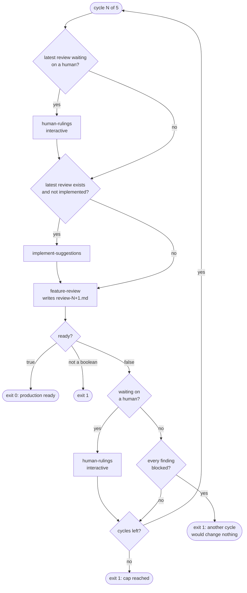
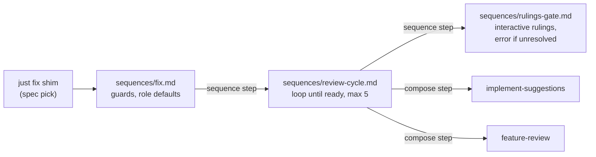

# Moving Away from the `just fix` Recipe

`just fix {spec}` runs the review/fix cycle on a feature or fix spec: an
agent reviews the implementation, another fixes what it found, a person rules
on anything it could not decide, and that repeats until a review declares the
work production ready. The recipe was written when Claudine's lifecycle
events and sequence syntax could not yet express the cycle, so the recipe owns
the control flow and calls Claudine only to run one prompt at a time.

That is close to changing. The remaining gap is **composability**: a sequence
step can today only run its generic `prompt` action, so it cannot choose the
session a step runs in (interactive or not, yolo, provider, model) or run
another sequence and get its result. Claudine will let a sequence step use
`compose`, `inline-compose`, and `sequence` actions in place of `prompt`. This
page describes the recipe as it is, three ways to move it into Claudine, and
the approach recommended.

> **Provisional syntax.** The step actions are not yet specified. The YAML
> sketches below write them as `compose:` / `sequence:` with a
> `session: { interactive, yolo, provider, model }` block. Read them for
> shape, not spelling.

## Current state

### What a run looks like

```sh
just fix 2026-11-14-output-flag            # pick agents and models interactively
just fix 2026-11-14-output-flag --use-defaults
```

The recipe lives in `just/review.just` and is imported by the root `justfile`
and by several area justfiles, so it runs from the repository root or from an
area directory. It accepts exactly one spec, plus an optional `--use-defaults`.

1. **Resolve the spec.** An existing file path is used as is. Otherwise the
   recipe lists `*spec*.md` under `features/` and `fixes/` (skipping
   `_completed` and `_unscheduled`), filters by the argument, and lets you
   pick with `fzf` (auto-selected when there is one match).
2. **Check it is worth running.** The spec's `implemented` must be `true`.
   If the latest review is already `ready: true`, or the spec is
   `completed: true`, the recipe stops with success.
3. **Choose agents and models.** It picks one agent and model for reviewing
   (default `codex` / `gpt-6.1-sol`) and one for implementing (default
   `claude` / `opus`); `--use-defaults` skips the prompts.
4. **Loop for at most five cycles.**

The "latest review" is `review-{N}.md` beside the spec, where `N` is the
spec's `review-iterations`. Each cycle is:



The rulings step needs a terminal on stdin and stdout. Without one it stops
and asks you to rerun in a terminal. It also stops with an error if any ruling
is still unresolved after the session. Any failing `claudine compose` ends the
run with exit 1 (there is no retry). Every unsuccessful ending exits 1, so the
only outcome the exit code distinguishes is "ready".

### Where state lives

The recipe keeps no state of its own. Every step reads and writes frontmatter
on disk, and the recipe reads it back with `md get`:

| File | Fields the cycle depends on | Written by |
|---|---|---|
| the spec | `implemented`, `review-iterations`, `completed` | implementer (`implemented`), review agent (the rest) |
| `review-{N}.md` | `ready`, `findings`, `blocked`, `human-in-the-loop`, `human-resolved`, `implemented` | review agent; rulings session; implementer |
| `log.md` | an "Implementation of Review Findings #N" section, a finding ledger, a completion report | implementer |

Because state is on disk, each step can be run, inspected, or rerun on its
own, and any orchestrator that rereads the files between steps behaves the
same way. Every approach below keeps that property.

### Who owns what

The recipe makes three kinds of `claudine compose` call. Each passes only the
file paths; the prompt works out iteration numbers and review/log paths from
the spec's frontmatter.

| Call | Prompt | Session |
|---|---|---|
| implement | `prompts/_implement/implement-suggestions.md` with `spec=` | `-y`, implementer agent/model |
| review | `prompts/_reviews/feature-review.md` with `spec=` | `-y`, reviewer agent/model |
| rulings | `prompts/_reviews/human-rulings.md` with `spec=` and `review=` | `-y -i`, implementer agent/model |

| The recipe owns | Claudine owns (inside each compose) |
|---|---|
| argument parsing and `--use-defaults` | schema validation of `spec` / `review` |
| fuzzy spec selection (`fd`, `rg`, `fzf`) | deriving iteration, review, and log paths |
| the `implemented` and already-ready checks | per-prompt guards: implement-suggestions and feature-review refuse to start while a review waits on a human |
| choosing an agent and model for each role | every notification: `message`, `say`, `effect`, `warn` |
| the loop, the five-cycle cap, and step choice | the agent's work and all frontmatter changes |
| termination: ready, invalid `ready`, all blocked, rulings unfinished, cap | the interactive rulings session |
| the terminal check before rulings | creating `log.md` (`ensure_file`) |
| exit codes and progress lines | |

None of the prompts declares `loop:`, a sequence, a group, `break`, `prep`,
or `proxy`. The recipe never uses `claudine sequence` or `inline-compose`.
Some inputs are never supplied today: `next-spec` (so feature-review's
next-spec refresh never runs) and `retry` (implement-suggestions accepts it,
but nothing retries a failed implementation).

### What Claudine can already express

Most of the recipe maps onto features Claudine already has (see
[Sequences](./topics/flow-control/sequences.md),
[Looping](./topics/flow-control/looping.md), and
[Flow control](./topics/flow-control/flow-control.md)):

- **the cycle and its cap:** a root `loop: { until, max, gate }`
- **choosing a step:** a `when:` guard that reads live `frontmatter(...)`;
  each step rereads disk
- **the checks before the loop:** `initialize` with `error` or `skip`
- **endings other than ready:** `gate` entries that raise `error`
- **a role's agent and model:** `with: { agent, model }` from setters that
  have defaults

These are what it cannot express yet:

1. **One interactive step in a headless run.** `claudine sequence` refuses
   `interactive: true` on the sequence document, and `-i` applies to every
   step. No expression can test for a terminal.
2. **Session flags per step.** A `prompt:` step sets only frontmatter.
   Nothing sets `-y`, `-i`, or a provider per step. The `compose` step action
   closes this.
3. **Calling another sequence and getting its result.** `prep` returns only
   what the called document wrote to disk. It is approved at run time, cannot
   be interactive on its own terms, and cannot run a group. A referenced
   `sequence:` task cannot take `with:` today. The `sequence` step action is
   meant to close this.
4. **Interactive spec selection** (an `fzf`-style picker).
5. **A prompt for each role's provider that starts with a default.** The
   sequence review screen offers a picker only for tasks that name no
   provider, so it cannot show a default to accept or change.

## Approaches

All three approaches keep the fuzzy spec pick, and for now the terminal
check, in a thin `just fix` shim that resolves the path and then calls
Claudine. They differ in where the cycle lives.

### Approach A: one looping sequence, a direct port

A single `sequences/fix.md` reproduces the recipe's pass. The steps run
rulings, then implement, then review, and the loop's `gate` handles the
endings.

```yaml
$schema: { spec: "file(required; match(**/*spec*.md))" }
review_agent: codex
review_model: gpt-6.1-sol
implement_agent: claude
implement_model: opus
initialize:
  - { when: "<spec not implemented>", then: [ { error: "implement it first" } ] }
  - { when: "<spec completed or latest review ready>", then: [ skip ] }
loop:
  until: "<latest review>.ready == true"
  max: 5
  gate:
    - { when: "<ready is not a boolean>", then: [ { error: "review did not set ready" } ] }
    - { when: "<all blocked, no ruling asked>", then: [ { error: "every finding blocked" } ] }
sequence:
  - name: rulings
    when: "<latest review waits on a human>"
    compose: "@prompts/_reviews/human-rulings.md"
    session: { interactive: true, provider: "{{implement_agent}}", model: "{{implement_model}}" }
  - name: implement
    when: "<latest review exists and is not implemented>"
    compose: "@prompts/_implement/implement-suggestions.md"
    session: { yolo: true, provider: "{{implement_agent}}", model: "{{implement_model}}" }
  - name: review
    compose: "@prompts/_reviews/feature-review.md"
    session: { yolo: true, provider: "{{review_agent}}", model: "{{review_model}}" }
```

- **Relies on:** existing `loop`, `when:`, `initialize`, and setters, plus the
  upcoming `compose` step action with session flags.
- **Strengths:** it maps one-to-one onto the recipe, so it is easy to review
  against it; it is one file and `--dry-run` shows the whole cycle; the
  prompts' own human-wait guards still catch an ordering mistake.
- **Weaknesses:** the "latest review" path expression is repeated in every
  guard and in the gate. The cycle cannot be reused, so a pipeline over
  several specs would copy it. Rulings requested on the fifth pass are never
  collected, because the cap is reached first. That is arguably better, but it
  is a change from the recipe.
- **Prompt changes:** wording only. Text that tells the agent "the `just fix`
  loop" collects rulings should describe the cycle without naming its caller.
  The prompts' `yolo: true` / `interactive: true` frontmatter either becomes
  redundant with the step's session flags or is documented as overridden by
  them.

### Approach B: an entry document over a reusable cycle (nested sequences)

This approach splits the work into three small documents, each with one job:



```yaml
# sequences/review-cycle.md — the reusable unit
$schema: { spec: "file(required)", next-spec: file, max_cycles: "number(default(5))" }
loop: { until: "<latest ready>", max: "{{max_cycles}}", gate: [ <not boolean>, <all blocked> ] }
sequence:
  - { name: rulings, when: "<waiting>", sequence: "@sequences/rulings-gate.md", with: { … } }
  - { name: implement, when: "<unimplemented>", compose: "@prompts/_implement/implement-suggestions.md", session: { … } }
  - { name: review, compose: "@prompts/_reviews/feature-review.md",
      with: { spec: "{{spec}}", next-spec: "{{next-spec}}" }, session: { … } }
```

A pipeline over several specs is then one `sequence: "@sequences/review-cycle.md"`
step per spec, each with `with: { spec: a, next-spec: b }`. That finally
supplies `next-spec`, so feature-review's next-spec refresh starts running.

- **Relies on:** everything A relies on, plus the upcoming `sequence` step
  action, specifically `with:` on it, because a referenced sequence cannot read
  its caller's frontmatter today.
- **Strengths:** the cycle becomes the unit that multi-spec pipelines need.
  The entry layer holds what was recipe-specific, and the rule that rulings
  must be resolved or the run stops lives in one place. Each layer can be run
  and dry-run on its own. Because every ending other than "ready" is an
  error, the nested loop needs no exit codes from `break`, which take effect
  only at the root loop.
- **Weaknesses:** it depends most on upcoming work. There are three files
  instead of one, and failures are reported through two container layers. If
  separate exit codes are ever wanted (for example "needs a human"), the loop
  would have to move up to the root document.
- **Prompt changes:** those in A, plus a real test for feature-review's
  now-live `next-spec` branch. human-rulings could raise an error itself when
  rulings stay unresolved (today it only warns), which would remove the
  wrapper's `finalize` check.

### Approach C: self-routing prompts (a `proxy` chain)

There is no cycle document. Each prompt's `success` event uses `proxy` to hand
off to the next prompt: review → rulings or implement → review. A `chain=true`
input turns the routing on, and a `cycle_start` input stands in for the cap.

```yaml
# feature-review.md (additions)
success:
  - { when: "chain && <waiting on a human>",
      then: [ { proxy: { to: "@prompts/_reviews/human-rulings.md", with: { chain: true, … } } } ] }
  - { when: "chain && !<waiting> && !blocked",
      then: [ { proxy: { to: "@prompts/_implement/implement-suggestions.md", with: { … } } } ] }
initialize:
  - { when: "chain && iteration > cycle_start + 5", then: [ { error: "5 cycles without ready" } ] }
```

- **Relies on:** existing `proxy` with `with:`. It would also need session
  flags for each proxy target, which no plan includes. A proxy target runs
  under the original session's flags, so switching to an interactive rulings
  session in the middle of a headless chain probably does not work. The
  upcoming step actions do not help here, because there are no steps.
- **Strengths:** a single `claudine compose feature-review.md spec=…
  chain=true` runs the whole cycle, and each hand-off sits beside the prompt
  that knows the outcome.
- **Weaknesses:** control flow is spread across three prompts. The cap is
  arithmetic rather than `loop.max`. `--dry-run` cannot show the cycle. A
  proxy hands off rather than calls, so a run's provenance names only the last
  document. Reusable review prompts become tied to one workflow, which is the
  opposite of what sequences are for.
- **Prompt changes:** large. Every prompt gains the chain inputs, routing
  branches, and termination logic.

### Comparison

| | A: one sequence | B: entry + reusable cycle | C: proxy chain |
|---|---|---|---|
| New files | 1 sequence | 3 small sequences | none; 3 prompts change heavily |
| Needs the `compose` step action | yes | yes | no, but needs proxy session flags that no plan includes |
| Needs the `sequence` step action with `with:` | no | yes | no |
| Fidelity to today's behavior | closest | close | loose |
| Cap | `loop.max` | `loop.max`, set per caller | hand-written arithmetic |
| Dry-run and visibility | good | good, per layer | poor |
| Reusable in multi-spec pipelines; supplies `next-spec` | no | yes | awkward |
| Main risk | repeated "latest review" expression | depends on `with:` for sequence steps | interactive switch mid-chain; scattered control flow |

## Recommendation

**Adopt Approach B, delivered in two stages.**

1. **Stage 1, when the `compose` step action lands:** write
   `sequences/review-cycle.md` and have the `just fix` shim call it directly.
   At this stage it *is* Approach A, but written so another sequence can call
   it: its inputs (`spec`, `next-spec`, `max_cycles`) are declared in its
   schema, and it reads nothing from a caller's frontmatter.
2. **Stage 2, when the `sequence` step action accepts `with:`:** add the
   `fix.md` entry layer and the `rulings-gate.md` wrapper, and start using the
   cycle as a step in multi-spec pipelines.

Why B over the others:

- **The cycle is the unit worth reusing.** This repository is moving toward
  pipelines of specs run back to back. A review cycle that is itself a
  callable sequence is what those pipelines need, and it is the only design
  that supplies `next-spec` naturally. A gives a cycle no other sequence can
  call; C ties the reusable prompts to one workflow.
- **It costs almost nothing over A.** Stage 1 is A with its inputs declared
  up front. If the `sequence` step action slips, Stage 1 still fully replaces
  the recipe's loop.
- **Nothing is lost on exit status.** Every ending other than "ready" is
  already exit 1 in the recipe, so in a nested loop the endings become ordinary
  errors. B does not need exit codes from `break`, which only the root loop
  can set.
- **The prompts stay reusable.** B changes only their wording and makes the
  dormant `next-spec` path live. C would rewrite all three.
- **It puts the composability work where it pays.** B is the design that
  actually uses the new step actions as intended: compose for a single
  session, sequence for a reusable flow. It is therefore also a realistic
  first consumer of those actions.

### Questions the step-action design should settle

Every approach depends on these answers. The design of the `compose` and
`sequence` step actions should settle them before the cycle is ported:

- **An interactive step without a terminal.** It should fail with a typed
  error rather than hang or run headless. This is what lets the shim drop its
  own terminal check.
- **Step session flags vs. document frontmatter.** It must be stated whether a
  step's session flags override a document's own `yolo:` or `interactive:`
  frontmatter.
- **Recomputing frontmatter each pass.** If a computed frontmatter value (the
  "latest review" path) is recomputed on each loop pass, the repeated path
  expression disappears from every guard.
- **A role default the user can change.** A way for the review screen to show
  a default provider that the user can override would let `just fix` lose its
  agent and model prompts. After that, the shim is only the fuzzy spec pick,
  and `claudine sequence sequences/fix.md spec=…` can be run directly.
