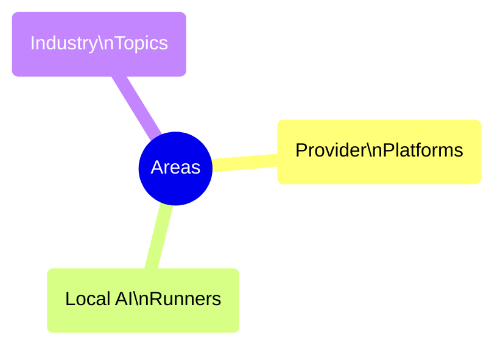

---
content-policy:
    - SubDirectories
---
# Research Folders

This README's responsibility is to describe the focus/responsibility of the various folders under _research_.



## Provider Based Fleet Research

Provider based fleet research is what a majority of the research in Claudine is focused on. This research digs into the details of all the [supported Agentic CLI's](^claudine/docs/provider.yaml) that Claudine is responsible for supporting.

We provide both **primary** research topics as well as buckets of **summary** research where:

- the **primary** research gathers information for a specific _topic_ on a specific _provider_
- the **summary** research _aggregates_ research by either:
    - the provider
    - the topic

### Primary Research Topics

```mermaid
mindmap 
    root((RESEARCH))
        Shared Assets((Shared\nAssets))
            Prompts
            Agent Skills
            Hooks
            Sub-Agent Defn
            MCP
            Plugins
        Interface((Interface))
            CLI
            API
            Desktop App
        Handling((Handling))
            Logging
            Errors
            Non-Interactive
        Vendor((Vendor))
            Plans
            Caching
        Config((Config))
            Models
            Reasoning Lvl
            Permissions
            System Prompt
        Capabilities((Capabilities))
            Tools
            Resumption
            Steering
            Sandboxing
            Decision Models
            Memory Systems
```

#### Capabilities

#### Shared Assets

- [**Agent Skills**](./skills/_fleet.md)
- [**MCP**](./mcp/_fleet.md)
- [**Hooks**](./hooks/_fleet.md)
- [**Prompts**](./slash-commands/_fleet.md)
- [**Sub Agent Defn**](./subagents/_fleet.md)

#### Interface

- **API**
- [**CLI**](./agent-cli/_fleet.md)
- **Desktop App**
- [**ACP**](./acp/_fleet.md)

#### Configuration

- [**Models**](./model-config/_fleet.md)
- [**Reasoning Level**](./reasoning-level/_fleet.md)
- **System Prompt**
- **Permissions**

#### Handling

- **Errors**
- **Logging**
- **Non-Interactive**

#### Model Configuration

Addresses the configuration files that a provider has and how the different _scopes_ (e.g., typically **user** and **repo**) interact. It also tackles **which** LLM models are provided to a user "out of the box" as well as how a user can configure local LLM's to use with the platform.

#### Permissions

Focuses on the 

#### Hooks


#### Slash Commands / Prompts


#### Agent Skills


#### Reasoning Levels


#### Prompt Resumption


#### Prompt Steering


### Cross Provider Research


## Local Runner Research

Another area of interest for Claudine is how to integrate well into locally run LLM solutions.
