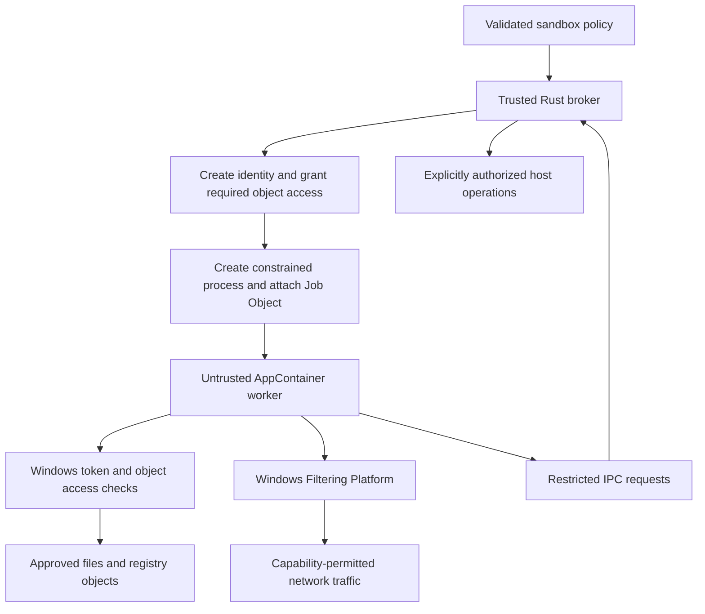

# AppContainer sandboxing for Rust on Windows

AppContainer is a strong choice for isolating a **purpose-built native Windows worker** whose required resources can be enumerated. It combines an application identity, capability checks, object permissions, and network isolation. Microsoft recognizes the AppContainer boundary in its [Windows security servicing criteria](https://www.microsoft.com/en-us/msrc/windows-security-servicing-criteria). It shares the host kernel; it does not provide a virtual machine's separate kernel.

For a Rust program, the useful abstraction is a trusted launcher and broker supervising an untrusted child process. A parser, converter, plugin host, or narrowly scoped tool fits this model well. A shell driving arbitrary developer tools is a harder fit: binaries expect access to toolchains, registry entries, profiles, temporary directories, subprocesses, credentials, and local services. OpenAI's [Windows sandbox engineering account](https://openai.com/index/building-codex-windows-sandbox/) explicitly describes rejecting AppContainer for that open-ended workload and choosing a different architecture. AppContainer is therefore an appropriate Windows building block, but its suitability depends on the workload.

This research was checked on October 30, 2026. The linked ChatGPT conversation was unavailable to the research browser; its conclusion is treated as the question to investigate, rather than supporting evidence. Code below illustrates native Windows integration; it was checked against published API signatures, but was not compiled or executed during this document update.

## 1. What the boundary consists of

AppContainer was introduced in Windows 8; the profile APIs also support Windows Server 2012 onward. These are API minimums, not recommendations to deploy unsupported Windows releases. An unpackaged executable can use AppContainer without becoming a UWP app or being distributed through the Microsoft Store. MSIX packaging can manage profile lifecycle for an application; an unpackaged launcher manages it itself. [Microsoft's legacy-app overview](https://learn.microsoft.com/en-us/windows/win32/secauthz/appcontainer-for-legacy-applications-) explains both deployment models.

Three identities matter:

- The Windows user and its groups provide the user's existing authority.
- The AppContainer security identifier (SID) identifies the sandbox profile.
- Capability SIDs identify additional classes of authority granted to a process.

For ordinary protected objects, the access check considers both user-side and AppContainer-side permissions. Granting the container access does not grant rights that its underlying user lacks. AppContainer processes also run at low integrity. A profile name or SID is an identity, not a secret or an authentication credential. [Microsoft's launch guide](https://learn.microsoft.com/en-us/windows/win32/secauthz/implementing-an-appcontainer) describes the intersection of these access checks.



The broker remains outside the boundary. Every operation it performs on a worker's behalf is a deliberate grant of authority. A broker that accepts unrestricted paths or arbitrary commands can undo the sandbox's protections.

### Regular AppContainer versus LPAC

A regular AppContainer can access resources granted to `ALL APPLICATION PACKAGES`, SID `S-1-15-2-1`, as well as resources granted to its particular identity or capabilities. Thus, **zero capabilities does not mean zero accessible files, registry keys, or services**.

A Less Privileged AppContainer, or LPAC, opts out of that broad package-group access. Resources granted to `ALL RESTRICTED APPLICATION PACKAGES`, SID `S-1-15-2-2`, and explicit grants can still be available. LPAC requires more deliberate provisioning, including loader dependencies and appropriate COM or registry capabilities. Chromium documents LPAC support from Windows 10 RS2 and its [filesystem permission requirements](https://chromium.googlesource.com/chromium/src/+/main/docs/design/sandbox.md#Less-Privileged-App-Container-LPAC).

**Design recommendation:** prefer LPAC for a small worker you control, subject to compatibility testing. Treat regular AppContainer as a different baseline with a broader accessible surface, not as an identical fallback. A strict policy should fail if its required boundary cannot be created.

## 2. Networking: effective coarse isolation, additional policy for precision

The standard network capabilities divide access into broad categories:

| Capability set                                      | Intended network permission                                    |
| --------------------------------------------------- | -------------------------------------------------------------- |
| None                                                | No ordinary external Internet or private-network socket access |
| `internetClient`                                    | Outbound Internet/public-network connections and their replies |
| `internetClientServer`                              | Internet/public-network client and server activity             |
| `privateNetworkClientServer`                        | Private-network client and server activity                     |
| Internet capability plus private-network capability | Both corresponding categories                                  |

These capabilities are not domain, URL, protocol, or port allowlists. The private-network capability combines client and server authority; there is no equivalent standard private-client-only capability. A server capability does not override separate firewall blocks. Microsoft documents the categories in its [capability reference](https://learn.microsoft.com/en-us/windows/apps/package-and-deploy/app-capability-declarations).

### Where enforcement lives

AppContainer networking is enforced through Windows Filtering Platform, or WFP, using the application's security context. It applies beneath Rust's networking libraries: switching from `reqwest` to raw Winsock should not bypass a correctly configured OS policy. Network classification and enterprise private-range configuration affect which capability is required. A firewall profile labeled “Public” is not a substitute for understanding this classification. Microsoft's [connectivity troubleshooting guide](https://learn.microsoft.com/en-us/windows/security/operating-system-security/network-security/windows-firewall/troubleshooting-uwp-firewall) explains the filtering and diagnostic model.

The security conclusion has a qualification: the effective WFP configuration matters. In 2021, James Forshaw demonstrated executable-scoped permit rules that allowed some AppContainer processes to communicate without the expected capabilities; Microsoft classified the reported issue as not requiring a security bulletin. His [original investigation](https://projectzero.google/2021/08/understanding-network-access-windows-app.html) also describes same-package loopback exceptions. This is historical evidence of a configuration hazard, not proof that every current Windows installation has the same behavior.

For a strict offline contract, test the deployed Windows builds and effective firewall configuration. Also test OS-mediated operations such as DNS resolution and broker requests separately: “the worker cannot establish an external socket” is a narrower claim than “nothing the worker does can cause external communication.”

### Loopback and local services

Host loopback is restricted by default. This commonly breaks local HTTP proxies, language servers, model servers, and development databases. Do not assume localhost, IPv6 `::1`, the machine's LAN address, and communication between processes sharing a package SID all behave identically.

`CheckNetIsolation.exe LoopbackExempt` can create exemptions, but these change host configuration and can expose local services beyond the one intended endpoint. They are not a per-launch port allowlist. Avoid silently creating exemptions to make a test pass. Microsoft discusses these cases in its [network-isolation diagnostics](https://techcommunity.microsoft.com/blog/coreinfrastructureandsecurityblog/diagnosing-network-isolation-issues/2511562).

For a worker you control, an explicit IPC channel to the broker is usually easier to constrain than a blanket loopback exemption. A worker that must speak HTTP to a local proxy needs an independently enforced rule limiting it to that proxy, plus a tested way to reach that endpoint.

### Allowing only one remote service

For a policy such as “allow HTTPS to the inference provider and nothing else,” choose one of these architectures:

1. **Brokered requests:** omit worker network capabilities. Send structured requests over private IPC; the broker owns HTTP, credentials, destination validation, redirects, response-size limits, and timeouts.
2. **Enforced proxy:** permit access only to a designated proxy through an OS-enforced path. The proxy checks destinations. Setting `HTTP_PROXY` alone provides no security because hostile code can ignore it.
3. **Additional WFP policy:** install narrowly scoped filters covering the application identity, directions, IPv4/IPv6, protocols, and ports. This adds privileged provisioning and lifecycle management; it is a separate subsystem from creating an AppContainer.

These are design recommendations. A hostname allowlist also requires decisions about DNS changes, redirects, IP literals, proxy `CONNECT`, and services that share an IP address. An AppContainer capability cannot express those decisions.

## 3. Filesystem: object permissions, not a private root filesystem

AppContainer restricts access to files through Windows security checks. An access control list (ACL) contains access control entries (ACEs); its discretionary portion (DACL) grants or denies access to named principals. AppContainer does not give an unpackaged worker a private drive namespace, a Linux-style mount namespace, or a copy-on-write checkout. Hiding a directory in application code or changing the working directory is not enforcement.

For a controlled worker, provision a small layout:

| Location                                      | Proposed worker authority            | Purpose                                      |
| --------------------------------------------- | ------------------------------------ | -------------------------------------------- |
| Worker executable and dependencies            | Read/execute                         | Load trusted worker code                     |
| Input snapshot                                | Read                                 | Consume selected input                       |
| Output and scratch directories                | Necessary create/write/delete rights | Produce results and temporary files          |
| User home, credential stores, broker binaries | No additional grants                 | Keep unrelated authority out of the workload |

Use an ACE for the specific AppContainer SID or a deliberately scoped capability SID. `SetEntriesInAclW` and `SetNamedSecurityInfoW` are typical APIs for updating object permissions; the [Microsoft launcher sample](https://github.com/microsoft/SandboxSecurityTools/blob/main/LaunchAppContainer/LaunchAppContainer/LaunchAppContainer.cpp) shows resource grants alongside process creation. Avoid granting access to all application packages merely to get past a launch failure.

“No additional grants” does not prove complete invisibility: existing ACLs, regular-AppContainer baseline access, capability grants, inherited handles, and the object's security support determine actual access. A real allowlist needs negative tests as well as positive tests.

### Details that change the security result

**The loader needs access before Rust starts.** The executable, dependent DLLs, resource files, and required directory traversal must be accessible. User-profile install locations and build-output directories often lack suitable grants. Stage immutable worker binaries in a controlled location instead of recursively widening access to a developer's home.

**Integrity labels and DACLs are separate policy inputs.** Low integrity by itself is not a filesystem allowlist. AppContainer-aware access rules also differ from simply taking an ordinary process and lowering its integrity. Check effective read, write, execute, and delete behavior on the target objects; do not recursively lower the integrity label of a host checkout as a generic repair. See [Mandatory Integrity Control](https://learn.microsoft.com/en-us/windows/win32/secauthz/mandatory-integrity-control) and the AppContainer-specific rules in the launch guide.

**Permission inheritance is not a recursive guarantee.** Existing children with protected DACLs may not inherit a new parent ACE. Conversely, an inheritable grant can expose future files added to that directory. Define which existing objects and future children receive a grant.

**Deletion and replacement need their own tests.** A nominally read-only file may still be replaceable through rights on its parent directory. Check file delete rights and parent delete-child rights. Avoid overlapping read-only and writable policy roots unless their resulting authority is intentional.

**Writable code is deferred execution authority.** Do not let a worker rewrite binaries, DLLs, broker configuration, hooks, or scripts that a trusted host process will subsequently execute. A writable repository can contain such hooks. A private output area followed by validated publication offers a clearer boundary than unrestricted writes to the live checkout.

**Filesystem semantics matter.** Reparse points, junctions, hard links, network shares, alternate streams, and filesystems without the needed persistent security descriptors require explicit handling. Resolve and validate the actual object being granted access, rather than relying only on a lexical path prefix. In a broker, prevent an attacker from swapping a checked path before it is opened. Prefer preopened handles or isolated copies for sensitive inputs.

These points are implementation review requirements derived from an ACL-based design. They are not promises that AppContainer automatically solves path races or supplies a filesystem overlay.

### Profile storage and persistence

`CreateAppContainerProfile` creates per-user application storage and returns a SID; profiles are not disposed of when the last worker exits. The [profile API reference](https://learn.microsoft.com/en-us/windows/win32/api/userenv/nf-userenv-createappcontainerprofile) documents creation, limits, and the existing-profile result.

Use [`GetAppContainerFolderPath`](https://learn.microsoft.com/en-us/windows/win32/api/userenv/nf-userenv-getappcontainerfolderpath) when locating profile storage rather than constructing a presumed path. Point temporary-file environment variables and the working directory at locations the child can actually use. Do not assume an unpackaged Win32 program acquires every UWP file-picker, virtualization, or package-identity behavior merely because its token is AppContainer.

A reused profile identity can accumulate state and permissions. Allocate a separate identity for workloads that must be isolated from each other; serialize lifecycle operations for a shared identity. Deleting a profile is not a rollback of ACEs installed on unrelated host files. Maintain an explicit record of permissions your application adds and remove only those grants when appropriate.

## 4. Other protections and their boundaries

Microsoft's [isolation overview](https://learn.microsoft.com/en-us/windows/win32/secauthz/appcontainer-isolation) identifies several additional categories:

| Category                     | What AppContainer contributes                                   | What the application must still decide                                              |
| ---------------------------- | --------------------------------------------------------------- | ----------------------------------------------------------------------------------- |
| Registry                     | Restricted access and application-specific state                | Required keys, capabilities, and packaged versus unpackaged behavior                |
| Processes and kernel objects | Restrictions on access to other processes and securable objects | IPC ACLs and any process, token, section, or file handles passed in                 |
| Windows and UI               | Restrictions on interaction with other applications' windows    | Whether the worker needs a desktop, clipboard, or GUI APIs at all                   |
| Devices and sensors          | Capability-controlled access to protected devices               | Required APIs, privacy consent, and effects of broader device grants                |
| Identity and credentials     | Limits on using the user's ambient identity                     | Secrets passed through arguments, environment variables, files, or broker responses |

An AppContainer cannot protect a secret deliberately handed to it. For example, an API key copied into the child's environment is readable in the child's memory even if the credential store itself is inaccessible.

Ordinary child processes typically inherit the AppContainer parent's token restrictions; AppContainer does not inherently forbid subprocess creation. A trusted external service that launches a process on the worker's behalf is a separate authority path. Decide whether to prohibit children or permit them under the same boundary, and constrain the entire process tree.

AppContainer also does not impose a CPU budget, memory budget, process-count limit, execution deadline, or disk quota. Add **Job Objects** for supported process-tree and resource controls, a broker-enforced deadline, and a storage strategy for output growth. Configure kill-on-job-close, prohibit breakaway where required, and retain ownership of the job for the worker's lifetime. Nested jobs and preexisting job restrictions need compatibility tests. See Microsoft's [Job Objects documentation](https://learn.microsoft.com/en-us/windows/win32/procthread/job-objects).

Exploit mitigations are complementary: dynamic-code restrictions, Win32k lockdown, image-loading policies, and child-process restrictions reduce particular attack surfaces. They can also break JIT runtimes, GUI applications, or tools that legitimately spawn children. AppContainer is not a general syscall filter; a compromised worker still reaches allowed host-kernel interfaces.

## 5. Integrating it into a Rust launcher

### Bindings and ownership

Microsoft's [`windows` and `windows-sys` crates](https://github.com/microsoft/windows-rs) expose the required APIs. `windows` offers more projected types and error conversions; `windows-sys` stays close to the C ABI. Neither is a complete security policy engine.

The following dependency declaration supports the small profile helper below. It is an example for a Windows backend crate, not a change to this repository's dependency graph.

```toml
[target.'cfg(windows)'.dependencies]
windows-sys = { version = "0.61.2", features = [
    "Win32_Foundation",
    "Win32_Security",
    "Win32_Security_Isolation",
] }
```

This helper opens or creates an explicitly named profile and owns the returned SID allocation. It **does not launch a sandbox**. A stable name is appropriate only when sharing that profile's state and authority is intentional.

```rust
#[cfg(windows)]
mod appcontainer_profile {
    use std::ptr::{null, null_mut};
    use windows_sys::Win32::Security::{FreeSid, PSID};
    use windows_sys::Win32::Security::Isolation::{
        CreateAppContainerProfile,
        DeriveAppContainerSidFromAppContainerName,
    };

    pub struct OwnedSid(PSID);

    impl OwnedSid {
        pub fn as_ptr(&self) -> PSID {
            self.0
        }
    }

    impl Drop for OwnedSid {
        fn drop(&mut self) {
            // Both profile APIs require FreeSid for their returned allocation.
            unsafe { FreeSid(self.0); }
        }
    }

    pub fn open_profile(name: &str) -> Result<OwnedSid, i32> {
        const E_INVALIDARG: i32 = 0x80070057_u32 as i32;
        const ALREADY_EXISTS: i32 = 0x800700B7_u32 as i32;

        if name.is_empty() || name.len() > 64 || !name.bytes().all(|b| {
            b.is_ascii_alphanumeric() || b"-_. ".contains(&b)
        }) {
            return Err(E_INVALIDARG);
        }

        let wide: Vec<u16> = name.encode_utf16().chain(Some(0)).collect();
        let mut sid: PSID = null_mut();
        let mut hr = unsafe {
            CreateAppContainerProfile(
                wide.as_ptr(), wide.as_ptr(), wide.as_ptr(),
                null(), 0, &mut sid,
            )
        };
        if hr == ALREADY_EXISTS {
            hr = unsafe {
                DeriveAppContainerSidFromAppContainerName(wide.as_ptr(), &mut sid)
            };
        }
        if hr < 0 {
            return Err(hr);
        }
        Ok(OwnedSid(sid))
    }
}
```

The helper retains HRESULT values as HRESULTs, rather than incorrectly treating them as raw Win32 error codes. The [Rust creation signature](https://docs.rs/windows-sys/latest/windows_sys/Win32/Security/Isolation/fn.CreateAppContainerProfile.html) and [SID derivation contract](https://learn.microsoft.com/en-us/windows/win32/api/userenv/nf-userenv-deriveappcontainersidfromappcontainername) specify these interfaces. Freeing the SID allocation does not delete the persistent profile.

### Create the child with restrictions already in place

Use `CreateProcessW` with `STARTUPINFOEXW` and `EXTENDED_STARTUPINFO_PRESENT`. A full launcher must construct and own a process attribute list, security-capability data, any capability SID allocations, an explicit environment block, process/thread handles, and the Job Object.

The central security-capability value looks like this Rust integration fragment, where `profile` is the `OwnedSid` above:

```rust
use windows_sys::Win32::Security::SECURITY_CAPABILITIES;

let security_capabilities = SECURITY_CAPABILITIES {
    AppContainerSid: profile.as_ptr(),
    Capabilities: std::ptr::null_mut(),
    CapabilityCount: 0,
    Reserved: 0,
};
```

Install it with `PROC_THREAD_ATTRIBUTE_SECURITY_CAPABILITIES`. For LPAC, also set `PROC_THREAD_ATTRIBUTE_ALL_APPLICATION_PACKAGES_POLICY` to `PROCESS_CREATION_ALL_APPLICATION_PACKAGES_OPT_OUT`. The SID, capability arrays, and attribute-value buffers must remain valid through process creation. Delete the attribute list and release each allocation with its documented allocator. Microsoft's [launch guide](https://learn.microsoft.com/en-us/windows/win32/secauthz/implementing-an-appcontainer) provides the sequence; [`SECURITY_CAPABILITIES`](https://microsoft.github.io/windows-docs-rs/doc/windows/Win32/Security/struct.SECURITY_CAPABILITIES.html) shows the projected Rust fields.

To add a named capability, derive its capability SID, retain it in a `SID_AND_ATTRIBUTES` entry with `SE_GROUP_ENABLED`, and supply the corresponding array and count at launch. [`DeriveCapabilitySidsFromName`](https://learn.microsoft.com/en-us/windows/win32/api/securitybaseapi/nf-securitybaseapi-derivecapabilitysidsfromname) returns both capability-group and capability-SID arrays. Its individual SIDs and arrays require `LocalFree`; they must not be put into the `OwnedSid` wrapper above, whose allocator contract requires `FreeSid`.

Recommended launch sequence:

1. Validate the requested policy, select a dedicated identity, and prepare immutable binaries, input, scratch, and output locations.
2. Install only the required ACL grants and build the AppContainer or LPAC attributes. Add compatible mitigation and child-process policies at creation time.
3. Supply an absolute executable path, an accessible working directory, and an allowlisted Unicode environment. Apply correct Windows argument quoting; do not route untrusted arguments through a shell.
4. Give the worker only intended IPC and standard-stream handles. If inheriting handles, use `PROC_THREAD_ATTRIBUTE_HANDLE_LIST` with the required inheritance settings, not unrestricted inheritance. The [attribute API reference](https://learn.microsoft.com/en-us/windows/win32/api/processthreadsapi/nf-processthreadsapi-updateprocthreadattribute) documents these contracts.
5. Attach the job at creation using `PROC_THREAD_ATTRIBUTE_JOB_LIST` where supported, or create the child suspended, assign it to the configured job, and resume only after assignment succeeds. Terminate the suspended child on failure.
6. Verify token and job properties, then supervise execution, bound output, enforce deadlines, and collect results. Kill and reap descendants before removing scratch storage and grants.

Do not start ordinary untrusted code and then attempt to “turn on” AppContainer. The child must be born with the required token restrictions. Likewise, `std::process::Command` creation flags alone do not construct the complete security attribute list described here.

### IPC is part of the trusted boundary

Start with an explicitly passed pipe or a named endpoint secured to the intended principals. Authenticate the peer where applicable, bound message lengths and outstanding requests, and authorize each operation. Do not return powerful process/token handles or general-purpose host file handles merely because the requester is inside the expected AppContainer.

Packaged-app named pipes have additional namespace and package rules, including the `LOCAL\` naming convention. Unpackaged and full-trust processes have different conditions. Microsoft's [IPC reference](https://learn.microsoft.com/en-us/windows/apps/develop/communication/interprocess-communication) is the appropriate contract; do not assume an existing desktop named-pipe design works unchanged.

## 6. Practical pitfalls and demonstrated workarounds

| Failure or limitation                                                                | Evidence and practical response                                                                                                                                                                                                                                                                                                                                                          |
| ------------------------------------------------------------------------------------ | ---------------------------------------------------------------------------------------------------------------------------------------------------------------------------------------------------------------------------------------------------------------------------------------------------------------------------------------------------------------------------------------- |
| Process creation fails with access denied before worker code runs                    | Verify executable/DLL and working-directory permissions. Fastrender documents staging the executable, selecting accessible CWD/temp directories, and sanitizing the environment in its [Windows sandbox design](https://github.com/wilsonzlin/fastrender/blob/main/docs/windows_sandbox.md). Treat its implementation as an engineering example, not independent security certification. |
| LPAC breaks COM, registry reads, or dependencies that regular AppContainer could use | Inventory the actual dependency and add the narrow required grant or capability. Avoid solving every failure by restoring all-package access.                                                                                                                                                                                                                                            |
| Local HTTP service hangs or cannot connect                                           | Diagnose loopback filtering separately from DNS and remote reachability. Prefer private IPC; if loopback is essential, authorize and test the precise connection path.                                                                                                                                                                                                                   |
| A network capability does not produce connectivity                                   | Check private-range policy, inbound firewall rules, proxy configuration, VPNs, and IPv4/IPv6. A timeout alone does not prove sandbox enforcement.                                                                                                                                                                                                                                        |
| Temporary-file creation or tool startup fails                                        | Provide a private writable temp directory and explicit environment. Broadening access to the real user profile can defeat the intended confidentiality boundary.                                                                                                                                                                                                                         |
| A profile already exists                                                             | Derive its SID only when intentional reuse is authorized. Reuse is not proof that its storage or existing external ACLs match the new policy.                                                                                                                                                                                                                                            |
| The child can use resources excluded from the path policy                            | Audit inherited and duplicated handles, broad capability grants, and broker operations. Access already conveyed by a handle may bypass the intended path-opening restriction.                                                                                                                                                                                                            |
| Cleanup leaves state behind                                                          | Wait for descendants and close handles before deleting storage. Track external ACEs separately; avoid replacing a whole shared DACL from an old snapshot.                                                                                                                                                                                                                                |
| A shell or build tool needs an ever-growing set of exceptions                        | Reconsider the execution environment rather than continually expanding the policy. A VM or separate-user design may fit better.                                                                                                                                                                                                                                                          |

Ordinary per-user AppContainer creation and grants on user-controlled files need not require an administrator. That does not imply an arbitrary setup is unprivileged: modifying protected installation directories, creating local users, enabling virtualization, or installing machine-wide firewall policy can require elevation. Test the intended standard-user deployment explicitly.

For cleanup, [`DeleteAppContainerProfile`](https://learn.microsoft.com/en-us/windows/win32/api/userenv/nf-userenv-deleteappcontainerprofile) advises closing storage handles first and notes that failures can leave the profile in an undetermined state. Make explicit cleanup retryable and report incomplete removal. Avoid hiding persistent cleanup failures in Rust `Drop` implementations that cannot return an error.

## 7. Rust libraries and alternatives

### Libraries implementing the same boundary

These change implementation effort, not the underlying security model:

| Option                                                                   | Rust integration and assessment                                                                                                                                                                                                                                                                                                                                                                                |
| ------------------------------------------------------------------------ | -------------------------------------------------------------------------------------------------------------------------------------------------------------------------------------------------------------------------------------------------------------------------------------------------------------------------------------------------------------------------------------------------------------- |
| `windows` / `windows-sys`                                                | Direct official bindings. Good control over a small, auditable backend, but ownership, ACL provisioning, launch policy, and tests remain your responsibility.                                                                                                                                                                                                                                                  |
| [`sandboxrs-windows`](https://github.com/TarunKurella/sandboxrs-windows) | A higher-level Rust launcher with AppContainer and experimental composable-sandbox backends. The project reports standard-user security evaluations and explicit handling of reparse points and inherited handles. Its own status says the newer API was present but feature-disabled on tested public runners. Evaluate a pinned revision and reproduce its policy tests; repository claims are not an audit. |
| [`firehazard`](https://docs.rs/firehazard/latest/firehazard/)            | Low-level typed Windows sandbox primitives. Its published documentation explicitly disclaims mature security assurance and describes limited review/testing. Useful reference material; do not infer production suitability from the API surface.                                                                                                                                                              |

A safe wrapper should reject unrepresentable policy, expose which backend actually ran, and provide no silent fallback to an unrestricted process. Convenience methods named `read_only` or `deny_network` need behavioral evidence for their complete semantics.

### Alternative isolation designs

| Design                                                    | Advantages for Rust programs                                                                       | Costs and limits                                                                                                                                                  |
| --------------------------------------------------------- | -------------------------------------------------------------------------------------------------- | ----------------------------------------------------------------------------------------------------------------------------------------------------------------- |
| Restricted token + integrity policy + Job Object          | Native processes; configurable permissions; useful for compatibility-oriented tool runners         | No AppContainer network boundary. Requires separately designed ACL, credential, IPC, and network policies. Low integrity alone mainly limits writes.              |
| Dedicated local user + restricted token + firewall policy | Separates identity and network policy from the interactive user; supports broader native tooling   | Privileged provisioning, credential management, permission lifecycle, and broader read authority must be designed explicitly.                                     |
| Windows Sandbox                                           | Disposable Windows VM with a separate kernel; runs native Windows binaries                         | Feature/edition and virtualization requirements; guest provisioning and IPC overhead; GUI lifecycle is less convenient for an embedded library.                   |
| Hyper-V-isolated Windows containers or a managed VM       | Separate kernel; better fit for hostile workloads and reproducible toolchains                      | Images, startup/storage cost, orchestration, and deliberate host integration.                                                                                     |
| Process-isolated Windows containers                       | Filesystem/registry/network namespace isolation and resource controls                              | Shared kernel; Microsoft's security guidance does not treat this as a robust boundary for hostile multitenancy.                                                   |
| WebAssembly with Wasmtime/WASI                            | Rust host API; capability-oriented imported functions and filesystem access; portable plugin model | Requires a Wasm-compatible workload. Arbitrary Windows executables cannot run as WASI modules; host imports and runtime resource limits remain security-critical. |

[`CreateRestrictedToken`](https://learn.microsoft.com/en-us/windows/win32/api/securitybaseapi/nf-securitybaseapi-createrestrictedtoken) can remove privileges, disable SIDs, and add restricting SIDs; these primitives still need a complete sandbox design. OpenAI's engineering account supplies a concrete example of the dedicated-user approach, including the operational complexity it introduced.

[Windows Sandbox](https://learn.microsoft.com/en-us/windows/security/application-security/application-isolation/windows-sandbox/) is distinct from AppContainer. Do not accept its defaults as an offline policy: networking, clipboard sharing, and audio input are enabled by default in Microsoft's [configuration reference](https://learn.microsoft.com/en-us/windows/security/application-security/application-isolation/windows-sandbox/windows-sandbox-configure-using-wsb-file). Explicitly configure integration channels and mapped-folder permissions. A writable host mapping remains writable host authority despite the VM boundary.

Microsoft documents the namespace and kernel differences between container modes in [Isolation modes](https://learn.microsoft.com/en-us/virtualization/windowscontainers/manage-containers/hyperv-container), and the hostile-multitenancy distinction in [Secure Windows containers](https://learn.microsoft.com/en-us/virtualization/windowscontainers/manage-containers/container-security). For Wasm, use [Wasmtime's security model](https://docs.wasmtime.dev/security.html) and [WASI's capability model](https://wasi.dev/security) to assess the actual runtime and imports.

Running a Linux worker under WSL2 is another execution option, but it is a different target environment. Windows drive mounts and host interoperability must be restricted if they would expose host authority. Linux confinement inside WSL2 is not evidence that a native Windows child is confined.

### Newer Windows APIs: distinguish composition from virtualization

Microsoft now documents `Experimental_CreateProcessInSandbox` and `Experimental_CreateProcessAsUserInSandbox` from `processmodel.dll`. They accept a compiled FlatBuffer sandbox specification and can compose AppContainer with other restrictions. They are explicitly experimental. Their [current reference](https://learn.microsoft.com/en-us/windows/win32/secauthz/createprocessinsandbox) also rejects handle inheritance and AppContainer callers, which matters for designs relying on passed standard-stream or IPC handles.

These APIs are not the separate-kernel Windows Sandbox VM. They may reduce launcher plumbing, but should be an optional, runtime-detected backend while their availability and contract evolve. An exported function alone does not establish usable feature support. Keep any experimental FFI isolated, probe required behavior, and reject unsupported security requirements.

Win32 app isolation is likewise built on AppContainer rather than replacing it with a VM. Microsoft's [Python isolation example](https://blogs.windows.com/windowsdeveloper/2024/03/06/sandboxing-python-with-win32-app-isolation/) demonstrates the packaged-application route. It can help an application vendor provision a known workload, but does not make arbitrary command execution automatically compatible.

## 8. Verification before relying on the boundary

A credible Rust implementation should run adversarial behavioral probes on native Windows under the intended user privileges. Start with a deliberately malicious test worker rather than relying only on a cooperative library's error handling.

| Area            | Positive and negative evidence to collect                                                                                                                                                                                                    |
| --------------- | -------------------------------------------------------------------------------------------------------------------------------------------------------------------------------------------------------------------------------------------- |
| Identity        | Query `TokenIsAppContainer`, `TokenAppContainerSid`, integrity, capabilities, and LPAC status; compare against the requested policy.                                                                                                         |
| Files           | Read intended inputs, reject excluded credentials, write scratch, reject protected writes, and test deletion/replacement through parent directories.                                                                                         |
| Path edge cases | Exercise junctions, hard links, alternate streams, protected child ACLs, and a path swapped between policy validation and use.                                                                                                               |
| Network         | Reach a controlled allowed endpoint when enabled; block controlled forbidden Internet/private endpoints, IPv4/IPv6, TCP/UDP, host loopback, and machine-address access as policy requires. Probe DNS and broker-mediated traffic separately. |
| IPC and handles | Attempt unintended pipe access and operations through every inherited handle; send malformed, oversized, and unauthorized broker requests.                                                                                                   |
| Process tree    | Spawn descendants, test child restrictions, verify job membership and limits, and confirm timeout or broker failure terminates the whole owned tree.                                                                                         |
| Persistence     | Exercise existing profiles, concurrent lifecycle operations, crash recovery, partial ACL setup, cleanup failure, and repeated launches.                                                                                                      |
| Deployment      | Test standard-user installs, per-user executable locations, supported Windows builds/architectures, and representative enterprise firewall/VPN configurations.                                                                               |

For network denials, include a reachable unsandboxed control and inspect WFP evidence; an unreachable test server proves nothing. For filesystem denials, verify that the unsandboxed control really has the access being restricted. Tests should run without opening or focusing a desktop window unless GUI isolation itself is the explicitly selected subject.

For a controlled Rust worker, the recommended starting point is **LPAC, a private input/output layout, no worker network capabilities, narrow broker IPC, and a supervised Job Object**. Add authority only for a documented requirement with a corresponding probe. For arbitrary native developer tools, prototype compatibility early and compare the result against a separate-user or VM design before committing to a large exception policy.
