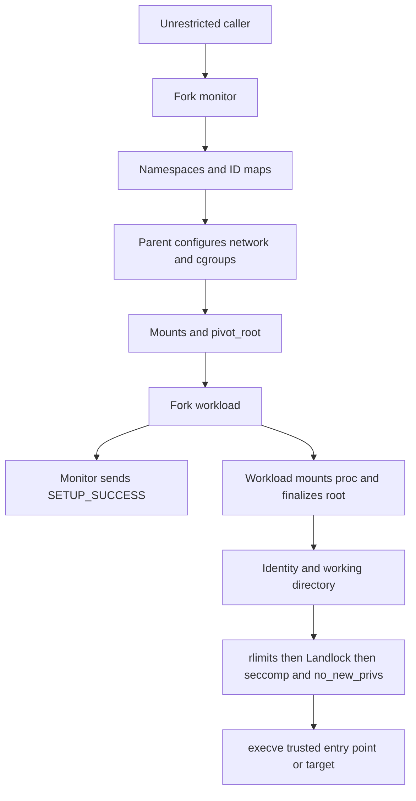

# Hakoniwa for a Linux sandbox launcher

**Assessment:** `hakoniwa` is a usable, compact Rust building block for launching Linux processes with a deliberately constructed filesystem and selected isolation controls. It is suitable for reducing the authority of build tools and local automation when the launcher owns and tests the policy. It does **not** turn `Container::new()` into a fully configured hostile-code sandbox: networking is shared by default, resource budgets are unset, and Landlock, seccomp, and cgroups require both Cargo features and explicit configuration. For mutually hostile tenants or kernel-exploit containment, use a separate-kernel boundary as well.

**Research date: November 4, 2026. Examined published stable release: `hakoniwa` 1.8.0, published September 25, 2026 at 13:56:48 UTC.** A material read-only-mount fallback fix exists on upstream `main` but is **not in this release**. Do not enable `Runctl::MountFallback` when read-only mounts are a requirement. The public API also lacks a complete, per-control enforcement receipt before execution. These conclusions come from the published archive, rather than assuming the README's list of mechanisms is a default policy. [Registry version history](https://index.crates.io/ha/ko/hakoniwa), [published archive](https://static.crates.io/crates/hakoniwa/hakoniwa-1.8.0.crate), [fallback defect](https://github.com/souk4711/hakoniwa/issues/202)

## Identity, release history, and maintenance

The package metadata names `hakoniwa`, links to **souk4711/hakoniwa**, and declares **`LGPL-3.0-only WITH LGPL-3.0-linking-exception`**. Docs.rs lists the registry owner as `souk4711`. The repository contains the library and a separately published `hakoniwa-cli`; the CLI uses GPL-3.0-only. The associated `hakoniwa.d` project provides application profiles. This is not the unrelated TOPPERS Hakoniwa robotics/simulation project. A Rust application can depend directly on the library without installing the CLI or its profiles. [Published metadata and owner](https://docs.rs/crate/hakoniwa/1.8.0), [manifest](https://docs.rs/crate/hakoniwa/1.8.0/source/Cargo.toml.orig), [library license](https://docs.rs/crate/hakoniwa/1.8.0/source/LICENSE)

The registry index contains 39 releases and no prerelease version names. `0.2.0` is yanked; `1.8.0` is not. There is no indexed `1.0.0`: the first indexed 1.x release is `1.1.0`. Do not invent a 1.0 milestone or assume the old pre-1.0 interface matches current examples. The following covers the November 4, 2024–November 4, 2026 window; dates are registry publication dates. [Complete registry index](https://index.crates.io/ha/ko/hakoniwa)

| Releases                   | Publication dates                                              | Relevant changes or interpretation                                                                                                                                   |
| -------------------------- | -------------------------------------------------------------- | -------------------------------------------------------------------------------------------------------------------------------------------------------------------- |
| 0.2.0–0.4.6                | August 18–September 6, 2022                                    | Early API history; 0.2.0 was yanked.                                                                                                                                 |
| 0.4.8, 0.5.0, 0.5.1, 0.5.2 | August 27 and November 4, 2023; February 20 and April 22, 2024 | Older published line; no subsequent publication until March 2025.                                                                                                    |
| 1.1.0–1.1.5                | March 6, 17, 22; April 3, 16, 28, 2025                         | Start of the current 1.x line.                                                                                                                                       |
| 1.1.6–1.1.9                | May 14, May 28, June 13, July 2, 2025                          | Empty Landlock ruleset handling, `Child::try_wait`, filesystem files, multiple UID/GID maps.                                                                         |
| 1.2.0–1.2.2                | July 15, July 23, August 13, 2025                              | Fallible rootfs setup, process metrics, user switching; Rust 2024 and Rust 1.87 announced in 1.2.1.                                                                  |
| 1.2.3, 1.2.4               | October 28 and November 11, 2025                               | devpts permissions and error-handling changes.                                                                                                                       |
| 1.3.0–1.3.2                | January 8, March 15, March 27, 2026                            | cgroups; unused-FD closing and `_exit`; nontruncating mount-point creation; devfs remount fix.                                                                       |
| 1.4.0                      | March 31, 2026                                                 | `Stdio` loses `Clone`/`Copy`; gains conversions from files and owned descriptors.                                                                                    |
| 1.5.0                      | April 11, 2026                                                 | CPU weight; closes descriptors after fork rather than after exec.                                                                                                    |
| 1.6.0                      | April 25, 2026                                                 | Closure execution, tmpfs-backed devfs; breaking Landlock method renames.                                                                                             |
| 1.7.0–1.7.2                | May 16, June 12, July 5, 2026                                  | RustSlirp; optional ignored cgroup failures; new session; gateway configuration.                                                                                     |
| 1.8.0                      | September 25, 2026                                             | Overlay mounts; tolerates busy old-proc mount-point removal; fixes ptrace continuation race. CLI removes its RustSlirp option, but the library retains that feature. |

Change descriptions above are from [upstream release notes](https://api.github.com/repos/souk4711/hakoniwa/releases?per_page=100) and the [1.8.0 release](https://github.com/souk4711/hakoniwa/releases/tag/v1.8.0). In particular, 1.6 changes `add_fs_rule` to `allow_path` and splits network rules into `allow_tcp_bind`/`allow_tcp_connect`. The 1.x notes explicitly label several changes as breaking, including 1.4's `Stdio` change. Treat even minor upgrades as a source and policy migration: pin the reviewed release, keep a lockfile, compile examples, and rerun denial tests. A 1.x version number alone does not establish compatibility.

The 1.8.0 package does **not declare `rust-version`**, so there is no machine-enforced MSRV contract in its manifest. The historical 1.87 announcement is not a reliable current floor: 1.8 uses `std::io::pipe`/`PipeReader`/`PipeWriter` (stabilized in Rust 1.87) and let chains, whose stabilization requires Rust 1.88. Transitive dependency resolution may raise the practical floor further. This report checked examples with Rust 1.97.1; it did not establish the lowest compiling toolchain. [Published source](https://docs.rs/crate/hakoniwa/1.8.0/source/src/command.rs), [Rust 1.88 let chains](https://blog.rust-lang.org/2025/06/26/Rust-1.88.0/), [manifest](https://docs.rs/crate/hakoniwa/1.8.0/source/Cargo.toml)

**Maintenance judgment:** there is observable ongoing work, with 15 publications in 2025, 10 in 2026 through September 25, and repository commits through November 3. The November 1 fallback fix and additions to CI show work after the latest publication. This supports “maintained,” not “audited” or a response-time guarantee. The visible registry ownership is concentrated in one account; no independent security audit or support commitment was established. [Registry index](https://index.crates.io/ha/ko/hakoniwa), [recent commit history](https://api.github.com/repos/souk4711/hakoniwa/commits?per_page=5), [unreleased comparison](https://github.com/souk4711/hakoniwa/compare/v1.8.0...c322512d49331bd7f17c792f3a23b2f474370a4a)

## Public API: policy is explicit

`Container` is a cloneable configuration builder. Constructing it does not immediately unshare the caller. `container.command("/absolute/program")` snapshots the configuration into a `Command`; later container changes do not modify that command. `Command` supports `arg`/`args`, explicit `env`/`envs`, `current_dir`, `stdin`/`stdout`/`stderr`, and `wait_timeout(u64)` in seconds. It uses `execve`, not a shell or a PATH-searching exec function: supply the target path in the sandbox and pass shell syntax only through an explicitly chosen shell. Its environment starts empty. [Container source](https://docs.rs/crate/hakoniwa/1.8.0/source/src/container.rs), [Command source](https://docs.rs/crate/hakoniwa/1.8.0/source/src/command.rs), [execution implementation](https://docs.rs/crate/hakoniwa/1.8.0/source/src/runc.rs)

`spawn()` returns `Result<Child>`; `status()` launches and waits; `output()` launches, drains stdout/stderr, and returns `Output { status, stdout, stderr }`. `Child` offers `id`, `kill`, `try_wait`, `wait`, `wait_with_output`, and optional pipe handles. `ExitStatus` is the crate's own type: inspect `success()`, `code`, `reason`, and `exit_code`, not `std::process::ExitStatus` methods. It can carry rusage and optional `/proc` metrics selected by `Runctl`. Importantly, `Ok(Child)` and even `Ok(ExitStatus)` are not proof that startup succeeded. [Child and status implementation](https://docs.rs/crate/hakoniwa/1.8.0/source/src/child.rs)

| Control              | `Container::new()` in 1.8.0                                              | Explicit configuration                                                                                                                       |
| -------------------- | ------------------------------------------------------------------------ | -------------------------------------------------------------------------------------------------------------------------------------------- |
| Namespaces           | Mount, User, PID                                                         | `unshare(Namespace::…)` adds Network, Ipc, Uts, Cgroup, etc. `Container::empty()` selects none.                                              |
| Identity             | Current host UID/GID mapped to the same numeric IDs inside               | `uidmap`, `gidmap`, or tuple-based `uidmaps`/`gidmaps`; optional named `user`.                                                               |
| Filesystem           | Temporary root mount point; fresh `/proc`; no executable runtime mounted | `bindmount_ro/rw`, `rootfs`, `rootdir`, overlays, tmpfs, devfs, files/directories/symlinks. Root is remounted read-only unless `RootdirRW`.  |
| Networking           | Host network namespace                                                   | Add `Namespace::Network`; optionally configure `network(Pasta)` or `network(RustSlirp)`. Calling `network` alone does not add the namespace. |
| Resource limits      | No new limits; inherited OS limits remain                                | `setrlimit(Rlimit, soft, hard)`.                                                                                                             |
| cgroups              | None                                                                     | Feature `cgroups` and `cgroups_resources(Resources)`.                                                                                        |
| Landlock             | None                                                                     | Feature `landlock` and `landlock_ruleset(Ruleset)` with explicit `restrict`.                                                                 |
| seccomp              | None                                                                     | Feature `seccomp` and `seccomp_filter(Filter)`.                                                                                              |
| Privilege escalation | Sets `no_new_privs` in the workload setup                                | `AllowNewPrivs` opts out; avoid it for hostile workloads.                                                                                    |

These defaults and gates are visible in [Container](https://docs.rs/crate/hakoniwa/1.8.0/source/src/container.rs), [namespace variants](https://docs.rs/crate/hakoniwa/1.8.0/source/src/unshare/namespace.rs), and [Runctl](https://docs.rs/crate/hakoniwa/1.8.0/source/src/runctl.rs). A cgroup namespace only changes the visible cgroup hierarchy; it does not set resource budgets. UTS isolates hostname information; IPC isolates System V IPC and POSIX message queues. PID namespaces isolate process numbering/visibility, not the host kernel.

### Filesystem and identity configuration

`rootdir(path)` chooses an existing host directory as the new root mount point; it is not the same operation as `rootfs(path)`. With the default temporary directory, the launcher creates only selected mounts and mount-point entries. `rootfs("/")` selects host `/bin`, `/etc`, `/lib`, `/lib64`, `/lib32`, `/sbin`, and `/usr` when present. It does not expose every host top-level directory, but **does expose broad system configuration**, including anything readable under the selected `/etc`. For another rootfs directory, the implementation walks immediate entries, selects directories, skips `/proc`, and preserves directory symlinks; it is not a complete image unpacker and does not automatically copy top-level regular files. [Container implementation](https://docs.rs/crate/hakoniwa/1.8.0/source/src/container.rs)

Bind mounts are recursive and request `NOSUID`; read-only binds request `RDONLY` and are remounted after `pivot_root`. There is no general recursive `mount_setattr(AT_RECURSIVE, MOUNT_ATTR_RDONLY)` implementation. A recursively imported tree may contain independently writable submounts. Validate the actual mount tree, avoid untrusted or changing source mount trees, and do not describe `bindmount_ro` as making the underlying host data globally immutable. Another writable alias or host writer can still change it. Overlays require kernel/filesystem support and compatible lower/upper/work directories; a writable overlay is not equivalent to a host bind. [Mount implementation](https://docs.rs/crate/hakoniwa/1.8.0/source/src/runc/unshare.rs), [bind and remount semantics](https://man7.org/linux/man-pages/man2/mount.2.html)

Single-ID mapping writes `/proc/self/uid_map`, denies `setgroups`, and writes `gid_map`. Multi-entry mapping uses parent-side `newuidmap`/`newgidmap`, requiring installed helpers and authorized subordinate IDs. Tuples are `(container_id, host_id, size)`. `user(name, group, supplementary_groups)` resolves names from the sandbox's `/etc/passwd` and `/etc/group`, and can fail if mappings or `setgroups` policy disallow the result. Mapping the caller to UID 0 inside is **namespace root**, not host root, but grants authority over objects governed by that user namespace. `no_new_privs` prevents privilege gains through exec; it does not revoke existing capabilities or filesystem ownership. [Mapping implementation](https://docs.rs/crate/hakoniwa/1.8.0/source/src/unshare/newuser.rs), [child identity setup](https://docs.rs/crate/hakoniwa/1.8.0/source/src/runc/unshare.rs), [user namespace rules](https://man7.org/linux/man-pages/man7/user_namespaces.7.html)

### Optional profiles and dependencies

The Cargo default is `default = []`. Docs.rs builds with all features, which can make methods appear available when they are absent in an ordinary dependency build. There is no mandatory Hakoniwa daemon. [Exact feature manifest](https://docs.rs/crate/hakoniwa/1.8.0/source/Cargo.toml.orig)

| Feature                     | Dependency/mechanism                        | Additional deployment requirement                                                                                                                                                   |
| --------------------------- | ------------------------------------------- | ----------------------------------------------------------------------------------------------------------------------------------------------------------------------------------- |
| `landlock`                  | Rust `landlock` `^0.4.4`                    | Kernel Landlock enabled and its syscalls permitted. No separate service.                                                                                                            |
| `seccomp`                   | `libseccomp` `^0.4.0` Rust wrapper          | Native libseccomp library for linking/runtime; development library when building.                                                                                                   |
| `cgroups`                   | `libcgroups` `^0.7.0`, `oci-spec` `^0.10.0` | Intended systemd-backed cgroup-v2 path; usable systemd connection, `busctl` for rootless connection setup, and resource-control authorization. See the legacy-manager caveat below. |
| `rustslirp`                 | `tun-rs`, `route_manager`, `sendfd`         | `/dev/net/tun`, TUN/TAP support, namespace permissions, and a caller-supplied packet handler/forwarder. No libslirp engine is embedded by this option.                              |
| No feature needed for Pasta | External `pasta` from passt                 | Helper executable must exist and successfully configure the selected network namespace.                                                                                             |
| Multiple UID/GID ranges     | External `newuidmap`/`newgidmap`            | Distribution uidmap/shadow package, subordinate-ID policy and helper privileges.                                                                                                    |

The basic implementation uses Linux syscalls through libc/nix, procfs, descriptor-closing support, and temporary directories. The upstream CLI installation guide lists `libseccomp-dev`/equivalent, passt, and uidmap packages; those are not all mandatory for a minimal library build. Its AppArmor example applies to the installed CLI pathname, not automatically to your embedded launcher. [Published dependencies](https://docs.rs/crate/hakoniwa/1.8.0/source/Cargo.toml), [installation guide at v1.8.0](https://github.com/souk4711/hakoniwa/blob/v1.8.0/INSTALL.md)

Landlock's public wrapper exposes filesystem R/W/X and TCP bind/connect port rules. An `allow_path` or `allow_tcp_connect` call **alone imposes no restriction**; first enable the corresponding `Resource` using `restrict(resource, CompatMode)`. With an empty restrictions map, installation is a no-op. Filesystem setup hard-requires ABI 1 rights, then requests rights through **ABI 5** best effort. The FS `CompatMode` value is not used to change that implementation: `Enforce` does **not** mean “all ABI 5 rights must exist.” TCP `Enforce` does require its operation support; TCP `Relax` is best effort. The wrapper discards `restrict_self()`'s returned enforcement status. It does not expose newer Landlock scoping, per-right compatibility, or a full enforcement report. [Ruleset API](https://docs.rs/crate/hakoniwa/1.8.0/source/src/landlock/ruleset.rs), [installation code](https://docs.rs/crate/hakoniwa/1.8.0/source/src/runc/landlock.rs)

Seccomp's `Filter::new(default_action)` accepts syscall-name rules, integer argument comparisons, and architecture additions. Actions include Allow, Errno, KillProcess/KillThread, Trap, Log, Trace, and Notify. A `Notify` action does not supply a notification-broker API: this wrapper does not hand out a seccomp listener. Unknown syscall names are **silently skipped** when libseccomp cannot resolve them; the source comment calls this a kernel-support check, but name resolution is not a runtime kernel capability probe. With a default-Allow denylist, a typo can remove the intended denial. With a default-deny allowlist, an omitted allowance generally breaks compatibility instead. No shipped automatic “safe” filter is installed. The loader does not request thread synchronization: it installs in the fresh workload process before exec, and subsequently created threads/children inherit it. This does not restrict threads already running in the caller. [Filter builder](https://docs.rs/crate/hakoniwa/1.8.0/source/src/seccomp/filter.rs), [filter loader](https://docs.rs/crate/hakoniwa/1.8.0/source/src/runc/seccomp.rs)

## Startup ordering and failure semantics

The parent remains unrestricted. In a forked monitor, the library redirects standard I/O, closes extra FDs, sets parent-death SIGKILL, unshares the selected namespaces, and coordinates identity mappings/network/cgroups with the parent. It makes mount propagation recursively private, constructs the root, pivots, detaches the old root, and remounts bind targets. It then forks the workload. The workload becomes PID 1 when a new PID namespace was requested; the monitor remains outside that PID namespace, but shares its selected mount/user/network namespaces. This is not a separately hardened supervisor sandbox. [Launch implementation](https://docs.rs/crate/hakoniwa/1.8.0/source/src/runc.rs), [mount setup](https://docs.rs/crate/hakoniwa/1.8.0/source/src/runc/unshare.rs)



`SETUP_SUCCESS` is a **partial-startup acknowledgment**. It is sent by the monitor without waiting for workload-side procfs, rlimit, Landlock, seccomp, or exec success. Those operations still run before target execution, and errors abort that workload path, but the caller cannot treat return from `spawn()` as a complete security attestation. [Acknowledgment and workload ordering](https://docs.rs/crate/hakoniwa/1.8.0/source/src/runc.rs)

| Failure                                                     | Released behavior                                                      | Caller obligation                                                                                                |
| ----------------------------------------------------------- | ---------------------------------------------------------------------- | ---------------------------------------------------------------------------------------------------------------- |
| Temporary directory, stdio pipe, initial fork failure       | Can return `Err` from `spawn`                                          | Handle the `Result`.                                                                                             |
| Requested namespace unavailable or blocked                  | `unshare` error; monitor reports failure status, normally code 125     | Also wait and inspect status; no automatic fallback to host namespaces.                                          |
| UID/GID helper, Pasta, or cgroup parent-side setup failure  | Parent kills monitor and returns a `Child` carrying failure status     | Do not equate `Ok(child)` with successful setup.                                                                 |
| cgroup failure with `IgnoreCgroupSetupFailed`               | Logs at debug and continues without requested limits                   | Never enable when budgets are mandatory; no public receipt identifies which limits were installed.               |
| No Landlock FS support with FS restricted                   | ABI 1 hard requirement fails before target                             | Nonzero workload status; details may be written to stderr.                                                       |
| Older Landlock supporting FS ABI 1 but missing later rights | Newer rights degrade best effort                                       | Require a verified ABI/right set externally if those rights matter.                                              |
| TCP restriction missing                                     | `Enforce` fails; `Relax` may degrade                                   | Require `Enforce` for a mandatory TCP rule.                                                                      |
| seccomp context/rule/load failure                           | Aborts before exec, writes diagnostic, exits 125                       | Check status, capture bounded diagnostics. Unknown names can instead be skipped.                                 |
| Workload-side setup or exec failure                         | Failure exit, usually 125; the monitor may describe it as process exit | Error classification is imperfect; do not rely only on `reason` or distinguish all cases from workload exit 125. |
| Bind remount failure                                        | Aborts unless `MountFallback` requested                                | Avoid fallback in 1.8.0 for required read-only semantics.                                                        |

These are source-traced behaviors, not promises inferred from successful launches. [Parent error handling](https://docs.rs/crate/hakoniwa/1.8.0/source/src/command.rs), [child errors](https://docs.rs/crate/hakoniwa/1.8.0/source/src/runc.rs), [cgroup fallback](https://docs.rs/crate/hakoniwa/1.8.0/source/src/cgroups.rs)

### Verifying requirements before untrusted code runs

For basic fail-closed startup, request controls explicitly, avoid all relaxation flags, and never retry with weaker configuration after failure. The source puts the requested controls before `execve`. For **auditable readiness**, launch a small trusted executable as the sandbox entry point. It should verify the required namespaces, maps, mount flags, cgroup membership and actual limit files, `NoNewPrivs`, and seccomp state, then perform targeted denial probes, send a readiness message over a dedicated pipe, and finally exec the untrusted program in the same process. Only release input or mark the job running after readiness. The public API closes arbitrary extra descriptors, so carry this protocol on deliberately assigned standard I/O or add a narrowly reviewed descriptor-passing facility. A numeric PID from `Child::id()` identifies the monitor, not automatically the inner workload.

This trampoline protocol is a **recommendation**, not a shipped Hakoniwa API. `/proc/self/status` saying `Seccomp: 2` does not identify the installed rules; a cgroup path does not prove its budgets; kernel release strings do not prove Landlock availability. There is no exposed Landlock status to attest full ABI 5 enforcement. If policy needs exact rights or an atomic pre-exec receipt, use direct bindings or modify/audit the launcher implementation to report them. A separate probe launch helps deployment validation but cannot attest the actual job's later launch. A verifier also needs access to the proc/cgroup observation files it uses; the filesystem example below does not grant those paths. Expose only the required read-only observations, or perform parent-side inspection using the correctly identified workload PID, and account for any observation paths inherited by the final target. [Startup/status sources](https://docs.rs/crate/hakoniwa/1.8.0/source/src/runc.rs), [Landlock loader](https://docs.rs/crate/hakoniwa/1.8.0/source/src/runc/landlock.rs), [proc status fields](https://man7.org/linux/man-pages/man5/proc_pid_status.5.html)

## Linux integration requirements

| Mechanism                         | Required capabilities                                                                                          | Compatibility boundary                                                                                                                                                   |
| --------------------------------- | -------------------------------------------------------------------------------------------------------------- | ------------------------------------------------------------------------------------------------------------------------------------------------------------------------ |
| User/mount/PID namespaces         | `CONFIG_NAMESPACES`, `CONFIG_USER_NS`, `CONFIG_PID_NS`, procfs and mount support; permitted namespace creation | User namespaces make many namespace-local operations rootless. Distribution LSM policy, namespace quotas, seccomp, or outer-container restrictions may still deny them.  |
| Network/IPC/UTS/cgroup namespaces | Corresponding kernel configuration such as `CONFIG_NET_NS`, `CONFIG_IPC_NS`, `CONFIG_UTS_NS`, `CONFIG_CGROUPS` | Selected only when requested. Network mode configuration additionally requires Network namespace selection.                                                              |
| rlimits                           | `setrlimit` permission and valid soft/hard values                                                              | Cannot raise a hard limit without sufficient privilege. `RLIMIT_AS` is address space, not resident-memory accounting; `RLIMIT_RSS` is not an effective Linux memory cap. |
| cgroups                           | Resource controllers, intended v2 unified hierarchy, systemd-backed manager and authorization for unified mode | A visible or writable `/sys/fs/cgroup` alone does not establish usable systemd delegation.                                                                               |
| Landlock filesystem               | `CONFIG_SECURITY_LANDLOCK`, active LSM, allowed syscalls; baseline Linux 5.13/ABI 1                            | ABI 2 adds REFER (5.19), ABI 3 TRUNCATE (6.2), ABI 5 device ioctl handling (6.10). This crate requests through V5 but does not hard-require every right.                 |
| Landlock TCP                      | ABI 4, normally Linux 6.7+                                                                                     | Bind/connect **ports**, not addresses, DNS names, UDP, or a general packet firewall.                                                                                     |
| seccomp                           | `CONFIG_SECCOMP`/`CONFIG_SECCOMP_FILTER`, supported architecture/actions and libseccomp build                  | Native syscall ABI and any permitted compatibility ABIs must be tested separately.                                                                                       |
| Overlays, devfs, tmpfs            | Relevant filesystem support; allowed mounts; devpts for `devfsmount`                                           | Outer containers may lock inherited flags or forbid mounting procfs/devpts/overlay.                                                                                      |

Sources: [namespace overview](https://man7.org/linux/man-pages/man7/namespaces.7.html), [resource-limit semantics](https://man7.org/linux/man-pages/man2/getrlimit.2.html), [Landlock ABI history](https://man7.org/linux/man-pages/man7/landlock.7.html), [seccomp installation](https://man7.org/linux/man-pages/man2/seccomp.2.html), [crate mount setup](https://docs.rs/crate/hakoniwa/1.8.0/source/src/runc/unshare.rs).

Rootless operation is the intended useful path, not a guarantee that every Linux installation permits it. An outer container must allow namespace creation and the requisite mount/security syscalls, provide an appropriate `/proc`, and, for selected features, TUN or systemd connectivity and resource-control access. Host-level root can bypass many of the restrictions; embedding this in a privileged service demands a separate capability/identity review. Keep untrusted configuration away from arbitrary mount sources, helper paths, map ranges, and `Runctl` switches. [User namespace permission model](https://man7.org/linux/man-pages/man7/user_namespaces.7.html), [upstream deployment guidance](https://github.com/souk4711/hakoniwa/blob/v1.8.0/INSTALL.md)

The cgroup API exposes `Resources` containing `Cpu`, `Memory`, and `Pids`. It uses OCI/v1-shaped values but the wrapper documents **cgroup v2 plus systemd** and hardcodes a systemd cgroup path of `hakoniwa.slice:hakoniwa:<monitor-pid>`. CPU quota/period are microseconds; weight is relative priority, not a CPU-time ceiling. `Memory::limit` is bytes; `Memory::swap` is **memory plus swap**, not the v2 `memory.swap.max` value alone. `Pids::limit` counts tasks, including threads. There is no public setter for an arbitrary delegated cgroup directory or an explicit cgroup-version selector in this facade. [cgroup module](https://docs.rs/crate/hakoniwa/1.8.0/source/src/cgroups.rs), [manager](https://docs.rs/crate/hakoniwa/1.8.0/source/src/cgroups/manager.rs), [resource builders](https://docs.rs/crate/hakoniwa/1.8.0/source/src/cgroups/)

**Documentation/source distinction:** despite the facade's v2-plus-systemd description, `libcgroups` 0.7.0 has default features `v1`, `v2`, and `systemd`. Its manager factory selects a direct v1 manager on legacy/hybrid hierarchies, before consulting `systemd_cgroup`; only unified mode selects the systemd manager for Hakoniwa's relative path. Therefore “v2 only” is not an accurate description of every possible execution path. The facade does not document or test a portable legacy deployment contract, and its colon-form systemd path is still passed to that factory. Require and verify unified v2 for the integration described here; reject a legacy/hybrid host instead of assuming equivalent cgroup enforcement. [Dependency features](https://docs.rs/crate/libcgroups/0.7.0/source/Cargo.toml.orig), [manager dispatch](https://docs.rs/crate/libcgroups/0.7.0/source/src/common.rs)

For rootless deployment, an administrator must arrange controllers and authorization through the user service manager/delegation model supported by `libcgroups`; for privileged deployment, authorize the system-manager operations. With direct delegation, the delegate needs control over its subtree and controller enablement, while obeying the cgroup-v2 no-internal-process rule. The dependency selects the user session connection for non-host-root and the system connection for host-root; its session setup locates a bus from `DBUS_SESSION_BUS_ADDRESS` or `XDG_RUNTIME_DIR` and invokes `busctl --user --no-pager status`. A generic `Delegate=yes` subtree is **not a substitute** for the specific systemd-manager connection this crate selects. Validate that its transient scope is actually created under the intended manager, and read `cpu.max`, `memory.max`, `memory.swap.max`, and `pids.max` for that scope. Do not grant the workload writable access to cgroup control files. [session setup source](https://docs.rs/crate/libcgroups/0.7.0/source/src/systemd/dbus_native/dbus.rs), [systemd delegation contract](https://systemd.io/CGROUP_DELEGATION/), [kernel cgroup-v2 controller documentation](https://docs.kernel.org/admin-guide/cgroup-v2.html)

The source exports many seccomp architectures (including x86/x86-64/x32, ARM/AArch64, RISC-V, LoongArch, MIPS, PowerPC, and s390 families), but that enum is not a tested-platform matrix. Docs.rs documents an x86_64 Linux build; upstream install scripts/package artifacts and your native dependencies determine practical deployment coverage. This report establishes compilation on x86_64 Linux only. Native macOS and Windows cannot run this Linux implementation. In WSL2, evaluate the guest's actual namespaces, LSM configuration, syscalls, controllers, filesystem mounts, and systemd setup using the same probes; do not infer compatibility from “WSL2” or treat it as a native Windows backend. [Architecture mapping](https://docs.rs/crate/hakoniwa/1.8.0/source/src/runc/seccomp.rs), [documented target](https://docs.rs/crate/hakoniwa/1.8.0), [WSL architecture](https://learn.microsoft.com/en-us/windows/wsl/compare-versions)

## Networking: isolation, connectivity, and destinations differ

| Configuration                                        | Result                                                                    | Host access and DNS                                                                                                                                                     |
| ---------------------------------------------------- | ------------------------------------------------------------------------- | ----------------------------------------------------------------------------------------------------------------------------------------------------------------------- |
| Default container                                    | Host network namespace                                                    | Host loopback, routes, and services remain reachable subject to ordinary permissions/firewalls.                                                                         |
| `unshare(Namespace::Network)` without `network(...)` | Fresh network namespace with no configured external interface             | Crate does not bring loopback up in this path. No external route is installed. This does not remove filesystem Unix sockets or authority supplied through standard I/O. |
| Network namespace plus `Pasta::default()`            | External helper configures IPv4/IPv6 addresses/routes with `--config-net` | Crate adds `--no-map-gw` and disables automatic port forwarding both directions; outbound traffic is still enabled. Not a destination allowlist.                        |
| Network namespace plus `RustSlirp`                   | Creates TUN/TAP and brings loopback up; returns raw packet FD on `Child`  | Caller must implement forwarding, filtering, and DNS behavior. No automatic Internet access or ready-made destination policy.                                           |
| Landlock TCP restriction                             | Controls newly performed bind/connect by port                             | Allowing TCP 443 allows that port at any reachable destination; it does not restrict to an approved host or block UDP/QUIC.                                             |

These are library modes, not the CLI's option vocabulary. [Namespace gating](https://docs.rs/crate/hakoniwa/1.8.0/source/src/container.rs), [Pasta implementation](https://docs.rs/crate/hakoniwa/1.8.0/source/src/unshare/newnet/pasta.rs), [RustSlirp implementation](https://docs.rs/crate/hakoniwa/1.8.0/source/src/unshare/newnet/rustslirp.rs)

Pasta's address/route copying is a convenience for connectivity. `--no-map-gw` prevents one special gateway-to-host mapping; it does not exclude host services reachable at real host/LAN addresses. `--map-gw` is a Hakoniwa convenience argument which suppresses the injected `--no-map-gw`. Additional helper arguments can alter the defaults. A missing helper or nonzero setup exit fails the launch path; a successful helper exit is not a long-term health or firewall receipt. Avoid helper options that make it stay in the foreground: Hakoniwa waits for the helper command to finish during startup. [Pasta command construction](https://docs.rs/crate/hakoniwa/1.8.0/source/src/unshare/newnet/pasta.rs), [official pasta manual](https://passt.top/builds/latest/web/passt.1.html)

Hakoniwa does not synthesize a policy-safe resolver file. `rootfs("/")` can expose host `/etc/resolv.conf`; its configured nameserver may be a loopback stub that is unusable in the new namespace. Supply an explicit resolver configuration and test it when connectivity is enabled. For **approved destinations only**, use a dedicated egress proxy or packet policy outside workload control, account for IPv4/IPv6, DNS, redirects, and rebinding, and block direct bypass routes. RustSlirp provides a packet boundary at which the caller can implement such policy; it does not implement it for you. Classic seccomp cannot inspect the pointed-to sockaddr or pathname to implement a hostname/path allowlist. [crate filesystem/network source](https://docs.rs/crate/hakoniwa/1.8.0/source/src/unshare/newnet.rs), [seccomp pointer limitation](https://docs.kernel.org/userspace-api/seccomp_filter.html)

## Security limits and integration pitfalls

The useful protection is reduction of the workload's ambient authority: hide unmounted host paths, make chosen inputs read-only, restrict filesystem operations/syscalls, and bound resources. Namespace, Landlock, and seccomp policies are inherited by descendants; rlimits are inherited but mostly apply per process or per real UID rather than as an aggregate job budget. Cgroups supply aggregate accounting/limits when correctly configured. None creates a separate kernel, and neither namespace ownership nor `no_new_privs` makes kernel vulnerabilities irrelevant. The following separates missing crate facilities from operating-system limits and deployment mistakes.

| Gap class                                                                | Consequence                                                                                          | Mitigation                                                                                                                                        |
| ------------------------------------------------------------------------ | ---------------------------------------------------------------------------------------------------- | ------------------------------------------------------------------------------------------------------------------------------------------------- |
| **Released crate defect:** mount fallback loses requested flags          | Requested RO bind can become RW after failed remount                                                 | Do not enable `MountFallback` on 1.8.0; test actual writes and mount flags. Review the unreleased fix before adopting it.                         |
| **Crate capability gap:** exact Landlock compatibility/status            | Baseline FS success can omit newer controls                                                          | Use verified minimum ABI/right probes plus a trusted entry point, or direct bindings with hard requirements and status reporting.                 |
| **OS/model limit:** port rules are not destination policy                | Exfiltration to arbitrary hosts on allowed port                                                      | Enforce egress outside the workload; do not market a port allowance as a host allowlist.                                                          |
| **Deployment:** broad system/runtime mounts                              | Confidential configuration or writable nested mounts can enter the sandbox                           | Build a curated runtime; inspect submounts and aliases; avoid mounting host `/` at another path.                                                  |
| **OS/model limit:** already-open object authority                        | Landlock/network namespaces do not revoke an existing socket or all prior FD access                  | Sanitize descriptors; give only pipes/files intended as capabilities.                                                                             |
| **Integration:** mount-source races/aliases                              | A writable workspace may contain a hard link to an input or bind a sensitive path under another name | Use trusted stable mount sources and separate copies/filesystems; validate policy before launch; do not accept arbitrary workload-defined mounts. |
| **Crate capability gap:** no complete readiness receipt                  | `spawn()` can precede final restriction failure                                                      | Trusted in-sandbox verification protocol or a reviewed launcher extension.                                                                        |
| **Stronger boundary needed:** kernel attacks or strong tenant separation | All native processes still share the host kernel                                                     | Put the launcher inside a VM/microVM and retain these layers inside it.                                                                           |

Several concrete details deserve integration tests:

- **Read-only is a mount-path property.** The source does not protect every recursive submount or every hard-link alias. Landlock rules are based on filesystem objects and hierarchies, not a string-prefix validator, and may grant access through other aliases. Protect immutable inputs with controlled copies and no writable alias, rather than relying on user-provided canonical paths. Landlock also does not retroactively constrain every action through preexisting open descriptors. [Landlock filesystem semantics](https://docs.kernel.org/security/landlock.html), [mount source](https://docs.rs/crate/hakoniwa/1.8.0/source/src/runc/unshare.rs)
- **Old-root cleanup is deliberate but not sufficient by itself.** The implementation makes `/` recursively private, pivots, changes cwd to `/`, and detaches the old root. Avoid exposing host namespace descriptors, host `/proc`, block devices, or an alternative host-root bind which would restore authority. Keep capabilities and permitted namespace/mount syscalls under review, especially when mapping UID 0 or using `AllowNewPrivs`. There is no configurable general capability-drop profile. [Root and identity setup](https://docs.rs/crate/hakoniwa/1.8.0/source/src/runc/unshare.rs)
- **`/proc` is not a general confidentiality boundary.** The fresh proc mount shows the new PID view, but still exposes many kernel/global-information files. This crate does not install the comprehensive proc/sys masking policy of a full container runtime. `/dev` is absent unless requested; `devfsmount` creates tmpfs plus selected host devices (`null`, `zero`, `full`, `random`, `urandom`, `tty`), devpts and proc-FD links. It can expose the current console when stdout is a TTY. Do not bind the entire host `/dev` for convenience. [devfs and proc implementation](https://docs.rs/crate/hakoniwa/1.8.0/source/src/runc/unshare.rs), [proc overview](https://man7.org/linux/man-pages/man5/proc.5.html)
- **IPC can bypass the intended data boundary.** IPC namespace selection is not the default. Even with it, pathname Unix sockets in mounted directories remain communication endpoints. Host networking also shares abstract Unix-socket networking state; a private network namespace addresses that part, not mounted D-Bus, SSH-agent, Docker, display, or application sockets. Avoid those mounts or broker narrow operations. Hakoniwa's V5 Landlock profile does not add newer signal/abstract-socket scopes. [Unix socket semantics](https://man7.org/linux/man-pages/man7/unix.7.html), [Landlock installation](https://docs.rs/crate/hakoniwa/1.8.0/source/src/runc/landlock.rs)
- **FD handling is better than simple inheritance, but inspect standard I/O.** Extra FDs starting at 3 are closed in the monitor, retaining its setup pipes. Standard descriptors are intentionally inherited or assigned by the caller. A socket passed as stdin/stdout can defeat an “offline” claim even with a private net namespace. `Stdio` accepts files and owned FDs, but has no `Stdio::null()`; open `/dev/null` in the parent and pass the file. Shared controlling terminals also require care. [FD handling](https://docs.rs/crate/hakoniwa/1.8.0/source/src/runc/sys.rs), [Stdio](https://docs.rs/crate/hakoniwa/1.8.0/source/src/stdio.rs)
- **Restrictions apply before the target, after setup.** Trusted setup accesses paths and performs mounts before Landlock/seccomp installation. This is intentional; the target must not control executable setup logic or the mount policy. Dynamic programs need the interpreter, ELF loader, shared libraries, configuration, certificates, and temporary/cache paths that their runtime uses. Prefer explicit runtime mounts over progressively allowing `/`. [Workload startup](https://docs.rs/crate/hakoniwa/1.8.0/source/src/runc.rs)
- **Forking a multithreaded parent needs review.** Both ordinary startup and optional closures do substantial Rust/library work after fork. `command_from_closure` is explicitly unsafe because allocation, environment access, and locks may be unsafe after fork with other threads. Run Hakoniwa in a fresh, single-threaded launcher helper when embedding it in an async server. Do not treat that recommendation as an upstream guarantee that all ordinary spawning is deadlock-free. [Closure safety contract](https://docs.rs/hakoniwa/1.8.0/hakoniwa/struct.Container.html#method.command_from_closure), [fork safety](https://man7.org/linux/man-pages/man2/fork.2.html)

### Lifetime, timeouts, and cleanup

`wait_timeout(seconds)` installs an alarm in the monitor after it has forked the workload. Its handler sends SIGKILL to the direct inner process. It is a wall-time limit for that stage, **not** a deadline for initial namespace/mount/helper/cgroup setup, nor a graceful cancellation protocol. It narrows the value to the alarm's integer range; zero disables the alarm. `Rlimit::Cpu` instead limits consumed CPU time, so neither substitutes for the other. With the default PID namespace, killing PID 1 causes the kernel to kill the remaining namespace processes. Without that namespace, this PID-targeted timeout is not a process-tree kill. [Timeout implementation](https://docs.rs/crate/hakoniwa/1.8.0/source/src/runc/timeout.rs), [monitor setup](https://docs.rs/crate/hakoniwa/1.8.0/source/src/runc.rs), [PID namespace lifetime](https://man7.org/linux/man-pages/man7/pid_namespaces.7.html)

The monitor waits for the direct inner process, not every descendant. The workload itself is PID 1 in the default inner namespace and must reap its orphaned descendants while it runs; a long-running job may need a trusted init wrapper. `Child::kill()` SIGKILLs the monitor, ignores the signal syscall result, and returns `Ok`; call `wait()` afterward. Monitor and inner process request parent-death SIGKILL, but the implementation does not perform a follow-up parent-PID check to close the usual setup race. Parent-death behavior follows Linux's parent-thread rules, not a universal job-ownership contract. No `Drop for Child` kills and waits for the job. Dropping a live handle is not cancellation. [Child implementation](https://docs.rs/crate/hakoniwa/1.8.0/source/src/child.rs), [parent-death setup](https://docs.rs/crate/hakoniwa/1.8.0/source/src/runc.rs), [PR_SET_PDEATHSIG semantics](https://man7.org/linux/man-pages/man2/PR_SET_PDEATHSIG.2const.html)

`output()`/`wait_with_output()` read the complete streams into unbounded `Vec<u8>` buffers, using two reader threads when both streams are piped. This avoids the usual one-stream pipe deadlock but exposes the unrestricted parent to output-driven memory exhaustion. `wait()` alone does not drain piped output. Use concurrent capped readers or files with externally managed quotas, continue draining/discarding after the cap, and enforce a separate supervisor deadline for startup and collection. `RLIMIT_FSIZE` does not bound pipe output. [Output implementation](https://docs.rs/crate/hakoniwa/1.8.0/source/src/child.rs), [rlimit semantics](https://man7.org/linux/man-pages/man2/getrlimit.2.html)

The parent owns the temporary directory and cgroup manager. Normal status retrieval drops both; cgroup-manager `Drop` attempts removal but ignores errors. A configured `rootdir` may retain empty mount-point entries. Partial setup failures kill the monitor and are intended to abort, but there is no transactional cleanup report or guarantee that a partially created systemd scope/helper has disappeared. Parent-side cached failure status can also short-circuit later waiting, so validate failure-path reaping under repeated launch errors. For a long-lived service, monitor process/scope/temp-directory leakage and use a service-owned cleanup boundary. RustSlirp exposes a raw FD; its setup helper is forked without an explicit `waitpid` in that path, and the shown Child lifecycle does not close that raw FD. Close and reap deliberately in a reviewed integration; do not adopt this optional packet path without a lifecycle test. [Command failure paths](https://docs.rs/crate/hakoniwa/1.8.0/source/src/command.rs), [cgroup destructor](https://docs.rs/crate/hakoniwa/1.8.0/source/src/cgroups/manager.rs), [RustSlirp source](https://docs.rs/crate/hakoniwa/1.8.0/source/src/unshare/newnet/rustslirp.rs)

### Defects and advisories

**Confirmed material issue for 1.8.0:** upstream issue/PR [#202](https://github.com/souk4711/hakoniwa/issues/202), opened October 29, documents a requested read-only bind becoming writable when `MountFallback` retries a failed remount on a writable source with locked flags. The published helper clears requested mount flags and reconstructs them from the source; this can discard the requested `MS_RDONLY`. The upstream [November 1 fix, `f57e3211325d`](https://github.com/souk4711/hakoniwa/commit/f57e3211325d) merges the requested flags instead. It is closed upstream but **unreleased as of this research date**. The posted regression results are contributor evidence; this report did not independently execute that regression. Landlock can reduce consequences but does not make the mount contract correct.

The 1.8 release fixes busy `.oldproc` removal and a ptrace race; those fixes are already included. Earlier releases fixed truncation during mount-point creation and devfs remount behavior. Those release notes establish corrected behavior, not a blanket security certification. The repository's [public security-advisory endpoint](https://api.github.com/repos/souk4711/hakoniwa/security-advisories) returned an empty list. A RustSec search did not identify a Hakoniwa-specific advisory; its package URL was unavailable through the browsing tool. This is a limited search result, not proof of no vulnerabilities. Audit the resolved dependency graph separately. [Release records](https://api.github.com/repos/souk4711/hakoniwa/releases?per_page=100), [RustSec advisory database](https://rustsec.org/advisories/)

## Complete Rust integration example

The following one-shot launcher has two explicit profiles: `offline` and `cgroups`. Both mount a trusted runtime and read-only input, expose one writable workspace plus scratch `/tmp`, request private networking/IPC/UTS, install baseline Landlock FS restrictions, and set per-process limits. The second additionally requires cgroup CPU/memory/task limits. The optional `seccomp` build adds a **small illustrative denylist**, not a comprehensive hostile-workload syscall profile.

**Setup:** use three separate, trusted, stable directories. Put an independently obtained, trusted **statically linked BusyBox** executable at `RUNTIME/busybox` and a file named `INPUT/hello`. The static binary avoids mounting all host libraries; a dynamic BusyBox will not work without its loader/runtime. Do not put sockets, devices, nested mounts, workspace aliases, or sensitive hard links in these directories. Keep the runtime nonwritable to the workload and outside the workspace. This fixture is intentionally a bounded shell probe, not arbitrary adversarial code.

`Cargo.toml`:

```toml
[package]
name = "hakoniwa-launch-example"
version = "0.1.0"
edition = "2024"

[dependencies]
hakoniwa = { version = "=1.8.0", default-features = false, features = ["landlock", "cgroups"] }

[features]
seccomp = ["hakoniwa/seccomp"]
```

`src/main.rs`:

```rust
use hakoniwa::{Container, Namespace, Rlimit};
use hakoniwa::landlock::{CompatMode, FsAccess, Resource, Ruleset};
use std::{error::Error, io, path::PathBuf};

type Result<T> = std::result::Result<T, Box<dyn Error>>;

fn host_dir(value: std::ffi::OsString) -> Result<String> {
    let path = PathBuf::from(value).canonicalize()?;
    if !path.is_dir() {
        return Err(io::Error::other("expected a directory").into());
    }
    path.into_os_string().into_string()
        .map_err(|_| io::Error::other("hakoniwa requires UTF-8 paths").into())
}

fn main() -> Result<()> {
    let mut args = std::env::args_os().skip(1);
    let runtime = host_dir(args.next().ok_or("missing runtime directory")?)?;
    let input = host_dir(args.next().ok_or("missing input directory")?)?;
    let work = host_dir(args.next().ok_or("missing workspace directory")?)?;
    let profile = args.next().ok_or("missing profile: offline or cgroups")?;
    if args.next().is_some() || (profile != "offline" && profile != "cgroups") {
        return Err("usage: launcher RUNTIME INPUT WORK offline|cgroups".into());
    }

    let mut container = Container::new();
    container.unshare(Namespace::Network)
        .unshare(Namespace::Ipc)
        .unshare(Namespace::Uts)
        .hostname("workload")
        .bindmount_ro(&runtime, "/runtime")
        .bindmount_ro(&input, "/input")
        .bindmount_rw(&work, "/work")
        .tmpfsmount("/tmp")
        .setrlimit(Rlimit::Cpu, 2, 2)
        .setrlimit(Rlimit::As, 256 * 1024 * 1024, 256 * 1024 * 1024)
        .setrlimit(Rlimit::Fsize, 1024 * 1024, 1024 * 1024)
        .setrlimit(Rlimit::Nofile, 64, 64)
        .setrlimit(Rlimit::Core, 0, 0);

    let mut rules = Ruleset::default();
    rules.restrict(Resource::FS, CompatMode::Enforce)
        .allow_path("/runtime", FsAccess::R | FsAccess::X)
        .allow_path("/input", FsAccess::R)
        .allow_path("/work", FsAccess::R | FsAccess::W)
        .allow_path("/tmp", FsAccess::R | FsAccess::W);
    container.landlock_ruleset(rules);

    if profile == "cgroups" {
        use hakoniwa::cgroups::{Cpu, Memory, Pids, Resources};
        let mut cpu = Cpu::default();
        cpu.period(100_000).quota(50_000);
        let mut memory = Memory::default();
        memory.limit(128 * 1024 * 1024).swap(128 * 1024 * 1024);
        let mut pids = Pids::default();
        pids.limit(16);
        let mut resources = Resources::default();
        resources.cpu(cpu).memory(memory).pids(pids);
        container.cgroups_resources(resources);
    }

    #[cfg(feature = "seccomp")]
    {
        use hakoniwa::seccomp::{Action, Filter};
        let mut filter = Filter::new(Action::Allow);
        for syscall in ["mount", "umount2", "pivot_root", "setns", "unshare", "ptrace"] {
            filter.add_rule(Action::Errno(1), syscall);
        }
        container.seccomp_filter(filter);
    }

    // The runtime supplies a trusted, statically linked busybox at this path.
    let mut command = container.command("/runtime/busybox");
    command.args(["sh", "-ec", "test -r /input/hello; test ! -e /etc/passwd; \
        if echo forbidden > /input/new 2>/tmp/deny; then exit 90; fi; \
        echo allowed > /work/result"])
        .env("PATH", "/runtime")
        .current_dir("/work")
        .wait_timeout(5)
        .stdin(std::fs::File::open("/dev/null")?)
        .stdout(std::fs::OpenOptions::new().write(true).open("/dev/null")?)
        .stderr(std::fs::OpenOptions::new().write(true).open("/dev/null")?);
    let mut child = command.spawn().map_err(|e| io::Error::other(format!("spawn: {e}")))?;
    let status = child.wait().map_err(|e| io::Error::other(format!("wait: {e}")))?;
    if !status.success() {
        return Err(io::Error::other(format!(
            "sandbox or workload failed: code={}, exit_code={:?}, reason={}",
            status.code, status.exit_code, status.reason
        )).into());
    }
    Ok(())
}
```

Build and run on a prepared Linux host:

```sh
cargo build --locked --bin hakoniwa-launch-example
./target/debug/hakoniwa-launch-example /srv/job-runtime /srv/job-input /srv/job-work offline
./target/debug/hakoniwa-launch-example /srv/job-runtime /srv/job-input /srv/job-work cgroups
```

Generate and review `Cargo.lock` first; it is required by `--locked`. For the optional syscall example, build with `--features seccomp` after installing native libseccomp development/runtime packages through the host's normal provisioning process. The explicitly named syscalls are valid policy examples on the tested x86_64 ABI, but Hakoniwa's unknown-name skipping still requires architecture-specific policy validation. This denylist does not forbid `clone`, `clone3`, every ioctl, or all kernel attack surfaces. It is not an egress firewall.

The `offline` profile requests a network namespace without a networking helper. Input reads and workspace writes should work; creating `/input/new` and reading an unmounted `/etc/passwd` should fail. No host-network routes or helper are supplied, and standard I/O is explicitly `/dev/null`, so no network socket is deliberately passed in. The example uses baseline Landlock plus read-only mounts; it does not claim strict enforcement of every post-ABI-1 Landlock right, recursive submount immutability, or protection from writable aliases. It deliberately fails if the host rejects a requested read-only remount rather than enabling the defective fallback.

The shell probe tests only a few operations. It does not itself prove “offline”; a production entry point must also inspect interfaces/routes and attempt both allowed and forbidden communication paths. Output is discarded to protect the parent from unbounded buffering; production diagnostics should use a bounded collector. A failure status terminates the launcher with an error and is never retried with weaker policy. For arbitrary hostile workloads, add aggregate resource enforcement and an independently enforced supervisor/startup deadline before calling the job bounded.

The `cgroups` profile requests a 50% CPU allocation ceiling (`50,000 / 100,000` microseconds), 128 MiB memory, a combined memory-plus-swap budget of 128 MiB, and 16 tasks. The monitor is added before the workload forks, so its accounting also consumes part of the cgroup budget. Provision a functioning systemd-managed v2 hierarchy with `cpu`, `memory`, and `pids` available to the chosen manager. Rootless service startup must preserve a valid user-manager environment, including the appropriate `XDG_RUNTIME_DIR`/bus address and `busctl` availability; transient scope creation and controller manipulation must be authorized. Confirm scope values and denied-over-budget behavior on the actual deployment. There is no portable one-line chmod or `Delegate=yes` command that fixes every systemd/user-manager setup. [libcgroups manager selection](https://docs.rs/crate/libcgroups/0.7.0/source/src/common.rs), [session connection](https://docs.rs/crate/libcgroups/0.7.0/source/src/systemd/dbus_native/dbus.rs)

### Separate capability and launch-failure probes

Use the same Cargo manifest and put this complete program in `src/bin/probe.rs`. These are **trusted, short-lived capability probes**, not an untrusted-code policy. `Container::empty()` deliberately avoids unrelated namespace/mount requirements so a failed Landlock installation can be observed separately. The FS probe allows read/execute of `/` solely to run the trusted `/bin/true` fixture. The TCP probe hard-requires TCP-connect handling, with no allowed ports. It neither requires namespaces nor grants network access to untrusted code.

```rust
use hakoniwa::{Container, Namespace, Rlimit};
use hakoniwa::landlock::{CompatMode, FsAccess, Resource, Ruleset};
use std::error::Error;

fn main() -> Result<(), Box<dyn Error>> {
    let mode = std::env::args().nth(1).ok_or("expected userns, fs, tcp, cgroups, pasta, or bad-limit")?;
    let mut container = Container::empty();
    match mode.as_str() {
        "userns" => {
            container.unshare(Namespace::User).uidmap(0).gidmap(0);
        }
        "fs" => {
            let mut rules = Ruleset::default();
            rules.restrict(Resource::FS, CompatMode::Enforce)
                .allow_path("/", FsAccess::R | FsAccess::X);
            container.landlock_ruleset(rules);
        }
        "tcp" => {
            let mut rules = Ruleset::default();
            rules.restrict(Resource::NET_TCP_CONNECT, CompatMode::Enforce);
            container.landlock_ruleset(rules);
        }
        "cgroups" => {
            let mut memory = hakoniwa::cgroups::Memory::default();
            memory.limit(128 * 1024 * 1024);
            let mut resources = hakoniwa::cgroups::Resources::default();
            resources.memory(memory);
            container.cgroups_resources(resources);
        }
        "pasta" => {
            container.unshare(Namespace::User).uidmap(0).gidmap(0);
            container.unshare(Namespace::Network);
            let mut pasta = hakoniwa::Pasta::default();
            pasta.program("/nonexistent-hakoniwa-probe/pasta");
            container.network(pasta);
        }
        "bad-limit" => {
            container.setrlimit(Rlimit::Nofile, 65, 64);
        }
        _ => return Err("unknown probe".into()),
    }
    let status = container.command("/bin/true").status()?;
    if !status.success() {
        return Err(format!("{}: code={}, reason={}", mode, status.code, status.reason).into());
    }
    Ok(())
}
```

Run each as a separate process and record both the command exit status and its diagnostic:

```sh
cargo build --locked --bin probe
./target/debug/probe userns
./target/debug/probe fs
./target/debug/probe tcp
./target/debug/probe bad-limit
./target/debug/probe pasta
DBUS_SESSION_BUS_ADDRESS=unix:path=/tmp/nonexistent-hakoniwa-probe \
DBUS_SYSTEM_BUS_ADDRESS=unix:path=/tmp/nonexistent-hakoniwa-probe \
./target/debug/probe cgroups
```

The final command changes only that process's bus environment; it does not disable systemd or modify global security policy. The deliberately invalid limit must fail even on a capable kernel. A missing Pasta helper must fail before exec, and an unusable systemd connection must fail when the v2 systemd path is selected. User-namespace denial, unavailable FS Landlock, and unavailable TCP Landlock must each be observed in their own process. For seccomp unavailability, use a disposable outer sandbox that denies filter installation and run the optional seccomp launcher: verify that the trusted target's marker is never created. Do not install an irreversible test filter in the test runner itself.

### What was actually checked

On November 4, 2026, the configured `BUILD_LINUX` rig reported **Debian GNU/Linux 13, kernel `7.0.14-25-pve`, x86_64 Linux build target, and `rustc 1.97.1 (8bab26f4f 2026-07-14)`**. The macOS editing host reported Rust 1.98.1; it was not used to establish Linux enforcement. Only `BUILD_LINUX` was configured; no WSL2 or native Windows execution was performed.

| Check                                                         | Observed result                                          | What it establishes                                                                                                                                                                                                                               |
| ------------------------------------------------------------- | -------------------------------------------------------- | ------------------------------------------------------------------------------------------------------------------------------------------------------------------------------------------------------------------------------------------------- |
| Main launcher, `cargo check`, then build                      | Passed with `hakoniwa =1.8.0`, Landlock and cgroups      | API/type/link compatibility for this dependency resolution.                                                                                                                                                                                       |
| Optional seccomp branch, `cargo check --features seccomp`     | Passed                                                   | API/type compatibility only; no seccomp-enabled executable was linked or run. Native libseccomp development metadata was absent.                                                                                                                  |
| Complete probe program, build                                 | Passed                                                   | Probe examples compile and link.                                                                                                                                                                                                                  |
| `probe userns`                                                | Succeeded                                                | User namespace and single-ID-map startup worked for this invocation.                                                                                                                                                                              |
| `probe fs`                                                    | Failed with code 125, fully incompatible FS rights       | Requested Landlock baseline was unavailable to the probe; source places this failure before exec. This does not identify whether kernel configuration, active LSM selection, or an outer restriction caused it.                                   |
| `probe tcp`                                                   | Failed with code 125, incompatible ConnectTcp            | Required TCP Landlock support was unavailable; no silent `Relax` fallback.                                                                                                                                                                        |
| `probe bad-limit`                                             | Failed with code 125 and `setrlimit(...65,64) => EINVAL` | Invalid workload-side setup was surfaced as a non-success status.                                                                                                                                                                                 |
| `probe pasta`                                                 | Failed with code 125 and missing-helper reason           | Parent-side helper failure was surfaced through status, despite `spawn` returning a child handle.                                                                                                                                                 |
| `probe cgroups` with process-local bogus bus addresses        | Failed with code 125 and D-Bus address error             | Required cgroup setup did not silently continue.                                                                                                                                                                                                  |
| Main launcher, both profiles, temporary empty runtime fixture | Failed with code 125 on read-only bind remount `EPERM`   | The remount was refused with `EPERM`, consistent with locked inherited flags; the exact host restriction was not independently diagnosed. This was a failure-path test; it did not execute BusyBox or validate successful filesystem enforcement. |

The current dependency resolution selected `landlock` 0.4.7 and `libcgroups` 0.7.0; the facade still hardcodes its V5 Landlock policy. There was no successful full-policy run, no successful RO/RW workload test, no seccomp enforcement test, and no claim of production confinement from these results. The static BusyBox fixture was not installed on the rig. All probes ran in child processes; no sysctl, LSM, host firewall, or service configuration was changed.

### Required deployment tests

Use a disposable Linux VM/container with explicitly permitted user namespaces and mounts for successful-path tests, and separate disposable environments for disabled mechanisms. Keep the test runner unrestricted and use fixed trusted probe programs, not arbitrary commands. A proposed acceptance suite should include:

1. **Files:** allowed input read/workspace write; denied input create, overwrite, truncate, delete, rename, and link; denied unmounted secret read; symlinks and hard links; nested writable submounts; attempted writable bind aliases; inspect mount flags as well as operation results. Include the fallback regression independently if evaluating a future fixed release.
2. **Networking/IPC:** host listener and LAN/public IPv4/IPv6 connection attempts must fail in offline mode; test UDP DNS and QUIC, pathname and abstract Unix sockets, and a deliberately inherited socket as a negative integration control. With Pasta, distinguish a working DNS path from host service access. With approved-destination policy, test forbidden IPs/ports and proxy bypass.
3. **Privileges and missing capabilities:** blocked user namespaces; unsupported/blocked Landlock FS; old FS ABI with missing truncate/ioctl rights; missing TCP ABI; failed seccomp load; unknown syscall rule; missing helper; unauthorized systemd scope; missing controller. Assert the target marker is absent and check both Rust results and final statuses.
4. **Resource and lifetime:** bounded CPU spin, memory allocation, task creation, excessive output, stalled setup helper, child/grandchild survival, ignored termination, `kill` followed by `wait`, dropping a handle, supervisor death, and repeated partial setup failures. Inspect residual processes, FDs, cgroups, and temporary directories. Never run a fork bomb or uncontrolled allocation directly on the shared host.
5. **Readiness:** have a trusted in-sandbox entry point report actual namespaces/maps, mount state, no-new-privileges state, syscall denials and cgroup limit files before it execs the test target. Repeat with the actual production runtime and filesystem types, including the WSL2 guest if supported.

These are proposed tests; the table above is the evidence actually obtained. Compilation, successful `/bin/true`, or a kernel-version comparison cannot replace them.

## Alternatives and complementary tools

The comparisons below concern integration fit, not interchangeable security guarantees. Maintenance observations refer to primary project evidence available on the research date; alternative versions have not received the source audit performed here for Hakoniwa.

| Option                                                                 | Role and platform                                                                                        | Integration cost and fit                                                                                                                                                                                                                                                                                                                                                                                             |
| ---------------------------------------------------------------------- | -------------------------------------------------------------------------------------------------------- | -------------------------------------------------------------------------------------------------------------------------------------------------------------------------------------------------------------------------------------------------------------------------------------------------------------------------------------------------------------------------------------------------------------------- |
| **Bubblewrap**                                                         | Linux namespace/filesystem launcher, used by Flatpak                                                     | Invoke an external `bwrap` binary from Rust, construct explicit mount/namespace policy, and supply a seccomp FD when needed. Established deployment/use evidence is stronger than a small wrapper's release count, but Bubblewrap explicitly leaves the security model to the caller. Resource budgets and egress policy need additional layers.                                                                     |
| **Direct `nix`/`rustix` + `landlock` + `libseccomp` or `seccompiler`** | Competing low-level bindings plus complementary kernel controls, Linux                                   | More lifecycle and unsafe-code review, but permits exact compatibility requirements, per-right status, descriptor passing, and a pre-exec protocol. `seccompiler` avoids a native libseccomp dependency and documents little-endian x86_64/AArch64/RISC-V hosts. Maintain and test the whole launcher yourself.                                                                                                      |
| **`extrasafe` 0.5.1**                                                  | Rust seccomp/Landlock policy wrapper with optional `Isolate` subprocess/user-namespace facilities, Linux | More convenient policy building for trusted Rust programs and a candidate wrapper to evaluate. It is not a full cgroup/network/runtime replacement; inspect feature-specific inheritance and restrictions. Its latest registry publication is April 16, 2024; no newer release appears in the examined index. That is a publication-cadence observation, not proof of abandonment or audit quality.                  |
| **`birdcage` 0.8.1**                                                   | Higher-level process sandbox API for Linux and macOS                                                     | Useful when a shared exception-oriented API matters more than Linux-specific cgroup/network knobs. Audit both platform implementations and launcher/thread behavior; it does not supply a native Windows backend or prove parity between OS policies. Its latest registry publication is April 19, 2024; the examined index has no newer release. Repository activity and support commitments need a separate check. |
| **nsjail**                                                             | External Linux process isolation tool combining namespaces, cgroups, rlimits, and seccomp/Kafel          | Broader established configuration surface and active repository; extra executable, native build dependencies and policy translation. A competing launcher, not a Rust binding or a VM.                                                                                                                                                                                                                               |
| **youki / OCI runtime**                                                | Rust full container-runtime layer, Linux                                                                 | Choose when OCI lifecycle/configuration and ecosystem integration are requirements. More operational machinery than an embedded command builder; `libcgroups` itself comes from this ecosystem. Still shares the kernel.                                                                                                                                                                                             |
| **VM/microVM, such as Firecracker**                                    | Separate guest kernel; Firecracker uses Linux KVM                                                        | Stronger isolation boundary for hostile multi-tenant native code, with image/network/storage and virtualization management costs. Complements inner namespace/Landlock/seccomp limits rather than replacing their policies. Cross-platform VM deployment requires an appropriate host virtualization backend.                                                                                                        |

Publication dates: [extrasafe registry index](https://index.crates.io/ex/tr/extrasafe), [Birdcage registry index](https://index.crates.io/bi/rd/birdcage). Primary sources: [Bubblewrap security model and usage](https://github.com/containers/bubblewrap), [Bubblewrap release history](https://github.com/containers/bubblewrap/releases), [Rust Landlock](https://docs.rs/landlock/0.4.7/landlock/), [seccompiler 0.5.0](https://docs.rs/seccompiler/0.5.0/seccompiler/), [extrasafe 0.5.1](https://docs.rs/extrasafe/0.5.1/extrasafe/), [Birdcage 0.8.1](https://docs.rs/birdcage/0.8.1/birdcage/), [nsjail](https://github.com/google/nsjail), [youki](https://github.com/youki-dev/youki), [Firecracker architecture](https://github.com/firecracker-microvm/firecracker/blob/main/docs/design.md).

For this launcher, Bubblewrap is the practical external-executable comparison; direct bindings are the comparison when exact enforcement status is essential. An egress proxy, systemd resource scope, and separate VM boundary are complementary controls with distinct responsibilities. There is no reason to replace them with a single boolean named “sandboxed.”

## Authoritative resources and adoption questions

Use versioned sources when reviewing the released behavior:

- [Hakoniwa 1.8.0 API](https://docs.rs/hakoniwa/1.8.0/hakoniwa/) and [published source tree](https://docs.rs/crate/hakoniwa/1.8.0/source/).
- [Registry index with publication times and yank flags](https://index.crates.io/ha/ko/hakoniwa) and [1.8.0 package archive](https://static.crates.io/crates/hakoniwa/hakoniwa-1.8.0.crate).
- [Release records](https://github.com/souk4711/hakoniwa/releases), [read-only fallback defect](https://github.com/souk4711/hakoniwa/issues/202), and [unreleased fix](https://github.com/souk4711/hakoniwa/commit/f57e3211325d).
- [Linux Landlock user API](https://docs.kernel.org/userspace-api/landlock.html), [Landlock security model](https://docs.kernel.org/security/landlock.html), [seccomp syscall contract](https://man7.org/linux/man-pages/man2/seccomp.2.html), and [namespace overview](https://man7.org/linux/man-pages/man7/namespaces.7.html).
- [cgroup-v2 kernel guide](https://docs.kernel.org/admin-guide/cgroup-v2.html), [systemd delegation](https://systemd.io/CGROUP_DELEGATION/), and [Pasta manual](https://passt.top/builds/latest/web/passt.1.html).

Material questions to resolve before adoption:

1. Will the deployment kernel, LSM policy and outer container allow the exact RO mounts and namespaces without `MountFallback`? If a newer release is adopted, does it contain the reviewed fallback fix?
2. Does policy require exact modern Landlock rights or an enforcement receipt? If so, will the launcher add a trusted verification protocol/direct binding layer rather than rely on FS `Enforce` alone?
3. Can the service's real user/system manager create the intended scope and enforce every required controller, and is cleanup reliable after partial failure?
4. Is networking completely offline, or is destination-aware egress required? Who owns the proxy/packet-policy implementation, resolver configuration and bypass tests?
5. Will a dedicated single-threaded helper, bounded I/O collector, external setup deadline and tree-lifetime owner be part of the integration? What evidence proves descendant and supervisor-death cleanup?
6. Is shared-kernel confinement acceptable for the threat model, and which supported Linux architectures/filesystem types/WSL2 kernels will receive real denial tests? The lowest supported Rust toolchain and any security-audit commitment also remain unestablished.
