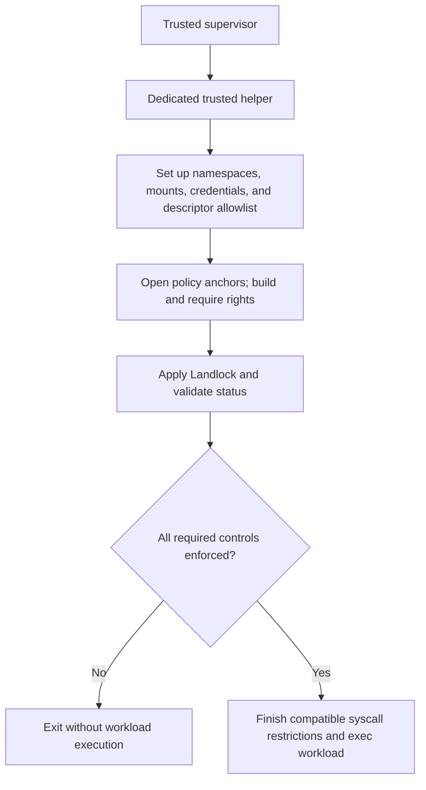

# The Rust `landlock` crate for a Linux sandbox launcher

**Assessment:** `landlock` is a good fit for adding unprivileged, kernel-enforced filesystem allowlists and TCP port restrictions to a Linux launcher. Its safe builders make runtime compatibility explicit. For an untrusted workload, require the policy before executing it: the default best-effort mode can successfully return with reduced or absent enforcement. This crate alone cannot provide complete offline operation, approved-host egress, metadata immutability, resource budgets, or a cross-platform sandbox. Those requirements need additional mechanisms. [Versioned crate documentation](https://docs.rs/landlock/0.4.7/landlock/), [compatibility implementation](https://github.com/landlock-lsm/rust-landlock/blob/v0.4.7/src/compat.rs), [network implementation](https://github.com/landlock-lsm/rust-landlock/blob/v0.4.7/src/net.rs)

**Research date: November 4, 2026. Examined stable release: `landlock` 0.4.7, published July 27, 2026.** Cargo registry search, the published-package version history, and upstream releases identify it as the latest stable release found. `cargo info landlock@0.4.7` independently confirmed the license, repository, and Rust 1.71 requirement. This report uses version-pinned APIs and tagged source rather than assuming `main` represents a published package. “Stable release” here means a published, non-prerelease version; the Rust API remains pre-1.0. [Published metadata mirrored by docs.rs](https://docs.rs/crate/landlock/0.4.7), [upstream release](https://github.com/landlock-lsm/rust-landlock/releases/tag/v0.4.7)

The supplied `./landlock.md` lead was not present beside this document. The relevant context was [the existing Landlock report](../os-support/landlock.md). Its crate version and ABI 1–9 mapping were independently confirmed; its newer-kernel claims were checked against Linux release tags. Its prompt's Windows premise is incorrect: Landlock enforces Linux workloads, including suitably configured WSL2 guests, not native Windows programs. This report leaves that context document unchanged.

## Identity, release history, and maintenance

The Cargo package is **`landlock`**, described as “Landlock LSM helpers,” maintained upstream at **`landlock-lsm/rust-landlock`**. It is the official Rust library linked by the Landlock project, rather than an unrelated product sharing its name. Mickaël Salaün (`l0kod`), Landlock's creator, is the principal observable maintainer and release publisher; releases also credit outside contributors. This is evidence of project stewardship, not a claim to have enumerated every registry owner or a support commitment. Licensing is **MIT OR Apache-2.0**. [Official integrations](https://landlock.io/integrations/), [project site](https://landlock.io/), [tagged manifest](https://github.com/landlock-lsm/rust-landlock/blob/v0.4.7/Cargo.toml), [copyright](https://github.com/landlock-lsm/rust-landlock/blob/v0.4.7/COPYRIGHT), [release records](https://api.github.com/repos/landlock-lsm/rust-landlock/releases?per_page=30)

### Releases in the last 24 months

The window is November 4, 2024–November 4, 2026. Dates below are **crate publication dates** from published-package metadata; the linked release notes explain the changes.

| Version | Published  | Relevant changes                                                                                                                             |
| ------- | ---------- | -------------------------------------------------------------------------------------------------------------------------------------------- |
| 0.4.2   | 2025-04-29 | ABI 6 signal and abstract Unix socket scopes; `HandledAccess`; `Errno`; owned-descriptor conversion; expanded kernel tests.                  |
| 0.4.3   | 2025-09-14 | Common trait implementations, documentation, and tests; no new kernel control category.                                                      |
| 0.4.4   | 2025-11-20 | All-architecture binding support, `LandlockStatus` diagnostics; MSRV raised to 1.68.                                                         |
| 0.4.5   | 2026-05-22 | ABI 7 audit controls, `RestrictSelf`, kernel errata queries; `no_new_privs()` replaces deprecated `set_no_new_privs()`; MSRV raised to 1.71. |
| 0.4.6   | 2026-07-25 | ABI 8 atomic synchronization across a process's threads through `all_threads()`.                                                             |
| 0.4.7   | 2026-07-27 | ABI 9 pathname Unix socket access through `AccessFs::ResolveUnix`.                                                                           |

Sources: [publication history](https://docs.rs/crate/landlock/0.4.7), release notes for [0.4.2](https://github.com/landlock-lsm/rust-landlock/releases/tag/v0.4.2), [0.4.3](https://github.com/landlock-lsm/rust-landlock/releases/tag/v0.4.3), [0.4.4](https://github.com/landlock-lsm/rust-landlock/releases/tag/v0.4.4), [0.4.5](https://github.com/landlock-lsm/rust-landlock/releases/tag/v0.4.5), [0.4.6](https://github.com/landlock-lsm/rust-landlock/releases/tag/v0.4.6), and [0.4.7](https://github.com/landlock-lsm/rust-landlock/releases/tag/v0.4.7).

There is a small date discrepancy worth preserving: GitHub's 0.4.6 release was **published July 27**, while the crate metadata records **July 25**. These are different publication events, not evidence of another crate version. Releases in this window are irregular: gaps of about two to six months, followed by the two July 2026 publications two days apart. There were no further published versions in the examined listing through the research date. [GitHub release timestamps](https://api.github.com/repos/landlock-lsm/rust-landlock/releases?per_page=30), [crate history](https://docs.rs/crate/landlock/0.4.7)

### Earlier milestones and migration

| Version | Published  | Why it still matters                                                                                                                                                            |
| ------- | ---------- | ------------------------------------------------------------------------------------------------------------------------------------------------------------------------------- |
| 0.1.0   | 2021-04-14 | Initial published package.                                                                                                                                                      |
| 0.2.0   | 2023-01-30 | High-level interface. Its notes call it the “first major release,” meaning a project milestone, not a SemVer 1.x release.                                                       |
| 0.3.0   | 2023-10-10 | ABI 3 truncation; three compatibility levels; `Ruleset::default()` and `set_compatibility()` supersede older APIs. Stricter validation and file-type handling changed behavior. |
| 0.3.1   | 2024-03-26 | `RulesetCreated::try_clone()`.                                                                                                                                                  |
| 0.4.0   | 2024-06-19 | ABI 4 TCP rules; `from_read()`/`from_write()` moved from `Access` to `AccessFs`; default `no_new_privs` behavior became consistent even without Landlock.                       |
| 0.4.1   | 2024-09-13 | ABI 5 device ioctl control.                                                                                                                                                     |

Sources: [published history](https://docs.rs/crate/landlock/0.4.7), [0.2.0 notes](https://github.com/landlock-lsm/rust-landlock/releases/tag/v0.2.0), [0.3.0 notes](https://github.com/landlock-lsm/rust-landlock/releases/tag/v0.3.0), [0.3.1 notes](https://github.com/landlock-lsm/rust-landlock/releases/tag/v0.3.1), [0.4.0 notes](https://github.com/landlock-lsm/rust-landlock/releases/tag/v0.4.0), [0.4.1 notes](https://github.com/landlock-lsm/rust-landlock/releases/tag/v0.4.1).

**MSRV is Rust 1.71; edition is 2021.** There is no released 1.x API in the examined history. Builders and non-exhaustive types allow additive changes within 0.4.x, but applications must handle future enum variants and avoid constructing non-exhaustive status structs directly. Read older examples carefully: replace deprecated construction/compatibility methods, use the current traits, and account for truncation separately from writing. A 0.3-to-0.4 upgrade is a compatibility boundary under Cargo's pre-1.0 version rules. Patch updates have also raised MSRV, so compiler policy needs explicit review. [Manifest](https://github.com/landlock-lsm/rust-landlock/blob/v0.4.7/Cargo.toml), [tagged changelog](https://github.com/landlock-lsm/rust-landlock/blob/v0.4.7/CHANGELOG.md), [ABI documentation](https://docs.rs/landlock/0.4.7/landlock/enum.ABI.html)

Do not derive handled rights from `BitFlags::all()`. Use explicit rights or a vetted constant such as `AccessFs::from_all(ABI::V5)`: a future crate update must not silently introduce a new deny-by-default operation into an untested policy. The constant chooses a **policy vocabulary**, not a kernel to emulate. [ABI design rationale](https://docs.rs/landlock/0.4.7/landlock/enum.ABI.html)

**Maintenance judgment:** the dated releases, new ABI integrations, outside contributions, and CI work are evidence of continuing maintenance rather than abandonment. They do not establish an independent security audit, response SLA, absence of vulnerabilities, or equivalence with every new kernel feature. The latest crate release predates released kernel controls discussed below. Pre-1.0 numbering alone provides no reliability assessment. [Release activity](https://api.github.com/repos/landlock-lsm/rust-landlock/releases?per_page=30), [test contribution workflow](https://github.com/landlock-lsm/rust-landlock/blob/v0.4.7/CONTRIBUTING.md)

## Public API and enforcement model

### Building a policy

1. **Declare handled operations.** `Ruleset::default()` probes the running kernel. Import `RulesetAttr` and call `handle_access()` for filesystem and/or network rights. Every handled operation is denied unless granted. Repeated calls accumulate handled bits.
2. **Create the kernel ruleset.** `create()` returns `RulesetCreated`; in best-effort compatibility it can represent a non-enforcing fallback rather than a real ruleset descriptor.
3. **Grant access to resources.** With `RulesetCreatedAttr`, call `add_rule()` or `add_rules()`. `PathBeneath::new(fd, rights)` grants filesystem operations on a file or hierarchy; `PathFd::new(path)` opens an `O_PATH` descriptor. `NetPort::new(port, rights)` grants TCP port operations. Rules must use rights declared as handled. `path_beneath_rules()` is an iterator helper, including file-type adaptation; inspect its error behavior rather than ignoring missing required paths.
4. **Apply and inspect.** `restrict_self()` sets `no_new_privs` by default and applies the ruleset. Accept execution only when the returned `RestrictionStatus` satisfies the application's requirements. Configuration and syscall errors are returned through `RulesetError`; path opening has its own `PathFdError`.

Sources: [ruleset implementation and public traits](https://github.com/landlock-lsm/rust-landlock/blob/v0.4.7/src/ruleset.rs), [filesystem helpers](https://github.com/landlock-lsm/rust-landlock/blob/v0.4.7/src/fs.rs), [port rules](https://github.com/landlock-lsm/rust-landlock/blob/v0.4.7/src/net.rs), [versioned builder API](https://docs.rs/landlock/0.4.7/landlock/struct.Ruleset.html).

**Handled is different from allowed.** Handling only `ReadFile` and granting reads to `/input` does not prohibit writing elsewhere: writing was never handled. To make inputs read-only for Landlock-covered operations, handle the relevant read, write, creation, removal, reference, and truncation rights, then grant only the input read rights. Historical exception: `REFER` is denied by default even when omitted; a ruleset cannot permit cross-directory linking/renaming without handling it. [Released Linux UAPI](https://github.com/torvalds/linux/blob/v7.3/include/uapi/linux/landlock.h)

Matching grants within a layer accumulate. A permissive parent-directory grant cannot be canceled with a narrower child rule: there are no subtractive deny rules. Across stacked layers, every layer must permit the operation; normal discretionary permissions and other LSMs still apply. Landlock can remove authority, never grant authority that the process lacked. Layers are irreversible, survive `exec`, and pass to future children. Closing a ruleset descriptor does not remove an installed domain. There is a 16-layer limit; nested launchers must propagate failure rather than treating an `E2BIG` enforcement error as success. [Released kernel userspace guide](https://github.com/torvalds/linux/blob/v7.3/Documentation/userspace-api/landlock.rst), [kernel design](https://docs.kernel.org/security/landlock.html)

By default, the restriction applies to the **calling thread** and its future descendants, not existing siblings. ABI 8's `all_threads(true)` requests atomic synchronization across the current process; this is an optional builder setting whose success must be required and checked when needed. Ordinary unprivileged use needs no root, daemon, or policy installation; it requires `no_new_privs`, which prevents subsequent privilege gain through exec. The kernel alternatively accepts appropriate `CAP_SYS_ADMIN` privilege in the current user namespace, but that is not needed for these examples. `no_new_privs(false)` is an explicit privileged integration choice, not a way to retain unrestricted privilege transitions safely. [Thread/enforcement builder](https://github.com/landlock-lsm/rust-landlock/blob/v0.4.7/src/restrict_self.rs), [ruleset defaults](https://github.com/landlock-lsm/rust-landlock/blob/v0.4.7/src/ruleset.rs), [kernel guide](https://github.com/torvalds/linux/blob/v7.3/Documentation/userspace-api/landlock.rst)

### Capability map for 0.4.7

Kernel releases are upstream introductions, **not runtime proof**. The minimum ABI applies to the individual control; requesting several controls requires all of them. API spellings below are from the released crate. Filesystem and networking grants are separate from handling their rights.

| Control                                    | Public Rust API                                                                                             | Minimum ABI | Introducing Linux release | Compatibility and semantic caveat                                                                                                   |
| ------------------------------------------ | ----------------------------------------------------------------------------------------------------------- | ----------- | ------------------------- | ----------------------------------------------------------------------------------------------------------------------------------- |
| File content, execution, directory listing | `AccessFs::{ReadFile, WriteFile, Execute, ReadDir}`; `PathBeneath`                                          | 1           | 5.13                      | Does not provide full metadata control; existing descriptors remain significant.                                                    |
| Directory entries and file creation        | `RemoveDir`, `RemoveFile`, `MakeChar`, `MakeDir`, `MakeReg`, `MakeSock`, `MakeFifo`, `MakeBlock`, `MakeSym` | 1           | 5.13                      | Rights belong to the containing hierarchy; granting directory rights on a non-directory can fail strict validation.                 |
| Cross-directory link/rename                | `AccessFs::Refer`                                                                                           | 2           | 5.19                      | Also needs applicable create/remove rights; moving must not expand access. May fail with `EXDEV`; omitted `REFER` remains denied.   |
| Truncation                                 | `AccessFs::Truncate`                                                                                        | 3           | 6.2                       | `WriteFile` alone does not prevent truncation. Descriptor-associated rights are captured when opening.                              |
| Local TCP bind; remote TCP connect         | `AccessNet::{BindTcp, ConnectTcp}`; `NetPort`                                                               | 4           | 6.7                       | Port only, IPv4/IPv6 TCP; no address/hostname identity. Not UDP, a packet firewall, or revocation of existing connections.          |
| Device ioctls                              | `AccessFs::IoctlDev`                                                                                        | 5           | 6.10                      | Character/block devices, coarse control with generic ioctl exceptions; pre-opened devices are not retroactively restricted.         |
| Abstract Unix socket and signal boundaries | `RulesetAttr::scope(Scope::{AbstractUnixSocket, Signal})`                                                   | 6           | 6.12                      | Restricts interaction outside the same/nested domain, not an arbitrary peer allowlist; no per-peer exception rules.                 |
| Audit behavior                             | `log_same_exec()`, `log_new_exec()`, `log_subdomains()`                                                     | 7           | 6.15                      | Logging configuration, not access authority; system audit setup matters. Default states: same exec on, new exec off, subdomains on. |
| All existing threads                       | `RestrictSelfAttr::all_threads(true)`                                                                       | 8           | 7.0                       | Default is false; best-effort may drop it. Require it and inspect `status.all_threads`.                                             |
| Pathname Unix socket connection/resolution | `AccessFs::ResolveUnix`; `PathBeneath`                                                                      | 9           | 7.1                       | Distinct from `MakeSock`; does not cover abstract sockets or revoke already connected sockets.                                      |

Sources: [ABI-to-kernel mapping](https://docs.rs/landlock/0.4.7/landlock/enum.ABI.html), released implementations for [filesystem](https://github.com/landlock-lsm/rust-landlock/blob/v0.4.7/src/fs.rs), [network](https://github.com/landlock-lsm/rust-landlock/blob/v0.4.7/src/net.rs), [scopes](https://github.com/landlock-lsm/rust-landlock/blob/v0.4.7/src/scope.rs), [audit and synchronization](https://github.com/landlock-lsm/rust-landlock/blob/v0.4.7/src/restrict_self.rs), and [Linux UAPI semantics](https://github.com/torvalds/linux/blob/v7.3/include/uapi/linux/landlock.h).

Additional implicit ptrace restrictions follow Landlock domain relationships; this is not a configurable process/PID allowlist. `RestrictSelf` can configure supported restriction flags without creating a new Landlock domain, for example subdomain audit behavior. It is not a substitute for an access ruleset. `Erratum::current()` queries fixes separately from ABI features. [Kernel guide](https://github.com/torvalds/linux/blob/v7.3/Documentation/userspace-api/landlock.rst), [standalone restriction builder](https://github.com/landlock-lsm/rust-landlock/blob/v0.4.7/src/restrict_self.rs), [errata API](https://github.com/landlock-lsm/rust-landlock/blob/v0.4.7/src/errata.rs)

### Features and dependencies

**0.4.7 declares no Cargo feature flags and no default feature set.** There is no `network`, `linux`, or `strict` feature to enable: these are runtime/API decisions. Its normal dependencies are `enumflags2`, `libc`, and `thiserror`; upstream examples/tests use additional dev dependencies. A downstream package can use a Linux-target-specific dependency, but that does not supply a sandbox backend on other platforms. [Tagged Cargo manifest](https://github.com/landlock-lsm/rust-landlock/blob/v0.4.7/Cargo.toml), [published dependency metadata](https://docs.rs/crate/landlock/0.4.7)

## Compatibility, availability, and failure

### Compile target is not runtime availability

Treat this as a **Linux-specific dependency**. Its implementation uses Unix descriptors, Linux syscalls, and Linux-specific constants; it does not provide macOS or native Windows enforcement. The all-architecture work in 0.4.4 concerns Linux architecture bindings, not cross-OS sandbox support. In a portable launcher, gate both dependency and implementation with `target_os = "linux"` and return an unsupported-policy error on other backends unless an independent backend actually enforces the requirement. [Source imports](https://github.com/landlock-lsm/rust-landlock/blob/v0.4.7/src/fs.rs), [0.4.4 release](https://github.com/landlock-lsm/rust-landlock/releases/tag/v0.4.4)

Availability depends on kernel build configuration (`CONFIG_SECURITY_LANDLOCK`), LSM activation at boot, actual ABI support, and surrounding policy. Distribution names and kernel strings are insufficient because vendors can backport features or disable them. Containers share their host kernel; installing a newer userspace crate inside one adds no kernel capability. An outer seccomp/LSM policy may also block Landlock syscalls, even when a host probe succeeds. Probe and enforce in the actual child environment after relevant namespace and credential setup. [Kernel configuration guide](https://github.com/torvalds/linux/blob/v7.3/Documentation/userspace-api/landlock.rst), [ABI rationale](https://docs.rs/landlock/0.4.7/landlock/enum.ABI.html)

WSL2 can run this Linux backend only if its guest kernel and policy permit it. Native Windows remains outside that boundary, and WSL1 must not be assumed equivalent. Test the actual filesystem used by the workload, especially a Windows-backed mounted directory versus the guest's Linux filesystem. This is a deployment recommendation, not a claim of enforcement verified on every WSL2 build. [Microsoft WSL architecture comparison](https://learn.microsoft.com/en-us/windows/wsl/compare-versions), [kernel filesystem guidance](https://github.com/torvalds/linux/blob/v7.3/Documentation/userspace-api/landlock.rst)

`Ruleset::default()` performs the ABI query internally. The crate uses the intersection of kernel capabilities and its known ABI, at most V9. `RestrictionStatus.landlock` reports `LandlockStatus::Available { effective_abi, kernel_abi }`, with a newer raw kernel ABI retained as optional diagnostic information. `NotEnabled` corresponds to `EOPNOTSUPP`; `NotImplemented` covers `ENOSYS`. Importantly, the 0.4.7 probe maps **other negative probe results** to `NotImplemented` too. Thus that status alone cannot distinguish a genuinely missing facility from a seccomp filter returning another errno. A filter that kills the process cannot produce a recoverable Rust error at all. Do not treat an availability diagnosis as proof that creation, rule insertion, and restriction will succeed. [Compatibility/probe source](https://github.com/landlock-lsm/rust-landlock/blob/v0.4.7/src/compat.rs), [returned status fields](https://github.com/landlock-lsm/rust-landlock/blob/v0.4.7/src/ruleset.rs)

### Actual compatibility APIs

| `CompatLevel`          | Unsupported requested feature                                                                                                                             | Appropriate use                                                                                 |
| ---------------------- | --------------------------------------------------------------------------------------------------------------------------------------------------------- | ----------------------------------------------------------------------------------------------- |
| `BestEffort` (default) | Drops unsupported portions and continues; can enforce a subset or nothing.                                                                                | Optional hardening of an application allowed to run without full protection.                    |
| `SoftRequirement`      | Abandons the affected object/build rather than installing its incomplete form; does not return a compatibility error. A ruleset can end up `NotEnforced`. | An optional policy that should be applied as a whole or omitted. Not a mandatory security gate. |
| `HardRequirement`      | Returns a compatibility error when a requested feature cannot be supported.                                                                               | A launcher that must refuse an insufficient sandbox.                                            |

`Compatible::set_compatibility()` affects **subsequent** builder calls and is inherited by created builders/rules unless overridden. Set strictness before `handle_access()`, `scope()`, and optional flag requests. Switching to hard requirements after unsupported operations were dropped does not retrospectively request them again. Real creation/add/enforcement syscall errors and invalid configurations still require handling; best-effort is not “ignore every error.” [Compatibility contract and implementation](https://github.com/landlock-lsm/rust-landlock/blob/v0.4.7/src/compat.rs)

`restrict_self()` returns `FullyEnforced`, `PartiallyEnforced`, or `NotEnforced` in `status.ruleset`. Also check `status.no_new_privs`, `status.all_threads` when required, and effective logging fields if logging is a requirement. **Fully enforced means the requested policy was installed, not that the policy covers every attack path or every kernel feature.** An ABI-1 vocabulary can be fully enforced while leaving truncation uncontrolled. Best-effort can set `no_new_privs` even when no Landlock policy is installed; errors after that point may leave the helper changed. Exit the helper on any failure instead of trying to recover into workload execution. [Ruleset enforcement implementation](https://github.com/landlock-lsm/rust-landlock/blob/v0.4.7/src/ruleset.rs)

The upstream crate documentation generally recommends optional hardening and logging degradation for ordinary applications. A launcher whose contract requires confinement has a different requirement; this report recommends `HardRequirement` plus status validation. That is an application policy choice, not a contradiction in the API. [Upstream compatibility guidance](https://github.com/landlock-lsm/rust-landlock/blob/v0.4.7/src/lib.rs)

### Kernel bug fixes are separate from ABI support

`Erratum::current()` reports known fixed issues, preserving unknown bits; it returns an empty set if querying errata fails or is unsupported. Empty therefore does not establish that every relevant fix is absent. Known 0.4.7 variants concern TCP socket identification, scoped signal handling, and disconnected-directory handling under bind mounts. The latter is security-relevant because older behavior could widen filesystem rights. `BitFlags::<Erratum>::from(abi)` identifies applicable known errata, not fixes proven present. [Versioned errata source](https://github.com/landlock-lsm/rust-landlock/blob/v0.4.7/src/errata.rs)

Recommended adoption policy: use vendor-supported kernels with relevant security fixes, and separately decide whether deployment must require affirmative errata evidence. Do not silently disable protections to work around missing errata. The examples below enforce requested rights, but do **not** certify kernel patch level or freedom from kernel vulnerabilities.

### Released kernel features beyond this crate

**Unreleased repository changes:** upstream `main` at commit `6a5413744f746cb471263b39234c06ea1b6cdf1b` (October 21, 2026) is five commits ahead of the 0.4.7 tag. It adds ABI 10 networking (`AccessNet::BindUdp`, `ConnectSendUdp`) and raises MSRV to **1.77**, while its manifest still says version 0.4.7. These are repository changes, not features or compiler requirements of the registry artifact examined here. Do not substitute a Git dependency and assume the same API baseline. [Exact comparison](https://github.com/landlock-lsm/rust-landlock/compare/v0.4.7...6a5413744f746cb471263b39234c06ea1b6cdf1b), [development manifest](https://github.com/landlock-lsm/rust-landlock/blob/6a5413744f746cb471263b39234c06ea1b6cdf1b/Cargo.toml), [development network API](https://github.com/landlock-lsm/rust-landlock/blob/6a5413744f746cb471263b39234c06ea1b6cdf1b/src/net.rs)

| Feature                                                                    | Evidence/status on research date                                                                | 0.4.7 consequence                                                                                                                         |
| -------------------------------------------------------------------------- | ----------------------------------------------------------------------------------------------- | ----------------------------------------------------------------------------------------------------------------------------------------- |
| UDP bind and destination connect/send control; selective audit suppression | Released in Linux 7.2 / ABI 10, present in the 7.2 implementation and 7.3 UAPI.                 | No `AccessNet` UDP variants or quiet-rule API; a newer kernel does not make them accessible through these builders.                       |
| Set `no_new_privs` atomically with successful enforcement                  | Released in Linux 7.3 / ABI 11.                                                                 | The crate still performs its separate `prctl` setup; do not assume rollback of `no_new_privs` on later failure.                           |
| Namespace-use and Linux-capability-use rules                               | Development-tree ABI 12 in the inspected `master`; outside the released 7.3 baseline used here. | No corresponding public crate API; no deployment guarantee assumed. Proposals and development code are not published crate functionality. |

Sources: [Linux 7.2 ABI implementation](https://github.com/torvalds/linux/blob/v7.2/security/landlock/syscalls.c), [Linux 7.3 ABI implementation](https://github.com/torvalds/linux/blob/v7.3/security/landlock/syscalls.c), [7.3 UAPI](https://github.com/torvalds/linux/blob/v7.3/include/uapi/linux/landlock.h), [7.3 userspace guide](https://github.com/torvalds/linux/blob/v7.3/Documentation/userspace-api/landlock.rst), [development implementation](https://github.com/torvalds/linux/blob/master/security/landlock/syscalls.c), [development guide](https://docs.kernel.org/userspace-api/landlock.html), and [crate public exports](https://github.com/landlock-lsm/rust-landlock/blob/v0.4.7/src/lib.rs). Development links move; re-check them before adopting newer APIs. No unmerged proposal is counted as supported here.

## Practical integration and requirements

### Prepare first, restrict before untrusted work

For **self-restriction**, perform trusted initialization, open only required resources, build the policy, enforce it, then begin parsing untrusted data or serving requests. For **untrusted child launch**, prefer a dedicated single-threaded helper which prepares policy and replaces itself with the workload. The supervisor remains outside the child's domain. This also avoids using normal allocation, environment lookup, or locks in a post-fork `pre_exec` closure of a multithreaded supervisor, where Rust explicitly warns those operations may be unsafe. [Rust `CommandExt` safety contract](https://doc.rust-lang.org/std/os/unix/process/trait.CommandExt.html#tymethod.pre_exec)



This is recommended launcher architecture. Namespace, credential, seccomp, and descriptor setup are not services supplied by `landlock`. Their exact order must preserve setup syscalls while ensuring all restrictions are active before workload execution. With filesystem confinement, mount/pivot operations must happen before enforcement because Landlock denies later topology changes. Set working directories and runtime grants deliberately. [Kernel topology restrictions](https://github.com/torvalds/linux/blob/v7.3/Documentation/userspace-api/landlock.rst)

Do not install thread-local Landlock from a Tokio task after a runtime has started and assume the process is confined. Either enforce before creating threads, use a fresh helper, or require ABI 8 synchronization and inspect `all_threads`. Synchronization does not undo work already performed by sibling threads, restrict existing child processes, or close their resources. [Crate synchronization contract](https://github.com/landlock-lsm/rust-landlock/blob/v0.4.7/src/restrict_self.rs)

### Resource and filesystem pitfalls

- **Descriptors are capabilities.** Close unwanted inherited files, directory handles, sockets, devices, and broker connections before admitting untrusted code; specify stdin/stdout/stderr deliberately. Landlock does not revoke existing readable/writable descriptors. Truncation and device-ioctl rights are associated with the file description at open time; receiving a more privileged descriptor can carry that authority. An inherited connected socket can still communicate. `O_PATH` policy anchors avoid opening input data for reading/writing, but do not sanitize other descriptors. [Descriptor semantics and special-file limits](https://github.com/torvalds/linux/blob/v7.3/Documentation/userspace-api/landlock.rst), [PathFd implementation](https://github.com/landlock-lsm/rust-landlock/blob/v0.4.7/src/fs.rs)
- **Runtime dependencies need grants.** Execution may require the binary, ELF interpreter/dynamic loader, shared libraries, script interpreter, modules, certificates, locale data, and subprocess tools. A single granted executable does not automatically grant its dependencies. Keep runtime trees immutable to the workload and separate from writable input/workspace trees. `AccessFs::from_read()` includes execution; explicitly choose `ReadFile | ReadDir` for data-only inputs. Denying `Execute` on a script does not stop an allowed interpreter reading and evaluating it. [Filesystem API](https://github.com/landlock-lsm/rust-landlock/blob/v0.4.7/src/fs.rs)
- **A path grant is about kernel objects and hierarchy.** Resolve trusted configuration against a controlled filesystem before opening anchors. Symlinks do not grant access to an otherwise forbidden target. Bind mounts can expose the same objects through another path, and OverlayFS's merged view is distinct from its layers; grant the hierarchy the child will actually use. A directory renamed after anchoring is not a stable pathname policy. Do not assume canonicalizing a string makes a hostile mutable tree race-free. [Bind mounts and OverlayFS guidance](https://github.com/torvalds/linux/blob/v7.3/Documentation/userspace-api/landlock.rst)
- **Parent grants are broad.** Granting `/home/user` and then adding a narrower rule for `.ssh` cannot exclude `.ssh`. Grant narrow non-overlapping roots, or build an isolated mount view / additional restrictive layer. Filesystem mutations can need several rights; a `REFER` grant alone does not authorize every rename. [Kernel rules and rename semantics](https://github.com/torvalds/linux/blob/v7.3/include/uapi/linux/landlock.h)

### Can it enforce the representative policy?

| Requirement                | What 0.4.7 can enforce                                                                                                          | Remaining requirement / recommendation                                                                                                                                                                                           |
| -------------------------- | ------------------------------------------------------------------------------------------------------------------------------- | -------------------------------------------------------------------------------------------------------------------------------------------------------------------------------------------------------------------------------- |
| Read-only inputs           | Deny new content-writing opens, truncation, removal, creation, and relevant renames in input hierarchies, while granting reads. | Handle these rights explicitly; remove writable inherited descriptors and overlapping writable grants. Metadata immutability and invisibility are separate requirements.                                                         |
| Writable workspace         | Permit selected content and directory operations within its hierarchy; deny those handled operations elsewhere.                 | Use a disjoint root and least rights. No disk quota, isolation from other writers, or transactional rollback.                                                                                                                    |
| No networking              | Deny new TCP bind/connect; add abstract-socket scoping and ABI 9 pathname-socket restrictions for their narrower roles.         | This is still not offline: UDP and other families/protocols, existing connections, and network-capable IPC remain. Add a disconnected network namespace and/or carefully designed syscall filtering plus descriptor/IPC control. |
| Only approved destinations | Allow TCP connection **ports** with `NetPort`; e.g., remote 443.                                                                | Cannot select an IP, hostname, URL, certificate, or HTTP method. Enforce direct-egress denial plus a trusted destination-validating proxy/broker or host networking policy. Proxy environment variables alone are bypassable.    |

These conclusions follow from the released [filesystem](https://github.com/landlock-lsm/rust-landlock/blob/v0.4.7/src/fs.rs), [network](https://github.com/landlock-lsm/rust-landlock/blob/v0.4.7/src/net.rs), and [scope](https://github.com/landlock-lsm/rust-landlock/blob/v0.4.7/src/scope.rs) interfaces. Port zero grants ephemeral **bind** behavior as documented by `NetPort`; it is not a wildcard for remote destinations. A 443 grant also permits any reachable IP serving that TCP port, including local services. DNS usually needs additional access and is not automatically allowed by a TCP-443 rule.

### Material gaps and mitigations

Categories: **A** underlying Landlock limitation; **B** released kernel feature missing from 0.4.7; **C** integration/deployment constraint; **D** requirement needing another isolation mechanism. Some requirements cross categories.

| Category | Gap and consequence                                                                                                                            | Practical mitigation                                                                                                                                                                 |
| -------- | ---------------------------------------------------------------------------------------------------------------------------------------------- | ------------------------------------------------------------------------------------------------------------------------------------------------------------------------------------ |
| A        | No comprehensive metadata mediation (`stat`, ownership/mode changes, timestamps, xattrs, etc.); “read-only” does not mean immutable or hidden. | Read-only mount views, separate ownership/credentials, and syscall restrictions where appropriate. Do not promise filesystem confidentiality from path lookup metadata.              |
| A        | Network rules lack destination identities; scopes lack arbitrary outside-peer allowlists.                                                      | Trusted narrow broker/proxy with independent direct-egress prevention; review IPC as an egress path.                                                                                 |
| A/C      | Existing descriptors and connections are not revoked; privileged handles can bypass intended ambient restrictions.                             | Explicit inheritance allowlist, no privileged descriptor broker, controlled standard streams, and child-process tests.                                                               |
| B        | UDP / quiet-rule controls and atomic `no_new_privs` enforcement are absent.                                                                    | Use another mechanism for UDP; if adopting lower-level/newer bindings, audit their exact ABI and fallback handling. Exit on setup errors; do not depend on atomic rollback in 0.4.7. |
| C        | Unsupported ABI, disabled LSM, syscall blocking, and unpatched kernels can defeat availability or assumptions.                                 | Strict builder settings, status checks, deployment probes, kernel updates, and a documented minimum capability policy.                                                               |
| C        | Existing threads, permissive overlapping grants, loader dependencies, mutable mounts, or too many inherited layers can break policy or launch. | Fresh helper, trusted topology, explicit rights and runtime inputs, minimal stacking, and fail closed on every setup error.                                                          |
| D        | CPU, memory, process count, time, and disk budgets; host kernel attack surface.                                                                | cgroups, rlimits, external supervision, seccomp; use a VM when a separate kernel boundary is required.                                                                               |
| D        | Portable sandboxing across native Windows and macOS.                                                                                           | Separate OS backends and explicit capability negotiation; Linux-only Landlock success says nothing about other targets.                                                              |

Sources: [released kernel limits and descriptor behavior](https://github.com/torvalds/linux/blob/v7.3/Documentation/userspace-api/landlock.rst), [filesystem UAPI caveats](https://github.com/torvalds/linux/blob/v7.3/include/uapi/linux/landlock.h), [crate compatibility source](https://github.com/landlock-lsm/rust-landlock/blob/v0.4.7/src/compat.rs), [seccomp documentation](https://docs.kernel.org/userspace-api/seccomp_filter.html), and [cgroup v2 documentation](https://docs.kernel.org/admin-guide/cgroup-v2.html). Mitigations are recommendations; each needs its own enforcement checks.

## Complete Rust examples

These are **Linux helper binaries**, using Rust 2021 and `landlock = "=0.4.7"`. Save each named example under `src/bin/` in a small package with this manifest:

```toml
[package]
name = "landlock-examples"
version = "0.1.0"
edition = "2021"
rust-version = "1.71"

[dependencies]
landlock = "=0.4.7"
```

The dependency pin fixes the API examined; a `Cargo.lock` additionally fixes transitive resolution. A portable application should instead place the dependency under `[target.'cfg(target_os = "linux")'.dependencies]` and gate the Linux module, providing an explicit unsupported result elsewhere. The manifest MSRV records the crate baseline; the compilation below used the available newer toolchain, not an MSRV qualification run. [Crate manifest](https://github.com/landlock-lsm/rust-landlock/blob/v0.4.7/Cargo.toml)

All examples return setup errors and a nonzero exit status. Neither launcher reaches `exec` after a missing path, unsupported requested control, rule insertion failure, enforcement failure, or rejected status. They rely on a **trusted caller** to supply policy arguments and an already sanitized descriptor set; they do not parse untrusted policy or implement descriptor cleanup. They are focused integration examples, not a complete container runtime.

### Filesystem confinement: `fs_launcher.rs`

Requires **all filesystem rights through ABI 9**, therefore usable support for Linux 7.1-era ABI 9 or a suitable backport. This intentionally chooses a modern filesystem baseline to deny pathname Unix socket resolution as well as file operations. For an ABI-5 deployment, explicitly review the weaker socket guarantee before changing the constant.

Preconditions: `RUNTIME`, `INPUT`, and `WORKSPACE` are existing, trusted, disjoint directory hierarchies; no alternate mount aliases undermine their separation. They must be absolute paths because the helper changes its working directory. `RUNTIME` contains the program and all permitted runtime dependencies at their usable paths; this example does not relocate ELF loader paths. The launcher is single-threaded. A supervisor must close unrelated descriptors before starting it.

```rust
use landlock::{
    Access, AccessFs, CompatLevel, Compatible, PathBeneath, PathFd,
    Ruleset, RulesetAttr, RulesetCreatedAttr, RulesetStatus, ABI,
};
use std::{error::Error, os::unix::process::CommandExt, process::Command};

fn main() -> Result<(), Box<dyn Error>> {
    let args: Vec<_> = std::env::args_os().skip(1).collect();
    if args.len() < 4 {
        return Err("usage: fs_launcher RUNTIME INPUT WORKSPACE /absolute/program [args...]".into());
    }
    let runtime = PathFd::new(&args[0])?;
    let input = PathFd::new(&args[1])?;
    let workspace = PathFd::new(&args[2])?;
    let read = AccessFs::ReadFile | AccessFs::ReadDir;
    let write = read | AccessFs::WriteFile | AccessFs::Truncate
        | AccessFs::MakeReg | AccessFs::MakeDir | AccessFs::MakeSym
        | AccessFs::RemoveFile | AccessFs::RemoveDir | AccessFs::Refer;
    let status = Ruleset::default()
        .set_compatibility(CompatLevel::HardRequirement)
        .handle_access(AccessFs::from_all(ABI::V9))?
        .create()?
        .add_rule(PathBeneath::new(runtime, read | AccessFs::Execute))?
        .add_rule(PathBeneath::new(input, read))?
        .add_rule(PathBeneath::new(workspace, write))?
        .restrict_self()?;
    if status.ruleset != RulesetStatus::FullyEnforced || !status.no_new_privs {
        return Err("required filesystem policy was not enforced; refusing exec".into());
    }
    let error = Command::new(&args[3])
        .args(&args[4..]).env_clear().current_dir(&args[2]).exec();
    Err(error.into())
}
```

Expected result: reads in `INPUT` and `WORKSPACE` are permitted; only the runtime hierarchy grants executable-file access. Workspace regular-file writes, truncation, directory creation/removal, symlink creation, and valid cross-directory references are permitted. New reads and handled writes elsewhere are denied. Inputs and runtime content cannot be newly opened for writing or truncated. Creating devices, FIFOs, and socket files, device ioctls covered by `IoctlDev` on newly opened devices, and pathname Unix socket resolution are denied everywhere because these handled rights receive no grants. Generic ioctl exceptions still apply. Ordinary permissions and other security layers may deny additional operations.

This is filesystem confinement, **not an offline policy**: no network rights or abstract-socket scopes are requested. It does not prevent metadata operations, use of inherited handles, interpretation of readable scripts, resource exhaustion, or changes by other processes. The code clears the environment to avoid carrying ambient configuration; applications may need a small explicit environment allowlist. Granting a broad runtime tree also exposes all readable data in that tree. [Rights definitions and helpers](https://github.com/landlock-lsm/rust-landlock/blob/v0.4.7/src/fs.rs)

### TCP port policy: `tcp_launcher.rs`

Requires **ABI 4** (Linux 6.7 introduction or suitable backport). It allows new outbound TCP connections to remote port 443 and denies other new TCP connections and explicit TCP binds. It applies **no filesystem restrictions**.

```rust
use landlock::{
    Access, AccessNet, CompatLevel, Compatible, NetPort,
    Ruleset, RulesetAttr, RulesetCreatedAttr, RulesetStatus, ABI,
};
use std::{error::Error, os::unix::process::CommandExt, process::Command};

fn main() -> Result<(), Box<dyn Error>> {
    let mut args = std::env::args_os().skip(1);
    let program = args.next().ok_or("usage: tcp_launcher /absolute/program [args...]")?;
    let status = Ruleset::default()
        .set_compatibility(CompatLevel::HardRequirement)
        .handle_access(AccessNet::from_all(ABI::V4))?
        .create()?
        .add_rule(NetPort::new(443, AccessNet::ConnectTcp))?
        .restrict_self()?;
    if status.ruleset != RulesetStatus::FullyEnforced || !status.no_new_privs {
        return Err("required TCP policy was not enforced; refusing exec".into());
    }
    let error = Command::new(program).args(args).env_clear().exec();
    Err(error.into())
}
```

An otherwise reachable IPv4/IPv6 TCP endpoint on remote 443 passes this Landlock layer; remote 80 and attempts to explicitly bind TCP ports fail. Actual connection success still depends on listeners, routing, and other controls. `connect()`'s implicit local-port assignment is not an explicit `bind()` grant requirement. There is no TLS/HTTPS validation: arbitrary bytes to arbitrary addresses on port 443 are allowed. UDP, existing connections, Unix sockets, and other protocols are outside this example's guarantee. To deny all **new TCP binds/connects**, omit the `NetPort` rule while retaining both handled rights; do not label that change “no networking.” [TCP rule API](https://github.com/landlock-lsm/rust-landlock/blob/v0.4.7/src/net.rs), [Linux network right definitions](https://github.com/torvalds/linux/blob/v7.3/include/uapi/linux/landlock.h)

### Mandatory capabilities and status: `check_policy.rs`

This example is an **enforcement probe, not a read-only host inventory command**: it restricts its own process and exits. It requires both TCP rights, both ABI-6 scopes, and ABI-8 all-thread synchronization (Linux 7.0-era support). There are no TCP allow rules, so new TCP binds/connects are denied. Abstract sockets and signals outside the domain are scoped; filesystem access remains unrestricted. The same gate can run before a workload in a dedicated helper.

```rust
use landlock::{
    AccessNet, CompatLevel, Compatible, Erratum, RestrictSelfAttr,
    Ruleset, RulesetAttr, RulesetStatus, Scope,
};
use std::error::Error;

fn main() -> Result<(), Box<dyn Error>> {
    let fixed = Erratum::current();
    let status = Ruleset::default()
        .set_compatibility(CompatLevel::HardRequirement)
        .handle_access(AccessNet::BindTcp | AccessNet::ConnectTcp)?
        .scope(Scope::Signal | Scope::AbstractUnixSocket)?
        .create()?
        .all_threads(true)?
        .restrict_self()?;
    if status.ruleset != RulesetStatus::FullyEnforced
        || !status.no_new_privs || !status.all_threads
    {
        return Err("required TCP, IPC, and thread coverage missing".into());
    }
    println!("Landlock: {:?}; fixed errata: {:?}", status.landlock, fixed);
    Ok(())
}
```

The diagnostic `status.landlock` describes the kernel/crate ABI intersection after successful enforcement; it is not used to guess capabilities before requesting them. `fixed` is informational: the example does not treat an empty errata set as proof of missing fixes or require all known errata. If synchronization or any requested right/scope is unavailable, the process exits with an error. If adopting a kernel-patch requirement, add that independent check before admitting the workload. [Status implementation](https://github.com/landlock-lsm/rust-landlock/blob/v0.4.7/src/ruleset.rs), [thread flags](https://github.com/landlock-lsm/rust-landlock/blob/v0.4.7/src/restrict_self.rs), [errata behavior](https://github.com/landlock-lsm/rust-landlock/blob/v0.4.7/src/errata.rs)

### Verification performed and enforcement test design

**Compiled:** all three complete examples were extracted into a standalone Cargo package and passed `cargo check --target x86_64-unknown-linux-gnu --bins` from the macOS research host, against registry `landlock` 0.4.7, without warnings. This checked the Linux code, trait imports, builder methods, and return types. **Not executed:** the helper binaries, positive/negative access probes, all-thread behavior, older-kernel fallbacks, and WSL2 enforcement. No claim of runtime security verification follows from the cross-compile. Rust 1.71 itself was not tested.

For behavioral qualification, keep the test runner unrestricted and spawn a fresh helper process for each case. The helper installs its policy, checks status, and then performs the operation or execs a tiny probe binary. Return results through a deliberately inherited pipe and wait for the child's exit. Avoid enforcing in a test runner thread, especially with `all_threads(true)`: restrictions are irreversible and could contaminate unrelated tests. Upstream also isolates enforcement tests and provides multi-kernel test tooling. [Upstream test implementation](https://github.com/landlock-lsm/rust-landlock/blob/v0.4.7/src/lib.rs), [Landlock test tools](https://github.com/landlock-lsm/landlock-test-tools)

A useful qualification matrix should include:

- An allowed input read and workspace create/write/truncate; denied input write/truncate, outside read, workspace execution, and cross-boundary rename/link. Test existing files as well as newly created ones.
- Local controlled TCP servers on allowed and denied ports, IPv4 and IPv6, with no external internet dependency. Assert the denied operation reports an access denial, not merely connection refused or timeout. Show UDP remains outside the TCP policy.
- A pre-opened writable descriptor and connected socket to demonstrate their retained authority, followed by a sanitized-inheritance case. Include symlinks, bind mounts, and the actual overlay/mount arrangement where used.
- A successful supported-kernel run and rejected older/disabled/blocked-kernel runs. Have the workload write a marker on entry; prove it never runs after a setup failure.
- A separate multithreaded helper for `all_threads(true)`, checking sibling-thread operations after synchronization. Do not run that check in the test harness process.

These are recommended tests, not results obtained during this research. Use controlled fixture paths and child processes without opening or focusing terminal/browser windows.

## Alternatives and complementary tools

Choose by the missing guarantee, not by a crate's sandbox branding. The first row is a competing **low-level binding approach**; the next rows are wrappers or independent enforcement mechanisms. None automatically replaces all the others.

| Option                                               | Coverage and platform                                                                                                                                                                                                | Observable maintenance/version evidence                                                                                                                                                               | Integration cost and fit                                                                                                                                                                             |
| ---------------------------------------------------- | -------------------------------------------------------------------------------------------------------------------------------------------------------------------------------------------------------------------- | ----------------------------------------------------------------------------------------------------------------------------------------------------------------------------------------------------- | ---------------------------------------------------------------------------------------------------------------------------------------------------------------------------------------------------- |
| `linux-raw-sys` Landlock module + your syscall layer | Generated Linux UAPI types/constants, not a safe ruleset workflow or compatibility engine. Linux only.                                                                                                               | Examined published module: 0.12.1. Its listed constants cover older Landlock controls; do not assume a newer package number means ABI 10/11 support.                                                  | High: implement unsafe boundaries, descriptor ownership, size/flag checks, runtime probing, and failure policy. Appropriate only when a demonstrated binding gap justifies owning that code.         |
| `extrasafe`                                          | Higher-level Linux syscall allowlists via seccompiler, optional Landlock path rules, and user-namespace helpers. Published docs state x86_64 support.                                                                | Latest published listing found: 0.5.1, April 16, 2024; optional dependency is `landlock ^0.3`, which predates 0.4's TCP API. This proves release/API lag, not abandonment of every repository branch. | Lower initial setup for self-restriction; still validate bundled policy assumptions and thread coverage. It is a wrapper using Landlock, not an independently maintained competing Landlock binding. |
| `birdcage`                                           | Higher-level filesystem/network launcher API: Linux namespaces, macOS Seatbelt; not native Windows.                                                                                                                  | Repository archived July 6, 2026. Its own README warns it is not a complete sandbox.                                                                                                                  | Easier common API, but archived upstream and GPL-3.0 licensing need review. Do not assume it is a current Landlock wrapper; its README identifies namespaces for Linux.                              |
| `seccompiler`                                        | Linux seccomp-BPF syscall/argument filtering; useful for reducing kernel attack surface and denying socket families/syscalls. Cannot inspect pointed-to pathname or sockaddr contents as a general path/host policy. | Former standalone rust-vmm repository archived August 18, 2026 with an explicit move to the rust-vmm monorepo. Archive status here is a relocation signal, unlike assuming no maintenance.            | Medium/high policy work: architecture-specific syscall coverage and process/thread scope. Complements Landlock's object checks; install filters without blocking unfinished setup.                   |
| `bubblewrap` (`bwrap`)                               | Linux namespace-based launcher with controlled mounts, network namespace options, and seccomp integration. Separate executable, not a Rust crate.                                                                    | Upstream has a current release history; review the installed distribution build and security fixes. No claim here that one version is universally newest or safe.                                     | Moderate process integration and mount policy work; user-namespace/deployment restrictions matter. Suitable for read-only mount views and disconnected networking that this crate cannot supply.     |
| `rlimit` + cgroups/supervisor                        | Resource limits complement access controls. `rlimit` is primarily Unix; Windows API is narrower (max stdio), not an equivalent budget sandbox. cgroup v2 is Linux-specific.                                          | `rlimit` published 0.11.0 on February 1, 2026; cgroups are kernel facilities.                                                                                                                         | Low for individual rlimits, higher for workload-wide cgroup delegation/supervision. Needed for bounded resource use; per-process limits alone do not always bound a process tree.                    |

Primary sources: [`linux-raw-sys` public Landlock bindings](https://docs.rs/linux-raw-sys/0.12.1/linux_raw_sys/landlock/index.html), [`extrasafe` package/dependency history](https://docs.rs/crate/extrasafe/0.5.1), [`extrasafe` API](https://docs.rs/extrasafe/0.5.1/extrasafe/), [`birdcage` repository and platform warning](https://github.com/phylum-dev/birdcage), [`seccompiler` repository and move notice](https://github.com/rust-vmm/seccompiler), [seccomp kernel contract](https://docs.kernel.org/userspace-api/seccomp_filter.html), [`bubblewrap` design](https://github.com/containers/bubblewrap), [`bubblewrap` releases](https://github.com/containers/bubblewrap/releases), [`rlimit` API](https://docs.rs/rlimit/0.11.0/rlimit/), [`rlimit` publication history](https://docs.rs/crate/rlimit/0.11.0), [cgroup v2](https://docs.kernel.org/admin-guide/cgroup-v2.html).

This research did not establish a second maintained safe Landlock builder crate with coverage comparable to 0.4.7. That is an evidence limit, not a claim that none exists. Raw generated bindings compete at a different abstraction level. For this launcher, the recommendation is to keep `landlock` as the Landlock binding and add a targeted complementary mechanism for each unmet policy requirement.

## Authoritative resources and adoption questions

- [Published package metadata](https://docs.rs/crate/landlock/0.4.7), [0.4.7 API reference](https://docs.rs/landlock/0.4.7/landlock/), and [tagged source](https://github.com/landlock-lsm/rust-landlock/tree/v0.4.7): the reproducible crate baseline.
- [Upstream releases](https://github.com/landlock-lsm/rust-landlock/releases) and [tagged sandboxer example](https://github.com/landlock-lsm/rust-landlock/blob/v0.4.7/examples/sandboxer.rs): migrations and integration patterns; example success is not a guarantee for another policy.
- [Linux 7.3 userspace guide](https://github.com/torvalds/linux/blob/v7.3/Documentation/userspace-api/landlock.rst) and [UAPI header](https://github.com/torvalds/linux/blob/v7.3/include/uapi/linux/landlock.h): released-kernel semantics and limits. [Current kernel documentation](https://docs.kernel.org/userspace-api/landlock.html) may include development functionality.
- [Official Landlock project](https://landlock.io/) and [test tools](https://github.com/landlock-lsm/landlock-test-tools): upstream context and multi-kernel qualification.

Unresolved questions that materially affect adoption:

1. What are the deployed kernels, enabled LSMs, outer filters, and relevant errata fixes? ABI 9 filesystem confinement and ABI 8 synchronization must be demonstrated where required, including actual containers/WSL2 filesystems.
2. Does “read-only” mean covered content operations or immutable metadata too? Does “no network” include UDP, local IPC, inherited connections, and broker-mediated access? These answers determine additional mechanisms.
3. Which executable/runtime paths, writable roots, mounts, inherited handles, and environment variables are actually required? The examples cannot establish a safe universal list.
4. Is support for released ABI 10/11 controls necessary now, and will it come from a future published crate or separately reviewed bindings? The ABI-10 work on `main` is unreleased; no newer public crate release was established here.
5. Can the target deployment pass the child-process positive/negative tests, including blocked/missing Landlock and thread synchronization? Compilation in this report leaves those runtime questions open.
