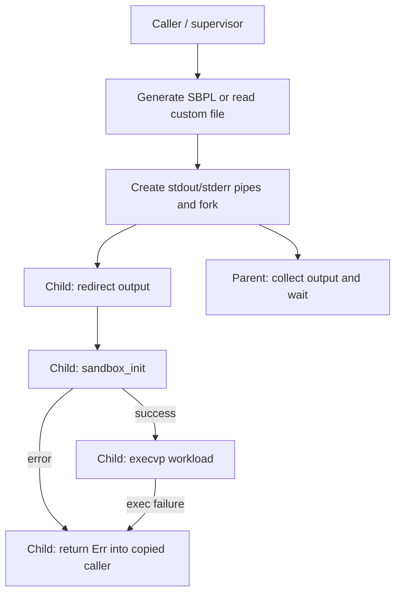

# `sandbox-host-macos` for a macOS sandbox launcher

**Assessment: do not adopt the published 0.1.1 release as a security boundary.** It is a real, published MIT-licensed macOS backend for `cross-sandbox`, and its public API can also be called directly with `cross-sandbox-core`. However, the unmodified release fails to compile on macOS in the validation environment. Source review also finds a wrong native initialization flag, policy widening, unsafe child failure handling, and incomplete process supervision. These are concrete release defects, rather than a judgment based on its pre-1.0 version number. [Package metadata][metadata], [published source archive][archive], [launcher source][process].

Research date: **November 4, 2026**. Exact latest stable release examined: **0.1.1**, published **June 17, 2026, 10:17:59 UTC**. The analysis below separates released code, native behavior independently tested here, upstream documentation, and adoption recommendations. No modified version is presented as the published crate. The requested `./seatbelt.md` was not present beside this document; the contextual report was located at [Seatbelt sandboxing](../os-support/seatbelt.md) and used for leads. Its API/deprecation claims were checked against the SDK, installed Apple manual, and native probes below.

## Identity, releases, and maintenance

| Item                                 | Verified finding                                                                                              |
| ------------------------------------ | ------------------------------------------------------------------------------------------------------------- |
| Package / Rust library               | `sandbox-host-macos` / `sandbox_host_macos`; library only, no shipped executable                              |
| Publisher and current registry owner | `WeiChens`, display name `wei`; this identifies a registry account, not a verified maintenance team           |
| License                              | MIT in the published manifest                                                                                 |
| Linked repository                    | `https://github.com/wei/cross-sandbox`                                                                        |
| Parent architecture                  | `cross-sandbox` facade, shared `cross-sandbox-core`, and platform backends                                    |
| Published provenance                 | `.cargo_vcs_info.json` records revision `a45e9761aa1cd24acce9714a3eaa40d61f9eb827`, path `sandbox-host-macos` |
| Rust requirement                     | Edition 2021; no `rust-version` declared, so no verified MSRV commitment                                      |
| macOS floor / architectures          | No explicit minimum OS version or tested CPU matrix declared in this package                                  |

Sources: [registry metadata][metadata], [owners endpoint][owners], [normalized manifest][manifest], [archive containing VCS provenance][archive].

The registry API and sparse index list **only 0.1.1**, not yanked, with no prereleases. For the 24-month window November 4, 2024–November 4, 2026, the entire observable release history is this one publication. There is no earlier published backend milestone or backend major release to describe. The parent facade has separate releases: 0.1.0 at 09:34:51 UTC, 0.1.1 at 10:10:20 UTC, and 0.2.0 at 10:19:11 UTC, all June 17, 2026; 0.2.0 declares platform-backend dependencies. Those are **facade versions**, not backend releases or evidence that this backend was fixed. [Backend index][index], [facade index][facade-index], [facade package documentation][facade].

The repository URL in both registry metadata and package manifests was checked. GitHub's unauthenticated repository, commits, releases, and issues API endpoints returned **404** on the research date. This could mean a removed, renamed, private, or incorrectly linked repository; the evidence does not distinguish them. Accordingly, repository identity is verified only as the publisher's declared link, not as accessible matching history. No release notes, commit cadence, issue response history, or unreleased fixes could be authenticated. The registry still distributes the source archive independently. [Declared repository][repository], [repository API][repository-api].

**Maintenance judgment:** one release, an inaccessible linked repository, and a reproducible native compile failure make adoption risky without an accountable maintainer or an owned fork. They do not prove abandonment. There is no verified migration guide or API stability promise. Pin both backend and core when investigating; moving the facade from 0.1 to 0.2 is a separate compatibility decision. Dependency resolution can raise the effective compiler requirement even though the package declares no MSRV.

## Public API and configuration semantics

The backend exports `MacOSSandboxHost` and the public `seatbelt` module. Configuration and execution types come from **another package**, `cross-sandbox-core`; import its `PlatformSandbox` trait to call the trait methods. The intended workflow is:

1. Construct `SandboxConfig`, containing `FileRule` and `NetRule` values.
2. Call `MacOSSandboxHost::new(config)`, which only calls `config.validate()` and stores it.
3. Call `PlatformSandbox::exec(command, args)` or `exec_streaming(command, args)`.
4. Receive `SandboxResult`, or a `StreamReceiver` carrying `StreamEvent::Stdout`, `Stderr`, and `Done`.

`audit_summary()` returns a descriptive string. `validate_config(&config)` repeats generic validation; it does not install a sandbox, test macOS support, or verify enforcement. [Backend API source][lib], [core trait][trait], [core errors/results][errors].

Generic validation rejects two empty rule lists, empty file patterns, and glob syntax that `globset` cannot parse. It does **not** validate network host syntax, SBPL quoting, contradictory rules, availability of native APIs, or whether the requested features are enforced. `SandboxConfig::from_json` deserializes but does not itself call `validate`. [Configuration source][config].

### What the generator actually emits

| Requested control                                  | Released macOS translation                               | Consequence                                                                                                              |
| -------------------------------------------------- | -------------------------------------------------------- | ------------------------------------------------------------------------------------------------------------------------ |
| Baseline                                           | `(version 1)` and `(deny default)`                       | Unmentioned operations are denied, assuming a valid profile is successfully installed                                    |
| `FileRule::read_only(path)`                        | `allow file-read*` with `subpath`                        | Adds read access; does not subtract an overlapping write grant                                                           |
| `FileRule::inherit(path)`                          | Emits `file-read* file-write* file-exec*` with `subpath` | **Invalid on the tested OS**: `file-exec*` is an unbound variable; not a copied permission set or independent filesystem |
| `FileRule::deny(path)`                             | Nothing                                                  | Cannot carve secrets or read-only inputs out of a broader allow                                                          |
| `NetAction::Deny`, including `NetRule::deny_all()` | Nothing                                                  | Does not cancel an existing allow                                                                                        |
| Allow host `*`                                     | `allow network* (remote ip "*:*")`                       | Requested port is discarded                                                                                              |
| Allow host containing `*`, such as `*.example.com` | Warns and uses `*:*`                                     | **Silently broadens destination and port coverage apart from a log warning**                                             |
| Other allowed host and port                        | `remote ip "host:port"`, with `0` becoming `*`           | Domain names and numeric IPs are rejected by the tested OS; `localhost` is accepted                                      |
| `NetProtocol::Tcp`, `Udp`, `Any`                   | Protocol field is ignored; always emits `ip`             | A TCP request does not enforce TCP-only access                                                                           |
| Process, Mach/XPC, POSIX IPC, devices              | No typed configuration                                   | Custom SBPL is needed; generated policy supplies no workload runtime baseline                                            |
| CPU, memory, disk, output limits                   | No corresponding native limits                           | A timeout setting is the only resource-related launcher field, with defects below                                        |

All translations above are from the [published generator][seatbelt], not from the names or documentation of shared types. The shared configuration describes first-match file-rule semantics, but this backend does not implement that algorithm. It emits a collection of grants and omits denies. Rearranging a deny and an allow cannot repair this mismatch. This is detected documentation/code drift; this report follows the released implementation. [Shared ACL documentation][acl], [configuration documentation][config].

`SandboxConfig::default()` and `dev_config()` include read-only patterns based on `/home/*/**` and `/etc/**`, plus network allows for `127.0.0.1`, `localhost`, and everything. `timeout_secs` is zero (unlimited). `enable_network_isolation` defaults to true, but the macOS backend never consults it. `verbose_audit` is also unused here. Serde's missing-field defaults differ: `{}` gives empty rule lists rather than the `Default` implementation's rules, and consequently fails validation at host construction. Prefer explicit lists. [Configuration][config], [launcher][process].

The independent profile helpers are string constructors, not applied policies:

- `generate_strict_profile()` permits reads in system-library directories, writes under literal `/tmp`, and purported loopback networking, including a numeric host rejected in local testing.
- `generate_readonly_profile()` grants reads everywhere and broad networking.
- `generate_no_network_profile()` grants reads and writes everywhere but no network grants.

None is automatically selected by a mode flag; `exec` uses `generate_profile`, unless a custom profile file is configured. Names such as “strict” do not establish executable access, correct paths, or confinement. [Generator and helper source][seatbelt].

### Features and dependencies

**There are no Cargo feature flags and no default feature set in this package.** Disabling default features cannot remove the streaming code or fix the native build. Normal dependencies are `log ^0.4`, `thiserror ^2`, and `cross-sandbox-core ^0.1.1` (internally renamed `sandbox-core`); macOS additionally uses `libc ^0.2`. Core brings Serde, JSON, and `globset`. There is no build script, native helper binary, proxy, privileged service, or vendored sandbox engine. [Backend manifest][manifest], [core manifest][core-manifest].

## Native mechanism and compatibility

Seatbelt is the macOS process sandbox mechanism. App Sandbox uses macOS sandbox facilities within Apple's signing/entitlement model; it is not interchangeable with supplying arbitrary SBPL to a command launcher. Here the backend directly declares and calls `sandbox_init` and `sandbox_free_error`, then uses libc `fork`/`execvp`. It does **not** invoke `/usr/bin/sandbox-exec`, provision App Sandbox entitlements, or use an XPC helper. “Host” means the backend implementing `PlatformSandbox`, not a daemon or virtual machine. Its only IPC is output pipes inside the launcher and local Rust channels for streaming. [Native calls][seatbelt], [launcher][process], [Chromium's distinction][chromium-readme], [Apple App Sandbox][apple-app].

Apple's installed SDK `usr/include/sandbox.h` declares `sandbox_init` and `sandbox_free_error` introduced in **macOS 10.5 and deprecated in 10.8**, with the message “No longer supported.” The header itself is deprecated and directs app developers to App Sandbox. These symbols still existed and could be called in the research environment; deprecation is not proof of removal. The SDK documents `SANDBOX_NAMED` for built-in profile names; other flag values are reserved in its public contract. Raw custom profiles with flags zero are an undocumented usage, not a supported replacement public API. Chromium's implementation also declares private parameterization and compile/apply interfaces itself. [Apple-authored SDK header, mirrored for linking][sdk-header], [Chromium FFI][chromium-ffi]. The installed header was independently inspected, rather than relying on the contextual Seatbelt report's description.

**Critical mismatch:** `apply_seatbelt(profile)` passes **1 (`SANDBOX_NAMED`)** even though its argument and both launcher paths supply SBPL source text. An isolated native call with `(version 1) (allow default)` returned `-1` and `profile not found` with flag 1; the same source with flag 0 returned 0. This confirms the mismatch on the tested OS. Merely correcting this constant would still leave the remaining defects, and would depend on the undocumented raw-profile route. [Released native wrapper][seatbelt], [SDK contract][sdk-header].

No root check, special entitlement, signature validation, application bundle, or privileged installation is implemented by this crate. Ordinary unprivileged child self-confinement is the intended mechanism. The local native probes and alternative example ran without elevation or added entitlements. That does not establish App Store acceptability, compatibility inside an already sandboxed app, or suitability for every hardened/signing configuration. Apple's header says an already sandboxed process cannot simply apply another profile through this interface. Unix permissions, TCC, and other OS protections still constrain any granted access. [SDK contract][sdk-header], [Apple App Sandbox][apple-app].

There is no package-specific minimum supported macOS version or arm64/x86_64 enforcement matrix. The native API's historical introduction date is **not** the crate's runtime support floor. Linux, Windows, and WSL2 compile different code: host execution methods return `SandboxError::Unsupported`; profile generation remains available. A non-macOS docs.rs build can therefore succeed without checking the native process module. [Platform branches][lib].

## Launch ordering, failures, and trust boundary

The released source intends this flow:



The parent is not intentionally sandboxed. Successful self-confinement is process-local, persists across exec, and constrains descendants; it does not restrict unrelated processes or create another kernel. The public `seatbelt::apply_seatbelt` instead restricts **whichever process calls it**; calling it in the supervisor would restrict that supervisor. The crate offers no undo. Native sandbox extensions/brokers can add access in other architectures, but this package exposes no such machinery. [Released wrapper][seatbelt], [Chromium process/child model][chromium-readme].

Material defects in **0.1.1**:

| Finding                                                                    | Status / practical effect                                                                                                                                             |
| -------------------------------------------------------------------------- | --------------------------------------------------------------------------------------------------------------------------------------------------------------------- |
| `config: &SandboxConfig` captured by `thread::spawn` in streaming launcher | **Compile failure reproduced**, E0521 at `process.rs:266`; macOS module compilation fails even if only synchronous execution is used                                  |
| `file-exec*` in every generated writable grant                             | **Native syntax failure reproduced**: macOS rejects it as an unbound variable, so changing only the initialization flag still does not make workspace profiles usable |
| SBPL passed as a named profile                                             | **Native mismatch reproduced** independently; normal generated and custom-file profiles cannot be assumed to install                                                  |
| Child uses `?` on sandbox and exec errors                                  | **Source-confirmed**: returns into the forked copy of caller code instead of terminating with `_exit`; parent receives no setup-error handshake                       |
| Allocation, formatting, logging, and profile compilation after `fork`      | **Source-confirmed**: unsafe integration with multithreaded callers; inherited locks can deadlock before exec                                                         |
| Synchronous stdout read to EOF before stderr read                          | **Source-confirmed**: stderr backpressure can deadlock; timeout starts only after both output reads finish                                                            |
| Timeout kills only immediate PID                                           | **Source-confirmed**: no process-group/tree cleanup; descendants can retain pipes and keep work running                                                               |
| Streaming watcher emits `Done` independently of reader completion          | **Source-confirmed**: final output can arrive later; watcher errors become result `exit_code = -1` with text in `audit_summary`, not a returned error                 |
| Pipe/fork failure paths incomplete                                         | **Source-confirmed**: descriptors can leak after fork failure; streaming creates pipes before reading the profile and can leak them on read error                     |

Sources: [launcher][process], [Rust's post-fork safety contract][pre-exec]. These findings are research results, not linked upstream acknowledgments or published fixes. No fix release was found; inaccessible issue history prevents checking whether maintainers already know about them.

On a sandbox setup failure, the intended target is not reached through that invocation's `execvp`, but copied caller code can continue **without the requested sandbox**. That is not an acceptable fail-closed launcher contract. Catching `Err` in the original supervisor cannot repair errors that occur in the child. An application could put the entire backend into a disposable helper that unconditionally exits on return, but this would not repair policy generation, flags, deadlocks, or tree cleanup. Rewriting those responsibilities is a substantial owned launcher implementation, not a configuration workaround.

`SandboxError::Config` covers malformed input/custom-profile reads; `apply_seatbelt` maps native failures to `PermissionDenied`; process functions can produce `Io`, `ProcessError`, and `Timeout`. Non-macOS execution produces `Unsupported`. The common enum's `FileAccessDenied`, `NetworkDenied`, and `NotImplemented` variants do **not** mean this backend reports workload denials individually. Usually the workload just receives an OS error and may even exit successfully after ignoring it. Neither `SandboxResult`, its PID/string audit fields, nor `Done` contains an enforcement attestation or negotiated capability set. [Errors/results][errors], [backend][lib], [launcher][process].

There is no `support_info`, required-capability builder, installation acknowledgment, or per-control enforcement status. `new`, `validate_config`, successful compilation, and a zero workload exit are all insufficient checks. For this release, a caller requiring the stated guarantees should **refuse adoption/launch**, rather than attempt an unsandboxed fallback.

## Paths, networks, and practical guarantees

### Filesystem policy is not an object capability

`sanitize_path` removes trailing `/**`, `/*`, then trailing `*`; it does not implement glob matching, canonicalize, or escape SBPL strings. Its own test expects `/Users/*/**` to become **`/Users`**. Empty input becomes `/` when calling the generator directly, although host config validation rejects an empty pattern. Embedded stars are not translated to regular expressions. Quotes/backslashes are inserted verbatim into quoted SBPL: attacker-controlled policy strings can break syntax or inject rules. Generic glob validation is not an SBPL injection defense. [Published generator and tests][seatbelt].

For an owned replacement, resolve existing roots before policy creation, parameterize paths rather than concatenate policy source, and keep profile files outside workload-writable directories. `/tmp`, `/var`, and `/etc` aliases require attention to their resolved locations. Validate disjoint read-only and writable roots; a read grant inside a write-granted subtree cannot remove that write access in this generator. Canonicalization at setup does not freeze directory identity, prevent later renames, or make two hard-link names separate objects. Use supervisor-owned staging directories, control writable ancestors, and test aliases, hard links, renames, and races. Seatbelt does not provide an alternate root filesystem or snapshot. [Chromium policy parameterization/design][chromium-design], [published path translation][seatbelt].

### Networking is not destination authentication

An empty allow list, or only `NetRule::deny_all()`, generates no network grants under default-deny. This is a useful **policy intent**, but 0.1.1 does not provide a usable verified launch implementing it. A trailing deny after an allow does nothing. `localhost:PORT` can express a local endpoint in native SBPL; the crate's generator applies the broader `network*` and `ip` families and ignores requested transport. Wildcard domains instead open all generated remote addresses/ports. Numeric IP and domain entries failed native parsing in local probes. [Generator][seatbelt].

A port identifies a listening endpoint, not an approved company, domain, TLS peer, or HTTP URL. For destination allowlists, use a separate trusted proxy and a native policy that permits only its exact loopback TCP port. Keep direct Internet, other loopback ports, UDP, DNS channels, and unneeded Unix sockets denied. The proxy must validate each connection/redirect, DNS resolution and rebinding, IP classes, destination ports, and TLS/HTTP semantics appropriate to the requirement. Environment proxy variables are hints, not enforcement. This crate includes **no proxy**. [Chromium parameterized profiles][chromium-design], [Anthropic's proxy-based launcher design][srt].

### Boundaries and gap classification

| Requirement / pitfall                         | Classification                                           | Consequence and mitigation                                                                                                                         |
| --------------------------------------------- | -------------------------------------------------------- | -------------------------------------------------------------------------------------------------------------------------------------------------- |
| Read-only inputs plus writable workspace      | Native capability, broken/incomplete wrapper integration | Possible in SBPL with disjoint grants; this release's launch and translation require repair                                                        |
| Confidential inputs only, no other host reads | Policy/runtime integration                               | Allow executable, libraries, runtime files and required services explicitly; broad read access also exposes credentials                            |
| No networking                                 | Native capability plus integration constraints           | Deny socket operations; scrub inherited connected sockets and audit brokers/system services; do not claim no exfiltration from socket rules alone  |
| Approved destinations                         | Missing crate facility                                   | Confine to a trusted proxy, then enforce identity there; crate host strings do not supply this                                                     |
| Existing file descriptors, sockets, stdin     | Native/integration boundary                              | Crate closes its own pipe ends but does not scrub arbitrary descriptors or replace stdin; use a clean helper with an explicit descriptor allowlist |
| Existing process state and threads            | Integration defect                                       | A fork inherits credentials, address-space secrets and resources; start a minimal fresh helper before untrusted input or plugins                   |
| Descendants                                   | Native inheritance plus supervisor gap                   | Applied restrictions inherit, but timeout/reaping is not process-tree management; own a process group and drain output concurrently                |
| IPC/system services                           | Missing typed controls                                   | Custom profile can govern Mach/XPC and Unix/POSIX IPC; reachable services or inherited rights can act with greater authority                       |
| Executables and runtimes                      | Missing generated baseline                               | Default-deny without a real exec/runtime policy can prevent startup; profile-loading success is not workload compatibility                         |
| CPU/memory/disk exhaustion                    | Needs complementary limits                               | Add supervisor deadlines/output caps and suitable native limits; use a VM if resource boundaries require stronger guarantees                       |
| Hostile native code / kernel exploits         | Shared-kernel limitation                                 | Seatbelt can confine malicious operations if correctly deployed, but cannot isolate kernel vulnerabilities; consider a VM and patch the OS         |
| Later host execution of writable artifacts    | Application trust boundary                               | Hooks, build scripts, and tool config written by a worker can execute later outside confinement; stage/review outputs and protect control files    |

Descriptor behavior is explicitly documented by [Chromium][chromium-readme]. Do not assume installing a policy revokes resources already opened. No amount of path-rule validation sanitizes secrets already inherited in memory or environment. The backend uses `execvp` (PATH search), inherits environment and working directory, and offers no per-exec API for clearing environment, changing directory, selecting credentials, or closing descriptors. A custom `seatbelt_profile_path` **replaces** generated policy; ACL lists are not merged, while generic validation still requires at least one rule. [Launcher][process], [configuration][config].

No package-specific RustSec advisory was found in the advisory database's path listing for `sandbox-host-macos` or `cross-sandbox` on the research date. The linked repository's security/issue status could not be inspected. This is a bounded search result, **not evidence of security or a clean audit**. The source findings above already materially disqualify this release. [RustSec database][rustsec].

## Rust examples and verification

### Pinned dependency and explicit refusal for this release

This is the actual dependency configuration for direct integration; neither the facade nor an external helper is required by the package. Use an isolated example package outside a larger workspace, or retain `[workspace]` below to isolate it. No feature flags apply.

```toml
[package]
name = "macos-backend-review"
version = "0.1.0"
edition = "2021"

[workspace]

[target.'cfg(target_os = "macos")'.dependencies]
sandbox-host-macos = "=0.1.1"
cross-sandbox-core = "=0.1.1"
```

`src/main.rs` below demonstrates real configuration and the absence of a sufficient enforcement check. It deliberately refuses execution. It is **not a working launcher**: on macOS the dependency fails before this program can compile, and on other platforms it exits with an error.

```rust
fn main() -> Result<(), Box<dyn std::error::Error>> {
    #[cfg(target_os = "macos")]
    {
        use cross_sandbox_core::{FileRule, NetRule, PlatformSandbox, SandboxConfig};
        use sandbox_host_macos::{seatbelt, MacOSSandboxHost};
        let config = SandboxConfig {
            name: "read-input-write-workspace".into(),
            file_permissions: vec![
                FileRule::read_only("/opt/job/input"),
                FileRule::inherit("/opt/job/workspace"),
            ],
            network_permissions: vec![NetRule::deny_all()],
            timeout_secs: 10,
            ..SandboxConfig::default()
        };
        let _profile = seatbelt::generate_profile(
            &config.file_permissions, &config.network_permissions,
        );
        let host = MacOSSandboxHost::new(config.clone())?;
        host.validate_config(&config)?;
        // Validation supplies no installation or enforcement acknowledgment.
        return Err("0.1.1 cannot establish required launch guarantees; refusing".into());
    }
    #[cfg(not(target_os = "macos"))]
    Err("macOS backend required; refusing to launch".into())
}
```

The hypothetical execution call would be `host.exec("/absolute/program", &args)` with `args: Vec<String>`. It is intentionally absent from the example: this release cannot safely fulfill its stated requirements. Do not ship this dependency configuration under the assumption that avoiding streaming avoids the compile error.

**Compile result:** the unmodified published source archive failed `cargo check` on **macOS 27.2, arm64 (Apple M4 Max), Rust/Cargo 1.98.1**, with E0521 at `src/process.rs:266`: borrowed `config` escapes into a `'static` thread closure. The manifest has no feature that disables that function. No patched-backend execution was performed. The configuration example is source-reviewed, but cannot be labeled compiled on macOS because its dependency fails first.

### Executed alternative: isolated write/network probes through `sandbox-exec`

The following is an **independent, std-only alternative**, not a hidden substitute implementation of `sandbox-host-macos`. It shows controls available in the native system while the crate is unusable. It re-executes a trusted test workload under `/usr/bin/sandbox-exec`; the supervisor stays unrestricted. No signing/entitlement additions or third-party helper installation were needed on the tested host. `sandbox-exec` itself is deprecated; this is not an Apple-supported long-term API commitment. Its Apple-authored installed manual (`/usr/share/man/man1/sandbox-exec.1`, dated March 9, 2017) was inspected directly: it documents `-p` and `-D` and explicitly marks the command deprecated.

Two modes demonstrate the same filesystem policy: `none` grants no network operations; `proxy` permits outbound TCP to one exact loopback port. The listeners are test endpoints, **not filtering proxies**. There is no domain-allowlist guarantee in this example.

**Deliberate limitation:** this small profile allows **all file reads**, including host credentials, to keep the runtime baseline explicit and executable. Inputs are read-only and writes are confined to the workspace, but read confidentiality is not a requirement it meets. It also permits metadata reads, sysctl reads, and process execution. A production input-only read policy needs a separately tested executable/runtime allowlist. Do not widen a production policy until it works and then call it least privilege.

Use a separate project with this manifest:

```toml
[package]
name = "seatbelt-launch-probe"
version = "0.1.0"
edition = "2021"

[workspace]
```

`src/main.rs`:

```rust
use std::{error::Error, io, path::PathBuf};
type Result<T> = std::result::Result<T, Box<dyn Error>>;
fn require(ok: bool, message: &str) -> Result<()> {
    if ok { Ok(()) } else { Err(message.into()) }
}
fn denied<T>(result: io::Result<T>) -> Result<()> {
    match result {
        Err(e) if e.kind() == io::ErrorKind::PermissionDenied => Ok(()),
        Err(e) => Err(format!("expected permission denial, got {e}").into()),
        Ok(_) => Err("required denial was not enforced".into()),
    }
}
fn main() -> Result<()> {
    #[cfg(not(target_os = "macos"))]
    return Err("this example requires macOS Seatbelt".into());
    #[cfg(target_os = "macos")]
    run()
}
#[cfg(target_os = "macos")]
fn run() -> Result<()> {
    use std::{ffi::OsString, fs, net::{SocketAddr, TcpListener, TcpStream},
              process::{Command, Stdio}, time::Duration};
    let args: Vec<OsString> = std::env::args_os().collect();
    require(args.len() == 4 || args.len() == 7,
            "usage: seatbelt-launch-probe INPUT WORKSPACE none|proxy")?;
    if args[1] == "--worker" {
        require(args.len() == 7, "invalid worker arguments")?;
        let input = PathBuf::from(&args[2]);
        let workspace = PathBuf::from(&args[3]);
        let mode = args[4].to_str().ok_or("invalid mode")?;
        let allowed: SocketAddr = args[5].to_str().ok_or("invalid address")?.parse()?;
        let forbidden: SocketAddr = args[6].to_str().ok_or("invalid address")?.parse()?;
        let contents = fs::read(input.join("input.txt"))?;
        denied(fs::write(input.join("blocked-write.txt"), b"must fail"))?;
        denied(TcpStream::connect_timeout(&forbidden, Duration::from_secs(1)))?;
        if mode == "proxy" {
            let _connection = TcpStream::connect_timeout(&allowed, Duration::from_secs(1))?;
        } else {
            require(mode == "none", "invalid mode")?;
            denied(TcpStream::connect_timeout(&allowed, Duration::from_secs(1)))?;
        }
        fs::write(workspace.join("result.txt"), contents)?;
        return Ok(());
    }
    require(args.len() == 4, "invalid supervisor arguments")?;
    let input = fs::canonicalize(&args[1])?;
    let workspace = fs::canonicalize(&args[2])?;
    require(input.is_dir() && workspace.is_dir(), "roots must be directories")?;
    require(!input.starts_with(&workspace) && !workspace.starts_with(&input),
            "roots must be disjoint")?;
    let mode = args[3].to_str().ok_or("invalid mode")?;
    require(mode == "none" || mode == "proxy", "mode must be none or proxy")?;
    let _ = fs::read(input.join("input.txt"))?;
    let allowed_listener = TcpListener::bind("127.0.0.1:0")?;
    let forbidden_listener = TcpListener::bind("127.0.0.1:0")?;
    let allowed = allowed_listener.local_addr()?;
    let forbidden = forbidden_listener.local_addr()?;
    let exe = fs::canonicalize(std::env::current_exe()?)?;
    let mut profile = String::from(r#"
(version 1)
(deny default)
(allow process-exec)
(allow sysctl-read)
(allow file-read-metadata)
(allow file-read*)
(allow file-read* file-write* (subpath (param "WORKSPACE")))
"#);
    if mode == "proxy" {
        profile.push_str("(allow network-outbound (remote tcp (param \"PROXY\")))\n");
    }
    let parameter = |key: &str, value: &std::ffi::OsStr| {
        let mut p = OsString::from(format!("{key}="));
        p.push(value);
        p
    };
    let proxy = OsString::from(format!("localhost:{}", allowed.port()));
    let status = Command::new("/usr/bin/sandbox-exec")
        .arg("-p").arg(profile)
        .arg("-D").arg(parameter("WORKSPACE", workspace.as_os_str()))
        .arg("-D").arg(parameter("PROXY", &proxy))
        .arg(&exe).arg("--worker").arg(&input).arg(&workspace).arg(mode)
        .arg(allowed.to_string()).arg(forbidden.to_string())
        .current_dir(&workspace).env_clear()
        .stdin(Stdio::null()).stdout(Stdio::null()).stderr(Stdio::inherit())
        .status()?;
    require(status.success(), &format!("sandbox setup or worker verification failed: {status}"))
}
```

Create existing, disjoint `input` and `workspace` directories, place `input.txt` inside `input`, and run:

```sh
cargo build --color never
./target/debug/seatbelt-launch-probe ./input ./workspace none
./target/debug/seatbelt-launch-probe ./input ./workspace proxy
```

Each run must read `input/input.txt`, fail to create `input/blocked-write.txt` with a permission denial, and fail to connect to a live listener on a forbidden loopback port with a permission denial. `none` must also fail to connect to the other live listener; `proxy` must connect to it. Only after these checks pass does the workload copy the input to `workspace/result.txt`. Any missing executable, bad parameter/profile, nonzero child exit, unexpected denial error, or unexpectedly allowed probe returns failure; there is no unsandboxed retry. A connection refusal caused by an absent server does **not** count as a verified sandbox denial.

This tests a few concrete operations, not every path or socket family. The permission check accepts Rust's `PermissionDenied` mapping rather than all connection errors. It uses resolved, disjoint roots and `-D` parameters without a shell. Production callers must additionally prevent root/ancestor replacement, close unrelated descriptors, protect helper binaries, remove secrets from the environment, control standard streams, and run deadlines/output caps/tree cleanup outside the helper. Inherited stderr remains a supervisor-approved output channel. `--worker` is only a private dispatch convention, not proof that any arbitrary caller invoking that mode is sandboxed; keep the workload binary trusted and use the supervisor entry point.

**Validation:** this std-only example was compiled **and both modes executed successfully** on macOS 27.2 arm64 with Rust 1.98.1. Each produced the expected output file and passed the stated allow/deny checks. The external test harness created temporary fixtures and imposed a 15-second deadline. No terminal/browser window was opened and the test runner itself was not sandboxed. No other OS, architecture, domain policy, or arbitrary workload was tested. A compile on another platform would only demonstrate the explicit refusal branch.

The separate native probes also confirmed:

- SBPL passed to `sandbox_init` with flag 1 failed as a missing named profile; flag 0 accepted the same profile.
- `/usr/bin/sandbox-exec` rejected `remote ip "example.com:443"` and `remote ip "127.0.0.1:443"` with `host must be * or localhost in network address` and exit 65.
- The corresponding `localhost:443` and `*:*` profile forms were accepted. Acceptance alone was not used as proof of restriction.
- A profile containing the generated `file-exec*` token failed with exit 65 and `unbound variable: file-exec*`.

These probes ran in disposable subprocesses through native FFI or the OS launcher. They did not run a modified copy of the crate or install persistent security state.

### Tests required before adoption of a repaired implementation

Use an unrestricted test runner launching a **fresh disposable child per policy**. Never apply an irreversible sandbox in a test-runner thread. Use private fixtures and local listeners rather than external network dependencies. For this repository, implement runtime tests at the appropriate gated integration tier and run them with nextest through the package's `just test-l2` recipe; the checks above were standalone research probes, not added repository tests.

| Test group             | Required observations                                                                                                                                                                          |
| ---------------------- | ---------------------------------------------------------------------------------------------------------------------------------------------------------------------------------------------- |
| Allowed work           | Read fixture, create/replace workspace outputs, load the actual executable/runtime, run permitted descendants                                                                                  |
| File denials           | Write input, write outside workspace, read a confidential fixture under a narrow-read policy; ensure the same operations succeed in unsandboxed controls                                       |
| Aliases and mutation   | `/tmp` versus `/private/tmp`, symlinks crossing roots, hard links, renaming writable ancestors, replacement during startup, quotes/backslashes/glob metacharacters                             |
| Networking             | Live IPv4 and IPv6 listeners, other loopback ports, Internet endpoints via controlled fixtures, UDP/DNS, Unix sockets, inherited connected sockets; distinguish denials from unreachable hosts |
| Destination broker     | Reject unlisted names, raw IP bypass, DNS rebinding, redirects and alternate transports; proxy death must not enable direct access                                                             |
| Capability unavailable | Non-macOS refusal, unavailable native facility/helper, already-sandboxed helper; target-start sentinel must remain absent                                                                      |
| Launch failure         | Malformed SBPL, missing/unreadable custom profile, invalid executable, NUL argument, simulated pipe/fork failure; verify both parent error and child termination                               |
| Supervision            | Large simultaneous stdout/stderr, invalid UTF-8 output, timeout before EOF, retained descendant pipe, dropped stream receiver, final output ordering, no surviving process group               |

Validate helper installation separately from workload success: an error pipe with close-on-exec semantics can distinguish setup/exec failure from normal workload termination in an owned launcher. Kill and reap the dedicated process group in test cleanup even after assertion failure. A helper should `_exit` on every setup/exec error and never return to supervisor logic. Repeat enforcement tests for every supported macOS version/architecture and deployment/signing context. These are recommendations; 0.1.1 does not implement them.

## Alternatives and complementary mechanisms

These are focused candidates, not claims of equivalent guarantees or audited replacements. Sources pointing at `main` or `latest` describe upstream material at the research date and are not evidence of functionality released in `sandbox-host-macos`.

| Approach                          | Relationship and enforcement                                                                                                     | Platform / maintenance evidence                                                                                                       | Integration cost and caution                                                                                                                                                                                   |
| --------------------------------- | -------------------------------------------------------------------------------------------------------------------------------- | ------------------------------------------------------------------------------------------------------------------------------------- | -------------------------------------------------------------------------------------------------------------------------------------------------------------------------------------------------------------- |
| `nono`                            | Higher-level Rust capability API over Seatbelt; `CapabilitySet`, `Sandbox::support_info`, and irreversible `Sandbox::apply_auto` | Published docs examined show 0.81.0, Linux Landlock and macOS Seatbelt; other platforms return unsupported                            | More policy/path/network machinery than this backend; still review support checks and use a disposable helper rather than sandbox the supervisor. Release/docs availability is not an audit. [API][nono]       |
| `sandy-seatbelt`                  | Rust compiler/apply boundary coupled to Sandy's `ValidatedPolicy`; `compile`, `apply`, `probe`                                   | Published docs examined show 0.1.8; macOS boundary, non-macOS application/probe rejection                                             | A competing backend binding, not a generic independent process supervisor. Docs describe a sacrificial compatibility probe and bootstrap; assess the whole Sandy system. [API][sandy]                          |
| Direct native integration         | Own a fresh helper, parameterize/compile policy, apply, then exec                                                                | Apple SDK's initialization API is deprecated; Chromium demonstrates currently used private compile/apply APIs                         | Small binding surface but substantial responsibility for undocumented ABI, policy, startup, descriptors, failure handshake and OS compatibility. [SDK][sdk-header], [Chromium][chromium-ffi]                   |
| `/usr/bin/sandbox-exec` from Rust | OS helper installs custom Seatbelt policy before exec; supervisor stays outside                                                  | Present and exercised on the research host, deprecated command                                                                        | Straightforward std `Command` integration and `-D` parameters; still own profile, availability probes, cleanup and compatibility. No automatic domain filtering. [Chromium design discussion][chromium-design] |
| Anthropic Sandbox Runtime (`srt`) | External helper-based launcher with filesystem rules and proxy-enforced network filtering; not a Rust binding                    | Upstream README labels it a research preview, documents macOS `sandbox-exec`, Linux bubblewrap, and a separate Windows implementation | Adds Node/package/proxy operational dependencies and evolving configuration; evaluate current platform code rather than assuming parity. [Upstream README][srt]                                                |
| App Sandbox                       | Complementary/sometimes alternative signed-app confinement with entitlements and brokered file access                            | Apple's documented application model                                                                                                  | Fits packaged apps/helpers whose needs fit entitlements; different deployment and file-access workflow from per-job arbitrary SBPL. [Apple][apple-app]                                                         |
| Virtualization framework / VM     | Stronger boundary with a separate guest kernel and filesystem                                                                    | Apple's supported virtualization framework                                                                                            | Higher packaging, image, startup and lifecycle cost; explicitly constrain mounts, networking and host brokers. Appropriate for more hostile native workloads. [Apple][apple-vm]                                |

Do not select the crate named `seatbelt` solely by name: its current package is resilience/retry middleware, not a macOS sandbox binding. [Package documentation][unrelated-seatbelt].

**Decision guidance:** the examined release is sufficient for inspecting its profile-generation behavior, not for the proposed production launcher. A repaired, reviewed backend could reduce accidental access and enforce meaningful native restrictions, provided its policy and lifecycle are validated against the actual workload. Destination identity needs an enforced proxy/broker layer. Stronger hostile-code or kernel-isolation requirements favor a VM. The parent facade cannot repair a broken backend merely by wrapping it.

## Authoritative resources and open adoption questions

Primary starting points:

- [Version-specific backend documentation][api], [published 0.1.1 archive][archive], [registry metadata][metadata], [sparse registry history][index], and [owner record][owners]. The archive is the decisive fallback where docs.rs source rendering is unavailable.
- [Core 0.1.1 configuration][config], [ACL types][acl], [execution trait][trait], and [errors/results][errors].
- [Publisher-declared repository][repository] and [repository API][repository-api]; inaccessible during this research.
- [Apple App Sandbox][apple-app], the Apple-authored [SDK header][sdk-header] (also inspected in the installed Xcode SDK), and [Apple Virtualization][apple-vm].
- [Chromium's macOS sandbox overview][chromium-readme], [startup/policy design][chromium-design], and [native API implementation][chromium-ffi]. These are primary evidence for Chromium's integration and OS observations, not Apple compatibility promises.

Questions that materially block adoption:

1. Where is the accessible authoritative repository, and who will maintain the crate and accept security reports?
2. Is there a forthcoming published fix for the native compile failure, named-profile misuse, policy widening/injection, and child-error return path? None was verified.
3. What macOS versions, CPU architectures, Rust versions, signing contexts and already-sandboxed launch environments will be supported and tested?
4. Who owns the runtime allowlist, descriptor/environment scrub, IPC review, startup acknowledgment, resource supervision and descendant cleanup?
5. Is broad host reading acceptable? If not, what tested narrow-read baseline supports the actual workloads? Is approved-destination networking required, and who owns its trusted proxy?

[metadata]: https://crates.io/api/v1/crates/sandbox-host-macos
[owners]: https://crates.io/api/v1/crates/sandbox-host-macos/owners
[index]: https://index.crates.io/sa/nd/sandbox-host-macos
[archive]: https://static.crates.io/crates/sandbox-host-macos/sandbox-host-macos-0.1.1.crate
[api]: https://docs.rs/sandbox-host-macos/0.1.1/sandbox_host_macos/
[manifest]: https://docs.rs/crate/sandbox-host-macos/0.1.1/source/Cargo.toml
[lib]: https://docs.rs/crate/sandbox-host-macos/0.1.1/source/src/lib.rs
[seatbelt]: https://docs.rs/crate/sandbox-host-macos/0.1.1/source/src/seatbelt.rs
[process]: https://docs.rs/crate/sandbox-host-macos/0.1.1/source/src/process.rs
[core-manifest]: https://docs.rs/crate/cross-sandbox-core/0.1.1/source/Cargo.toml
[config]: https://docs.rs/crate/cross-sandbox-core/0.1.1/source/src/config.rs
[acl]: https://docs.rs/crate/cross-sandbox-core/0.1.1/source/src/acl.rs
[trait]: https://docs.rs/crate/cross-sandbox-core/0.1.1/source/src/sandbox_trait.rs
[errors]: https://docs.rs/crate/cross-sandbox-core/0.1.1/source/src/error.rs
[facade-index]: https://index.crates.io/cr/os/cross-sandbox
[facade]: https://docs.rs/crate/cross-sandbox/0.2.0
[repository]: https://github.com/wei/cross-sandbox
[repository-api]: https://api.github.com/repos/wei/cross-sandbox
[sdk-header]: https://raw.githubusercontent.com/phracker/MacOSX-SDKs/master/MacOSX11.3.sdk/usr/include/sandbox.h
[apple-app]: https://developer.apple.com/documentation/security/app-sandbox
[apple-vm]: https://developer.apple.com/documentation/virtualization
[chromium-readme]: https://raw.githubusercontent.com/chromium/chromium/main/sandbox/mac/README.md
[chromium-design]: https://chromium.googlesource.com/chromium/src/+/main/sandbox/mac/seatbelt_sandbox_design.md
[chromium-ffi]: https://raw.githubusercontent.com/chromium/chromium/main/sandbox/mac/seatbelt.cc
[pre-exec]: https://doc.rust-lang.org/std/os/unix/process/trait.CommandExt.html#method.pre_exec
[rustsec]: https://github.com/RustSec/advisory-db/tree/main/crates
[nono]: https://docs.rs/nono/0.81.0/nono/
[sandy]: https://docs.rs/sandy-seatbelt/0.1.8/sandy_seatbelt/
[srt]: https://github.com/anthropic-experimental/sandbox-runtime/blob/main/README.md
[unrelated-seatbelt]: https://docs.rs/crate/seatbelt/latest
