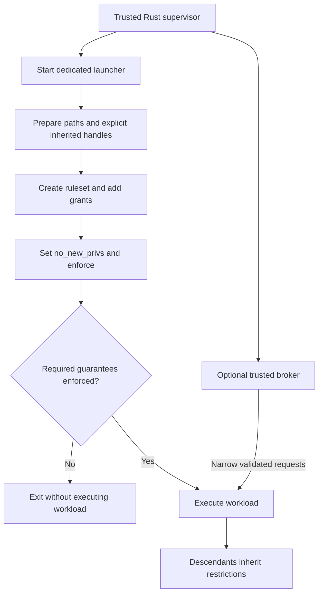

# Landlock sandboxing for Rust programs

## Platform correction and recommendation

**Landlock is a Linux kernel security feature, not a native Windows sandbox.** It first shipped in Linux 5.13. A Rust application can use it to restrict itself or a child process without requiring root. The `landlock` crate supplies a safe Rust interface. It is a strong candidate for filesystem confinement on Linux, including a suitably configured WSL2 guest, but it cannot enforce policy on a native Windows executable. [Rust Landlock documentation](https://docs.rs/landlock/0.4.7/landlock/)

The linked ChatGPT conversation could not be retrieved during this research. Its reported Windows conclusion is therefore treated as a premise to verify, not as evidence. Native Windows calls for a Windows backend such as AppContainer; macOS calls for a macOS backend. Running a Linux workload in WSL2 changes which kernel enforces policy; it does not turn Landlock into a Windows API.

**Recommendation:** use Landlock as one Linux enforcement layer for a Rust launcher. Pair it with syscall restrictions, resource limits, and stronger networking isolation when the threat model requires those guarantees. For a cross-platform product, define explicit policy requirements and implement separate backends; report unsupported requirements before launching untrusted code. This is an architectural recommendation derived from the capabilities below.

## Versions: kernel support and Rust support differ

The researched Rust release is `landlock` **0.4.7**, whose documented interface reaches ABI 9 and whose MSRV is Rust 1.71. The release kernel and development tree have moved further. Avoid conclusions based only on an old article saying “Landlock has no networking” or “Landlock only supports TCP.” [Crate capabilities](https://docs.rs/landlock/0.4.7/landlock/)

- **ABI 1 (Linux 5.13):** Filesystem access rules.
- **ABI 2 (Linux 5.19):** `REFER`: cross-directory linking and renaming.
- **ABI 3 (Linux 6.2):** File truncation control.
- **ABI 4 (Linux 6.7):** TCP bind and connect rules.
- **ABI 5 (Linux 6.10):** Device ioctl control.
- **ABI 6 (Linux 6.12):** Signal and abstract Unix socket scoping.
- **ABI 7 (Linux 6.15):** Audit logging controls.
- **ABI 8 (Linux 7.0):** Thread synchronization for enforcement.
- **ABI 9 (Linux 7.1):** Pathname Unix socket connection control.
- **ABI 10 (Linux 7.2):** UDP bind/connect/send rules and selective audit suppression.
- **ABI 11 (Linux 7.3):** Set `no_new_privs` atomically with successful enforcement.

Kernel introductions through ABI 9 come from the [Rust ABI reference](https://docs.rs/landlock/0.4.7/landlock/enum.ABI.html). ABI 10 is confirmed in the [Linux 7.2 implementation](https://raw.githubusercontent.com/torvalds/linux/v7.2/security/landlock/syscalls.c); ABI 11 in the [Linux 7.3 implementation](https://raw.githubusercontent.com/torvalds/linux/v7.3/security/landlock/syscalls.c). Newer feature semantics are documented in the [kernel userspace guide](https://docs.kernel.org/userspace-api/landlock.html).

There is also **development-tree ABI 12**: the inspected `master` implementation declares version 12, and its header adds namespace-use and Linux-capability-use permissions. These are development features, outside the released 7.3 baseline and outside crate 0.4.7. Do not design deployment guarantees around their presence. [Development implementation](https://raw.githubusercontent.com/torvalds/linux/master/security/landlock/syscalls.c), [development permissions](https://raw.githubusercontent.com/torvalds/linux/master/include/uapi/linux/landlock.h)

Probe capabilities at runtime. A distribution may backport features, disable the LSM, or place the program inside an outer sandbox that blocks its syscalls. The kernel-version string alone is insufficient. The crate's ABI-indexed rights also prevent a dependency update from silently enabling previously untested restrictions. [ABI compatibility rationale](https://docs.rs/landlock/0.4.7/landlock/enum.ABI.html)

## The enforcement model

A ruleset first declares which operation classes it **handles**. Those operations become denied unless an allow rule grants them. An operation omitted from the handled set remains outside that layer's control. `REFER` is a historical exception: it is denied by default even when omitted. Merely adding a read rule does not create a read-only sandbox unless write operations are also handled. [Ruleset syscall contract](https://man7.org/linux/man-pages/man2/landlock_create_ruleset.2.html)

The lifecycle is create, add rules, and restrict. Unprivileged enforcement requires `no_new_privs`; the Rust builder normally sets it. Policies survive execution of another program and are inherited by future descendants. Enforcement is irreversible: a restricted process can add restrictions but cannot remove them. Closing the ruleset descriptor does not undo enforcement. [Enforcement contract](https://man7.org/linux/man-pages/man2/landlock_restrict_self.2.html), [Rust enforcement method](https://docs.rs/landlock/latest/landlock/struct.RulesetCreated.html)

Within one layer, matching grants accumulate. Across layers, every layer must permit an operation; DAC permissions and other LSMs must permit it too. A child cannot regain access denied by an ancestor. Landlock checks kernel objects rather than implementing a userspace path-string filter. [Kernel security design](https://docs.kernel.org/security/landlock.html)



The separate launcher and broker are recommended application structure, not services supplied by Landlock.

## Filesystem sandboxing

### What it controls

Rules identify an existing file or directory through an open descriptor, preferably `O_PATH`. A directory rule covers its hierarchy. This allows granting project access without granting the user's entire home directory, or granting one configuration file without granting its siblings. [Path rule contract](https://man7.org/linux/man-pages/man2/landlock_add_rule.2.html)

The Rust rights cover file reading, writing, and execution; directory listing; removing files or directories; creating regular files, directories, symlinks, sockets, FIFOs, and device nodes; cross-directory references; truncation; device ioctls; and pathname Unix socket resolution. File and directory rights differ: for example, creating and removing directory entries are directory permissions. [Filesystem rights](https://docs.rs/landlock/0.4.7/landlock/enum.AccessFs.html)

For an agent launcher, a useful starting policy is:

- Grant read and execution access to the actual runtime and toolchain directories.
- Grant read access to specifically required configuration and trust stores.
- Grant project content access according to the task, with a separate writable scratch directory.
- Keep credentials, unrelated repositories, and desktop-service sockets outside those grants.

This is a policy-design example, not a universal path list. Runtime discovery must account for the executable, dynamic loader, shared libraries, subprocesses, interpreter modules, and tool-specific caches.

### Limits that matter

“Read-only” here means the requested Landlock content and directory operations are restricted. It does **not** imply complete metadata immutability or invisibility. The documented gaps include `stat`, `chmod`, `chown`, xattr changes, timestamps, file locking, and related syscall families. Ordinary permissions still apply, but Landlock alone cannot promise to conceal file existence or stop every metadata modification. [Filesystem caveats](https://man7.org/linux/man-pages/man7/landlock.7.html#CAVEATS)

Policy is tied to filesystem objects and hierarchy, not a durable textual pathname. A symlink into another tree does not by itself grant access to that target. Conversely, bind mounts can expose the same objects through multiple paths. OverlayFS layers and their merged view are separate policy hierarchies. Namespace and mount setup therefore need deliberate ordering and tests. [Filesystem topology guidance](https://raw.githubusercontent.com/torvalds/linux/v7.3/Documentation/userspace-api/landlock.rst)

Within one ruleset, an allow on a parent cannot be canceled by omitting rights on a child. For example, granting reads to the entire home directory and then adding a zero-access rule for `.ssh` does not express an exclusion. Prefer grants to narrow leaves; use another restrictive layer or a namespace layout when exclusions are necessary. This follows from the [rule-composition model](https://docs.kernel.org/security/landlock.html).

## Networking sandboxing

### TCP is a port policy

ABI 4 introduces `BIND_TCP` for local ports and `CONNECT_TCP` for remote ports. Handling both with no corresponding grants denies those operations. Adding a connect grant for port 443 permits TCP connections to that port; it does not identify a trusted website. Crate 0.4.7 exposes `AccessNet::BindTcp` and `AccessNet::ConnectTcp`. [Rust network rights](https://docs.rs/landlock/0.4.7/landlock/enum.AccessNet.html)

The rule object contains a port, not an IP address, hostname, URL, TLS identity, or HTTP method. Consequently, a port-443 grant cannot distinguish an approved model endpoint from an attacker endpoint on that port, or localhost from a remote address. There is no packet-content inspection or bandwidth policy in this interface. This is a direct consequence of the [network rule structure](https://man7.org/linux/man-pages/man2/landlock_add_rule.2.html).

Bind permission is also separate from connect permission. Port zero has special ephemeral-binding semantics; it is not a wildcard granting every destination port. A preexisting listener and its accepted connections require separate consideration from new binds. [Rust port-rule documentation](https://docs.rs/landlock/latest/landlock/struct.NetPort.html)

### UDP depends on both kernel and binding

ABI 10 adds UDP local-bind and remote-connect/send controls, including destination-bearing datagram sends. For a normal DNS client, granting remote UDP port 53 can still fail if UDP bind is handled but ephemeral autobinding is denied. Grant UDP bind port zero when that behavior is intended. TCP DNS fallback requires its own TCP grant. These kernel features are absent from the researched Rust crate's `AccessNet` enum. [Released Linux 7.3 UAPI](https://raw.githubusercontent.com/torvalds/linux/v7.3/include/uapi/linux/landlock.h), [Rust network enum](https://docs.rs/landlock/0.4.7/landlock/enum.AccessNet.html)

Therefore, a Rust program using only crate 0.4.7 must not label “all TCP denied” as “offline”: UDP, including DNS and QUIC, is not controlled by those requested rights. Even an upgraded UDP-capable binding would need to consider other socket families, existing sockets, and IPC to network-capable services. This is a security implication of the API's operation coverage.

### How to enforce stronger network requirements

For **no network**, place the workload in a private network namespace without host connectivity and review inherited sockets and IPC. A carefully designed seccomp policy can additionally deny socket creation or unwanted address families. Cover alternate syscall paths and supported architectures; blocking a single familiar syscall is insufficient.

For **approved destinations only**, force traffic through a trusted broker or proxy and prevent direct egress independently. A proxy environment variable is only configuration; hostile code can ignore it. Landlock cannot constrain its proxy port grant to one address. The broker must validate destination and protocol requests, and should not offer arbitrary tunneling.

These are recommended compositions using [namespace sandboxing](https://github.com/containers/bubblewrap) and [seccomp filtering](https://docs.kernel.org/userspace-api/seccomp_filter.html), rather than extra Landlock features.

## Other sandboxing categories

- **Signals.** ABI 6 can restrict outgoing signals to the same or nested domain; this is not a PID namespace.
- **Abstract Unix sockets.** ABI 6 can prevent connections outside the domain; it does not provide individual outside-domain exceptions.
- **Pathname Unix sockets.** ABI 9 adds `RESOLVE_UNIX`; granting socket-file creation alone is not connection control.
- **Process inspection.** Domain relationships impose additional ptrace restrictions.
- **Device access.** Filesystem rules restrict opening device nodes; ABI 5 adds coarse device ioctl control, with exceptions.
- **Audit.** ABI 7 provides logging controls; system audit configuration determines available diagnostics.
- **CPU, memory, process count, disk quota.** No general resource-budget facility in the released baseline; use cgroups, limits, or a supervisor.
- **Syscall attack surface.** No general syscall filter; pair with seccomp where needed.
- **Virtualization and memory isolation.** No guest kernel or in-process module isolation; choose a VM or a sandboxed runtime for those requirements.

Signal and abstract-socket scope semantics are documented in the [Rust scope reference](https://docs.rs/landlock/latest/landlock/enum.Scope.html). Pathname-socket rules and device rights are in the [filesystem API](https://docs.rs/landlock/0.4.7/landlock/enum.AccessFs.html). Ptrace and descriptor semantics are covered by the [Linux manual](https://man7.org/linux/man-pages/man7/landlock.7.html). Audit behavior is described in the [administration guide](https://docs.kernel.org/admin-guide/LSM/landlock.html). Uncovered categories in this list are architectural boundaries of the listed interfaces, not claims that all future ABIs will retain them.

## Rust integration

### A strict filesystem-and-TCP example

Use a target-specific dependency in a portable package:

```toml
[target.'cfg(target_os = "linux")'.dependencies]
landlock = "=0.4.7"
```

The following Linux helper allows reading/executing one prepared runtime hierarchy, ordinary file updates in a workspace, and TCP connections to remote port 443. Other handled operations are denied. Its filesystem baseline is ABI 5; it intentionally makes no claim about UDP or Unix socket isolation.

```rust
#[cfg(target_os = "linux")]
fn restrict_launcher(
    runtime: &std::path::Path,
    workspace: &std::path::Path,
) -> Result<(), Box<dyn std::error::Error>> {
    use landlock::{
        ABI, Access, AccessFs, AccessNet, CompatLevel, Compatible,
        NetPort, PathBeneath, PathFd, Ruleset, RulesetAttr,
        RulesetCreatedAttr, RulesetStatus,
    };

    let runtime_fd = PathFd::new(runtime)?;
    let workspace_fd = PathFd::new(workspace)?;
    let runtime_access =
        AccessFs::ReadFile | AccessFs::ReadDir | AccessFs::Execute;
    let workspace_access = AccessFs::ReadFile
        | AccessFs::ReadDir
        | AccessFs::WriteFile
        | AccessFs::Truncate
        | AccessFs::MakeReg
        | AccessFs::MakeDir
        | AccessFs::MakeSym
        | AccessFs::RemoveFile
        | AccessFs::RemoveDir
        | AccessFs::Refer;

    let status = Ruleset::default()
        .set_compatibility(CompatLevel::HardRequirement)
        .handle_access(AccessFs::from_all(ABI::V5))?
        .handle_access(AccessNet::from_all(ABI::V4))?
        .create()?
        .add_rule(PathBeneath::new(runtime_fd, runtime_access))?
        .add_rule(PathBeneath::new(workspace_fd, workspace_access))?
        .add_rule(NetPort::new(443, AccessNet::ConnectTcp))?
        .restrict_self()?;

    if status.ruleset != RulesetStatus::FullyEnforced || !status.no_new_privs {
        return Err("required Landlock policy was not fully enforced".into());
    }
    Ok(())
}
```

This example follows the documented [ruleset builder](https://docs.rs/landlock/0.4.7/landlock/struct.Ruleset.html), [path rules](https://docs.rs/landlock/latest/landlock/struct.PathBeneath.html), and [network port constructor](https://docs.rs/landlock/latest/landlock/struct.NetPort.html). It was checked against those APIs, but was not compiled or executed during this documentation research.

Call it in a dedicated, single-threaded launcher before executing the target. Propagate any error to process exit; do not continue to execute the workload. The runtime and workspace should be disjoint, controlled directories. The workspace grant intentionally excludes execution and device creation; scripts remain readable, so an allowed interpreter can still interpret their contents. This is an example policy, not a production-ready agent sandbox: it omits loader-path selection, descriptor cleanup, broker design, and resource limits.

For a newer filesystem policy, explicitly review ABI 9 and `ResolveUnix` rather than changing the ABI constant casually. `FullyEnforced` means every **requested** restriction was installed; it does not mean every capability of the running kernel was requested.

### Threads and asynchronous runtimes

By default, enforcement applies to the calling thread and its future children. Existing sibling threads remain outside it. Applying Landlock inside a Tokio task after worker threads start can leave those workers unrestricted. ABI 8 provides process-wide synchronization:

```rust
// On a RulesetCreated builder already configured with HardRequirement:
use landlock::RestrictSelfAttr;
let status = ruleset.all_threads(true)?.restrict_self()?;
```

This fragment requires an existing `ruleset` builder. On older kernels, default best-effort compatibility can silently discard `all_threads(true)`. Require it when needed. Thread synchronization also cannot undo work performed before enforcement; establish the boundary before admitting untrusted input. [Thread synchronization API and warning](https://docs.rs/landlock/latest/landlock/trait.RestrictSelfAttr.html)

A dedicated helper avoids restricting the supervisor and avoids doing complex Rust allocation or policy construction in a post-fork `pre_exec` closure of a multithreaded process. Have the helper construct the policy normally and then replace itself with the target executable. This is a recommended integration pattern.

### Choose downgrade behavior deliberately

The crate defaults to best effort, which is useful for hardening a trusted application across varied kernels. A hostile-code execution boundary has a different contract: missing required protections should stop execution. Use `CompatLevel::HardRequirement` for those protections and record the actual result. Optional improvements can remain best effort if the product explicitly accepts their absence. [Compatibility policy API](https://docs.rs/landlock/latest/landlock/trait.Compatible.html)

Distinguish an unavailable syscall (`ENOSYS`), a disabled LSM (`EOPNOTSUPP`), unsupported arguments, and a blocked call under an outer sandbox. A kernel configured with Landlock is not proof that the running process can install the requested policy. [Creation errors](https://man7.org/linux/man-pages/man2/landlock_create_ruleset.2.html)

## Pitfalls and practical workarounds

- **Files or sockets opened before enforcement.** Access can survive after path access or new connections are denied. Inventory descriptors; close unwanted ones and deliberately retain only explicit capabilities.
- **A privileged service receives requests from the sandbox.** The service can perform operations the sandbox cannot. Exclude agent, Docker, desktop, and credential sockets unless essential; validate broker requests.
- **Write access without truncation rights.** Overwriting an existing file can fail unexpectedly; on ABI 1–2 truncation cannot be denied. Require ABI 3 for content-protection guarantees and handle write/truncate together.
- **Cross-directory rename or hard link.** `REFER` and entry-operation rights are needed; rights-changing moves may return `EXDEV`. Keep temporary files in the destination directory and organize directories with consistent grants.
- **Rules for nonexistent paths.** There is no object to attach the rule to. Create trusted scratch directories before enforcement; grant an existing parent only when that broader access is acceptable.
- **Treating a broad allow as a deny-list foundation.** A narrower rule in the same layer does not revoke the parent grant. Grant narrow subtrees, or change filesystem visibility using namespaces.
- **Mount setup after filesystem confinement.** Topology-changing operations can be denied. Set up namespaces and mounts first, then enforce Landlock.
- **Device descriptors, especially inherited terminals.** Previously obtained ioctl authority can remain available. Prefer controlled pipes; review terminal inheritance and device-specific allowances.
- **Repeatedly stacking policies per operation.** Layers are finite and cannot be removed. Build one ruleset per workload, or restart a helper for a different policy.

Descriptor preservation is an explicit [kernel design rule](https://docs.kernel.org/security/landlock.html). Rename and truncation behavior, mount limitations, and terminal caveats are documented in the [released kernel guide](https://raw.githubusercontent.com/torvalds/linux/v7.3/Documentation/userspace-api/landlock.rst). File-descriptor path anchors are defined by the [path-rule API](https://docs.rs/landlock/latest/landlock/struct.PathBeneath.html). The remaining workaround choices are engineering recommendations derived from those contracts.

Do not solve every compatibility failure by allowing the whole filesystem. Exercise representative operations, then add the smallest justified grant. Newer audit support can identify the domain and rights that caused a denial; availability depends on kernel audit configuration and logging settings. `EACCES` alone does not identify Landlock as the cause, because other access controls can also deny an operation. [Audit diagnostics](https://docs.kernel.org/admin-guide/LSM/landlock.html)

## Alternatives and complementary tools for Rust

- **Seccomp BPF.** Reduce Linux syscall attack surface or forbid socket families. `seccompiler` provides Rust policy construction. Classic filters cannot dereference pathname or socket-address pointers; use Landlock for object access.
- **Bubblewrap.** Launch arbitrary Linux binaries with a curated filesystem view and private namespaces. Invoke `bwrap` from Rust; policy and namespace availability remain deployment responsibilities.
- **nsjail.** Combine Linux namespaces, cgroups, resource limits, and seccomp in a launcher. Invoke it as a subprocess; broader configuration and host requirements than a Landlock-only helper.
- **extrasafe.** Compose ergonomic Rust syscall restrictions with optional Landlock facilities. A Rust facade over Linux mechanisms, not an independent portable security boundary.
- **AppContainer.** Restrict a native Windows process using capability-based OS isolation. Use Windows APIs through Rust bindings; filesystem ACLs, token setup, capabilities, and handle inheritance need Windows-specific policy.
- **Windows Job Objects.** Process-tree lifetime control and resource limits. Complement AppContainer; a job alone does not implement a filesystem/network capability sandbox.
- **macOS App Sandbox.** Restrict a packaged macOS application's resource access. Entitlement-driven deployment; evaluate helper inheritance and file-access flows for the intended packaging.
- **macOS Seatbelt.** Apply macOS process sandbox profiles in a custom launcher. Chromium documents this design, but private/profile interfaces require OS-specific maintenance; it is not Landlock.
- **Wasmtime and WASI.** Run controllable plugin or task code through explicit host interfaces across platforms. Embed Wasmtime in Rust and grant only needed host capabilities; arbitrary existing native agent binaries cannot run unchanged.
- **`cap-std`.** Make filesystem/network authority explicit in trusted Rust code. Useful architecture, but native code can still bypass the API with `std` or syscalls; it does not confine a hostile native child.

Primary references: [seccomp kernel contract](https://docs.kernel.org/userspace-api/seccomp_filter.html), [seccompiler](https://docs.rs/seccompiler/latest/seccompiler/), [Bubblewrap](https://github.com/containers/bubblewrap), [nsjail](https://github.com/google/nsjail), [extrasafe](https://docs.rs/extrasafe/latest/extrasafe/), [AppContainer](https://learn.microsoft.com/en-us/windows/win32/secauthz/appcontainer-isolation), [Job Objects](https://learn.microsoft.com/en-us/windows/win32/procthread/job-objects), [Apple App Sandbox](https://developer.apple.com/documentation/security/app-sandbox), [Chromium Seatbelt design](https://www.chromium.org/developers/design-documents/sandbox/osx-sandboxing-design/), [Wasmtime security](https://docs.wasmtime.dev/security.html), and [cap-std](https://docs.rs/cap-std/latest/cap_std/).

AppArmor or SELinux can also supply administrator-managed Linux policy; Landlock's distinctive advantage is letting an unprivileged application add its own restrictions without replacing existing system policy. [Landlock LSM design](https://docs.kernel.org/security/landlock.html)

## Verification before production use

The following is a proposed verification plan, not a report of tests performed for this document:

1. Probe and report each required capability under a fully supporting kernel, an older kernel, and a disabled or blocked Landlock configuration. Verify that strict mode never executes the target after setup failure.
2. Check allowed operations and denied counterparts: outside-project reads, outside-workspace writes, truncation, directory creation, deletion, symlink escapes, cross-directory renames, and execution.
3. Verify actual network behavior over IPv4 and IPv6: allowed and denied TCP ports, UDP DNS, QUIC, loopback, and inherited sockets. Include pathname and abstract Unix sockets for any claimed IPC isolation.
4. Exercise a child and grandchild, a process with preexisting threads, and intentionally inherited file/socket descriptors. Ensure the test observes the intended boundary rather than just a builder's success return.
5. Test real workloads: dynamic loading, interpreters, DNS resolution, certificates, Git operations, temporary files, and caches. Do not infer production compatibility from an empty test program.
6. Run native Windows and macOS backend tests separately. WSL2 evidence validates the Linux backend in that guest, not the native Windows backend.

Keep these as subprocess tests because successful Landlock enforcement cannot be undone in the test runner. Require explicit evidence for guarantees such as “offline,” “project-only writes,” or “all threads restricted”; a single boolean named `sandboxed` loses information the caller needs.
