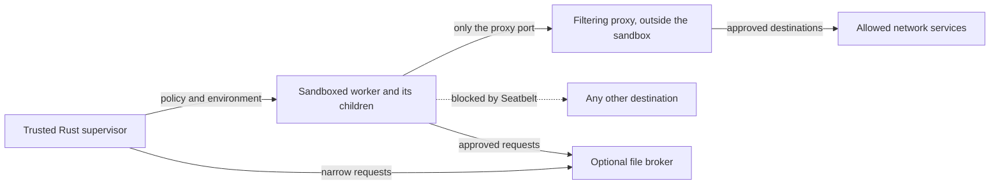

# Seatbelt sandboxing for Rust on macOS

Seatbelt is the macOS kernel's sandbox. A process gives it a policy, and from then on the kernel refuses any operation the policy does not allow: opening a file, connecting a socket, talking to a system service, and so on. The policy is permanent for that process and is inherited by every process it starts.

For a Rust program that launches external tools, the workable design is:

- a trusted **supervisor** process that is never sandboxed,
- which starts each tool as a fresh **worker** under a policy that denies everything by default,
- and, when the worker needs the network, a **proxy** run by the supervisor that decides which destinations are allowed.

Seatbelt handles filesystem rules well. For networking it can block all connections, or allow only a connection to a local proxy. It cannot filter by domain name or IP range, so that decision has to live in the proxy.

## Is it safe to depend on?

Apple marks both public ways to apply a custom policy, the `sandbox-exec` command and the `sandbox_init` C function, as deprecated. Both man pages tell developers to use App Sandbox instead. Both still ship and still work (checked on macOS 27.2), and major projects depend on them: Chromium, OpenAI's Codex CLI, and Anthropic's `sandbox-runtime` all build their macOS sandboxes on Seatbelt. [Chromium sandbox overview](https://chromium.googlesource.com/chromium/src/+/main/sandbox/mac/README.md), [`sandbox-exec` man page](https://keith.github.io/xcode-man-pages/sandbox-exec.1.html).

The policy language, Sandbox Profile Language (SBPL), has no public specification, so Apple could change it in any release without notice. In practice that means:

- keep all policy generation in one macOS-specific module, so a change only has to be absorbed in one place;
- rerun enforcement tests on every macOS release you support (see [Testing a policy](#testing-a-policy-before-relying-on-it)).

## Three things called "sandbox" on macOS

These names are easy to confuse:

| Name                    | What it is                                                                                    | How a Rust program uses it                                           |
| ----------------------- | --------------------------------------------------------------------------------------------- | -------------------------------------------------------------------- |
| Seatbelt                | The kernel mechanism that enforces an SBPL policy on a process and its children               | Through one of the two entry points below                            |
| `sandbox-exec`          | A command-line tool that applies a policy file and then runs a command inside it              | Run `/usr/bin/sandbox-exec` with `std::process::Command`             |
| App Sandbox             | Apple's supported model for sandboxing a whole app, configured by entitlements at signing time | Sign and package the app (or a helper) with the needed entitlements |

App Sandbox is Apple's supported option and is required for the Mac App Store. It is configured with a fixed set of entitlements, such as "may make outgoing network connections" or "may read files the user selected", rather than with a custom policy. It cannot express rules like "this job may write only to this directory", and it changes how the app is signed and packaged. It is not a drop-in replacement for a custom Seatbelt policy. [Apple App Sandbox](https://developer.apple.com/documentation/security/app-sandbox), [Xcode configuration guide](https://help.apple.com/xcode/mac/current/en.lproj/devbd04af149.html).

Some limits on what Seatbelt does:

- It only ever removes access. An `allow` rule cannot grant something that Unix file permissions or another macOS protection, such as privacy (TCC) prompts, already blocks.
- It applies to the process that installs it and that process's descendants. The parent and unrelated processes are unaffected.
- It does not give the worker its own filesystem, user account, or kernel. The worker sees the real host, with some operations refused.

## Filesystem control

SBPL can treat file operations separately. Reading contents, reading metadata, executing, creating, writing, and deleting are all different operations. Wildcard names such as `file-read*` and `file-write*` cover a whole family of operations at once.

A rule can match paths in three ways:

- `literal`: one exact path;
- `subpath`: a directory and everything beneath it;
- `regex`: paths matching a regular expression.

This **fragment** allows reading the project directory and writing only to an output directory:

```scheme
(version 1)
(deny default)
(allow file-read* (subpath (param "PROJECT")))
(allow file-read* file-write* (subpath (param "OUTPUT")))
```

`(param "PROJECT")` is filled in when the policy is applied, so paths never have to be pasted into the policy text. On its own, this fragment cannot launch anything. A real profile must also allow the executable, the dynamic loader, system libraries, metadata on every parent directory, and whatever system services the program uses. Chromium's design notes explain parameters and `subpath`, and its maintained profiles show how far finer-grained rules go (extended attributes, cache files created only in certain places). [Chromium SBPL design](https://raw.githubusercontent.com/chromium/chromium/main/sandbox/mac/seatbelt_sandbox_design.md), [Chromium common profile](https://raw.githubusercontent.com/chromium/chromium/main/sandbox/policy/mac/common.sb).

With these tools a policy can make source code read-only, give the worker a private scratch directory, and block credential files such as `~/.ssh`.

**Be careful about letting a worker write to the project.** Many files in a project run later outside the sandbox: build scripts, Git hooks, editor and tool configuration. A sandboxed worker that can edit `.git/hooks/pre-commit` can get code run unsandboxed the next time someone commits. Codex handles this by keeping `.git`, the real Git directory it points to, and `.codex` read-only even inside a writable workspace. [Codex sandbox policy](https://github.com/openai/codex/blob/main/codex-rs/core/README.md).

### Rules match real paths, not the path you wrote

Seatbelt compares rules against the fully resolved path. On macOS, `/tmp` is a symlink to `/private/tmp`, so a rule written for `/tmp` silently never matches. With this rule:

```scheme
(deny file-write* (subpath "/tmp/demo"))
```

a write to `/tmp/demo/a` **succeeds**. Writing the rule as `/private/tmp/demo` blocks it. (`/var` and `/etc` are symlinks in the same way.)

A deny rule also attaches to a path, not to the files currently at that path. If the worker can rename a parent directory, the protected files move out from under the rule. With a rule denying writes to `tree/secret`, the following runs to completion inside the sandbox:

```sh
mv tree tree2
echo changed > tree2/secret/f   # allowed: the rule only covered tree/secret
```

Rules to follow when generating paths:

- Resolve every root to its real path before putting it in a policy. For an output file that does not exist yet, resolve its parent directory and append the file name.
- Allow metadata reads (`file-read-metadata`) on each parent directory the worker must traverse. Do not fix "operation not permitted" errors by allowing reads of the whole home directory.
- Pass literal paths as parameters. If you turn user glob patterns into `regex` rules, escape directory names that contain `[` or `*` so they are not read as wildcards.
- When protecting a path inside a writable area, also deny renames of its parent directories. Codex does this for read-only carve-outs, and nono grants metadata along both the original and the resolved path. [Codex profile generation](https://raw.githubusercontent.com/openai/codex/main/codex-rs/sandboxing/src/seatbelt.rs), [nono macOS backend](https://raw.githubusercontent.com/always-further/nono/main/crates/nono/src/sandbox/macos.rs).
- Test hard links and files replaced while the worker runs. Resolving a path tells you where it pointed at setup time, not where it will point later.

### Seatbelt can block access but cannot substitute content

Seatbelt cannot give the worker a different root filesystem or show it a sanitized copy of a secret file. If you need that, copy the inputs into a staging directory, have the supervisor serve files on request, or use a VM. Anthropic's `sandbox-runtime` reflects this: on macOS, where it would like to mask a credential file, it can only deny reading it, because SBPL cannot redirect reads. [Anthropic macOS policy code](https://raw.githubusercontent.com/anthropics/sandbox-runtime/main/src/sandbox/macos-sandbox-utils.ts).

## Network control

SBPL has separate operations for outgoing connections, incoming traffic, binding a socket, and Unix-domain sockets. A policy that denies by default allows no networking at all. A policy can also allow exactly one local port:

```scheme
; Allow connections to the local proxy only; everything else stays denied.
(allow network-outbound (remote tcp "localhost:43127"))
```

**The host in a network rule must be `*` or `localhost`.** Domain names and IP ranges are rejected when the profile loads:

```text
$ sandbox-exec -f policy.sb /usr/bin/true    # policy contains (remote tcp "example.com:443")
sandbox-exec: host must be * or localhost in network address
```

The same error appears for `(remote ip "10.0.0.0/8:*")`. To allow some Internet destinations and not others, the worker must be confined to a local proxy, and the proxy decides. Both nono and Anthropic's `sandbox-runtime` work this way. [nono loopback rules](https://raw.githubusercontent.com/always-further/nono/main/crates/nono/src/sandbox/macos.rs), [Anthropic network design](https://github.com/anthropics/sandbox-runtime#how-it-works).

Also note that DNS lookups on macOS go through a local system service socket. Denying `network*` therefore also breaks name resolution: `curl` fails with "Could not resolve host" rather than a connection error.

| Goal                                         | What Seatbelt does                                           | What else is needed                                                 |
| -------------------------------------------- | ------------------------------------------------------------ | ------------------------------------------------------------------- |
| No network access                            | Deny all socket operations except channels the tool needs    | Check sockets inherited from the parent and services the worker can reach |
| Only approved domains                        | Allow only the proxy's port                                  | The proxy resolves names and checks destinations                    |
| Restrict HTTP methods, URLs, or credentials  | Force all traffic through a broker                           | A broker that understands the protocol; HTTPS hides URLs unless decrypted |
| No access to local services                  | Withhold broad localhost, Unix-socket, and Mach-service rules | Allow each required channel individually                            |
| Run a development server                     | Allow binding and incoming connections                       | Decide which interface to listen on and who may connect             |

### The proxy enforces the policy, not the environment variables

`HTTP_PROXY`, `HTTPS_PROXY`, and `ALL_PROXY` only tell well-behaved programs where the proxy is. A hostile program ignores them. What makes the proxy mandatory is the Seatbelt rule that blocks every other connection.



Requirements for the proxy and the launcher:

1. Start the proxy and bind its port before launching the worker. Run it outside the worker's process tree so the worker cannot kill or reconfigure it.
2. Allow only the proxy's exact port, never all of `localhost`. Otherwise Docker sockets, local databases, and debug endpoints become ways around the proxy.
3. Check each destination host and port. Normalize host names, and reject raw IP addresses and private ranges unless the policy allows them. Check the resolved address at connection time, not only the name, to defeat DNS rebinding.
4. Check every new destination, including redirects. An HTTPS `CONNECT` request reveals the destination host but not the URL path or body. Filtering on paths requires decrypting TLS or offering a dedicated request API instead of a general proxy.
5. Do DNS lookups in the proxy, not the worker. Allowing DNS from the worker opens a channel that can carry data out. Cover IPv4, IPv6, UDP, QUIC, and Unix-domain sockets in tests that expect failure.
6. If the proxy dies, its configuration is invalid, or the policy cannot be installed, do not start the worker at all.

Anthropic's HTTP proxy is a useful reference for request parsing, `CONNECT` handling, and destination checks. [Anthropic HTTP proxy](https://raw.githubusercontent.com/anthropics/sandbox-runtime/main/src/sandbox/http-proxy.ts).

### "No network" does not mean "no way out"

A worker with no sockets can still ask a system service it is allowed to reach to do something for it. Blocking the worker's own sockets therefore does not prove it cannot send data anywhere. Review every allowed Mach/XPC service, DNS, automation (Apple Events), inherited IPC channels, and any broker you provide.

TLS certificate checking is a common example. A program using Apple's security APIs asks the `trustd` service to verify certificates, which may fetch revocation data over the network. Codex allows the trust-related services in its network profile. Anthropic's `sandbox-runtime` makes `trustd.agent` access an opt-in and labels it as weakening network isolation. A Rust program using `rustls` with bundled roots may not need these services at all, so test the TLS stack you actually ship rather than allowing every service that a certificate error mentions. [Codex network profile](https://raw.githubusercontent.com/openai/codex/main/codex-rs/sandboxing/src/seatbelt_network_policy.sbpl), [Anthropic macOS policy code](https://raw.githubusercontent.com/anthropics/sandbox-runtime/main/src/sandbox/macos-sandbox-utils.ts).

## Other things Seatbelt controls

| Category                    | Examples                                               | Why it matters                                                         |
| --------------------------- | ------------------------------------------------------ | ---------------------------------------------------------------------- |
| Processes                   | Fork, exec, sending signals, reading process info      | Let the worker start its own children without touching other processes |
| Mach IPC                    | Looking up system services, task ports                 | Every reachable service adds capability and attack surface             |
| POSIX IPC                   | Shared memory, semaphores                              | Multiprocessing and numeric libraries may need specific exceptions     |
| Kernel and device interfaces | IOKit clients, `sysctl` values                        | Hardware queries and GPU use need their own rules                      |
| Terminals                   | Creating pseudo-terminals, terminal `ioctl` calls      | Interactive shells need more than file access                          |
| Preferences and automation  | Reading preferences, Apple Events, Launch Services     | Convenience APIs can reach outside the sandbox                         |

Codex's base profile shows what real tools need: it limits signals and process inspection to processes in the same sandbox, allows specific `sysctl` values and IOKit clients, allows semaphores for Python `multiprocessing`, and allows specific shared-memory names for OpenMP. This is also why copying another project's full profile is risky: every exception it made for its own tools becomes a capability your worker has. [Codex base profile](https://raw.githubusercontent.com/openai/codex/main/codex-rs/sandboxing/src/seatbelt_base_policy.sbpl).

Seatbelt does **not** limit CPU time, memory, or disk use, and it does not help you kill a worker's whole process tree. The supervisor has to enforce deadlines, cap output size, and clean up child processes itself. Seatbelt also does not replace code signing, the Hardened Runtime, privacy (TCC) permissions, or keeping macOS up to date.

## Using Seatbelt from Rust

A Rust program has two ways in: run `sandbox-exec`, or call `sandbox_init` through FFI. (nono, covered under [Alternatives](#alternatives), wraps the second behind a higher-level API.)

### Option 1: run `sandbox-exec` (recommended for external tools)

This needs no `unsafe` code in the supervisor. The profile file must come from you, never from the job being run; the job only influences the parameter values.

```rust
#[cfg(target_os = "macos")]
fn launch_sandboxed(
    trusted_profile: &std::path::Path,
    project: &std::path::Path,
    output: &std::path::Path,
    program: &std::path::Path,
    args: &[std::ffi::OsString],
) -> std::io::Result<std::process::Output> {
    use std::ffi::OsString;
    use std::process::{Command, Stdio};

    let parameter = |name: &str, value: &std::path::Path| {
        let mut entry = OsString::from(name);
        entry.push("=");
        entry.push(value.as_os_str());
        entry
    };

    Command::new("/usr/bin/sandbox-exec")
        .arg("-f")
        .arg(trusted_profile)
        .arg("-D")
        .arg(parameter("PROJECT", project))
        .arg("-D")
        .arg(parameter("OUTPUT", output))
        .arg(program)
        .args(args)
        .current_dir(project)
        .env_clear()
        .env("PATH", "/usr/bin:/bin:/usr/sbin:/sbin")
        .env("TMPDIR", output)
        .stdin(Stdio::null())
        .stdout(Stdio::piped())
        .stderr(Stdio::piped())
        .spawn()?
        .wait_with_output()
}
```

The example assumes the paths are already absolute and resolved, the output directory exists, and the profile allows everything the program needs to start. It is kept short: a production runner should stream output with a size limit, enforce a deadline, and clean up descendants instead of waiting indefinitely. `sandbox-exec` exits with status 65 when the profile fails to load; treat that as a setup failure. **Never retry a failed run without the sandbox.**

Passing arguments separately avoids shell interpretation, and `-D` parameters avoid pasting path text into the SBPL source. Store the profile somewhere the worker cannot write. The `-f` and `-D` options are documented in the [`sandbox-exec` man page](https://keith.github.io/xcode-man-pages/sandbox-exec.1.html).

### Option 2: call `sandbox_init` from a helper binary

A small helper binary can sandbox itself and then do the untrusted work, or `exec` the tool. Minimal Rust 2024 bindings:

```rust
#[cfg(target_os = "macos")]
mod seatbelt {
    use std::ffi::{CStr, CString, c_char, c_int};

    #[link(name = "sandbox")]
    unsafe extern "C" {
        fn sandbox_init(
            profile: *const c_char,
            flags: u64,
            errorbuf: *mut *mut c_char,
        ) -> c_int;
        fn sandbox_free_error(errorbuf: *mut c_char);
    }

    /// Installs `profile` (SBPL source) on the current process. Irreversible.
    pub fn install(profile: &str) -> Result<(), String> {
        let profile = CString::new(profile).map_err(|e| e.to_string())?;
        let mut error = std::ptr::null_mut();
        // Flags 0 means `profile` is SBPL source rather than a named profile.
        let result = unsafe { sandbox_init(profile.as_ptr(), 0, &mut error) };
        let detail = if error.is_null() {
            None
        } else {
            // sandbox_init allocated this string; it must be released with
            // sandbox_free_error, not by Rust.
            let message = unsafe { CStr::from_ptr(error) }
                .to_string_lossy()
                .into_owned();
            unsafe { sandbox_free_error(error) };
            Some(message)
        };
        if result == 0 {
            Ok(())
        } else {
            Err(detail.unwrap_or_else(|| "sandbox_init failed".into()))
        }
    }
}
```

If `install` fails, the helper must exit before touching any untrusted input. `sandbox_init` takes no parameters, so paths must be written into the profile text and escaped correctly. The variant that takes parameters, `sandbox_init_with_parameters`, and Chromium's separate compile-then-apply functions are private, undocumented APIs; binding them means maintaining declarations for interfaces Apple can change at any time. [`sandbox_init` man page](https://keith.github.io/xcode-man-pages/sandbox_init.3.html), [Chromium parameterized initialization](https://raw.githubusercontent.com/chromium/chromium/main/sandbox/mac/seatbelt_sandbox_design.md).

Install the sandbox as early as possible, before loading libraries that open files or connect to services during startup. Chromium moved sandbox installation ahead of framework loading for exactly this reason: code that ran before the sandbox could open resources that stayed available afterward.

Do not call `sandbox_init` inside `CommandExt::pre_exec` in a multithreaded program. That callback runs between `fork` and `exec`, where allocating memory or taking locks can deadlock, and compiling a profile does both. A separate helper binary that sandboxes itself at the top of `main` avoids the problem. [Chromium startup design](https://raw.githubusercontent.com/chromium/chromium/main/sandbox/mac/seatbelt_sandbox_design.md), [`pre_exec` safety contract](https://doc.rust-lang.org/std/os/unix/process/trait.CommandExt.html#method.pre_exec).

## Pitfalls and how projects handle them

| Pitfall                                                  | What happens                                                                                   | What to do                                                                                                      |
| -------------------------------------------------------- | ---------------------------------------------------------------------------------------------- | --------------------------------------------------------------------------------------------------------------- |
| Deprecated entry points, undocumented language          | Apple points to App Sandbox; SBPL can change without notice                                    | Keep policy code in one backend; run enforcement tests on each macOS release; refuse to run where tests fail   |
| Open file descriptors keep working                       | Files and sockets opened before the sandbox stay usable (Chromium documents this)              | Close what the worker does not need; check standard streams and anything else inherited                       |
| Libraries grab resources at startup                      | Anything opened before installation escapes the policy                                         | Install the sandbox before loading complex frameworks or reading untrusted input                               |
| Renaming a parent directory moves files out of a rule    | A deny on `a/secret` stops applying after `mv a b`                                             | Deny renames of parent directories; test rename, delete, and create, not just opening a denied file           |
| Rule order and precedence are subtle                     | Real generators carefully order allows and follow-up denies                                    | Decide your own ordering rules and test the result; do not assume "deny always wins"                           |
| Very large profiles crash                                | nono reports initialization crashes above about 17,770 rules and caps port-range expansion     | Keep profiles small and deduplicated; route access through a few brokers. This is nono's observation, not a documented Apple limit. [nono capability limit](https://raw.githubusercontent.com/always-further/nono/main/crates/nono/src/capability.rs) |
| Secrets held by services, not files                      | Denying `~/Library/Keychains` does not stop a worker that can reach the Keychain service        | Review service access as well as paths; never allow all Mach services. nono explicitly denies Keychain services |
| Denials look like ordinary errors                        | The program sees "Operation not permitted"; Seatbelt logs the denial to the system log, not to the program's output | Keep the worker's stderr; collect matching system-log entries; verify results independently       |
| Syntax errors point to the wrong place                   | A two-token profile with a missing `)` was reported at line 108 of Apple's built-in prelude     | Generate profiles from code rather than by hand, and test each generated profile loads                         |

Sources: [Chromium descriptor guidance](https://chromium.googlesource.com/chromium/src/+/main/sandbox/mac/README.md), [nono macOS backend](https://raw.githubusercontent.com/always-further/nono/main/crates/nono/src/sandbox/macos.rs), [Codex profile generation](https://raw.githubusercontent.com/openai/codex/main/codex-rs/sandboxing/src/seatbelt.rs), [Chromium sandbox debugging](https://chromium.googlesource.com/chromium/src/+/main/docs/mac/sandbox_debugging.md).

### A sandbox can be widened, not removed

A sandboxed process cannot uninstall its sandbox. It can, however, gain access through **sandbox extensions**: tokens that another process issues to grant access to a specific file or service. Anything that issues extensions, and any broker the supervisor runs, is therefore part of the security boundary. If a worker needs different access, prefer starting a new worker with a new policy over widening a running one.

App Sandbox apps have a supported version of this, security-scoped bookmarks, for keeping access to files the user picked. That is a separate, documented mechanism and should not be confused with the private extension APIs. [Apple file access in App Sandbox](https://developer.apple.com/documentation/security/accessing-files-from-the-macos-app-sandbox).

### No sandbox on a shared kernel is complete

Seatbelt does not protect against kernel bugs, and it cannot stop misuse of access you deliberately allowed. Apple's own mechanisms have had escapes: Microsoft's analysis of CVE-2025-31191 shows an escape through security-scoped bookmarks. That does not mean every custom Seatbelt policy has the same hole, but it is a reason to keep macOS patched and to layer other defenses. [Microsoft's CVE-2025-31191 analysis](https://www.microsoft.com/en-us/security/blog/2025/05/01/analyzing-cve-2025-31191-a-macos-security-scoped-bookmarks-based-sandbox-escape/).

## Alternatives

| Approach                        | Good for                                                                    | Trade-offs for a Rust program                                                                                                         |
| ------------------------------- | --------------------------------------------------------------------------- | ------------------------------------------------------------------------------------------------------------------------------------- |
| App Sandbox                     | Signed Mac apps whose needs fit Apple's entitlements and user file pickers | Affects signing and packaging; network entitlements are on/off and cannot list allowed domains per job                                |
| Wasmtime with WASI              | Plugins or computations that can be compiled to WebAssembly                | Same isolation on every OS; the host decides exactly what the guest can reach; cannot run arbitrary native tools                      |
| A virtual machine               | Hostile native code that needs its own kernel or filesystem image          | Slower startup, more storage and lifecycle work; shared folders and host services are still openings                                  |
| `cap-std`                       | Trusted Rust code handling attacker-controlled paths                       | Prevents path traversal, but code can bypass it with `std` or FFI; it is not a sandbox for untrusted code                              |
| Broker architecture             | Small workers that need a few privileged actions                           | Works alongside Seatbelt; each broker request must be checked independently                                                           |

Apple documents App Sandbox and its Virtualization framework. Wasmtime documents its isolation model and how host imports define what a guest can do. `cap-std` says explicitly that it is not a sandbox for untrusted Rust code. [Apple App Sandbox](https://developer.apple.com/documentation/security/app-sandbox), [Apple Virtualization](https://developer.apple.com/documentation/virtualization), [Wasmtime security](https://github.com/bytecodealliance/wasmtime/blob/main/docs/security.md), [cap-std README](https://raw.githubusercontent.com/bytecodealliance/cap-std/main/README.md).

**nono** is a Rust library that sits on top of Seatbelt rather than replacing it. It uses Seatbelt on macOS and Landlock on Linux, and returns an "unsupported platform" error elsewhere. Its API includes `CapabilitySet` to describe allowed access, `Sandbox::support_info` to check what the host supports, and `Sandbox::apply_auto`, which sandboxes the current process irreversibly. Review the rules it generates and how it behaves on failure before adopting it. [nono API docs](https://docs.rs/nono/latest/nono/).

A cross-platform program needs a separate backend per OS, because the kernels enforce different things:

- **Linux:** Landlock, seccomp, and namespaces. Which Landlock features exist depends on the kernel version (network rules arrived later than filesystem rules), so probe the supported ABI at runtime. [Landlock documentation](https://docs.kernel.org/userspace-api/landlock.html)
- **Windows:** AppContainer, and restricted tokens with ACLs. [AppContainer isolation](https://learn.microsoft.com/en-us/windows/win32/secauthz/appcontainer-isolation)
- **WSL2:** a Linux kernel, so the Linux backend applies.

The same intended policy, such as "read the project, write only to output", will not behave identically on all three.

## Testing a policy before relying on it

A profile that loads has only passed a syntax check. Only enforcement tests show what it actually blocks. Each test should run a fresh sandboxed child and check what it could and could not do:

1. **Allowed work succeeds:** reading inputs, creating and atomically replacing outputs, starting needed child processes, and making TLS connections with the real TLS stack.
2. **Forbidden work fails:** reading a secret, writing outside the allowed directories, running Apple Events automation, connecting directly to the Internet, and reaching an unrelated local service.
3. **Path rules hold:** symlinks (including `/tmp` vs `/private/tmp`), hard links, paths containing glob characters, renaming parent directories, and files replaced during the run.
4. **Network rules hold:** ignoring the proxy variables, other localhost ports, IPv6, UDP, redirects, DNS rebinding, and the proxy dying mid-run.
5. **Setup failures stop the run:** an invalid profile, a missing `sandbox-exec`, an oversized profile, or a missing proxy never results in unsandboxed work.
6. **Cleanup works:** timeouts, floods of output, and leftover child processes never leave work running.

Use private temporary directories and local test servers, and do not let tests take terminal or browser focus. Repeat the tests on each macOS version and CPU architecture you support.

## How this page was checked

On macOS 27.2 (build 26B123), using `/usr/bin/sandbox-exec`:

- a `remote tcp` rule with a domain name, and a `remote ip` rule with a CIDR range, were both rejected with `host must be * or localhost in network address`;
- a write deny on `/tmp/...` did not block writes, and the same rule on `/private/tmp/...` did;
- renaming the parent of a write-denied directory succeeded, and the moved files could then be written;
- with `network*` denied, `curl` failed to resolve host names;
- a write deny applied to a shell also applied to shells it started two levels down;
- both man pages mark their interfaces deprecated.

Both Rust examples compile with Rust 1.98.1 (edition 2024). The `sandbox_init` example was also run: it returned the parse error for a malformed profile, and after installing a profile denying writes under `/private/tmp`, a write there failed with `PermissionDenied`. The `sandbox-exec` example was compiled but not run. None of the SBPL fragments here is a complete or audited production profile.

Links to project `main` branches point at code that changes over time.
