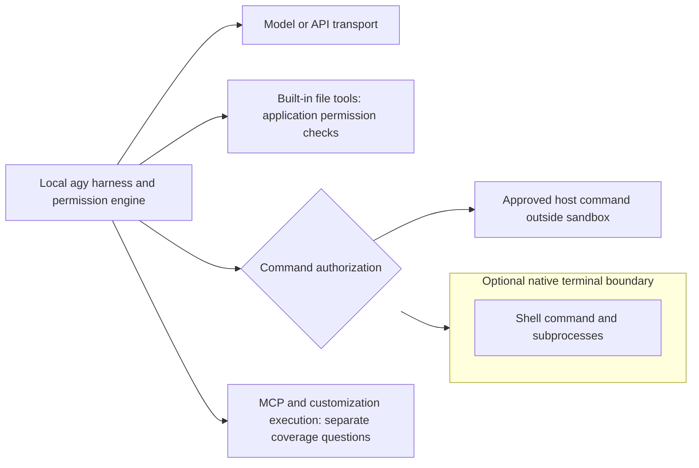

# Antigravity CLI sandboxing

Research checked **2026-11-04 UTC**. The local macOS installation reports **agy 1.4.10**. Current official documentation and the public repository at commit [`c994f07d241d3b3b1902d5705008092beb00e099`](https://github.com/google-antigravity/antigravity-cli/tree/c994f07d241d3b3b1902d5705008092beb00e099), committed November 4, were examined; its changelog reaches **1.5.0**. Documentation is mutable and includes features newer than the installed binary. No agent workload or isolation escape was executed.

## What a normal installation protects

**Antigravity CLI supplies an optional terminal sandbox, but leaves it off by default.** A clean configuration uses `agentMode: ""`, `enableTerminalSandbox: false`, `toolPermission: "request-review"`, and `allowNonWorkspaceAccess: false`. Default mode asks for shell execution and interactive review of file modifications; workspace reads are allowed. These are application permission checks, not an OS boundary around the agent. Once approved, an ordinary unsandboxed shell command has the invoking account’s host access. The desktop Antigravity App’s newer Default preset enables sandboxing; that is **not the CLI default**. [CLI reference](https://antigravity.google/docs/cli/reference#configuration-keys-settingsjson), [execution modes](https://antigravity.google/docs/cli/modes), [sandbox, CLI tab](https://antigravity.google/docs/sandbox?tab=cli).

The following table assumes no saved settings, explicit grants, startup overrides, or administrator changes. WSL2 is kept separate from native Windows; the WSL2 backend conclusion is conditional inference from the Linux requirements, not a WSL2 runtime observation.

| Platform | Interactive default | Non-interactive `agy -p` default | Optional local terminal isolation |
| --- | --- | --- | --- |
| macOS | Sandbox off; review commands and edits | Sandbox off; unavailable approvals are soft-denied | Seatbelt through `sandbox-exec` |
| Linux | Same | Same | Kernel namespaces; unprivileged user namespaces must be available |
| Native Windows | Same | Same | AppContainer inside a process security environment; Windows 11 24H2+ with August 2026 update or later |
| WSL2 | Same CLI defaults; WSL2-specific behavior unverified | Same documented print policy; WSL2-specific behavior unverified | Expected Linux backend inside the distribution if its kernel/policy permits it; not native Windows containment |

The first launch asks about appearance, rendering, and **workspace trust before indexing**. Trust records a decision about repository access; it does not enable an OS sandbox. Headless mode honors saved permission and execution settings, so an existing user’s print run need not resemble these clean defaults. A tool action whose approval cannot be obtained is denied while the run continues, normally exits zero, and names the tool and remedy on stderr. Exit zero alone therefore does not prove the requested work ran. [Getting started](https://antigravity.google/docs/getting-started?tab=cli), [headless permissions](https://antigravity.google/docs/cli/headless#permissions-in-headless-mode).

## Optional local isolation and its extent

Enable `--sandbox`, persist `enableTerminalSandbox: true`, or use `/config`. Personal accounts can also select Auto mode (`--mode=auto`), which enables sandboxing automatically: macOS/Linux require CLI 1.3.5+, Windows requires 1.4.4+. Auto is unavailable for business and enterprise accounts. It approves workspace edits and sandboxed commands, and has a separate agent evaluate commands requesting host execution; safe, reversible commands may run outside containment automatically. Auto is therefore not a promise that every command stays isolated. [Auto mode requirements](https://antigravity.google/docs/cli/modes#requirements-and-limitations).

The boundary contains **agent-launched terminal commands and their subprocesses**, rather than the entire local agent harness. macOS uses Seatbelt filesystem/socket profiles; Linux namespaces isolate filesystem, host processes, and networking. The enterprise guide names bubblewrap for Linux, but neither it nor the CLI guide establishes a separately installed `bwrap` executable requirement or its packaging. Native Windows uses a process security environment plus AppContainer, not Windows Sandbox or a VM. Windows commands no longer require administrator rights as of 1.2.17. No Docker daemon, container image, or VM setup is required for these native backends. [Sandbox mechanisms](https://antigravity.google/docs/sandbox?tab=cli#how-it-works), [enterprise execution guidance](https://antigravity.google/docs/enterprise#autonomous-tool-permissions-and-human-in-the-loop-controls), [1.2.17 release notes](https://github.com/google-antigravity/antigravity-cli/blob/c994f07d241d3b3b1902d5705008092beb00e099/CHANGELOG.md#1217).



### Files, credentials, and processes

With sandboxing enabled, workspace folders and `write_file` grants are writable; `read_file` grants add read-only access. Temporary directories, common build caches, and the agent’s artifact/scratch directories are also available. System directories such as `/usr` and `/etc` are readable for tool compatibility. This is broader than a workspace-only filesystem. On macOS/Linux, unexposed paths are inaccessible; on Windows, directories outside the current user profile remain readable but not writable, while other ungranted files in that profile and other users’ profiles are hidden. Read-only host access protects integrity, not confidentiality. [CLI filesystem integration](https://antigravity.google/docs/sandbox?tab=cli#cli-permissions-integration), [artifact/scratch behavior, 1.2.10](https://github.com/google-antigravity/antigravity-cli/blob/c994f07d241d3b3b1902d5705008092beb00e099/CHANGELOG.md#1210).

Documented sensitive exclusions include `~/.ssh` and `.env`. Release notes establish additional protections: 1.3.3 blocks macOS `~/Library/Application Support`; 1.4.6 blocks `~/.docker`, `~/.kube`, and `~/_netrc` unless explicitly granted. Version 1.1.10 changed repository `.git` access to read-only. These exclusions are not evidence that every credential file, environment secret, keychain operation, or inherited handle is confidential. The complete mount/cache/temporary-file lists and symlink-resolution/race protections are not published in the examined material. A workspace symlink must not be assumed to authorize its target. [Credential and Git protection changes](https://github.com/google-antigravity/antigravity-cli/blob/c994f07d241d3b3b1902d5705008092beb00e099/CHANGELOG.md).

Adding `--add-dir /path` expands the workspace; permissions can grant narrower external reads or writes. Built-in file tools use `read_file` and `write_file` application checks, with non-workspace access normally requiring approval. They are not established as running inside the terminal’s OS boundary. Plan mode prepends planning instructions and uses read-only investigation; it does not create process isolation or prevent the agent from reading authorized sensitive content. [CLI flags](https://antigravity.google/docs/cli/reference#command-line-flags), [permission resources](https://antigravity.google/docs/permissions?tab=cli), [plan mode](https://antigravity.google/docs/cli/modes#analyze-tasks-before-editing-with-plan-mode).

### Network and tool coverage

Sandboxed commands have no network access by default; `read_url(domain)` grants authorize domains and their subdomains. `sandboxProxy.http` can replace the built-in HTTP proxy; the replacement must enforce the `read_url` rules itself. This policy concerns tool traffic. It does not disable the harness’s model/API connection or establish an egress firewall around all CLI activity. Google sign-in uses the platform keyring, and `modelProvider: "gemini"` with `GEMINI_API_KEY` can select direct Gemini API transport. [Proxy configuration](https://antigravity.google/docs/settings?tab=cli#sandboxproxy), [authentication](https://antigravity.google/docs/install), [URL matching](https://antigravity.google/docs/permissions?tab=cli).

Subagents inherit parent sandbox settings, directory scopes, and terminal grants; permission requests bubble to the parent. Their branched Git worktrees separate working copies, not OS privileges. Release 1.4.3 aligned subagent Auto-mode host-command evaluation with the parent. [Subagent inheritance](https://antigravity.google/docs/subagents#permissions-and-configuration-inheritance), [release history](https://github.com/google-antigravity/antigravity-cli/blob/c994f07d241d3b3b1902d5705008092beb00e099/CHANGELOG.md#143).

MCP has its own `mcp(server/tool)` approvals, defaulting to Ask, and supports both local stdio executables and remote HTTP servers. Authorizing an MCP tool does not establish that its server is in the terminal sandbox or that its internal disk/network operations obey shell rules. Hooks run configured commands and can approve, deny, or alter tool gating; plugins can bring hooks, MCP servers, and sidecars. Sidecars launch executables from their own directories. The examined documentation does **not** establish OS containment of these helper processes. Their host access remains an unresolved coverage issue, rather than a verified assertion that they are isolated or unrestricted. [MCP](https://antigravity.google/docs/mcp?tab=cli), [hooks](https://antigravity.google/docs/hooks?tab=cli), [sidecars](https://antigravity.google/docs/sidecars), [customization files](https://antigravity.google/docs/settings?tab=cli#other-configuration-files).

## Changing permissions and handling failures

Persistent CLI preferences live at `~/.gemini/antigravity-cli/settings.json`. `/config` saves preferences immediately; command-line overrides apply to the current session and remain enforced even if the saved preference changes. Local 1.4.10 also advertises `--settings` accepting an inline JSON object or file path, for session-only settings. Its precedence relative to overlapping dedicated flags is unverified. `/permissions` exposes Project, Shared, and Global scopes; global rules come from `settings.json` and are combined with the other scopes. The documented evaluation order is **Deny > Ask > Allow**, then mode/policy defaults. [Settings lifecycle](https://antigravity.google/docs/settings?tab=cli#how-the-cli-reads-and-saves-settingsjson), [permission scope manager](https://antigravity.google/docs/cli/commands/permissions).

For example, these settings enable local containment and permit sandboxed commands automatically without selecting Auto’s automatic host-command review:

```json
{
  "enableTerminalSandbox": true,
  "toolPermission": "proceed-in-sandbox",
  "permissions": {
    "allow": ["read_file(/opt/reference)", "read_url(registry.npmjs.org)"],
    "deny": ["read_file(.env)", "write_file(.git/)"]
  }
}
```

```sh
agy --sandbox
agy --sandbox -p "Run the workspace test suite and report blocked operations"
agy --mode=auto
agy --sandbox --add-dir /absolute/path/to/another/project
```

The second directory becomes part of the writable workspace; use a `read_file` grant instead when only reference access is needed. `write_file` implies read permission; denying reads also denies writes. Commands use literal token-prefix matching or `regex:`; complex or unparseable shell constructs require full-line matching. An allowlist authorizes execution, rather than proving the command is safe. [Permissions syntax and examples](https://antigravity.google/docs/permissions?tab=cli#supported-cli-actions-and-matching-rules).

A denied permission blocks the action. A sandbox filesystem/network failure can lead the agent to request an unsandboxed retry. Outside Auto mode this requires approval unless a matching command grant exists. For personal accounts, `command(git push)` can permit execution **inside or outside** the sandbox; business/enterprise accounts instead use `unsandboxed(git push)` to grant bypass. Personal accounts ignore `unsandboxed` rules with a warning. Approvals can be one-time, conversation-wide, or persisted. This is an intentional route to host execution, not an escape exploit. [CLI bypass handling](https://antigravity.google/docs/sandbox?tab=cli#cli-permissions-integration).

`--dangerously-skip-permissions` auto-approves tool requests and selects `always-proceed`; the settings reference says explicit Ask/Deny rules still apply to that policy, while the headless guide describes the flag broadly as approving all tools. Neither proves that the flag disables an explicitly enabled sandbox. It does remove the ordinary approval hurdle for a requested host retry, so pairing it with `--sandbox` does not guarantee confinement. Exact interactions with Auto activation and explicit rules need runtime confirmation; no `--yolo` alias is advertised by local help. [Headless bypass flag](https://antigravity.google/docs/cli/headless#permissions-in-headless-mode), [policy overrides](https://antigravity.google/docs/permissions?tab=cli#execution-modes-and-the-terminal-sandbox).

**Unavailable isolation is not fail-closed.** Starting in 1.4.4, `--sandbox` and `enableTerminalSandbox` have no effect if the backend is unavailable; `proceed-in-sandbox` becomes `request-review`, and Auto is hidden. Examples include older Windows builds and Linux/container policies blocking unprivileged user namespaces. A headless request for unavailable Auto warns and continues in default mode. Saved settings remain intact for a capable host. The documents do not specify the response to every mid-session sandbox setup failure or malformed headless configuration. [Unavailable sandbox behavior](https://antigravity.google/docs/sandbox?tab=cli#if-the-sandbox-isnt-available), [mode fallback](https://antigravity.google/docs/cli/modes#requirements-and-limitations).

No dedicated sandbox environment variable or administrator-locked local sandbox policy was verified in the examined CLI references. Enterprise IAM, region selection, model enablement, and VPC Service Controls govern service access; they do not establish local shell filesystem confinement. Enterprise setup requires an eligible license/project and administrator enablement. [Enterprise administration](https://antigravity.google/docs/enterprise#administrator-setup-guide).

## Official remote alternative

Current documentation supports `agy --remote-agent --project="My remote project"`: conversations and tools run in a Google-managed isolated remote environment, without access to the local launch directory. Code must be attached as remote resources. This contains agent execution remotely rather than only local shell tools. Remote Control alone continues executing on the connected workstation. Remote Agents requires a personal Google AI Pro or Ultra account and gradual feature availability; it is unavailable for free, Plus, and business accounts. Docs specify CLI 1.4.12+, while the repository first lists the flag’s help exposure under 1.5.0; local 1.4.10 help lacks it. [Remote Agents CLI integration](https://antigravity.google/docs/remote-agents?tab=cli).

Remote permissions replace local sandbox/mode settings and default to `always-proceed (turbo)`; the remote machine’s isolation technology and complete network/credential boundaries are not disclosed. Remote sessions currently do not support print mode (`--print`). Do not infer Docker or VM technology from the phrase “isolated environment.” [Remote settings](https://antigravity.google/docs/remote-agents#remote-agent-settings).

## Evidence and remaining checks

Frontmatter evidence records distinguish **documented**, **repository-inspected**, **locally observed**, and **inferred** findings. The public repository tree contains README, changelog, issue templates, and customization examples, but **no CLI implementation source** at the examined commit. Consequently this report makes no source-audited enforcement claim. Local inspection used `sniff software agents --json`, `agy --version`, and `agy --help`; user settings and credentials were not read or changed. [Examined repository tree](https://github.com/google-antigravity/antigravity-cli/tree/c994f07d241d3b3b1902d5705008092beb00e099).

Specific unresolved checks are: run bounded filesystem/network probes on each backend (including WSL2 and native Windows separately); test symlink targets and inherited environment/handles; trace MCP, hook, plugin sidecar, and file-tool execution; test `--sandbox` with permission bypass and Auto; test overlapping `--settings`/dedicated flags; and verify Remote Agents rollout/version availability. These tests should use disposable fixtures and nonsecret markers. Missing public implementation is a limitation of verification, not evidence of missing sandbox functionality.

### Local observation record

Sanitized read-only observations on macOS, November 4, 2026 UTC (`local-help`):

```text
$ agy --version
1.4.10

$ agy --help
  --sandbox                       Run in a sandbox with terminal restrictions enabled
  --dangerously-skip-permissions  Auto-approve all tool permission requests without prompting
  --mode                          Set the agent execution mode for this session (accept-edits, auto, plan)
  --settings                      Settings for this session only, never saved: a JSON object of settings.json keys, inline or as a file path
  --add-dir                       Add a directory to the workspace (repeatable) (default [])
```

The full help output contained no `--remote-agent` or `--yolo` flag. Sniff independently identified the installed `agy` as version 1.4.10. These observations establish the installed interface, not clean-install preferences or functioning OS enforcement.

## Changelog

- **2026-11-04:** Initial report separates CLI defaults from App presets, documents optional native and remote isolation, account/version requirements, credential hardening, approval bypass, and unavailable-backend fallback. Records untested coverage explicitly.
