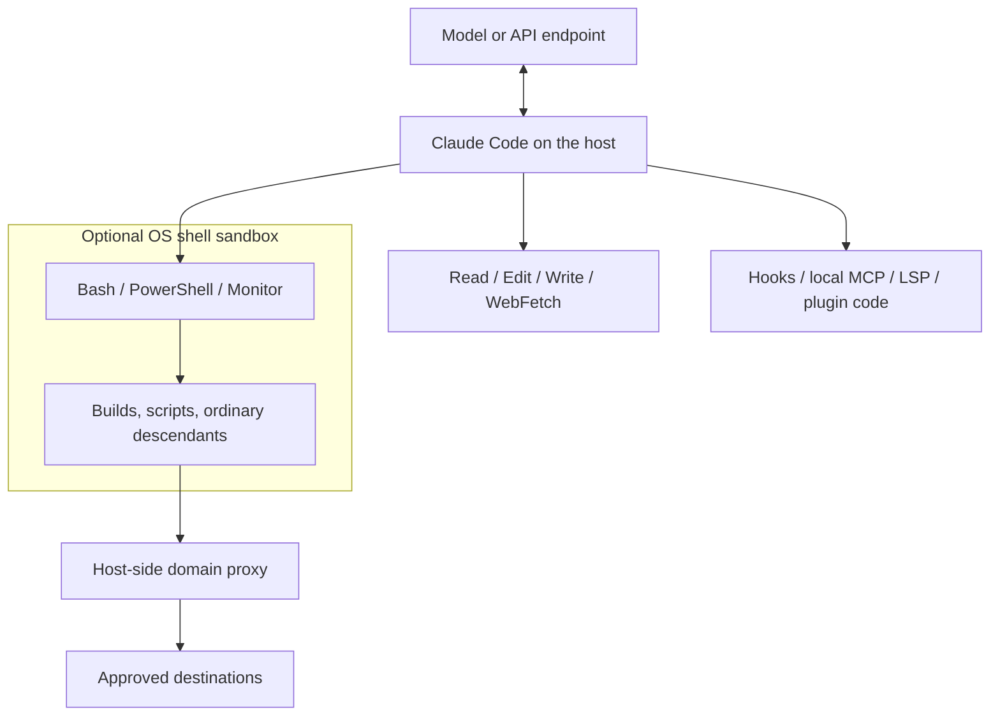

# Claude Code sandboxing

Research checked **2026-11-04 UTC**. A normal local Claude Code installation supplies **no enabled OS sandbox**. Its optional built-in sandbox contains shell tool commands and their descendants, not the agent process. Reads remain broad even after enabling it. For a boundary around file tools, hooks, and local MCP servers as well, Anthropic documents launching the whole CLI through its experimental sandbox runtime, a dev container, or a cloud session. These are separate deployment choices, not clean-install defaults. [e1], [e2], [e5]

## What was examined

The starting point was the [official overview](https://code.claude.com/docs/en/overview), followed by the current sandboxing, permissions, settings, deployment, and CLI documentation. Read-only local inspection on macOS found `/Users/ken/.local/bin/claude`, reporting **2.1.318 (Claude Code)** through both `sniff software agents --json` and `claude --version`. `claude --help` was also examined. No model session, sandbox probe, package installation, permission change, or credential inspection was performed. Existing user settings were not used to infer defaults. [e1], [e13]

Release notes were examined at Claude Code repository commit `26382c08758260c9f5deb2019d8fe851f89fa9ae`; the current top release was 2.1.318. Public sandbox-runtime source was examined at `98a4016d27609ed34dd1fb43d23ed6efb6eeeb77`, whose package version is **0.0.81**, also the npm `latest` version observed during research. That package requires Node.js **22.12.0 or later**. This establishes the standalone runtime's source behavior, not the exact runtime revision embedded in the installed native CLI. Claude Code's complete permission implementation was not source-audited. [e9], [e10], [e11], [e13]

## Defaults across platforms and session types

The following assumes no managed policy, saved permission choice, settings override, or command-line override. “Auto” means a classifier reviews actions; it does not mean sandboxed. Current interactive Auto defaults require an eligible model/session and can fall back to Manual. [e2], [e3]

| Platform | Interactive terminal, current CLI | Non-interactive `claude -p`, current CLI | Optional built-in shell sandbox |
| --- | --- | --- | --- |
| macOS | Sandbox off; Auto when available, otherwise Manual | Sandbox off; Manual; unanswered approval calls denied | Seatbelt; no separate sandbox package needed |
| Linux | Sandbox off; same permission defaults | Sandbox off; same headless defaults | Bubblewrap and socat; usable user namespaces required |
| Native Windows | No built-in shell isolation; same permission defaults | No built-in shell isolation; same headless defaults | Explicitly unsupported; shell commands run unsandboxed |
| WSL2 | Sandbox off; same permission defaults inside the distribution | Sandbox off; same headless defaults | Linux backend inside WSL2; not native Windows isolation |

The sandbox-off default and native Windows absence are explicit statements in the [sandbox guide](https://code.claude.com/docs/en/sandboxing#what-the-sandbox-restricts), not deductions from missing documentation. Current [permission-mode documentation](https://code.claude.com/docs/en/permission-modes#which-mode-a-session-starts-in) says interactive Auto became the built-in default across plans/providers in **2.1.283**; older versions had plan and feature-flag conditions. HIPAA-eligible sessions default to Manual from 2.1.285. An organization can disable Auto, and unsupported models or server-side availability can cause Manual fallback. **2.1.302 and later** explicitly default headless/SDK runs to Manual when no mode is set. Earlier defaults should not be inferred from this table. [e2], [e3]

First use involves authentication and interactive workspace trust. The local CLI supports Claude subscription/Console authentication and documented third-party inference providers; the shell sandbox itself has no separately documented paid entitlement. On the first session that uses the built-in Auto default, a notice explains the mode. A user with a saved non-Auto default may instead receive an opt-in question; declining preserves that choice. None of these enables the sandbox. `/sandbox` is a separate opt-in, offering automatic approval inside the boundary or regular permission checks. It normally saves the choice to `.claude/settings.local.json`; setting `sandbox.enabled` in user settings applies across projects. [e1], [e2], [e3]

Current Auto mode also has an interactive first-read choice for paths outside working directories: allow broadly, block future outside reads, or decide again next time. Choosing the persistent block sets `permissions.blockReadsOutsideWorkingDirectories: true`. The prompt does not occur in `-p` or background sessions. Thus a previous user's answer can materially change an installation without changing the clean-install default. `-p`, or non-TTY output, skips workspace trust according to locally observed help; this is not an isolation mechanism. [e3], [e13]

## The built-in boundary and what bypasses it

With `sandbox.enabled: true`, Bash, PowerShell, and Monitor tool commands run under OS restrictions, as do their ordinary child processes. On macOS the runtime generates a Seatbelt profile and invokes `/usr/bin/sandbox-exec`. On Linux/WSL2 it constructs bubblewrap mount, PID, and network namespaces, read-only mounts and writable exceptions, with socat relaying traffic to a host-side proxy. This is per-command isolation on the local kernel, not a VM containing Claude Code. The agent and proxy remain outside. [e2]; source-derived details: [e10]



The [documented scope](https://code.claude.com/docs/en/sandboxing#what-runs-outside-the-sandbox) is narrower than “Claude is sandboxed”:

| Surface | Under built-in shell sandbox? | Actual control |
| --- | --- | --- |
| Shell tools and ordinary descendants | Yes, when enabled and not exempted | OS filesystem/network policy plus tool permissions |
| Read, Edit, Write, search and built-in web tools | No | Claude Code's application permission checks |
| Subagents | Their shell calls share the parent's sandbox | Same-process subagents use the same sandbox configuration; other tools retain their normal scope |
| Hooks, local stdio MCP, LSP, status-line and authentication helpers | No | Host-user authority; separate configuration/approval controls |
| Plugins and extensions | Depends on execution surface | A skill's shell call uses shell policy; plugin hooks, monitors, and in-process mods do not acquire that boundary |
| Remote MCP services | No local process containment | Service-side authority and Claude Code's MCP permissions |
| Commands typed with `!` | Usually no | User-directed host execution; limited strict-mode exceptions below |

An ordinary shell child cannot opt out just by ignoring a prompt or proxy variable. However, allowed host services can execute work outside the boundary. Docker socket access effectively exposes host authority; macOS `allowAppleEvents: true` permits launching unsandboxed applications. Computer use operates on the real desktop. Independent background Claude sessions are separate processes and use their own loaded sandbox settings. Remote Control steers a local process; it does not move it into a remote sandbox. [e2], [e12]

Linux requires **bubblewrap and socat**. Native Claude Code bundles ripgrep. `/sandbox` reports missing dependencies and may show a missing optional seccomp component, installable through `@anthropic-ai/sandbox-runtime`. The optional filter blocks Unix socket creation; without it, do not claim Unix IPC isolation. Ubuntu's AppArmor user-namespace restriction may prevent startup; the guide gives an AppArmor profile for `/usr/bin/bwrap` and an alternative system policy change. WSL1 is unsupported. In WSL2, Windows executable launches use an interoperability Unix socket: blocking it requires the optional filter; `allowAllUnixSockets` permits those launches and much more. [e2]

## Files, credentials, processes, and network

### Filesystem access

Without the sandbox, OS access remains that of the host user. Tool prompts, read/write rules, and modes constrain what Claude Code dispatches; they do not create a read-only mount or separate credential store. In Manual mode, ordinary in-workspace reads and recognized read-only commands can run without approval; edits and most shell commands need approval. Auto substitutes classifier decisions for many prompts. Neither mode makes readable secrets confidential. [e3], [e4]

With the sandbox enabled, shell writes are allowed in the working directory, added directories (`--add-dir`, `/add-dir`, `permissions.additionalDirectories`), and a per-user temporary directory. Linked worktrees also receive access to the shared Git metadata needed for commits. **Reads normally cover most of the machine**, including `~/.ssh`, `~/.aws/credentials`, and inherited environment secrets. There is no built-in credential deny list. [e2]

Use `sandbox.filesystem.allowWrite`, `denyWrite`, `denyRead`, and `allowRead` to adjust shell access. Narrower read paths override broader ones: a project can be reopened under a home-directory read deny, while a narrower secret deny survives a broad read allowance. Filesystem path syntax differs from permission-rule syntax: `/tmp/build` is an absolute sandbox path, `~` means home, and relative paths resolve against the settings file's directory. In a project settings file, `.` means that project; in `~/.claude/settings.json`, it means `~/.claude`. [e2], [e6]

Protected writes remain denied inside writable regions. The CLI protects settings, skills, agents, commands, hooks, MCP configuration, relevant workflow/task files, Git hooks/configuration, shell startup files, and its configuration/credential store. The scope differs between the working directory, ancestors, and user configuration directory; it is not a universal ban on every similarly named file. `allowWrite` does not override these protections. The guide also documents cleanup of newly created top-level `HEAD`, `objects`, and `refs` entries, including deletion of some populated folders: these names have special bare-repository protections and should not be assumed safe scratch locations. [e2]

Symlinks do not establish a separate security boundary. Current macOS denials also cover resolved destinations, including supported wildcard-prefix cases, and settings symlink targets are reconsidered for subsequent commands. Release notes document fixes in **2.1.299** for denied paths through symlinks and **2.1.309** for write-deny globs at real destinations. Linux uses mount-based policy; the standalone runtime scans existing nested protected paths to a bounded depth rather than watching all future nested repositories. These are version-sensitive claims, not results of adversarial tests here. [e2], [e9], [e10]

`permissions.blockReadsOutsideWorkingDirectories: true` is an additional application control, available from **2.1.257**. It rejects outside file-tool reads even in bypass mode, with exceptions for files Claude needs. When filesystem sandboxing applies, it also denies shell reads under user-data roots such as `/Users`, `/home`, `/Volumes`, and `/mnt`, then reopens working directories, session temp, and needed configuration. It is not a blanket deny of the entire root filesystem. Shell enforcement has documented exceptions: disabled filesystem isolation, `allowManagedReadPathsOnly`, or a starting directory containing glob characters. Global Git configuration is reopened and may itself contain secrets. **2.1.314** adds `permissions.blockWritesOutsideWorkingDirectories` for file tools, with own-file exceptions; it does not constrain hooks, MCP, or shells. [e6]

### Secrets and temporary storage

For sandboxed commands, `sandbox.credentials.files` and `envVars` accept `mode: "deny"`: files become unreadable and variables are removed. `mode: "mask"` supplies placeholders and allows proxy-side substitution on allowed destinations. Masking requires `sandbox.network.tlsTerminate`; each `injectHosts` destination must also be network-allowed. Only user, managed, and `--settings` scopes may authorize masking/TLS termination. Linux file masks use substituted file contents; macOS file masks become read denies while filesystem isolation is enabled. File masking and AWS SigV4 handling require **2.1.221** or later; additional AWS pairing controls require 2.1.224. A pattern mask with the default no-match warning can leave a file unmasked: use a deny when failure to match must remain confidential. [e2], [e6]

`CLAUDE_CODE_SUBPROCESS_ENV_SCRUB=1` separately strips recognized credentials from environments of subprocesses including hooks and stdio MCP. It deliberately leaves GitHub tokens and proxy settings; it does not remove credentials from files or the parent agent. `CLAUDE_CONFIG_DIR` relocates CLI configuration; `CLAUDE_CODE_TMPDIR` changes internal temp placement. Sandboxed shell `$TMPDIR` normally points to the writable per-user sandbox temp and may differ from unsandboxed `$TMPDIR`. A temp directory is writable storage, not a promise of isolation from every process of the same user. [e2], [e7]

### Network and process execution

Sandboxed tools have no unrestricted direct outbound route. Linux uses a network namespace; Seatbelt limits macOS network access. The host-side HTTP/SOCKS proxy evaluates `sandbox.network.allowedDomains` and `deniedDomains`; the allowed list starts empty and also incorporates supported `WebFetch(domain:...)` permission rules. Proxy-aware tools work once allowed. Tools that ignore the proxy, such as plain SSH or many database clients, fail even for allowed hosts until explicitly configured to use it. UDP/QUIC/ICMP do not get a direct outbound path. [e2]

An unknown hostname does not necessarily stay denied: interactive Manual/acceptEdits sessions can approve it, bypass mode ordinarily allows it, Auto can approve per-command requested domains from **2.1.271**, and dontAsk refuses it. `strictAllowlist: true` or managed `allowManagedDomainsOnly: true` prevents that widening; explicit denied domains remain denied. The proxy also checks resolved local addresses on direct hostname connections, with exceptions including explicit IP grants and upstream proxies. An allowed domain is not content-level authorization: broad GitHub access can still exfiltrate readable files. Default proxying does not inspect TLS payloads, and TLS termination alone adds no content filter. [e2], [e6]

This network boundary applies to **tool subprocess traffic**. The parent agent still communicates with Anthropic or its configured inference provider; Read output can enter those model requests. `allowedDomains: []` does not make the session offline or prevent model-mediated disclosure. External whole-process isolation must separately permit model/auth endpoints and still transmits supplied context. [e2], [e5]

`network.allowUnixSockets`, `allowAllUnixSockets`, `allowLocalBinding`, and macOS `allowMachLookup` open further IPC/server access. The per-path `allowUnixSockets` list applies only on macOS; Linux/WSL2 ignore it and use the all-or-nothing socket setting. `allowLocalBinding` also applies only on macOS: it permits listening on local addresses and direct localhost connections, including accepting other machines when binding a non-loopback address. Linux/WSL2 instead have private loopback interfaces. `allowAppleEvents` and Linux `allowNestedUserNamespaces` can undermine code-execution containment; the latter, added in **2.1.305**, permits operations that can defeat filesystem protections. `enableWeakerNestedSandbox` supports constrained container environments with weaker isolation. `enableWeakerNetworkIsolation` relaxes macOS trust-service restrictions for compatibility. These are security changes, not harmless fixes for a failing build. [e2], [e6], [e9], [e10]

## Configuration, approvals, and failures

For a local supported-platform session, this example enables the shell boundary, prevents startup fallback and model-requested unsandboxed retries, protects two credential paths, and admits one package registry. It still leaves file tools and hooks outside the OS boundary and keeps the ordinary broad read default for other shell paths. [e2], [e6], [e13]

```sh
claude --settings '{"sandbox":{"enabled":true,"failIfUnavailable":true,"allowUnsandboxedCommands":false,"filesystem":{"denyRead":["~/.ssh","~/.aws"]},"network":{"allowedDomains":["registry.npmjs.org"],"strictAllowlist":true}}}'
```

The following can be saved as a settings file and supplied with `--settings policy.json`. It retains normal permission approval for sandboxed calls and applies explicit file-tool boundaries as well. [e2], [e6]

With the default `autoAllowBashIfSandboxed: true`, matching deny rules and content-specific ask rules still apply. A bare Bash ask rule is normally skipped for sandboxed calls, but plan mode does not gain those approvals. Monitor calls remain sandboxed without receiving the same automatic approval. Certain interpreter/environment-assignment forms also return to the ordinary permission flow. These exceptions affect approval, not the OS boundary. [e2]

```json
{
  "sandbox": {
    "enabled": true,
    "failIfUnavailable": true,
    "autoAllowBashIfSandboxed": false,
    "allowUnsandboxedCommands": false,
    "network": { "allowedDomains": [], "strictAllowlist": true },
    "credentials": {
      "files": [{ "path": "~/.ssh", "mode": "deny" }],
      "envVars": [{ "name": "GITHUB_TOKEN", "mode": "deny" }]
    }
  },
  "permissions": {
    "blockReadsOutsideWorkingDirectories": true,
    "blockWritesOutsideWorkingDirectories": true
  }
}
```

For unattended execution, specify the approval behavior too; the sandbox does not answer every tool permission request:

```sh
claude -p --settings policy.json --permission-mode dontAsk \
  --permission-prompts none --allowedTools 'Bash(npm test)' \
  'Run npm test and summarize the result.'
```

Observed 2.1.318 help describes `--permission-prompts none` as denying anything that would prompt. Without a host callback/prompt tool, headless Manual calls needing approval are denied; allow rules, hooks, or an SDK permission callback can authorize them. Auto or bypass modes are explicit alternatives, not implicit consequences of `-p`. A headless run should preconfigure required domains and avoid dependence on an interactive network decision. [e3], [e13]

### Scope and administration

The documented settings precedence is managed policy, then `--settings`, project-local settings, shared project settings, and user settings. User settings are normally `~/.claude/settings.json`; project files are `.claude/settings.local.json` and `.claude/settings.json`. Lists generally merge; they are not simply replaced by the highest file. `--setting-sources user,project,local` selects ordinary sources. From **2.1.246**, excluded project/local sources no longer feed sandbox filesystem or credential rules; some user credential denies remain protective even when that user source is excluded. Environment variables have per-variable semantics rather than constituting a universal highest precedence tier. [e2], [e8]

Administrators can deploy the sandbox JSON through managed settings. File locations are `/Library/Application Support/ClaudeCode/managed-settings.json` on macOS, `/etc/claude-code/managed-settings.json` on Linux/WSL, and `C:\Program Files\ClaudeCode\managed-settings.json` on native Windows. Server-managed policy and OS management are other supported delivery routes. The Windows path does not imply Windows sandbox support: `failIfUnavailable: true` makes a required built-in sandbox refuse startup there. Managed-only `sandbox.bwrapPath` and `sandbox.socatPath` pin backend executables instead of trusting PATH. [e2], [e6], [e14]

From **2.1.285**, an admin-required sandbox ignores repository settings that loosen exclusions, network access, write grants, or certain read rules. It becomes admin-required through managed/CLI `allowUnsandboxedCommands: false`, or managed `allowManagedDomainsOnly: true`; these keys do not themselves enable it. User/CLI grants can still widen many lists unless a specific managed lock covers them. `allowManagedReadPathsOnly` and `allowManagedDomainsOnly` restrict their respective allowlists. Managed filesystem policy or credential-file denies also prevent a lower scope disabling the filesystem layer. There is no basis for treating one `enabled: true` as an immutable complete policy. [e2], [e6]

`sandbox.filesystem.disabled: true` deliberately leaves network isolation but removes filesystem isolation, including protected-write and file-deny enforcement. `autoAllowBashIfSandboxed` still defaults true, making this especially significant. `excludedCommands` sends matching calls outside both shell boundaries; compound calls require every command to match, and matching is not a transitive exemption for programs invoked inside scripts. A custom `httpProxyPort`/`socksProxyPort` replaces built-in network filtering for that traffic: the custom proxy must enforce the policy itself. `HTTPS_PROXY`/`HTTP_PROXY` instead configure an upstream corporate proxy behind the built-in allow checks. [e2], [e6]

### Denial, escape hatches, and approval bypass

OS-denied writes usually surface as `Operation not permitted` on macOS or `Read-only file system` on Linux/WSL2. Blocked network results identify the destination. Claude can adjust the command or request a retry with the **tool parameter** `dangerouslyDisableSandbox`; this is not a top-level CLI flag. With the default `allowUnsandboxedCommands: true`, approval can permit a completely unsandboxed retry. A matching Bash allow rule can approve that retry without a fresh prompt. Manual and acceptEdits otherwise prompt; bypass runs it without prompting; Auto evaluates it; dontAsk denies it. An ask rule `Bash(dangerouslyDisableSandbox:true)` can force a retry prompt even in bypass mode. `allowUnsandboxedCommands: false` disables the parameter, but trusted explicit exclusions remain possible. [e2]

When enabled sandboxing cannot initialize, the default `failIfUnavailable: false` allows unsandboxed execution. Set it true for fail-closed startup. Recent releases also have narrower command refusal paths reported as `Sandbox is required`; they refuse the retry parameter too. An unusable backend should not be confused with a successfully sandboxed command that gets an access error. Missing dependencies, unavailable namespaces, and container restrictions require repair or an explicit deployment change. `claude doctor` and `/sandbox` expose diagnostics; `/sandbox` is interactive and does not configure a headless run. [e2], [e6]

More precisely, `failIfUnavailable: true` exits when the startup platform/dependency check fails; if that check passes but later initialization fails, the session may remain open while each sandboxed command is refused. [e6]

“YOLO” is not the examined CLI's flag name. `--dangerously-skip-permissions`/`--permission-mode bypassPermissions` bypass approval checks; `--allow-dangerously-skip-permissions` only makes that mode available. These do **not themselves disable an already enabled OS sandbox**, but they can approve unknown hosts and unsandboxed retries unless the stricter controls above prevent them. The first interactive bypass launch asks for responsibility acceptance; ordinary `-p` shows no such dialog. Background bypass sessions have separate saved-acceptance requirements. `permissions.disableBypassPermissionsMode: "disable"` lets administrators forbid the mode. [e2], [e3], [e13], [e14]

Plan mode, tool allowlists/denylists, workspace trust, and `--restricted` are application controls. `--allowedTools`, `--disallowedTools`, and `--tools` select or preapprove tool calls rather than isolating execution. `permissions.defaultMode` selects a saved starting mode, subject to documented restrictions on repository-supplied Auto/bypass settings. `CLAUDE_CODE_RESTRICTED=1` is equivalent to `--restricted` and is ignored in a settings `env` block. Current `--restricted` removes code-running tools and WebFetch unless explicitly restored with `--tools`, confines file tools, ignores ordinary user/project/local settings, and refuses bypass mode; managed settings and `--settings` still apply. Add `--strict-mcp-config` to avoid ordinary configured MCP servers. It is available from **2.1.248**, not an OS jail. `--safe-mode` is a troubleshooting customization switch, also not a sandbox. [e3], [e7], [e13]

Commands a person types at `!` ordinarily remain unsandboxed even with strict retries disabled. Documented exceptions are strict background sessions and Linux sessions using `CLAUDE_CODE_SUBPROCESS_ENV_SCRUB`; prior to **2.1.260** strict mode had broader coverage of typed commands. Therefore “strict” must be read in its documented scope. [e2]

## Official optional deployments around the whole CLI

### Standalone Anthropic sandbox runtime

The [official deployment guide](https://code.claude.com/docs/en/sandbox-environments#sandbox-runtime) documents `npm install -g @anthropic-ai/sandbox-runtime`, configuring `~/.srt-settings.json` or `srt --settings FILE`, then launching `srt claude`. For a pinned examined version:

```sh
npm install -g @anthropic-ai/sandbox-runtime@0.0.81
srt --settings /absolute/path/srt-settings.json claude
```

Configure the runtime's own `filesystem` and `network` objects, without Claude Code's outer `sandbox` key. Allow the project, required CLI state paths, and runtime temp writes; permit the configured model endpoint and required login/refresh hosts. Linux/WSL2 need bubblewrap, socat, and ripgrep; create Linux write-grant targets first. Install the runtime outside writable project paths so sandboxed code cannot replace the next launcher. An absent default settings file starts with restricted built-in writes and blocked network; an explicitly missing, empty, unreadable, or invalid settings file refuses launch. Ordinary read access remains broad unless narrowed. [e5], [e10], [e11]

The outer boundary now covers file tools, hooks, and local MCP descendants too, and its network policy also affects the agent's API traffic. It does not contain a remote MCP service's own actions. Linux automatic protected-path discovery is bounded and does not protect all future nested files; state deliberately left writable can affect a later unsandboxed launch. The integration is experimental and may change. The pinned README's macOS dependency subsection still lists ripgrep, but the pinned `sandbox-manager.ts` explicitly checks it only on Linux and says macOS uses profile globs instead. This report follows that implementation and the official deployment guide; the README line appears stale. [e5], [e10]

There is a meaningful **native Windows distinction**: current Claude Code explicitly lacks a built-in Windows sandbox, but standalone runtime **0.0.81 has an alpha Windows backend**. Its source/README describe a dedicated `srt-sandbox` local account, write-restricted token, job object, NTFS ACLs, and a Windows Filtering Platform outbound fence. `windows-install` requires an elevated UAC setup step and makes substantial account/ACL changes, including default profile-read grants with credential exceptions. It also documents residual token and system-service network gaps. This research did not install or test it, and does not establish end-to-end Claude Code compatibility on that alpha backend. It is not evidence that `/sandbox` works on native Windows. [e2], [e10]; unresolved check G2

### Dev container and cloud sessions

Anthropic supplies a [reference dev container](https://code.claude.com/docs/en/devcontainer), requiring Docker and compatible Dev Containers tooling. It runs the entire local CLI inside the container, with the project bind-mounted writable and configuration persisted in a named volume. Authentication still needs a normal supported account/provider. The optional reference firewall requires `NET_ADMIN`/`NET_RAW`; merely installing the Dev Container Feature does not install that firewall policy. [e15]

Source inspection of the reference `init-firewall.sh` shows a default-drop policy with **exceptions beyond the named domain set**, including DNS, TCP port 22, loopback, and a host-network range. Thus “default-deny firewall” is not “all traffic is restricted to those HTTPS hostnames.” The reference uses the non-root `node` user and permits its firewall initialization through sudo. These observations describe the published template, not a built/tested container. Bind-mounted code and any injected credentials remain accessible inside it. [e11]

`claude --cloud` is an official CLI handoff to an Anthropic-hosted isolated VM, not an enhancement to local `/sandbox`. It requires a suitable Claude subscription: the current documentation lists Pro, Max, Ultra, Team, and eligible Enterprise seats, subject to organizational policy. GitHub connectivity supports clone/push, but CLI uploads can send a local repository without a GitHub connection. A network proxy constrains VM egress; Git credentials/signing keys remain outside the VM and are attached by a separate proxy. Even network-disabled cloud sessions retain Anthropic API transport. Self-hosted `--environment` execution instead depends on the organization's own isolation. `--teleport` returns work to a local execution context and should not be assumed to preserve the VM boundary. [e16]

## Evidence and remaining checks

Evidence records below were accessed **2026-11-04 UTC**. Documentation establishes vendor claims; source records establish implementation details at a pinned revision; local help establishes exposed options. None constitutes a runtime isolation test.

| ID | Evidence and scope |
| --- | --- |
| e1 | [Official overview](https://code.claude.com/docs/en/overview): local CLI installation/authentication and supported inference options. |
| e2 | [Sandbox guide](https://code.claude.com/docs/en/sandboxing): explicit off default, unsupported native Windows, boundaries, controls, dependencies, escape/failure behavior. |
| e3 | [Permission modes](https://code.claude.com/docs/en/permission-modes): current starting modes, version conditions, outside-read choice, bypass acceptance and headless behavior. |
| e4 | [Permissions](https://code.claude.com/docs/en/permissions): application tool rules, working directories and trust; distinct from OS isolation. |
| e5 | [Sandbox environments](https://code.claude.com/docs/en/sandbox-environments): officially documented whole-process runtime, containers, VMs and cloud choices. |
| e6 | [All settings](https://code.claude.com/docs/en/settings-reference): precise sandbox and permission key defaults, scopes, read-block exceptions and version requirements. |
| e7 | [Environment variables](https://code.claude.com/docs/en/env-vars): subprocess scrub, temp/config paths, restricted/safe mode variables. |
| e8 | [Settings files and precedence](https://code.claude.com/docs/en/settings): sources, scopes, list merging and precedence. |
| e9 | [Pinned Claude Code changelog](https://github.com/anthropics/claude-code/blob/26382c08758260c9f5deb2019d8fe851f89fa9ae/CHANGELOG.md): 2.1.318 top release and historical sandbox fixes. |
| e10 | [Pinned runtime README](https://github.com/anthropic-experimental/sandbox-runtime/blob/98a4016d27609ed34dd1fb43d23ed6efb6eeeb77/README.md), [sandbox manager](https://github.com/anthropic-experimental/sandbox-runtime/blob/98a4016d27609ed34dd1fb43d23ed6efb6eeeb77/src/sandbox/sandbox-manager.ts), [macOS backend](https://github.com/anthropic-experimental/sandbox-runtime/blob/98a4016d27609ed34dd1fb43d23ed6efb6eeeb77/src/sandbox/macos-sandbox-utils.ts), [Linux backend](https://github.com/anthropic-experimental/sandbox-runtime/blob/98a4016d27609ed34dd1fb43d23ed6efb6eeeb77/src/sandbox/linux-sandbox-utils.ts), and [package manifest](https://github.com/anthropic-experimental/sandbox-runtime/blob/98a4016d27609ed34dd1fb43d23ed6efb6eeeb77/package.json): public runtime implementation and prerequisites, including Windows alpha claims. |
| e11 | [Pinned reference container configuration](https://github.com/anthropics/claude-code/blob/26382c08758260c9f5deb2019d8fe851f89fa9ae/.devcontainer/devcontainer.json), [Dockerfile](https://github.com/anthropics/claude-code/blob/26382c08758260c9f5deb2019d8fe851f89fa9ae/.devcontainer/Dockerfile), and [firewall](https://github.com/anthropics/claude-code/blob/26382c08758260c9f5deb2019d8fe851f89fa9ae/.devcontainer/init-firewall.sh): mounts, capabilities and actual network exceptions. |
| e12 | [Remote Control](https://code.claude.com/docs/en/remote-control): local execution remains local. |
| e13 | Local read-only commands `sniff software agents --json`, `sniff os --json`, `claude --version`, and `claude --help`: macOS installation, 2.1.318, observed flag descriptions; no boundary probes. |
| e14 | [Managed settings](https://code.claude.com/docs/en/managed-settings): administrative delivery, OS file locations and bypass restrictions. |
| e15 | [Dev containers](https://code.claude.com/docs/en/devcontainer): official feature/reference setup, authentication, persistence and optional firewall. |
| e16 | [Cloud sessions](https://code.claude.com/docs/en/claude-code-on-the-web#security-and-isolation): CLI launch, eligibility, VM boundary, credential proxies and API transport exception. |

### Local observation

Sanitized excerpts captured from the local CLI on 2026-11-04 UTC:

```text
$ claude --version
2.1.318 (Claude Code)
$ claude --help
  -p, --print
  --settings <file-or-json>
  --permission-mode <mode>
    choices: acceptEdits, auto, bypassPermissions, manual, dontAsk, plan
  --permission-prompts <target>
    choices: host, none; default: host
  --restricted
  --strict-mcp-config
  --cloud [description|session_id|url]
```

The flag list is excerpted, not a complete help transcript. `sniff` independently reported the installed version and macOS host. No local configuration or secret values are reproduced.

**G1 — embedded revision and runtime enforcement:** the exact sandbox-runtime revision compiled into Claude Code 2.1.318 was not established. Obtain an upstream build manifest/SBOM and compare it with pinned runtime source. Then use disposable macOS, Linux, and WSL2 environments to test writes, read denies, symlink retargeting, socket access, startup fallback, headless domain denial, and a rejected unsandboxed retry; on native Windows verify required-sandbox startup refusal. This research used documentation/source inspection only.

**G2 — standalone Windows alpha:** establish whether `srt` 0.0.81 can run the native Claude Code 2.1.318 binary end to end. Test in a disposable Windows VM after reviewing the installer account/ACL changes, including credential availability, filesystem denies, subprocess coverage, and the README's documented network residuals. Keep this question separate from the verified absence of the built-in native Windows sandbox.

## Changelog

- **2026-11-04:** Created the report from current documentation, pinned release notes/runtime/container source, and local 2.1.318 version/help inspection. Recorded the sandbox-off default, current interactive Auto/headless Manual split, shell-only coverage, whole-process alternatives, and the standalone Windows alpha distinction. No earlier report existed at this path.

[e1]: https://code.claude.com/docs/en/overview
[e2]: https://code.claude.com/docs/en/sandboxing
[e3]: https://code.claude.com/docs/en/permission-modes
[e4]: https://code.claude.com/docs/en/permissions
[e5]: https://code.claude.com/docs/en/sandbox-environments
[e6]: https://code.claude.com/docs/en/settings-reference
[e7]: https://code.claude.com/docs/en/env-vars
[e8]: https://code.claude.com/docs/en/settings
[e9]: https://github.com/anthropics/claude-code/blob/26382c08758260c9f5deb2019d8fe851f89fa9ae/CHANGELOG.md
[e10]: https://github.com/anthropic-experimental/sandbox-runtime/blob/98a4016d27609ed34dd1fb43d23ed6efb6eeeb77/README.md
[e11]: https://github.com/anthropics/claude-code/blob/26382c08758260c9f5deb2019d8fe851f89fa9ae/.devcontainer/init-firewall.sh
[e12]: https://code.claude.com/docs/en/remote-control
[e13]: claude.md#local-observation
[e14]: https://code.claude.com/docs/en/managed-settings
[e15]: https://code.claude.com/docs/en/devcontainer
[e16]: https://code.claude.com/docs/en/claude-code-on-the-web#security-and-isolation
