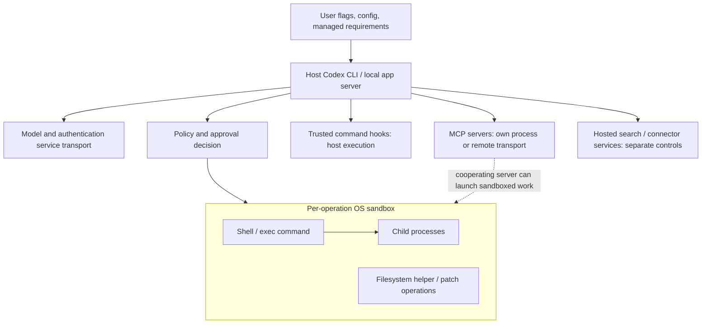

# Codex CLI sandboxing

Codex CLI supplies OS-enforced isolation for local command execution. Its normal editing policy permits workspace and temporary-directory writes while blocking command networking. This is primarily an integrity boundary: the built-in policies allow broad reads of files the executing identity can access. They do not make the home directory or credentials confidential. Approvals are a separate decision layer that can authorize broader execution. MCP servers, trusted hooks, hosted tools, and Codex's own API connection must be considered separately.

## Scope and evidence

Examined **2026-11-04 UTC**: the official CLI documentation starting at [the requested entry point](https://developers.openai.com/codex/cli), its current destination [Codex CLI](https://learn.chatgpt.com/docs/codex/cli), and the official repository at **`rust-v0.166.0`**, commit **`6ff1e1ca3b30fc8b914720681fcf5fe62e95f856`**. GitHub's latest stable release was [0.166.0, published October 29, 2026](https://github.com/openai/codex/releases/tag/rust-v0.166.0). Release notes include preservation of acknowledged permissions across resume/fork, a reason to distinguish a resumed session from a fresh launch.

Read-only local inspection returned `codex-cli 0.166.0` from `codex --version`. `codex --help`, `codex exec --help`, `codex sandbox --help`, `codex --yolo --help`, `codex exec-server --help`, and `codex cloud exec --help` corroborated the command surfaces below. `codex features list` reported `prefer_mxc` as under development and disabled in this installation; the tagged feature definitions independently establish its clean-install default. No user configuration or credential contents were inspected. No model session or sandbox enforcement experiment was run on any OS. Thus **documented** means current official documentation, **source-derived** means inspected tagged implementation, and **observed** means only the local version/help observations—not runtime security verification.

## Defaults and first run

The comparison assumes a new standalone CLI, no managed policy, no saved project trust or permission selection, and a working OS backend. An interactive launch includes onboarding; `codex exec` does not. A trust decision or existing configuration changes later defaults, so “always workspace-write” and “always read-only” are both incomplete descriptions. The source derives workspace-write after either a trusted or untrusted project decision, otherwise read-only; an explicitly untrusted project also derives stricter command approvals. See [default resolution](https://github.com/openai/codex/blob/6ff1e1ca3b30fc8b914720681fcf5fe62e95f856/codex-rs/config/src/config_toml.rs#L834) and [approval resolution](https://github.com/openai/codex/blob/6ff1e1ca3b30fc8b914720681fcf5fe62e95f856/codex-rs/core/src/config/mod.rs#L3954).

| Platform | Interactive `codex` | Non-interactive `codex exec` | Enforcer and prerequisite |
|---|---|---|---|
| macOS | Onboarding/trust choice; normal trusted-project Auto is workspace-write with on-request approval. Before a decision, read-only. | Clean default read-only, approvals never; existing trust/config can select workspace-write. | Seatbelt through system `sandbox-exec`; no container or administrator setup. |
| Linux | Same policy/trust behavior as macOS. | Same clean read-only/never behavior. | Bubblewrap namespaces plus seccomp; host must permit required namespace and syscall operations. |
| Native Windows | Backend setup is a first-run prerequisite. Normal setup offers legacy elevated, or policy-permitted unelevated; after setup Auto can use workspace-write/on-request. | No backend is selected in a clean standalone installation. Read-only policy intent and never approvals do **not** provision enforcement: sandbox-intended tools fail until a backend is configured and, where necessary, provisioned. | Native restricted-token/ACL backends; MXC is an optional supported alternative, not the standalone CLI's default. |
| WSL2 | Linux CLI inside WSL2 follows Linux policy/trust behavior. | Linux clean read-only/never behavior. | Linux bubblewrap/seccomp inside the WSL2 guest; its required kernel facilities must work. |

The [security guide](https://learn.chatgpt.com/docs/agent-approvals-security#defaults-and-recommendations) recommends Auto for version-controlled folders and read-only for others. These are onboarding recommendations, not proof that merely finding `.git` grants writes before trust. Explicit untrusted project status skips project-local configuration and requires command approval unless rules permit execution; it does not mean a distinct OS sandbox. The retired explicit `approval_policy = "untrusted"` now prevents startup, although project-derived untrusted approval behavior still exists. [Migration and trust behavior](https://learn.chatgpt.com/docs/agent-approvals-security#migrate-from-the-retired-untrusted-approval-policy).

The [non-interactive guide](https://learn.chatgpt.com/docs/non-interactive-mode#permissions-and-safety) documents read-only as the default. Source sets `AskForApproval::Never` for headless operation, with a rebuild path when automatic review is selected. Saved project decisions and configuration still participate; `--ignore-user-config` skips the base user file but is not a universal clean-room switch. `--ignore-rules` skips user/project execution-policy rules, a separate guardrail; it does not disable the sandbox. `--skip-git-repo-check` relaxes the repository check, not the sandbox. See [exec initialization](https://github.com/openai/codex/blob/6ff1e1ca3b30fc8b914720681fcf5fe62e95f856/codex-rs/exec/src/lib.rs#L590).

Native Windows needs special care: the feature defaults leave MXC preference and legacy feature switches off; absent `windows.sandbox`, configuration selects no backend and downgrades legacy workspace-write intent to read-only. The TUI then offers setup. The executor returns an error when sandbox intent has no enforcer rather than silently executing it on the host. This source-derived qualification is stronger than the documentation's general statement that local execution uses an OS sandbox. [Feature defaults](https://github.com/openai/codex/blob/6ff1e1ca3b30fc8b914720681fcf5fe62e95f856/codex-rs/features/src/lib.rs#L1462), [backend selection](https://github.com/openai/codex/blob/6ff1e1ca3b30fc8b914720681fcf5fe62e95f856/codex-rs/core/src/config/windows_sandbox_config.rs), [setup UI](https://github.com/openai/codex/blob/6ff1e1ca3b30fc8b914720681fcf5fe62e95f856/codex-rs/tui/src/chatwidget/windows_sandbox_prompts.rs), [executor refusal](https://github.com/openai/codex/blob/6ff1e1ca3b30fc8b914720681fcf5fe62e95f856/codex-rs/exec-server/src/process_sandbox.rs#L250).

## What is actually isolated

The CLI/orchestrator remains outside its per-operation sandbox. It loads configuration, holds authentication, requests model inference, and dispatches tools. Shells and their descendants enter the selected OS boundary. Built-in filesystem operations use sandboxed helpers where a filesystem sandbox context is required. An external container can instead contain the whole CLI, including its credentials and integrations, but that is explicit deployment setup.



This boundary follows the [sandbox manager](https://github.com/openai/codex/blob/6ff1e1ca3b30fc8b914720681fcf5fe62e95f856/codex-rs/sandboxing/src/manager.rs) and [filesystem helper runner](https://github.com/openai/codex/blob/6ff1e1ca3b30fc8b914720681fcf5fe62e95f856/codex-rs/exec-server/src/fs_sandbox.rs). It is neither an agent-wide VM nor a guarantee that every integration shares shell restrictions.

On **macOS**, Codex constructs a Seatbelt policy and starts commands through `/usr/bin/sandbox-exec`. Its base policy denies by default, then permits process execution/forking, signals to processes in the same sandbox, selected system facilities, and the filesystem/network grants. Descendants inherit the policy. Restricted-read profiles add curated runtime allowances rather than indiscriminately exposing `/System`. Unsupported policy construction fails closed. [Seatbelt construction](https://github.com/openai/codex/blob/6ff1e1ca3b30fc8b914720681fcf5fe62e95f856/codex-rs/sandboxing/src/seatbelt.rs), [base policy](https://github.com/openai/codex/blob/6ff1e1ca3b30fc8b914720681fcf5fe62e95f856/codex-rs/sandboxing/src/seatbelt_base_policy.sbpl).

On **Linux and WSL2**, the default filesystem backend is bubblewrap, not Landlock. It layers writable mounts over a read-only filesystem view, reapplies protected carveouts, and uses user, PID, and, for restricted networking, network namespaces. Seccomp and `PR_SET_NO_NEW_PRIVS` constrain syscalls; filters also block `io_uring` bypasses. Managed proxy networking uses an isolated namespace and a routing bridge. Codex prefers system `bwrap` outside the working directory, supports older system versions without `--argv0`, and otherwise uses its bundled helper. A missing system binary can therefore produce a warning without disabling enforcement. Namespace restrictions imposed by a container or host can still prevent startup. [Linux implementation guide](https://github.com/openai/codex/blob/6ff1e1ca3b30fc8b914720681fcf5fe62e95f856/codex-rs/linux-sandbox/README.md).

Linux normally isolates PIDs and mounts a fresh `/proc`; a denied proc mount can retain inherited `/proc` while retaining PID isolation. Trusted provisioning can explicitly select `codex exec-server --linux-sandbox-pid-namespace=inherit`; that relaxes same-UID process signaling isolation and is not a repository/environment-variable switch. WSL1 ceased support with the bubblewrap migration in 0.115; WSL2 support is independently documented and does not establish native Windows behavior. [Linux backend details](https://github.com/openai/codex/blob/6ff1e1ca3b30fc8b914720681fcf5fe62e95f856/codex-rs/linux-sandbox/README.md), [OS support](https://learn.chatgpt.com/docs/agent-approvals-security#os-level-sandbox).

On **native Windows**, the documented supported choices are:

- `elevated`: administrator-approved provisioning creates dedicated lower-privilege users and installs filesystem permissions, firewall rules, and required local policy. The workload itself is not an administrator process. Both legacy backends normally use a private desktop.
- `unelevated`: a restricted token derived from the current user and ACL-based boundaries, with environment-level offline controls. Its network isolation is weaker, and denied-read policies are unsupported; do not treat it as equivalent to kernel-enforced offline execution.
- `mxc`: Microsoft Execution Containers **native process isolation**, requiring a working PSEC environment. It does not invoke an AppContainer dispatcher, create accounts, modify host ACLs, request elevation, or start a VM. Current docs identify Windows 11 24H2 build 26100.9278 and 25H2 build 26200.9278 as introduction points, but a runtime create/close probe determines actual availability. Deny paths need an additional capability. [Windows setup and prerequisites](https://learn.chatgpt.com/docs/windows/windows-sandbox), [MXC implementation](https://github.com/openai/codex/blob/6ff1e1ca3b30fc8b914720681fcf5fe62e95f856/codex-rs/mxc-sandbox/README.md).

MXC is strict when explicitly selected; `features.prefer_mxc = true` selects it only when compatible and otherwise retains legacy selection/setup. This fallback is selection-time compatibility handling: command failures do not trigger a different backend. MXC stops remaining descendants when the foreground process exits, unlike the legacy backends' detached-server behavior. Managed MXC networking permits host loopback and requires effective `allow_local_binding = true`; proxied domain rules remain, but additional proxy private-destination checks are removed. Its hard-link names have independent permissions, and volume-root expansion has documented alias limitations. These are material limits on confidentiality and process-lifetime assumptions. [MXC selection and limits](https://github.com/openai/codex/blob/6ff1e1ca3b30fc8b914720681fcf5fe62e95f856/codex-rs/mxc-sandbox/README.md).

## Access boundaries

**Files and credentials.** Read-only permits ordinary file reads and command execution while blocking filesystem mutation; workspace-write additionally permits writes in effective workspace roots and normal system temporary locations. Neither built-in profile is a workspace-only read policy. A shell can therefore read home files or credential files allowed by the executing identity and OS permissions. The orchestrator separately reads its authentication/configuration state outside these tool boundaries. Read-only is not a confidentiality guarantee. [Filesystem policy representation](https://github.com/openai/codex/blob/6ff1e1ca3b30fc8b914720681fcf5fe62e95f856/codex-rs/protocol/src/permissions.rs), [built-in profiles and restricted-read examples](https://learn.chatgpt.com/docs/permissions#file-access-limited-to-workspace).

Workspace selection uses `-C`/`--cd`; `--add-dir` adds writable directories rather than narrowing reads. Legacy `[sandbox_workspace_write]` supports `writable_roots`, `network_access`, `exclude_tmpdir_env_var`, and `exclude_slash_tmp`; the two exclusions default false. Thus `/tmp` and `$TMPDIR` may be writable outside the project. Under a writable root, `.git` (including pointer files and the resolved Git directory), existing `.agents`, `.codex`, and `.aws` directories remain recursively read-only. These are write protections, not secret-file denials. [Configuration reference](https://learn.chatgpt.com/docs/config-file/config-reference), [protected paths](https://learn.chatgpt.com/docs/agent-approvals-security#protected-paths-in-writable-roots).

Permission profiles can replace broad reads with `:minimal` runtime paths plus explicit roots, and can deny exact paths or glob matches. More-specific paths override ancestors; equally specific `deny` outranks write/read. On Linux, WSL2, MXC, and elevated Windows, deny-glob matches are snapshotted **at each process launch**: a matching file created later can remain readable to that running process. A long-lived shell is not refreshed with each stdin write. `glob_scan_max_depth` bounds expansion, so an insufficient depth is not a universal secret-file rule. [Profile semantics and timing](https://learn.chatgpt.com/docs/permissions#deny-reads-with-exact-paths-or-globs).

**Links and aliases.** OS enforcement is not a string-prefix workspace check. Linux masks symlink or missing components of protected paths; macOS rejects user-controlled symlink components in writable roots by default. The macOS-only `allow_symlinked_codex_home = true`, read only from the execution host's `$CODEX_HOME/config.toml` at startup, permits already-authorized roots beneath that home to follow links, including changing targets outside it; it adds no writable roots. MXC resolves symlink/junction aliases with strictest equivalent-path access but explicitly does not unify hard-link permissions. [Seatbelt path checks](https://github.com/openai/codex/blob/6ff1e1ca3b30fc8b914720681fcf5fe62e95f856/codex-rs/sandboxing/src/seatbelt.rs#L414), [configuration scope](https://learn.chatgpt.com/docs/config-file/config-reference), [MXC alias limits](https://github.com/openai/codex/blob/6ff1e1ca3b30fc8b914720681fcf5fe62e95f856/codex-rs/mxc-sandbox/README.md).

**Processes and environment.** The sandbox permits compilers, shells, test runners, and other programs; it constrains their effects rather than providing a universal executable allowlist. Rules may separately allow, prompt for, or forbid commands. Environment handling is a further disclosure surface: current docs say `shell_environment_policy.ignore_default_excludes` defaults to `true`, so automatic filtering of names containing KEY/SECRET/TOKEN is skipped. Set it false and use `inherit = "core"` or `"none"` plus keyed filters for a tighter subprocess environment. `allow_login_shell = false` rejects login-shell requests. These controls neither remove secrets from readable files nor sandbox the host orchestrator. [Environment policy](https://learn.chatgpt.com/docs/config-file/config-advanced#shell-environment-policy).

**Networking.** The built-in restricted modes block ordinary command networking; enabling legacy `network_access = true` grants network access and does not itself create a destination allowlist. Profile `network.enabled = true` likewise needs `features.network_proxy = true`, or enabled managed network requirements, before domain rules enforce anything. The active proxy denies absent allow rules, honors denies over allows, and normally blocks local/private destinations; Unix sockets require explicit grants. A socket such as Docker's can expose a much stronger host service. MXC and unelevated exceptions are described above. [Network permissions](https://learn.chatgpt.com/docs/permissions#network-permissions).

The command proxy does **not** govern model/authentication traffic, hosted web search, connectors, MCP transports, browser/computer-use traffic, or cloud tasks. API access can therefore work while shell `curl` fails. Hosted search normally uses cached results; `--search` or `web_search = "live"` selects live access, and `web_search = "disabled"` disables it. Full-access mode defaults search to live. The security guide also documents `web_search = "indexed"` for index-gated external access. These are separate service controls, not a hole in the subprocess network namespace. [Explicit coverage exclusions](https://learn.chatgpt.com/docs/permissions#what-the-network-proxy-does-not-control), [search defaults](https://learn.chatgpt.com/docs/config-file/config-basic#web-search-mode).

## Which tools share the boundary

| Surface | Coverage in the examined implementation |
|---|---|
| Shell / `exec_command` / continued subprocess input | Initial workload and descendants inherit OS restrictions; a long-running process retains its launch-time authority. |
| Built-in patches and filesystem operations | `apply_patch` uses approval assessment and an explicit filesystem sandbox context; executor helpers enforce reads/writes and refuse missing enforcement. Do not generalize this to every orchestrator disk read. |
| Subagents | Runtime permission and approval snapshots are inherited; the spawn path bounds changed authority by intersection. A subagent is not automatically granted full host access. |
| Skills / extensions | Instruction text supplies no OS isolation. Work dispatched through restricted executor process/filesystem APIs uses those boundaries; an extension is not universally a separate container. |
| Command hooks, including plugin-bundled hooks | Trusted local command hooks spawn directly outside the model-command sandbox. Trust review gates execution; it does not contain it. Environment-targeted hooks can use their environment's executor. |
| Local stdio MCP servers | Ordinary configured server launch is outside the command sandbox; executor-based launch explicitly uses `sandbox: None`. A process-lifetime Job Object is not the command filesystem/network policy. |
| Remote MCP / connectors | Run under the server/service's authority and transport. Local shell restrictions do not confine their effects. |

These are source-derived findings from [patch runtime](https://github.com/openai/codex/blob/6ff1e1ca3b30fc8b914720681fcf5fe62e95f856/codex-rs/core/src/tools/runtimes/apply_patch.rs), [sandboxed filesystem](https://github.com/openai/codex/blob/6ff1e1ca3b30fc8b914720681fcf5fe62e95f856/codex-rs/exec-server/src/sandboxed_file_system.rs), [child authority](https://github.com/openai/codex/blob/6ff1e1ca3b30fc8b914720681fcf5fe62e95f856/codex-rs/core/src/agent/control/spawn.rs), [extension executor tests](https://github.com/openai/codex/blob/6ff1e1ca3b30fc8b914720681fcf5fe62e95f856/codex-rs/core/tests/suite/extension_sandbox.rs), [hook launcher](https://github.com/openai/codex/blob/6ff1e1ca3b30fc8b914720681fcf5fe62e95f856/codex-rs/hooks/src/engine/command_runner.rs), and [MCP launcher](https://github.com/openai/codex/blob/6ff1e1ca3b30fc8b914720681fcf5fe62e95f856/codex-rs/rmcp-client/src/stdio_server_launcher.rs). Inspection of tests is evidence of intended coverage, not an assertion that they were run here.

MCP has a supported experimental **cooperative** integration: a server advertises `codex/sandbox-state` (deprecated alias `codex/sandbox-state-meta`), receives opaque state in call metadata, and can forward it unchanged to `codex sandbox --sandbox-state-json`. A separate `codex/sandbox-launcher` supplies a verified local CLI path when available; remote/HTTP connections omit that launcher. Only work the server routes through it is sandboxed. The server itself retains its original authority and must cooperate; metadata alone is not enforcement. [Metadata contract](https://github.com/openai/codex/blob/6ff1e1ca3b30fc8b914720681fcf5fe62e95f856/codex-rs/codex-mcp/src/sandbox_metadata.rs), [integration test](https://github.com/openai/codex/blob/6ff1e1ca3b30fc8b914720681fcf5fe62e95f856/codex-rs/core/tests/suite/mcp_sandbox_tests.rs).

Non-managed hooks must be reviewed and trusted against their current definition; changed hooks are skipped pending review. Managed hooks are trusted by policy. `--dangerously-bypass-hook-trust` bypasses that separate gate for one invocation. Plugin-bundled hooks use the same trust system, and bundled MCP servers retain MCP semantics. Installing a plugin does not cause all its execution to inherit the shell sandbox. [Hooks and trust](https://learn.chatgpt.com/docs/hooks#review-and-trust-hooks).

## Configure the boundary and approvals

These examples are alternatives; do not combine legacy sandbox keys with permission-profile settings.

```sh
# Explicit interactive editing, with escalation requests going to the user.
codex --sandbox workspace-write --ask-for-approval on-request

# Headless review: blocked actions remain blocked, without human prompts.
codex exec --sandbox read-only -c approval_policy='"never"' "Review the code"

# Headless editing, with one additional writable root.
codex exec -C /work/project --sandbox workspace-write --add-dir /work/shared "Run the checks"

# Approval requests go through automatic review; workspace-write remains active.
codex --approve-for-me

# No Codex sandbox and no command approval prompts; outer isolation is external.
codex --dangerously-bypass-approvals-and-sandbox
```

`--sandbox`/`-s` accepts `read-only`, `workspace-write`, or `danger-full-access`. `--ask-for-approval`/`-a` currently exposes `on-request` and `never` in interactive help; use `-c approval_policy=...` for deterministic exec configuration rather than assuming every interactive flag is accepted after the subcommand. `--yolo` is the supported alias for the dangerous bypass. `-a never` alone leaves the selected sandbox intact; `danger-full-access` removes it while approval policy remains independently configurable. `--full-auto` is retired in current documentation; use workspace-write or `--approve-for-me`. [Current command documentation](https://learn.chatgpt.com/docs/developer-commands?surface=cli), [non-interactive migration](https://learn.chatgpt.com/docs/non-interactive-mode#permissions-and-safety), and local 0.166.0 help observations.

```toml
# Legacy policy, ~/.codex/config.toml
sandbox_mode = "workspace-write"
approval_policy = "on-request"
approvals_reviewer = "user"

[sandbox_workspace_write]
writable_roots = ["/work/shared"]
network_access = false
exclude_tmpdir_env_var = true
exclude_slash_tmp = true
```

For finer reads and destinations, use the beta profile system instead:

```toml
default_permissions = "project-limited"
approval_policy = "on-request"

[features]
network_proxy = true

[permissions.project-limited]
extends = ":workspace"

[permissions.project-limited.filesystem]
":root" = "deny"
":minimal" = "read"

[permissions.project-limited.filesystem.":workspace_roots"]
"." = "write"
"secrets" = "deny"

[permissions.project-limited.network]
enabled = true

[permissions.project-limited.network.domains]
"api.openai.com" = "allow"
```

This preserves inherited metadata protection, explicitly restricts reads, and routes allowed command networking through the proxy. Exact denied directories avoid the new-file timing limitation of globs. Profiles also support additional `[permissions.<name>.workspace_roots]` path-to-boolean entries. Built-ins are `:read-only`, `:workspace`, and `:danger-full-access`; full access cannot be an inheritance parent. [Profile definition and examples](https://learn.chatgpt.com/docs/permissions).

Legacy settings win if any loaded config has `sandbox_mode`, if `--sandbox` is supplied, or if the selected config profile sets it. Managed `allowed_permission_profiles` is the exception that activates the newer system; administrators should remove mixed legacy settings. Managed profile compatibility begins at 0.138.0. Select a permission profile for a normal session with `-c 'default_permissions="project-limited"'`; the current diagnostic subcommand separately exposes `--permission-profile`/`-P`. Do not confuse a permission profile with `--profile`/`-p`, which loads `$CODEX_HOME/<name>.config.toml`. [Profile migration](https://learn.chatgpt.com/docs/permissions#migrate-from-older-sandbox-settings), [configuration profiles](https://learn.chatgpt.com/docs/config-file/config-advanced#profiles).

For native Windows, configure and provision before unattended work:

```toml
[windows]
sandbox = "elevated"

[features]
prefer_mxc = true
```

Here MXC is preferred when compatible, with elevated as fallback. Explicit `sandbox = "mxc"` instead fails if unavailable. IT can provision the legacy fallback from an elevated deployment process using `codex sandbox setup --elevated --user 'DOMAIN\alice' --codex-home 'C:\Users\alice\.codex'`; users subsequently run normally. These Windows-only setup forms were documented, not executed on this Mac. [Windows configuration](https://learn.chatgpt.com/docs/windows/windows-sandbox#configure-the-windows-sandbox).

Configuration defaults resolve, highest first: CLI/`-c` overrides; trusted project `.codex/config.toml` layers closest to cwd first; selected profile file; user config; cloud-managed defaults; system config; built-ins. `$CODEX_HOME` defaults to `~/.codex` and relocates config/state/auth lookup—it does not grant a filesystem root. Requirements constrain what these defaults may select, so a command-line bypass cannot override administrator-enforced requirements. [Config precedence](https://learn.chatgpt.com/docs/config-file/config-basic#configuration-precedence), [state directory](https://learn.chatgpt.com/docs/config-file/config-advanced#config-and-state-locations).

Administrators can constrain `allowed_approval_policies`, `allowed_approvals_reviewers`, legacy `allowed_sandbox_modes`, `allowed_permission_profiles`, managed filesystem restrictions, approved `mcp_servers`, feature settings, and command/network rules. Native Windows separately supports `windows.allowed_sandbox_implementations` for legacy choices and `windows.allow_mxc = false` to prohibit MXC. The source also validates `windows.require_mxc = true` after full config bootstrap. In 0.166.0, managed `[network_proxy]` requirements (alias `[experimental_network]`) can activate the command proxy without the local feature switch; use one spelling per layer and account for older policy validators. Local requirements load from `/etc/codex/requirements.toml` on Unix or `%ProgramData%\OpenAI\Codex\requirements.toml` on Windows. In ascending priority: system requirements, cloud Agent Security requirements, reinterpreted legacy managed configuration, then macOS MDM `com.openai.codex:requirements_toml_base64`; merges are field-specific. Cloud administration needs an authorized workspace administrator, while local OS requirements are device provisioning, not a consumer subscription entitlement. [Managed configuration](https://learn.chatgpt.com/docs/enterprise/managed-configuration#locations-and-precedence), [MXC requirement validation](https://github.com/openai/codex/blob/6ff1e1ca3b30fc8b914720681fcf5fe62e95f856/codex-rs/core/src/config/windows_sandbox_config.rs).

The ordinary OS sandbox is not a paid cloud environment and does not require a special account tier. Running model tasks still requires a supported authentication/provider setup; supported local-model providers have their own prerequisites. Docker/Dev Containers are officially documented **optional outer isolation**, requiring a configured container runtime and chosen mounts/network. Keeping inner Linux sandboxing needs compatible capabilities; explicitly using danger-full-access relies on the container boundary and exposes anything mounted or credentialed inside it. Neither a VM nor a remote cloud task is created by plain `codex`. [CLI installation/authentication](https://learn.chatgpt.com/docs/codex/cli), [Dev Containers integration](https://learn.chatgpt.com/docs/agent-approvals-security#run-codex-in-dev-containers).

An additional optional CLI integration is **`codex cloud exec --env <ENV_ID> "Task"`**. Local 0.166.0 help labels it experimental and confirms submission, status, diff, and apply commands. The [official CLI overview](https://learn.chatgpt.com/docs/codex/cli) links this workflow to [Codex Cloud](https://learn.chatgpt.com/docs/cloud). It requires sign-in and access to a configured environment/repositories; it submits remote work rather than containing the already-running local CLI. Local diff application still changes the local checkout.

The [current cloud guide](https://learn.chatgpt.com/docs/environments/cloud-environments) describes an isolated task workspace in a VM, configured public-network access and independent VPN access; environment variables expose actual values, while network secrets use proxy substitution. The [legacy cloud guide](https://learn.chatgpt.com/docs/environments/cloud-environment) instead describes containers, setup-time secrets and offline-by-default agent networking. These are distinct documented environments. No cloud task was submitted here, so the precise current-versus-legacy routing, entitlement and failure behavior for a CLI environment ID remain unresolved; neither model is assumed to be the default local sandbox. Likewise `codex --remote` connects to another app server; it does not itself provision isolation. The execution host supplies the boundary.

## Denials, escalation, and diagnosis

An OS denial or unsupported policy is returned as a tool error; read-only still permits commands whose effects stay inside policy. A missing backend, failed namespace construction, unavailable explicit MXC selection, or unsupported unelevated denied-read policy does not authorize host execution. Linux's bundled-bwrap compatibility path, MXC preference fallback, and inherited-proc fallback each retain an enforcement boundary; they are distinct from an approved unsandboxed retry. Setting deprecated `features.use_legacy_landlock` cannot substitute for bubblewrap on filesystem-restricted policies because it cannot isolate app-server Unix sockets. [Enforcement failures](https://learn.chatgpt.com/docs/permissions#how-enforcement-works), [process refusal](https://github.com/openai/codex/blob/6ff1e1ca3b30fc8b914720681fcf5fe62e95f856/codex-rs/exec-server/src/process_sandbox.rs), [Linux compatibility](https://github.com/openai/codex/blob/6ff1e1ca3b30fc8b914720681fcf5fe62e95f856/codex-rs/linux-sandbox/README.md).

With on-request approvals the agent can request broader authority. Approval may grant a narrow path/network permission or explicitly allow an execution outside the sandbox; a full escalation can bypass the command proxy. A failed command is not silently rerun unsandboxed merely because it failed. The orchestrator checks policy, retry scope, and required approval before an escalated attempt. With never approvals, it reports the denial and the model can attempt an in-boundary alternative. `approvals_reviewer = "auto_review"` changes the reviewer, not the baseline sandbox; `--approve-for-me` combines that reviewer with workspace-write. Reviewer errors and timeouts fail closed and review adds model usage. Local `[auto_review].policy` supplies reviewer instructions, with managed `guardian_policy_config` taking precedence; it does not grant OS access. [Retry orchestration](https://github.com/openai/codex/blob/6ff1e1ca3b30fc8b914720681fcf5fe62e95f856/codex-rs/core/src/tools/orchestrator.rs), [automatic review](https://learn.chatgpt.com/docs/agent-approvals-security#automatic-approval-reviews).

Project trust, plan mode, AGENTS.md instructions, command rules, MCP tool enable/approval settings, and hook review are not substitutes for OS isolation. A writable script can also be executed by a user or service later outside the original boundary. In danger-full-access there is **no Codex filesystem/process sandbox**: ordinary host/container permissions, independent integration permissions, managed restrictions that still apply, and the configured approval layer are the actual guardrails. YOLO additionally removes command approval prompts; it is not just a convenience switch for already-sandboxed work. Separate hook trust still has its own explicit bypass. [Boundary scope](https://learn.chatgpt.com/docs/permissions#what-profiles-control), [bypass semantics](https://learn.chatgpt.com/docs/agent-approvals-security#common-sandbox-and-approval-combinations).

For diagnostics, inspect `/status` and `/debug-config` in an existing interactive session. Current 0.166.0 local help uses **`codex sandbox [OPTIONS] -- COMMAND...`**, with the host choosing the backend, and `-P`/`--permission-profile`; it also offers macOS `--log-denials`. Some current documentation still shows `codex sandbox macos|linux|windows --permissions-profile ...`. Prefer installed help for runnable syntax rather than those older examples. A harmless explicit diagnostic form is `codex sandbox --permission-profile :workspace -- <program> <args>`. On Windows 0.162.0+, docs give `codex -c windows.sandbox=mxc sandbox --include-managed-config --permission-profile :workspace -- cmd.exe /d /c echo MXC_OK`. Explicit diagnostic profiles need `--include-managed-config` when requirements should be included; do not assume a diagnostic invocation proves a managed session's effective policy. [Diagnostic documentation](https://learn.chatgpt.com/docs/agent-approvals-security#test-the-sandbox-locally), [current backend guide](https://github.com/openai/codex/blob/6ff1e1ca3b30fc8b914720681fcf5fe62e95f856/codex-rs/linux-sandbox/README.md), and local help observations.

## Unresolved checks and research limits

- **Native Windows first-run end-to-end behavior:** tagged selection, setup UI, and refusal paths establish intended behavior; no native session was launched here. On a clean Windows VM with isolated `CODEX_HOME`, observe trust/setup and run a harmless read/write/network matrix before and after elevated, unelevated, and MXC setup. Do not use WSL results as native evidence.
- **Runtime enforcement across hosts:** no denial probe was run on this Mac, Linux, or WSL2. In temporary fixtures, exercise allowed/denied reads and writes, protected metadata, links, direct/proxied networking, and child-process inheritance using the exact installed binary. Include MXC hard links and long-lived-process glob timing where relevant.
- **Extension coverage:** inspected executor tests show restrictions for work routed through those APIs, not a universal guarantee for every present or future plugin host. Inspect and probe each enabled extension's process/FS/network route; plugin hooks and MCP already have the separate authority documented above.
- **Cloud integration:** confirm which environment generation a CLI task ID uses, its account entitlement, saved network/secret policy and failed-submission behavior with an authorized disposable task; current cloud VM docs must not be silently substituted for legacy container behavior.
- **Document/help drift:** the live security page's platform-specific diagnostic syntax disagrees with installed 0.166.0 help and tagged Linux README. Recheck subsequent releases' `codex sandbox --help` before updating examples. Live docs may evolve independently of the pinned release.

## Changelog

- **2026-11-04 UTC:** Created the report from current official documentation, release 0.166.0 source, and local version/help inspection. Distinguished trust-dependent interactive defaults, headless read-only/never intent, native Windows setup and optional MXC, broader host surfaces, beta profiles, and documented/source-derived limitations.
