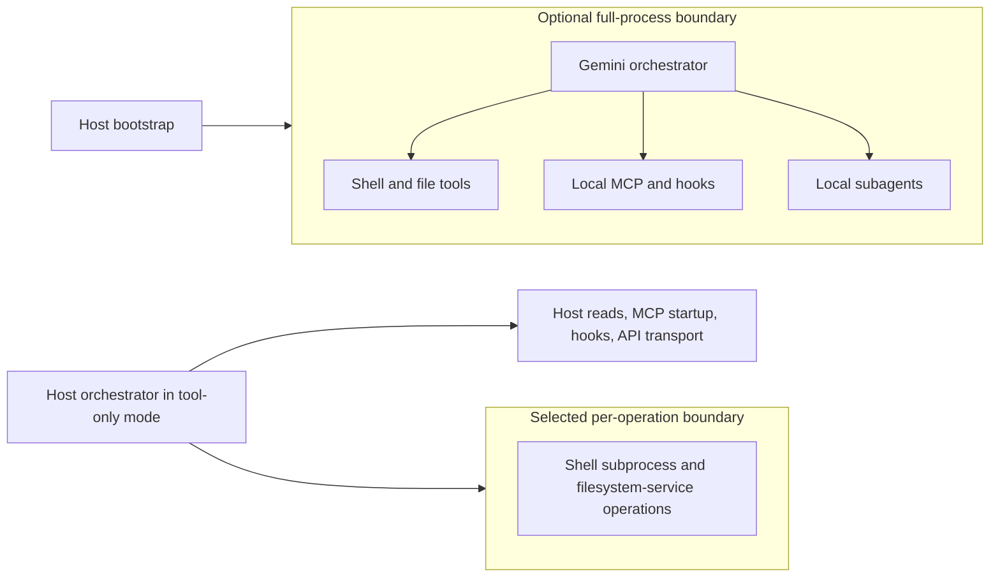

# Gemini CLI sandboxing

Gemini CLI **does not enable an OS sandbox in a clean installation** on macOS, Linux, native Windows, or WSL2. Interactive approval prompts and application-level file checks are the ordinary protection. Optional full-process sandboxing and a separate tool-level sandbox implementation exist, with different coverage and defaults. In particular, installing on macOS does not automatically activate Seatbelt: the backend selector returns before platform detection when sandboxing is unset or false. Both the settings schema and CLI configuration set `security.toolSandboxing` to false. These are source-derived findings, not confinement tests. [e2](https://github.com/google-gemini/gemini-cli/blob/v0.66.0/packages/cli/src/config/sandboxConfig.ts), [e3](https://github.com/google-gemini/gemini-cli/blob/v0.66.0/packages/cli/src/config/settingsSchema.ts), [e4](https://github.com/google-gemini/gemini-cli/blob/v0.66.0/packages/cli/src/config/config.ts)

## Scope and evidence

Researched on **2026-11-04 UTC**. The official website was the starting point. The release API identified **v0.66.0**, published October 27, 2026, as stable; its source archive resolves to commit `9704132`. Read-only local `gemini --version` returned `0.66.0`; `gemini --help` confirmed the flags used below. No agent task, authentication flow, sandbox launch, credential read, or denial probe was run. Local configuration was not used to infer defaults. [e1](https://github.com/google-gemini/gemini-cli/releases/tag/v0.66.0)

The source snapshot is the main implementation authority here. The backend selector and manager factory are unchanged at main commit `89e9d25d67e7dc7cb0deb84ad2c3474b7a392d31` (November 3 UTC). That main snapshot adds rootless Podman user namespace handling and an IDE connection bridge; these are **post-stable** changes, not demonstrated 0.66.0 behavior. The November 4 nightly release notes mention the Podman change. Live documentation is unversioned and occasionally describes a stronger or simpler boundary than the examined code. [e20](https://github.com/google-gemini/gemini-cli/blob/89e9d25d67e7dc7cb0deb84ad2c3474b7a392d31/packages/cli/src/utils/sandbox.ts), [release history](https://github.com/google-gemini/gemini-cli/releases)

Installation recommends Node.js 20+, macOS 15+, Windows 11 24H2+, or Ubuntu 20.04+. Sandboxing has no separate paid-account entitlement in its local selection code. Model use still requires authentication: Google login, an AI Studio `GEMINI_API_KEY`, or Vertex AI credentials. Organization login and Vertex AI can require a Cloud project. Headless automation needs credentials established beforehand; isolation does not provide an account or remove API quotas. [installation](https://github.com/google-gemini/gemini-cli/blob/v0.66.0/docs/get-started/installation.mdx), [authentication](https://github.com/google-gemini/gemini-cli/blob/v0.66.0/docs/get-started/authentication.mdx)

## Defaults by platform and session

“None” means no Gemini-enforced OS isolation, not absence of all tool checks. This table assumes no administrator policy, environment override, project configuration, or explicit flags.

| Platform | Interactive clean default | Non-interactive clean default | Optional isolation and prerequisites |
| --- | --- | --- | --- |
| macOS | None; default approval mode | None; requests requiring unavailable confirmation are denied | Full CLI under Seatbelt with `-s`; tool-level Seatbelt with `security.toolSandboxing`; containers require their runtime |
| Linux | None; default approval mode | None; same policy behavior | Tool-level Bubblewrap requires `bwrap`, usable namespaces, and seccomp; full CLI supports Docker/Podman, explicit Docker + runsc, or experimental LXC/LXD |
| Native Windows | None; default approval mode | None; same policy behavior | Tool-level native helper uses restricted tokens, Low integrity, ACL changes, and a Job Object; Linux containers require a configured Docker/Podman environment |
| WSL2 | None in the Linux guest | None in the Linux guest | Linux implementation and prerequisites; neither WSL2 nor Docker availability proves the native Windows backend works |

The defaults follow the disabled flags and `NoopSandboxManager`, which passes the requested program and arguments through after environment sanitization. Non-interactive policy converts `ask_user` to `deny`; this is a software decision before execution, not an OS containment boundary. Known-safe commands and read tools can be allowed without a prompt. [e3](https://github.com/google-gemini/gemini-cli/blob/v0.66.0/packages/cli/src/config/settingsSchema.ts), [e5](https://github.com/google-gemini/gemini-cli/blob/v0.66.0/packages/core/src/services/sandboxManager.ts), [e6](https://github.com/google-gemini/gemini-cli/blob/v0.66.0/packages/core/src/policy/policy-engine.ts)

First-run theme/authentication choices do not select an OS sandbox. Folder trust is also **disabled by default**. If enabled with `security.folderTrust.enabled`, the first visit offers trust for the folder, its parent, or neither. An untrusted project loses executable configuration and other capabilities; headless startup exits with `FatalUntrustedWorkspaceError` rather than displaying that dialog. `--skip-trust` or `GEMINI_CLI_TRUST_WORKSPACE=true` trusts the workspace for that session. Neither switch enables nor disables OS isolation. [e7](https://github.com/google-gemini/gemini-cli/blob/v0.66.0/docs/cli/trusted-folders.md)

## Two different process boundaries

Full-process mode relaunches Gemini itself, after host bootstrap and authentication preparation. A sandboxed CLI's ordinary child processes inherit its outer boundary. Tool-level mode leaves the orchestrator on the host and wraps selected operations instead. The factory chooses the native platform manager only when sandboxing is enabled; it does not choose a container backend for tool-level execution. [e8](https://github.com/google-gemini/gemini-cli/blob/v0.66.0/packages/cli/src/gemini.tsx), [e9](https://github.com/google-gemini/gemini-cli/blob/v0.66.0/packages/core/src/services/sandboxManagerFactory.ts)



This is a coverage model, not a claim that every bootstrap action is contained. A remote MCP server or remote subagent executes wherever that service is deployed; a local sandbox cannot confine that remote machine.

### Full-process Seatbelt

With sandboxing explicitly enabled, macOS selects Apple's `sandbox-exec` before looking for containers. The default **profile within this opted-in mode** is `permissive-open`. It starts with deny-default, permits broad host reads, process execution and forking, and allows outbound networking, local binds, and inbound connections. Writes include the workspace, selected temporary/cache locations, `~/.npm`, `~/.cache`, and up to five included directories. Explicit rules block several credential filenames, `.env` files, writes to `~/.gemini`, and known container-daemon escape surfaces. This is not workspace-only confidentiality. [e10](https://github.com/google-gemini/gemini-cli/blob/v0.66.0/packages/cli/src/utils/sandbox-macos-permissive-open.sb)

`SEATBELT_PROFILE` selects profiles such as `restrictive-open`, `strict-open`, and the `*-proxied` variants. The sandbox guide's profile names are not all equivalent, and a profile's network rules must be read separately from its file rules. Custom profiles resolve as `sandbox-macos-<name>.sb`, preferring `~/.gemini` over the project's `.gemini`. `GEMINI_SANDBOX_PROXY_COMMAND` configures an optional proxy integration. Neither these environment variables nor the permissive profile control the separate generated tool-level Seatbelt policy. [profile guide](https://github.com/google-gemini/gemini-cli/blob/v0.66.0/docs/cli/sandbox.md), [e11](https://github.com/google-gemini/gemini-cli/blob/v0.66.0/packages/cli/src/utils/sandbox.ts)

### Containers and experimental LXC

Docker and Podman need a working engine, not just a CLI binary. Linux containers on macOS or Windows depend on the runtime's Linux environment; Gemini does not install a VM. Explicit `runsc` requires Linux, Docker, and a configured gVisor runtime, and adds `--runtime=runsc`. LXC requires an already running LXD-managed container, defaults to `gemini-sandbox`, and is documented experimental. Its operating system and services are supplied by that container. None is auto-enabled by installation. [e2](https://github.com/google-gemini/gemini-cli/blob/v0.66.0/packages/cli/src/config/sandboxConfig.ts), [sandbox guide](https://geminicli.com/docs/cli/sandbox/)

The Docker/Podman launcher mounts the workspace read/write at its corresponding absolute path, creates a temporary configuration home, and selectively forwards environment/authentication material. Extra `allowedPaths` mounts are read-only; `SANDBOX_MOUNTS` supports explicit read/write mounts. Container networking is normally available for the CLI's API transport; disabling it can also disable inference. An optional internal-network/proxy arrangement can mediate egress. Container confinement protects unmounted host files, not files deliberately mounted or credentials forwarded into the container. [e11](https://github.com/google-gemini/gemini-cli/blob/v0.66.0/packages/cli/src/utils/sandbox.ts)

The default release image is `us-docker.pkg.dev/gemini-code-dev/gemini-cli/sandbox:0.66.0` ([package metadata](https://github.com/google-gemini/gemini-cli/blob/v0.66.0/packages/cli/package.json)). The launcher excludes the host Gemini credential directory from ordinary settings mounts and sanitizes copied settings. Nevertheless it can expose a read-only gcloud configuration directory, `GOOGLE_APPLICATION_CREDENTIALS`, and API-key environment variables. Read-only credentials are still readable credentials. Sensitive-path rejection follows canonical paths, including symlink targets; it is not a universal secret detector. [mount sanitization](https://github.com/google-gemini/gemini-cli/blob/v0.66.0/packages/cli/src/utils/sandboxUtils.ts)

### Native per-tool mechanisms

Enable tool-level mode independently with `security.toolSandboxing: true`. It does **not** require `tools.sandbox` to be set. The native manager receives the workspace, included paths, ignored/forbidden paths, and an approval-mode-specific sandbox policy. [e12](https://github.com/google-gemini/gemini-cli/blob/v0.66.0/packages/core/src/config/config.ts)

On macOS, the tool manager generates an SBPL policy and executes through `sandbox-exec`. Read access includes the workspace, system runtime locations, Node's installation, and PATH-derived directories. Shared system/user temporary directories are writable; the default is not a private temporary filesystem. It permits subprocess execution under the same policy. Network access is separately added when authorized. Broad PATH entries can therefore broaden readable files. [generated policy](https://github.com/google-gemini/gemini-cli/blob/v0.66.0/packages/core/src/sandbox/macos/seatbeltArgsBuilder.ts), [base policy](https://github.com/google-gemini/gemini-cli/blob/v0.66.0/packages/core/src/sandbox/macos/baseProfile.ts)

On Linux and WSL2, the tool manager uses **Bubblewrap**, not Docker. It creates namespaces with `--unshare-all`, a new session and private `/proc`, a minimal `/dev`, and a private writable `/tmp`; network permission adds `--share-net`. It initially binds `/` read-only, then overlays permitted writable paths and masks selected forbidden/secret paths. Thus most host files, including home files outside the masks, remain readable. The seccomp filter specifically denies `ptrace`; it is not a general syscall allowlist. `bwrap`, `sh`, and filesystem utilities must be available and the environment must permit the namespace operations. [Linux manager](https://github.com/google-gemini/gemini-cli/blob/v0.66.0/packages/core/src/sandbox/linux/LinuxSandboxManager.ts), [mount builder](https://github.com/google-gemini/gemini-cli/blob/v0.66.0/packages/core/src/sandbox/linux/bwrapArgsBuilder.ts)

Native Windows support is present in source and is distinct from WSL. The tool manager invokes `GeminiSandbox.exe`, compiling the shipped C# source through `csc.exe` if necessary. The helper creates a restricted token with privileges disabled, lowers integrity to Low, and assigns external processes to a Job Object. It adjusts filesystem ACLs/integrity labels for allowed paths, with persistent effects; the guide gives `icacls <path> /setintegritylevel Medium` as a manual reset. This is not Windows Sandbox, Hyper-V, or an AppContainer. Low integrity principally restricts writes; it does not hide every readable user file. [Windows manager](https://github.com/google-gemini/gemini-cli/blob/v0.66.0/packages/core/src/sandbox/windows/WindowsSandboxManager.ts), [native helper](https://github.com/google-gemini/gemini-cli/blob/v0.66.0/packages/core/src/sandbox/windows/GeminiSandbox.cs)

A significant Windows limitation: “network off” attempts Job Object rate control with `MaxBandwidth = 1`. If setting it fails, the helper warns and continues. It does not install a firewall rule or create a disconnected network namespace. Treat this as attempted throttling, **not verified network denial**. Native helper runtime behavior remains untested in this research. [native network implementation](https://github.com/google-gemini/gemini-cli/blob/v0.66.0/packages/core/src/sandbox/windows/GeminiSandbox.cs#L292)

## Files, credentials, and tool coverage

Without an OS sandbox, the shell runs with the host user's effective permissions. It can read home files, launch programs, write outside the project, and contact network services when tool policy permits the command. Environment sanitization removes selected sensitive variables, but cannot stop a permitted shell from reading accessible credential files. Built-in file tools separately validate workspace membership; additional directories and project temporary paths expand that application-level scope. The read tool resolves real paths before validating access. These checks do not constrain arbitrary shell programs. [e5](https://github.com/google-gemini/gemini-cli/blob/v0.66.0/packages/core/src/services/sandboxManager.ts), [e12](https://github.com/google-gemini/gemini-cli/blob/v0.66.0/packages/core/src/config/config.ts), [read tool](https://github.com/google-gemini/gemini-cli/blob/v0.66.0/packages/core/src/tools/read-file.ts)

In tool mode, canonical workspace and permission paths are resolved together with symlink aliases. `SandboxedFileSystemService` rejects canonical paths outside the workspace or included paths, then performs text reads/writes through the manager. This prevents treating a workspace symlink as automatic permission for an outside target in that service. It is source evidence, not proof against all races or alternate read paths. [filesystem service](https://github.com/google-gemini/gemini-cli/blob/v0.66.0/packages/core/src/services/sandboxedFileSystemService.ts), [path resolution](https://github.com/google-gemini/gemini-cli/blob/v0.66.0/packages/core/src/services/sandboxManager.ts)

The generated native policies distinguish `.git`, ignore files, `.env`/`.env.*`, and `.geminiignore` exclusions. `.git` is normally protected from writes but a writable Git command can receive explicit permission. Ignore files can be writable when the workspace is writable. Linux secret discovery searches only three levels and prunes build/dependency directories; failure to scan is logged rather than fatal. macOS uses path regex rules. These protections are neither uniform nor a complete credential inventory. Included paths also differ: Linux globally included directories are read-only; macOS's generated profile allows both reads and writes to them. [Linux mounts](https://github.com/google-gemini/gemini-cli/blob/v0.66.0/packages/core/src/sandbox/linux/bwrapArgsBuilder.ts), [macOS policy](https://github.com/google-gemini/gemini-cli/blob/v0.66.0/packages/core/src/sandbox/macos/seatbeltArgsBuilder.ts)

| Execution surface | Default / tool-only behavior | With an outer full-process sandbox |
| --- | --- | --- |
| Shell tool and descendants | Host by default; platform manager when enabled | Inherits outer boundary, possibly with further per-tool restrictions |
| File writes and edits | Host validation by default; filesystem service can sandbox writes | Outer boundary also applies |
| Built-in reads/search/listing | Not uniformly sandboxed in tool mode; application path checks remain | Host reads are limited by outer boundary |
| Local subagents | Execution context passes the same sandbox manager; no separate private machine | Share the outer process environment |
| Command hooks | Spawn directly from the orchestrator; environment sanitization is not confinement | Child inherits outer boundary; bootstrap timing still matters |
| Extensions | No universal separate plugin sandbox; coverage depends on the hook/tool/MCP surface supplied | Code executed inside the relaunched CLI inherits its boundary; installation/bootstrap are separate |
| Local stdio MCP | Direct SDK transport startup, not the per-tool sandbox manager | Child process inherits outer boundary |
| Remote MCP / remote agents | Remote execution and host-side network transport | Outer boundary controls local connection only, not the remote service |

The read coverage exception is concrete: `processSingleFileContent` explicitly does **not use** its `FileSystemService` parameter and reads through host filesystem utilities. Search also has direct filesystem reads. Consequently enabling tool sandboxing does not prove that secret masks protect all model-visible reads. Hooks call `spawn` directly; MCP stdio uses `StdioClientTransport`; local subagents receive `sandboxManager` in their execution context. [e13](https://github.com/google-gemini/gemini-cli/blob/v0.66.0/packages/core/src/utils/fileUtils.ts), [search](https://github.com/google-gemini/gemini-cli/blob/v0.66.0/packages/core/src/tools/grep.ts), [e14](https://github.com/google-gemini/gemini-cli/blob/v0.66.0/packages/core/src/hooks/hookRunner.ts), [e15](https://github.com/google-gemini/gemini-cli/blob/v0.66.0/packages/core/src/tools/mcp-client.ts), [e16](https://github.com/google-gemini/gemini-cli/blob/v0.66.0/packages/core/src/agents/local-executor.ts)

Tool-level network restrictions apply to wrapped subprocesses, not the host orchestrator's Gemini API, built-in web-fetch/search, or remote MCP transport. With full-process isolation, the model connection is inside the boundary and needs an allowed route. A network-denied shell therefore does not imply that model transport or every tool is offline. [factory](https://github.com/google-gemini/gemini-cli/blob/v0.66.0/packages/core/src/services/sandboxManagerFactory.ts), [web fetch](https://github.com/google-gemini/gemini-cli/blob/v0.66.0/packages/core/src/tools/web-fetch.ts), [MCP transports](https://github.com/google-gemini/gemini-cli/blob/v0.66.0/packages/core/src/tools/mcp-client.ts)

## Configuration, precedence, and approvals

These examples describe supported configuration surfaces; they were not executed as sandbox tests.

```sh
# Opt into full-process isolation; on macOS this selects Seatbelt.
gemini --sandbox -p "Analyze this project"

# Explicit container provider, including on macOS.
GEMINI_SANDBOX=docker gemini -p "Run the tests"

# Explicit gVisor integration on a configured Linux host.
GEMINI_SANDBOX=runsc gemini -p "Run the tests"

# Add workspace scope; this does not mean identical OS permissions on all backends.
gemini --include-directories /path/to/shared-library
```

For native per-tool isolation, put this in `~/.gemini/settings.json` and restart:

```json
{
  "security": { "toolSandboxing": true },
  "general": { "defaultApprovalMode": "default" }
}
```

For an explicit full-process container configuration:

```json
{
  "tools": {
    "sandbox": {
      "enabled": true,
      "command": "docker",
      "networkAccess": true,
      "allowedPaths": ["/path/to/reference"],
      "image": "your-approved-image:tag"
    }
  }
}
```

The object form's network default is true; tool-only native policies start with network false. `tools.sandboxAllowedPaths` and `tools.sandboxNetworkAccess` augment the configuration constructed by `loadCliConfig` (network uses logical OR). However, the outer relaunch separately calls `loadSandboxConfig`, which reads the nested object's `allowedPaths` and `networkAccess` instead of those siblings. They are not interchangeable across the two startup paths. [e2](https://github.com/google-gemini/gemini-cli/blob/v0.66.0/packages/cli/src/config/sandboxConfig.ts), [e3](https://github.com/google-gemini/gemini-cli/blob/v0.66.0/packages/cli/src/config/settingsSchema.ts)

Settings merge from system defaults, user settings, trusted workspace settings, then system overrides. System paths are `/Library/Application Support/GeminiCli/settings.json` on macOS, `/etc/gemini-cli/settings.json` on Linux/WSL, and `C:\ProgramData\gemini-cli\settings.json` on Windows; `system-defaults.json` sits beside it. `GEMINI_CLI_SYSTEM_SETTINGS_PATH` and `GEMINI_CLI_SYSTEM_DEFAULTS_PATH` replace those locations. `GEMINI_CLI_HOME` redirects Gemini's user configuration root, not the OS user's identity or shell permissions. [e17](https://github.com/google-gemini/gemini-cli/blob/v0.66.0/packages/cli/src/config/settings.ts), [enterprise configuration](https://github.com/google-gemini/gemini-cli/blob/v0.66.0/docs/cli/enterprise.md)

**Backend-selection precedence has an important asymmetry:** `loadCliConfig` first rewrites `GEMINI_SANDBOX=true` when `--sandbox` is truthy. The selector then takes `argv.sandbox ?? settings.tools.sandbox` and replaces it with any nonempty `GEMINI_SANDBOX`. Thus `--sandbox` forces auto-selection even over an explicit backend environment value, but `--no-sandbox` does not clear an existing environment override. Without the positive flag, the environment wins over file settings and the negative flag. Environment `false`/`0` disables the full-process selector, `true`/`1` requests auto-selection, and explicit strings select a backend. `SANDBOX` suppresses relaunch as an internal already-sandboxed marker; setting it is not proof of actual confinement. Tool-level enablement is independent, so disabling full-process mode alone does not disable an explicitly enabled tool manager. The CLI rewrite is in [CLI config](https://github.com/google-gemini/gemini-cli/blob/v0.66.0/packages/cli/src/config/config.ts). Image precedence is `GEMINI_SANDBOX_IMAGE`, `GEMINI_SANDBOX_IMAGE_DEFAULT`, object `image`, package default. [e2](https://github.com/google-gemini/gemini-cli/blob/v0.66.0/packages/cli/src/config/sandboxConfig.ts)

Other container controls include `SANDBOX_MOUNTS` (comma-separated `from:to:opts`, default `ro`), `SANDBOX_FLAGS` (runtime arguments), `SANDBOX_ENV` (explicit environment pairs), and `SANDBOX_SET_UID_GID`. These are operator-granted capabilities: extra mounts or privileged runtime flags can materially weaken isolation. The guide describes custom `.gemini/sandbox.Dockerfile` images; the stable launcher's `BUILD_SANDBOX` path requires a linked source checkout, so building a custom image externally and selecting it explicitly is clearer for installed binaries. [sandbox guide](https://github.com/google-gemini/gemini-cli/blob/v0.66.0/docs/cli/sandbox.md), [launcher](https://github.com/google-gemini/gemini-cli/blob/v0.66.0/packages/cli/src/utils/sandbox.ts)

Approval policy is separate from confinement. `--approval-mode default`, `auto_edit`, `plan`, and `yolo`, plus `--yolo`/`-y`, control tool admission. `tools.core` limits available built-in tools; policy files supplied with `--policy` or `--admin-policy` can allow, ask, or deny. Deprecated `--allowed-tools` bypasses selected confirmations, not OS checks. Plan mode is not a universal read-only OS environment when sandboxing is off. With tool sandboxing on, its sandbox mode also requests a read-only workspace. [local help observation](https://github.com/google-gemini/gemini-cli/blob/v0.66.0/packages/cli/src/config/config.ts), [policy engine](https://github.com/google-gemini/gemini-cli/blob/v0.66.0/packages/core/src/policy/policy-engine.ts)

YOLO is more than prompt suppression **inside the native tool policies**: the sandbox policy manager sets network true, readonly false, and `yolo: true`. It keeps the native backend, but expands workspace writes and networking; it does not remove every forbidden-path rule or outer container restriction. Full-process Seatbelt's selected profile is not replaced by YOLO. A custom `~/.gemini/policies/sandbox.toml` supplies `modes.plan`, `modes.default`, `modes.accepting_edits`, and per-command `allowed_paths` / `allow_network`. Default native modes block tool networking; malformed user sandbox TOML logs an error and falls back to the built-in policy. [e18](https://github.com/google-gemini/gemini-cli/blob/v0.66.0/packages/core/src/policy/sandboxPolicyManager.ts)

Administrators can set `security.disableYoloMode`, restrict tools/MCP/extensions, and deploy system settings. The enterprise guide calls system `tools.sandbox` enforcement, but the source's environment/argv overrides mean it is not an immutable OS security authority against a user controlling process launch. Cloud enterprise admin controls are separately documented as locally non-overridable; strict mode blocks YOLO and managed controls can disable extensions/MCP. Those account policies do not themselves create an OS sandbox. [enterprise guide](https://github.com/google-gemini/gemini-cli/blob/v0.66.0/docs/cli/enterprise.md), [e19](https://github.com/google-gemini/gemini-cli/blob/v0.66.0/docs/admin/enterprise-controls.md)

## Denials, expansion, and failure behavior

An invalid backend, missing explicitly selected executable, unsupported platform for runsc/windows-native, or `true` with no detected backend raises `FatalSandboxError`. Auto-selection tries macOS Seatbelt, Docker, then Podman; it does not fall back to ordinary host execution after an explicitly requested backend fails. Tool-level Linux/native launch errors similarly propagate from prepared subprocess execution; the no-op manager is the disabled path, not a documented denial-retry fallback. [e2](https://github.com/google-gemini/gemini-cli/blob/v0.66.0/packages/cli/src/config/sandboxConfig.ts), [shell execution](https://github.com/google-gemini/gemini-cli/blob/v0.66.0/packages/core/src/services/shellExecutionService.ts)

Shell denial detection is heuristic. On a failed operation it can return `sandbox_expansion_required`, carrying proposed filesystem or network permissions. The scheduler requests confirmation and retries the tool with the expanded permission arguments; cancellation preserves a denial. Proactive suggestions can ask before network-heavy commands. Approval can apply once, for the session, or persist per command; persistent `allowed_paths` collapse requested read/write access into paths usable for both. This is a permission expansion, not a general automatic unsandboxed retry. [shell expansion](https://github.com/google-gemini/gemini-cli/blob/v0.66.0/packages/core/src/tools/shell.ts), [scheduler](https://github.com/google-gemini/gemini-cli/blob/v0.66.0/packages/core/src/scheduler/scheduler.ts), [e18](https://github.com/google-gemini/gemini-cli/blob/v0.66.0/packages/core/src/policy/sandboxPolicyManager.ts)

Headless sessions have no approval dialog and must arrange permitted operations beforehand. The policy engine denies decisions still requiring a user. Whether every reactive expansion path terminates promptly in the current headless scheduler was not runtime-tested; do not rely on interactive expansion in CI. Full-process sandbox options work with `-p`; piped stdin is forwarded during relaunch. No code examined establishes an automatic headless switch to YOLO or automatic removal of a failed boundary. [policy engine](https://github.com/google-gemini/gemini-cli/blob/v0.66.0/packages/core/src/policy/policy-engine.ts), [relaunch](https://github.com/google-gemini/gemini-cli/blob/v0.66.0/packages/cli/src/gemini.tsx)

## Remaining checks

1. **Native Windows full-process selector:** `windows-native` is accepted, but `start_sandbox` has explicit Seatbelt/LXC branches followed by container-style startup, without a corresponding native relaunch branch. Use the tool-level setting for the source-established native manager. A disposable native Windows launch should establish whether the full-process selector is usable or defective; acceptance of a config value alone is insufficient.
2. **Runtime boundary matrix:** on disposable macOS, Linux, Windows, and WSL2 environments, enable tool mode and test shell/file reads, outside-workspace writes, symlink targets, home credentials, secret masks, subprocess inheritance, and loopback/external networking. This research establishes implementation intent and specific limitations, not runtime security certification.
3. **Headless expansion:** run a bounded failing shell task requiring new permissions without a TTY and confirm denial/exit, including the reactive scheduler path.
4. **Layer composition:** test full-process containers containing native tool mode, especially whether their image includes `bwrap` and permits nested namespaces. Documentation's contrast between modes does not prove that one automatically disables the other.
5. **Container authentication:** verify each auth method using disposable credentials. Sanitized settings and withheld OAuth cache files mean host login success does not establish successful model authentication inside a fresh container.

These checks are unresolved behavior, not evidence that the respective mechanism is absent. Conversely, disabled clean defaults and host-side direct read/hook/MCP paths are supported negative findings in the examined source.

## Evidence records

All remote records were accessed 2026-11-04 UTC. `source` means code inspection, not execution; `documentation` means the official description. Evidence identifiers in frontmatter refer to this inventory.

| ID | Kind | Examined artifact and principal use |
| --- | --- | --- |
| e1 | release + local observation | [v0.66.0](https://github.com/google-gemini/gemini-cli/releases/tag/v0.66.0); local version/help, stable baseline |
| e2 | source | [sandboxConfig.ts](https://github.com/google-gemini/gemini-cli/blob/v0.66.0/packages/cli/src/config/sandboxConfig.ts); defaults, selection, precedence, fatal validation |
| e3 | source | [settingsSchema.ts](https://github.com/google-gemini/gemini-cli/blob/v0.66.0/packages/cli/src/config/settingsSchema.ts); disabled tool mode and settings |
| e4 | source | [CLI config.ts](https://github.com/google-gemini/gemini-cli/blob/v0.66.0/packages/cli/src/config/config.ts); CLI flags and toolSandboxing default |
| e5 | source | [sandboxManager.ts](https://github.com/google-gemini/gemini-cli/blob/v0.66.0/packages/core/src/services/sandboxManager.ts); no-op behavior, path resolution |
| e6 | source | [policy-engine.ts](https://github.com/google-gemini/gemini-cli/blob/v0.66.0/packages/core/src/policy/policy-engine.ts); headless denies asks |
| e7 | documentation | [Trusted Folders](https://github.com/google-gemini/gemini-cli/blob/v0.66.0/docs/cli/trusted-folders.md); opt-in trust and headless errors |
| e8 | source | [gemini.tsx](https://github.com/google-gemini/gemini-cli/blob/v0.66.0/packages/cli/src/gemini.tsx); outer relaunch |
| e9 | source | [sandboxManagerFactory.ts](https://github.com/google-gemini/gemini-cli/blob/v0.66.0/packages/core/src/services/sandboxManagerFactory.ts); native factory and disabled manager |
| e10 | source | [permissive-open.sb](https://github.com/google-gemini/gemini-cli/blob/v0.66.0/packages/cli/src/utils/sandbox-macos-permissive-open.sb); outer Seatbelt rules |
| e11 | source | [sandbox.ts](https://github.com/google-gemini/gemini-cli/blob/v0.66.0/packages/cli/src/utils/sandbox.ts); containers, profiles, mounts, transport |
| e12 | source | [core config.ts](https://github.com/google-gemini/gemini-cli/blob/v0.66.0/packages/core/src/config/config.ts); file service and workspace validation |
| e13 | source | [fileUtils.ts](https://github.com/google-gemini/gemini-cli/blob/v0.66.0/packages/core/src/utils/fileUtils.ts); direct read exception |
| e14 | source | [hookRunner.ts](https://github.com/google-gemini/gemini-cli/blob/v0.66.0/packages/core/src/hooks/hookRunner.ts); direct host spawn |
| e15 | source | [mcp-client.ts](https://github.com/google-gemini/gemini-cli/blob/v0.66.0/packages/core/src/tools/mcp-client.ts); stdio and remote transports |
| e16 | source | [local-executor.ts](https://github.com/google-gemini/gemini-cli/blob/v0.66.0/packages/core/src/agents/local-executor.ts); inherited manager |
| e17 | source | [settings.ts](https://github.com/google-gemini/gemini-cli/blob/v0.66.0/packages/cli/src/config/settings.ts); configuration layers |
| e18 | source | [sandboxPolicyManager.ts](https://github.com/google-gemini/gemini-cli/blob/v0.66.0/packages/core/src/policy/sandboxPolicyManager.ts); modes, YOLO, persistent expansions |
| e19 | documentation | [Enterprise Admin Controls](https://github.com/google-gemini/gemini-cli/blob/v0.66.0/docs/admin/enterprise-controls.md); managed-account guardrails |
| e20 | source | [main sandbox.ts](https://github.com/google-gemini/gemini-cli/blob/89e9d25d67e7dc7cb0deb84ad2c3474b7a392d31/packages/cli/src/utils/sandbox.ts); post-stable differences |
| e21 | source | [Linux manager](https://github.com/google-gemini/gemini-cli/blob/v0.66.0/packages/core/src/sandbox/linux/LinuxSandboxManager.ts) and [mount builder](https://github.com/google-gemini/gemini-cli/blob/v0.66.0/packages/core/src/sandbox/linux/bwrapArgsBuilder.ts); Bubblewrap boundaries |
| e22 | source | [macOS manager](https://github.com/google-gemini/gemini-cli/blob/v0.66.0/packages/core/src/sandbox/macos/MacOsSandboxManager.ts) and [profile builder](https://github.com/google-gemini/gemini-cli/blob/v0.66.0/packages/core/src/sandbox/macos/seatbeltArgsBuilder.ts); tool Seatbelt |
| e23 | source | [Windows manager](https://github.com/google-gemini/gemini-cli/blob/v0.66.0/packages/core/src/sandbox/windows/WindowsSandboxManager.ts) and [C# helper](https://github.com/google-gemini/gemini-cli/blob/v0.66.0/packages/core/src/sandbox/windows/GeminiSandbox.cs); native support and network limitation |
| e24 | source | [shell.ts](https://github.com/google-gemini/gemini-cli/blob/v0.66.0/packages/core/src/tools/shell.ts) and [scheduler.ts](https://github.com/google-gemini/gemini-cli/blob/v0.66.0/packages/core/src/scheduler/scheduler.ts); expansions and retry |
| e25 | documentation | [sandbox guide](https://geminicli.com/docs/cli/sandbox/); supported optional integrations and configuration examples |

## Changelog

- **2026-11-04:** Initial report. Distinguished disabled defaults from opted-in profiles; documented native tool sandboxing, partial tool coverage, source/documentation precedence differences, and Windows network throttling limits.
