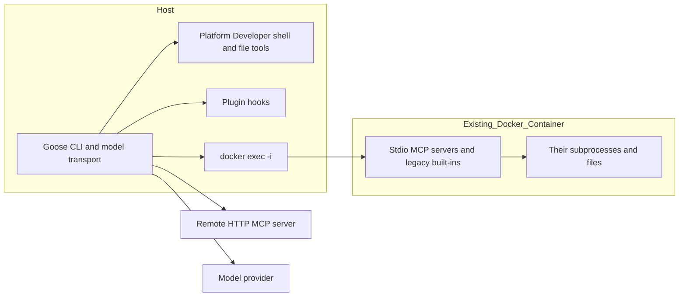

# Sandboxing in Goose CLI

Goose CLI supplies **no default OS sandbox** for its agent, shell, or file tools. A normal installation runs with the launching user's authority and defaults to `GOOSE_MODE=auto`, which approves tool calls automatically. Optional official integrations can put selected MCP processes, or the entire CLI, in Docker. These are materially different boundaries: **`--container` does not contain the current Developer shell and file tools.** This conclusion comes from execution-path inspection, not merely the absence of a documented sandbox switch. [Default mode](https://github.com/aaif-goose/goose/blob/v1.57.0/crates/goose-provider-types/src/goose_mode.rs), [Developer execution](https://github.com/aaif-goose/goose/blob/v1.57.0/crates/goose/src/agents/platform_extensions/developer/shell.rs), [extension dispatch](https://github.com/aaif-goose/goose/blob/v1.57.0/crates/goose/src/agents/extension_manager/mod.rs).

## Scope, versions, and method

Research date: **2026-11-04 UTC**. The requested [Block documentation](https://block.github.io/goose/) redirects to [goose-docs.ai](https://goose-docs.ai/), and [block/goose](https://github.com/block/goose) redirects to AAIF Goose. The latest published release examined was **v1.57.0**, published **2026-10-28**, source commit **`30bba95105e59bc3e7df624cf6b4d433690cfe12`**. Its release notes include stricter extension-allowlist fetching, Windows build fixes, and shell process-tree cleanup; those changes do not introduce a general agent sandbox. [Release](https://github.com/aaif-goose/goose/releases/tag/v1.57.0), [release tree](https://github.com/aaif-goose/goose/tree/30bba95105e59bc3e7df624cf6b4d433690cfe12).

The release source was downloaded for read-only inspection. Key Developer and extension-placement paths were also checked at current `main`, **`bfe8ccd23de1d2c47a4cb2970d522f093ae7f2ba`**, dated **2026-11-04 07:57:41 UTC**; the platform-extension exception persists there. This was a targeted comparison, not a full audit of every unreleased change. [Current dispatch](https://github.com/aaif-goose/goose/blob/bfe8ccd23de1d2c47a4cb2970d522f093ae7f2ba/crates/goose/src/agents/extension_manager/mod.rs).

Local observation: `sniff software agents --json` reported Goose absent on this macOS host; both `goose --version </dev/null` and `goose --help </dev/null` returned `command not found`. No provider session, credential lookup, extension, or container was executed. Examples below are documentation/source-derived, not runtime validation. No existing report was present to refresh.

## Normal-install defaults

The table assumes provider setup is complete, no explicit mode override, and no externally imposed container or OS policy. “Host access” always means access permitted to the process identity, not administrator authority.

| Platform | Interactive `goose session` | Non-interactive `goose run --text …` | Meaningful platform difference |
| --- | --- | --- | --- |
| macOS | No sandbox; Auto by default | Same boundary and default | Native Unix shell; macOS permissions and Keychain remain external controls |
| Linux | No sandbox; Auto by default | Same boundary and default | Native Unix shell; no Goose-enabled namespace/seccomp filesystem boundary |
| Native Windows | No sandbox; Auto by default | Same boundary and default | Official native installation exists; shell defaults to `cmd`, not a WSL sandbox |
| WSL2 | No Goose sandbox; Auto by default | Same boundary and default | Linux process inside the existing WSL environment; mounted Windows files and enabled interoperability are not fenced by Goose |

Native Windows and WSL are separately documented installation options; the table does not infer Windows support from WSL. Unix uses `bash` if available, otherwise `sh`; `GOOSE_SHELL` can change the executable. Windows also supports PowerShell or a supplied POSIX shell, with invocation flags chosen automatically. Process-tree cancellation is cleanup, not containment. [Installation](https://goose-docs.ai/docs/getting-started/installation/), [environment variables](https://goose-docs.ai/docs/guides/environment-variables/), [shell implementation](https://github.com/aaif-goose/goose/blob/v1.57.0/crates/goose/src/agents/platform_extensions/developer/shell.rs).

**First run is a choice, not an enforced protection tier.** After successful provider setup, `goose configure` asks for a mode if none is already set, with Auto selected. Existing configuration or `GOOSE_MODE` can suppress that choice. Provider setup offers OpenRouter login, Tetrate login, or manual configuration; credentials/account requirements depend on the selected provider, and a local-model provider avoids a mandatory Goose cloud account. Skipping installer configuration with `CONFIGURE=false` does not enable a sandbox; a headless invocation still needs a working provider configuration. [Setup implementation](https://github.com/aaif-goose/goose/blob/v1.57.0/crates/goose-cli/src/commands/configure.rs), [installation](https://goose-docs.ai/docs/getting-started/installation/).

## What the uncontained agent can reach

Developer is enabled by default and executes in the Goose process. Its shell launches an ordinary child process; `write` and `edit` use ordinary filesystem operations. Absolute paths are accepted; relative paths are joined to the session working directory without a containment check. Consequently, the workspace is a starting directory, not a filesystem jail. Additional paths do not need a Goose sandbox grant. `..` and symlink targets remain subject to normal OS resolution rather than a workspace fence. Directory-tree filtering and advice to use gitignore-aware search reduce context noise, not direct-read capability. [Platform registry](https://github.com/aaif-goose/goose/blob/v1.57.0/crates/goose/src/agents/platform_extensions/mod.rs), [path resolution and edits](https://github.com/aaif-goose/goose/blob/v1.57.0/crates/goose/src/agents/platform_extensions/developer/edit.rs), [Developer tools](https://github.com/aaif-goose/goose/blob/v1.57.0/crates/goose/src/agents/platform_extensions/developer/mod.rs).

Home directories, dotfiles, repositories outside the workspace, temporary files, and credentials in readable files have no general Goose deny rule. OS ACLs, ownership, macOS privacy permissions, and credential-store authorization can still deny access. File-based `secrets.yaml` permissions protect against other identities; they do not isolate tools running as its owner. Keyring access can require separate authorization and must not be described as automatically readable merely because file access is broad. Likewise, protected system files remain protected by the OS, not a Goose-specific protected-path list. [Secret storage](https://github.com/aaif-goose/goose/blob/v1.57.0/crates/goose/src/config/base.rs), [security guidance](https://github.com/aaif-goose/goose/blob/v1.57.0/SECURITY.md).

Shell programs can execute other programs and access the network with the user's ordinary permissions. Goose supplies no default tool destination allowlist or deny-all network namespace. Its `EgressInspector` recognizes some destinations in shell/web arguments and logs them while returning `InspectionAction::Allow`; it is observation, not a firewall. Model/API transport is a separate connection from the Goose process to its selected provider. Blocking a tool through approval does not block that transport or prevent already collected context from being sent. [Egress implementation](https://github.com/aaif-goose/goose/blob/v1.57.0/crates/goose/src/security/egress_inspector.rs), [provider configuration](https://goose-docs.ai/docs/guides/config-files/).

MCP Roots advertises the session working directory to cooperative servers. It does not change the OS authority of their processes. A server may implement stricter rules itself; that is server-specific enforcement. No universal project-trust prompt establishes a filesystem boundary in the examined launch and tool paths. Recipe warnings, hints, plan instructions, and “Chat” mode must likewise not be read as a read-only OS sandbox. [Roots](https://goose-docs.ai/docs/guides/mcp-roots/), [CLI launch](https://github.com/aaif-goose/goose/blob/v1.57.0/crates/goose-cli/src/cli.rs), [permission modes](https://goose-docs.ai/docs/guides/managing-tools/goose-permissions/).

## Optional isolation and its coverage

### Attach selected extensions to an existing Docker container

Both session and run accept an existing container ID or name:

```sh
goose session --container goose-dev
goose run --container goose-dev --text "Inspect the project"
goose session --container goose-dev --with-extension "/usr/local/bin/my-mcp-server"
```

Docker must be installed, its daemon reachable, and the named container running. Goose does not create a container or set its mounts, user, capabilities, network, or read-only root filesystem here. Stdio extension executables must already exist inside it at their configured paths. Legacy built-ins require `goose` inside the container to serve `goose mcp <name>`. There is no additional Goose account requirement; Docker distribution/licensing and model credentials are separate prerequisites. [Docker tutorial](https://goose-docs.ai/docs/tutorials/goose-in-docker/), [stdio launch](https://github.com/aaif-goose/goose/blob/v1.57.0/crates/goose/src/agents/extension_manager/stdio.rs), [built-in launch](https://github.com/aaif-goose/goose/blob/v1.57.0/crates/goose/src/agents/extension_manager/builtin.rs).

**The documentation overstates current coverage when it says configured extensions automatically run inside the container.** The release dispatch first recognizes platform-extension names and constructs their clients in process. This includes Developer even when old configuration labels it `type: builtin`. `Placement::for_config` supplies no container placement for these clients. Only remaining stdio and legacy built-in branches use Docker. Remote Streamable HTTP servers remain remote; the Goose HTTP client stays on the host. [Dispatch and placement](https://github.com/aaif-goose/goose/blob/v1.57.0/crates/goose/src/agents/extension_manager/mod.rs), [current-main dispatch](https://github.com/aaif-goose/goose/blob/bfe8ccd23de1d2c47a4cb2970d522f093ae7f2ba/crates/goose/src/agents/extension_manager/mod.rs).



For contained extensions, the container's filesystem, mounts, identity, and network determine access. No host workspace or home is automatically mounted by `--container`; conversely, any existing bind mounts, secrets, agent sockets, or Docker socket remain accessible according to the container configuration. Symlinks resolve in that filesystem and its mounted trees. Temporary files created by an extension belong to its environment, while Goose's own session/configuration files remain on the host. `docker exec` forwards configured extension environment values with `-e`, not a sanitized confidentiality policy. It does not add `--network none`, a mount policy, or an explicit container working directory. [Command construction](https://github.com/aaif-goose/goose/blob/v1.57.0/crates/goose/src/agents/extension_manager/stdio.rs).

### Run the entire CLI inside Docker

The official tutorial also supplies a source-build Docker/Compose workflow. Here Goose, its in-process Developer tools, hooks, and locally spawned extension processes run inside the container, subject to mounts and privileges. Remote services still execute in their own environments. Linux containers use Linux isolation; on macOS or Windows their Linux kernel is supplied by the chosen Docker backend, not by a Goose-managed VM. Native Windows CLI availability does not mean Windows-container images or every Docker backend were tested for this report. [Whole-process tutorial](https://goose-docs.ai/docs/tutorials/goose-in-docker/), [Dockerfile](https://github.com/aaif-goose/goose/blob/v1.57.0/documentation/docs/docker/Dockerfile).

The shipped Compose example mounts the repository read-write, `~/.gitconfig` read-only, and **`~/.ssh` read-only**. Read-only SSH keys can still be read and transmitted. It also passes model credentials and socket-related environment names. Adapt this example before treating it as a confidentiality boundary; it is a development environment, not a minimal hardened preset. The tutorial requires explicit model/provider/API configuration and discusses keyring limitations in containers. [Compose file](https://github.com/aaif-goose/goose/blob/v1.57.0/documentation/docs/docker/docker-compose.yml).

A minimal illustrative alternative, using an image you have built with Goose and its dependencies, is:

```sh
docker run --rm --network bridge \
  --mount "type=bind,src=$PWD,dst=/workspace" --workdir /workspace \
  --env OPENAI_API_KEY --env GOOSE_PROVIDER=openai --env GOOSE_MODEL \
  --env GOOSE_MODE=auto --env GOOSE_DISABLE_KEYRING=1 \
  goose-local goose run --text "Inspect this workspace"
```

This is an operator-created container policy using the officially documented whole-process approach, not an extra Goose flag or a tested image. It deliberately grants workspace writes and network access for model transport. Change mounts/user/network at container creation to change those limits. `--network none` would also block an external model API unless another transport arrangement is provided.

### Container Use and delegated CLI providers

The official extension catalog documents **Container Use**, installed separately, with Docker required and Node.js additionally required for the documented remote bridge. The local launch command is `container-use stdio`; the remote example uses `npx -y mcp-remote https://container-use.com/mcp`. It creates task environments through its tools; enabling it does not relocate Goose, Developer, hooks, or other MCP servers. Host-side orchestration still requires trust. Remote-service authentication, retention, and platform guarantees are not established by the Goose setup page, so no account-free remote execution claim is made here. [Container Use setup](https://goose-docs.ai/docs/mcp/container-use-mcp/).

Goose can also delegate inference/actions to another agent CLI. In the deprecated `codex` provider, source maps Goose Auto to `--yolo`, Smart Approve to `--full-auto`, Approve to no permission flag, and Chat to `--sandbox read-only`. Here switching approval mode **can change the delegated provider's sandbox**, because the adapter explicitly passes those flags. That boundary belongs to the installed Codex version, not to Goose's general tool runtime. The provider metadata recommends `codex-acp`; do not assume the legacy mapping applies unchanged to ACP or all providers. A working delegated CLI installation and its authentication are required. [Adapter and deprecation](https://github.com/aaif-goose/goose/blob/v1.57.0/crates/goose/src/providers/codex.rs), [documented provider integration](https://goose-docs.ai/docs/guides/cli-providers/).

For a session intended to use only Container Use, explicitly disable host Developer in the persistent extension configuration and inspect the remaining enabled tools:

```yaml
extensions:
  developer:
    type: platform
    name: developer
    enabled: false
```

Then a session can add the separately installed server with `goose session --with-extension "container-use stdio"`. Disabling one extension removes that tool surface; it does not isolate Goose or block another enabled extension from executing host code. `extensions.<name>.available_tools` filters tool names; an empty list means **all tools**, not none. Recipe/session extension selections can differ from persistent defaults. [Extension configuration](https://github.com/aaif-goose/goose/blob/v1.57.0/crates/goose/src/config/extensions.rs), [tool-filter semantics](https://github.com/aaif-goose/goose/blob/v1.57.0/crates/goose/src/agents/extension.rs).

### Coverage summary

| Execution surface | Normal host launch | With `--container` | Entire Goose process in Docker |
| --- | --- | --- | --- |
| Developer shell, `write`, `edit`, other platform tools | Host | Host | Container |
| Stdio MCP and legacy built-in MCP processes | Host | Selected existing container | Container, unless separately directed elsewhere |
| Remote HTTP MCP | Remote server; host client | Same | Remote server; container client |
| Subagents | Host session/tool runtime | No inherited container guarantee | Within outer container for local execution |
| Plugin hooks | Host shell process | Host shell process | Container shell process |
| Provider/API client and Goose state | Host | Host | Container, plus explicitly mounted state |

Subagents inherit the parent's permission mode and selected extensions unless overridden, but the examined Summon child-session creation does not copy `container`; new sessions initialize it to `None`. This is source-derived evidence against relying on inherited Docker placement, not a tested exploit. Plugin hooks use a separate command runner (`sh -c`, with Flatpak host-spawn handling) and do not consult extension container placement. Native Windows hook execution additionally depends on an available `sh`; this report does not claim every plugin hook works in a clean Windows shell. [Summon](https://github.com/aaif-goose/goose/blob/v1.57.0/crates/goose/src/agents/platform_extensions/summon.rs), [session initialization](https://github.com/aaif-goose/goose/blob/v1.57.0/crates/goose/src/session/session_manager.rs), [hooks](https://github.com/aaif-goose/goose/blob/v1.57.0/crates/goose/src/hooks/mod.rs).

## Approval, configuration, and failure behavior

Use these controls for oversight, not OS isolation:

```sh
# Process-scoped mode override; requires a configured provider.
GOOSE_MODE=approve goose session
GOOSE_MODE=smart_approve goose session
GOOSE_MODE=auto goose run --text "Run the checks"
```

Within an interactive session, `/mode auto`, `/mode approve`, `/mode smart_approve`, and `/mode chat` change the session's mode. Persistent defaults can be selected through `goose configure` or `GOOSE_MODE: approve` in `config.yaml`. Chat suppresses agent tool use; it does not remove Goose's own filesystem, provider, or extension-startup authority. Auto bypasses permission approval, not Docker's kernel-enforced mounts or permissions. There is no independent Goose-wide YOLO sandbox toggle in the examined CLI parser. [Modes](https://goose-docs.ai/docs/guides/managing-tools/goose-permissions/), [CLI parser](https://github.com/aaif-goose/goose/blob/v1.57.0/crates/goose-cli/src/cli.rs).

Configuration normally lives at `~/.config/goose/config.yaml` on macOS/Linux/WSL and `%APPDATA%\Block\goose\config\config.yaml` on Windows. Source loads system defaults first (`/etc/goose/config.yaml`, or `%PROGRAMDATA%\goose\config.yaml`), then `GOOSE_ADDITIONAL_CONFIG_FILES` in OS path-list order, then the user file. Later layers override earlier values; `GOOSE_MODE` in the environment wins during mode resolution. Session mode is persisted, so a changed default need not rewrite existing sessions. `GOOSE_PATH_ROOT`, when absolute, relocates config/data/state under that root; it does not chroot tools. These system settings are defaults, not an immutable administrator security policy. [Configuration layering](https://github.com/aaif-goose/goose/blob/v1.57.0/crates/goose/src/config/base.rs), [path relocation](https://github.com/aaif-goose/goose/blob/v1.57.0/crates/goose/src/config/paths.rs), [configuration guide](https://goose-docs.ai/docs/guides/config-files/).

Per-tool policy is stored in `permission.yaml`; for example:

```yaml
user:
  always_allow: []
  ask_before: [shell, write, edit]
  never_allow: [computercontroller__computer_control]
```

Use actual tool names from the installed extensions; current Developer tools are unprefixed. In Approve and Smart Approve, explicit user rules take priority. Without such a rule, Approve asks; Smart Approve allows read-only annotations and can ask the model to classify other calls. **Auto skips these per-tool permission rules**, including `never_allow`, in the inspected permission inspector. Other security inspectors can still intervene. Classifying an operation as read-only does not restrict which files it reads or guarantee it cannot disclose their contents. [Permission storage](https://github.com/aaif-goose/goose/blob/v1.57.0/crates/goose/src/config/permission.rs), [decision order](https://github.com/aaif-goose/goose/blob/v1.57.0/crates/goose/src/permission/permission_inspector.rs).

Interactive confirmation supports allowing or denying a request; permission denial keeps the selected tool from executing. In headless mode, if a confirmation is requested while the effective configured mode is Approve or Smart Approve, the CLI cancels the run and returns an error requiring an interactive terminal. This is conditional on a confirmation request: pre-allowed calls may already have executed. The fallback branch for confirmations in other modes warns and selects `AllowOnce`; therefore even an optional security prompt is not a reliable unattended containment policy under Auto. No general sandbox-escalation handshake or automatic retry outside Docker appears in the examined extension-launch paths. [Headless confirmation handling](https://github.com/aaif-goose/goose/blob/v1.57.0/crates/goose-cli/src/session/mod.rs).

A missing Docker command, unavailable daemon, stopped/missing container, absent in-container binary, or MCP initialization failure becomes an extension setup failure. The selected Docker branch does not retry its command on the host; extension slots retain a failed state and expose a load error. This does not imply a fail-closed session: host platform tools and other successfully loaded extensions remain separate capabilities. An OS-denied file operation is returned as a tool error, without a Goose privilege grant; the agent can propose another action, which goes through its applicable tool controls. [Launch errors](https://github.com/aaif-goose/goose/blob/v1.57.0/crates/goose/src/agents/extension_manager/stdio.rs), [extension failure state](https://github.com/aaif-goose/goose/blob/v1.57.0/crates/goose/src/agents/extension_manager/mod.rs), [file errors](https://github.com/aaif-goose/goose/blob/v1.57.0/crates/goose/src/agents/platform_extensions/developer/edit.rs).

Headless credential access is another failure surface: OS keyring authorization may require a GUI. `GOOSE_DISABLE_KEYRING=1` avoids that lookup and permits file-based secret storage; provide credentials through process environment where appropriate. It changes credential storage/access, not tool isolation. [Unattended CLI guidance](https://goose-docs.ai/docs/guides/goose-cli-commands/).

Optional prompt-injection inspection uses `SECURITY_PROMPT_ENABLED: true`, with `SECURITY_PROMPT_THRESHOLD` defaulting to `0.8`. ML classification additionally uses `SECURITY_PROMPT_CLASSIFIER_ENABLED`, `SECURITY_PROMPT_CLASSIFIER_ENDPOINT`, and optional `SECURITY_PROMPT_CLASSIFIER_TOKEN`. Both detection features default off. They inspect arguments/context and can request approval; allowed commands still have full process authority. Classification can itself send context to an additional endpoint. [Security configuration](https://goose-docs.ai/docs/guides/config-files/), [detection guide](https://goose-docs.ai/docs/guides/security/prompt-injection-detection/).

Adversary mode is enabled by creating `adversary.md` in the Goose config directory; its default reviewed tool is `shell`, expandable through a `tools:` header. It uses the configured provider for contextual review and **fails open** if the reviewer fails. This is an optional model judgment, not kernel enforcement. [Adversary mode](https://goose-docs.ai/docs/guides/security/adversary-mode/).

The official extension-allowlist guide advertises `GOOSE_ALLOWLIST=https://…/allowlist.yaml` for both Desktop and CLI. However, the release's fetch/check implementation is in **Desktop TypeScript**, and repository searches found no corresponding CLI/Rust consumer. The v1.57.0 HTTPS/redirect/fail-closed release note describes that fetcher. Treat CLI enforcement as **unresolved and unsafe to rely on** until a CLI-specific runtime check proves rejection; an installation allowlist would still not constrain an already running shell. [Allowlist guide](https://goose-docs.ai/docs/guides/allowlist/), [fetcher](https://github.com/aaif-goose/goose/blob/v1.57.0/ui/desktop/src/allowlistFetcher.ts), [release notes](https://github.com/aaif-goose/goose/releases/tag/v1.57.0).

## Evidence limits and checks to resolve them

The default absence is supported by ordinary file/process execution, explicit Auto defaults, and extension placement code, plus upstream's recommendation to supply a dedicated VM/container. It is not a claim that every server, provider, or operator environment lacks isolation. Browser iframe/CSP sandboxes for MCP Apps and Desktop packaging are different surfaces from CLI tool execution. [Upstream security policy](https://github.com/aaif-goose/goose/blob/v1.57.0/SECURITY.md).

No cross-platform runtime containment tests were performed. The most useful follow-up is a credential-free disposable setup with sentinel files inside/outside the workspace: test `write`/`edit` and shell under `--container`, repeat through a subagent, and record process locations on macOS, Linux, native Windows, and WSL2. Separately test stopped-container failure without other tools enabled. For the allowlist discrepancy, set an HTTPS list excluding a harmless test server and attempt to add/start it through CLI configuration and `--with-extension`; inspect both rejection and fetch-failure behavior. For Container Use remote service and ACP provider boundaries, inspect the exact installed service/provider versions and authentication before claiming their enforcement or account requirements.
