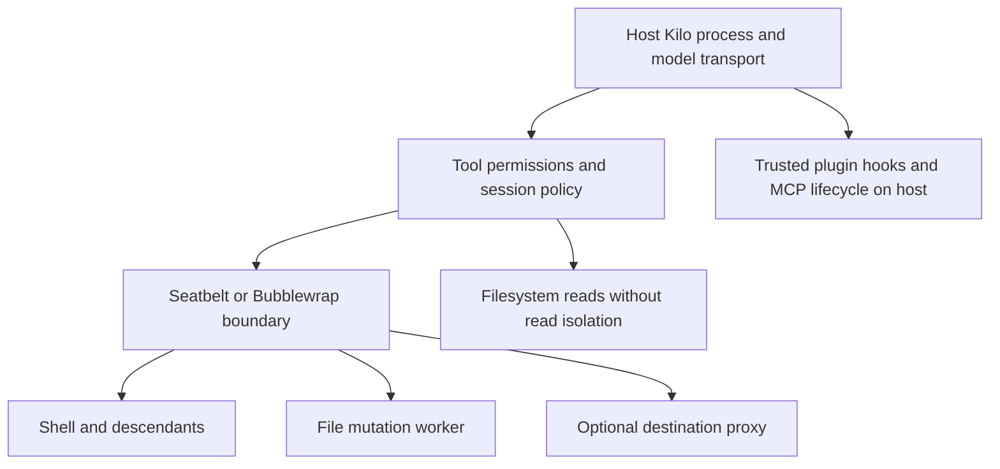

# Kilo Code CLI sandboxing

Kilo supplies an **optional OS-enforced sandbox, disabled on a clean installation**. Its normal guardrails are application-level tool permissions. Enabling the sandbox adds filesystem write confinement and, by default, tool network denial on macOS and Linux. It does not restrict filesystem reads, isolate the main agent process, or stop model/API transport. Native Windows has no backend; WSL2 selects the Linux backend but needs working Linux namespaces and Bubblewrap. [Official sandbox overview](https://kilo.ai/docs/getting-started/settings/sandboxing), [backend selector](https://github.com/Kilo-Org/kilocode/blob/c631a1da498a732ef47b97345d3c7724b8382e34/packages/kilo-sandbox/src/backend.ts).

## Scope and evidence

Research date: **2026-11-04 UTC**. This report concerns the standalone `kilo` CLI, not the former CLI implementation, IDE-specific controls, Cloud Agents, or third-party container wrappers. Official CLI documentation applies to CLI 1.0 and later. The latest GitHub release observed was **v7.8.18**, published **2026-10-26**. Detailed source findings below are pinned to **main commit `c631a1da498a732ef47b97345d3c7724b8382e34`**, committed **2026-11-04T16:42:26Z**; they are not assertions that every detail shipped in that release. The sandbox backend file exists at the v7.8.18 tag, corroborating that this is not solely an unreleased feature. The first release containing the complete current policy remains unresolved. [CLI documentation](https://kilo.ai/docs/code-with-ai/platforms/cli), [release](https://github.com/Kilo-Org/kilocode/releases/tag/v7.8.18), [examined commit](https://github.com/Kilo-Org/kilocode/commit/c631a1da498a732ef47b97345d3c7724b8382e34), [release backend](https://github.com/Kilo-Org/kilocode/blob/v7.8.18/packages/kilo-sandbox/src/backend.ts).

Read-only local inspection on macOS found `kilo --version` **7.3.45**. `kilo --help` and `kilo run --help` expose `--pure`, `--auto`, and `--dangerously-skip-permissions`, but no sandbox launch flag. That older executable's help is not evidence of current sandbox enforcement. No model session, sandbox escape probe, or remote platform test was run. Existing user settings were not used to infer installation defaults. Source inspection establishes intended control flow, not successful runtime confinement.

## Default protection and first use

The eight clean-install profiles are below. “No” means the CLI adds no OS sandbox; ordinary account permissions and host security still apply. The permission baseline is shared across platforms rather than an OS-specific sandbox preset. [Sandbox defaults](https://github.com/Kilo-Org/kilocode/blob/c631a1da498a732ef47b97345d3c7724b8382e34/packages/opencode/src/kilocode/sandbox/config.ts), [agent defaults](https://github.com/Kilo-Org/kilocode/blob/c631a1da498a732ef47b97345d3c7724b8382e34/packages/opencode/src/agent/agent.ts), [headless run handling](https://github.com/Kilo-Org/kilocode/blob/c631a1da498a732ef47b97345d3c7724b8382e34/packages/opencode/src/cli/cmd/run.ts).

| Platform | Session | OS sandbox by default | Approval behavior | Optional local backend |
|---|---|---|---|---|
| macOS | Interactive | No | Ask for unmatched shell actions and external paths | Seatbelt |
| macOS | Non-interactive `kilo run` | No | Reject unanswered permission requests | Seatbelt |
| Linux | Interactive | No | Same interactive permission baseline | Bubblewrap |
| Linux | Non-interactive `kilo run` | No | Same headless rejection | Bubblewrap |
| Native Windows | Interactive | No | Same interactive permission baseline | Unsupported |
| Native Windows | Non-interactive `kilo run` | No | Same headless rejection | Unsupported |
| WSL2 | Interactive | No | Same interactive permission baseline | Linux backend, conditional |
| WSL2 | Non-interactive `kilo run` | No | Same headless rejection | Linux backend, conditional |

By default most tools, including workspace file edits, are allowed. `external_directory` asks except for trusted runtime/config/skill paths. The `read` permission asks for `*.env` and `*.env.*`, with `*.env.example` allowed. Shell permission defaults to `ask` with an explicit command allowlist; it includes not only inspection commands but also `touch`, `mkdir`, `cp`, `mv`, `tsc`, and archive utilities. This is not a read-only baseline. Permission patterns decide whether Kilo dispatches a tool, not what an approved process can do internally. [Base rules](https://github.com/Kilo-Org/kilocode/blob/c631a1da498a732ef47b97345d3c7724b8382e34/packages/opencode/src/agent/agent.ts), [Kilo shell rules](https://github.com/Kilo-Org/kilocode/blob/c631a1da498a732ef47b97345d3c7724b8382e34/packages/opencode/src/kilocode/agent/index.ts).

First-time setup uses `/connect` for provider credentials; the documented flow does not require a sandbox choice. Enable it explicitly in config or with `/sandbox`. No separate sandbox subscription, Kilo account entitlement, Docker installation, or VM is required by the local backend code. Model access still needs suitable provider credentials, a Kilo connection, or a configured local model. Plan/Ask agents restrict tool dispatch, and project-config trust limits what repository configuration can inject; neither constitutes OS isolation. [CLI setup](https://kilo.ai/docs/code-with-ai/platforms/cli), [agent restrictions](https://github.com/Kilo-Org/kilocode/blob/c631a1da498a732ef47b97345d3c7724b8382e34/packages/opencode/src/kilocode/agent/index.ts), [config trust and loading](https://github.com/Kilo-Org/kilocode/blob/c631a1da498a732ef47b97345d3c7724b8382e34/packages/opencode/src/config/config.ts).

## What enabling the sandbox contains

The backend wraps tool processes rather than moving the entire CLI into a container. File mutations use a confined worker through Kilo's sandbox-aware filesystem service. Reads execute normally. Trusted integration code doing direct host I/O is not automatically confined. [Process wrapping](https://github.com/Kilo-Org/kilocode/blob/c631a1da498a732ef47b97345d3c7724b8382e34/packages/kilo-sandbox/src/backend.ts), [filesystem adapter](https://github.com/Kilo-Org/kilocode/blob/c631a1da498a732ef47b97345d3c7724b8382e34/packages/kilo-sandbox/src/filesystem.ts).



On **macOS**, Kilo invokes `/usr/bin/sandbox-exec` with a generated Seatbelt policy. It allows file reads, process execution/forking, selected runtime services, and writes only through the computed path rules. Direct sockets are denied in restricted network modes; destination exceptions open only the scoped loopback proxy route. The backend checks that `sandbox-exec` exists; execution failure remains an error. [Seatbelt generator](https://github.com/Kilo-Org/kilocode/blob/c631a1da498a732ef47b97345d3c7724b8382e34/packages/kilo-sandbox/src/seatbelt.ts), [base profile](https://github.com/Kilo-Org/kilocode/blob/c631a1da498a732ef47b97345d3c7724b8382e34/packages/kilo-sandbox/src/seatbelt-base.ts), [network profile](https://github.com/Kilo-Org/kilocode/blob/c631a1da498a732ef47b97345d3c7724b8382e34/packages/kilo-sandbox/src/seatbelt-network.ts).

On **Linux**, Bubblewrap creates user and PID namespaces, a read-only bind of `/`, writable bind exceptions, and private `/dev` and `/proc` views. Denied or proxied networking adds a network namespace. Proxy mode also needs Kilo's relay and seccomp helper to bridge the proxy while preventing direct host Unix-socket access. Selection tries `/usr/bin/bwrap`, then a bundled binary checked against its build-time SHA-256 digest. `KILO_BWRAP_PATH` selects an absolute alternative instead of that candidate list. Setuid/setgid binaries are rejected. A bounded startup probe must successfully create the namespaces; merely installing Bubblewrap is insufficient where kernel or host policy forbids them. Additional writable paths must already exist and be accessible. [Bubblewrap implementation](https://github.com/Kilo-Org/kilocode/blob/c631a1da498a732ef47b97345d3c7724b8382e34/packages/kilo-sandbox/src/bubblewrap.ts), [path filtering](https://github.com/Kilo-Org/kilocode/blob/c631a1da498a732ef47b97345d3c7724b8382e34/packages/opencode/src/kilocode/sandbox/policy.ts).

**Native Windows** explicitly returns an unavailable backend. Enabling a policy prevents affected tools from running rather than creating AppContainer isolation. **WSL2** is a source-derived conditional conclusion: a Linux Kilo binary selects Bubblewrap because selection uses `process.platform`, without a separate WSL backend. WSL2's VM is not a Kilo-created sandbox; mounted Windows paths and interoperability need runtime checks before claiming stronger containment. [Backend selection](https://github.com/Kilo-Org/kilocode/blob/c631a1da498a732ef47b97345d3c7724b8382e34/packages/kilo-sandbox/src/backend.ts).

## Files, credentials, and writable paths

The active workspace is writable; in ordinary repositories the policy may include the detected worktree root as well as the invocation directory. Linked-worktree handling selects the active worktree and avoids implicitly widening writes to its parent checkout or siblings. Additional global writable paths expand that authority. Kilo also allows writes in its XDG data, cache, and state trees and its dedicated temporary directory, normally `~/.local/share/kilo`, `~/.cache/kilo`, `~/.local/state/kilo`, and `$TMPDIR/kilo`. `TMPDIR`, `TMP`, and `TEMP` are set to that dedicated temporary path for confined launches. Arbitrary system temporary files are not generally writable. [Policy construction](https://github.com/Kilo-Org/kilocode/blob/c631a1da498a732ef47b97345d3c7724b8382e34/packages/opencode/src/kilocode/sandbox/policy.ts).

Protected rules override writable roots: `.git` metadata, saved sandbox policies/preferences, and the global config root are read-only. A permission approval for an external directory does not add it to sandbox writable paths. Writable file handles are deliberately unavailable through the adapter, so an integration requesting a read-write handle can fail even inside an otherwise writable location. Paths are canonicalized, including resolving existing symlink ancestors and not-yet-created descendants; the filesystem adapter checks physical destinations and runs mutations through the worker. A symlink under the workspace does not intentionally grant writes to its external target. This is source evidence, not a claim that all race or hard-link attacks have been tested. [Filesystem checks](https://github.com/Kilo-Org/kilocode/blob/c631a1da498a732ef47b97345d3c7724b8382e34/packages/kilo-sandbox/src/filesystem.ts), [canonicalization](https://github.com/Kilo-Org/kilocode/blob/c631a1da498a732ef47b97345d3c7724b8382e34/packages/kilo-sandbox/src/path.ts), [protected paths](https://github.com/Kilo-Org/kilocode/blob/c631a1da498a732ef47b97345d3c7724b8382e34/packages/opencode/src/kilocode/sandbox/policy.ts).

Home files and credentials remain readable wherever the OS account can read them. The process environment removes selected Kilo config, server-auth, and browser-broker variables, but does not generally strip all provider keys or application credentials. Denying Kilo's `read` tool for a secret does not prevent an allowed shell command or another reading tool from accessing it. Read-only mounts protect integrity, not confidentiality, and readable content may enter model context. [Environment policy](https://github.com/Kilo-Org/kilocode/blob/c631a1da498a732ef47b97345d3c7724b8382e34/packages/opencode/src/kilocode/sandbox/policy.ts), [unrestricted Seatbelt reads](https://github.com/Kilo-Org/kilocode/blob/c631a1da498a732ef47b97345d3c7724b8382e34/packages/kilo-sandbox/src/seatbelt.ts).

## Network and tool coverage

`sandbox.network: "deny"` blocks direct tool-process egress. With `allowed_hosts`, the internal mode becomes `proxy`: authenticated HTTP/HTTPS proxying allows exact public DNS hosts and ports, defaulting to 443. URLs, wildcard hosts, IP literals, private/reserved destinations, and implicit subdomains are rejected. HTTPS tunnels require matching TLS SNI; DNS is resolved and validated outside confinement. Redirect destinations need their own permission. SSH, arbitrary TCP/UDP, QUIC, SOCKS, and CIDR allowlists are not supported. A host exception grants an egress destination, not a repository, tenant, HTTP path, or data-loss-prevention boundary; credentials retain their authority at that destination. Unknown NAT64 translation prefixes remain a documented limitation. `network: "allow"` removes network confinement while retaining write confinement. [Destination parser](https://github.com/Kilo-Org/kilocode/blob/c631a1da498a732ef47b97345d3c7724b8382e34/packages/kilo-sandbox/src/destination.ts), [proxy implementation](https://github.com/Kilo-Org/kilocode/blob/c631a1da498a732ef47b97345d3c7724b8382e34/packages/kilo-sandbox/src/proxy.ts), [config resolution](https://github.com/Kilo-Org/kilocode/blob/c631a1da498a732ef47b97345d3c7724b8382e34/packages/opencode/src/kilocode/sandbox/config.ts).

| Surface | Boundary when enabled |
|---|---|
| Shell and child processes | OS write/network policy inherited by launched subprocesses |
| Built-in file tools | Reads unconfined; mutations use sandbox-aware service and worker |
| Built-in HTTP tools | Policy-aware destination checks/proxy; not model transport |
| Subagents and forks | Inherit session policy; stricter initial parent/child combination |
| Notebook execution/background-process tool | Host-process tools refused while sandbox active |
| Semantic search/LSP and other opaque network tools | Refused while network restricted |
| Custom/plugin tools | Refused under restricted networking unless admitted as built-ins; direct trusted integration I/O otherwise depends on using sandbox-aware services |
| Plugin hooks | Trusted host execution, including hooks before internal tool permission checks |
| MCP | Local/remote tool calls and typed resource reads refused under restricted networking; server startup, remote connection/reconnection, and prompt retrieval remain trusted host activity |

The table follows the [session tool dispatcher](https://github.com/Kilo-Org/kilocode/blob/c631a1da498a732ef47b97345d3c7724b8382e34/packages/opencode/src/session/tools.ts), [network tool gate](https://github.com/Kilo-Org/kilocode/blob/c631a1da498a732ef47b97345d3c7724b8382e34/packages/opencode/src/kilocode/sandbox/network.ts), [host/opaque inventory](https://github.com/Kilo-Org/kilocode/blob/c631a1da498a732ef47b97345d3c7724b8382e34/packages/opencode/src/kilocode/sandbox/network-tools.ts), and [typed-resource gate](https://github.com/Kilo-Org/kilocode/blob/c631a1da498a732ef47b97345d3c7724b8382e34/packages/opencode/src/session/prompt.ts). Allowing tool networking does not put independently running MCP servers inside the CLI's process sandbox.

Provider/model inference remains on the host transport. Network denial is therefore not an offline or provider-privacy mode. `--pure` disables external plugins in the observed CLI help; it does not create a process sandbox or disable model networking.

## Configuration, precedence, and examples

Use global `~/.config/kilo/kilo.jsonc` (respecting the configured XDG config root) for authority-expanding settings:

```jsonc
{
  "sandbox": {
    "enabled": true,
    "network": "deny",
    "allowed_hosts": ["github.com:443", "api.github.com:443"],
    "writable_paths": ["~/shared-output"]
  },
  "permission": {
    "bash": { "*": "ask", "git status*": "allow" },
    "read": { "*": "allow", "*.env": "deny", "*.env.*": "deny" }
  }
}
```

Create `~/shared-output` yourself first. Remove `allowed_hosts` for deny-all tool networking; set `network` to `"allow"` for unrestricted tool network access with write confinement. The read rules above only gate the read tool. Run `kilo` and use `/sandbox` to change a session's enabled state; there is no verified dedicated `--sandbox` launch flag. [Config contract and scope filter](https://github.com/Kilo-Org/kilocode/blob/c631a1da498a732ef47b97345d3c7724b8382e34/packages/opencode/src/kilocode/sandbox/config.ts), [CLI sandbox command](https://github.com/Kilo-Org/kilocode/blob/c631a1da498a732ef47b97345d3c7724b8382e34/packages/opencode/src/kilocode/plugins/sandbox.tsx).

Global defaults are `enabled: false`, `network: "deny"`, `allowed_hosts: []`, and `writable_paths: []`. Project config may enable confinement or deny networking, but cannot disable a global enabled default, permit globally denied networking, add hosts, or add writable paths. A project network denial clears global host exceptions. This sandbox-specific scope filter matters even though general CLI documentation says project config overrides global config. Session choice then takes priority: a saved session snapshot wins; otherwise a saved project preference wins over the config default. Thus a global enabled default is not an immutable administrator lock against trusted session toggles. [Scope filter](https://github.com/Kilo-Org/kilocode/blob/c631a1da498a732ef47b97345d3c7724b8382e34/packages/opencode/src/kilocode/sandbox/config.ts), [session initialization and refresh](https://github.com/Kilo-Org/kilocode/blob/c631a1da498a732ef47b97345d3c7724b8382e34/packages/opencode/src/kilocode/sandbox/policy.ts).

The loader supports `KILO_CONFIG`, `KILO_CONFIG_DIR`, and `KILO_CONFIG_CONTENT`, but their security scope is significant. A custom file's scope is inferred from its location; inline `KILO_CONFIG_CONTENT` is explicitly merged as **local** for sandbox settings even though it is trusted for variable expansion. Do not rely on inline JSON to add writable paths or egress destinations. `KILO_DISABLE_PROJECT_CONFIG` suppresses project config loading. `KILO_BWRAP_PATH=/absolute/path/to/bwrap kilo` selects a Linux backend binary; it does not enable sandboxing. [Loader](https://github.com/Kilo-Org/kilocode/blob/c631a1da498a732ef47b97345d3c7724b8382e34/packages/opencode/src/config/config.ts), [Bubblewrap override](https://github.com/Kilo-Org/kilocode/blob/c631a1da498a732ef47b97345d3c7724b8382e34/packages/kilo-sandbox/src/bubblewrap.ts).

Administrator-managed config loads late, after ordinary user/project/inline and console-managed organization settings. System directories are `/Library/Application Support/kilo` on macOS, `/etc/kilo` on Linux/WSL, and `%ProgramData%/kilo` on Windows. macOS managed preferences in the `ai.opencode.managed` domain load last. These can distribute settings, but do not supply a Windows backend or establish an untoggleable sandbox mandate. Saving trusted sandbox settings refreshes network/write limits for existing sessions before their next execution; in-flight tools keep their launch policy. New forks retain confinement, and subagents initially combine enabled states with OR and intersect writable paths and destination lists, with deny-all stricter than proxy access. Later trusted settings refresh those limits. [Managed config](https://github.com/Kilo-Org/kilocode/blob/c631a1da498a732ef47b97345d3c7724b8382e34/packages/opencode/src/config/managed.ts), [loader order](https://github.com/Kilo-Org/kilocode/blob/c631a1da498a732ef47b97345d3c7724b8382e34/packages/opencode/src/config/config.ts), [inheritance and refresh](https://github.com/Kilo-Org/kilocode/blob/c631a1da498a732ef47b97345d3c7724b8382e34/packages/opencode/src/kilocode/sandbox/policy.ts).

## Denials, escalation, and unattended operation

An unavailable backend, failed namespace setup, or unavailable proxy dependency fails the affected execution. There is no automatic unrestricted fallback. With sandboxing off, execution deliberately uses the unrestricted path. Denied writes generally surface as tool/OS errors; a permission grant does not retry them with broader filesystem authority. [Backend errors](https://github.com/Kilo-Org/kilocode/blob/c631a1da498a732ef47b97345d3c7724b8382e34/packages/kilo-sandbox/src/backend.ts), [policy execution](https://github.com/Kilo-Org/kilocode/blob/c631a1da498a732ef47b97345d3c7724b8382e34/packages/opencode/src/kilocode/sandbox/policy.ts).

Mutating Git commands need `.git` writes and can trigger a special one-command escalation prompt. Its explicit manual approval runs the **entire command and descendants outside filesystem and network confinement**. Bash allow rules and automatic permission approval do not satisfy this request. This is a deliberate escape hatch, not a wider sandbox profile or a generic automatic retry after every denial. The shell parser checks each parsed subcommand for Git mutations; approving a match lifts confinement for the entire original shell command, including accompanying commands. The lower-level Git classifier rejects compound text itself, so its check must be read together with that parser. [Shell escalation path](https://github.com/Kilo-Org/kilocode/blob/c631a1da498a732ef47b97345d3c7724b8382e34/packages/opencode/src/tool/shell.ts), [Git classifier](https://github.com/Kilo-Org/kilocode/blob/c631a1da498a732ef47b97345d3c7724b8382e34/packages/opencode/src/kilocode/sandbox/git.ts), [manual approval provenance](https://github.com/Kilo-Org/kilocode/blob/c631a1da498a732ef47b97345d3c7724b8382e34/packages/opencode/src/session/tools.ts), [unrestricted escalation function](https://github.com/Kilo-Org/kilocode/blob/c631a1da498a732ef47b97345d3c7724b8382e34/packages/opencode/src/kilocode/sandbox/policy.ts).

The official page contradicts itself: it describes unrestricted network access after escalation, then says escalation does not itself grant network access. The unrestricted source function supports the broader interpretation for an approved escalated execution. Ordinary, non-escalated `gh` or HTTPS Git still requires destination exceptions. A runtime escalated-network probe is needed to settle the contradictory wording definitively. [Conflicting documentation](https://kilo.ai/docs/getting-started/settings/sandboxing#leaving-the-sandbox).

Plain `kilo run "Summarize this project"` cannot answer permission prompts: it rejects them, including child-agent requests, and a run with an ordinary auto-rejected permission exits 1. `kilo run --auto "Implement the change"` answers ordinary requests automatically; current source describes it as approving permissions not explicitly denied. Hidden compatibility flags `--yolo` and `--dangerously-skip-permissions` also affect approval handling. None changes the sandbox profile or removes its enforcement. The non-interactive event handler explicitly rejects sandbox-escalation and skill-shell requests even in auto mode. `kilo serve` is an API server whose clients must answer requests; merely lacking a TTY is not the same policy as the `run` frontend. [Run flags and event handler](https://github.com/Kilo-Org/kilocode/blob/c631a1da498a732ef47b97345d3c7724b8382e34/packages/opencode/src/cli/cmd/run.ts), [forced approval checks](https://github.com/Kilo-Org/kilocode/blob/c631a1da498a732ef47b97345d3c7724b8382e34/packages/opencode/src/permission/index.ts), [headless descendants](https://github.com/Kilo-Org/kilocode/blob/c631a1da498a732ef47b97345d3c7724b8382e34/packages/opencode/src/kilocode/permission/headless.ts).

## Unresolved checks

- **Release boundary:** compare tagged policy, filesystem, proxy, and run-handler history to find the first release with each behavior. The locally installed 7.3.45 was inspected only for version/help and must not be assumed to enforce the current policy.
- **WSL2 enforcement:** run a current Linux build in WSL2, verify namespace/proxy startup, then probe writes through `/mnt/c` and Windows interop subprocesses. Linux dispatch alone does not prove these cases.
- **Escalation networking:** manually approve a harmless mutating-Git escalation in a disposable repository and test a controlled egress destination from that execution; compare with an unapproved sandboxed command.
- **Runtime boundary:** source was inspected, not executed adversarially. On current macOS/Linux builds, verify shell and built-in-file outside writes, symlink redirects, read visibility, and restricted proxy egress using disposable fixtures.

## Changelog

- **2026-11-04:** Created the report. Established clean-install sandbox-off defaults, current opt-in Seatbelt/Bubblewrap confinement, host integration exclusions, headless approval behavior, and the distinction between tool egress and model transport. Recorded the installed-version mismatch and unresolved release/WSL2/escalation checks.
