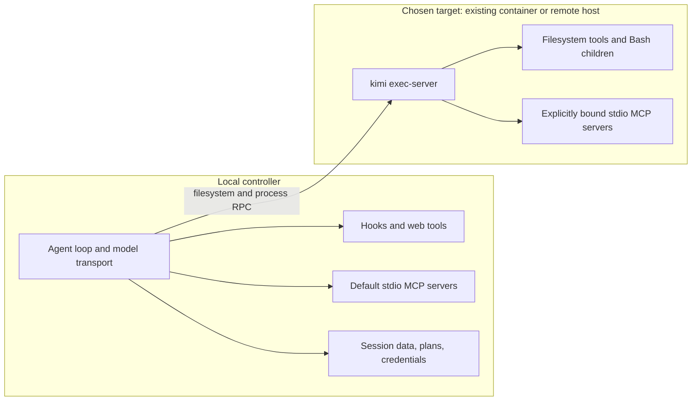

# Kimi Code CLI: sandboxing and access boundaries

Researched **2026-11-04 UTC**. A normal Kimi Code CLI installation does **not** put the agent or its shell in an OS sandbox. It runs with the launching user's filesystem, process, and network authority. Its default protections are application-level tool checks, approval policies, and workspace trust. Starting with **2.5.0**, officially supported remote environments can move file and process operations into an existing container or onto another machine; they leave important execution surfaces on the controller. This conclusion comes from the local environment's direct host filesystem/process bindings, the Node backends, and the remote launcher implementation, rather than from silence in the documentation. [E3](#e3-host-execution) [E8](#e8-remote-environments)

## Scope and versions

The requested [documentation entry point](https://moonshotai.github.io/kimi-cli/) and [MoonshotAI/kimi-cli repository](https://github.com/MoonshotAI/kimi-cli) now lead to a migration distinction: the Python repository was archived on September 23, 2026, and identifies **MoonshotAI/kimi-code** as its replacement. This report describes the current TypeScript Kimi Code CLI, release **2.5.0**, published November 4, 2026, and source commit **`f8e15c7a9be44fe4e0361a4ce57eaf690e05476a`**, dated November 4. The archived repository's final release is **1.52.0**, and its examined commit is **`9ab1286b8fe4e6bcd116949a27ce5e0ac3389c82`**. Legacy Kaos APIs are not evidence that current CLI flags enable a sandbox. In fact, 2.2.0 removed the never-implemented MCP `executor = "kaos"` option; configurations retaining it fail validation. [E1](#e1-product-identity) [E2](#e2-release-history)

Read-only local inspection on macOS found `/Users/ken/.kimi-code/bin/kimi`, reporting **2.1.1**. `kimi --help` corroborated `--yolo`, `--auto`, `--prompt`, `--plan`, and `--add-dir`; its help did not advertise a sandbox flag. This installation predates remote environments. No model session, permission bypass, container launch, credential inspection, or access probe was run. Source inspection below establishes implementation behavior, not runtime security-test results. [E12](#e12-local-observation)

## Clean-install defaults

The table concerns **2.5.0**, with no migrated configuration, remembered trust, extra directories, or administrator-supplied containment. Native Windows has its own supported installation and requires Git for Windows/Git Bash (`KIMI_SHELL_PATH` can specify an absolute `bash.exe` path); its support is established independently of WSL2. WSL2 runs the Linux CLI within the distribution and inherits whatever Windows mounts and interoperability that distribution exposes; Kimi adds no further WSL boundary. [E3](#e3-host-execution) [E11](#e11-installation-and-data)

| Platform | Interactive `kimi` | Non-interactive `kimi -p "…"` |
| --- | --- | --- |
| macOS | No sandbox; `manual` (Always Ask); initial workspace trust confirmation | No sandbox; forced `auto` (Never Ask); no trust dialog |
| Linux | Same default policy, on the Linux host | Same unattended policy, on the Linux host |
| Native Windows | No sandbox; same modes/trust gate; Bash uses Git Bash | No sandbox; forced `auto`; Git Bash required for shell execution |
| WSL2 | No Kimi sandbox; Linux behavior inside the distribution | No Kimi sandbox; Linux unattended behavior inside the distribution |

Always Ask does not mean every read or even every write prompts. Ordinary reads, searches, web tools, and subagent dispatch are automatically approved. The inspected policy also automatically approves `Write`/`Edit` within a Git workspace on **POSIX** targets after earlier rules/guards have been considered. That policy returns no automatic approval on native Windows. This is a source-derived qualification to the documentation's simpler description that edits always ask in manual mode. [E4](#e4-permission-evaluation)

On first interactive opening, the trust dialog offers **Trust and continue** (the default selection) or **Exit**. Declining exits before session creation; trusting enables project-controlled configuration, including project MCP servers. It does not constrain the shell's authority. Print mode has no trust prompt and skips untrusted project MCP servers with a warning; that does not prevent its built-in tools from operating on the project. Current trust settings default to `[workspace] require_trust = true`; `KIMI_CODE_TRUST_WORKSPACE=1` trusts the current workspace for that process without saving a record. In 2.5.0, `require_trust = false` treats every workspace as trusted. Neither switch changes tool permissions. [E5](#e5-workspace-trust)

The non-interactive column describes `-p`, not every stdio integration. `kimi acp` exposes session mode selection and routes tool approvals/questions through the ACP client’s `session/request_permission`; it does not inherit print mode’s unconditional auto policy merely because it uses stdio. [ACP reference](https://moonshotai.github.io/kimi-code/en/reference/kimi-acp.html)

A working model connection is needed for agent activity: first-run `/login` offers Kimi Code OAuth or a Moonshot API key, and compatible providers can be configured separately. There is no separate sandbox account or paid sandbox entitlement documented for remote environments; users supply the target, authentication, and executor. The recommended binary installation needs no preinstalled Node.js; the documentation lists Node.js 22.19+ for npm installation, while the current source workspace requires Node.js 24.15+ for development. [E11](#e11-installation-and-data) [E8](#e8-remote-environments)

## What local execution can access

**Files and directories.** `Read`, `Write`, and `Edit` resolve relative paths against the workspace and accept absolute paths outside it. Relative traversal outside the workspace is rejected with `PATH_OUTSIDE_WORKSPACE`, asking the caller to use an absolute path. Consequently, the workspace is not a read jail or a mandatory write jail. `--add-dir <dir>` adds workspace context for one session; `/add-dir` can remember directories in the workspace registry. Legacy `.kimi-code/local.toml` `workspace.additional_dir` entries still apply to implicit workspaces. These settings affect path handling and approvals, not OS authority. [E6](#e6-file-tool-boundaries) [E5](#e5-workspace-trust)

The default file-tool path policy blocks sensitive names before execution (`PATH_SENSITIVE`), including `.env`, `.env.*`, `id_rsa`, `id_ed25519`, `id_ecdsa`, `credentials`, and selected backup/key variants. `.env.example`, `.env.sample`, `.env.template`, and the explicitly listed public-key names are exempt. `Read`/`Write`/`Edit` retain this check even in `auto` mode and when confirmation guards are disabled. This is a filename heuristic, not a complete credential vault boundary: `Grep` and `Glob` explicitly use `checkSensitive: false`, and arbitrary shell programs do not inherit this file-tool check. Other accessible home files and credentials under unrecognized names remain exposed. Read-only tool access can disclose secrets just as shell output can. [E6](#e6-file-tool-boundaries) [E4](#e4-permission-evaluation)

**Symlinks and protected paths.** Release 2.1.0 claimed symlink-escape hardening and rejection of additional directories resolving to home or filesystem root; 2.1.1 explicitly rolled back some defensive changes. Current agent-tool path resolution is lexical, and the examined `Read`/`Write`/`Edit` paths call host filesystem operations without a realpath confinement check. The separate workspace filesystem service used by UI/API file operations does include a realpath-based workspace check. Do not transfer that UI/API protection to the model's file tools or assume every symlink escape is blocked. This discrepancy needs an isolated runtime regression check. There is no documented private temporary filesystem or universal protected-file list for Bash; ordinary OS permissions still apply. [E2](#e2-release-history) [E6](#e6-file-tool-boundaries)

**Processes and network.** Local process execution uses Node's `spawn`, with the host environment plus overrides. Shell children have the user's host access, including inherited environment secrets, available executables, temporary directories, and ordinary network connectivity. There is no supplied Seatbelt, Landlock, namespace, seccomp, AppContainer, or container wrapper in this local execution path. Command classification and dangerous-command confirmations are policy checks before launch, not a restriction applied to the resulting process. [E3](#e3-host-execution) [E4](#e4-permission-evaluation)

Kimi supplies no general tool-network deny switch or domain firewall in the examined configuration. Web tools, MCP connections, model transport, login, updates, and telemetry have distinct network consumers. Standard `HTTP_PROXY`, `HTTPS_PROXY`, `ALL_PROXY`, and `NO_PROXY` influence supported outbound clients, with loopback bypass; a proxy setting is not an enforced egress policy for arbitrary Bash descendants. Disabling a web tool does not prevent Bash from making requests or prevent model/API transport. [E10](#e10-network-and-tool-selection) [E3](#e3-host-execution)

## Optional remote execution, including containers

**2.5.0 remote environments are tool placement, with isolation supplied by the chosen target.** `[environments]` supports SSH, Docker-compatible containers, and a custom command launcher. A small `kimi exec-server` executes filesystem and process primitives on that target. The agent loop, model requests, OAuth/API credentials, approvals, and session persistence remain local. A container contains the executor and its selected subprocesses, not the complete agent. SSH relocates authority to the target account; it is not itself a filesystem sandbox on that target. [E8](#e8-remote-environments)



For Docker, the launcher runs `docker exec -i <container> sh -c …`; it **does not create or harden the container**. The operator must provide a running container, Docker-compatible CLI/daemon access, a usable shell, the project files, and a compatible executor installed or mounted at `remoteBin`. Mounts, container user, privileges, capabilities, network, Docker socket exposure, and any VM supporting the runtime are properties of that existing environment. Kimi sets no fixed read/write mount policy or default network isolation. A mounted home or Docker socket can defeat the intended separation. This conclusion follows from the launcher argv; this report did not test a container escape. [E8](#e8-remote-environments)

SSH needs the system SSH client, target access, and an installed executor; it honors SSH configuration and agent authentication. The protocol minimum executor version is **2.5.0**, and Windows executors must advertise the required process-lifecycle capability. The executor is not automatically installed. Native Windows targets require Git Bash and support SSH/custom launchers, **not Windows Docker containers**. A Windows controller may still use a separately provisioned POSIX container target; that is a different claim from Windows-container support. Custom launchers can connect other officially described environments, but the CLI does not manufacture their security policy. [E8](#e8-remote-environments)

Example user configuration, after provisioning a container named `kimi-dev` and installing a compatible Linux executor there:

```toml
# ~/.kimi-code/config.toml
[environments.kimi-dev]
type = "docker"
container = "kimi-dev"
remoteBin = "/usr/local/bin/kimi"
defaultCwd = "/workspace"
```

```sh
# 2.5.0: these environment flags are documented but hidden from normal help.
kimi --environment kimi-dev --environment-cwd /workspace
kimi --environment kimi-dev -p "Run the project checks"
```

Other declaration fields are `type = "ssh"` with `host`, or `command` with `args` and optional launcher-only `env`; Docker accepts optional `context`. `remoteBin` defaults to `~/.kimi-code/bin/kimi` on POSIX targets or `~/.kimi-code/bin/kimi.exe` on Windows. A custom launcher normally receives `<remoteBin> exec-server` appended to its arguments; launchers without target-shell expansion need an absolute executor path.

`--environment` overrides `[environments] default` for creation. Without either, new sessions use `local`. `--environment-cwd` requires `--environment`; both reject resume/continue because resumed sessions restore the saved binding. The entry's `defaultCwd` must be absolute unless overridden. Bindings are per session; ordinary subagents inherit them, while Tower orchestration is unsupported remotely. `/new` retains the live environment rather than reapplying the startup selection. [E8](#e8-remote-environments)

Remote file tools can access files allowed by the target account and container mounts, not only `defaultCwd`. Target home/temporary files are not automatically hidden. Model credentials are not automatically sent there, but target-side credentials and secrets deliberately supplied through MCP `env` remain exposed to their processes. Local plans, task-output artifacts, and session attachments are explicit exceptions: Kimi can still read these locally during a remote session. `WebSearch`/`FetchURL` also remain local, so a container egress restriction on Bash does not restrict those tools or the model connection. [E8](#e8-remote-environments) [E9](#e9-hooks-plugins-and-mcp)

## Coverage across tools and integrations

| Surface | Default local session | Remote/container session |
| --- | --- | --- |
| Bash and background shell tasks | User's host processes | Target executor and target processes |
| Ordinary file tools and filesystem searches | Host filesystem through tool-specific checks | Target filesystem through the same tool policy |
| Ordinary subagents | Same host authority; separate conversation context | Inherit parent environment binding |
| Plans, retained task output, attachments | Local session storage | Local storage exceptions remain available |
| WebSearch, FetchURL, model/API requests | Local network clients | Still local |
| Lifecycle hooks, including plugin hooks | Local shell commands | Still local; user hooks use the local project directory, plugin hooks use the plugin root |
| Stdio MCP servers | Local child processes | Still local unless each server specifies `environment_id` |
| HTTP/SSE MCP servers | External service authority | Same service boundary; not moved into the session target |
| Skills and agent profiles | Instructions and tool selection | No independent OS isolation |

Hooks can block selected events with exit code 2, but errors/timeouts otherwise fail open; they are not a dependable sole security boundary. Plugins can supply hooks and MCP servers and therefore acquire those execution surfaces. Plugin hooks use the plugin root as their working directory. Plugin resource paths are checked after symlink resolution to stay within that root; this validates loaded resources rather than containing the hook process. Marketplace trust labels and installation confirmations identify provenance; they do not create confinement. MCP permission approval gates a call, not everything a server might do during startup or between calls. [E9](#e9-hooks-plugins-and-mcp)

To move a stdio MCP server into the target, set its environment explicitly in the **local** MCP configuration:

```json
{
  "mcpServers": {
    "project-files": {
      "command": "/usr/local/bin/project-mcp",
      "cwd": "/workspace",
      "environment_id": "kimi-dev"
    }
  }
}
```

This ID never implicitly follows the session binding. Such servers inherit the target's base environment, plus explicit `env` overlay values. Remote-side project MCP configuration is not loaded. [E9](#e9-hooks-plugins-and-mcp)

## Controls, precedence, and failure behavior

Approval selection is separate from environment selection. Interactive defaults come from `default_permission_mode = "manual"`; `--yolo`/`-y` selects `yolo` (Ask When Needed), `--auto` selects `auto` (Never Ask), and `/permission`, `/yolo`, or `/auto` changes the live session mode. `--yes` and `--auto-approve` are hidden YOLO aliases. Mode flags override saved mode when resuming; `-p` forces `auto` and rejects combinations with `--yolo`, `--auto`, or `--plan`. It does not silently enable a sandbox. YOLO/Auto do not change an existing remote binding or its container policy. [E4](#e4-permission-evaluation) [E7](#e7-command-controls)

The current policy source evaluates configured **deny** first, then the interactive dangerous-command guard, then auto-mode approval, session approvals, configured **ask**, configured **allow**, sensitive/git-path confirmations, YOLO, default tool approvals, POSIX Git-workspace writes, and finally a prompt. Thus static deny survives `auto`, but configured ask does not force a prompt in auto. Documentation says the first matching rule wins; the implementation instead searches separately by decision class. Use non-overlapping rules and treat the implementation ordering as the examined behavior pending upstream clarification. Scope values include `turn-override`, `session-runtime`, `project`, and `user`; these are permission-record scopes, not four independent administrator configuration files. [E4](#e4-permission-evaluation)

```toml
# ~/.kimi-code/config.toml (or $KIMI_CODE_HOME/config.toml)
default_permission_mode = "manual"

[permission]
dangerous_command_guard = true

[[permission.rules]]
decision = "deny"
pattern = "Bash(rm -rf*)"
reason = "Require a different workflow for recursive deletion"

[tools]
disabled = ["Bash"]
```

The Bash rule is command-pattern matching, not a semantic prohibition on deletion through other programs or file tools. `[tools] enabled` (nonempty allowlist) and `disabled` apply globally to all agents and intersect agent-profile `tools`/`disallowedTools`; availability is checked again before execution. They reduce exposed tools but impose no OS boundary. No immutable organization-managed sandbox policy, locked administrator override, sandbox escalation protocol, or sandbox-specific environment variable was found in the examined command/config schemas and host execution code. An administrator can constrain the OS account or provision the remote environment externally; that is separate enforcement. [E4](#e4-permission-evaluation) [E10](#e10-network-and-tool-selection)

`[permission] dangerous_command_guard = false`, overridden by the exact environment value `KIMI_CODE_DANGEROUS_COMMAND_GUARD=false`, disables built-in dangerous-command, sensitive-access, and git-control confirmation guards in current releases. This broader effect dates to 2.3.0. The file tools' sensitive-name hard rejection remains. `KIMI_CODE_HOME` relocates configuration, sessions, logs, and credentials; it does not hide the real home, and generic `~/.agents` resources still use the real OS home. [E2](#e2-release-history) [E6](#e6-file-tool-boundaries) [E11](#e11-installation-and-data)

Plan mode is workflow policy. It restricts selected mutating tools, allows writing the plan, and handles Bash through regular permission rules; it is not a read-only mount or a network boundary. Since 2.4.0, exiting a plan requires review even in Never Ask. Print mode skips `default_plan_mode` for new sessions and cannot approve a plan on a resumed plan-mode session. These details should not be projected backward onto the observed 2.1.1 installation. [E2](#e2-release-history) [E7](#e7-command-controls)

Denied rules/tool checks return errors to the agent; ordinary filesystem/process failures remain host or target failures. No OS-sandbox denial can trigger an unsandboxed retry because no such local backend is selected. For remote environments, invalid declaration/default configuration fails creation; an unknown ID, invalid working directory, missing/incompatible executor, or connection failure aborts creation/resumption. Disconnects terminate associated work; an in-flight call fails without automatic replay. Later calls may reconnect to the **same** environment, but there is **no silent local fallback**. Changing launcher configuration disconnects remote commands and bound remote MCP servers. [E4](#e4-permission-evaluation) [E8](#e8-remote-environments)

SSH normally uses `-T`, `BatchMode=yes`, a 10-second connect timeout, and `StrictHostKeyChecking=accept-new`: a new key is trusted on first use, a changed key fails. Interactive TUI password fallback uses OpenSSH Askpass and needs OpenSSH 8.4+; it does not cover independent OTP/MFA or private-key passphrase prompts. Print mode has no password callback and fails promptly. Executor handshakes/platform probes have bounded timeouts. None of these failures grants host execution as a retry. [E8](#e8-remote-environments)

## Evidence and unresolved checks

The evidence records below distinguish documentation, inspected source, release history, and local observation. Source links are pinned to the examined commit so future changes do not silently rewrite the basis of this report.

### E1: Product identity

Official [archived repository and migration notice](https://github.com/MoonshotAI/kimi-cli/blob/9ab1286b8fe4e6bcd116949a27ce5e0ac3389c82/README.md), [current repository](https://github.com/MoonshotAI/kimi-code/blob/f8e15c7a9be44fe4e0361a4ce57eaf690e05476a/README.md), and [migration guide](https://moonshotai.github.io/kimi-code/en/guides/migration.html). Documentation/source inspection, November 4, 2026.

### E2: Release history

Official [2.5.0 release](https://github.com/MoonshotAI/kimi-code/releases/tag/%40moonshot-ai/kimi-code%402.5.0), [1.52.0 legacy release](https://github.com/MoonshotAI/kimi-cli/releases/tag/1.52.0), and pinned [changelog](https://github.com/MoonshotAI/kimi-code/blob/f8e15c7a9be44fe4e0361a4ce57eaf690e05476a/docs/en/release-notes/changelog.md). Release/source evidence, November 4, 2026.

### E3: Host execution

Inspected [LocalEnvironment](https://github.com/MoonshotAI/kimi-code/blob/f8e15c7a9be44fe4e0361a4ce57eaf690e05476a/packages/agent-core-v2/src/environment/localEnvironment.ts), [host process backend](https://github.com/MoonshotAI/kimi-code/blob/f8e15c7a9be44fe4e0361a4ce57eaf690e05476a/packages/agent-core-v2/src/os/backends/node-local/hostProcessService.ts), and [host filesystem backend](https://github.com/MoonshotAI/kimi-code/blob/f8e15c7a9be44fe4e0361a4ce57eaf690e05476a/packages/agent-core-v2/src/os/backends/node-local/hostFsService.ts). Direct host bindings and subprocess inheritance support the negative finding of no built-in local OS sandbox; no hostile runtime probes were performed.

### E4: Permission evaluation

Inspected [policy ordering](https://github.com/MoonshotAI/kimi-code/blob/f8e15c7a9be44fe4e0361a4ce57eaf690e05476a/packages/agent-core-v2/src/agent/permissionPolicy/permissionPolicyService.ts), [rule evaluation](https://github.com/MoonshotAI/kimi-code/blob/f8e15c7a9be44fe4e0361a4ce57eaf690e05476a/packages/agent-core-v2/src/agent/permissionPolicy/policies/user-configured-rule.ts), [default approvals](https://github.com/MoonshotAI/kimi-code/blob/f8e15c7a9be44fe4e0361a4ce57eaf690e05476a/packages/agent-core-v2/src/agent/permissionPolicy/policies/default-tool-approve.ts), [POSIX Git write approvals](https://github.com/MoonshotAI/kimi-code/blob/f8e15c7a9be44fe4e0361a4ce57eaf690e05476a/packages/agent-core-v2/src/agent/permissionPolicy/policies/git-cwd-write-approve.ts), and [guard configuration](https://github.com/MoonshotAI/kimi-code/blob/f8e15c7a9be44fe4e0361a4ce57eaf690e05476a/packages/agent-core-v2/src/agent/permissionRules/configSection.ts); compared with [interaction docs](https://moonshotai.github.io/kimi-code/en/guides/interaction.html) and [permission reference](https://moonshotai.github.io/kimi-code/en/configuration/config-files.html#permission). Source-derived ordering takes precedence in this report where docs simplify it.

### E5: Workspace trust

Official [trust configuration](https://moonshotai.github.io/kimi-code/en/configuration/config-files.html#workspace-trust), inspected [trust store](https://github.com/MoonshotAI/kimi-code/blob/f8e15c7a9be44fe4e0361a4ce57eaf690e05476a/packages/agent-core-v2/src/workspace/workspaceTrust/workspaceTrustStore.ts), [TUI trust startup](https://github.com/MoonshotAI/kimi-code/blob/f8e15c7a9be44fe4e0361a4ce57eaf690e05476a/apps/kimi-code/src/tui/kimi-tui.ts), [trust dialog](https://github.com/MoonshotAI/kimi-code/blob/f8e15c7a9be44fe4e0361a4ce57eaf690e05476a/apps/kimi-code/src/tui/components/dialogs/trust-prompt.ts), and [print-mode trust handling](https://github.com/MoonshotAI/kimi-code/blob/f8e15c7a9be44fe4e0361a4ce57eaf690e05476a/apps/kimi-code/src/cli/v2/run-v2-print.ts). Documentation and source, not a first-run test.

### E6: File-tool boundaries

Inspected [path-access policy](https://github.com/MoonshotAI/kimi-code/blob/f8e15c7a9be44fe4e0361a4ce57eaf690e05476a/packages/agent-core-v2/src/tool/path-access.ts), [Read](https://github.com/MoonshotAI/kimi-code/blob/f8e15c7a9be44fe4e0361a4ce57eaf690e05476a/packages/agent-core-v2/src/agent/tools/os/read/readTool.ts), [Write](https://github.com/MoonshotAI/kimi-code/blob/f8e15c7a9be44fe4e0361a4ce57eaf690e05476a/packages/agent-core-v2/src/agent/tools/os/write/writeTool.ts), [Edit](https://github.com/MoonshotAI/kimi-code/blob/f8e15c7a9be44fe4e0361a4ce57eaf690e05476a/packages/agent-core-v2/src/agent/tools/edit/editTool.ts), [Grep](https://github.com/MoonshotAI/kimi-code/blob/f8e15c7a9be44fe4e0361a4ce57eaf690e05476a/packages/agent-core-v2/src/agent/tools/os/grep/grepTool.ts), [Glob](https://github.com/MoonshotAI/kimi-code/blob/f8e15c7a9be44fe4e0361a4ce57eaf690e05476a/packages/agent-core-v2/src/agent/tools/os/glob/globTool.ts), and separate [workspace filesystem service](https://github.com/MoonshotAI/kimi-code/blob/f8e15c7a9be44fe4e0361a4ce57eaf690e05476a/packages/agent-core-v2/src/workspace/workspaceFs/fsService.ts). Source-derived findings; symlink behavior remains untested at runtime.

### E7: Command controls

Official [command reference](https://moonshotai.github.io/kimi-code/en/reference/kimi-command.html) and pinned [print-mode implementation](https://github.com/MoonshotAI/kimi-code/blob/f8e15c7a9be44fe4e0361a4ce57eaf690e05476a/apps/kimi-code/src/cli/v2/run-v2-print.ts), including forced auto permission. Documentation/source, November 4, 2026.

### E8: Remote environments

Official [remote environment guide](https://moonshotai.github.io/kimi-code/en/guides/remote-environment.html), pinned [launcher source](https://github.com/MoonshotAI/kimi-code/blob/f8e15c7a9be44fe4e0361a4ce57eaf690e05476a/packages/agent-core-v2/src/remote/client/launchers.ts), [protocol version requirements](https://github.com/MoonshotAI/kimi-code/blob/f8e15c7a9be44fe4e0361a4ce57eaf690e05476a/packages/agent-core-v2/src/remote/protocol/methods.ts), and [executor filesystem handler](https://github.com/MoonshotAI/kimi-code/blob/f8e15c7a9be44fe4e0361a4ce57eaf690e05476a/packages/agent-core-v2/src/remote/server/fsHandler.ts). Documentation and source; isolation quality depends on user-provisioned target and has not been exercised here.

### E9: Hooks, plugins, and MCP

Official [hooks](https://moonshotai.github.io/kimi-code/en/customization/hooks.html), [plugins](https://moonshotai.github.io/kimi-code/en/customization/plugins.html), [MCP](https://moonshotai.github.io/kimi-code/en/customization/mcp.html), and [agents](https://moonshotai.github.io/kimi-code/en/customization/agents.html) documentation, also inspected as files in the pinned source snapshot.

### E10: Network and tool selection

Official [environment variables and HTTP proxy behavior](https://moonshotai.github.io/kimi-code/en/configuration/env-vars.html), [global tools settings](https://moonshotai.github.io/kimi-code/en/configuration/config-files.html#tools), and [agent tool policies](https://moonshotai.github.io/kimi-code/en/customization/agents.html), compared with E3's direct process backend. No global enforced network filter is established by those settings.

### E11: Installation and data

Official [installation](https://moonshotai.github.io/kimi-code/en/guides/getting-started.html), [data locations](https://moonshotai.github.io/kimi-code/en/configuration/data-locations.html), and pinned [development requirements](https://github.com/MoonshotAI/kimi-code/blob/f8e15c7a9be44fe4e0361a4ce57eaf690e05476a/package.json). Native Windows/Git Bash support is documented; WSL2 behavior here is an inference from the Linux execution path, not a WSL runtime test.

### E12: Local observation

On November 4, 2026 UTC, `sniff software agents --json` located `/Users/ken/.kimi-code/bin/kimi`; `kimi --version` printed `2.1.1`. `kimi --help` showed the approval, print, plan, and additional-directory flags described above and no sandbox option. These are metadata/help observations only, with no user configuration used to infer defaults.

### Remaining checks

- **Cross-platform runtime behavior:** run 2.5.0 in disposable macOS, Linux, native Windows, and WSL2 accounts with clean data roots; exercise manual, YOLO, print, and trust gating with a stub model. Current platform findings are documentation/source conclusions, not runtime certification.
- **Symlink and secret-file scope:** directly exercise Read/Write/Edit/Grep with harmless fixture secrets, external symlinks, and absolute outside paths. Compare agent tools with UI/API filesystem requests and identify exactly what 2.1.1 rolled back; do not infer confinement from the 2.1.0 release note.
- **Rule precedence drift:** use a deterministic tool-call fixture with overlapping allow/deny/ask rules and manual/auto modes, then obtain an upstream correction to the first-match documentation or the decision-class implementation.
- **Remote boundary:** provision a minimal 2.5.0 executor/container and verify file/process placement, local hooks/web calls, explicit MCP binding, and disconnect behavior. Repeat for a Windows SSH target and WSL2 controller; the observed 2.1.1 executable cannot settle 2.5.0 behavior.

## Changelog

- **2026-11-04:** Initial report. Distinguished archived Python Kimi CLI from current Kimi Code CLI; established absence of a default OS sandbox, documented 2.5.0 optional remote tool execution, and recorded permission-order and symlink documentation/source discrepancies plus the local 2.1.1 version limitation.
