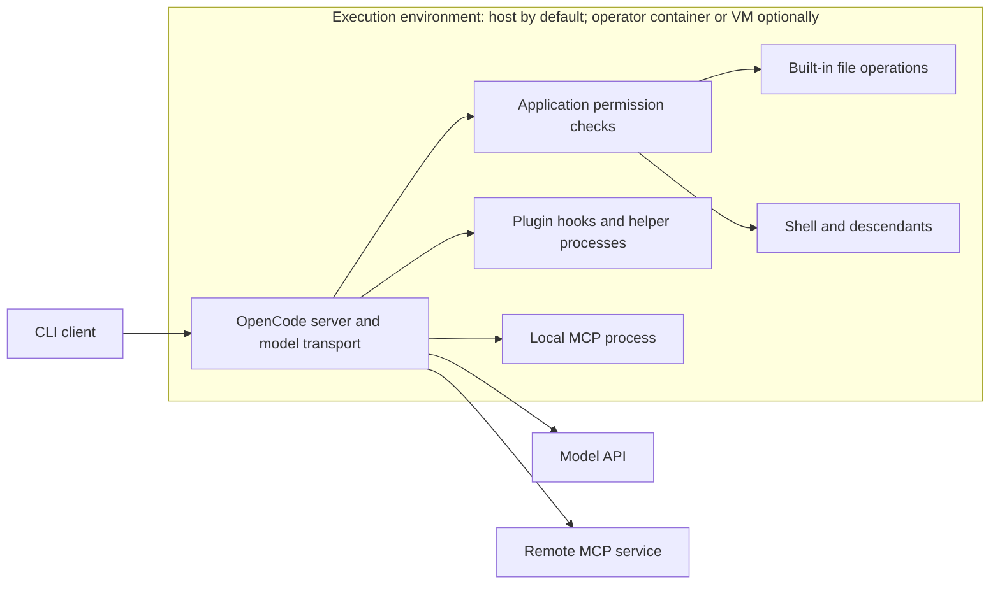

# Sandboxing in OpenCode CLI

OpenCode CLI **does not supply an agent sandbox** in the examined stable release. Its own security policy calls permissions a user-awareness feature rather than security isolation, and recommends running the whole application in a container or VM when isolation is needed. A normal installation runs with the launching user's filesystem, process, environment, and network authority. Permission checks can stop particular tool invocations, but they do not confine the process or everything a permitted command can do. This is a verified upstream design statement, corroborated by execution source, rather than a conclusion drawn from missing documentation. [Security policy, v1.19.5](https://github.com/anomalyco/opencode/blob/v1.19.5/SECURITY.md), [shell execution source](https://github.com/anomalyco/opencode/blob/v1.19.5/packages/opencode/src/tool/shell.ts).

## Scope and evidence

Researched **2026-11-04 UTC**. GitHub's latest-release endpoint returned **v1.19.5**, published **2026-10-28**; its release notes describe a TUI worker error fix, not a sandbox addition. Implementation findings below use that tag's downloaded source archive. Official website documentation was checked on the research date, including its explicit distinctions between OpenCode 1 and OpenCode 2. The report concerns the stable 1.x CLI; 2.x-only policy examples do not establish supported stable behavior. [Release](https://github.com/anomalyco/opencode/releases/tag/v1.19.5), [version-qualified policies documentation](https://opencode.ai/docs/policies/).

Read-only local inspection on macOS found `/Users/ken/.opencode/bin/opencode`, version **1.18.35**. Executed `opencode --version`, `opencode --help`, and `opencode run --help`; these expose `--auto`, `--pure`, server/attach operations, and no sandbox selector. Sniff independently identified the executable/version. No model session, credential inspection, permission-bypass test, or container was launched. Local help corroborates command availability, not runtime containment. Source inspection is not a runtime test on any OS. Clean-install defaults below come from released source, not this user's settings.

## Default protection by platform and session

The ordinary default agent is `build`. Its baseline allows tools, asks about external directories and repeated identical calls (`doom_loop`), and asks before built-in reads matching `*.env` or `*.env.*`; `*.env.example` is allowed. Internal output, application temporary, skill, and reference directories have external-directory exceptions. **Documentation drift:** both the tagged permissions page and the live page describe `.env` reads as denied, but **1.19.5 source says `ask`**. The 1.18.35 tagged agent source agrees with `ask`. This report uses the executable implementation for that default. [Agent defaults](https://github.com/anomalyco/opencode/blob/v1.19.5/packages/opencode/src/agent/agent.ts), [1.18.35 comparison](https://github.com/anomalyco/opencode/blob/v1.18.35/packages/opencode/src/agent/agent.ts), [permissions documentation](https://opencode.ai/docs/permissions/).

| Platform | Interactive default (`opencode`) | Non-interactive default (`opencode run`) | Platform distinction |
| --- | --- | --- | --- |
| macOS | No sandbox; normally allowed tools run immediately; `ask` opens approval UI. | No sandbox; allowed tools run; `ask` is automatically rejected. | No OpenCode Seatbelt/App Sandbox boundary. |
| Linux | Same permissive tool defaults and approval UI; no sandbox. | Same immediate allow / automatic rejection of asks; no sandbox. | No OpenCode namespace, seccomp, Landlock, or container confinement. |
| Native Windows | Same permission model; no sandbox. | Same immediate allow / automatic rejection of asks; no sandbox. | Native execution is supported; there is no OpenCode AppContainer/restricted-token sandbox. |
| WSL2 | Linux CLI permission behavior; no OpenCode sandbox. | Linux CLI behavior, including automatic rejection of asks; no OpenCode sandbox. | WSL is an existing Linux environment, not a boundary created by this CLI; mounted Windows drives remain accessible. |

The no-sandbox finding is platform-independent upstream policy and is corroborated by ordinary shell spawning and direct file access. The session difference is source-derived: `run` answers permission events with `reject` unless auto mode is active. Native Windows support is established independently by upstream Windows documentation and Windows shell execution branches; it is not inferred from WSL support. WSL documentation explicitly demonstrates access through `/mnt/c/`. Ordinary OS permissions, ACLs, and host protections still apply. [Security policy](https://github.com/anomalyco/opencode/blob/v1.19.5/SECURITY.md), [run event handler](https://github.com/anomalyco/opencode/blob/v1.19.5/packages/opencode/src/cli/cmd/run.ts), [native shell implementation](https://github.com/anomalyco/opencode/blob/v1.19.5/packages/opencode/src/tool/shell.ts), [Windows and WSL](https://opencode.ai/docs/windows-wsl/).

First-run setup involves installation and model/provider connection; provider credentials or a usable local model configuration are needed for inference, not for an isolation backend. The documented onboarding has no sandbox-backend selection or restrictive/YOLO security choice. Project configuration and project plugins are loaded through normal discovery; a project-trust prompt must not be assumed. This first-run conclusion is limited to documented onboarding plus the inspected config/plugin paths, not a fresh interactive-install test. [Getting started](https://opencode.ai/docs/), [config loader](https://github.com/anomalyco/opencode/blob/v1.19.5/packages/opencode/src/config/config.ts), [plugin loader](https://github.com/anomalyco/opencode/blob/v1.19.5/packages/opencode/src/plugin/index.ts).

## What the agent can access

### Files, home, credentials, and paths

Built-in `read` resolves paths and calls `external_directory`, then the `read` permission check, before returning file content. Editing uses the same external-path helper and an `edit` permission. Those checks run in the application, while actual I/O uses the host filesystem. There is no mounted workspace with a kernel-enforced writable/read-only split. Permitting reads can disclose their contents to the model even when edits are denied. [Read tool](https://github.com/anomalyco/opencode/blob/v1.19.5/packages/opencode/src/tool/read.ts), [edit tool](https://github.com/anomalyco/opencode/blob/v1.19.5/packages/opencode/src/tool/edit.ts).

The effective internal project boundary includes **the starting directory OR the Git worktree**. Starting in a repository subdirectory does not make its siblings external. Non-Git projects deliberately avoid treating `/` as the workspace. Additional paths can be admitted with `permission.external_directory` patterns, including leading `~` and `$HOME` expansion. This grants a permission exception, not a filesystem mount or confinement rule. The source definition is more precise than the docs' shorthand “working directory.” [Boundary predicate](https://github.com/anomalyco/opencode/blob/v1.19.5/packages/opencode/src/project/instance-context.ts), [external-directory helper](https://github.com/anomalyco/opencode/blob/v1.19.5/packages/opencode/src/tool/external-directory.ts), [pattern expansion](https://github.com/anomalyco/opencode/blob/v1.19.5/packages/opencode/src/permission/index.ts).

Home and credential files are not hidden from the process. Explicit out-of-project file-tool reads normally ask, except approved directories; this is not a comprehensive credential denylist. Shell execution inherits `process.env` plus plugin-provided additions. A permitted interpreter or script therefore retains environmental secrets and host-readable files even if a specialized `read` call would ask. No protected-file or secret-redaction guarantee follows from the `.env` rule. Similarly, there is no private temporary filesystem: application temporary/output directories are host paths, some explicitly allowed by default. [Shell environment](https://github.com/anomalyco/opencode/blob/v1.19.5/packages/opencode/src/tool/shell.ts), [default path exceptions](https://github.com/anomalyco/opencode/blob/v1.19.5/packages/opencode/src/agent/agent.ts).

Symlink handling is not an isolation guarantee. The read path uses the supplied resolved spelling for checks, and the containment helper compares relative paths; it does not establish an immutable, race-resistant mapping to permitted targets. Reads then use ordinary filesystem APIs. Thus an apparent project path should not be treated as proof that its target is confined. This is a source-derived limitation; junction, reparse-point, and symlink behavior were not exercised on the four platforms. [Read path](https://github.com/anomalyco/opencode/blob/v1.19.5/packages/opencode/src/tool/read.ts), [filesystem containment](https://github.com/anomalyco/opencode/blob/v1.19.5/packages/core/src/fs-util.ts).

### Processes and network

The shell tool retains permission key `bash`, including on Windows where the selected shell can be PowerShell or cmd. It parses command syntax, gathers command patterns, and recognizes selected commands' path arguments for external-directory approval. This scan is not syscall mediation: code launched by an allowed command can open other paths, launch children, or connect to the network. The spawn path creates ordinary child processes with the selected shell, cwd, and environment. Detached process groups and timeouts are lifecycle controls, not security isolation. [Shell implementation](https://github.com/anomalyco/opencode/blob/v1.19.5/packages/opencode/src/tool/shell.ts), [stable tool ID](https://github.com/anomalyco/opencode/blob/v1.19.5/packages/opencode/src/tool/shell/id.ts).

There is no default egress firewall or host allowlist. Built-in `webfetch` asks its own permission before using an HTTP client; in OpenCode 1 its configuration accepts only `allow`, `ask`, or `deny`, **not URL-pattern objects**. Disabling that tool does not disable shell HTTP clients, plugins, local MCP networking, or remote MCP connections. Model/API transport is a separate host-side provider operation and is not gated by `permission.webfetch`. The 2.x-only `experimental.policies` provider controls are also not a stable 1.x network sandbox. [Webfetch implementation](https://github.com/anomalyco/opencode/blob/v1.19.5/packages/opencode/src/tool/webfetch.ts), [1.x permission schema](https://github.com/anomalyco/opencode/blob/v1.19.5/packages/core/src/v1/config/permission.ts), [provider transport](https://github.com/anomalyco/opencode/blob/v1.19.5/packages/opencode/src/session/llm.ts), [policy version condition](https://opencode.ai/docs/policies/).

## Which execution surfaces share the limits?

There is no common isolation boundary to inherit:

| Surface | Actual control and execution location |
| --- | --- |
| Built-in file and shell tools | Application permission checks followed by host I/O or host child processes. |
| Subagents | Tool/session permissions, not a separate container. The task path carries parent **session** deny and external-directory rules; parent **agent** restrictions do not automatically become all child restrictions. Child agent permissions matter. |
| Plugin hooks and custom tools | Imported host-runtime code. Hooks can execute commands and change tool inputs/environment; custom tools receive an `ask` API, rather than an OS fence around arbitrary implementation code. |
| Local MCP | Configured command starts through stdio transport with cwd and inherited environment plus configured overrides. Tool-call permission checks do not sandbox server startup or the server's internals. |
| Remote MCP | Executes at the configured service under its own authentication and security controls. OpenCode does not attest or provide that service's isolation. |
| Formatters/LSP and other helpers | Host services invoked by OpenCode; file-tool permission settings do not create an encompassing process boundary. |

These are source-derived conclusions from [subagent permission derivation](https://github.com/anomalyco/opencode/blob/v1.19.5/packages/opencode/src/agent/subagent-permissions.ts), [custom-tool adapter](https://github.com/anomalyco/opencode/blob/v1.19.5/packages/opencode/src/tool/registry.ts), [plugin runtime](https://github.com/anomalyco/opencode/blob/v1.19.5/packages/opencode/src/plugin/index.ts), [MCP startup](https://github.com/anomalyco/opencode/blob/v1.19.5/packages/opencode/src/mcp/index.ts), [MCP call gating](https://github.com/anomalyco/opencode/blob/v1.19.5/packages/opencode/src/session/tools.ts), and [read-triggered LSP warm-up](https://github.com/anomalyco/opencode/blob/v1.19.5/packages/opencode/src/tool/read.ts). Upstream explicitly places configured MCP server behavior outside its trust boundary. [Security policy](https://github.com/anomalyco/opencode/blob/v1.19.5/SECURITY.md).

## Changing guardrails and handling failures

Configure `permission` in `opencode.json`/`opencode.jsonc` globally or per project. Values are `allow`, `ask`, and `deny`; ordered wildcard rules use the last match. Agent-specific rules under `agent.<name>.permission` override the agent's merged defaults. The legacy `tools` boolean settings remain compatibility input, mapped to permissions, with explicit permissions winning. [Permission evaluator](https://github.com/anomalyco/opencode/blob/v1.19.5/packages/opencode/src/permission/index.ts), [config normalization](https://github.com/anomalyco/opencode/blob/v1.19.5/packages/opencode/src/config/config.ts).

For example, this deliberately narrow built-in-tool profile permits reads and asks before shell execution while refusing edits and built-in network tools:

```json
{
  "$schema": "https://opencode.ai/config.json",
  "permission": {
    "*": "deny",
    "read": "allow",
    "bash": "ask",
    "external_directory": {
      "*": "deny",
      "~/shared/reference/*": "allow"
    },
    "edit": "deny",
    "webfetch": "deny",
    "websearch": "deny"
  }
}
```

The explicit `read: allow` replaces the built-in sensitive-name defaults for this permission; add `.env` patterns if needed. Shell approval still permits that command's actual capabilities. This profile does not constrain plugin startup, MCP startup, or model transport. For a headless run, `ask` will reject; select narrowly allowed commands in advance if they must run unattended. [Agent merge order](https://github.com/anomalyco/opencode/blob/v1.19.5/packages/opencode/src/agent/agent.ts), [run handler](https://github.com/anomalyco/opencode/blob/v1.19.5/packages/opencode/src/cli/cmd/run.ts).

The inspected config loader's low-to-high order is: authenticated `.well-known/opencode` defaults; global config; `OPENCODE_CONFIG`; project config; `.opencode`/`OPENCODE_CONFIG_DIR` content; `OPENCODE_CONFIG_CONTENT`; active account/organization config when present; system managed config; macOS managed preferences. **Then `OPENCODE_PERMISSION` JSON is merged into permissions.** Managed-config documentation describes its layer as overriding user/project settings, but this late environment merge and subsequent agent-specific overrides mean administrators should not interpret it as tamper-proof enforcement against a user who controls launch/configuration. Invalid `OPENCODE_PERMISSION` JSON logs a warning and is skipped, not fail-closed. [Config load sequence](https://github.com/anomalyco/opencode/blob/v1.19.5/packages/opencode/src/config/config.ts).

Managed files are `opencode.json` or `opencode.jsonc` under `/Library/Application Support/opencode` on macOS, `/etc/opencode` on Linux/WSL, and `%ProgramData%\opencode` on Windows. macOS additionally reads `ai.opencode.managed.plist`, preferring `/Library/Managed Preferences/<user>/` before `/Library/Managed Preferences/`. These provide deployment/configuration control, not a new sandbox. The source also exposes `OPENCODE_TEST_MANAGED_CONFIG_DIR` as a test override, not a production security boundary. [Managed settings implementation](https://github.com/anomalyco/opencode/blob/v1.19.5/packages/opencode/src/config/managed.ts).

Useful launch examples (POSIX syntax; PowerShell uses `$env:NAME` assignments):

```sh
# An explicit config file, still merged with other applicable layers.
OPENCODE_CONFIG=/absolute/path/review.json opencode run 'Review the changes'

# Runtime permission override; still a tool guard, not confinement.
OPENCODE_PERMISSION='{"bash":"deny","edit":"deny"}' opencode run 'Explain the code'

# Avoid external plugins; this does not isolate built-ins or configured MCP.
opencode --pure

# Approve asks automatically, preserving explicit deny rules.
opencode run --auto 'Run the requested checks'
```

`OPENCODE_CONFIG_DIR` chooses an additional configuration directory; `OPENCODE_CONFIG_CONTENT` supplies inline JSON; `OPENCODE_DISABLE_PROJECT_CONFIG=true` skips project config discovery. `--pure`/`OPENCODE_PURE=true` suppress external plugins. None changes filesystem/process authority. [Config flags](https://github.com/anomalyco/opencode/blob/v1.19.5/packages/core/src/flag/flag.ts), [runtime flags](https://github.com/anomalyco/opencode/blob/v1.19.5/packages/opencode/src/effect/runtime-flags.ts), [plugin loader](https://github.com/anomalyco/opencode/blob/v1.19.5/packages/opencode/src/plugin/index.ts).

An explicit denied request fails in the permission service before executing that checked action. Rejection fails a pending request; interactive approval offers `once`, `always`, or rejection. Documentation describes `always` as lasting for the current session; source stores approvals in live instance state rather than a permanent policy file, so it should not be read as durable configuration or assumed to be a strict per-conversation security scope. Bare `serve` has no approval UI: requests wait for a client reply; ordinary `run` supplies the automatic rejection behavior described above. There is no sandbox-backend startup, unavailable-backend fallback, privilege-escalation protocol, or automatic retry outside confinement because execution was already on the host. A model might try another allowed tool; permission denial is not a global prohibition on equivalent effects. [Permission service](https://github.com/anomalyco/opencode/blob/v1.19.5/packages/opencode/src/permission/index.ts), [run client](https://github.com/anomalyco/opencode/blob/v1.19.5/packages/opencode/src/cli/cmd/run.ts).

`--auto` is false by default. In 1.19.5, hidden compatibility flags `--yolo` and `--dangerously-skip-permissions` on `run` feed the same auto boolean. They approve requests that reached `ask`, while explicit `deny` is evaluated earlier. They do not disable a sandbox or grant OS privileges. `permission: "allow"` is a broader configuration override that can replace permission restrictions. Plan mode likewise changes tool permissions and prompting; it is not an OS-enforced read-only environment, and its source includes allowed plan-file edits and user overrides. [Auto aliases](https://github.com/anomalyco/opencode/blob/v1.19.5/packages/opencode/src/cli/cmd/run.ts), [deny evaluation](https://github.com/anomalyco/opencode/blob/v1.19.5/packages/opencode/src/permission/index.ts), [plan agent](https://github.com/anomalyco/opencode/blob/v1.19.5/packages/opencode/src/agent/agent.ts).

## Optional isolation and officially supported integrations

**Whole-CLI Docker deployment.** The official installation page supplies `docker run -it --rm ghcr.io/anomalyco/opencode`; the repository's CLI Dockerfile packages the Linux executable in Alpine with runtime libraries and ripgrep. This contains the CLI and its ordinary local descendants within the container environment, subject to Docker's runtime configuration. It is a separate installation/deployment choice requiring a working Docker engine and a compatible Linux-container environment, not a CLI setting that turns on a per-tool sandbox. The image declares no `USER`, so it does not itself establish a non-root application identity. Host mount permissions, credentials, Docker socket exposure, and networking must be chosen by the operator. OpenCode supplies no documented secure mount/network profile. No OpenCode paid account is required merely to run the image; model-provider access is separate. [Official Docker installation](https://opencode.ai/docs/), [CLI Dockerfile](https://github.com/anomalyco/opencode/blob/v1.19.5/packages/opencode/Dockerfile).

**Remote server and GitHub integration.** `opencode serve` plus `opencode run --attach <url>` separates the client from the machine executing tools. If the server is inside an operator-provided VM/container, that environment can contain the agent; merely moving it to another host provides no sandbox there. Set `OPENCODE_SERVER_PASSWORD` for HTTP Basic authentication (optional `OPENCODE_SERVER_USERNAME`); this protects server access, not outbound egress or filesystem access. The official GitHub integration executes within the chosen Actions runner, requiring a repository workflow, GitHub authorization, and model access; the standard setup installs the OpenCode GitHub app, with a documented caller-token alternative. Runner isolation comes from the runner environment and its exposed secrets/resources, not a new OpenCode tool boundary. [CLI server/attach documentation](https://opencode.ai/docs/cli/), [server security](https://github.com/anomalyco/opencode/blob/v1.19.5/SECURITY.md), [GitHub integration](https://opencode.ai/docs/github/).



The box denotes where execution happens, **not a sandbox supplied by OpenCode**. A container around only one MCP server contains that server, not built-in shell/file tools or the agent. The upstream `sandboxes` project/worktree terminology also does not establish an OS boundary: the implementation adds Git worktree directories to a project list. The experimental workspace adapter registry ships only a `worktree` adapter, which returns a local directory target; plugins may register other adapters, but the registry supplies no built-in container or VM backend. [Worktree implementation](https://github.com/anomalyco/opencode/blob/v1.19.5/packages/opencode/src/worktree/index.ts), [adapter registry](https://github.com/anomalyco/opencode/blob/v1.19.5/packages/opencode/src/control-plane/adapters/index.ts), [local target](https://github.com/anomalyco/opencode/blob/v1.19.5/packages/opencode/src/control-plane/adapters/worktree.ts).

**Experimental CodeMode is narrower still.** `OPENCODE_EXPERIMENTAL_CODE_MODE=true` (also enabled by the broad `OPENCODE_EXPERIMENTAL` switch unless specifically overridden) adds an `execute` tool backed by the repository's restricted JavaScript interpreter. Programs lack ambient process/filesystem/network/module authority and call only supplied host tools. Those tools retain their own authority and permission checks. This is an interpreter capability boundary for orchestration code, not an agent, shell, plugin, or MCP process sandbox; the structured agent-sandbox mechanism inventory therefore remains empty. It needs no external OS backend. Its runtime/isolation claims here are source-derived, not adversarially tested. [Flag and default](https://github.com/anomalyco/opencode/blob/v1.19.5/packages/opencode/src/effect/runtime-flags.ts), [CLI adapter](https://github.com/anomalyco/opencode/blob/v1.19.5/packages/opencode/src/tool/code-mode.ts), [CodeMode contract](https://github.com/anomalyco/opencode/blob/v1.19.5/packages/codemode/README.md).

## Remaining checks

No unresolved finding changes the established absence of a stable agent sandbox. Remaining runtime questions are narrower: repeat clean-profile first-run and harmless permission fixtures on macOS, Linux, native Windows, and WSL2; exercise symlink/junction reads with sentinel files; verify managed-settings precedence using synthetic settings and `OPENCODE_PERMISSION`; and test the official image's user, mounts, network, and MCP behavior under an explicitly recorded Docker configuration. These checks would corroborate implementation-derived behavior, not turn permissions into isolation. A future 2.x release requires a separate review rather than importing current 2.x-only documentation into these defaults.

## Changelog

- **2026-11-04:** Initial research against stable 1.19.5 and local 1.18.35 help. Established no built-in agent sandbox; distinguished optional whole-process deployments and CodeMode; recorded `.env` documentation drift, headless rejection, and managed-settings precedence limitations.
