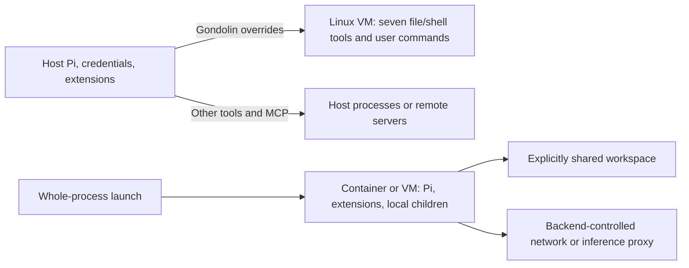

# Sandboxing in Pi

Pi has **no built-in OS sandbox enabled by a normal installation**. Its default tools read, write, and execute with the permissions of the account running Pi, without per-call approval. Project trust gates loading project resources; it does not confine tool actions. This is an explicit documented limitation, corroborated by direct filesystem calls and child-process spawning in source, rather than a conclusion based on missing documentation. [Security guide](https://pi.dev/docs/latest/security), [read implementation](https://github.com/earendil-works/pi/blob/707888ece685778881c40d232880c5a0b93a12f1/packages/coding-agent/src/core/tools/read.ts), [Bash implementation](https://github.com/earendil-works/pi/blob/707888ece685778881c40d232880c5a0b93a12f1/packages/coding-agent/src/core/tools/bash.ts).

## Scope and evidence

Researched on **2026-11-04 UTC**, starting at [pi.dev](https://pi.dev/). Current documentation and the **1.5.0 release dated 2026-11-02** were checked against upstream commit `707888ece685778881c40d232880c5a0b93a12f1` (2026-11-04). That checkout identifies its package as 1.5.0 but also contains unreleased changes; source-derived statements below refer to that exact commit. The locally installed macOS binary at `/Users/ken/.bun/bin/pi` returned **1.4.0** from `pi --version`; `pi --help` corroborated tool-selection, trust, extension, MCP, print/RPC, and offline flags. No local settings or secrets were read, no model was called, and no sandbox was launched. Source inspection is not runtime validation. [Package manifest](https://github.com/earendil-works/pi/blob/707888ece685778881c40d232880c5a0b93a12f1/packages/coding-agent/package.json), [release history](https://github.com/earendil-works/pi/blob/707888ece685778881c40d232880c5a0b93a12f1/packages/coding-agent/CHANGELOG.md).

The version distinction matters: 1.5.0 **removed** the native OS `sandbox/` extension example and its dependency. Current guidance recommends isolated environments or Gondolin instead. The legacy example remains relevant to the observed 1.4.0 installation, but was optional there too. [1.5.0 changelog](https://pi.dev/changelog).

For a normal npm installation, current Pi requires Node.js **22.19.0 or newer**; the macOS, Linux, and Windows installers can install Node if needed. This is separate from Gondolin's higher runtime requirement. Normal npm installation does not require dependency lifecycle scripts. [Pinned package requirements](https://github.com/earendil-works/pi/blob/707888ece685778881c40d232880c5a0b93a12f1/packages/coding-agent/package.json), [installation overview](https://github.com/earendil-works/pi/blob/707888ece685778881c40d232880c5a0b93a12f1/packages/coding-agent/README.md).

## Clean-install defaults across platforms

| Platform | Interactive session | Non-interactive print, JSON, or RPC session | Platform prerequisite/difference |
|---|---|---|---|
| macOS | No OS sandbox; project-resource trust prompt when needed | No OS sandbox; unresolved project trust skips protected resources | Local shell; no automatic Seatbelt boundary |
| Linux | Same default and trust prompt | Same default and trust skipping | Local shell; no automatic namespaces, seccomp, or Landlock boundary |
| Native Windows | Same default and trust prompt | Same default and trust skipping | Git Bash normally required; optional native `powershell` tool |
| WSL2 | Same default and trust prompt | Same default and trust skipping | Linux process inside the chosen distribution; WSL2 is not a Pi sandbox |

These are documented/source-derived defaults, not four-platform execution results. The enabled default tools are `read`, `bash`, `edit`, and `write`. On native Windows, Pi discovers Git Bash in configured `shellPath`, standard Git installation locations, then `PATH`. The optional PowerShell tool runs with `-NoProfile -NonInteractive -ExecutionPolicy Bypass`, subject to administrator-enforced policies. WSL uses Linux tools; native Windows support is documented independently. WSL-accessible Windows mounts remain available to commands under the surrounding system's permissions. [CLI tools](https://github.com/earendil-works/pi/blob/707888ece685778881c40d232880c5a0b93a12f1/packages/coding-agent/docs/cli.md#tools), [Windows guide](https://pi.dev/docs/latest/windows).

On first use of a folder with protected project resources, the default trust setting is `ask`. Interactive users can make a session-only or saved decision; a bare `.pi` directory does not trigger the question. Without an existing decision or override, headless `ask` skips those resources rather than blocking on stdin. Declining trust does **not** turn the session into a read-only or network-restricted session. See the trust resolver and its [choice definitions](https://github.com/earendil-works/pi/blob/707888ece685778881c40d232880c5a0b93a12f1/packages/coding-agent/src/core/trust-manager.ts).

## What the default process can access

The working directory supplies a base for relative paths, not a filesystem jail. File tools accept absolute paths and home expansion; relative `..` paths are resolved normally. Reads and writes use Node filesystem APIs. There is no Pi workspace allowlist, additional-directory permission grant, or special protection for home, credentials, temporary files, `.git`, or Pi configuration. Existing OS permissions still apply. Symlinks are followed by ordinary file operations; the resolver does not enforce real-path containment within the workspace. These are source-derived conclusions from [path utilities](https://github.com/earendil-works/pi/blob/707888ece685778881c40d232880c5a0b93a12f1/packages/coding-agent/src/core/tools/path-utils.ts), [path resolution](https://github.com/earendil-works/pi/blob/707888ece685778881c40d232880c5a0b93a12f1/packages/coding-agent/src/utils/paths.ts), [write](https://github.com/earendil-works/pi/blob/707888ece685778881c40d232880c5a0b93a12f1/packages/coding-agent/src/core/tools/write.ts), and [edit](https://github.com/earendil-works/pi/blob/707888ece685778881c40d232880c5a0b93a12f1/packages/coding-agent/src/core/tools/edit.ts).

Shell tools spawn processes with a normal inherited environment plus Pi session metadata. They can execute installed programs and use available network services. File-based API keys/OAuth credentials normally reside in `<agent-dir>/auth.json`; changing `PI_CODING_AGENT_DIR` relocates that directory but does not restrict access to the old or new location. A read-only tool selection can still disclose readable credentials to the model; write protection does not establish confidentiality. [Configuration paths](https://github.com/earendil-works/pi/blob/707888ece685778881c40d232880c5a0b93a12f1/packages/coding-agent/docs/configuration.md), [shell environment](https://github.com/earendil-works/pi/blob/707888ece685778881c40d232880c5a0b93a12f1/packages/coding-agent/src/core/tools/bash.ts).

Pi supplies no default tool-network domain policy. `--offline`/`PI_OFFLINE=1` disables startup/automatic network work, including catalog refreshes; it is not a firewall for shell commands, extensions, MCP, or model requests. Model/API transport originates from the Pi process, independently of any tool-only isolation. A cloud model needs its provider's API key or supported OAuth account; local compatible endpoints are also possible. No separate Pi sandbox account is required for direct execution. [Environment reference](https://github.com/earendil-works/pi/blob/707888ece685778881c40d232880c5a0b93a12f1/packages/coding-agent/docs/environment-variables.md), [provider setup](https://pi.dev/docs/latest/providers).

## Actual guardrails and their configuration

User settings live in `~/.pi/agent/settings.json` (relocatable with `PI_CODING_AGENT_DIR`); trusted `.pi/settings.json` overrides ordinary user settings, while resource lists combine. `defaultProjectTrust` is user-level only. Trust decision precedence is CLI override, first deciding user/CLI extension's `project_trust` handler, nearest saved canonical directory/ancestor decision in `<agent-dir>/trust.json`, then `defaultProjectTrust` (`ask`, `always`, `never`). `/trust` saves decisions. Trust protects project settings, MCP configuration, extensions, skills, prompts, themes, and system-prompt resources. Context files such as `AGENTS.md` still load unless disabled. Pi reads project `sessionDir` before resolving trust, an explicit exception. [Configuration guide](https://pi.dev/docs/latest/configuration), [trust resolver](https://github.com/earendil-works/pi/blob/707888ece685778881c40d232880c5a0b93a12f1/packages/coding-agent/src/core/project-trust.ts).

For example, these are separate controls:

```sh
# Skip trust-gated project resources for this run.
pi --no-approve -p "Review this project"

# Reduce exposed model tools and remove extension/MCP/context loading.
pi --no-extensions --no-mcp --no-context-files --no-skills \
  --tools read,grep,find,ls -p "Review src"

# Explicitly trust project resources for one automated invocation.
pi --approve -p "Run the tests"
```

`--approve` (`-a`) and `--no-approve` (`-na`) control project loading, not per-command approval. There is no core YOLO or sandbox-bypass switch in the examined CLI. `--tools` replaces tool selection; lists containing only `+name`/`-name` modify defaults instead. `--exclude-tools` applies last. Crucially, ordinary `--tools read,...` selections retain MCP reach unless entries begin with `mcp__`; use `--no-mcp` or exclude `mcp__*` explicitly. `--no-tools` disables all model tools initially, but does not sandbox extension initialization. `--no-extensions` still permits explicit `-e` paths. These are configurable exposure controls, not administrator-enforced isolation. [CLI reference](https://pi.dev/docs/latest/cli).

Extensions can implement approvals through `tool_call` events. The official `permission-gate.ts` example checks selected dangerous Bash patterns, asks through the UI, and blocks matching calls when there is no UI. It is neither installed automatically nor a complete command-security policy. Plan-mode extensions likewise change available tools/workflow rather than OS permissions. Pi has no core administrator-managed sandbox policy; administrator controls belong to the host or a selected external backend. [Permission-gate source](https://github.com/earendil-works/pi/blob/707888ece685778881c40d232880c5a0b93a12f1/packages/coding-agent/examples/extensions/permission-gate.ts), [plan-mode example](https://github.com/earendil-works/pi/tree/707888ece685778881c40d232880c5a0b93a12f1/packages/coding-agent/examples/extensions/plan-mode).

The ordinary `shellPath` setting chooses a shell executable; `shellCommandPrefix` prepends text to shell commands. Neither restricts file tools or extension code. For example, `{"shellPath":"/bin/bash","shellCommandPrefix":"set -o pipefail;"}` changes shell behavior without adding containment. [Shell settings](https://github.com/earendil-works/pi/blob/707888ece685778881c40d232880c5a0b93a12f1/packages/coding-agent/docs/settings.md#shell-and-updates).

## Which execution surfaces share a boundary?

| Surface | Normal installation | With Gondolin example | Entire Pi inside container/VM |
|---|---|---|---|
| Bash and user `!` commands | Host permissions | Routed into VM | Inside selected environment |
| `read`, `write`, `edit`, `grep`, `find`, `ls` | Host filesystem | Replaced by VM-backed operations | Inside selected environment |
| Optional native PowerShell | Host permissions | Not replaced by this example | Depends on workload OS; Linux images do not supply native Windows tool |
| Extensions and event hooks | Host, in Pi process | Still host; custom tools can bypass VM | Inside environment if loaded there |
| Subagent extension/SDK sessions | No automatic OS isolation | No automatic inheritance of routing | Children launched inside remain inside; external services keep their own boundary |
| MCP | Local stdio servers use local process permissions; HTTP servers execute remotely | Not intercepted by Gondolin overrides | Local child servers inside, except explicit host gateways; remote servers remain external |

Pi's extension subagent example spawns another Pi process and can choose its working directory/tools; it is not an OS sandbox. A parent tool wrapper is not automatically applied to that new process. [Subagent implementation](https://github.com/earendil-works/pi/blob/707888ece685778881c40d232880c5a0b93a12f1/packages/coding-agent/examples/extensions/subagent/index.ts). MCP is now built in: user `<agent-dir>/mcp.json` and trusted project `.pi/mcp.json` define stdio or HTTP servers; project entries override same-name user entries. Configuration can execute commands to resolve credentials. These commands and extension hooks retain the Pi process's privileges unless the whole process is isolated. [MCP reference](https://github.com/earendil-works/pi/blob/707888ece685778881c40d232880c5a0b93a12f1/packages/coding-agent/docs/mcp.md).

Codemode is a separate, narrow language-runtime boundary. It is off as an active tool by default, though MCP can activate it. `pi --tools +codemode` enables it explicitly. Its QuickJS scripts lack Node APIs, direct filesystem/network access, and timers, but can call session tools and credential-backed `models` APIs. Delegation therefore preserves those tools' existing host access; it does not isolate the agent. The script has a 256 MB limit, optional `timeout_ms`, and a default two-worker process-wide limit (`PI_CODEMODE_MAX_WORKERS`). Failures do not undo completed tool effects. [Codemode contract](https://github.com/earendil-works/pi/blob/707888ece685778881c40d232880c5a0b93a12f1/packages/coding-agent/docs/codemode.md), [worker implementation](https://github.com/earendil-works/pi/blob/707888ece685778881c40d232880c5a0b93a12f1/packages/coding-agent/src/extensions/codemode/worker.ts).

## Officially documented optional isolation

These are opt-in launch environments and an official extension example, not a clean-install sandbox mode or built-in `--sandbox` flag. Their policies are configured outside Pi. [Pi isolation guide](https://pi.dev/docs/latest/containerization).



### Plain Docker

The official recipe builds a Linux image from `node:24-bookworm-slim`, installs Bash, Git, ripgrep and Pi, and starts the whole process inside a container. It needs a functioning Linux-container runtime; this is not a native Windows container recipe. Host filesystem exposure is determined by mounts. For a prepared `pi-sandbox` image, a headless adaptation of the documented launch is:

```sh
docker run --rm -e ANTHROPIC_API_KEY \
  -v "$PWD:/workspace" -v pi-agent-home:/root/.pi/agent \
  pi-sandbox -p "Review this project"
```

The workspace is writable through to the host. Add `:ro` to make that mount read-only, or copy files instead. The named agent-home volume avoids mounting host credentials, but the passed API key is readable inside the container. Plain Docker's recipe supplies no Pi-specific egress allowlist or credential proxy. Network and mount restrictions must come from runtime configuration; a read-only mount still discloses its contents. [Pinned Docker recipe](https://github.com/earendil-works/pi/blob/707888ece685778881c40d232880c5a0b93a12f1/packages/coding-agent/docs/containerization.md#run-pi-in-plain-docker).

Docker supplies Linux namespaces, network separation, and cgroups; it does not turn every outbound destination into an approval decision. Docker Desktop makes Linux containers usable from Windows terminals and WSL2 distributions; its WSL backend requires WSL 2.1.5 or newer and enabled distribution integration. Thus a Windows-hosted Linux container is distinct from sandboxing Pi as a native Windows process. On macOS, the recipe likewise requires a Linux-container runtime rather than a Pi-specific macOS sandbox. [Docker isolation](https://docs.docker.com/engine/security/), [Windows and WSL2 integration](https://docs.docker.com/desktop/features/wsl/).

### Docker Sandboxes

Pi documents `sbx run --kit "docker.io/sbx/pi-kit:latest" pi`, and `sbx exec <sandbox-name> -- pi -p "list the failing tests"` for headless use. This contains the whole agent in a microVM. The current `sbx` installer requires macOS 14+ on Apple silicon, Windows 11 x64 with Windows Hypervisor Platform, or Ubuntu 24.04+ with KVM for local execution; WSL2 is not separately established by that support list. Docker sign-in is required. Local compute is free, cloud compute uses a paid subscription, and centralized governance is separately paid. [Installation](https://docs.docker.com/ai/sandboxes/install/), [service/account scope](https://docs.docker.com/ai/sandboxes/).

The host proxy can substitute real provider credentials into allowed requests, leaving placeholders inside. Pi warns against `/login` inside the VM because that stores a real credential there. Anthropic API-key setup uses `sbx secret set anthropic`; Claude Pro/Max token setup requires Claude Code's `claude setup-token` and the documented `sbx secret set-custom --host api.anthropic.com --env ANTHROPIC_OAUTH_TOKEN --placeholder 'sk-ant-oat01-{rand}'`. This is a provider-specific option, not a universal Claude subscription requirement. [Pi kit setup](https://github.com/docker/sbx-kits-contrib/tree/main/pi).

Direct workspace mounts remain writable. The proxy governs tool and agent egress, including model transport; default destination rules include broad wildcards. Inspect `sbx policy ls`; organizations can centrally manage filesystem, network, and MCP policies. A major exception is the host MCP gateway: local stdio MCP servers registered there execute **on the host**, outside the VM. SSH-agent forwarding can grant signing operations without exposing private-key bytes. Neither feature should be mistaken for inaccessible host credentials. [Docker security model](https://docs.docker.com/ai/sandboxes/security/).

Docker Sandboxes also offers clone mode, which shares the original repository read-only while Pi works on a private clone, and a mountless mode. These alternatives change host write exposure rather than merely asking Pi to avoid writes. [Workspace isolation](https://docs.docker.com/ai/sandboxes/security/#trust-boundaries).

### OpenShell

Pi's guide selects an active gateway with `openshell gateway add <gateway-url> --name <name>` and `openshell gateway select <name>`, then launches `openshell sandbox create --name pi-sandbox --from pi -- pi`. Remote gateways do not automatically mount the local project: use `sandbox upload`/`download` or clone inside. Inference routing can keep raw provider keys outside, with Pi pointed at the gateway's compatible endpoint. [Pi OpenShell recipe](https://github.com/earendil-works/pi/blob/707888ece685778881c40d232880c5a0b93a12f1/packages/coding-agent/docs/containerization.md#run-pi-with-openshell).

OpenShell v0.1.7 documents Linux and Apple-silicon macOS support, experimental WSL2 support, and separate native Windows work on a `windows` branch. Do not equate that branch with a validated native Windows Pi recipe. Linux workloads require Landlock ABI 3+ and specific seccomp user-notification capabilities; Docker-backed setups require Docker 28+, with Podman, Kubernetes, and microVM alternatives. The selected gateway owns policies. Denied network requests can yield proposals reviewed using `openshell rule get`, `rule approve`, or `rule reject`; approval updates policy so the sandboxed operation can retry, rather than rerunning on the host. No separate Pi account is required; backend provisioning and model credentials remain necessary. [Support matrix](https://docs.nvidia.com/openshell/latest/about/support-matrix), [policy denial workflow](https://docs.nvidia.com/openshell/latest/about/run-your-first-agent).

### Gondolin tool-routing extension

The official example requires Node.js **23.6+**, QEMU, and installation of the example's dependencies. Copy `packages/coding-agent/examples/extensions/gondolin` from a source checkout into `~/.pi/agent/extensions/gondolin`, run `npm install --ignore-scripts` there, and launch `pi -e ~/.pi/agent/extensions/gondolin` from the desired workspace. Gondolin documents macOS and Linux; native Windows and WSL2 operation of this specific example remain unverified. First use can download roughly 200 MB or more of guest assets. [Example source and requirements](https://github.com/earendil-works/pi/blob/707888ece685778881c40d232880c5a0b93a12f1/packages/coding-agent/examples/extensions/gondolin/index.ts), [Gondolin prerequisites](https://github.com/earendil-works/gondolin#readme).

The extension mounts the host working folder through `RealFSProvider` at `/workspace`, replaces seven tools, and routes user shell commands into a Linux microVM. It forwards the shell environment, including any API keys, so file-based host credential separation is not environment-secret protection. Pi's model connection and unrelated extensions/MCP stay outside. VM startup/tool errors propagate through `ensureVm`; the replacement executors do not retry the operation using their original local implementations. Extension-load failure still requires operator attention: source inspection of the tool executor is not proof that every startup error terminates the CLI. [Gondolin routing implementation](https://github.com/earendil-works/pi/blob/707888ece685778881c40d232880c5a0b93a12f1/packages/coding-agent/examples/extensions/gondolin/index.ts).

The example supplies no custom domain allowlist or secret-injection hooks. Gondolin mediates HTTP/TLS rather than providing raw host NAT, blocks internal IP ranges by default, and has programmable filesystem/network policy. These backend capabilities should not be confused with a configured Pi destination allowlist. Workspace symlink behavior and backend-version-specific defaults need separate validation before claiming full confidentiality. [Gondolin security design](https://earendil-works.github.io/gondolin/security/), [VFS providers](https://earendil-works.github.io/gondolin/vfs/).

## Legacy 1.4.0 native sandbox example and failure behavior

The versioned example used `@anthropic-ai/sandbox-runtime`, documented macOS `sandbox-exec` and Linux bubblewrap, and required bubblewrap, socat, and ripgrep on Linux. It replaced Bash and user shell execution only; file tools, Pi, extensions, and MCP remained outside. It was never enabled by installing Pi alone. [1.4.0 example](https://github.com/earendil-works/pi/blob/v1.4.0/packages/coding-agent/examples/extensions/sandbox/index.ts).

Its precedence was built-in defaults, `<agent-dir>/extensions/sandbox.json`, then `<cwd>/.pi/sandbox.json`; nested network/filesystem objects merge but individual arrays replace. Defaults allowed writes to `.` and `/tmp`, denied reads of `~/.ssh`, `~/.aws`, `~/.gnupg`, denied writes matching `.env`, `.env.*`, `*.pem`, `*.key`, and allowed selected npm/PyPI/GitHub domains. This did not mean all credential files were unreadable. `enabled: false` or extension-defined `--no-sandbox` disabled it. Unsupported platforms and initialization errors emitted notifications and left the replacement Bash using the original **unsandboxed** executor, with no approval requirement. That fallback is present in source regardless of session UI availability. This is a verified fail-open path, not an inference about all sandbox backends. [Versioned configuration and initialization code](https://github.com/earendil-works/pi/blob/v1.4.0/packages/coding-agent/examples/extensions/sandbox/index.ts).

In current direct Pi, OS denial returns file/shell errors; there is no built-in escalation broker or automatic sandbox-to-host retry because there is no default sandbox to escape. With external isolation, backend availability, denials, and policy changes belong to that backend. Pi approval flags cannot remove a container/VM boundary. Conversely, loading a host-capable extension or an explicit host MCP integration creates access outside a tool-only boundary without requiring a sandbox escalation prompt. [Tool error paths](https://github.com/earendil-works/pi/blob/707888ece685778881c40d232880c5a0b93a12f1/packages/coding-agent/src/core/tools/write.ts), [extension execution model](https://github.com/earendil-works/pi/blob/707888ece685778881c40d232880c5a0b93a12f1/packages/coding-agent/docs/extensions.md).

## Unresolved checks

No containment probes were run. To establish runtime guarantees, pin the Pi and backend versions, use disposable marker files inside/outside the workspace (including symlink targets), test file tools separately from Bash and MCP, verify environment-secret visibility without real secrets, and check egress separately from model transport. Remove a required backend executable to test startup failure in print and RPC modes. These checks would settle Gondolin symlink confinement, extension-load failure behavior, and platform-specific operation; absence of default Pi isolation is already established by documentation and source. Docker Sandboxes WSL2 support and Gondolin native Windows/WSL2 support need explicit upstream confirmation plus a supported-host launch. OpenShell's current Pi image alias and headless launch should be verified against a pinned gateway release; its separate native Windows branch needs its own Pi test.

The structured `mechanisms` below records OS/container/VM isolation, including optional integrations and the version-limited legacy example. QuickJS is described in prose and controls as a restricted scripting runtime, because revision 5's mechanism categories do not represent language-runtime isolation. Its presence does not change the eight unsandboxed clean-install profiles. External-backend failure behavior is left unknown where Pi documentation/source does not establish a complete launch guarantee.

## Changelog

- **2026-11-04:** Initial report. Established unsandboxed clean-install defaults, separated trust/tool exposure and QuickJS from OS isolation, documented current official integration paths, and identified the removed 1.4.0 example's unsandboxed initialization fallback.
