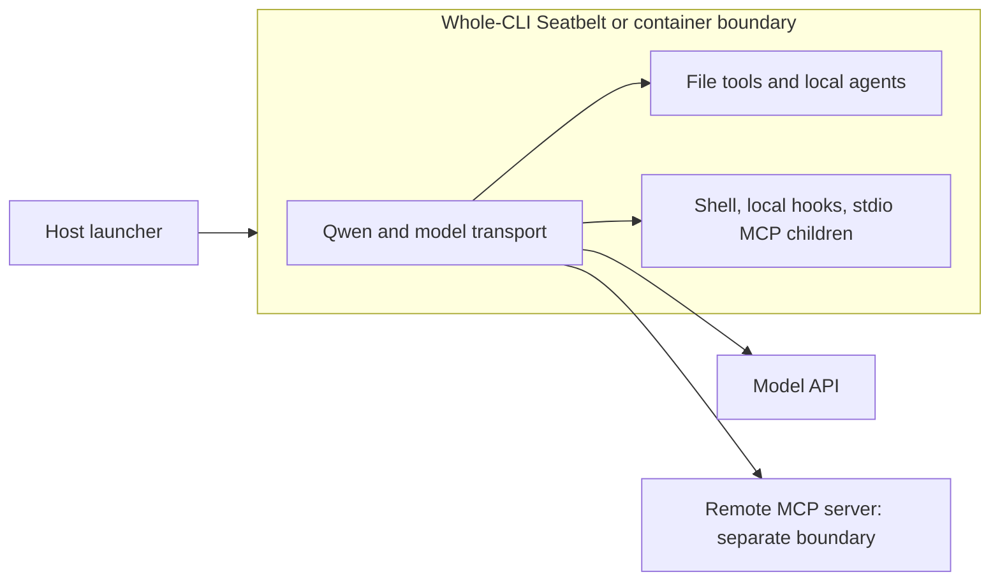
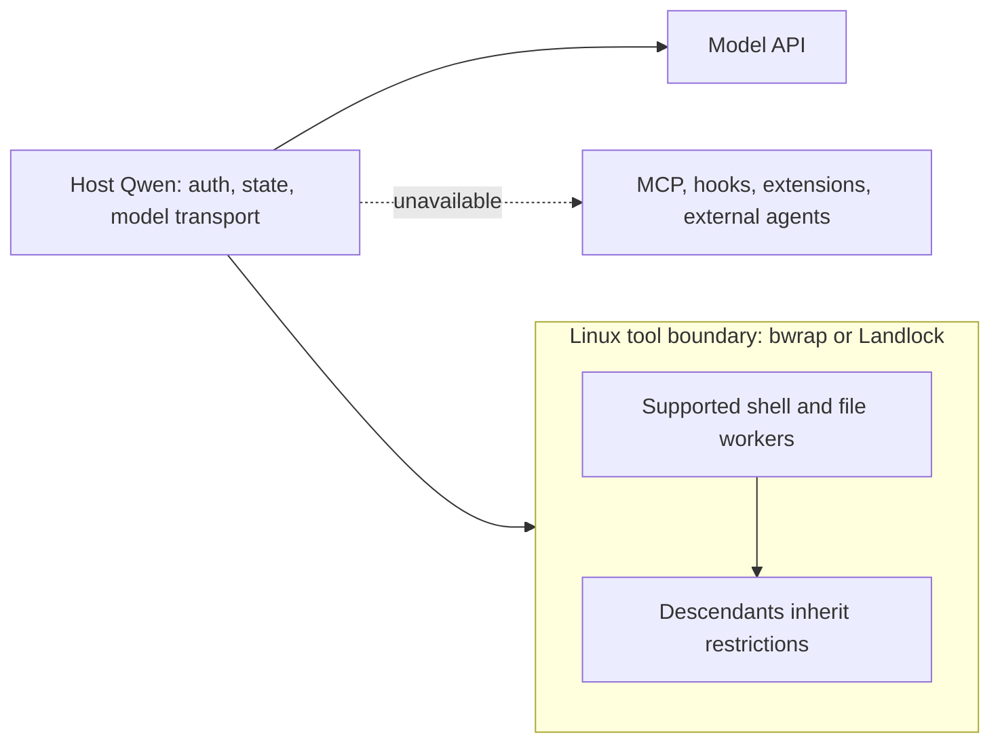

# Sandboxing in Qwen Code CLI

Researched **2026-11-04 UTC**. Qwen Code supplies optional sandboxes, but **a normal installation starts without OS sandboxing on every platform examined**. Its default approval mode is now `auto`: a classifier evaluates operations before execution. That is an application guardrail, not a filesystem, process, or network boundary. Optional protection has two substantially different shapes: macOS Seatbelt and Docker/Podman re-launch the whole CLI; Linux `tools.executionSandbox` confines supported tool operations while the CLI and model connection stay on the host. [Default selection source](https://github.com/QwenLM/qwen-code/blob/f45c34d8ccbd651f2f0f4d97c9b013c11af52f5b/packages/cli/src/config/sandboxConfig.ts), [approval selection](https://github.com/QwenLM/qwen-code/blob/f45c34d8ccbd651f2f0f4d97c9b013c11af52f5b/packages/cli/src/config/config.ts).

## Scope and evidence

The research started at the [official overview](https://qwenlm.github.io/qwen-code-docs/en/users/overview/) and followed its sandbox, approval, trust, and configuration references. GitHub's latest-release endpoint identified **v0.26.7**, published **2026-11-04 04:03:01 UTC**. The release source archive was inspected, including its actual launcher, settings parser, profiles, and execution backends. Main at `2800ea18dad039980680f624ce69632fed434e27` was inspected initially; the findings below were checked against the release and source links pin its commit `f45c34d8ccbd651f2f0f4d97c9b013c11af52f5b`. The [release notes](https://github.com/QwenLM/qwen-code/releases/tag/v0.26.7) include strengthened project-trust handling. Live documentation can change independently of releases; its sandbox page carries an October 22 date despite describing the current tool sandbox.

Read-only local inspection on macOS found `/opt/homebrew/bin/qwen`, **0.26.4**, through `sniff software agents --json`; `qwen --version`, `qwen --help`, and `qwen sandbox --help` corroborated the installed version and advertised flags. No task, model request, sandbox payload, container, or denial probe was run. No user credentials or configuration were read. These observations establish CLI availability, **not runtime enforcement** or clean-install defaults. The release parser and schema establish defaults. See the evidence inventory below for the distinction between documentation, source conclusions, and local observations.

## What a clean installation protects

The following assumes no inherited sandbox variables, no operator or project overrides, and the ordinary CLI rather than ACP or a hosted daemon. “Auto” means classifier-based approval; it does not mean an automatically selected sandbox. Both sandbox settings default to absent, and the launcher returns before searching for a backend when sandboxing is unset. [Settings defaults](https://github.com/QwenLM/qwen-code/blob/f45c34d8ccbd651f2f0f4d97c9b013c11af52f5b/packages/cli/src/config/settingsSchema.ts), [launcher selection](https://github.com/QwenLM/qwen-code/blob/f45c34d8ccbd651f2f0f4d97c9b013c11af52f5b/packages/cli/src/config/sandboxConfig.ts).

| Platform | Interactive default | Non-interactive default | Optional supported boundary |
| --- | --- | --- | --- |
| macOS | No OS sandbox; auto approval | No OS sandbox; auto approval; unresolved human confirmations denied | Whole-CLI Seatbelt, Docker, or Podman |
| Linux | Same | Same | Tool-only Bubblewrap or Landlock; whole-CLI Docker/Podman |
| Native Windows | Same | Same | Whole-CLI Docker/Podman with a working Linux-container engine; no native tool sandbox |
| WSL2 | Same | Same | Linux tool sandbox if the guest kernel permits it; Docker/Podman from the guest |

The native Windows conclusion is supported by explicit Windows handling in the container launcher and the Linux-only check in `createExecutionSandboxPolicy`; it is not inferred from WSL support. WSL2 follows Node's Linux path, so tool-backend viability depends on its kernel capabilities and namespace policy. No native Windows AppContainer, restricted-token, or job-object sandbox is selected by these paths. This is a source-derived conclusion about these CLI backends, not a claim to have executed them on all four systems. [Platform gate](https://github.com/QwenLM/qwen-code/blob/f45c34d8ccbd651f2f0f4d97c9b013c11af52f5b/packages/cli/src/config/execution-sandbox-config.ts), [container platform handling](https://github.com/QwenLM/qwen-code/blob/f45c34d8ccbd651f2f0f4d97c9b013c11af52f5b/packages/cli/src/serve/sandbox.ts).

First-run authentication and trust do not turn sandboxing on. Folder trust itself defaults to **disabled**. When enabled with `security.folderTrust.enabled: true`, interactive users can trust the folder, trust its parent, or refuse. An undecided folder is untrusted; trust decisions persist in `~/.qwen/trustedFolders.json`. Untrusted operation forces manual `default` approval, including when a more permissive mode was requested. In headless operation there is no terminal trust dialog to answer: provision the trust decision beforehand or retain restricted behavior. The release also requires explicit trust for repository hooks and certain project-supplied grants/LSP definitions, even when broad folder-trust tracking is disabled. [Trust implementation](https://github.com/QwenLM/qwen-code/blob/f45c34d8ccbd651f2f0f4d97c9b013c11af52f5b/packages/cli/src/config/trustedFolders.ts), [trusted-folders documentation](https://github.com/QwenLM/qwen-code/blob/f45c34d8ccbd651f2f0f4d97c9b013c11af52f5b/docs/users/configuration/trusted-folders.md), [release fixes](https://github.com/QwenLM/qwen-code/releases/tag/v0.26.7).

Without a sandbox, approved commands run with the invoking user's OS permissions and ordinary host networking. Built-in reads generally allow workspace and designated Qwen artifact/skill/memory locations; other paths require application approval. The read-permission helper canonicalizes candidates to avoid silently allowing a workspace symlink into credentials. This does not make an approved shell command unable to read the same credentials. Additional roots, ignore files, permission rules, and project trust are not confidentiality boundaries. [Read permission implementation](https://github.com/QwenLM/qwen-code/blob/f45c34d8ccbd651f2f0f4d97c9b013c11af52f5b/packages/core/src/tools/file-read-permission.ts), [shell permissions and execution](https://github.com/QwenLM/qwen-code/blob/f45c34d8ccbd651f2f0f4d97c9b013c11af52f5b/packages/core/src/tools/shell.ts).

## Whole-CLI sandboxing: Seatbelt and containers

These modes re-launch Qwen inside the selected environment. Built-in tools, local in-process subagents, shell children, locally spawned hooks, and stdio MCP servers launched there inherit that environment's restrictions. A remote HTTP/SSE MCP server executes elsewhere and keeps its own permissions; connecting to it does not place that server inside the local sandbox. The host launcher, runtime daemon, and auxiliary proxy are outside the payload boundary. Optional custom images and flags determine much of the effective container policy. [Whole-CLI launcher](https://github.com/QwenLM/qwen-code/blob/f45c34d8ccbd651f2f0f4d97c9b013c11af52f5b/packages/cli/src/serve/sandbox.ts), [MCP client](https://github.com/QwenLM/qwen-code/blob/f45c34d8ccbd651f2f0f4d97c9b013c11af52f5b/packages/core/src/tools/mcp-client.ts).



### macOS Seatbelt

`QWEN_SANDBOX=sandbox-exec` uses macOS's `sandbox-exec` profile enforcement. No container daemon or extra sandbox account is required. Automatic whole-CLI selection prefers it on macOS **only after sandboxing is requested**. The default profile, `permissive-open`, allows operations generally but denies writes outside its allowed roots. Both permissive and restrictive profile families permit broad host file reads, including home and readable credentials. “Restrictive” does not mean secrets are hidden. [Selection](https://github.com/QwenLM/qwen-code/blob/f45c34d8ccbd651f2f0f4d97c9b013c11af52f5b/packages/cli/src/config/sandboxConfig.ts), [permissive-open](https://github.com/QwenLM/qwen-code/blob/f45c34d8ccbd651f2f0f4d97c9b013c11af52f5b/packages/cli/src/serve/sandbox-macos-permissive-open.sb), [restrictive-open](https://github.com/QwenLM/qwen-code/blob/f45c34d8ccbd651f2f0f4d97c9b013c11af52f5b/packages/cli/src/serve/sandbox-macos-restrictive-open.sb).

Writable roots include the canonical working directory, system temporary directory, Darwin user cache, Qwen configuration and runtime directories, `~/.npm`, `~/.cache`, and `~/.gitconfig`, plus the first **five** additional workspace directories passed as profile parameters. Thus protected source-control configuration and Qwen state are not universally protected against writes. This is broader than “writes only inside the project.” Paths are resolved with `realpathSync` before profile construction; a symlink spelling does not create an independent writable root. The actual symlink/OS denial matrix was not runtime-tested. [Profile and parameter construction](https://github.com/QwenLM/qwen-code/blob/f45c34d8ccbd651f2f0f4d97c9b013c11af52f5b/packages/cli/src/serve/sandbox.ts), [write exceptions](https://github.com/QwenLM/qwen-code/blob/f45c34d8ccbd651f2f0f4d97c9b013c11af52f5b/packages/cli/src/serve/sandbox-macos-permissive-open.sb).

`SEATBELT_PROFILE` selects `permissive-open`, `permissive-closed`, `permissive-proxied`, `restrictive-open`, `restrictive-closed`, or `restrictive-proxied`. The restrictive family starts deny-by-default and grants execution, reads, and required OS services. Closed profiles deny outbound networking but retain an inbound localhost debugger exception on port 9229. Proxied profiles allow outbound TCP through localhost:8877; an operator-supplied `QWEN_SANDBOX_PROXY_COMMAND` starts the proxy outside Seatbelt. Since **model transport is inside**, a closed profile also blocks ordinary model/API access. Proxy allowlists must accommodate the selected model endpoint; a proxy variable alone is not an enforced domain allowlist. [Closed profile](https://github.com/QwenLM/qwen-code/blob/f45c34d8ccbd651f2f0f4d97c9b013c11af52f5b/packages/cli/src/serve/sandbox-macos-permissive-closed.sb), [proxied profile](https://github.com/QwenLM/qwen-code/blob/f45c34d8ccbd651f2f0f4d97c9b013c11af52f5b/packages/cli/src/serve/sandbox-macos-permissive-proxied.sb).

A custom profile is `.qwen/sandbox-macos-<name>.sb` in the project, selected by `SEATBELT_PROFILE=<name>`. Review that file as executable policy. A missing profile is fatal. These profile changes can widen or tighten the actual kernel boundary. [Profile resolver](https://github.com/QwenLM/qwen-code/blob/f45c34d8ccbd651f2f0f4d97c9b013c11af52f5b/packages/cli/src/serve/sandbox.ts).

### Docker and Podman

Install and start a compatible container engine; the CLI probes `docker version` or `podman version`, not just executable presence. Linux containers use the engine's namespaces/mounts; macOS and native Windows require the engine's Linux VM/backend. Qwen does not provision that VM. WSL2 may use an engine in the guest or integration with a host engine. These are local engine integrations, not a Qwen cloud sandbox subscription. Image pulling and the chosen model service require connectivity and any applicable registry/model credentials. [Container selection](https://github.com/QwenLM/qwen-code/blob/f45c34d8ccbd651f2f0f4d97c9b013c11af52f5b/packages/cli/src/config/sandboxConfig.ts), [launcher](https://github.com/QwenLM/qwen-code/blob/f45c34d8ccbd651f2f0f4d97c9b013c11af52f5b/packages/cli/src/serve/sandbox.ts).

The release's default image is `ghcr.io/qwenlm/qwen-code:0.26.7`. It is pulled if necessary. The launcher uses `run -i --rm --init`, adding `-t` only for TTY input. It mounts the working directory **read-write**, Qwen user settings and runtime state **read-write**, and the host temporary directory **read-write**. Existing `~/.config/gcloud` and `GOOGLE_APPLICATION_CREDENTIALS` are mounted **read-only**. It passes supported API-key variables, including `OPENAI_API_KEY`, into the container. These deliberate credential exposures mean this sandbox does not conceal model credentials from code running in it. Read-only credentials remain readable. It does not mount the entire host home by default. [Manifest image](https://github.com/QwenLM/qwen-code/blob/f45c34d8ccbd651f2f0f4d97c9b013c11af52f5b/packages/cli/package.json), [mounts and environment](https://github.com/QwenLM/qwen-code/blob/f45c34d8ccbd651f2f0f4d97c9b013c11af52f5b/packages/cli/src/serve/sandbox.ts).

`--include-directories` changes application workspace membership; the container launcher does not automatically create matching volume mounts for those extra roots. Use `SANDBOX_MOUNTS` for actual container visibility, for example `/absolute/reference:/reference:ro`. Container paths and symlinks resolve inside its mount tree; a symlink alone does not expose an unmounted host target. Mounted temporary/configuration paths are still host access. `SANDBOX_ENV` supplies comma-separated `KEY=value` pairs; `SANDBOX_PORTS` publishes ports; `SANDBOX_FLAGS` appends runtime flags, potentially weakening isolation. `SANDBOX_SET_UID_GID` controls identity mapping (Linux defaults to host UID/GID); it addresses file ownership, not access authorization. [Launcher implementation](https://github.com/QwenLM/qwen-code/blob/f45c34d8ccbd651f2f0f4d97c9b013c11af52f5b/packages/cli/src/serve/sandbox.ts).

Normal container networking is open, with `host.docker.internal` added. With `QWEN_SANDBOX_PROXY_COMMAND`, the launcher builds an internal network and a separate proxy container connected to an external-capable network. Both tools and Qwen model requests use this arrangement. Proxy policy determines allowed destinations. Custom runtime flags can change networking and mounts; neither Docker nor Podman implies an internet deny policy by itself. [Network setup](https://github.com/QwenLM/qwen-code/blob/f45c34d8ccbd651f2f0f4d97c9b013c11af52f5b/packages/cli/src/serve/sandbox.ts).

## Linux tool execution sandbox

This newer opt-in mode supports the ordinary headless CLI and both terminal UIs. Set a complete literal object in **User or System settings**:

```json
{
  "tools": {
    "executionSandbox": {
      "backend": "auto",
      "filesystem": "workspace-write",
      "network": "closed"
    }
  }
}
```

`filesystem` is required (`read-only` or `workspace-write`), as is `network` (`open` or `closed`); `backend` defaults to `auto`. Unknown keys, interpolation, and incomplete objects are rejected. The runtime freezes the selected policy. Workspace settings cannot enable, disable, or modify it. [Policy parser](https://github.com/QwenLM/qwen-code/blob/f45c34d8ccbd651f2f0f4d97c9b013c11af52f5b/packages/cli/src/config/execution-sandbox-settings.ts).

Bubblewrap is the strongest supported implementation: install it at **`/usr/bin/bwrap`**, and ensure the host allows its namespace setup. Source constructs a read-only bind of `/`, a private PID namespace, private `/proc` and `/dev`, a per-command writable scratch directory, and, for `workspace-write`, a writable bind of the canonical workspace. Closed networking adds a network namespace; open networking shares host networking. This exposes broad readable host files rather than hiding home or credentials. Installation, configuration, runtime state, and scratch/workspace overlap checks prevent admitting an obviously unsafe writable workspace. Linked worktrees do not gain write access to external Git common-directory metadata. Additional workspace directories do not expand this kernel write grant; the explicit CLI include-directories combination is rejected in this mode. [Bubblewrap invocation](https://github.com/QwenLM/qwen-code/blob/f45c34d8ccbd651f2f0f4d97c9b013c11af52f5b/packages/core/src/sandbox/bwrap-execution.ts), [admission checks](https://github.com/QwenLM/qwen-code/blob/f45c34d8ccbd651f2f0f4d97c9b013c11af52f5b/packages/core/src/sandbox/runtime-shell-policy.ts), [CLI combination checks](https://github.com/QwenLM/qwen-code/blob/f45c34d8ccbd651f2f0f4d97c9b013c11af52f5b/packages/cli/src/config/config.ts).

`auto` tries Bubblewrap first. If unavailable, **only an open-network policy** can fall back to the bundled Landlock helper, requiring Linux Landlock **ABI 3+** and a successful `/usr/bin/true` policy probe. Explicit `bwrap` or `landlock` requires that backend. Landlock reports **partial** enforcement: pathname access/mutations are restricted, but there is no private PID/network namespace and metadata operations such as chmod, chown, timestamps, and extended attributes are not fully restricted. It grants write access to `/dev/null`, scratch, and optionally the workspace; programs requiring writable `/dev/tty`, `/dev/full`, or `/dev/shm` can fail. Detached descendants retain Landlock restrictions. Landlock rejects closed networking and path masks; fallback never silently drops either requirement. Masks exist in the programmatic policy, not as an additional supported JSON key. [Fallback/admission](https://github.com/QwenLM/qwen-code/blob/f45c34d8ccbd651f2f0f4d97c9b013c11af52f5b/packages/core/src/sandbox/runtime-shell-policy.ts), [Landlock executor](https://github.com/QwenLM/qwen-code/blob/f45c34d8ccbd651f2f0f4d97c9b013c11af52f5b/packages/core/src/sandbox/landlock-execution.ts).

The CLI, authentication, model connection, and session storage remain on the host. Shell tools, terminal `!`, prompt shell interpolation, Monitor, file mutations, and ordinary same-workspace nested Agent/Code Mode calls use the runtime policy. File writes go through a confined worker with version checks; built-in file reads and discovery still use host services and application read permissions, consistent with this mode's broad-read policy. The restricted registry omits WebFetch and WebSearch; closed tool networking does not imply that the host CLI's API traffic is closed. The mode disables or rejects MCP/LSP, executable hooks/extensions, external agent executors, worktree/arena management, speculative execution, checkpoints/restores, automatic skill/memory maintenance, and unported mutation/process features. It rejects ACP, `qwen serve`, and web terminals. These integrations are **unavailable**, rather than silently executing on the host in this mode. Trusted operator management actions such as `/doctor` and opening files via `/memory` remain host actions and are not model-invocable tools. [Runtime feature gates and restricted registry](https://github.com/QwenLM/qwen-code/blob/f45c34d8ccbd651f2f0f4d97c9b013c11af52f5b/packages/core/src/config/config.ts), [file-write routing](https://github.com/QwenLM/qwen-code/blob/f45c34d8ccbd651f2f0f4d97c9b013c11af52f5b/packages/core/src/sandbox/runtime-file.ts), [read execution](https://github.com/QwenLM/qwen-code/blob/f45c34d8ccbd651f2f0f4d97c9b013c11af52f5b/packages/core/src/tools/read-file.ts).



Closed networking here is a **command IP-network restriction**, not a model transport restriction or universal host-service barrier. Pathname Unix sockets, existing connected descriptors, and caller-provided standard streams remain capabilities. Host-backed file/FIFO stdin is bridged through a private read-only socket using bundled Linux x64/arm64 helpers; existing sockets, character devices, and pipes can remain usable. Environment secrets are not generally scrubbed from tool payloads. Scratch is exposed as `TMPDIR`, `TMP`, and `TEMP`. Canonical workspace admission and kernel checks govern symlink targets, but this research did not test symlink races. [Execution environment and scratch](https://github.com/QwenLM/qwen-code/blob/f45c34d8ccbd651f2f0f4d97c9b013c11af52f5b/packages/core/src/sandbox/sandbox-execution.ts), [official descriptor limitations](https://qwenlm.github.io/qwen-code-docs/en/users/features/sandbox/#linux-tool-execution-sandbox).

## Selecting, administering, and diagnosing limits

Whole-CLI selection precedence is **`QWEN_SANDBOX` > `--sandbox`/`-s` > `tools.sandbox`**. Values are `true`, `false`, `docker`, `podman`, or `sandbox-exec` (environment parsing also recognizes `1`/`0`). Automatic selection tries usable Seatbelt on macOS, then Docker, then Podman. An explicitly named unavailable backend fails; automatic selection may move to another usable backend, but does not intentionally retry a failed payload on the host. The source has an exceptional missing-image branch: a container selection without any image URI returns no sandbox configuration. The shipped manifest supplies an image, so that is a packaging/configuration edge, not the normal default. An inherited `SANDBOX` marker suppresses re-launch; it is bookkeeping, not proof of isolation. [Selection source](https://github.com/QwenLM/qwen-code/blob/f45c34d8ccbd651f2f0f4d97c9b013c11af52f5b/packages/cli/src/config/sandboxConfig.ts).

```sh
# Optional whole-CLI sandbox, no approval bypass implied
qwen --sandbox=true -p "Inspect this project"
QWEN_SANDBOX=sandbox-exec SEATBELT_PROFILE=permissive-open qwen
QWEN_SANDBOX=docker qwen --sandbox-image ghcr.io/qwenlm/qwen-code:0.26.7 -p "Run tests"

# After configuring tools.executionSandbox on Linux
qwen sandbox
qwen sandbox --verify
qwen sandbox -- sh -c 'ls -la'
qwen -y -p "Update this project and run tests"
```

These are usage examples, not commands executed during this research. `--sandbox` accepts an optional value: prefer `--sandbox=true` or `--sandbox -p ...`; `--sandbox "my prompt"` interprets the next argument as a backend and rejects it. Image precedence differs: **`--sandbox-image` > `QWEN_SANDBOX_IMAGE` > `tools.sandboxImage` > manifest image**. Custom images must carry the intended CLI version and dependencies. The user sandbox page suggests `BUILD_SANDBOX=1`, but the developer guide says npm installations lack the build scripts; use a source checkout or build an image separately and select it explicitly. [Parser documentation](https://qwenlm.github.io/qwen-code-docs/en/users/features/sandbox/#enable-sandboxing-in-order-of-precedence), [developer build caveat](https://github.com/QwenLM/qwen-code/blob/f45c34d8ccbd651f2f0f4d97c9b013c11af52f5b/docs/developers/tools/sandbox.md).

Ordinary single-value settings merge as **System > trusted Workspace > User > SystemDefaults**, before sandbox-specific environment/flag overrides. Project restrictions and trust can withhold Workspace values. These precedence rules do not make whole-CLI selection an immutable administrator mandate: its environment override still wins. [Settings merge](https://github.com/QwenLM/qwen-code/blob/f45c34d8ccbd651f2f0f4d97c9b013c11af52f5b/packages/cli/src/config/settings.ts).

For Linux tool policy, precedence is **System > User > SystemDefaults**, selecting a whole object rather than merging fields. User settings are `~/.qwen/settings.json` or under `QWEN_HOME`. System settings default to `/etc/qwen-code/settings.json` on Linux/WSL2, `/Library/Application Support/QwenCode/settings.json` on macOS, and `C:\ProgramData\qwen-code\settings.json` on Windows; sibling `system-defaults.json` provides defaults. `QWEN_CODE_SYSTEM_SETTINGS_PATH` and `QWEN_CODE_SYSTEM_DEFAULTS_PATH` relocate these files. Ordinary settings also have a Workspace layer, but it is excluded from tool-policy selection. `--bare` and `--safe-mode` retain operator confinement. Malformed or unreadable operator files fail startup with configuration exit **52**, preserving the original file for repair. Restart after policy changes. This is an operator control within Qwen, not protection against a user who controls its executable, environment, or system-settings path. [Operator parser](https://github.com/QwenLM/qwen-code/blob/f45c34d8ccbd651f2f0f4d97c9b013c11af52f5b/packages/cli/src/config/execution-sandbox-settings.ts), [settings paths](https://github.com/QwenLM/qwen-code/blob/f45c34d8ccbd651f2f0f4d97c9b013c11af52f5b/packages/cli/src/config/storage-paths-lite.ts).

Do not combine `tools.executionSandbox` with whole-CLI sandboxing or inherited `SANDBOX`; the selection validator rejects incompatible configuration. Legacy whole-CLI `bwrap` was removed: replace `--sandbox bwrap`, `tools.sandbox: "bwrap"`, or `QWEN_SANDBOX=bwrap`, remove legacy `QWEN_SANDBOX_NET`/`QWEN_SANDBOX_PROXY_COMMAND`, and restart outside the old environment. Current tool network values are only `open` and `closed`, not `proxied`. [Migration validator](https://github.com/QwenLM/qwen-code/blob/f45c34d8ccbd651f2f0f4d97c9b013c11af52f5b/packages/cli/src/config/execution-sandbox-settings.ts).

`qwen sandbox` reports the selected tool boundary; `--verify` checks workspace write policy, denial against a host-writable fixture, and expected PID/network namespace identities. A passed probe proves backend admission, not every authenticated task or integration. Backend setup failures stop before payload execution, and the tool executor does not rerun the command unsandboxed. A denied write or network operation must be corrected within policy, or the operator must change settings and start a new runtime. There is no documented per-tool “approve outside sandbox” escalation for this policy. [Inspection command](https://github.com/QwenLM/qwen-code/blob/f45c34d8ccbd651f2f0f4d97c9b013c11af52f5b/packages/cli/src/commands/sandbox.ts), [backend admission](https://github.com/QwenLM/qwen-code/blob/f45c34d8ccbd651f2f0f4d97c9b013c11af52f5b/packages/core/src/sandbox/runtime-shell-policy.ts).

Approval controls remain separate: `--approval-mode plan|default|auto-edit|auto|yolo`, `tools.approvalMode`, `-y`/`--yolo`, `--allowed-tools`, and permission rules affect dispatch authorization. Plan mode is application-enforced analysis and can admit classified read-only shell operations; it is not an OS read-only mount. YOLO skips ordinary approval checks but **does not widen an active sandbox**. In plain headless mode, an operation still requiring human confirmation is denied as not started; stream-JSON hosts can answer supported permission requests, with human-only destructive confirmations still denied. A retry through approvals does not lift kernel confinement. [Scheduler behavior](https://github.com/QwenLM/qwen-code/blob/f45c34d8ccbd651f2f0f4d97c9b013c11af52f5b/packages/core/src/core/coreToolScheduler.ts), [CLI approval configuration](https://github.com/QwenLM/qwen-code/blob/f45c34d8ccbd651f2f0f4d97c9b013c11af52f5b/packages/cli/src/config/config.ts).

YOLO also **does not enable** a sandbox. Headless YOLO without a sandbox prints a warning; `QWEN_CODE_SUPPRESS_YOLO_WARNING=1` hides only that warning. Normal external-agent integrations delegate to another CLI's security model: for example, the documented Codex executor uses its own read-only/workspace/full-access modes depending on Qwen's effective approval mode. This does not create a Qwen session boundary, and the Linux tool sandbox rejects external executors. Worktree and fork context isolation alone are likewise not OS confinement. [Settings security note](https://github.com/QwenLM/qwen-code/blob/f45c34d8ccbd651f2f0f4d97c9b013c11af52f5b/docs/users/configuration/settings.md#sandbox), [external subagents](https://github.com/QwenLM/qwen-code/blob/f45c34d8ccbd651f2f0f4d97c9b013c11af52f5b/docs/users/features/sub-agents.md).

Qwen's current quickstart requires Node.js 22+ for npm installation and a configured model provider/API key or applicable subscription. It says Qwen OAuth ended April 15, 2026. Sandbox backends themselves require no separate Qwen account tier. First-run model setup, image downloads, and authentication may require interaction/network; provision credentials before headless work. Do not confuse an old image's available authentication choices with the current service. [Release quickstart](https://github.com/QwenLM/qwen-code/blob/f45c34d8ccbd651f2f0f4d97c9b013c11af52f5b/docs/users/quickstart.md).

## Narrow integrations are not a session-wide sandbox

### Container subagents

The release also ships an opt-in **subagent execution backend**, selected by exporting `QWEN_AGENT_EXECUTION_BACKEND=docker` or `podman` before launching Qwen. This requires containers for ordinary Agent dispatches while the parent model loop, parent tools, terminal `!`, and prompt file expansion remain local. Agent definitions can request `executionBackend: container` but cannot weaken an operator requirement or provision a missing factory. The factory supports Unix hosts (macOS, Linux, WSL2), not native Windows, whole-session sandbox handoffs, or Daemon/Serve. A required backend without a factory fails before child launch. File-sourced selectors, including user `.env`, are rejected; export the variable in the real launch environment. This is a source-supported integration with an implementation design document, rather than a general sandbox flag advertised in root help. [Activation source](https://github.com/QwenLM/qwen-code/blob/f45c34d8ccbd651f2f0f4d97c9b013c11af52f5b/packages/cli/src/config/agent-execution.ts), [implemented design](https://github.com/QwenLM/qwen-code/blob/f45c34d8ccbd651f2f0f4d97c9b013c11af52f5b/docs/design/2026-09-12-agent-container-execution.md).

Child file and shell tools run in a worker container with only the canonical working tree and dedicated output directory mounted read-write, the trusted CLI worker bundle mounted read-only, an empty read-only mask over `.git`, and a tmpfs home. The launcher drops capabilities and uses `no-new-privileges`. It rejects workspace overlap with home, Qwen credentials/runtime, temporary roots, and trusted installation/dependency paths. External dependency symlinks do not justify widening mounts. It passes a small environment allowlist rather than host model credentials. The installation must be an independent complete bundle, with strict link/hard-link checks; source/tsc launches and some shared package-store layouts are unsupported. [Container implementation](https://github.com/QwenLM/qwen-code/blob/f45c34d8ccbd651f2f0f4d97c9b013c11af52f5b/packages/core/src/services/container-execution-environment.ts), [installation checks](https://github.com/QwenLM/qwen-code/blob/f45c34d8ccbd651f2f0f4d97c9b013c11af52f5b/packages/cli/src/utils/container-installation.ts).

The primary child worker is offline. Standalone `npm install`/`npm ci`, `pnpm install`, or `yarn install` commands can use a separate network-enabled installation worker; this is ordinary network access, not a registry allowlist. Model requests, approval decisions, and transcripts remain on the host. Child Monitor, nested Agent, external executors, custom command tools, skills, LSP, and MCP are unavailable; incompatible executable hooks are rejected. There is no host retry after a container failure. `QWEN_CODE_CUSTOM_SANDBOX_IMAGE`, then `QWEN_SANDBOX_IMAGE`, can override the manifest image when exported by the operator; neither selects arbitrary mounts through model arguments. Example: `QWEN_AGENT_EXECUTION_BACKEND=docker qwen`. [Worker network and tools](https://github.com/QwenLM/qwen-code/blob/f45c34d8ccbd651f2f0f4d97c9b013c11af52f5b/packages/core/src/services/container-execution-environment.ts), [factory image selection](https://github.com/QwenLM/qwen-code/blob/f45c34d8ccbd651f2f0f4d97c9b013c11af52f5b/packages/cli/src/config/agent-execution.ts).

### Review and maintainer workflows

The official review pipeline separately supports **`review.sandbox: off|auto|required`**, default **off**, from operator scopes. A genuine process `QWEN_REVIEW_SANDBOX` can tighten that policy but cannot loosen the setting; file-sourced overrides are ignored. `auto` uses Docker/Podman when available and otherwise runs review commands directly on the host. `required` refuses uncontained build/test/mutation execution and reports the missing evidence rather than substituting host execution. It does not sandbox every action of the reviewer agent. [Review policy implementation](https://github.com/QwenLM/qwen-code/blob/f45c34d8ccbd651f2f0f4d97c9b013c11af52f5b/packages/cli/src/commands/review/lib/sandboxed-exec.ts).

Each admitted review command gets a disposable container mounting its review temporary tree read-write, a tmpfs home, and a small explicit environment instead of inherited model/GitHub keys. Install commands have network access; build/test commands use `--network none`. `QWEN_REVIEW_SANDBOX_IMAGE` selects a toolchain image ahead of other supported image fallbacks. This is a different credential policy from the whole-CLI container launcher. Native engine prerequisites still apply. Example: `QWEN_REVIEW_SANDBOX=required qwen review run --approval-mode auto`. [Review container construction](https://github.com/QwenLM/qwen-code/blob/f45c34d8ccbd651f2f0f4d97c9b013c11af52f5b/packages/cli/src/commands/review/lib/sandboxed-exec.ts), [environment allowlist](https://github.com/QwenLM/qwen-code/blob/f45c34d8ccbd651f2f0f4d97c9b013c11af52f5b/packages/cli/src/utils/container-policy.ts).

Release 0.26.7 also adds a repository-local `/verify-pr` Docker recipe with a host model proxy, described in [its local proxy design](https://github.com/QwenLM/qwen-code/blob/f45c34d8ccbd651f2f0f4d97c9b013c11af52f5b/docs/design/verify-pr-local-model-proxy.md). That is a purpose-built maintainer workflow, not a sandbox enabled for arbitrary `qwen` sessions or a reason to treat an npm installation as confined. Hosted Workspace/Managed Agent deployments likewise have deployment-specific infrastructure and are outside the normal CLI defaults evaluated here.

## Unresolved checks

- No runtime enforcement tests were performed. Run `qwen sandbox --verify` and a harmless task on representative Linux and WSL2 kernels, then test an external writable fixture, symlinks, inherited descriptors, and open/closed networking separately. This would settle kernel/backend admission and practical application coverage.
- Native Windows container support is documented and has Windows-specific source handling, but was not exercised. Test v0.26.7 with a running Linux-container engine and a workspace path containing spaces; WSL2 evidence cannot answer this.
- macOS profile enforcement and authenticated viability were not probed. Test each selected profile with harmless external reads/writes and model connectivity; closed profiles are expected to disrupt the whole CLI's model connection.
- The exact first release introducing the current tool-only mode and each subsequent hardening step was not established. Compare release tags around the migration commits; the verified support claim here is v0.26.7, with only help-surface corroboration from local v0.26.4.
- Remote MCP servers, external daemons, custom images/profiles, and user-supplied runtime flags require their own boundary review. Inspect the actual process tree and effective mounts/profile rather than treating `SANDBOX` or a container name as proof.

## Evidence inventory

Evidence IDs used in frontmatter refer to these examined records. All were accessed on 2026-11-04 UTC; source inspection is not runtime testing.

| ID | Kind | Record and findings supported |
| --- | --- | --- |
| e1 | Official documentation | [Overview](https://qwenlm.github.io/qwen-code-docs/en/users/overview/) and [sandbox guide](https://qwenlm.github.io/qwen-code-docs/en/users/features/sandbox/): supported whole-CLI and tool-only modes, constraints, descriptor caveats. |
| e2 | Release source | [sandboxConfig.ts](https://github.com/QwenLM/qwen-code/blob/f45c34d8ccbd651f2f0f4d97c9b013c11af52f5b/packages/cli/src/config/sandboxConfig.ts): disabled default, selection precedence, backend probes/failures, image fallback. |
| e3 | Release source | [config.ts](https://github.com/QwenLM/qwen-code/blob/f45c34d8ccbd651f2f0f4d97c9b013c11af52f5b/packages/cli/src/config/config.ts) and [settingsSchema.ts](https://github.com/QwenLM/qwen-code/blob/f45c34d8ccbd651f2f0f4d97c9b013c11af52f5b/packages/cli/src/config/settingsSchema.ts): approval/trust defaults, incompatible combinations. |
| e4 | Release source | [sandbox.ts](https://github.com/QwenLM/qwen-code/blob/f45c34d8ccbd651f2f0f4d97c9b013c11af52f5b/packages/cli/src/serve/sandbox.ts): whole-CLI relaunch, mounts, env, network, profile parameters, native Windows handling. |
| e5 | Release source | [permissive-open](https://github.com/QwenLM/qwen-code/blob/f45c34d8ccbd651f2f0f4d97c9b013c11af52f5b/packages/cli/src/serve/sandbox-macos-permissive-open.sb), [restrictive-open](https://github.com/QwenLM/qwen-code/blob/f45c34d8ccbd651f2f0f4d97c9b013c11af52f5b/packages/cli/src/serve/sandbox-macos-restrictive-open.sb), [closed](https://github.com/QwenLM/qwen-code/blob/f45c34d8ccbd651f2f0f4d97c9b013c11af52f5b/packages/cli/src/serve/sandbox-macos-permissive-closed.sb), [proxied](https://github.com/QwenLM/qwen-code/blob/f45c34d8ccbd651f2f0f4d97c9b013c11af52f5b/packages/cli/src/serve/sandbox-macos-permissive-proxied.sb): actual Seatbelt permissions. |
| e6 | Release source | [execution-sandbox-settings.ts](https://github.com/QwenLM/qwen-code/blob/f45c34d8ccbd651f2f0f4d97c9b013c11af52f5b/packages/cli/src/config/execution-sandbox-settings.ts), [platform gate](https://github.com/QwenLM/qwen-code/blob/f45c34d8ccbd651f2f0f4d97c9b013c11af52f5b/packages/cli/src/config/execution-sandbox-config.ts), [storage paths](https://github.com/QwenLM/qwen-code/blob/f45c34d8ccbd651f2f0f4d97c9b013c11af52f5b/packages/cli/src/config/storage-paths-lite.ts): operator policy, precedence, migration, fail-closed configuration. |
| e7 | Release source | [runtime-shell-policy.ts](https://github.com/QwenLM/qwen-code/blob/f45c34d8ccbd651f2f0f4d97c9b013c11af52f5b/packages/core/src/sandbox/runtime-shell-policy.ts), [bwrap-execution.ts](https://github.com/QwenLM/qwen-code/blob/f45c34d8ccbd651f2f0f4d97c9b013c11af52f5b/packages/core/src/sandbox/bwrap-execution.ts), [landlock-execution.ts](https://github.com/QwenLM/qwen-code/blob/f45c34d8ccbd651f2f0f4d97c9b013c11af52f5b/packages/core/src/sandbox/landlock-execution.ts): admission, namespaces, writes, fallback and partial enforcement. |
| e8 | Release source | [runtime config](https://github.com/QwenLM/qwen-code/blob/f45c34d8ccbd651f2f0f4d97c9b013c11af52f5b/packages/core/src/config/config.ts), [runtime-file.ts](https://github.com/QwenLM/qwen-code/blob/f45c34d8ccbd651f2f0f4d97c9b013c11af52f5b/packages/core/src/sandbox/runtime-file.ts), [sandbox-execution.ts](https://github.com/QwenLM/qwen-code/blob/f45c34d8ccbd651f2f0f4d97c9b013c11af52f5b/packages/core/src/sandbox/sandbox-execution.ts): tool coverage, disabled integrations, host state, scratch/env. |
| e9 | Release source | [coreToolScheduler.ts](https://github.com/QwenLM/qwen-code/blob/f45c34d8ccbd651f2f0f4d97c9b013c11af52f5b/packages/core/src/core/coreToolScheduler.ts), [file-read-permission.ts](https://github.com/QwenLM/qwen-code/blob/f45c34d8ccbd651f2f0f4d97c9b013c11af52f5b/packages/core/src/tools/file-read-permission.ts): approval versus enforcement, headless denial, symlink-aware read guard. |
| e10 | Release source | [sandbox command](https://github.com/QwenLM/qwen-code/blob/f45c34d8ccbd651f2f0f4d97c9b013c11af52f5b/packages/cli/src/commands/sandbox.ts): inspection, verification and one-command execution. |
| e11 | Release source | [review sandbox](https://github.com/QwenLM/qwen-code/blob/f45c34d8ccbd651f2f0f4d97c9b013c11af52f5b/packages/cli/src/commands/review/lib/sandboxed-exec.ts), [container policy](https://github.com/QwenLM/qwen-code/blob/f45c34d8ccbd651f2f0f4d97c9b013c11af52f5b/packages/cli/src/utils/container-policy.ts): review-only confinement, explicit host fallback, credential separation. |
| e12 | Official release/docs | [v0.26.7 release](https://github.com/QwenLM/qwen-code/releases/tag/v0.26.7), [quickstart](https://github.com/QwenLM/qwen-code/blob/f45c34d8ccbd651f2f0f4d97c9b013c11af52f5b/docs/users/quickstart.md), [custom builds](https://github.com/QwenLM/qwen-code/blob/f45c34d8ccbd651f2f0f4d97c9b013c11af52f5b/docs/developers/tools/sandbox.md), [verify-pr proxy](https://github.com/QwenLM/qwen-code/blob/f45c34d8ccbd651f2f0f4d97c9b013c11af52f5b/docs/design/verify-pr-local-model-proxy.md): version, setup and narrow workflow scope. |
| e13 | Local observation | macOS: `sniff software agents --json`, `qwen --version`, `qwen --help`, `qwen sandbox --help`; installed 0.26.4, advertised switches only. No enforcement test. |
| e14 | Release source | [agent-execution.ts](https://github.com/QwenLM/qwen-code/blob/f45c34d8ccbd651f2f0f4d97c9b013c11af52f5b/packages/cli/src/config/agent-execution.ts), [container worker](https://github.com/QwenLM/qwen-code/blob/f45c34d8ccbd651f2f0f4d97c9b013c11af52f5b/packages/core/src/services/container-execution-environment.ts), [installation checks](https://github.com/QwenLM/qwen-code/blob/f45c34d8ccbd651f2f0f4d97c9b013c11af52f5b/packages/cli/src/utils/container-installation.ts): Unix-only subagent containers, parent host access, credentials, restricted tools and no fallback. |

## Changelog

- **2026-11-04:** Initial report. Established disabled sandbox defaults, current auto approval, whole-CLI versus Linux tool-only boundaries, credential exposure, review-specific fallback, and explicit runtime-validation gaps against v0.26.7 and local v0.26.4 help.
