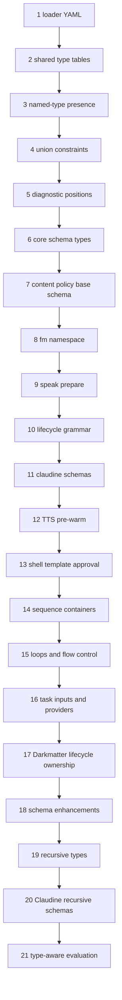

# Rollout Strategy — Lifecycle, Sequence, and Schema Pipeline

> **This page is a planning snapshot, not a behavior reference.** It names specs
> by their `{date}-{name}` directory, which topic pages never do. Delete it when
> the last spec in the pipeline has merged.

## How to run it

All 21 specs live in `claudine/features/`. **The date prefix is the execution
order**: one spec per day starting 2026-10-11, so listing the directory lists
the pipeline.

- Run the specs **one at a time, in date order**. Each spec starts only after
  the one before it has merged.
- Every spec's `depends-on` names only specs earlier in the pipeline, so running
  in order always satisfies it.
- Every design decision was made with the owner on 2026-10-10 and is written
  into the spec that implements it. A spec has no open questions. A
  recommendation a spec or plan records is decided, not pending. If an
  implementing agent finds a new gap anyway, it decides it and records the
  decision, the alternatives, the reason, and the downsides in the
  implementation log; it never defers requested scope. Only a surprise that
  changes what the spec promises and has no recommendable option pauses the
  plan.
- The last phase of each spec's plan checks the later specs and plans in this
  pipeline against what the implementation learned, and updates them
  directly.
- Agents stop at "implementation complete, ready for review". Moving a spec to
  `_completed` is the author's act.

## The pipeline

| # | Spec | What it delivers | Needs |
|---|---|---|---|
| 1 | `2026-10-11-schema-loader-yaml-spellings` | The SimplifiedSchema loader accepts two valid YAML spellings that crash it today: an indentless list and a plain string wrapped onto a second line. | — |
| 2 | `2026-10-12-shared-type-tables` | The schema resolver shares named-type tables instead of copying them on every import. Performance only. | — |
| 3 | `2026-10-13-named-type-presence-and-local-names` | `required` inside a reused named type is no longer stripped, and a type defined in the same file is referenced by its bare name (`author: person`). | — |
| 4 | `2026-10-14-union-type-constraints` | `[]`, `min(…)`, and `required` can apply to a reference to a union type; a list of a union becomes `items: { anyOf }`. | 3 |
| 5 | `2026-10-15-diagnostic-node-positions` | A validation error points at the offending list item or field, not the top-level key. | — |
| 6 | `2026-10-16-core-schema-types` | New schema types: `unknown` (`any` alias), `null`, `alphanumeric` with its options, and `shell`. | — |
| 7 | `2026-10-17-content-policy-base-schema` | Darkmatter checks every document's `content_policy:` list by default, in `md`, compose, and the editor. | 4, 5 |
| 8 | `2026-10-18-fm-namespace` | The frontmatter namespace `doc` becomes `fm` everywhere; the `current_env` global is removed. | — |
| 9 | `2026-10-19-speak-prepare` | biscuit-speaks can pre-generate the audio for a phrase before it is needed. | — |
| 10 | `2026-10-20-lifecycle-grammar` | Lifecycle events become flat lists with `when`/`then`/`else` and nesting; the old `stack:`/`action:` grammar is removed with clear errors; `_loop_*` becomes `loop.*`; every document is migrated. | 8 |
| 11 | `2026-10-21-claudine-schemas` | Claudine's schema files, with lifecycle events typed as unions of reusable action types and embedded in the binary from YAML. | 6, 10 |
| 12 | `2026-10-22-tts-prewarm` | Claudine pre-generates the audio its lifecycle events will speak, controlled by the `tts` object in `config.json`. | 9, 10 |
| 13 | `2026-10-23-shell-template-approval` | Shell commands that use values produced by earlier sequence steps are approved as typed templates and type-checked when they run. | 6 |
| 14 | `2026-10-24-sequence-containers` | Nested sequences replace serial groups; groups are concurrent only; lifecycle events (including the new `cancelled`) work on documents, groups, and sequences; `seq`/`loop`/`group` replace `state`. | 10, 13 |
| 15 | `2026-10-25-loops-and-flow-control` | Loops on any primitive, `break`, `prep`, `when:` on tasks, and `--dry-run` no longer running shell tasks. | 14 |
| 16 | `2026-10-26-task-inputs-and-providers` | Task `params:` becomes `with:`, each task's agent is chosen by one precedence order, and the sequence schema is written. | 11, 15 |
| 17 | `2026-10-27-darkmatter-lifecycle-ownership` | Darkmatter takes ownership of lifecycle events, hosts can define and rename events, one file declares every global, and the trigger kind is renamed. No other behavior change. | 16 |
| 18 | `2026-10-28-schema-enhancements` | `tuple`, `function`, and the `\|` union operator; one conversion engine for frontmatter and function arguments; the function catalog rewritten in that grammar. | 6 |
| 19 | `2026-10-29-recursive-schema-types` | Part A: validation stage timings, a slow-validation DMLS log, a Claudine-shaped benchmark, and removal of measured validation waste. Part B: a named type can reference itself without the resolved schema growing with every level. | A: —; B: 4, 18 |
| 20 | `2026-10-30-claudine-recursive-schemas` | Claudine's lifecycle schemas drop their hand-unrolled nesting and use recursive types; sequence and group containers, and every container event, are typed at every depth. | 11, 19 |
| 21 | `2026-10-31-type-aware-evaluation` | Type-aware evaluation, narrowing inside guards, diagnostics, and the consolidated `--allow`/`--deny`/`--disable` flags. | 18 |

## Why this order

- **Schema groundwork first (1–7).** Steps 1–5 are small, isolated Darkmatter
  changes that later schema work builds on; step 4's representation of a list
  of a union is reused by steps 18 and 19, so it is designed once. Content
  Policy (7) has no urgency; it sits here only because nothing else blocks it.
- **Rename before rewrite (8 before 10).** The lifecycle grammar change rewrites
  every document, so the `doc` → `fm` rename lands first and documents are
  rewritten once.
- **Claudine first, then Darkmatter ownership (10–17).** The new grammar and the
  container model change behavior and are built in Claudine, where the engine
  and its tests live. Step 17 then moves ownership to Darkmatter with no
  behavior change, proven by the same tests. It sits directly after the
  sequence work so the move happens against the final grammar.
- **Type system last (18–21).** Phase B is the largest spec and nothing in the
  lifecycle or sequence work waits on it.
- **Measure early (19, Part A).** Validation is already slow enough to hurt
  the editor, and the measurements guide Part B. Part A needs neither
  recursion nor step 18, so it runs alongside 15–16, before ownership moves
  in 17.
- **Not in this pipeline:** `2026-09-30-positional-args` stays in
  `darkmatter/features/` and follows once this pipeline is done.

## Where the old specs went

The 2026-10-10 restructure renamed, split, or retired these specs; each moved
spec records its former name in a `formerly:` frontmatter field.

| Former spec | Now |
|---|---|
| `2026-09-16-expression-type-system` (charter) | Split: Phase A → 6, Phase B annexes → 18, Phases C–E → 21 |
| `2026-09-21-lifecycle-ergonomics` | Split into 9, 10, 11, 12 |
| `2026-09-21-schema-enhancements` | 18 |
| `2026-09-22-lifecycle-events` | 17 (rewritten) |
| `2026-09-27-sequence-improvements` | Split into 14, 15, 16 |
| `2026-09-28-recursive-schema-types` | Split into 19, 20; its related defects and pre-work became 1, 2, 3, 5 |
| `2026-10-04-content-policy-base-schema` | 7 |

Completed before the restructure: `2026-09-28-hash-writer-byte-fidelity`,
`2026-09-27-sequence-review-screen`, and the strict-mode core
(`2026-09-17-remove-strict-mode`). Material that fix set aside was dropped or
redistributed: schema-based feature restrictions are replaced by typed
lifecycle events (11), Claudine schema embedding moved to 11, and the single
globals file and trigger renames moved to 17.
