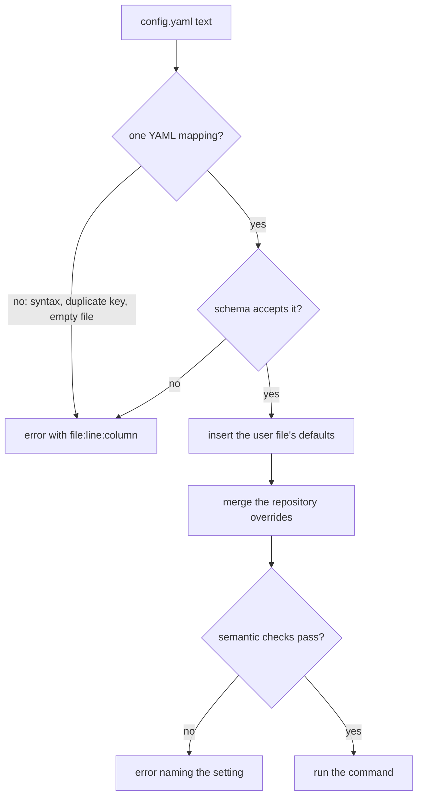
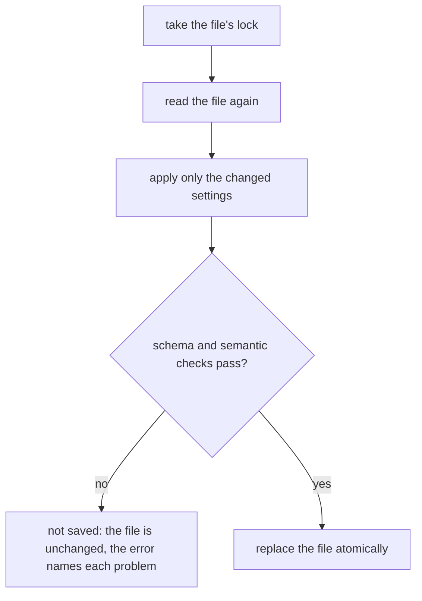

# Configuration files

Claudine reads two YAML files:

| Scope | File | What it may set |
|---|---|---|
| user | `~/.claudine/config.yaml` | every setting |
| repository | `{repo-root}/.claudine/config.yaml` | only the overrides listed below, plus `permissions` |

Both are described by one shipped schema,
[`claudine/schemas/claudine-config.yaml`](../../schemas/claudine-config.yaml):
its `user-config` type is the user file and its `repository-config` type is the
repository file. The schema is the authority for every setting's shape and for
the user file's defaults, so an editor with a SimplifiedSchema language server
(DMLS) can complete and check both files.

```yaml
# ~/.claudine/config.yaml
preferred_agent: claude
logging: true
protect:
  rules:
    git_destructive: false
actions:
  human_in_the_loop:
    - type: sound_effect
      effect: doorbell
```

```yaml
# {repo-root}/.claudine/config.yaml
canonical_provider: codex
active_messenger: null   # no messaging in this repository
```

## How a file is read

Every command that needs configuration reads the files the same way, before
any hook action, agent, provider, or composition runs:



- **Strict.** A value of the wrong type is an error, never converted:
  `logging: "yes"` and `max_repeats: "30"` are refused. Duplicate keys,
  several documents, and an empty file are errors; write `{}` for a file that
  keeps every default.
- **Located.** Each problem names the file, line, column, and the JSON pointer
  of the value (`~/.claudine/config.yaml:4:12 at /protect/enabled: …`).
- **Closed.** A key the scope does not declare is an error at that key. A
  repository file that sets `tts`, for example, fails.
- **Semantic checks** run after the schema: sound effect names, Protect
  patterns and `allow_paths`, exit-expression regexes and `scope` agents, and
  that the active messenger route exists.

## Defaults and inheritance

An absent user setting takes the schema's default (`logging: true`,
`protect: true`, `prompt_for_missing: true`, the guard thresholds, …). An
explicit `null` is an error for a setting with a default; for an optional
setting (`messenger`, `preferred_agent`, `canonical_provider`,
`exit_expressions`, and optional fields inside actions or routes) `null`
means the same as leaving it out.

A repository setting is an override, so nothing is inserted into a repository
file: an absent override inherits the user's value. The repository accepts
`canonical_provider`, `actions`, `matchers`, `active_messenger`,
`exit_expressions`, `guard_settings`, `steering`, and `permissions`.

| Repository value | Effect |
|---|---|
| `active_messenger` absent | the user's `messenger.active_config` |
| `active_messenger: null` | messaging off in this repository |
| `active_messenger: team` | the user's route named `team` |
| `actions.<event>` / `matchers.<event>` | replace the user's entry for that event |
| `guard_settings` | replaces the user's whole setting; `null` inherits |
| `steering` | must be a mapping; `null` is an error |

Two values are never written for you even though they default to on:
`tts.prewarm` and `steering.automatic.enabled`. Leaving them out means "on,
unless another layer says otherwise".

## Permissions

`permissions` is Darkmatter's block (which files a schema slot may read, which
shell commands run without a prompt, and network access). Claudine's schema
imports Darkmatter's type rather than declaring it, so the block is checked
the same way wherever it is written. The value may also be a file reference to
another YAML file whose own `permissions` holds the block. Claudine keeps the
block as written; Darkmatter interprets it. See
[Permissions](../../../darkmatter/docs/topics/permissions.md) for what the
block allows and
[Darkmatter's configuration](../../../darkmatter/docs/topics/configuration.md)
for the files that hold it.

### Darkmatter's permissions

Once Claudine is set up, its file holds the permissions block and
Darkmatter's `~/.darkmatter.yaml` points at it, so a Claudine user finds every
permission in one place:

```yaml
# ~/.darkmatter.yaml
permissions: ~/.claudine/config.yaml
register:
    - ~/.claudine/darkmatter-host.yaml
```

The `register` entry is Claudine's host registration: setup publishes it
before writing either file and adds the entry last, so `md` and DMLS
recognize Claudine documents anywhere (see
[The published host registration](schemas.md#the-published-host-registration)).

First-run setup writes Claudine's own file, then Darkmatter's:

| `~/.darkmatter.yaml` before setup | What setup does |
|---|---|
| missing, or without `permissions` | writes the reference above (and any other missing Darkmatter setting at its default); Claudine's file gets the default block if it has none |
| an inline `permissions` block | copies the block into `~/.claudine/config.yaml`, then replaces it in `.darkmatter.yaml` with the reference |
| an inline block, and Claudine's file already has a different one | changes neither block and warns, naming both files; the inline block stays in force until you keep one of them |
| a reference to `~/.claudine/config.yaml` | nothing |
| a reference to another file | nothing; Claudine does not take over another program's block |

Both files are written in one locked transaction, Claudine's first: if the
second write fails, `.darkmatter.yaml` still holds its original block, and
the next setup finishes the move. Comments and every other setting in both
files are kept, and running setup again changes nothing. Repository setup
does the same with `{repo-root}/.darkmatter.yaml` and
`{repo-root}/.claudine/config.yaml` (referenced as `./.claudine/config.yaml`),
and fails before writing anything outside a repository. With no home
directory, setup writes only Claudine's file and says that Darkmatter's was
not set up.

The same steps are available to Rust callers as
`claudine::config::setup::setup_with_darkmatter(context, scope, write)`,
where `write` is the caller's own write of Claudine's file. To undo the move,
`md init --inline` writes the block back into `~/.darkmatter.yaml`; see
[`md init`](../../../darkmatter/docs/cli/init.md).

## How Claudine writes these files

Claudine writes its configuration in three places: the `claudine config`
editor, the `claudine config set …` setters, and first-run setup. None of them
rewrites a whole file. Each one names the settings it changes, and only those
values are edited in place, so a hand-edited file keeps its comments, blank
lines, key order, quoting, and every key the writer did not touch, including a
`permissions` block that Darkmatter or another program maintains.

| Writer | What it changes |
|---|---|
| `claudine config` (the editor) | each setting you changed during the session, compared with the values it read when it opened |
| `claudine config set favorite-agent <agent\|none>` | `preferred_agent` only (an older file that spells it `favorite_agent` keeps that spelling) |
| `claudine config set prompt-for-missing <true\|false>` | `prompt_for_missing` only |
| first-run setup | the values setup chose that differ from the defaults, then [Darkmatter's permissions](#darkmatters-permissions) |

For example, with this file open in the editor, turning logging off changes
one line and nothing else:

```yaml
# my settings
preferred_agent: claude   # the one I use most
logging: true             # becomes `logging: false`

permissions:              # left exactly as it is
  network: deny
```

Every save follows the same steps:



- **Concurrent writers keep each other's edits.** The lock is the sibling file
  `config.yaml.darkmatter-lock`, shared with Darkmatter's own writer, and the
  file is re-read while it is held. Two editor sessions that change different
  settings both keep their change, and a `permissions` change made while the
  editor was open survives the editor's save. The lock file stays in the
  directory; leave it there.
- **What a change means.** A changed list (an event's actions, for example) is
  written as a whole. A setting you cleared is removed from the file; if the
  file never wrote it (its value was a default), it is written as `null`.
  Removing a repository file's last setting leaves `{}`; the editor never
  deletes a configuration file.
- **Nothing to save writes nothing.** When no setting changed, the file is not
  touched, not even its modification time.
- **An invalid result is refused.** If the edited file would fail the schema
  or a semantic check (an unknown sound name, say), nothing is written and the
  command reports that the configuration was not saved, listing each problem
  with the line and column it would have had. A failure to take the lock within
  two seconds, or to replace the file, is reported the same way.
- **New files.** A missing user file is created from the schema's defaults (the
  same values an empty `{}` file would take; `tts.prewarm` and
  `steering.automatic.enabled` are left out) plus the values setup chose. A
  repository file is created only when there is an override to write, and it
  holds only that override. Running setup again with the same choices leaves
  the file byte-for-byte unchanged.

## Converting a `config.json`

Earlier versions used JSON5 files named `config.json`. The conversion below is
temporary: it will be removed a few releases after the move to YAML, and a
`config.json` left in place after that is no longer read. Until then, loading
configuration at either canonical location handles the legacy file first:

| Files in the `.claudine` directory | Result |
|---|---|
| `config.json` only | written to `config.yaml` with the same values, then `config.json` is renamed `config.json.bak`; one notice names both files and says JSON5 comments were not carried over |
| `config.yaml` only | used |
| both | `config.yaml` is used; a warning says `config.json` is ignored |
| a pre-2026 per-provider `config.json` | renamed `config.json.bak` and ignored |

A conversion that fails (unreadable file, invalid JSON5, a duplicated key, a
number that cannot be kept exactly, or a value the schema refuses) leaves
`config.json` untouched, writes nothing, and stops with an error naming it. An
existing `config.json.bak` is never overwritten: if it holds the same bytes the
unchanged `config.json` is simply removed; if it differs, the conversion stops
and keeps both files.

The new file is published through Darkmatter's locked configuration writer
with a pending migration receipt (`config.yaml.darkmatter-migration.json`). If
the process stops after `config.yaml` is written but before `config.json` is
renamed, the next load finishes the rename. If `config.json` was edited in
between, it is kept and the load stops with an error; remove the receipt once
`config.yaml` holds your settings.

Only the canonical locations convert. A file passed explicitly at another path
is read as YAML exactly where it is, and shell completion never converts
anything.
