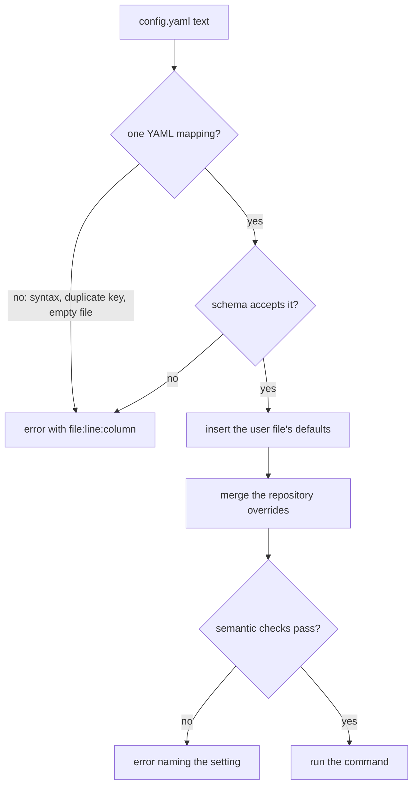
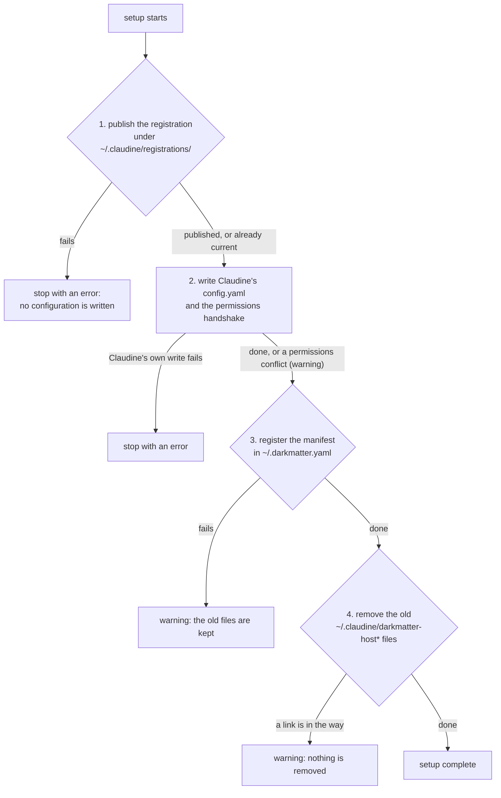
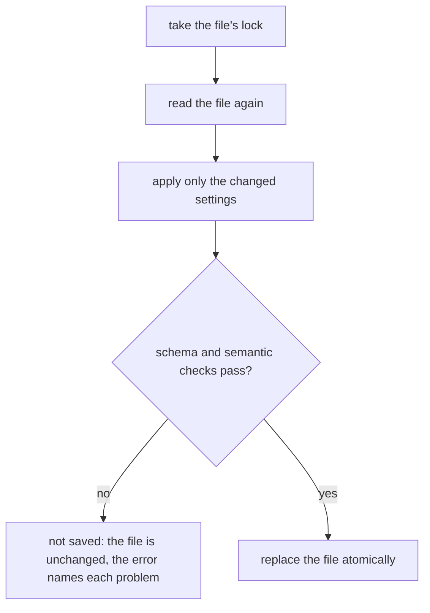

# Configuration files

Claudine reads two YAML files:

| Scope | File | What it may set |
|---|---|---|
| user | `~/.claudine/config.yaml` | every setting |
| repository | `{repo-root}/.claudine/config.yaml` | only the overrides listed below, plus `permissions` |

Both are described by one shipped schema,
[`claudine/registration/claudine-config.yaml`](../../registration/claudine-config.yaml):
its `user-config` type is the user file and its `repository-config` type is the
repository file. The schema is the authority for every setting's shape and for
the user file's defaults, so an editor with a SimplifiedSchema language server
(DMLS) can complete and check both files.

```yaml
# ~/.claudine/config.yaml
preferred_agent: claude
logging: true
protect:
  rules:
    git_destructive: false
actions:
  human_in_the_loop:
    - sound_effect:
        effect: doorbell
```

```yaml
# {repo-root}/.claudine/config.yaml
canonical_provider: codex
active_messenger: team   # the user's route named `team`
```

## How a file is read

Every command that needs configuration reads the files the same way, before
any hook action, agent, provider, or composition runs:



- **Strict.** A value of the wrong type is an error, never converted:
  `logging: "yes"` and `max_repeats: "30"` are refused. Duplicate keys,
  several documents, and an empty file are errors; write `{}` for a file that
  keeps every default.
- **Located.** Each problem names the file, line, column, and the JSON pointer
  of the value (`~/.claudine/config.yaml:4:12 at /protect/enabled: …`).
- **Closed.** A key the scope does not declare is an error at that key, and
  its line and column are the key's own. A repository file that sets `tts`,
  for example, fails. The same holds inside a setting that takes several
  forms: `tts: { provider: say, pitch: 3 }` is reported as the unknown key
  `pitch` at `/tts`, because no form of `tts` declares it, while a key one
  form does declare is never reported as unknown.
- **Semantic checks** run after the schema: sound effect names, Protect
  patterns and `allow_paths`, exit-expression regexes and `scope` agents, and
  that the active messenger route exists.

To check every file at once without running anything else, use
[`claudine doctor`](../cli/doctor.md). It reads the user files, and inside a
repository its files too, with these same rules, but never stops at the
first problem and never writes: a missing file is not created and a legacy
`config.json` is not converted. Unknown keys are listed, with their line and
column, under its `stray-config-keys` row. It shows where each problem is and
what kind it is, never the value; each remedy names a command that prints
the full message ([where the full message is printed](../cli/doctor.md#where-the-full-message-is-printed)).

## Defaults and inheritance

An explicit `null` is the same value as leaving the key out, at every level
of both files. An absent or `null` user setting takes the schema's default
(`logging: true`, `protect: true`, `prompt_for_missing: true`, the guard
thresholds, `tts.prewarm: true`, `steering.automatic.enabled: true`, …); an
optional setting without a default (`messenger`, `preferred_agent`,
`canonical_provider`, `exit_expressions`, and optional fields inside actions
or routes) is simply unset. An event whose action list or matcher is `null`
has none.

```yaml
logging: null        # same as leaving it out: `true`
steering:
  automatic: null    # same as leaving it out: `enabled: true`
actions:
  session_start: null   # no actions for this event
```

Every default is filled in, including the defaults of optional settings
inside a value you wrote. What a command reads is the completed value, not
the text of the file:

| You write | Claudine reads |
|---|---|
| `tts: { provider: say }` | `tts: { provider: say, gender: female, prewarm: true }` |
| `steering: {}` | `steering: { automatic: { enabled: true } }` |
| (no `steering` key) | `steering: { automatic: { enabled: true } }` |

Earlier releases filled only the required defaults, so the same files read
as `{ provider: say, gender: female }` and `steering: { automatic: {} }`, and
an unwritten `prewarm` or `enabled` was treated as on by the code that read
it. The switches behave the same; the difference is visible to anything
that inspects the loaded configuration, such as an editor's completion or a
library caller.

An event's action list and matcher, when written, must say something in
either file: `session_start: []` and `session_start: ""` are errors. Leave
the event out, or write `null`, for an event with no actions; a file that
still lists one as `[]` fails to load until that line is deleted.

A repository setting is an override, so a repository file declares no
defaults of its own: an absent or `null` override inherits the user's value.
The repository accepts `canonical_provider`, `actions`, `matchers`,
`active_messenger`, `exit_expressions`, `guard_settings`, `steering`, and
`permissions`.

| Repository value | Effect |
|---|---|
| `active_messenger` absent or `null` | the user's `messenger.active_config` |
| `active_messenger: team` | the user's route named `team` |
| `actions.<event>` / `matchers.<event>` | replace the user's entry for that event; `null` keeps the user's entry |
| `guard_settings` | replaces the user's whole setting; `null` inherits |
| `steering.automatic.enabled` | `true` or `false` overrides the user's value; absent or `null` inherits it |

An override that is written must say something: an empty `actions: {}`,
`matchers: {}`, `steering: {}`, or `steering: { automatic: {} }` is an error
(leave the key out instead).

A repository cannot turn messaging off. Earlier releases read
`active_messenger: null` as "no messaging in this repository"; it now
inherits the user's route like an absent key, and `claudine config` no
longer offers a "(disabled)" choice for the repository. For the same reason
a repository cannot clear an event's actions (`[]` is an error and `null`
inherits); it can only replace them with other actions.

## Actions and messenger routes

An action and a messenger route are each a mapping with one key that names
its kind and holds that kind's fields, so each kind's defaults live under its
own key:

```yaml
actions:
  session_start:
    - sound_effect: { effect: doorbell }      # volume and speed default to 1.0
    - bash: { command: ./notify.sh }
  turn_complete:
    - report: {}                              # no fields to set
messenger:
  active_config: team
  configurations:
    team:
      slack: { channel_id: C012345ABC }       # bot_token_env defaults to SLACK_BOT_TOKEN
    alerts:
      discord_webhook: {}                     # webhook_url_env defaults to DISCORD_WEBHOOK_URL
```

An entry with no key, two keys, an unknown kind, or `null` in place of the
fields is an error. Earlier releases wrote the kind as a field
(`- type: bash` beside `command:`, `provider: slack` beside `channel_id:`);
such a `config.yaml` fails to load, and the message spells each entry in the
keyed form, at that entry's location:

```yaml
actions:
  session_start:
    - type: bash          # the earlier flat form
      command: ./notify.sh
```

```text
… at /actions/session_start/0: an action is now written as a mapping keyed by its kind, not with `type:`; write `{ bash: { command: "./notify.sh" } }`
```

The rest of a flat entry is still judged as its keyed form would be, and
reported beside the migration message at the key the file wrote: a
misspelled setting (`timout: 5` beside `command:`) is an unknown key at
`/actions/session_start/0/timout`, on the misspelled key's own line, and a
wrong-typed one (`timeout_ms: soon`) is an invalid value at
`/actions/session_start/0/timeout_ms`. The keyed spelling the message gives
copies every field as written, a misspelled one included, so correct those
too.

The rules that judge the whole file are checked beside a flat entry too, so
one load names every edit the file needs. Writing both `preferred_agent` and
`favorite_agent` is reported at `/favorite_agent`, and an exit expression
that writes both `pattern` and `patterns`, or neither, at its own entry
(`/exit_expressions/0`, or `/exit_expressions/rules/0` in the layered
form), whatever form the actions and routes take and whatever else the
schema refuses:

```yaml
exit_expressions:
  - pattern: STOP         # /exit_expressions/0: write `pattern` or `patterns`, not both
    patterns: [HALT]
actions:
  session_start:
    - type: bash          # /actions/session_start/0: the keyed spelling
      command: ./notify.sh
```

Replace each flagged entry with the spelling the message gives. Kinds are
written in snake_case (`discord_webhook`, `slack_webhook`), and the message
already converts a hyphenated `provider: slack-webhook`. Only the file
format changed: the Rust types `HookAction` and `MessengerProviderConfig`
and their own serialized form (`type:` / `provider:` tags) are unchanged for
library callers. The action fields are listed in
[Configuring Actions](configuring-actions.md#action-types) and the route
fields in [Messaging Configuration](configuring-actions.md#provider-configs).

## Permissions

`permissions` is Darkmatter's block (which files a schema slot may read, which
shell commands run without a prompt, and network access). Claudine's schema
imports Darkmatter's type rather than declaring it, so the block is checked
the same way wherever it is written. The value may also be a file reference to
another YAML file whose own `permissions` holds the block. Claudine keeps the
block as written; Darkmatter interprets it. See
[Permissions](../../../darkmatter/docs/topics/permissions.md) for what the
block allows and
[Darkmatter's configuration](../../../darkmatter/docs/topics/configuration.md)
for the files that hold it.

In Claudine, `network` decides only what composition may fetch: a `::file` or
`::code` URL, a `prologue` or `epilogue` URL, and a URL given to a read-side
function such as `load_data`. With `network: allow` in effect, this prompt
includes the remote file; with the default `deny`, preparation fails and the
host is never contacted. `network: ask` fails the same way, with an error
naming the setting, because Claudine does not ask about composition reads
(set `allow` to fetch):

```markdown
::file https://example.com/guidelines.md
```

A `$schema` slot that reads a URL is the one read Claudine can ask about. It
is resolved before the agent launches, in a real run and a dry run alike,
and the composition reuses that result:

| `network` | Real run | Dry run |
| --- | --- | --- |
| `allow` | fetches, then launches | fetches |
| `ask` | asks on a terminal; with none, fails with `dm.schema.slot_approval_required` | sends nothing; a `not checked` row |
| `deny` | fails with `dm.schema.slot_network_denied`, sending nothing | the same refusal as an error row |

An invalid `network` value (`aswk`, `""`, a list) is not one of these three:
a real run still runs a prompt that reads nothing remote, refuses every remote
read with the configuration error, and sends nothing; a dry run reports the
setting once as an error at its value, whatever the prompt reads. An absent or
`null` value is `deny`.

```yaml
# schema.yaml, referenced as `$schema: ./schema.yaml`
kind: schema
$schema:
    os: "enum({{ load_data('https://example.com/os.yaml', 'string[]') }})"
```

A refused slot stops the run with `composition.schema_slot_failed`, whose
`slot_code` detail is the slot's own code, so a `failure` handler can tell
the cases apart (`when: "err.detail.slot_code == 'dm.schema.slot_network_denied'"`).
Claudine has no per-run host allowance, so its refusals name the
`permissions.network` setting as the remedy.

A `--dry-run` reports a refused slot by the slot's own code, at the slot in
the schema file, once for each task that reads the schema (for example
`dm.schema.slot_forbidden_binding at schema.yaml:3:20` for a slot that reads a
bare document key), never also as `composition.schema_slot_failed`.

It does not limit the agent's own network access once it runs.

### Darkmatter's permissions

Once Claudine is set up, its file holds the permissions block and
Darkmatter's `~/.darkmatter.yaml` points at it, so a Claudine user finds every
permission in one place:

```yaml
# ~/.darkmatter.yaml
permissions: ~/.claudine/config.yaml
register:
    - ~/.claudine/registrations/darkmatter/manifest.yaml
```

The `register` entry is Claudine's host registration: setup publishes it
before writing either file and writes the entry last, so `md` and DMLS
recognize Claudine documents anywhere (see
[The published host registration](schemas.md#the-published-host-registration)).
Of the entries naming the new manifest or the one earlier releases
published, `~/.claudine/darkmatter-host.yaml` (even when that file no longer
exists), in any spelling, the first is kept, rewritten in place to the new
path with the comment on its line, and every later one is removed together
with the comment on its line; other hosts' entries and the remaining
comments are kept. The old manifest and its `~/.claudine/darkmatter-host/` folder are
removed once the entry is written. The entry is written even when the
`permissions` handshake below reports a conflict, and a repository's
`.darkmatter.yaml` is never changed.

Setup runs on the first `claudine` command that finds no configuration,
and whenever you run [`claudine setup`](../cli/setup.md). The command is how
an existing install moves from an earlier registration format (the retired
format 1 layout or an older format 2 manifest at the fixed path) to the
current format 3 manifest in place: it writes members first and the manifest
last, never asks a question, keeps every setting, unrelated `register`
entry, and comment you wrote, and changes nothing when run again.

```sh
claudine setup
```

Setup runs these steps in this order, so a step that fails leaves what
the earlier steps wrote in a usable state:



Publishing again later, without touching either configuration file, is
`claudine registrations publish`; see
[Hand edits, recovery, and overrides](schemas.md#hand-edits-recovery-and-overrides)
for when you need it.

Setup writes Claudine's own file, then Darkmatter's. On an existing
configuration, `claudine setup` changes Claudine's file only where this
table gives it a `permissions` block:

| `~/.darkmatter.yaml` before setup | What setup does |
|---|---|
| missing, or without `permissions` (`permissions: null` counts as without) | writes the reference above (and any other missing Darkmatter setting at its default); Claudine's file gets the default block if it has none |
| an inline `permissions` block | copies the block into `~/.claudine/config.yaml`, then replaces it in `.darkmatter.yaml` with the reference |
| an inline block, and Claudine's file already has a different one | changes neither block and warns, naming both files; the inline block stays in force until you keep one of them |
| a reference to `~/.claudine/config.yaml` | nothing, except that Claudine's file gets the default block if it has none |
| a reference to another file | nothing; Claudine does not take over another program's block |

Both files are written in one locked transaction, Claudine's first: if the
second write fails, `.darkmatter.yaml` still holds its original block, and
the next setup finishes the move. Comments and every other setting in both
files are kept, and running setup again changes nothing. A `null`
`permissions` in either file is read as no block, as both programs' loaders
read it: setup never copies `null`, and a Claudine file holding `null` gets
the default block. Repository setup
does the same with `{repo-root}/.darkmatter.yaml` and
`{repo-root}/.claudine/config.yaml` (referenced as `./.claudine/config.yaml`),
and fails before writing anything outside a repository. With no home
directory, setup writes only Claudine's file and says that Darkmatter's was
not set up.

`claudine doctor` reports the state of this handoff for the user scope, and
for a repository whose two files both exist, in its
`darkmatter-permissions` row. `claudine doctor --fix` makes the same move
as setup when Darkmatter's file has no `permissions` or an inline block
Claudine can take over, with the same order and the same guarantee that a
failed second write leaves the original block in force. Unlike setup, it
edits only existing, valid files (a `.darkmatter.yaml` whose `register`
setting is invalid is left for you to correct, since Darkmatter's writer
would refuse the edited file, and a scope whose edit would reach an inline
root mapping or a `permissions` value with an anchor or tag, which
Darkmatter's format-preserving editor cannot change in place, is left for
you to rewrite in block form), never writes through a
symbolic link, never
writes a reference to a Claudine file that a link places outside its scope
(your home, or the repository), and never resolves a conflict: two different blocks stay an error until you
keep one. See [`claudine doctor` → Permissions repair](../cli/doctor.md#permissions-repair).

The same steps are available to Rust callers as
`claudine::config::setup::setup_with_darkmatter(context, scope, write)`,
where `write` is the caller's own write of Claudine's file;
`claudine::config::setup::setup_claudine(context, scope, write)` runs the
whole setup, publication, registration, and removal of the old files
included, and reports each step. To undo the move,
`md init --inline` writes the block back into `~/.darkmatter.yaml`; see
[`md init`](../../../darkmatter/docs/cli/init.md).

## How Claudine writes these files

Claudine writes its configuration in three places: the `claudine config`
editor, the `claudine config set …` setters, and first-run setup. None of them
rewrites a whole file. Each one names the settings it changes, and only those
values are edited in place, so a hand-edited file keeps its comments, blank
lines, key order, quoting, and every key the writer did not touch, including a
`permissions` block that Darkmatter or another program maintains.

| Writer | What it changes |
|---|---|
| `claudine config` (the editor) | each setting you changed during the session, compared with the values it read when it opened |
| `claudine config set favorite-agent <agent\|none>` | `preferred_agent` only (an older file that spells it `favorite_agent` keeps that spelling) |
| `claudine config set prompt-for-missing <true\|false>` | `prompt_for_missing` only |
| first-run setup | the values setup chose that differ from the defaults, then [Darkmatter's permissions](#darkmatters-permissions) |

For example, with this file open in the editor, turning logging off changes
one line and nothing else:

```yaml
# my settings
preferred_agent: claude   # the one I use most
logging: true             # becomes `logging: false`

permissions:              # left exactly as it is
  network: deny
```

Every save follows the same steps:



- **Concurrent writers keep each other's edits.** The lock is the sibling file
  `config.yaml.darkmatter-lock`, shared with Darkmatter's own writer, and the
  file is re-read while it is held. Two editor sessions that change different
  settings both keep their change, and a `permissions` change made while the
  editor was open survives the editor's save. The lock file stays in the
  directory; leave it there.
- **What a change means.** A changed list (an event's actions, for example) is
  written as a whole. A setting you cleared is removed from the file; if the
  file never wrote it (its value was a default), nothing is written, because
  the default applies again either way.
  Removing a repository file's last setting leaves `{}`; the editor never
  deletes a configuration file.
- **Nothing to save writes nothing.** When no setting changed, the file is not
  touched, not even its modification time.
- **An invalid result is refused.** If the edited file would fail the schema
  or a semantic check (an unknown sound name, say), nothing is written and the
  command reports that the configuration was not saved, listing each problem
  with the line and column it would have had. A failure to take the lock within
  two seconds, or to replace the file, is reported the same way.
- **New files.** A missing user file is created from the schema's defaults (the
  same values an empty `{}` file would take) plus the values setup chose. A
  repository file is created only when there is an override to write, and it
  holds only that override. Running setup again with the same choices leaves
  the file byte-for-byte unchanged.
- **Indentation.** A new file is indented the way its location asks. Inside a
  Git worktree that is the worktree's preference for `.yaml` files (an
  `.editorconfig` `[*.yaml]` section with `indent_size = 2` gives two
  spaces); anywhere else, including `~/.claudine/config.yaml` in a home that
  is not a worktree, it is four spaces, with list items indented under their
  key:

  ```yaml
  permissions:
      file-read:
          - ./*.txt
          - ./*.md
  ```

  An edit to an existing file never re-indents it: a value it adds copies the
  indentation of the file's own blocks, and only falls back to the location's
  preference when the file has no block to copy. See
  [Darkmatter's config writes](../../../darkmatter/docs/topics/config-writes.md#where-the-indentation-preference-comes-from).

## Converting a `config.json`

Earlier versions used JSON5 files named `config.json`. The conversion below is
temporary: it will be removed a few releases after the move to YAML, and a
`config.json` left in place after that is no longer read. Until then, loading
configuration at either canonical location handles the legacy file first:

| Files in the `.claudine` directory | Result |
|---|---|
| `config.json` only | written to `config.yaml` with the same values, actions and messenger routes rewritten in the [keyed form](#actions-and-messenger-routes) (a hyphenated kind such as `slack-webhook` becomes `slack_webhook`), then `config.json` is renamed `config.json.bak`; one notice names both files and says JSON5 comments were not carried over |
| `config.yaml` only | used |
| both | `config.yaml` is used; a warning says `config.json` is ignored |
| a pre-2026 per-provider `config.json` | renamed `config.json.bak` and ignored |

A conversion that fails (unreadable file, invalid JSON5, a duplicated key, a
number that cannot be kept exactly, or a value the schema refuses) leaves
`config.json` untouched, writes nothing, and stops with an error naming it.
The schema judges the converted, keyed value, so an empty event list
(`"session_start": []`) in the old file is refused like one in `config.yaml`;
delete it from `config.json` and load again. An
existing `config.json.bak` is never overwritten: if it holds the same bytes the
unchanged `config.json` is simply removed; if it differs, the conversion stops
and keeps both files.

The new file is indented as a [new file](#how-claudine-writes-these-files)
would be, and it is checked to read back as exactly the converted values
before anything is published; a failure there, or in writing it, leaves
`config.json` untouched and writes no `config.yaml`. It is published through
Darkmatter's locked configuration writer with a pending migration receipt (`config.yaml.darkmatter-migration.json`). If
the process stops after `config.yaml` is written but before `config.json` is
renamed, the next load finishes the rename. If `config.json` was edited in
between, it is kept and the load stops with an error; remove the receipt once
`config.yaml` holds your settings.

Only the canonical locations convert. A file passed explicitly at another path
is read as YAML exactly where it is, and shell completion never converts
anything.
