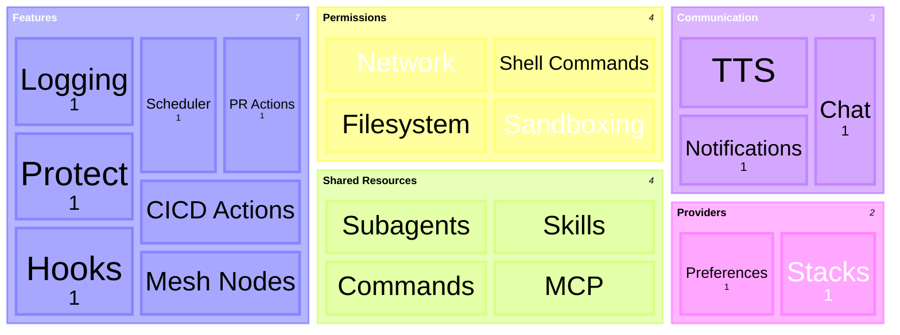

# Claudine Configuration Files

There are two Claudine configuration files:

1. **User Scoped:** `~/.claudine/config.yaml`
2. **Repo Scoped:** `{repo-root}/.claudine/config.yaml`

When using Claudine _outside_ of a git repo the only configuration that is used is the _user_ scoped configuration file. However, when inside a repo, the Claudine configuration is a merge of both files where the repo's configuration always overrides the user's configuration on a per-property basis.

The elements of the configuration are strongly typed using [Simplified Schema](simplified-schema/README.md) grammar and are defined with a **schema-trigger** so that they become activated when a user is working on one of these configuration files through an editor and provides useful context and guardrails (requires that the author be using [DMLS](darkmatter/dmls/README.md)).

- [Claudine Configuration Schema](claudine/schemas/configuration.yaml)

## Configuration Areas

### Permissions

The default policy in Claudine for permissions is "restrictive but ergonomic" and how that translates depends on the area being discussed.

- for the **network** the default URLs allowed only includes the git provider that hosts your "remote" (when in a git repo; nothing included when outside of a git repo)
- for the **file system** we default to:
    - [read, write, metadata]: all files in the repo (except for `.env*`) files
    - [metadata]: `.env*` in the repo
    - 

## Darkmatter Config Sharing

Claudine is a heavy user of [Darkmatter](darkmatter/README.md) under the hood and as a result there is a certain amount of configuration that is shared between the two solutions. Having this configuration being truly separate would not be in keeping with DRY (_don't repeat yourself_) principles so when either program detects the other's presence the configuration is moved to Claudine's configuration files and Darkmatter explicitly adds a file reference to the Claudine config file.

To better understand the details of this we need to know both _what_ configuration is shared across these two solutions and _how_ and _when_ this sharing takes place.

### What is Shared

Both configurations have a top level property called `permissions` and this is the area where configurations overlap. The three sub-properties nested under permissions that you need to be aware of are:

- **shell-commands**
    - Darkmatter allows for shell commands to be run and their output to be incorporated into Frontmatter properties or directly added to the prose document
    - However, by default, no shell commands are allowed but commands that the user deems safe can be added to this property as a "white list" of allowed shell commands
    - typically this list is managed "on demand":
        - when you run `md compose` or any of the claudine commands which use composition it will:
            - check for shell commands in the tree of documents being composed 
            - and if there are shell commands in the documents being composed that are _not_ on the whitelist then an interactive dialog will be presented to ask how you want to handle this
        - any approval can be made "one time" or accepted in 
- **file-reads**
    - Claudine and Darkmatter provide an [Expression Engine]() which allows for a bevy of safe, mutation free functions to be called without needing to white list these function calls
    - There are a few of these functions which can read from the filesystem. None of these functions _write_ to the filesystem 
- **network-urls**
