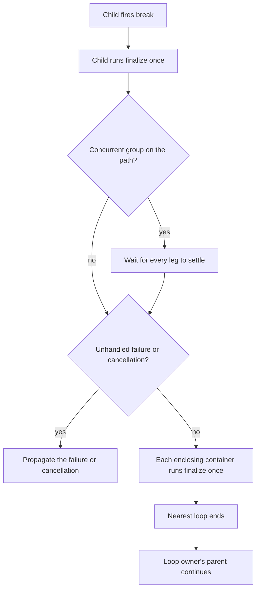

# Flow Control

Claudine runs three _executable primitives_: a markdown **document**, a **group** of tasks, and a **sequence** of steps. For any of them, Claudine lets the markdown (or YAML) author change the natural flow of execution through [lifecycle events](./lifecycle.md).

This page explains the directives and when to use each one. For edge cases and the exact runtime rules, see the [Flow Control Reference](flow-control-reference.md).

## An Example

A prompt asks an agent to write a file. The agent sometimes reports success without writing it, so the document checks for the file and sends the agent back to finish:

```yaml
---
prompt: "Write the release notes to @output/RELEASE.md"
success:
  - when: "!file_exists('@output/RELEASE.md')"
    then:
      - resume: "You finished without writing @output/RELEASE.md. Please create it now."
---
```

The pieces:

- `success` is the **event**. It fires when the agent finishes without an error. Its value is an ordered list of **items**, which Claudine runs top to bottom when the event fires.
- `when` is a condition, written as a Darkmatter expression. The actions under `then` run only when it is true; an optional `else` holds the actions for false. An item with no `when` always runs.
- `resume` is the flow-control directive. It continues the same agent session with a follow-up message.

[Lifecycle — Writing an Event](lifecycle.md#writing-an-event) covers the whole grammar: lists, dictionaries, `when`/`then`/`else`, and nesting.

## The directives

| Directive | What it does |
|-----------|--------------|
| [`stop`](#stop) | Ends this event. The run carries on with the outcome it already has. |
| [`skip`](#skip) | Skips the whole document or container before work starts. Only valid in `initialize`. |
| [`error`](#error) | Fails the run with a reason. |
| [`retry`](#retry) | Runs the prompt with a fresh session, or reruns a container from its first child. |
| [`resume`](#resume) | Sends a follow-up message to the same agent session. |
| [`proxy`](#proxy) | Hands the run to a different prompt document as _proxy_ for itself. |
| [`defer`](#defer) | **Planned:** suspends the whole run and schedules it to resume later, typically after a rate-limit window passes. |
| [`break`](#break) | Leaves the nearest enclosing loop, optionally with an exit code. |
| [`prep`](#prep) | Runs another executable primitive to prepare the environment, then returns control to the caller. |

Directives marked **planned** are part of the documented design and do not run yet. `defer` waits on scheduling in the `rendezvous` daemon; it is already parsed and validated like every other directive, so a malformed one is reported before anything runs, and reaching a valid one fails the event with a typed `LifecycleDeferNotImplemented` error, never a silent skip or a `stop`.

## Rules that apply to every directive

**A directive ends the whole event, except `prep`.** When a directive runs, nothing after it runs, in its own list or in any list that encloses it: a `retry` inside a nested `else` ends the event just as a `retry` at the top does. That is why an unconditional directive must be the **last** item in its list (a `when` item never counts as unconditional), and why a dictionary of verbs can hold at most one directive. `prep` is a call that returns, so items may follow it, even unconditionally; in a dictionary it still counts as the one directive and runs after the dictionary's other verbs. Put any messages you want to show *before* an ending directive:

```yaml
failure:
  - when: "err.category == 'cap'"
    then:
      - warn: "Usage cap reached, handing off to Codex"   # runs first
      - proxy: "@prompts/feature-codex.md"                # then ends the event
```

**Only the first directive reached fires.** Items run in order, and once one directive runs, later items are not reached. Put more specific conditions first.

**Ordinary events accept directives; cancellation is cleanup-only.** `cancelled` accepts only `stop` from the directive set; recovery in the following `finalize` is refused. Outside cancellation, `skip` is restricted to `initialize`. A directive reacts to *state*: an error, a missing file, an environment variable, a frontmatter value. An error is just one kind of state, so `retry` or `resume` works in `success` as well as in `failure`. `skip` only makes sense before anything has run and is therefore limited to `initialize`. Claudine checks this placement rule when it parses the document.

**Some directives need something that may not exist yet.** An event can accept a directive and still be unable to carry it out. `resume` needs a live agent session, so it fails in `initialize`, where no agent has started. `break` needs an enclosing loop, which a document cannot know about until it runs, since the loop may belong to the group or sequence that placed it. `defer` needs the scheduler. The [Flow Control Reference](flow-control-reference.md#what-each-event-can-do-at-runtime) lists these cases. When they happen you get a clear, typed error at the moment the directive fires instead of a silent no-op.

**`--dry-run` fires no lifecycle events.** A dry run never runs an event, so it never exercises a directive and never runs a `prep` target. It does parse and validate every event, so a malformed directive is still reported. Composition `$( … )` expansions still run with real effects, and so do sequence `shell:` tasks under `--dry-run-shell`; dry-run is not a filesystem sandbox. See [Sequences — Dry run](sequences.md#dry-run).

## Writing a directive

Each directive can be written in a **short form**, `verb: value`, or a **long form**, `verb: { parameters }`. Use the long form when you need an optional parameter:

```yaml
failure:
  - when: "err.is_transient"
    then:
      # short form
      - retry: 2
    else:
      # long form, same meaning plus a delay between attempts
      - retry:
          max_attempts: 2
          delay: "30s"
```

Values are literal text. To insert a variable or expression, wrap it in `{{ … }}`, for example `resume: "Fix the {{ err.code }} error"`. [Lifecycle — Action Forms](lifecycle.md#action-forms) covers both forms in detail.

## `stop`

Ends the current event without changing anything else. If the run was succeeding it still succeeds, and later events still fire.

```yaml
success:
  - when: "env.CI == 'true'"
    then:
      - stop                            # don't announce anything on CI
  - say: "Review finished"
```

`stop` takes no arguments. `- stop`, `- stop:`, and `- stop: []` all mean the same thing.

`stop` in `initialize` ends only `initialize`: the document still composes and the agent still launches. To opt a document out of its run, use [`skip`](#skip).

## `skip`

Opts the whole document out of the run. The agent is never launched, and no later events fire for this document (`finalize` and `loop` do not fire either). If the document is one step of a [sequence](sequences.md), the sequence moves on to the next step.

`skip` is only valid in `initialize`, the first event, which fires before any work starts.

```yaml
initialize:
  - when: "file_exists('@output/RELEASE.md')"
    then:
      - skip                            # already done, nothing to do
```

**Why an opt-out uses `skip`, not `stop`.** `stop` ends the event it is in and nothing more, so a `stop` in `initialize` still lets the document compose and launch an agent that has nothing to do. `skip` ends the document's run. For example, a commit step that finds nothing staged should launch nothing:

```yaml
initialize:
  - when: "length(current.staged_files) == 0"
    then:
      - message: "nothing staged; no commit"
      - skip                            # with `stop`, the agent would still launch
```

A skipped document adds no entry to `seq.outputs`, so a later step reading `seq.outputs` sees only the steps that ran.

`skip` is also how you make a [loop](looping.md) run zero times, because a loop always runs its body at least once.

A `when:` guard on the sequence step or group leg that names a primitive decides whether that primitive runs at all, including whether its loop runs even once; see [Sequences — Task guards](sequences.md#task-guards-when). `skip` stays for decisions a document makes about itself after it has been selected to run.

## `error`

Fails the run and records a reason. The reason reaches later events through the `err` variable, so a `failure` or `finalize` event can react to it.

```yaml
success:
  - when: "!file_exists('@output/RELEASE.md')"
    error: "The agent reported success but never wrote RELEASE.md"
```

Raising `error` in `success` or `finalize` turns a successful run into a failed one. In `success` the run then goes through `failure` and `finalize` as if the agent itself had failed. Use `error` when an agent says it is done but the result does not meet your requirements.

If neither `failure` nor `finalize` recovers the run with `retry`, `resume`, or `proxy`, the failure is the run's outcome, the same as an `error` raised in `start`:

| Where the document runs | Outcome |
|-------------------------|---------|
| `compose` / `inline-compose` | Exits `1` and prints `Error: <reason>` once. |
| A `sequence` step | The failure reaches the enclosing container. Without recovery the sequence stops. |
| A `loop:` iteration | The iteration fails, and the loop stops unless a `failure` event handles it. |

A recovery that works reports the recovered attempt's outcome, so a `retry` that succeeds exits `0` with no error left over from the earlier attempt. Messages that already fired, such as a `success` `info:` line, are kept. Without a reason, the error reads `lifecycle success error`.

| Parameter | Required | Meaning |
|-----------|----------|---------|
| `reason` | no | Human-readable explanation. This is the short-form value. |

## `retry`

Runs the prompt again with a **fresh** agent session. The agent starts over and does not remember the previous attempt. On a sequence or group, `retry` reruns the current attempt after the old children settle. A non-looping container preserves runtime mutations and clears abandoned child results. A looping container restores the current pass's entry state, retaining completed passes; see [Retry inside a looping container](looping.md#retry-inside-a-looping-container). It does not repeat `initialize` or run the abandoned attempt’s `finalize`. Container `retry.with` values become runtime writes for the new attempt. Disk edits and external effects remain. See [Container lifecycle and recovery](sequences.md#container-lifecycle-and-recovery).

```yaml
finalize:
  - when: "err"
    then:
      - retry: 1                        # one more attempt, then give up
```

The number is how many *additional* attempts are allowed. `retry` with no number allows one. When the attempts are used up, `retry` does nothing more and the run ends with the outcome it already had.

| Parameter | Required | Meaning |
|-----------|----------|---------|
| `max_attempts` | no | Extra attempts allowed. Defaults to `1`. This is the short-form value. |
| `delay` | no | Wait before each retry, such as `"30s"` or `"5m"`. Defaults to no wait. |
| `backoff` | no | `fixed` (the default) waits the same `delay` every time. `exponential` doubles the wait after each retry. |
| `with` | no | Frontmatter values for the next attempt only. Long form only. |

```yaml
failure:
  - when: "err.is_transient"
    then:
      - retry:
          max_attempts: 3
          delay: "10s"
          backoff: exponential          # waits 10s, then 20s, then 40s
```

**Telling the next attempt why.** A fresh session does not remember the failure, so `with:` can pass it along. Its entries become frontmatter properties of the retried attempt's fresh read of the document, so the prompt can mention them. They apply to that one attempt only, and nothing is written to disk:

```yaml
failure:
  - retry:
      max_attempts: 3
      with:
        reason: "{{ err.msg }}"
```

A later `retry` without `with:`, and a `resume`, do not see these values. The [reference](flow-control-reference.md#retry-overlays) covers how they combine with a `proxy` overlay and what happens when one fails to evaluate.

## `resume`

Continues the **same** agent session by sending it a follow-up message. The agent keeps everything it has already read and done. That makes `resume` usually better than `retry` when the agent was on the right track but stopped early.

```yaml
---
prompt: "Refactor @src/engine.rs and make the test suite pass"
timeout: 20m
failure:
  - when: "err.category == 'timeout'"
    resume: "You were stopped by a timeout. Continue where you left off and finish the task."
---
```

`resume` needs a live agent session. It fails in `initialize` and anywhere else no agent has been launched yet.

| Parameter | Required | Meaning |
|-----------|----------|---------|
| `message` | **yes** | The follow-up prompt. This is the short-form value. |
| `max_attempts` | no | How many times this `resume` may fire. Defaults to `1`. |

`resume` takes no `with:` (`LifecycleWithUnsupported`): it continues a live session rather than starting a fresh read. Use `set` for values the rest of the run should see.

## `proxy`

Hands the rest of the run to another prompt document. That document starts from its own `initialize` and takes over completely: its events, its agent, and its output. The original document's remaining events do not fire, so a `proxy` from `success` skips the original's `finalize`.

A common use is switching to another agent when one hits a usage limit:

```yaml
---
agent: claude
prompt: "Implement the feature described in @spec.md"
failure:
  - when: "err.category == 'cap'"
    then:
      - warn: "Claude usage cap reached, handing off to Codex"
      - proxy: "@prompts/feature-codex.md"
---
```

Here `@prompts/feature-codex.md` is the same task with `agent: codex` in its frontmatter.

The target is prepared exactly as if you had run it directly with `claudine compose`, including the same validation and shell approval. If the target file does not exist, the handoff fails with an error instead of silently doing nothing.

**Target paths.** A plain path such as `next.md` is looked up next to the current document first, then at the repository root. A path starting with `./` or `../` is relative to the current document only. `@` searches the project's usual prompt locations, then your home prompt directories. The [reference](flow-control-reference.md#how-a-proxy-target-is-found) lists every prefix.

**Passing values to the target.** The long form accepts a `with:` mapping. Its entries become frontmatter properties of the target for this handoff only, and nothing is written to disk:

```yaml
success:
  - proxy:
      target: "@prompts/next.md"
      with:
        attempt: "{{ iteration }}"
        label: "phase-{{ iteration }}"
```

`with:` values are evaluated once, in the current document, when the directive fires, and the target receives the results as data: text an agent wrote stays text there, even if it contains `{{ … }}` or `$( … )`. Values the caller passed on the command line (`--set key=value`) still win over `with:`. The overlay applies only to this target and is not passed on to further handoffs. The [reference](flow-control-reference.md#passing-values-with-with) covers types, precedence, errors, and the security model.

| Parameter | Required | Meaning |
|-----------|----------|---------|
| `target` | **yes** | The document to hand off to. This is the short-form value. |
| `with` | no | Frontmatter values for the target. Long form only. |

## `defer`

> **Planned.** Claudine already parses `defer` and checks its placement, but it depends on scheduling in the external `rendezvous` daemon, which does not exist yet. Until it does, every `defer` fails with a `LifecycleDeferNotImplemented` error.

Suspends the **whole run** and schedules it to resume later. The primary use is a rate limit: the agent reports that its usage window is exhausted, and the right response is to wait for the window to reset and then carry on, not to fail and not to hand off.

```yaml
failure:
  - when: "err.category == 'cap'"
    then:
      - warn: "Usage cap reached; resuming when the window resets"
      - defer: "{{ err.retry_after || '1h' }}"
```

What "the whole run" means: `defer` acts on the root invocation, whatever primitive fired it. A `defer` raised by a document that is one step of a sequence, or one task of a group, suspends the sequence or group along with it. When the run resumes it picks up at the point where `defer` fired, so earlier steps are not repeated. Deferring only the current step would leave the rest of the sequence running against an agent that cannot answer, which is never what a rate limit calls for.

Nothing else in the run happens while it is suspended: no later events fire, no later steps start, and no agent is launched. The `rendezvous` daemon holds the run and restarts it when the delay expires.

| Parameter | Required | Meaning |
|-----------|----------|---------|
| `delay` | **yes** | How long to wait before resuming, such as `"5m"` or `"1h"`. This is the short-form value. |
| `reason` | no | Human-readable explanation, shown when the run is suspended and again when it resumes. |

## `break`

Leaves the nearest enclosing [loop](looping.md). `break` is accepted in every event except `cancelled`, and in the loop gate. The loop may belong to a different primitive than the one raising `break`: a document's own `loop:`, or a looping group or sequence around the document. A document that is one task of a looped group ends the group's loop, and a group that is one step of a looped sequence ends the sequence's loop. With nested loops, only the nearest one ends; an outer loop continues and checks its own condition as usual.

```yaml
success:
  - when: "frontmatter(review, 'ready') == true"
    then:
      - message: "Review marked the work ready"
      - break: "ready"
```

**What a `break` skips, and what still runs.** Like every directive, `break` ends the current event: the rest of that event is skipped, while its earlier actions and mutations stand. Between the `break` and its loop:

- no further event fires on any primitive, except `finalize`, which runs once on each primitive where it has not already run;
- no later sibling task starts, at any level up to the loop's owner;
- the loop ends without its gate, its condition, or its per-iteration `action`.

A `break` fired from `finalize` or from the loop gate never re-runs cleanup.



**From `initialize`.** Nothing composes or launches, nothing is appended to `seq.outputs`, and the document's `finalize` runs. It is not a failure. This is the difference from `skip`, which also suppresses cleanup.

**Inside a concurrent group.** A `break` whose loop lies outside the leg is *pending*: sibling legs, including ones still queued behind `max_parallel`, run as usual, and admission does not stop. Once every leg has settled, the group carries the first breaking leg in declaration order, not in completion order. Each leg records its own break.

**A failure always beats a pending break.** An unhandled sibling failure, a failing `finalize`, or a `break` fired from `failure` all fail the run instead. A leg failure that `fail_fast: false` handles does not defeat the break. Ctrl-C overrides it (exit `130`), and a `retry` discards it.

**Exit code.** When the broken loop is the root invocation's — `claudine compose` of a looping document, or a looping root sequence — the process exits with `code`. An inner loop's `code` appears only in the summary line, and the run continues. A broken loop prints an info line `loop broken: <reason> (code N)`, or `loop broken (code N)` without a reason.

**Partial results.** Each container between the `break` and its loop publishes the work it completed, once, after its own cleanup. There is no placeholder for children that never ran and no synthetic break entry. A document broken before it launched publishes nothing. In `group.legs`, a leg that broke before doing any work is `skipped` with a null output.

**No enclosing loop.** A `break` fired outside any loop fails that event with a typed `LifecycleBreakWithoutLoop` error ("… fired outside any loop"), in the same class as `resume` with no session: a document cannot know at parse time whether it will be placed inside a looped group or sequence. `no_error` does not suppress it.

| Parameter | Required | Meaning |
|-----------|----------|---------|
| `reason` | no | Human-readable explanation, recorded as the loop's outcome. This is the short-form value. `""` is an explicit empty reason. |
| `code` | no | Process exit code, an integer from `0` to `255`, for a loop that ends through this `break`. Default `0`. |

The accepted spellings are a bare `- break`, `break: null` or `break: []` (no reason), `break: "reason"`, and the long form `break: { reason, code, no_error }`. A reason must be text: a number, a list, or a mapping is an error, and so is `break: [reason]`. `code` must be a YAML integer in range; `256`, `-1`, `1.5`, `"2"`, and `null` are errors, as is any other parameter. An unconditional `break` must be the last item in its list.

## `prep`

Runs another executable primitive to _prepare_ the environment, then returns control to the caller. `prep` is accepted in every event except `cancelled`, and in the loop gate. Where `proxy` is a hand-off, `prep` is a call: the target runs to completion, and the caller's event continues with the next item, including the items after the conditional branch that made the call.

```yaml
# commit.md — stage the tree first when the caller asks for it
initialize:
  - when: "stage == 'all'"
    then:
      - prep: "@prompts/_git/stage-all.md"
  - when: "length(current.staged_files) == 0"
    then:
      - skip
```

**The target runs as an invocation of its own**, in the same process (never a spawned `claudine`): its own `initialize`, schema check, shell approval, runtime layer, output accumulator, and output. A document target runs like `compose`, or like `inline-compose` when its frontmatter `prompt:` is a string; a sequence document or YAML sequence file runs like `claudine sequence`. Running a `kind: group` file as a target is **planned**; today the call fails with the sequence command's "not directly executable" error. The target path resolves relative to the document that authored the directive.

**What goes in.** The caller's setters and its `loop`, `seq`, and `group` roots do not reach the target. The `with:` overlay becomes the target's only caller values, as data: a `{{ … }}` the caller produced is never evaluated again.

**What comes back:** only what the target wrote to disk. The caller sees it through fresh file reads or its next preparation. The target's frontmatter, loop frames, and `set` writes never merge back, and its output is reported under the target, not appended to the caller's `seq.outputs`.

**From `initialize`.** The target is prepared and approved on its own, while the caller's `initialize` stays shell-free: a `shell` beside the `prep` is still refused. The caller's own preflight and composition run after the target returns, against the files as they are then.

**Approval.** The target is approved as its own invocation when it runs, under the caller's approval flags (`--yolo`, policy). Listing `prep` targets in a sequence's front-loaded approval is **planned**.

**Success and failure.** A target that exits `0` returns, including one whose `initialize` skipped and one whose own root loop ended by `break` with code `0`. Any other status — a failure, a non-zero root `break` code, an interrupt — fails the call. A failed call is an action failure of the caller's current event (`LifecyclePrepFailed`: "`prep` of `<target>` failed: <cause>"): it takes the event's ordinary error route, and `no_error: true` on the `prep` tolerates it like a failed `shell` action. In `failure` or `finalize` the event is not re-entered and the original error stays primary. Ctrl-C during a target cancels the whole run (exit `130`).

**Cycles.** Calls and handoffs share one cycle domain and `proxy`'s hop limit of 16 over the active chain, so a target cannot `prep` or `proxy` a document with an active call (`LifecyclePrepCycle`: "would re-enter an active call or exceed the hop limit"). Returning releases the call, so calling the same helper again, or on every pass of a loop, is legal. Concurrent group legs keep separate chains.

**Inside the target.** A target may `proxy`; the document it hands to owns the rest of the target's run, and control returns to the caller when that run ends. A `break` in the target cannot reach the caller's loop: without a loop of its own it is the "outside any loop" error, which fails the call. `timeout` and `step_timeout` apply per provider child, and a target inherits the caller's flags, so its children get the same limits; there is no invocation-wide deadline to reset.

| Parameter | Required | Meaning |
|-----------|----------|---------|
| `target` | **yes** | The document or sequence to run first. This is the short-form value. |
| `with` | no | Frontmatter values for the target, as for `proxy`. Long form only. |

The accepted spellings are `prep: "@target.md"` and the long form `prep: { target, with, no_error }`. The target must be a non-empty string (a file reference or a whole-value `{{ … }}`); a missing, empty, numeric, or list target is an error. `with` follows `proxy.with` exactly: omitted means no overlay, `with: {}` is an explicit empty overlay, and `null`, a string, or a list is an error. A `prep` in `initialize` is not a shell, so it passes the shell-free check while a `shell` beside it is still refused. An unconditional `prep` may be followed by other items.

## Choosing a directive

| Situation | Reach for |
|-----------|-----------|
| The agent finished, but the result is incomplete, and it was on the right track | `resume` |
| The agent got confused, or the failure looks random | `retry` |
| A different prompt or agent should do the work | `proxy` |
| The result is unacceptable and should count as a failure | `error` |
| The document has nothing to do on this run | `skip` (from `initialize`) |
| The rest of the event should not run | `stop` |
| The agent hit a rate limit and the run should wait it out | `defer` (planned) |
| The loop has done its job early, or should stop for a human to look | `break` |
| Another prompt must run first, and control should come back | `prep` |

These combine well across events. For example, `success` can raise `error` when an artifact is missing, and `finalize` can then `retry` once. The [verify-then-retry example](lifecycle.md#verify-an-artifact-on-success-then-retry-once-from-finalize) shows the full document.

## Related

- [Flow Control Reference](flow-control-reference.md): runtime limits per event, retry and resume details, and `proxy` handoff semantics.
- [Lifecycle](lifecycle.md): every event, every action type, and the `err` fields you can match on.
- [Looping](looping.md) and [Sequences](sequences.md): repeating a document, and running several documents in order.
