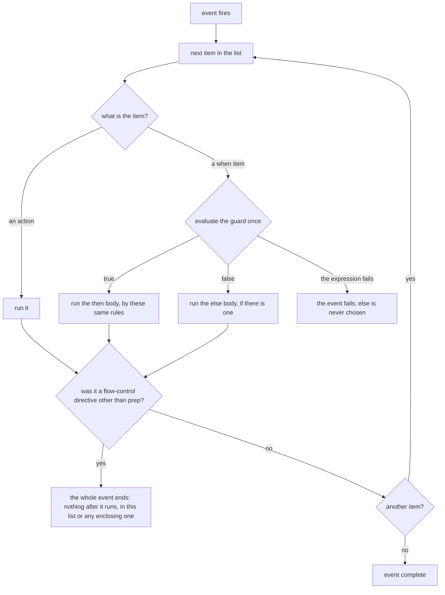
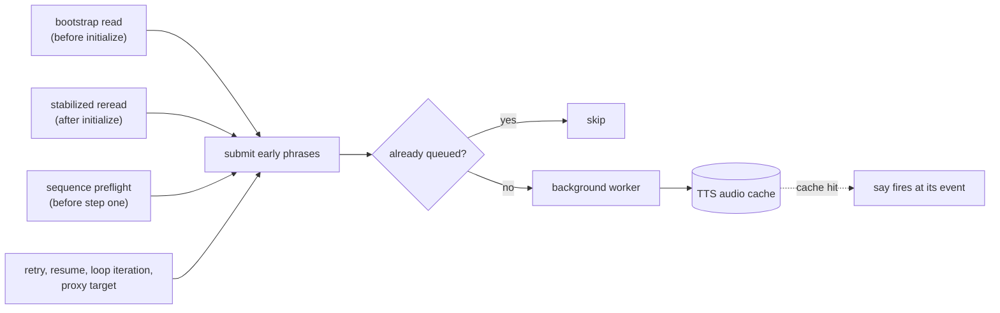
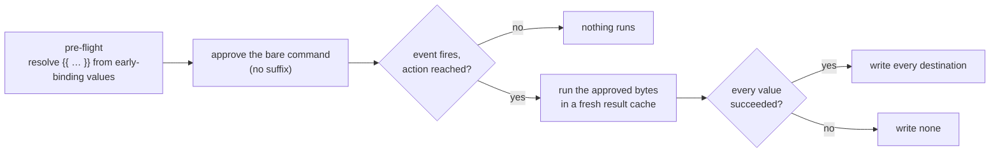

# Composition Lifecycle

A Claudine composition document can react to the key moments of its own run:
print a status line before the agent starts, speak when it finishes, run a
check, retry on failure, or hand the work to another prompt. You declare these
reactions in the document's frontmatter, one **lifecycle event** at a time.
Each event holds an ordered list of **actions**, and the list runs top to
bottom when the event fires.

```yaml
---
prompt: "Write the release notes to @output/RELEASE.md"
start:
  - info: "starting the release notes"
success:
  - effect: "confirmation"
  - say: "release notes written"
failure:
  - when: "err.is_transient"
    then:
      - warn: "transient failure; trying once more"
      - retry: 1
    else:
      - notify: "release notes failed: {{ err.msg }}"
---
```

This page covers every event, how to write its actions, and what each action
can read. [Flow Control](flow-control.md) explains the directives (`retry`,
`proxy`, …) in depth.

## Lifecycle Properties

Seven frontmatter properties are lifecycle events. An eighth, `loop`, is the
loop's configuration, and can carry lifecycle actions of its own (see
[Loop Gate Concerns](#loop-gate-concerns)).

| Property | Document | Sequence or group container |
|----------|----------|-----------------------------|
| `initialize` | After shell-free frontmatter bootstrap, before body discovery, shell preflight, and schema validation | When reached, before preparation; the root sequence initializes before static preflight. Shell-free. |
| `start` | Pre-flight checks passed; immediately before provider invocation | Preparation passed; immediately before children start. |
| `success` | The provider completed and the completion verdict passed | Children settled with a successful container outcome. |
| `blocked` | Preparation failed before the provider spawned | Container preparation failed before children started. |
| `failure` | Provider or completion verdict failed | An unhandled child failure reached this container. |
| `cancelled` | Cleanup after sibling-failure cancellation or Ctrl-C | Descendants settled after cancellation, before owner cleanup. |
| `finalize` | Once after the terminal event, unless skipped or transferred by recovery | Once after the final attempt; successful results publish afterward. |
| `loop` | Loop configuration and lifecycle gate after `finalize` | A group's or sequence's loop gate runs after each pass's `finalize`, as a document's does. |

`cancelled` accepts communications (`say`/`speak`, `effect`, `message`,
`notify`, `stdout`, `stderr`, `info`, `warn`, `success`), expression side
effects, `set`, `shell`, and `stop`, including conditional branches. It rejects
`skip`, `error`, `retry`, `resume`, `proxy`, `prep`, `break`, and `defer`,
even in unreachable
branches: cancellation cleanup cannot recover or redirect the run. Its `err`
binding describes the structured cancellation cause. Declaring `cancelled: []`
or `cancelled: {}` opts a running leg into sibling-failure cancellation even
without cleanup actions; omitting the event does not. Ctrl-C interrupts every
running primitive. Cleanup waits for descendants, then runs `cancelled` and
`finalize` before restoring the enclosing scope. Shells remain disabled when
the primitive has not reached `start`.

Cancellation bypasses `failure` recovery. In any looping primitive, it also
skips the loop gate and mutations and prevents another pass, even with a true
continuation condition. A recovery directive in the following
`finalize` raises a typed cancellation-recovery error and starts no new work.
Cleanup errors are secondary diagnostics: cancellation remains terminal and
Ctrl-C still exits `130`. A timeout during ordinary execution remains a failure;
a timeout in cleanup is a cleanup error. See
[Sequences — Cancellation](sequences.md#cancellation) for examples and exit values.

Sequence task `setup:` and `teardown:` are removed grammar. Use a preceding
sequence task for setup and a group `finalize:` handler for shared cleanup.
Container lifecycle handlers execute on inline `sequence:` containers and
referenced sequence documents. See [Sequences](sequences.md).

Live staged preparation runs initialization before reading body dependencies.
An `ensure_file` action can create a file that the stabilized body then includes;
existing contents are preserved. Every adopted proxy target follows the same
ordering, and an abandoned source body is never discovered. **Initialization
is shell-free:** shell actions are rejected even in a branch that can never
run, and bootstrap frontmatter `$(...)` expansion is forbidden. `-y`,
whitelists, cached approvals, and interactive approval cannot grant an
exception. Move shell work to `start` or a later event. After initialization,
the fresh body and remaining lifecycle commands receive a full, condition-blind
audit before launch.

Early `blocked`, `failure`, and `finalize` handlers also cannot execute shell
commands, including handlers reached through another catch's evaluation error.
Non-shell catches retain their ordinary routing; `no_error` cannot suppress a
shell prohibition. The runtime keeps lifecycle shells disabled until `start`,
which follows successful preflight, and resets that boundary on proxy adoption.

A bootstrap-gate failure precedes target lifecycle ownership. Once installed,
the target's lifecycle handles failures; a missing include after initialization
routes through `blocked`/`finalize` exactly once and prevents launch. Retry and
resume reread and audit without initializing again; later loop iterations use
the already-audited structural plan. Dry runs fire no lifecycle events or
dynamic proxy handoffs. Sequence static preflight still requires all includes
to exist before the sequence starts, even when a task's initialization or an
earlier task would create them. See
[Composition — Documents That Declare `initialize`](../composition.md#documents-that-declare-initialize).

### The completion verdict decides which terminal event fires

A **completion verdict** sits between the last producing actor and the terminal
event, for `compose` and `inline-compose` alike:

```
initialize → launch validation → start → provider → inline closure → verdict → success | failure → finalize
```

The verdict asks two questions — did the body change meaningfully (inline only),
and does the document satisfy the schema that was resolved at launch (its
`$schema` plus Claudine's [trigger schemas](../schemas.md))? A
failed verdict fires `failure` with a typed `err`
(`composition.body_unchanged` or `composition.completion_schema`, the latter
carrying `err.detail.properties[]`), so `success` cannot have fired first. It
then enters ordinary `failure` recovery: `retry`, `resume`, and `proxy` recover
it exactly as they recover a provider failure, and the process exits non-zero
only when none of them does. It runs once per composition — once per sequence
step and once per loop iteration.

**The verdict routes the flow; it does not police the hooks.** What a `success`,
`failure`, or `finalize` event may do is unchanged: it may still write to the
active document, including its frontmatter. If it does so after the inline
closure's stamp, keeping that stamp coherent is the author's responsibility, as
it always was. See
[Composition — Completion Verdict](../composition.md#completion-verdict).

## Writing an Event

An event's value is either a **list** of items or a single **dictionary** of
verbs. For events other than `cancelled`, omitting the event, writing `null`,
`[]`, or `{}` all mean "do nothing". For `cancelled`, omission does not opt into
sibling cancellation, an empty list or dictionary opts in without actions,
and null is invalid.

**A list** runs its items in the order written. Each item is one verb, a
dictionary of several verbs (a *bundle*), or a guarded `when` item:

```yaml
success:
  - message: "build complete"
  - shell: "git status --short"
  - stop
```

**A dictionary** is a compact spelling for a short, unguarded event. It runs
in the fixed [canonical order](#dictionary-bundles-and-canonical-order), not
the order you typed:

```yaml
start:
  message: "starting"
  say: "here we go"
  shell: "git fetch"
```

This runs `message`, then `say`, then `shell`. A root dictionary never carries
`when`, `then`, or `else`; a guarded action needs the list form.

The same grammar is accepted everywhere Claudine reads lifecycle actions: the
seven events and a `loop:` block's lifecycle concerns. Inline sequence
containers also execute lifecycle handlers.

### Guarded items: `when`, `then`, `else`

A `when` item runs its actions only when its condition is true. Put the
actions under `then`, and the actions for a false condition under `else`:

```yaml
start:
  - when: "ctx.branch == 'main'"
    then:
      - warn: "running on main"
    else:
      - info: "running on {{ ctx.branch }}"
  - info: "all checks done"   # runs in both cases
```

For a guard with no `else`, the actions may sit beside `when` instead of under
`then`. That item is a bundle, so it runs in canonical order:

```yaml
success:
  - when: "ctx.notify_team"
    message: "done: {{ fm.title }}"
    shell: "post-summary.sh"
```

The rules:

- `then` and `else` belong to the `when` item; there is no stand-alone
  `- else:` item, and `then` or `else` without `when` is an error.
- `else` requires `then`. A `when` item has either `then` (optionally with
  `else`) or sibling verbs, never both.
- A `then` or `else` body accepts exactly what an event accepts: a list or a
  dictionary of verbs. An explicitly written body must contain at least one
  action; `then: []`, `then: {}`, and `then: null` are errors.
- An item holding only `when` (or only `when` and `no_error`) is an error.

All of these shape errors are `LifecycleStackInvalidShape`, naming the authored
path, for example `failure[0].else`.

### Nesting

A `then` or `else` body can hold further `when` items. There is no `elif`;
an else-if chain is a `when` inside `else`:

```yaml
failure:
  - when: "err.code == 'cap.rate_limit'"
    then:
      - retry: 3
    else:
      - when: "err.category == 'cap'"
        then:
          - proxy: "@prompts/feature-codex.md"
        else:
          - warn: "unrecoverable: {{ err.msg }}"
```

A `when` in the event's own list is level one, and each `when` inside a body
adds one level; sibling items share a level. Conditionals nest at most **five**
levels. A sixth is `LifecycleStackInvalidShape`, naming the sixth `when`, for
example `failure[0].then[0].then[0].then[0].then[0].then[0].when`. The editor
schema does not check the depth; the parser does, before anything runs.

### How an event runs



- Items run strictly in order. A `set` is visible to every action and guard
  after it.
- A guard is evaluated **exactly once**, against the live state at that point,
  using Darkmatter's truthiness rules. A guard over an absent property is
  false.
- Only the selected body runs. The other body's operands are never evaluated
  and produce no effects.
- A guard that fails to evaluate (an unknown function, a late-binding global
  read where it is unavailable) is never treated as false. The event fails and
  follows the usual failure routing.
- The first flow-control directive that fires **ends the whole event**,
  wherever it sits: at the root, inside `then`, or inside a nested `else`.
  `prep` is the exception: after its target returns, the next item runs.
- An action failure in `initialize` or `start` that nothing tolerates fails
  the run with the action's own message, for example
  `lifecycle start failed: <message>` (or `lifecycle initialize failed: <message>`).
- An event is complete when its synchronous work has finished, its messages
  are registered for delivery, and its audio has been published.

### Both branches are validated before anything runs

Claudine parses and validates every branch before the event can fire, whether
or not that branch will be selected:

- the shape of every item and body, and verb placement (`skip` only in
  `initialize`);
- expression syntax of every `when` and every `{{ … }}` span, including each
  span inside mixed text such as `"status {{ fm.title }}"`. Spans are parsed,
  never evaluated: `"status {{ fm. }}"` is refused in a branch that is never
  selected, while a span that parses but would fail when evaluated
  (`"{{ no_such_fn(1) }}"`) is accepted and only fails if its branch runs;
- the late-binding globals each expression reads (`err`, `group`, …);
- nested spans inside quoted literals
  ([`LifecycleNestedSpanInLiteral`](#lifecyclenestedspaninliteral));
- literal `effect` names against the sound-effect catalog;
- shell approval: `shell` commands in **both** branches are resolved and
  approved at pre-flight, so the approved bytes are the executed bytes. A
  command whose placeholder its guard proves present, but which is missing at
  pre-flight, is approved by its shape instead (see
  [What a guard proves](#what-a-guard-proves-to-the-actions-it-selects)).

`initialize` refuses a `shell` action, and a `set` value written as a
whole-value `$( … )`, even in a branch that can never be selected
(`LifecycleActionPlacement`).

### What a guard proves to the actions it selects

A guard is evaluated only when its item is reached, but pre-flight still uses
it: a value the guard proves present may be missing when commands are
approved. The `then:` body, and actions written beside `when:`, get what the
guard proves when true. The `else:` body gets what it proves when false.
Nested items combine their guards.

```yaml
success:
  - when: "ctx.dirty_files && commit_message"
    then:
      - shell: git commit -m "{{commit_message}}"
    else:
      - shell: just commit
```

With no `commit_message`, pre-flight passes once the shape
`git commit -m {{ string }}` is approved (a `template` whitelist rule or the
approval prompt). When `success` runs:

- a false guard selects `else:`; `commit_message` is never read and
  `git commit` never starts;
- a true guard reads `commit_message` as the command starts and passes it as
  one argument, whatever spaces or `;` it holds;
- a `commit_message` that is `null` by then (an earlier `set` cleared it)
  fails that action with `MissingValue`, and no part of the command launches.
  `no_error` does not suppress it. Effects of earlier actions stand.

Without the guard, the same missing `commit_message` fails pre-flight before
anything runs. A guard excuses only the values it proves present: `when: msg`
does not excuse a missing `other` in the same command, a read of `msg`
outside the guarded body, or a value under the `else:` side. Which guard forms
prove presence (`x`, `!is_null(x)`, `is_string(x)`, `file_exists(x)`, `x != null`,
`a && x`; not `!x`, `x || y`, `x != ''`, or `x == null`) is listed in Darkmatter's
[What a Guard Proves](../../../../darkmatter/docs/topics/darkmatter-expressions.md#what-a-guard-proves).
Pre-flight reads `file_exists(x)` without touching the filesystem: it proves
only that `x` is a present string, because today's `file_exists` accepts
nothing else, never that the file exists when the command runs.

**What ends a guard's proof.** A `set` of a key ends
what guards proved about that key for every later action in the event,
including after the item that held the `set`. Writing `fm.msg` ends a proof
about `msg` and the reverse, and writing `obj` ends one about `obj.field`. A
`set` inside an inner branch ends the proof after its outer item too, since
the branch may have run. A destination that is not a constant path, and any
Darkmatter side effect (such as `set_frontmatter`), ends every proof about
document properties. A proof never
carries over to another event, a later loop pass, a retry, a resume, or a
proxy target: each one checks its guards again.

The check that the value is present and of the approved type is always made
again when the command runs. A guard is evidence for pre-flight, not a
promise about the live value.

### Dictionary bundles and canonical order

A bundle is a dictionary of verbs: a whole event or body written as a
dictionary, or a list item with several verb keys. A bundle cannot choose its
order. It always expands, when the document is parsed, into this order:

1. `set`
2. communication: `stdout`, `stderr`, `info`, `warn`, `success`, `message`,
   `notify`, `effect`, `say`/`speak`
3. `shell`
4. every other verb (side effects and expression functions), in ascending
   ASCII order of the verb name
5. the one flow-control directive, last

```yaml
failure:
  - say: "deploy failed"
    warn: "deploy failed: {{ err.code }}"
    retry: 1
```

This runs `warn`, then `say`, then `retry`. A bundle:

- holds each verb at most once; `say` and `speak` are the same verb and cannot
  share a dictionary (`LifecycleSayConflict`);
- holds at most one directive (`LifecycleMultipleLifecycleActions`);
- uses short form when it holds several verbs. Long form is allowed only in a
  dictionary holding one verb; use a list when several actions need named
  parameters.

Use a list whenever the order matters to you.

### Flow-control placement

A directive ends the whole event, so an action written after an unconditional
directive could never run. Within any one list (the event's list, a `then`
body, or an `else` body) an item that always fires a directive must be the
**last** item; otherwise parsing fails with `LifecycleActionOrder`, naming the
directive. `prep` is the exception: it returns to the next item, so anything
may follow it.

```yaml
start:
  - prep: "@prompts/_git/stage-all.md"   # returns
  - info: "staged"                       # legal after prep
  - break                                # an ending directive: last
```

A `when` item never counts as unconditional, even when both of its bodies end
in a directive, so an item after it is legal:

```yaml
failure:
  - when: "err.is_throttled"
    then:
      - info: "throttled; retrying"
      - retry: 3
    else:
      - warn: "not a throttle: {{ err.msg }}"
  - message: "failure handled"   # legal: the when item is conditional
```

### Removed spellings

Earlier versions of Claudine used a different lifecycle grammar. Every old
spelling now fails with `RemovedGrammar`, which names the authored path, the
removed spelling, and what to write instead. It is reported before the
provider launches, in `compose`, `inline-compose`, and `sequence`, and before
any other shape error in the same item.

| Removed | Write instead |
|---------|---------------|
| `stack:` under an event | write the event itself as the list |
| `- action:` item aggregator, or `action:` beside `when` | list the verbs directly; put guarded actions under `then:` or beside `when` |
| `{ action: shell, command: … }` discriminator map | `shell: { command: … }` |
| `say_first` | `say`, placed where you want it in the list |
| `message:` or `sound:` inside a communication long form | `text`, as in `say: { text: … }` |
| `route:` inside a communication long form | remove it; messaging routes come from Claudine's configuration |
| `_loop_count`, `_loop_is_first`, `_loop_is_last`, `_loop_last_output`, `_loop_last_exit_code` | `loop.count`, `loop.is_first`, `loop.is_last`, `loop.last_output`, `loop.last_exit_code` |

`action:` and `actions:` at the root of a `loop:` block are not removed: they
are the loop's iteration mutations (see [Looping](looping.md#actions)).
`resume`'s `message` parameter and the `message` verb are also unaffected.

## Binding Time: Early vs Late

Every lifecycle action interpolates **when its event fires**, not during the
initial compose. This is what lets a lifecycle message report the state at the
moment it runs, including the late-binding roots (`err`, `timing`, `current`)
that do not exist at compose time. So `- message: "❌️  {{err.code}}"` in
`failure` renders the real error's code.

The variables a lifecycle `{{ … }}` span can read fall into two groups:

- **Early-binding** (resolvable before the run): `fm.*` (frontmatter), `ctx.*`, `env.*`, and read-side functions (`parent_dir`, `dirname`, `frontmatter`, `file_exists`, …). `env.*` reads the environment the document captured when it started; every event, loop iteration, `retry`, `resume`, and `finalize` of that document reads the same map, and a `proxy` target captures its own (see [Composition — One Environment per Document](../composition.md#one-environment-per-document)).
- **Late-binding** (only exists at event-time): `err` (in `blocked`/`failure`/`cancelled`/optional-error `finalize`), `timing`, `group` (inside a sequence group), `loop` (inside a loop), `current`.

`seq`, `err`, `timing`, `group`, and `loop` are Claudine's lifecycle globals. Which of
them an event can read is fixed per event, and
both the prepare-time check and event-time evaluation consult that one
declaration:

| Where the expression runs | `err` | `timing` | `seq` | `group` | `loop` |
| --- | --- | --- | --- | --- | --- |
| `initialize`, `start`, `success`, `loop` | unavailable | available | current sequence, or standalone outputs | inside a group only | inside a loop only |
| `blocked`, `failure` | the failure | available | current sequence, or standalone outputs | inside a group only | inside a loop only |
| `cancelled` | the cancellation cause | available | current sequence, or standalone outputs | inside a group only | inside a loop only |
| `finalize` | the failure, or `null` | available | current sequence, or standalone outputs | inside a group only | inside a loop only |
| a sequence's own events (implemented) | follows the event above | available | own outputs/run ID; null child position | enclosing group only | enclosing loop only |
| a group's own events (implemented) | follows the event above | available | enclosing sequence | own variables and event-timed results | enclosing loop only |
| a lifecycle shell command at approval | unavailable | unavailable | unavailable | unavailable | the iteration's values inside a loop |
| a sequence task's commands at sequence-wide approval | unavailable | unavailable | unavailable | unavailable | unavailable |

`seq` is available in every lifecycle event, including `cancelled` and
container events. Standalone documents see only `seq.outputs`; a sequence
child sees its row, neighbors, outputs, and run ID. During shell approval its
runtime value is unavailable, so sequence commands reading it use typed
templates. `seq`, `group`, and `loop` replace whole roots at lexical boundaries
and cannot be assigned by `set` or persisted into a document. Explicit
`fm.seq`, `fm.group`, and `fm.loop` always read frontmatter. See
[Sequences](sequences.md#the-seq-runtime-root) for the field and rename tables.

Reading an unavailable global is an error that names the global and the
reason (`claudine.event-has-no-error`, `claudine.outside-group`,
`claudine.outside-loop`, `claudine.preflight-unavailable`). It never falls back
to a document property of the same name; write `fm.err`, `fm.group`, or
`fm.loop` to read one of those.

Three consequences are worth calling out. In `finalize`, `err` is always
readable: it is an explicit `null` when the run
did not fail, so `when: "err"` is simply false. At sequence-wide approval no
group has been entered yet, so `group` is unavailable there even for a command
that will run inside a group; a group member reads `group` at event time
instead. Sequence shell approval treats `seq`, `group`, and `loop` reads as
late placeholders approved by template shape and filled at the task’s turn. And a lifecycle event that
reads `loop` in a document that is not looping fails with
`claudine.outside-loop` when that event fires, not before launch, because the
document cannot know at preparation time whether it will run inside a loop.

A lifecycle action's interpolation resolves against the union of the early- and late-binding surfaces, at event-time. Frontmatter references (`{{ fm.phase }}`, `{{ artifact.path }}`) read the **current** effective document state at the moment the event fires — not a copy captured at the initial compose — so a `set_frontmatter` side effect that mutates `phase` between loop iterations is visible to the next iteration's lifecycle message.

Spans follow ordinary Darkmatter rules: `{{ … }}` is evaluated, and `{{{ … }}}` is an escape that renders the literal text `{{ … }}` without evaluating it. The backslash escapes `\{{ … }}` and `\{\{ … }}` are not evaluated either, but interpolation keeps them exactly as written, backslash included; the backslash disappears only on a channel that renders inline Markdown, such as `stderr`. Use `{{{ … }}}` when the braces must arrive without a backslash wherever the value goes (a `set:` value, a file, a shell command). The document body and ordinary (non-lifecycle) frontmatter keys still interpolate at compose-time and are unchanged.

## When Lifecycle Properties Interpolate

Lifecycle strings keep their authored `{{{ … }}}` spans through the prepare stage — Darkmatter defers the seven lifecycle keys from compose-time resolution (DM1, `ComposeOptions::with_exclude_keys`) — and Claudine re-interpolates each action string through Darkmatter (DM2, `SubtreeCompose`; the same composition engine, no second interpolator) just-in-time, immediately before it is used:

- **Action values** (`say`, `message`, `notify`, `stderr`, `info`, side-effect args, …) resolve at the instant the action runs, against the live document state plus the in-scope late-binding globals. Resolution is **just-in-time**, not a single snapshot: a `set_frontmatter` run by one action is visible to the next action in the same event.
- **Resolution fails closed on real expression failures.** A malformed expression, an unknown function, or a late-binding global used outside its legal event (for example bare `group` outside a group) fails the event with a typed error *before that action is dispatched*. A bare name that is none of those is a document property: when nothing supplies it, it is `null` and renders empty. A `when:` over an absent property is falsy, so its `else` body (if any) runs; a fallback (`plan || 'none'`) chooses a default value and is never needed to make an expression legal.
- **An evaluation error halts the run on every phase.** This fail-closed raise is an *expression-layer* error (a crashed `when:` guard or interpolation), distinct from a side-effect dispatch failure (below). It is carried as the typed `CompositionError::LifecycleEvaluationError` and surfaced to stderr as a styled error **at the point of error — before the catch events (`failure`/`finalize`) fire — and exactly once**, so the original crash is visible ahead of any catch-event output rather than buried beneath it. The run exits non-zero. On terminal-phase events (`success`/`failure`/`finalize`/`loop`) it does **not** retroactively fire `failure` (the provider already ran) but does fire `finalize` once with the error exposed as the `err` global, so an author can catch it. If a catch event *itself* raises a new evaluation error, that later crash is the surfaced (and exit-determining) one. A raise inside `finalize` itself surfaces and halts without re-entering `finalize`. A `when:` that evaluates cleanly to `false` is *not* a raise — it just selects `else`, or nothing.

### The `shell` exception

`shell` commands (short form `shell: "…"` and long-form `command:`) are the single early-binding exception, and so are the commands inside a `set` value written as a whole-value `$( … )` (see [Reading a Command's Result](#reading-a-commands-result)). They are approved during pre-flight, so they are resolved **then**, against early-binding surfaces only (`fm.*`, `ctx.*`, `env.*`, document properties, read-side functions, and inside a loop the iteration's `loop` values). A command approved as its bytes is byte-identical to the executed command, including sequence task commands, which run the bytes sequence approval fixed. Sequence approval resolves those under the launch environment; a task whose own captured environment would change the text is refused before it runs (see [Sequences — Phase 1](sequences.md#phase-1--static-preflight)). A `shell` action's child process starts from the document's environment, so `$X` in the command reads the value `{{ env.X }}` resolved. A late-binding reference (`err`, `timing`, `group`, `current`) inside a shell command is rejected at prepare time with a typed error naming the property path — even in a branch that would never run — because those values do not exist yet at pre-flight. `fm.group` still reads the document. A command approved by its shape instead keeps its placeholders and reads them when it runs; see [Shell actions approved by their shape](#shell-actions-approved-by-their-shape).

Lifecycle YAML accepts only `set: {property: value}`; the positional
`set(key, value)` spelling belongs to the separate capability and loop-control
API. Mapping-based lifecycle `set` evaluates every value against one pre-write snapshot. Its
destination keys are declared bindings: an absent destination reads as null,
while an existing value is retained for evaluation. A whole-value expression
preserves null; null embedded in text renders empty. Any other absent property
reads as `null` too. In a loop, initialization and its catch handlers
use the full bootstrap frontmatter, and initialization writes persist in the
runtime state for subsequent iterations.
The mapping keeps its authored key order whether it was written in YAML
frontmatter or in a YAML, JSON, or JSON5 task or group document. Order never
changes what a mapping evaluates to, but the first invalid key or failing value
in that order is the one diagnosed, and a `set` side effect's prior-value
result serializes in it.

## Communication Actions

These verbs report progress. Each takes one text value.

| Verb | Description |
|------|-------------|
| `say` / `speak` | Text to speak via TTS. `speak` is an alias of `say`. |
| `effect` | Sound effect to play (kebab-case name; see [Sound Effects](#sound-effects)). |
| `message` | Message dispatched via the configured messaging route (Discord, Slack, Signal, WhatsApp, or webhooks). |
| `notify` | Local desktop notification title. Zero-config; does not require a messaging route. |
| `stdout` | Plain prose line written to **stdout**. **No status glyph.** Note: stdout is otherwise reserved for pipeable command output, so this interleaves with the composed/provider output on the same stream — use deliberately. |
| `stderr` | Plain prose line written to stderr. **No status glyph** — inline styling and links are honored, but no status decoration. |
| `info` | Status line rendered with an info style. |
| `warn` | Status line rendered with a warning style. |
| `success` | Status line rendered with a success style. |

The `stdout`, `stderr`, `info`, `warn`, and `success` channels keep the lines of their text: each newline, whether written in the YAML (a `|` block) or carried by an interpolated value such as a captured output, starts a new line. For example, `info: 'captured=[{{ last(seq.outputs) }}]'` after a step printed `line one` and `  line two` shows:

```text
ℹ captured=[line one
  line two]
```

Most lifecycle output is written to stderr, messaging routes, or desktop notifications. The `stdout` channel is the lone exception: it writes to stdout, which is otherwise reserved for pipeable command output, so reach for it only when you specifically want lifecycle text on stdout.

### Audio runs in list order

`say`/`speak` and `effect` are **published** to Playa's durable per-user audio
queue in the order they appear, and the action returns as soon as the job is
queued; it never waits for synthesis or playback. Playa plays queued jobs one
at a time, in publication order. So the list order is the playback order:

```yaml
success:
  - effect: "confirmation"     # heard first
  - say: "the build is green"  # heard second
  - message: "build complete"
```

Put `say` before `effect` to speak first. In a [bundle](#dictionary-bundles-and-canonical-order)
the canonical order applies, and it places `effect` before `say`.

Audio already published keeps playing across a flow-control transition: when
`retry`, `resume`, or `proxy` fires, the queued audio plays out and the next
attempt's audio queues behind it. There is no way to cancel it.

### Speech is prepared ahead of time (pre-warm)

Synthesizing a phrase takes time: roughly 0.2–0.8 s for macOS `say`, 0.5–3 s
for Kokoro on a CPU, and 1–3 s for gTTS, Echogarden, and cloud providers. A
`say` in `success` that fires at the end of a twenty-minute run does not need
to wait for that, because its text was usually known before the agent started.
So Claudine **pre-warms** it: while it prepares the document, it hands every
phrase it can already resolve to a background worker that synthesizes it into
the TTS audio cache. When the event fires, `say` resolves the same text with
the same voice settings, finds the cached audio, and publishes it at once.

```yaml
success:
  - effect: "chime"
  - say: "{{ fm.title }} is done"      # known now: pre-warmed
failure:
  - say: "failed: {{ err.msg }}"       # needs err: synthesized when failure fires
```

Pre-warm is an optimization only. It never changes what is spoken, the order
audio plays in, the run's outcome, or its exit code, and an event never waits
for it. If the event fires before its phrase is ready, `say` takes its ordinary
uncached path, exactly as it would without pre-warm.

#### Which phrases are pre-warmed

Pre-warm walks the parsed lifecycle actions, never arbitrary frontmatter. It
collects every `say`/`speak` in `start`, `blocked`, `success`, `failure`,
`finalize`, `cancelled`, and the `loop:` block (loose verbs or `gate:`). It
looks inside dictionary bundles, named arguments
(`say: { text: … }`), and both the `then` and `else` bodies of every `when`,
at any depth. It does not evaluate a `when` guard: the guard decides whether a
phrase plays, not what it says. Phrases in `initialize` are skipped, since
`initialize` fires moments after preparation and a warm cache gains nothing
there.

A collected phrase is pre-warmed only when it is **ready early**, which is
stricter than the general [early-binding](#binding-time-early-vs-late) rule:

| The phrase | Pre-warmed? | Example |
| --- | --- | --- |
| literal text | yes | `say: "all done"` |
| reads only frontmatter (`fm.x`, `fm['x']`, or a bare document property) | yes | `say: "{{ title }} is done"` |
| reads `ctx` or `env` | yes, from the values the document captured | `say: "done on {{ ctx.branch }}"` |
| combines those with operators, indexing, `\|\|` fallbacks, or `? :` | yes | `say: "{{ fm.name \|\| 'the job' }} finished"` |
| reads `err`, `timing`, `current`, `loop`, or `group` (or any global added later) | no | `say: "took {{ timing.total_ms }} ms"` |
| contains **any** function call, even in a branch that would not run | no | `say: "done at {{ date() }}"` |
| contains a shell expansion (`$( … )` or a backtick) | no | ``say: "on $(hostname)"`` |
| resolves to empty or whitespace-only text | no | `say: "{{ fm.missing }}"` |

`fm.err` reads a document property, so it can be pre-warmed even though `err`
cannot. Function calls are excluded wholesale because some read-only functions
probe a shell, the filesystem, or the network, and pre-warm never runs
anything on speculation. A phrase that is skipped still plays normally: it is
synthesized when its event fires. A phrase whose speculative resolution fails
is skipped silently and reports nothing; the event resolves it again and
reports its own errors as usual.

The resolved text is produced by the same interpolation `say` uses at event
time. Text an expression returns is data: braces or `$( … )` inside a
frontmatter value are spoken as written, never evaluated a second time.

#### When it runs

One worker belongs to the whole command: a `compose`, `inline-compose`,
`sequence`, or provider-wrapper invocation. It starts on the first phrase
submitted, works through phrases one at a time, and is cancelled when the
command finishes or is interrupted. Cancellation does not wait for unfinished
synthesis; anything already cached stays cached for the next run.



Phrases are submitted at each point where Claudine reads a document:

- the **bootstrap** read, before `initialize` fires;
- the **stabilized reread** after initialization, and every later read that
  produces a new document state: each loop iteration, a `retry` or `resume`,
  and a `proxy` target (after its `with:` overlay is applied, so the target's
  phrases use the overlaid values; the caller never collects them);
- in a sequence, **preflight**, which submits the early phrases of every
  prompt document the sequence reaches before step one launches, without
  composing a body, resolving a new reference, or fetching remote content.
  Each prompt is submitted again when it is actually prepared.

Submission never waits for synthesis, so none of these delays `initialize`,
preflight, or the provider launch.

Each distinct pair of resolved text and voice configuration is prepared at
most once per command, across every task, iteration, retry, and handoff. A
phrase whose text changes (for example because `initialize` rewrote the
document with `set_frontmatter`) is a new pair and is prepared again; an
unchanged phrase is not. A failed preparation is not retried by pre-warm; the
event still synthesizes the phrase normally. Failures never print anything:
the first one in a command is logged as a single tracing warning that omits
the phrase text.

#### Sequence values are left for their step

Inside a sequence, values that a step receives from the sequence are treated as
late: the lexical `seq`, `group`, and `loop` roots, keys set by the
caller with `--set`, and a prompt task's `with`. A phrase reading a lexical
root, or reading a late property by bare name, `fm.key`, or `fm['key']`, is not
pre-warmed; nor is a phrase
whose computed index (`fm[name]`) or whole-`fm` read could reach one. During
preflight, Claudine also leaves late any frontmatter value that still holds
`{{`, `$(`, or a backtick (resolving it would mean evaluating it) and any read
of `ctx` or `env`, because the step has not captured its own yet. Those
phrases are reconsidered when their document is prepared. For example,
`say: "{{ env.NAME }}"` is skipped by preflight and prepared from the prompt's
captured `NAME` when the prompt is prepared. Lexical runtime roots,
`--set` keys, and runtime writes stay late there too.

#### Configuration and when it is off

Document lifecycle phrases use the `tts` setting in
`~/.claudine/config.json`, including prompt documents reached by a sequence.
Under `{ "tts": { "provider": "kokoro", "voice": "af_heart" } }`, a
prompt's `say: done` is prepared with Kokoro and `af_heart`.

The on/off switch always comes from the user's `tts` setting, whichever phrase
is submitted first. Pre-warm is on unless that setting is an object with
`"prewarm": false`; see
[Configuring Actions → Text-to-speech settings](../configuring-actions.md#text-to-speech-settings-tts).
The switch is decided once per command, when the first phrase is submitted.

Pre-warm also does nothing under `--dry-run` or when `PLAYA_DRY_RUN` is `1`,
`true`, `TRUE`, or `yes`. These checks come before any phrase is resolved.

#### Limits

- A phrase that reads a late root (`err`, `timing`, `current`, `loop`,
  `group`) is never pre-warmed.
- A lifecycle `set` (in `initialize` or any later event) changes the run's
  state, not the document Claudine re-reads. A phrase that reads a key `set`
  writes is pre-warmed with the text it had before the `set`, and at event time
  it misses the cache and synthesizes the correct text. You hear the right
  words, a little later. A document rewritten with `set_frontmatter` is re-read
  and warmed with its new text.
- Phrases for events that never fire are synthesized anyway. With a cloud
  provider that can mean a billed request for each unfired phrase, and any
  provider spends CPU or network time on them.
- An event that fires while its phrase is still being prepared does not wait
  for or cancel the preparation, so the phrase may be synthesized twice.
- `proxy … with:` cannot switch the TTS provider or voice; neither is
  frontmatter.
- Providers that write no audio file (eSpeak, SAPI), or whose default voice
  cannot be resolved safely ahead of time, gain nothing; preparing for them
  succeeds without doing any work.
- The audio cache has no eviction or expiry.

### Messages and notifications are delivered before exit

A `message` or `notify` returns at once and delivers in the background, but it
is not abandoned. Every send is tracked, and every ordinary exit of the
`claudine` CLI waits for pending deliveries first, at most 10 seconds in total.
A send still running at that limit is reported in one warning on stderr, and
whether it arrived is unknown. The exit code does not change. So a `message`
sent from `success` or `finalize` arrives, or is reported, before the process
ends. See [Messaging → Delivery tracking](../messaging.md#delivery-tracking).

## Action Forms

Every action is a verb and its value, written in **short form** or **long
form**. Both follow one evaluation rule:

> **Every value in a lifecycle action is literal text. Use `{{ … }}` to inject a variable or expression, and `{{{ … }}}` to write the literal text `{{ … }}`. The only expression-evaluated keys in the entire lifecycle surface are the boolean predicates `when`, `until`, and `while`.**

**Short form** — `verb: value`. The value carries the verb's required
argument(s):

```yaml
success:
  - success: "review {{ fm.iteration }} is production ready"
  - message: "✅ review #{{ fm.iteration }} completed"
  - effect: "small-group-cheer"
```

- **Scalar value → one argument.** Scalars may be strings, numbers, or booleans (`message: "review {{ fm.iteration }} passed"`, `retry: 3`, `proxy: "other-prompt.md"`).
- **Array value → positional arguments**, zipped against the verb's canonical signature:
  ```yaml
  start:
    - set_frontmatter: ["state.md", "status", "production ready"]
    - append_line: ["log.md", "review {{ fm.iteration }} started"]
  ```
- **Null value, empty array, or bare verb name → zero arguments.** All three spellings are equivalent for no-arg (and all-optional-arg) verbs:
  ```yaml
  success:
    - when: "env.CI == 'true'"
      then:
        - stop:        # null value
    - when: "env.QUIET == 'true'"
      then:
        - stop: []     # empty array
    - stop             # bare verb name
  ```

**Long form** — `verb: { <parameters> }`. Use it for an optional named
parameter (`on_error`, `max_attempts`, `delay`, `backoff`, `with`,
`no_error`, …) or for self-documenting parameter names:

```yaml
success:
  - shell:
      command: "git push origin HEAD"
      on_error: "push failed"
      no_error: true
  - message: { text: "Deployed {{ fm.version }}" }
```

- A mapping under a verb is always its long form, except under `set`, whose
  mapping is the data to write.
- Long form is allowed for a verb that is alone in its dictionary: a list
  item, a whole event, or a body. A bundle of several verbs uses short form.
- An unknown parameter is an error (`LifecycleActionInvalidLongForm`), never
  silently dropped. Key/value parameter values follow the same literal-default
  rule as short-form values.

| Verb | Short-form value | Long-form parameters |
|------|------------------|----------------------|
| `say` / `speak`, `effect`, `message`, `notify`, `stdout`, `stderr`, `info`, `warn`, `success` | the text (an `effect` name for `effect`) | `text` |
| `shell` | the command | `command` (required), `on_error` (a warning printed when the command fails; not an ignore switch) |
| `set` | a mapping of properties to values | none: `set` has no long form |
| side effects (`set_frontmatter`, `append_line`, `http_post`, …) | an array zipped to the signature | the catalog's parameter names |
| expression functions (`file_exists`, …) | a scalar, or an array zipped to the signature | the catalog's parameter names |
| flow-control directives | see [Flow Control](flow-control.md#the-directives) | see [Flow Control](flow-control.md#the-directives) |

`no_error` is accepted by every long form except `set`'s (see
[`no_error`](#no_error)). `say`/`speak` take no `voice` or `provider`: TTS
configuration lives in `~/.claudine/config.json`.

#### Typed argument values

A value whose trimmed content is exactly one `{{ expr }}` span resolves to the expression's **typed** value, matching Darkmatter's whole-value frontmatter rule — so `set_frontmatter: ["s.md", "ready", "{{ true }}"]` writes boolean `true`, `"{{ 3 }}"` writes number `3`, and `"3"` writes the string `"3"`. A bare token is always literal text, never a variable: `set_frontmatter: ["s.md", "status", "done"]` writes the literal string `done`.

#### Braces inside a quoted literal are inert

A lifecycle value is evaluated **once**. Action operands, `proxy`/`retry` `with` values, and the `when`/`while`/`until` predicates all take Darkmatter's whole-value path, which does not rescan its result. A `{{ … }}` written *inside a quoted string literal* within such an expression is therefore plain text, not a nested interpolation. Because it could never resolve, preparation refuses it ([`LifecycleNestedSpanInLiteral`](#lifecyclenestedspaninliteral)). Build the string with `+` instead:

```yaml
success:
  - say: |-
      {{ ctx.area ? "Review in " + ctx.area + " completed" : "Review completed" }}
```

Darkmatter's document body and mixed frontmatter strings are single-pass too: the same construction there emits the braces as literal text. Preparation refuses it only on the lifecycle surfaces. To emit literal braces, use `{{{ … }}}`.

#### Object-valued arguments

Some side-effect verbs take an object argument (`merge_frontmatter`, `append_jsonl`, `http_post`). Direct nested YAML maps are **not** accepted as argument values. Place the object in frontmatter or context and pass it through a whole-value `{{ … }}` span:

```yaml
payload:
  owner: ken
  status: ready
success:
  - merge_frontmatter: ["state.md", "{{ payload }}"]
  # long-form equivalent:
  - merge_frontmatter:
      file: "state.md"
      obj: "{{ payload }}"
```

A literal nested map used as an argument value (`merge_frontmatter: { file: "state.md", obj: { owner: ken } }`) is a typed object-data-through-interpolation error. The one mapping-valued parameter is `with`, on `proxy`, `retry`, and `prep`.

#### The removed `verb(args)` spelling

The `verb(args)` spelling (`say(All done)`, `shell(git push)`, `set_frontmatter('a','b','c')`) is **removed**. A document still using it fails with a typed did-you-mean error that prints the short-form rewrite (`success("x")` → `success: "x"`; `set_frontmatter('a','b','c')` → `set_frontmatter: ["a","b","c"]`). The error highlights the offending frontmatter line in TTY output and stays escape-free in non-color output. A bare verb name with no parentheses (`- stop`) is unaffected: it is the zero-argument short form.

### Flow Control Actions

Nine directives change what the run does next instead of producing a side effect: `stop`, `skip`, `error`, `retry`, `resume`, `proxy`, `defer`, `break`, and `prep`. Only `defer` is **planned**: it parses, and fails with `LifecycleDeferNotImplemented` when it fires. `break` ends the nearest enclosing loop, and `prep` runs another document or sequence to completion and then returns to the next item. The first directive that fires ends the whole event, except `prep`, which returns; an unconditional directive other than `prep` must be the last item in its list (see [Flow-control placement](#flow-control-placement)). `skip` is valid only in `initialize`; `cancelled` permits only `stop` from this directive set.

See [Flow Control](flow-control.md) for what each directive does and when to use it, and the [Flow Control Reference](flow-control-reference.md) for runtime limits, retry and resume re-entry, and `proxy` handoffs, including the `with:` overlays on `proxy`, `retry`, and `prep`.

### Shell Actions

The `shell` action runs an approved shell command from `start` or a later event. It is forbidden in `initialize` and cannot run in early catch handlers before preflight reaches `start`. Commands for permitted events are collected during preflight alongside body `::shell` directives and post-initialization frontmatter expressions. Approval never overrides the initialization prohibition.

```yaml
start:
  - shell:
      command: "npm run typecheck"
      on_error: "typecheck failed"
```

A non-zero exit code is an action error unless `no_error: true` is set. A
`shell` action returns nothing; to branch on a command, read its result with
`set`.

A `shell` command uses Claudine's own terminal, so it can be interactive:
`shell: just commit` may launch another `claudine compose` that prompts or
drives an agent's TUI. When cancellation stops a running command, the command
and everything it started end together, with one exception on macOS and Linux:
while Claudine is the terminal's foreground job, the command runs in
Claudine's own process group so the terminal does not stop it. Ctrl-C still
reaches everything it started, but a sibling-failure cancellation ends only
the command itself, not background processes it left running.

#### Shell actions approved by their shape

A `shell` command, or a `set` value's `$( … )` command, with a placeholder can
be approved two ways (see
[Pre-Flight Checks — Phase 2](../pre-flight-checks.md#phase-2-lifecycle-shell-commands)),
and the approval decides how it runs:

- **Approved as its bytes** (an `exact` or `prefix` rule, or the exact,
  prefix, or once choice): pre-flight's resolved bytes run through the system
  shell, and a later change to a value does not change them.
- **Approved by its shape** (a `template` rule, the "command shape"
  choice, or allow-once for a template-only site): the command runs as a template. Each placeholder is read when the
  action executes and passed as exactly one argument.

```yaml
---
note: draft
start:
  - set: { note: "ready to ship; tag it" }
  - shell: "record-note {{ note }}"
---
```

With `template record-note {{ string }}` approved, `record-note` receives one
argument, `ready to ship; tag it`: the value the earlier `set` wrote, with its
space and `;` passed as data. A template-mode command:

- **reads the state current when it runs**, including what an earlier action
  in the same event wrote, and available `loop` or sequence `group` values.
  Shell commands reading `err`, `timing`, or `current` remain refused during
  preparation. A `set` value's command reads the snapshot taken before that
  `set` writes anything, as every value of the `set` does. `ctx.*` and `env.*`
  read the snapshot captured when the document was prepared.
- **checks each value against its declared type** (constraints included)
  before anything starts. `null` is missing; an array or object, a string
  holding a NUL character, or a value the declaration refuses is rejected.
- **meets the blacklists again** once every argument is filled: a `template
  git {{ string }}` approval cannot run `git reset`, and a user `exact`
  blacklist rule blocks the fill it names.
- **starts its program directly**, never through a shell, from the same working
  directory and environment as a byte-approved command, with its output on the
  terminal. A program an interpreter would re-parse the arguments for (a
  `.cmd`/`.bat` file on Windows, a script without `#!` on Unix) is refused. Only
  the curated redirections (`> /dev/null`, `2> /dev/null`, `2>&1`, `>&2`) and
  `&&`/`||` chains are available; a refused segment anywhere in the chain keeps
  every segment from starting.

A missing or rejected value, a blacklisted fill, and a refused program are
input errors, not command failures: the event halts with
`LifecycleShellTemplateRefused`, whatever `no_error` says, and the message names
the placeholder, its declared type, and the authored command, never the value.
A command that starts and exits non-zero is still an ordinary action error,
which `no_error` can suppress. `initialize` and the early catch handlers stay
shell-free under every approval.

Runtime template validation errors omit the refused value; earlier document
schema validation may display it in its separate diagnostics.

### Reading a Command's Result

A `set` value written as a whole-value `$( … )` runs the command when the
action executes and stores what it produced. The frontmatter
[result suffixes](../../../../darkmatter/docs/inline/fm-shell-expansion.md#reading-a-commands-result)
apply: no suffix stores the trimmed stdout (a non-zero exit fails the action),
`::ok` a boolean, `::exit-code` a number, and `::result` an object
`{ ok, code, stdout, stderr }` a later `when:` can read with dotted access.

```yaml
start:
  - set:
      sha: "$(git rev-parse --short HEAD)"
      diff: "$(git diff --quiet)::result"
  - when: "!diff.ok"
    then:
      - info: "Uncommitted changes at {{ sha }}: exit {{ diff.code }}"
```

Two lifetimes apply to such a value, and they are separate:



- **The command bytes are fixed at pre-flight.** Arguments resolve once from
  early-binding values, pre-flight approves exactly those bytes, and the action
  runs them. A later `set` of a value the command interpolated does not change
  what runs. A value approved by its shape is the exception: it reads its
  placeholders when it executes (see
  [Shell actions approved by their shape](#shell-actions-approved-by-their-shape)).
- **The result is produced each time the action executes.** Each executed
  `set` gets its own result cache: two values naming the same command share one
  run, but a command read in `start` and again in `success` runs twice, because
  the agent may have changed the answer.
- **It runs only when the action runs**: when its branch is selected, never at
  pre-flight, never under `--dry-run`, and never in a branch that was not
  selected.
- **Every value reads the pre-write state**, and no destination is written
  unless every value succeeds. Expression values evaluate first, so a failing
  expression runs no command. A command that already ran is **not undone** when
  a later value fails: its external effects stand.
- **Only an exit status becomes a value.** A missing, blacklisted, denied, or
  timed-out command fails the action (Claudine has no allowed-timeout mode), a
  command ended by a signal fails it, and a user interruption keeps its
  cancellation outcome: `no_error: true` cannot turn it into `ok: false`.
- **Only a top-level, whole-value `$( … )` runs.** `"sha $(cmd)"`, and a
  `$( … )` inside a nested object or list, are stored as text.
- Like a `shell` action, it runs from `start` or a later event, in Claudine's
  working directory. It is refused in `initialize`, in every branch including
  one that can never be selected, and cannot run in an early catch handler
  before pre-flight reaches `start`. A `set` in `start` is legal in a document
  that also has `initialize`. A sequence `side_effect:` task's `set` cannot
  run a command and refuses a whole-value `$( … )`.

A `capture:` option on the `shell` action is not available; `set` is the one
way a lifecycle step reads a command's result.

### Side-Effect Actions

Any Darkmatter side-effect verb can be invoked by name:

```yaml
start:
  - set_frontmatter: ["state.md", "status", "in-progress"]
success:
  - set_frontmatter: ["state.md", "status", "done"]
```

Long-form side-effect actions accept named parameters that are reordered into the verb's positional signature:

```yaml
success:
  - http_post:
      url: "https://example.com/hook"
      body: "{{ payload }}"
```

### Expression-Function Actions

Any Darkmatter read-only expression function can be invoked for its result. The result is logged in the lifecycle/status style.

```yaml
start:
  - file_exists: "@docs/plan.md"
```

### `no_error`

When `no_error` is `true`, a side-effect **dispatch** failure (a channel, TTS,
or shell action whose values evaluated fine but whose effect failed) is logged
and does not stop the event or change the composition outcome. It defaults to
`false` and must be a YAML boolean.

It has exactly two homes:

```yaml
start:
  # 1. a parameter of a long-form action
  - shell: { command: "git status --short", no_error: true }
  # 2. a sibling of the verbs in a bundle; it applies to each of them
  - message: "status checked"
    shell: "post-summary.sh"
    no_error: true
```

It is rejected:

- beside `then`/`else` on a `when` item (put it on the actions in the body);
- beside a lone `set`, and as a long-form parameter of `set`: a `set` failure
  always stops the event. In a bundle that also holds `set`, the sibling flag
  applies to the other verbs, never to the `set`;
- when one action carries it both inside its long form and as a bundle
  sibling, even if the two values agree.

`no_error` never suppresses an expression-layer error: a crashed `when:`, a
`{{ … }}` that raised, a `with` overlay that failed to evaluate, or a shell
prohibition always halts. On a `prep` it tolerates a failed call
(`LifecyclePrepFailed`) like a failed `shell` action; it never suppresses a
`break` fired outside any loop (`LifecycleBreakWithoutLoop`).

## Lifecycle Context

Lifecycle expressions have access to late-binding roots in addition to frontmatter, `ctx.*`, `env.*`, and `fm.*`:

| Root | Available in | Fields |
|------|--------------|--------|
| `err` | `blocked`, `failure`, `finalize`, `cancelled` | faceted fields below (`code`, `category`, `disposition`, `origin`, `detail.*`, plus promoted conveniences) |
| `timing` | every event | `document_ms`, `total_ms`, `step_ms` (all optional) |
| `loop` | inside a loop: the loop gate and the events of an iteration | `count`, `is_first`, `is_last`, `last_output`, `last_exit_code`; see [Looping — Loop values](looping.md#loop-values) |
| `current` | every event | `current.<key>` for every `ctx.<key>`, observed once per event: every read in one event's actions agrees |

`err`, `timing`, and `loop` are Claudine globals. `current` is a Darkmatter
**reserved root**: Claudine supplies the invocation's refresh
capability, and a key that capability does not hold renders `null` with a
`PartialRuntimeCapture` diagnostic rather than probing the host. Lazy is
bounded by the request: Repository metadata and topology (`repo`, `repo_root`, `packages`, `area`, and the rest of the repository keys) are fixed by the request's repository observation, so `current.repo` always reads what `ctx.repo` does; only mutable Git and filesystem facts (`branch`, `recent_commits`, `dirty_files`) refresh from one event to the next. A gate that asks about now — "is anything staged yet?" — reads `current`; `ctx` holds what this composition run observed when it started. See
[Context Variables — Binding time](../state-management/context-variables.md#binding-time-eager-ctx-lazy-current).

`err` is only meaningful in events that can carry an error. Using bare `err` (or `err.*`) in `initialize`, `start`, `success`, or `loop` is rejected at parse time, in every branch.

### `err` Fields

Match handlers on these **faceted** fields — a stable, versioned contract (see [error-architecture.md](../error-architecture.md) for the catalog of facets and how a failure's facets are selected). Matching on these instead of human prose is what makes a lifecycle handler portable across providers and codes.

Every field below describes the **effective diagnostic** — the one error in the failure's cause chain selected to speak for it. The terminal block you see, the `err.*` you match on, and the serialized machine output are all projected from that same selection, so what you match can never be a different error than what was rendered.

| Field | Type | Description |
|-------|------|-------------|
| `err.code` | string | Stable dotted code, e.g. `composition.invalid_file_reference`, `cap.plan_limit`, `timeout.step_silence`. The most specific handle. |
| `err.category` | string | Coarse domain — the dotted prefix of `code` (`composition`, `cap`, `timeout`, `provider`, `document`, `vcs`, `io`, `config`, `usage`, `runaway`, `auth`, `internal`). |
| `err.disposition` | string | Generic remediation strategy: `transient`, `throttled`, `correctable`, `needs_input`, or `unrecoverable`. |
| `err.origin` | string | Who remediates: `provider`, `author`, `caller`, `environment`, or `internal`. |
| `err.severity` | string | Operator-facing severity: `info`, `warning`, or `error`. Defaulted from `disposition` (`transient`/`throttled`/`needs_input` → `warning`, `correctable`/`unrecoverable` → `error`) and overridable per code. |
| `err.detail.*` | typed | Per-instance payload — the fields that vary per occurrence (`err.detail.reference`, `err.detail.property`, `err.detail.reset_at`, …). Shape depends on `code`; an absent field reads as `null`. |
| `err.msg` | string | Concise, notification-safe rendering of the selected error — see [below](#errmsg). |
| `err.cause.*` | typed | The next registered diagnostic below the selected one — see [below](#errcause). |

#### A registered code always carries a detail object

If `err.code` names a code in the catalog, `err.detail` is **always an object**, with **every field that code declares present as a key**. A value the run could not determine reads as `null`.

This matters for two things that look alike but are not:

- `err.detail.reset_at == null` — the catalog says `cap.rate_limit` has a `reset_at`, and this occurrence did not carry one. Honest, and matchable.
- `err.detail.reset_at` against a *scalar* `err.detail` — a bug. It cannot happen: a code with no per-instance data available still projects the full all-`null` object rather than a bare `null`.

So `err.detail.<field>` is always a safe read for a registered code, and the value — not the shape — is what tells you whether the field was known. Only bare `when: "err.detail"` sees a difference, and it is a truthiness test on a container that no handler should be making.

Promoted conveniences (sugar over the canonical fields, present only when the error is classifiable):

| Field | Type | Description |
|-------|------|-------------|
| `err.is_transient` / `err.is_throttled` / `err.is_correctable` | bool | Predicate sugar derived from `err.disposition`. |
| `err.reset_at` | string | RFC 3339 timestamp lifted from `err.detail.reset_at` (cap codes); `null` otherwise. |
| `err.retry_after_ms` | number | Suggested wait lifted from `err.detail.retry_after_ms` (cap codes); `null` otherwise. |

```yaml
failure:
  - when: "err.code == 'composition.shell_expansion'"
    notify: "Shell command was denied"
```

#### `err.msg`

The selected diagnostic's **concise** message: single-line, escape-free, and length-clamped (~240 characters), so a TTS route, a webhook, or a desktop notification can use it verbatim.

It is deliberately **not** the multi-line rendered block — that block is for a terminal, and pushing it through a speech synthesizer or a Slack message is what the clamp exists to prevent. It is also not a classifier input: match on `err.code`, never on this text.

```yaml
failure:
  - say: "{{ err.msg }}"                          # safe: one clean line
  - notify: "{{ err.code }}: {{ err.msg }}"
```

For a provider attempt failure, `err.msg` keeps the established `harness::failure_message` precedence (its headline, timeout, and stderr fallbacks, plus the `(attempt N)` suffix) rather than being replaced by a typed error's `Display`. Both producers pass through the same hygiene stage, so a typed error and a provider failure cannot reach a notification under different rules.

#### `err.cause`

The **next registered diagnostic** below the selected one, when the chain has one. Unregistered prose causes are walked through, so `err.cause` is the next thing with facets — not merely the next `source()`.

| Field | Type |
|-------|------|
| `err.cause.code` / `err.cause.category` / `err.cause.disposition` / `err.cause.origin` / `err.cause.severity` | string |
| `err.cause.detail.*` | typed |
| `err.cause.msg` | string |

It is a strict **one-level** projection. **`err.cause.cause` is not exposed in v1** — it is unrepresentable in the underlying type rather than merely undocumented, so it cannot quietly start working. `err.cause` is `null` when the selected error has no registered cause, and always `null` for a facet-less failure.

```yaml
failure:
  # the write failed; the cause says why
  - when: "err.code == 'io.write_failed' && err.cause.code == 'io.permission_denied'"
    notify: "Cannot write {{ err.detail.path }} — check permissions"
```

#### Planned: delayed-completion diagnostic

**Planned, not yet implemented:** `ClaudineCompletionDelayed` will use
`err.code == 'timeout.claudine_completion_delayed'` when Claudine reaches its
cleanup deadline without a confirmed provider completion verdict. Its
`err.detail` will retain available response data and the observed cleanup
state, with explicit completeness flags. `err.msg` will remain a concise
headline and will not include the response body.

For example, a failure handler will be able to print an identified answer:

```yaml
failure:
  - when: "err.code == 'timeout.claudine_completion_delayed' && err.detail.response_text != null"
    stdout: "{{ err.detail.response_text }}"
```

Printing the answer will not repair the failed transaction. Existing recovery
directives and enclosing container failure policy will govern subsequent work.
A confirmed successful provider result with delayed presentation will remain
success and will not fire this failure handler. See
[planned completion behavior](../timeouts.md#planned-delayed-claudine-completion).

The planned diagnostic's `transient` disposition means another attempt may
succeed. It does not mean the provider did nothing: edits, commits, or messages
may already have completed before Claudine lost confirmation. Read the retained
answer and inspect the resulting state before choosing `retry`, which repeats
the transaction. Retained provider text is data; do not execute it as a shell
command or treat it as authored lifecycle instructions.

A sequence stops on an unhandled failure. To continue, wrap optional work in
a one-leg group with `fail_fast: false`; that group handles its leg failure
and publishes its result, allowing later sequence steps to run. The group can
report the failed leg through `group.failed`. A loop has no `fail_fast`: a
failed iteration is an unhandled failure unless a `failure` event handles it. `no_error` only covers lifecycle side-effect failures;
it does not repair an unconfirmed provider transaction. The diagnostic-specific
sequence example and recovery checks remain planned until populated detail
reaches both `failure` and `finalize`.

#### Deprecated aliases

The original `err` fields remain available for backward compatibility but are **deprecated** — new documents should match the faceted fields above.

`err.kind` and `err.variant` are the deprecated *spellings* of `err.category` and `err.code`: for a classifiable error they carry exactly those facet values, so prefer the faceted names directly. They fall back to Claudine's internal Rust error labels **only** for a facet-less action failure (a generic `shell`/`set_frontmatter` verb that maps to no diagnostic code), where there is no faceted equivalent — those residual values describe the internal shape, drift, and are not portable.

| Deprecated field | Type | Description |
|------------------|------|-------------|
| `err.kind` | string | Deprecated alias of `err.category`. Mirrors the category for a classifiable error; falls back to the internal Rust error *type* name (`ClaudineError`, `HarnessError`, `CompositionError`) only for a facet-less action failure. |
| `err.variant` | string | Deprecated alias of `err.code`. Mirrors the code for a classifiable error; falls back to the internal Rust enum *arm* name (`Io`, `ShellCommandDenied`, `SchemaLoad`) only for a facet-less action failure. |

### `fm.err` Escape Hatch

A frontmatter property literally named `err` is reached through the `fm` namespace. In every event a bare `err` is the lifecycle global — the failure, `null`, or unavailable — so `fm.err` is the only way to read the property. The same holds for `timing` and `fm.timing`, `group` and `fm.group`, `loop` and `fm.loop` (the loop's configuration), and the fixed roots `ctx`, `env`, and `current` (`fm.ctx`, `fm.env`, `fm.current`). `doc` is not reserved: a property named `doc` is read as bare `doc`.

```yaml
err: "user-configured reason"
start:
  - stderr: "{{ fm.err }}"
```

## Loop Gate Concerns

The `loop` property carries both iteration controls (`while`/`until`, `action`/`actions`, `max`, and, on a document, `on_rate_limit`) and lifecycle concerns. The lifecycle concerns fire on every gate pass, the point at which the loop condition is checked, including the final pass that exits the loop.

A `loop:` block spells its lifecycle concerns in one of two ways, never both:

- **Loose verb keys** beside the iteration controls. They are read as one
  [dictionary bundle](#dictionary-bundles-and-canonical-order): canonical
  order, each verb at most once, one directive last, no `when`.

  ```yaml
  loop:
    until: "loop.count >= 2"
    action: increment(counter)
    info: "gate after iteration {{ loop.count }}"
  ```

  This prints `gate after iteration 1` and then `gate after iteration 2`, and the loop stops after the second iteration.

- **`gate:`**, the loop's list. It accepts everything an event accepts, and is
  where a loop puts concerns that need an order or a guard.

  ```yaml
  loop:
    while: "fm.iteration < fm.max_iterations"
    action: increment(iteration)
    gate:
      - effect: "click"
      - when: "loop.is_first"
        then:
          - info: "first pass done"
      - info: "finished iteration {{ loop.count }}"
  ```

Mixing loose verb keys with `gate:` in one `loop:` block, and `when` at the
loop root, are both `LifecycleStackInvalidShape`; a guard belongs in `gate:`.
Unlike an event, `gate:` is never `null` or `{}`: both are
`LifecycleStackInvalidShape`, and `gate: []` is the explicit empty gate.
`action`/`actions` at the loop root are the iteration mutations, not lifecycle
grammar.

Loop execution runs `initialize` once at the start, then re-enters each iteration at `start` without re-running `initialize`, schema validation, or shell pre-flight. `success`, `failure`, and `finalize` fire once per iteration. At the gate the lifecycle concerns run first, then the condition is evaluated, and the per-iteration mutations are applied only when the loop continues.

The condition is checked at the **end** of each iteration, against the state that iteration ran with. A loop therefore always runs at least once, and a counter counts one further than it reads: `while: "n < 2"` counting from `0` runs three times. To run zero times, `skip` from `initialize`. See [Looping — Iteration semantics](looping.md#iteration-semantics) for the full counting table.

The `loop:` block's lifecycle concerns read ordinary frontmatter and the `loop` values. Inside the gate these describe the iteration that just finished, the same values the `while`/`until` condition reads, so on the pass that ends the loop `loop.count` is the number of iterations that ran. `retry`, `resume`, and `proxy` in the gate fail with `LifecycleSetupPhaseRecoveryUnsupported`. A `break` in the gate ends the loop without evaluating the condition or applying the action, and a `prep` in the gate runs its target and returns to the next gate item; see [Looping — Breaking out of a loop](looping.md#breaking-out-of-a-loop).

## Examples

### Minimal: terminal status only

```yaml
---
start:
  - stderr: "Starting code review..."
success:
  - stderr: "Code review complete"
---
```

### TTS with sound effect

```yaml
---
start:
  - effect: "confirmation"
  - say: "Starting the deployment pipeline"
success:
  - effect: "crowd-applause"
  - say: "Deployment finished successfully"
failure:
  - say: "Deployment failed"
  - effect: "sad-trombone"
---
```

### Initialize and finalize

```yaml
---
initialize:
  - stderr: "Setting up workspace"
start:
  - stderr: "Running agent"
success:
  - stderr: "Agent finished"
finalize:
  - stderr: "Cleaning up"
---
```

### Branching on `err`

```yaml
---
failure:
  - when: "err.category == 'composition'"
    then:
      - notify: "Composition failed"
    else:
      - notify: "The agent failed"
  - say: "Something went wrong"
---
```

### Interpolated actions

Action values interpolate `{{ … }}` spans; context values are read through `ctx.*` (a bare `agent` or `branch` is a document property, not context):

```yaml
---
start:
  - info: "running {{ ctx.agent }}"
  - shell: "git fetch origin {{ ctx.branch }}"
---
```

### `no_error` shell action

```yaml
---
start:
  - shell:
      command: "which optional-tool"
      no_error: true
  - info: "continuing"
---
```

### Loop lifecycle concerns

```yaml
---
iteration: 1
max_iterations: 3
loop:
  while: "iteration < max_iterations"
  actions:
    - increment(iteration)
  gate:
    - stderr: "loop gate"
    - info: "finished iteration {{loop.count}} of {{max_iterations}}"
---
```

This runs three times and reports `finished iteration 1 of 3`, then `2 of 3`, then `3 of 3`. The gate follows each iteration and asks its question of the iteration that just ran, so `<` is right here: with `<=` the gate after the third iteration would still say "continue" and a fourth would run. The message reads `loop.count`, which inside the `loop:` block is the count of the iteration that just finished (see [Loop Gate Concerns](#loop-gate-concerns)).

### Recover from a usage cap by switching providers

When a provider hits a usage cap or rate limit, the failure surfaces in the `failure` event classified into the locked `cap.*` codes — `cap.rate_limit`, `cap.plan_limit`, or `cap.billing`. The classifier folds each provider's raw label into one of these, so the guard matches the **contract**, not provider-specific strings. There is no in-place "switch provider" action; instead `proxy` hands the same task off to a sibling prompt that pins a different agent.

```yaml
---
agent: claude
prompt: "Implement the feature described in @spec.md"
failure:
  - when: "err.category == 'cap'"
    then:
      - warn: "Claude usage cap reached — handing off to Codex"
      - proxy: "@prompts/feature-codex.md"
---
```

`@prompts/feature-codex.md` is the same task with `agent: codex` in its frontmatter; `proxy` starts it fresh at its own `initialize`. Matching `err.category == 'cap'` catches every cap — rate limit, plan/usage quota, and billing stop. To react only to the *waitable* caps (rate limit and plan/usage quota, which auto-lift) and not a hard billing stop, match `err.is_throttled` instead; to target one code, use `err.code == 'cap.rate_limit'`.

### Verify an artifact on success, then retry once from `finalize`

`success` can double-check that the agent actually produced what it claimed. Raising `error` there converts the outcome to failure and routes through the `failure` event **before** `finalize`. Because `finalize` is the optional-error terminal event, it carries that `err` and can recover from it — so the verification lives in `success` and the single retry lives in `finalize`.

```yaml
---
prompt: "Generate the release notes and write them to @output/RELEASE.md"
success:
  # The agentic loop returned cleanly — confirm the file really exists.
  - when: "!file_exists('@output/RELEASE.md')"
    error: "agent reported success but @output/RELEASE.md was never written"
finalize:
  # `finalize` carries `err` after the success-side downgrade. Retry the
  # whole run exactly once; the retried attempt re-enters at `start`.
  - when: "err"
    then:
      - warn: "release notes missing; retrying once"
      - retry: 1
---
```

On the retried attempt the agent runs again and `success` re-verifies the file. With `retry: 1` the budget allows exactly one extra attempt; if the file is still missing after it, `finalize` carries `err` once more, the retry budget is spent, and the run ends in failure. The `warn` sits before `retry` in the same body because the directive ends the event.

To tell the retried attempt why it is running, pass a value with `retry`'s `with` overlay. It is visible to that one attempt only, as a frontmatter property, and is never written to disk:

```yaml
---
prompt: "Generate the release notes and write them to @output/RELEASE.md. {{ reason }}"
reason: ""
finalize:
  - when: "err"
    then:
      - retry:
          max_attempts: 1
          with:
            reason: "The previous attempt failed: {{ err.msg }}"
---
```

See [Flow Control Reference — Passing values with `with:`](flow-control-reference.md#passing-values-with-with).

### Resume after a timeout

Both the wall-clock `timeout` and the step-silence `step_timeout` surface in the `failure` event under the locked `timeout.*` codes — `timeout.wall_clock` and `timeout.step_silence`. `resume` continues the **same** agent session — context intact — with a follow-up message, which is usually better than `retry` for a timeout (retry re-runs the invocation from scratch).

```yaml
---
prompt: "Refactor @src/engine.rs and make the test suite pass"
timeout: 20m
step_timeout: 5m
failure:
  - when: "err.category == 'timeout'"
    resume: "You were stopped by a timeout. Continue from where you left off and finish the task."
---
```

`err.category == 'timeout'` matches both kinds; to distinguish them, match `err.code == 'timeout.wall_clock'` or `err.code == 'timeout.step_silence'`.

`failure` is the natural home for this recovery, but it is not the only legal one: `resume` is valid in every event except `cancelled`, and needs only a live provider session (pre-launch it surfaces `ResumeWithoutSession`). A `success` event can resume the agent just as well when the run finished cleanly but left something undone. `resume` defaults to a single attempt (`max_attempts: 1`), and its short-form value binds to the required `message` parameter.

## Sound Effects

The `effect` verb accepts a kebab-case name from the built-in catalog. Names are matched after stripping hyphens and lowercasing. A literal name is checked when the document is parsed (`LifecycleUnknownEffect`); a name built with `{{ … }}` is checked when the action runs.

- see [sound effects](../sound-effects.md) for an enumeration of sound effects

## State Machine

Claudine uses a `LifecycleRunGuard` to enforce correct state transitions and guarantee terminal signals are emitted.

### Signal States

| Signal | Terminal Status | stderr Style |
|--------|----------------|--------------|
| `Initialize` | Non-terminal | Info |
| `Start` | Non-terminal | Info |
| `Success` | Terminal | Success |
| `Blocked` | Terminal | Error |
| `Failure` | Terminal | Error |
| `Finalize` | Non-terminal | Info |
| `Loop` | Non-terminal | Info |

### Drop Safety-Net

If `start` is emitted but no terminal signal (`success`, `blocked`, `failure`) is emitted before the guard drops, a terminal signal is automatically fired:

| `start` emitted? | Provider launched? | Drop emits |
|------------------|-------------------|------------|
| No | — | Nothing |
| Yes | No | `Blocked` |
| Yes | Yes | `Failure` |

This ensures compositions that panic or exit unexpectedly still report a terminal lifecycle signal. The safety net has no evaluation context, so it emits only the event's root-level, unguarded `stderr`, `message`, `notify`, `say`/`speak`, and `effect` actions whose text holds no `{{ … }}` span, in list order (a root dictionary's canonical order). Guarded items, templated text, `shell`, and every other verb are skipped rather than emitted unevaluated.

### Explicit Control

Code using the guard can:

- Call `emit_initialize_once()` to emit `initialize` (idempotent; fires exactly once across a loop run)
- Call `emit_start_once()` to emit `start` (idempotent)
- Call `mark_provider_launched()` after the provider child spawns
- Call `emit_terminal(signal)` to emit a terminal signal and suppress the drop safety-net
- Call `emit_blocked_or_failure()` to emit `Blocked` (pre-launch) or `Failure` (post-launch)
- Call `emit_finalize_once()` to emit `finalize` once after a terminal signal
- Call `reset_for_next_iteration()` to reset per-iteration state for the next loop iteration
- Call `defuse()` to suppress the drop safety-net without emitting anything

## Validation

Claudine validates lifecycle frontmatter when the document is prepared, before
any event fires. Every error names the authored path of the offending node,
for example `failure[0].else[1].shell.command`. Claudine's
[schemas](../schemas.md) catch many of the same mistakes earlier, in the editor
and in the launch verdict. They type `cancelled` at every conditional depth,
but other stacks only within three conditional levels; the parser below is
the authority. The most common errors:

| Error | Cause |
|-------|-------|
| `RemovedGrammar` | An [old spelling](#removed-spellings), such as `stack:`, `- action:`, `say_first`, or a `_loop_*` read |
| `LifecycleStackInvalidShape` | A malformed event, item, or body: wrong type, empty explicit `then`/`else`, orphan `then`/`else`, a sixth nesting level, a misplaced `no_error`, long form in a several-verb bundle, `when` in a root dictionary or at the `loop:` root, loose loop verbs beside `gate:` |
| `LifecycleUnknownVerb` | A key that is not a verb (`- sya: "hi"`); suggests a spelling when one is close |
| `LifecycleActionInvalidLongForm` | An unknown or ill-typed long-form parameter (`shell: { command: "x", cwd: "/tmp" }`), or an operand whose `{{ … }}` span does not parse, whole value or inside mixed text (`info: "status {{ fm. }}"` names `start[0].info.text`) |
| `LifecycleActionOrder` | An action follows an unconditional directive in the same list |
| `LifecycleMultipleLifecycleActions` | Two directives in one bundle |
| `LifecycleSayConflict` | `say` and `speak` in one dictionary |
| `LifecycleUnknownEffect` | A literal `effect` name not in the compiled catalog |
| `LifecycleActionPlacement` | `skip` outside `initialize`, a shell in `initialize`, or a forbidden flow directive in `cancelled` (any branch) |
| `LifecycleRenamedEvent` | A `composed:` or `failed:` key: Darkmatter's names for the events Claudine calls `start` and `blocked`. The error names the key to write instead |
| `LifecycleWithUnsupported` | `with` on a verb other than `proxy`, `retry`, and `prep` |
| `LifecycleNestedSpanInLiteral`, `LifecycleErrNotAvailable` | Described below |

```yaml
start:
  - say: "Starting"
    speak: "Also starting"   # ERROR: LifecycleSayConflict
```

### `LifecycleNestedSpanInLiteral`

A single-pass lifecycle value nests a `{{ … }}` span inside a quoted string literal (see [Braces inside a quoted literal are inert](#braces-inside-a-quoted-literal-are-inert)). `validate_no_nested_spans_in_literals` checks every communication value, `loop.while`/`loop.until`, every `when` predicate in every branch (in the condition dialect), and every whole-value action operand and `proxy`/`retry` `with` value. The walk follows `LifecycleSignal` order and reports the first defect. It runs in shared preparation right after the lifecycle parses, so direct and inline compose, `--dry-run`, a proxy target, a `retry`/`resume` re-entry, and a loop seed are all refused before any provider starts. A loop's lifecycle is fixed when its seed is prepared, so lifecycle edits made during the loop never run. `sequence` also pre-scans every statically resolved `prompt:` document right after building its preflight graph, before shell approval, so a defect in a later step stops the run before step one starts. A step reference that preflight cannot resolve is checked when that step prepares.

The error names the property, the offending literal, and the nested span. It also prints a mechanical `+` rewrite (Darkmatter's `lint_expression` suggestion, shown without its `{{ }}` wrapper or YAML quoting) and points to `{{{ … }}}` for intentional braces. The rewrite is omitted when it cannot be proven equivalent, for example when the nested span does not itself parse.

Before (the 2026-09-13 incident):

```yaml
success:
  - say: |-
      {{
      ctx.area
          ? "The review of the draft specification file in {{ctx.area}} has completed"
          : "The review of the draft specification file in the {{ctx.repo_name}} repo has completed"
      }}
```

After:

```yaml
success:
  - say: |-
      {{
      ctx.area
          ? "The review of the draft specification file in " + ctx.area + " has completed"
          : "The review of the draft specification file in the " + ctx.repo + " repo has completed"
      }}
```

A text value such as `message: "review {{ fm.iteration }} passed"` is not affected. That string is not an expression literal; Claudine interpolates it as template text.

### Template text in a value is data, not an error

Some values only hold template syntax at event time: a frontmatter value a `set_frontmatter` stored, a file an agent wrote, or the output of a `{{{ … }}}` escape. The authored text of a lifecycle action is scanned **once**; whatever its spans insert is data and is delivered exactly as written. It is never refused and never expanded a second time.

```yaml
# log.md, written by the agent:  message_to_agent: "see {{ title }}"
success:
  - info: "agent says: {{ frontmatter('log.md', 'message_to_agent') }}"
# prints: agent says: see {{ title }}
```

The same holds for a `set:` value, a `proxy`/`retry` `with:` value, a side-effect argument, and a shell command: a pre-flight-resolved command runs its approved bytes as they stand. The one exception is a `with:` value for a lifecycle key (see [Passing values with `with:`](flow-control-reference.md#passing-values-with-with)).

What is still checked is the syntax **you** wrote. Every `{{ … }}` span in an authored lifecycle string is evaluated when its action runs, and a malformed expression or an unknown function fails the event before that action dispatches, whether the span is the whole value or sits inside other text. An absent document property is not a failure: it is `null`. The check never looks inside what a span returned, so an agent's words cannot trip it:

| Value | Result |
|-------|--------|
| `info: "{{ spec_fil }}"` (absent property) | prints an empty line |
| `info: "done: {{ spec_fil }}"` (absent property in text) | prints `done: ` |
| `info: "{{ 1 + }}"` (malformed) | fails before dispatch |
| `info: "{{ note }}"` where `note` is `see {{ title }}` | prints `see {{ title }}` |

Ordinary frontmatter and the body, which compose before the run, keep Darkmatter's rules: an unresolved whole value is an error, while an unresolved span in mixed text leaves the span in place with a warning. See [Whole-Value Frontmatter Expansion Is Executable State](../composition.md#whole-value-frontmatter-expansion-is-executable-state).

#### Frontmatter an action writes is data

`set_frontmatter`, `merge_frontmatter`, `append_frontmatter`, and `prepend_frontmatter` write the **result** of evaluating their value, so what lands in the file is data. A string that contains `{{` or `$(` is stored as a literal token and reads back on the next run as the same text, never as a template:

```yaml
success:
  - set_frontmatter: ["state.md", "last_note", "{{ frontmatter('log.md', 'message_to_agent') }}"]
```

This also means these effects cannot write a template into a file. An authored `{{{ title }}}` writes the text `{{ title }}` as data, and the next run shows those braces instead of the title. To give a file a template, author it in that file. The token format, and how to edit one by hand, are described in [Values an Agent Writes](../frontmatter-properties.md#values-an-agent-writes); [Side Effects](../state-management/side-effects.md) covers the verbs.

### `LifecycleErrNotAvailable`

`err` is read in an event that never carries an error (`initialize`, `start`, `success`, `loop`). Darkmatter's passive validation checks every `{{ … }}` span in every action and every `when:` expression against the event's declared globals — every branch, without evaluating anything — and the document fails preparation before any event runs. The typed Darkmatter error is the diagnostic's source. `timing` and `current` are readable in every event; `fm.err` reads the document.

```yaml
start:
  - stderr: "{{ err.code }}"  # ERROR: err not available in start
```

## Non-Object Frontmatter

If the frontmatter is not an object (e.g., a bare string or list), lifecycle parsing returns an empty configuration: no event has any action.

## Integration Notes

- **TTS**: Uses the global TTS configuration from `~/.claudine/config.json` (voice, rate, provider). If no TTS settings are configured, uses system defaults.
- **Messaging**: Requires a configured messaging route. See [Configuring Actions](../configuring-actions.md).
- **Desktop notifications**: Zero-config. Emitted via `notify` independently of messaging routes. Failures are non-fatal.
- **stderr/info/warn**: Rendered as styled status badges using the terminal's capability detection (circular theme with color-coded state).
- **Audio handoff**: `say`/`speak` and `effect` durably reserve/publish to
  Playa's private per-user spool, in list order, and return without waiting
  for synthesis or playback. The global scheduler plays lifecycle, hook,
  `so-you-say`, and Playa jobs in strict sequence without overlap, and the
  queued jobs outlive the `claudine` process that published them.
- **Audio delivery**: Native-first where the participating executable enables
  Playa's native backend, with capability-ranked host fallback. Delivery is
  best-effort after handoff and at-most-once after playback starts. A handoff
  failure emits one warning and does not fall back to blocking playback.
- **stdout**: The lone lifecycle channel that writes to stdout (all others target stderr, messaging, or desktop notifications). Because stdout is otherwise reserved for pipeable command output, lifecycle `stdout` text interleaves with the composed/provider output on that stream — opt in deliberately when a pipeline (`claudine compose <file> | other-tool`) should see the text.

## Related Topics

- [Composition](../composition.md) — the composition pipeline and loop behavior
- [Configuring Actions](../configuring-actions.md) — messaging routes and action configuration
- [Non-Interactive Sessions](../non-interactive-sessions.md) — stderr rendering and terminal output


## Sequence and group containers

Sequences and groups use the same event order as documents: initialize,
preparation, start, a terminal event, then finalize. The root sequence
initializes before static preflight. Nested sources are reread before start for
their events and group `variables`; the children preflight discovered run
unchanged ([Sequences](sequences.md#phase-2--just-in-time-composition)).
Preparation errors run blocked and finalize with shell execution disabled.
A body-only sequence step composes its source body without running the source
lifecycle again.

A container's events read the same frontmatter its children do. A referenced
sequence document's events read that document's own properties, under the
invocation's `--set` values and runtime writes, exactly as when it runs
directly; inline containers and groups read the frontmatter of the document
that authored them ([Sequences](sequences.md#what-a-referenced-sequence-reads)).

```mermaid
stateDiagram-v2
    [*] --> initialize
    initialize --> skipped: skip
    initialize --> preparation
    preparation --> blocked: fails
    preparation --> start: passes
    start --> children
    children --> success: successful outcome
    children --> failure: unhandled failure
    children --> cancelled: descendants settle after cancellation
    failure --> preparation: accepted retry; no finalize
    success --> finalize
    blocked --> finalize
    failure --> finalize: no recovery
    cancelled --> finalize
    finalize --> [*]: publish only on success
    skipped --> [*]: no finalize
```



A `proxy` transfers the container's place to a target without any remaining
source events. A `retry` in `finalize` does not re-enter that finalization;
it starts a new attempt. Recovery is prohibited after cancellation.


Container retry starts another attempt without repeating initialize or running
the abandoned attempt's finalize. It clears child results while retaining
runtime writes, including evaluated `retry.with` values. A container has no
provider session, so resume raises the no-session error. Proxy transfers its
place to the target without finalizing the source. Results publish after
finalize succeeds. See [Sequences](sequences.md#container-lifecycle-and-recovery)
for examples, result shapes, and failure propagation.
