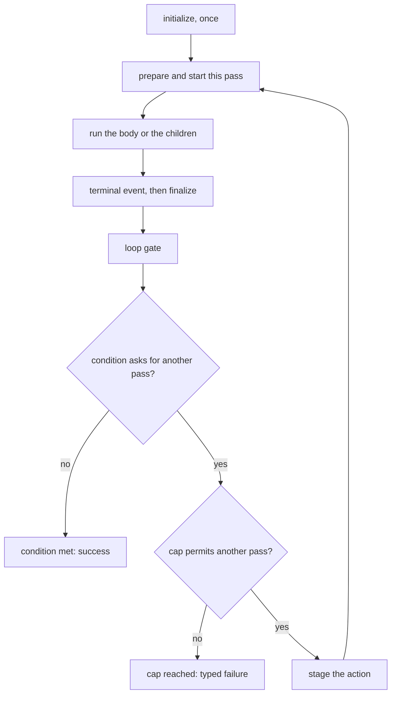

# Composition Looping

The idea of a "loop" is a fundamental [flow control](./flow-control.md) primitive. In Claudine we support _looping_ for Markdown (and YAML) authors with the `loop` frontmatter property. This property serves as both a [lifecycle event](./lifecycle.md) while also acting as a [flow control](./flow-control.md) device.

The `loop` property can be attached to any of the three _executable primitives_ Claudine runs:

- a Markdown prompt **document**
- a **sequence** of steps
- a **group** of tasks

A primitive without a `loop` property runs once. When looping is wanted, the primitive you attach it to makes no difference to the rules, so the examples on this page mostly use a Markdown document.

**The condition is checked at the end of each iteration, not before it.** A loop therefore always runs at least once, and the condition decides whether there is a *next* iteration. See [Iteration semantics](#iteration-semantics) for exactly how many times a given condition runs. Whether the primitive runs *at all* is a separate question, answered by a [`when:` guard](sequences.md#task-guards-when) on the step or task or by `skip` from a document's `initialize`; see [Leaving a loop early](#leaving-a-loop-early).

For a pipeline of different documents, use a [sequence](./sequences.md). A
looping document repeats wherever it runs: under `compose` or
`inline-compose`, as a sequence's `prompt:` step, and as a group leg.

```yaml
# count.md
---
n: 1
loop:
    until: "n >= 3"
    action: "increment(n)"
---
Iteration {{ n }}
```

```yaml
# seq.md
---
sequence:
    - name: counting
      prompt: "@count.md"
---
```

`claudine compose @count.md` and `claudine sequence @seq.md` each send the
provider `Iteration 1`, `Iteration 2`, and `Iteration 3`.

## Frontmatter shape

A loop is declared as a `loop:` object. Where it lives depends on the primitive:

- a **document** carries it at the root of its frontmatter;
- a **group** carries it on the group object, beside `tasks:`;
- a **sequence document** carries it at its root, beside `sequence:`;
- an **inline nested sequence** carries it on its task entry, beside `sequence: [ … ]`.

No other task takes `loop:`. One beside `prompt:`, `shell:`, `side_effect:`,
`task:`, a group reference (`group: "@g.yaml"`, whose loop belongs in that
file's group object), or a sequence reference (`sequence: "@s.yaml"`, whose
loop belongs at that document's root) is an error naming where the loop goes.

```yaml
---
loop:
    until: "loop.count >= 3"
sequence:
    - name: lint
      shell: "cargo clippy"
    - name: batch
      group:
          loop:
              until: "file_exists('ready.txt')"
              max: 5
          tasks:
              - name: left
                prompt: "@left.md"
              - name: right
                prompt: "@right.md"
---
```

```yaml
---
counter: 0
loop:
  while: "counter < 5"
  action: "increment(counter)"
---
```


Recognized keys, identical on every primitive:

| Key         | Type                    | Required                             | Description                                                                                                                                                   |
|-------------|-------------------------|--------------------------------------|---------------------------------------------------------------------------------------------------------------------------------------------------------------|
| `while`     | string                  | one of `while` / `until` is required | Boolean expression, evaluated after each iteration. Another iteration runs **while** it is truthy.                                                            |
| `until`     | string                  | one of `while` / `until` is required | Boolean expression, evaluated after each iteration. Another iteration runs **until** it is truthy.                                                            |
| `action`    | string \| object \| array | optional                             | One or more frontmatter mutations, applied after an iteration **only when the loop is going to continue**.                                                    |
| `actions`   | string \| object \| array | optional                             | Alias for `action`. Cannot be combined with `action`.                                                                                                         |
| `max`       | positive integer, or a `{{ … }}` template | optional           | Iteration cap for this loop. Defaults to `100` when unset. A template is resolved once, before the loop starts; see [Iteration cap](#iteration-cap).            |
| `on_rate_limit` | `pause` \| `abort` \| `continue` | optional (documents only)    | What an iteration that hits a provider rate limit does: sleep until the reset (`pause`, the default), halt with an error (`abort`), or carry on without pausing (`continue`). Only a document's provider reports rate limits, so a group or sequence `loop:` with this key is an error. |

The block may also carry **lifecycle concerns** that run at the loop gate: either loose lifecycle verb keys (`info:`, `stderr:`, `effect:`, …) or a `gate:` list, never both. See [Lifecycle — Loop Gate Concerns](lifecycle.md#loop-gate-concerns).

Any other key under `loop:` is rejected before anything runs. A key close to a valid one, such as `untill:`, or a known alias such as `max_iterations:`, gets a `did you mean …?` hint:

```text
invalid loop definition (prompts/count.md): unknown `loop.untill` key (did you mean `until`?); valid keys are: while, until, action, actions, max, on_rate_limit, `gate`, or lifecycle verbs
```

Every loop configuration error names the file and the key, as above. These are errors, never silently ignored:

- `null` for `loop` or any of its keys, and `loop: {}` (it has no condition);
- an empty `while`/`until`, and an empty `action: ""` (`action: []` is the explicit "no action");
- both `while` and `until`, or both `action` and `actions`.

**A loop has no `fail_fast`.** A failed iteration is an unhandled failure unless a `failure` event handles it (the iteration's document's, or the looping container's). `fail_fast` is a group key, so `loop.fail_fast` in any form, even `false` or `null`, is a `RemovedGrammar` error naming that replacement.

## Conditions

Conditions use the **Darkmatter expression language**. The full grammar — supported operators, comparison and truthiness rules, helper functions (`Length`, `Contains`, `HasKey`, `And`, `Or`, `number`, `round`), short-circuit semantics, and ternaries — is documented in [Darkmatter Boolean Conditional Logic](@darkmatter/docs/topics/boolean-conditional-logic.md). Treat that doc as authoritative; this section only summarizes what is loop-specific.

What's available inside a loop's `while:` / `until:` expression:

- **Frontmatter properties** of the document (top-level keys and dotted nested paths like `state.phase`), bare or through `fm.` (`fm.phase`). `fm.loop` is the `loop:` block itself.
- **Loop values** under the `loop` root (`loop.count`, `loop.last_output`, …) — see [Loop values](#loop-values) below.
- **Environment variables** under `env.NAME`. On Windows the name matches without regard to case, as Windows itself does, so `env.PATH` reads the variable Windows reports as `Path`.
- **Runtime context** under `ctx.*` (e.g. `ctx.current_package_area`, `ctx.dirty_files`). Each iteration is a composition run of its own, so it captures its own `ctx`: Git working state (`ctx.branch`, `ctx.staged_files`, `ctx.dirty_files`, …) is observed as the previous iterations left it, while launch-facing values come from the invocation's launch inputs rather than the wrapper's ambient CWD, so the child-working-directory switch cannot make CWD-derived values drift between iterations or steps. See [Composition — Launch-Anchored Prepared Context](../composition.md#launch-anchored-prepared-context).
- **Literals** — strings (`'review'` / `"review"`), numbers, `true`, `false`, `null`.
- **Comparisons** — `==`, `!=`, `>`, `>=`, `<`, `<=`.
- **Boolean operators** — `&&`, `||`, unary `!`, with `&&` binding tighter than `||`.
- **Helper functions** — `Length(...)`, `Contains(...)`, `HasKey(...)`, `number(...)`, `round(...)`, etc. Function names are case-insensitive.
- **Ternaries** — `cond ? a : b`.

```yaml
loop:
  while: "phase < total_phases"
```

```yaml
loop:
  until: "loop.last_exit_code == 0"
```

```yaml
loop:
  while: "Contains(loop.last_output, 'NEEDS_RETRY') && retries < 3"
```

Because the condition runs after an iteration, `loop.last_output` and `loop.last_exit_code` name the iteration that **just finished** when the condition reads them. Both examples above therefore react to the run they follow, with no lag.

`while` and `until` are mutually exclusive. Use one or the other.

## Actions

Actions describe how state changes between iterations. They are applied **after the condition has decided that the loop continues**, so iteration `N+1` sees the post-action state. When the condition ends the loop, the actions are not applied, and the final state is the one the last iteration ran with.

What an action mutates depends on the primitive, but the spelling does not. On a **document** it mutates the document's frontmatter. On a **group** or **sequence** it mutates the runtime `set` layer that every task and step reads through ordinary frontmatter keys, so `increment(n)` means the same thing in all three places and a later step sees the new `n`.

The canonical key is `action:`; `actions:` is accepted as an alias. The two cannot be combined in the same document.

The value of `action:` accepts **three shapes**: a single string, a single object, or a list of strings and/or objects. A single string or object is shorthand for a one-element list — semantically the three shapes are identical when only one action is needed.

The following three examples are identical semantically:

**String Format**
```yaml
loop:
    while: "counter < 5"
    action: "increment(counter)"
```

**Object Format**
```yaml
loop:
    while: "counter < 5"
    action:
        op: increment
        prop: counter
```

**List Format**
```yaml
loop:
    while: "counter < 5"
    action:
        - op: increment
          prop: counter
```

On the surface, the **object** and **list** formats look nearly identical and they _are_ in this example but the main reason that the **list** format is included is so that you can include one _or more_ actions on each iteration of the loop.

> **Note:** 
>
> - it is possible that an _action_ causes an error
> - the main reason this would happen is if the _type_ of the Frontmatter property in the document is not able to be mutated with the operation you've chosen
> - any error which occurs in the execution of an action (e.g., a mutation operation) will return an error immediately and stop execution

The whole action list runs as a single staged transaction; see [Action atomicity](#action-atomicity).

### Action atomicity

Each iteration's actions are **all-or-nothing**:

- All actions stage onto a copy of the iteration's pre-action frontmatter.
- The staged copy is committed only when every action succeeds.
- A failed action list discards its stage and fails the loop owner, named at the loop block and the pass: ``loop.action` failed after pass 7 (…): invalid increment at iteration 7, action 2 of 4 …``. No event of the pass that already finished runs again.
- On a group or sequence the action writes the container's runtime `set` layer, which every child of the next pass reads as ordinary frontmatter.

### When templates inside action values are rendered

Action values can contain `{{ ... }}` templates. These are rendered at **action-apply time** (end of the iteration that just ran), against that iteration's effective state:

- Loop values (`loop.count`, `loop.is_first`, `loop.is_last`) reflect the iteration whose actions are being applied.
- `loop.last_output` and `loop.last_exit_code` reflect what the executor produced for that same iteration.
- Frontmatter values reflect the pre-action state of that iteration (earlier actions in the same list have not been applied yet).

A value that is exactly one template span keeps its evaluated JSON type. Anything that mixes template and literal text renders to a string and stays one — it is **never re-parsed as JSON**, because the inserted values are data (`" {{ loop.last_output }}"` with output `true` stays the string `" true"`). The rendered value is also data for the next iteration's preparation: a `{{ … }}` or `$( … )` it carries is never evaluated again. Specifically:

| Action value                          | After rendering against `{ count: 3, name: "alice" }` |
|---------------------------------------|--------------------------------------------------------|
| `"{{count}}"`                         | `3` (number)                                           |
| `"{{name}}"`                          | `"alice"` (string)                                     |
| `"iter-{{count}}"`                    | `"iter-3"` (string — text + template = string)         |
| `"{{count}} + {{count}}"`             | `"3 + 3"` (string)                                     |
| `"{{count}}{{count}}"`                | `"33"` (string — never re-parsed as a number)          |
| `{ phase: "{{name}}", n: "{{count}}" }` | `{ phase: "alice", n: 3 }` (object walked recursively)  |

Templates are also rendered inside arrays and objects — every string leaf is processed, non-string scalars pass through.

The rule of thumb: **a value that is purely a single template span preserves its evaluated type; anything mixing template with literal text becomes a string.** This means `set(retries, {{loop.count}})` lands as a JSON number you can safely compare arithmetically, while `set(label, "iter-{{loop.count}}")` lands as the obvious string.

> **Loop vs lifecycle interpolation.** The loop action renderer and the lifecycle event renderer share the same Darkmatter expression core and the same missing-property semantics (an absent property is `null`), and differ in two ways — loop-contextual error typing, and the loop renderer not recognizing `{{{ … }}}` escapes. See [Composition — Loop vs lifecycle interpolation](../composition.md#loop-vs-lifecycle-interpolation); both engines are held to a [shared conformance matrix](../../../lib/src/composition/interpolation_conformance.rs).


## Mutation Operations

In the prior example we saw the **increment** operation being used but the full set of operations are:

| Op                     | Arity | Behavior                                                                                                                                          |
|------------------------|-------|---------------------------------------------------------------------------------------------------------------------------------------------------|
| `increment(prop)`      | 1     | Adds 1 to `prop`. Missing/null → `1`. Numeric strings parse and store back as numbers. Non-numeric strings raise `InvalidIncrementType`.          |
| `decrement(prop)`      | 1     | Subtracts 1 from `prop`. Missing/null → `-1`.                                                                                                     |
| `set(prop,value)`     | 2     | Sets `prop` to `value`. Cannot target the reserved names `loop` and `replace`, or a retired `_loop_*` name.                          |
| `append(prop,value)`  | 2     | Appends `value` to a string property. Objects/arrays serialize to compact JSON and are appended after a `\n` to build JSONL transcripts.          |
| `prepend(prop,value)` | 2     | Reverse of `append`; the `\n` separator goes between the new content and the existing content.                                                    |
| `merge(prop,value)`   | 2     | Shallow object merge.     |

All operations are designed around _changing the state_ of the document's Frontmatter on each iteration turn. Looping without any state change has limited value so these operations are a key part of the utility of looping.

## Loop values

In addition to the _mutation operations_ above, which change real state, the looping engine supplies five read-only **loop values** to every iteration. They live under the `loop` root, so they never collide with a frontmatter property, and they refer to the **innermost enclosing loop**: a task inside a looped group reads the group's iteration, and a document that also loops itself reads its own.

| Value                 | Type    | Description |
|-----------------------|---------|-------------|
| `loop.count`          | number  | 1-based iteration counter. `1` on the first iteration. |
| `loop.is_first`       | boolean | `true` on iteration 1, `false` thereafter. |
| `loop.is_last`        | boolean | `true` when this iteration is the final pass the cap permits (`count == max`), `false` otherwise. It says nothing about whether the condition will end the loop; see the note below. |
| `loop.last_output`    | text, array, or dictionary | The result of a pass: a document's captured stdout, a sequence's array of that pass's child results, a group's dictionary of leg results. In the body and in `start`: the **previous** pass's (`""`, `[]`, or `{}` on pass 1). In the pass's terminal event and `finalize`, the gate, the condition, and actions: the pass that **just finished**. |
| `loop.last_exit_code` | number  | **Process exit code** of a prompt run (Unix-style: `0` = success, non-zero = failure), with the same timing as `loop.last_output`. `0` before any pass. **Narrow utility — read the note below before using.** |

Read them in any of three spellings: dotted (`loop.count`), bracketed (`loop['count']`), or bare `loop` for the whole object. Wherever you read them (the condition, a lifecycle event, the body, or a frontmatter value), a dotted read copies only that one value. So `loop.count` stays cheap however large `loop.last_output` is. Bare `loop` and the bracketed spelling build the whole object, `loop.last_output` included, at most once per lifecycle evaluation or per composition. Each evaluation reads the current pass's values (the condition reads the pass that just finished); nothing is carried over from an earlier one. They can be used in the body, in compose-time frontmatter values, in your `while`/`until` expression, in your mutation operations, in the `start`, `success`, `failure`, and `finalize` lifecycle events of an iteration, and in the `loop:` block's own gate concerns.

```md
---
loop:
  until: "loop.count >= 3"
  action: increment(counter)
counter: 0
---

Iteration {{ loop.count }} of 3.
Counter so far: {{ counter }}.
First time? {{ loop['is_first'] }}
```

Where `loop` is not what you expect:

- **`fm.loop` is the configuration.** It reads the `loop:` block you wrote (`fm.loop.until`, `fm.loop.max`), never the values above.
- **A missing member never falls back to the document.** `loop.nonexistent` is `null`, even when the document has a property of that name.
- **`initialize` is inside the loop.** It already reads pass 1's values: `count` `1`, `is_first` `true`, `is_last` `true` only when `max` is `1`, and the empty result.
- **Before the loop exists** (a document's seed and bootstrap read) `loop` reads `null`.
- **Outside any loop** `loop` is unavailable, with the typed scope diagnostic `claudine.outside-loop`. A non-looping document that reads it in its body or compose-time frontmatter fails before launch; one that reads it in a lifecycle event fails when that event fires, because a document cannot know in advance whether it will run inside a loop.
- **A `proxy` target is not an iteration.** A document reached through `proxy` from a loop iteration does not receive the loop's values.

**The old `_loop_*` names are removed.** `_loop_count`, `_loop_is_first`, `_loop_is_last`, `_loop_last_output`, and `_loop_last_exit_code` are a hard error, `RemovedGrammar`, naming the place and the `loop.*` replacement. A read in the condition, an action, a lifecycle value, frontmatter, or the body is reported before the provider launches; one that only a later render introduces (for example, from a transcluded document) is reported when that render runs. Only real reads are errors: the same text inside a quoted string, ordinary Markdown, a code block, or an unrelated property such as `_loop_notes` is data.

**Captured output is data.** `loop.last_output` holds the agent's text exactly as it was printed, and it stays that way everywhere it goes: in a condition, in an action value, in a lifecycle message, and in the next iteration's prompt. Agents often write template or shell syntax in their summaries; it is shown, never evaluated or run:

```md
---
loop:
  until: "contains(loop.last_output, 'DONE')"
  max: 5
---
Continue from where you left off. Your last report was:

{{ loop.last_output }}
```

If iteration 1 ends with `see {{…}} and $(rm -rf x)`, iteration 2's prompt contains exactly that text: no parse error, no shell approval, nothing run. The same holds for every value the loop produces, not only the loop values: a frontmatter key an action wrote, a value lifted from the composed document, and, inside a sequence, [`seq.outputs`](sequences.md#the-output-array). Only values a person typed (`--set`, `key=value`, interactive answers) are templates; see [CLI overrides interact with looping](#cli-overrides-interact-with-looping).

> **`loop.is_last` means "last permitted", not "last".** A loop usually ends because of something the iteration itself produced: the agent's output, an exit code, or a file it wrote that the condition reads through `frontmatter(...)`. Nothing can know that before the iteration runs, so `is_last` does not try. It is `true` only on the `max`-th pass. If you want a prompt to say "this is your final attempt" in a loop that runs a fixed number of times, test the count directly: `{{ loop.count == 3 }}`, or set `max: 3` and let `is_last` do it.

For example, a loop action can stamp the iteration that produced a value:

```yaml
loop:
  while: "counter < 5"
  action: "set(stamp, {{loop.count}})"
```

### When `loop.last_exit_code` is actually useful

Rarely. A failed pass ends the loop before its gate, so a later pass never sees a failure there. What remains is a pass whose own lifecycle settled it as a success while its prompt run reported a non-zero code, which agentic CLIs almost never do: they reserve non-zero exits for timeouts, crashes, auth errors, and interrupts, not for "the agent's answer was wrong." It is also not an iteration counter; the expression engine has no arithmetic, so `{{loop.count - 1}}` is not valid.

For "did the agent actually succeed at its task?" — exit code is the wrong tool. Use one of these stronger signals instead:

- **Branch on output content** with `loop.last_output`:
  ```yaml
  loop:
    until: "contains(loop.last_output, 'DONE')"
  ```

- **Use `inline-compose` and have the agent set a sentinel frontmatter property**, then loop on that property:
  ```yaml
  loop:
    until: "done == true"
  done: false
  prompt: "If you finished the task, set frontmatter `done: true`."
  ```

`set(...)` may not write to `loop`, `replace`, or a retired `_loop_*` name; doing so raises `InvalidAction`.

## Iteration semantics

Every primitive repeats by the same order. `initialize` fires once per invocation. Each pass then runs `start`, its body or children, its terminal event (`success`, `failure`, `blocked`, or `cancelled`), and `finalize`; after that the **loop gate** decides whether another pass runs:

1. run any lifecycle concerns authored inside the `loop:` block (its loose verbs or its `gate:` list), on every pass including the one that ends the loop;
2. evaluate the condition against current values and fresh file reads, with `loop.*` describing the pass that just finished;
3. if the condition no longer asks for a pass, the loop ends: **condition met**;
4. if it does but this was the `max`-th pass, the loop fails: **cap reached** (`LoopLimitExceeded`), and no action applies;
5. otherwise stage the action, all or nothing, and start the next pass.



An unhandled failure, a handoff, a cancellation, or a [`break`](#breaking-out-of-a-loop) leaves this path without running the gate, the condition, or the action. A `retry` or `resume` accepted by the pass re-enters it without running its `finalize` and without advancing `loop.count`; the pass's `finalize` runs once, after its final attempt.

When an outer loop repeats a child, each pass is a new invocation of the child: its own `initialize` and a fresh count. A loop nests in any other loop, and `loop.*` always names the innermost one.

Two consequences are worth committing to memory.

**The first pass is unconditional.** A condition that is false from the start still runs the prompt once. Whether a primitive runs at all is decided *before* its loop, by a [`when:` guard](sequences.md#task-guards-when) on the sequence step or group task that names it: a false guard records the primitive as skipped and runs no pass. Inside a document, the same opt-out is a `skip` from `initialize`:

```yaml
initialize:
    - when: "length(work) == 0"
      then:
          - info: "nothing to do"
          - skip
```

**The condition is asked of the iteration that just ran, so a counter counts one further than it reads.** With `n: 0` and `action: "increment(n)"`:

| Condition | Iterations | Each body sees |
|---|---|---|
| `while: "n < 0"` | 1 | `n=0` |
| `while: "n < 1"` | 2 | `n=0`, `n=1` |
| `while: "n < 2"` | 3 | `n=0`, `n=1`, `n=2` |
| `until: "n == 2"` | 3 | `n=0`, `n=1`, `n=2` |
| `until: "loop.count >= 3"` | 3 | `loop.count` of `1`, `2`, `3` |
| `until: "loop.count > 3"` | 4 | `loop.count` of `1`, `2`, `3`, `4` |

Read a condition as "*did the iteration that just finished satisfy this?*" rather than "*may the next one start?*". `until: "n == 2"` stops after the iteration that ran with `n=2`. For exactly `k` runs, the clearest spelling is `until: "loop.count >= k"`.

### Leaving a loop early

- **`break`** ends the nearest enclosing loop, whichever primitive owns it. Each primitive between the `break` and the loop runs its `finalize` once, and the loop then stops without running its gate, evaluating its condition, or applying its actions. A loop ended by `break` is reported as its own outcome, distinct from "condition met" and "`max` reached". See [Breaking out of a loop](#breaking-out-of-a-loop).
- An explicit `error` among the `loop:` block's lifecycle concerns fails the run before the condition is evaluated.
- A `proxy` raised by an iteration's `start`, `success`, `failure`, or `finalize` ends the loop and hands off to its target, which enters at its own `initialize` and is not an extra iteration of this loop. No further iteration runs and the `loop:` block does not fire for the abandoned iteration. A proxy from `success` or `failure` skips that iteration's `finalize`, and one from `finalize` does not run it again.
- `retry`, `resume`, and `proxy` authored inside the `loop:` block itself are not supported and fail the run with `LifecycleSetupPhaseRecoveryUnsupported`.

### Breaking out of a loop

A `break` from a pass's terminal event, or from the loop gate, ends the loop early with an optional reason and exit code:

```yaml
---
loop:
  until: "loop.count >= 10"
  gate:
    - when: "file_exists('@output/NEEDS_REVIEW.md')"
      then:
        - break: { reason: "needs human review at pass {{ loop.count }}", code: 2 }
---
Work through the next item in @TODO.md.
```

Run with `claudine compose`, a pass that leaves `NEEDS_REVIEW.md` behind ends the loop, prints the info line `loop broken: needs human review at pass 3 (code 2)`, and exits `2`. Without a reason the line reads `loop broken (code N)`. The rules worth knowing:

- **Nearest loop only.** An inner loop's `break` does not end an outer loop; the outer loop reads its own condition as usual.
- **Exit code.** Only the root invocation's loop (`claudine compose` of a looping document, or a looping root sequence) sets the process exit code. An inner loop's `code` appears only in the summary line, and the run continues.
- **Results.** The broken loop publishes the work it completed; a document broken before it launched publishes nothing.
- **Failures win.** Any unhandled failure, including a failing `finalize`, beats a pending `break`. Ctrl-C overrides it (exit `130`), and a `retry` discards it.
- **No loop, no break.** A `break` fired outside any loop is a typed error of that event, `LifecycleBreakWithoutLoop`.

[Flow Control — `break`](flow-control.md#break) covers concurrent groups, `break` from `initialize`, and exactly which events still fire.

## Iteration cap

Every loop is bounded so a runaway condition cannot hang indefinitely.

- **Default cap:** `100` iterations.
- **Per-loop override:** `loop.max: <N>` on the primitive.
- **Per-run override:** `--max-iterations <N>` on the CLI, or the `CLAUDINE_MAX_ITERATIONS` environment variable.

Precedence is **CLI > environment > frontmatter > built-in default**. A `CLAUDINE_MAX_ITERATIONS` that is not a positive integer (`0`, `ten`) fails a looping run that would use it before its first iteration, rather than being ignored; under `--max-iterations` the variable is never read.

`max` may be a whole-value template. It is resolved **once**, before the first iteration, against the values the document's frontmatter resolves with: its own defaults, with the caller's setters and `--set` applied.

```yaml
---
cap: 4
loop:
  until: "n >= 3"
  action: "increment(n)"
  max: "{{ cap }}"
n: 1
---
```

`claudine compose count.md` runs with a cap of 4; `claudine compose count.md cap=2` runs with a cap of 2. A template that resolves to nothing (an undefined `cap`), to `0`, to a negative or fractional number, to text that is not an integer, or to a number too large for the platform is an error naming `loop.max` and the file. Changing `cap` during the loop does not move the cap.

The `max`-th pass always sees `loop.is_last: true`. If the condition still says "continue" after it, the loop exits with `LoopLimitExceeded`, carrying the file and the pass that reached the cap, and the loop owner fails like any unhandled failure (at the root, exit `1`). The condition is read first: a loop whose condition says "stop" after its `max`-th pass ends normally. Each loop has its own cap, and the runtime override applies to each loop independently.

A loop therefore ends on its own terms in one of three ways:

| Outcome | Result | Summary line |
|---|---|---|
| Condition met | Success | None |
| `max` reached | Typed failure, `LoopLimitExceeded` | The error |
| `break` fired | Success, or the `break`'s `code` when it is the root loop | `loop broken: <reason> (code N)` |

See [Breaking out of a loop](#breaking-out-of-a-loop).

## Results of a looping primitive

| Looping primitive | Inside it, across passes | Published to its parent, once, when the loop ends |
|---|---|---|
| document | `loop.last_output` | its final pass's output |
| sequence | `seq.outputs` keeps growing with no per-pass nesting: two passes of `A`, `B` read `["A", "B", "A", "B"]` | its whole `seq.outputs` array |
| group | `loop.last_output`, the previous pass's dictionary | its final pass's dictionary |

A sequence's `loop.last_output` is only the current pass's array, never its cumulative `seq.outputs`. A group rebuilds its leg results and `group.legs`/`succeeded`/`failed`/`cancelled` each pass. Results publish to the parent only after successful cleanup: a loop that fails or is cancelled publishes no result, even after passes that completed. A loop ended by `break` publishes the work it completed. Runtime writes follow the container's own rules: a sequence's writes are the invocation's, and an atomic group withholds its legs' writes when it fails.

### Retry inside a looping container

A `retry` replaces the failed attempt of the current pass without erasing completed passes. The pass's output slice and the container's runtime `set` layer return to their state at the entry of that pass, and the retry's `with:` values are written after that. `loop.count`, the cap, and `initialize` are untouched, and `loop.last_output` again reads the previous pass. External file writes and commands are not rolled back and may repeat.

So after pass 1 of `A`, `B` completes and pass 2 fails in `B` and retries, `seq.outputs` reads `["A1", "B1"]` when the retried pass 2 starts, never including the failed attempt's `A2`, and the final array holds one entry per child per completed pass.

A container without a loop keeps its own rule: a retried attempt's child results reset and its runtime writes survive.

## When a pass fails

A loop has no fail-fast switch (see [Frontmatter shape](#frontmatter-shape)), and `CLAUDINE_FAIL_FAST` is not read. A pass that its own lifecycle did not recover is an unhandled failure: the loop ends with it, before its gate, its condition, or its action.

| Source of failure | Result |
|---|---|
| The prompt run exits non-zero, or a container child fails, and no `failure` event recovers it | The loop ends with that failure; nothing more of it runs. |
| An `error` in `success` that nothing recovers | The loop ends; the error names the pass and the reason. |
| The pass cannot complete (for example, a refused `proxy`: missing target, cycle, hop limit) | The loop ends with that error, reported once. |
| An explicit `error` in the gate | The loop owner fails with `LifecycleLoopGateFailed`, naming the pass; the condition is not read. |
| The condition cannot be parsed or evaluated, or an action cannot be staged | The loop owner fails with `LoopEvaluationFailed`, naming the `loop:` key and the pass; nothing of the action is committed. |
| A container action is refused when writing runtime state | `LoopActionWriteRefused` names the action and the pass; the staged writes are not committed. |

To keep repeating past a failure, recover it in the pass's own `failure` event (`retry`), and to tolerate a group leg's failure, use the group's `fail_fast: false`.

## User interrupt (Ctrl+C)

Pressing **Ctrl+C** at any point during a `compose` / `inline-compose` run — including the pre-launch prep window where the source file is parsed, transclusions are resolved, target/model are selected, and shell preflight runs — halts the run with a friendly notice. The CLI installs a process-scoped `SIGINT` handler at the very top of the subcommand (just after positional argv parsing, before any I/O-heavy prep), so the handler is live throughout. It fires alongside the wrapper's per-iteration handler, so even when an agent CLI exits `0` after being interrupted (most do), the loop stops between iterations rather than starting a new one. When the interrupt is observed during loop execution the loop halts. Post-prep checkpoints consult the same flag and bail out with exit code `130` before launching the agent if the user interrupted during prep.

On interrupt the CLI:

- **Immediately** writes an INFO status line directly to stderr from the signal handler — this lands *before* the interrupted agent's dying-breath events are rendered, so it is the first thing the operator sees after the terminal echoes `^C`. The line is column-1 aligned (a leading newline pushes it off the `^C`) and the prompt path is rendered as an OSC8 hyperlink with the visible text resolved relative to the repo root (or CWD when not in a repo).
- **Relabels** the agent's terminal-error block from `Agent Error` to `User Action — User pressed CTRL+C to stop the session` with a yellow border, so operators are not led to believe the agent itself failed.
- Returns exit code `130` (the standard `128 + SIGINT(2)` shell convention).
- Surfaces a `LoopInterrupted` error in the in-process [`LoopExecutionResult`](../../../lib/src/composition/looping/engine.rs) for programmatic callers, but does **not** print a redundant red `Error:` line — the INFO status is the only user-facing announcement.

Implementation notes:

- The signal handler uses `libc::write(2, …)` (async-signal-safe) on a pre-rendered byte buffer; the Rust stdio macros (`eprintln!`, `tracing`) are *not* signal-safe and must not be added to that path.
- A process-scoped `USER_INTERRUPTED` atomic in [`output/mod.rs`](../../../cli/src/output/mod.rs) lets the live semantic sink's error renderer detect the interrupt and remap the label without plumbing flags through every parser.

## CLI overrides interact with looping

CLI shorthand setters and `--set` JSON are applied to the **initial frontmatter** that the loop's first iteration sees. So:

```bash
claudine compose loop_example.md iteration=1 --claude
```

…is equivalent to authoring the document with `iteration: 1` in the frontmatter. Subsequent iterations carry that value through unless an action explicitly overwrites it.

A setter is authored text, so a template in it fills in on every iteration: `--set '{"label":"{{ title }}"}'` renders the current `title` each time. Once an action overwrites that key, the key holds the action's result, which is data.

## Common errors

| Error                                                               | Cause                                                                                                                 |
|---------------------------------------------------------------------|-----------------------------------------------------------------------------------------------------------------------|
| `unknown loop.<key> key`                                            | A typo or unsupported key under `loop:`. The error message lists valid keys and suggests the closest one.            |
| `loop.fail_fast` uses the removed `fail_fast` grammar (`RemovedGrammar`) | `fail_fast` under `loop:`, in any form. Remove it; handle a failed iteration in a `failure` event.                  |
| `` `loop.max` template `{{ … }}` resolved to … ``                   | A templated cap did not resolve to a positive integer.                                                                |
| `` invalid `CLAUDINE_MAX_ITERATIONS` value ``                       | The runtime cap override is not a positive integer.                                                                   |
| `loop.action and loop.actions are aliases; specify only one`        | Both keys were set in the same document. Pick one.                                                                    |
| `loop.while and loop.until are mutually exclusive`                  | Both `while:` and `until:` were set. Pick one.                                                                        |
| `loop must define either while or until`                            | Neither condition key is present.                                                                                     |
| `loop.max must be greater than zero`                                | `max:` is `0` or negative.                                                                                            |
| `` `loop.action` failed after pass N `` (`LoopEvaluationFailed`)     | An action failed, for example an `increment` / `decrement` target that is not numeric; the inner cause names the action. |
| `` `loop.until` failed after pass N `` (`LoopEvaluationFailed`)      | The condition could not be parsed or evaluated.                                                                         |
| `lifecycle loop gate raised an error after pass N` (`LifecycleLoopGateFailed`) | An explicit `error` in the `loop:` block's gate concerns.                                               |
| `` invalid loop action at iteration N, action M of K: `<prop>` is reserved … `` (`InvalidAction`) | An action tried to write to `loop`, `replace`, or a retired `_loop_*` name. |
| `RemovedGrammar`                                                    | A read of a retired `_loop_*` name; the message names the `loop.*` replacement.                                         |
| `LifecycleStackInvalidShape`                                        | `when` at the `loop:` root, loose lifecycle verbs beside `gate:`, or `gate: null` / `gate: {}` (use `gate: []`).        |
| `LoopLimitExceeded`                                                 | The cap was reached and the condition would still continue.                                                           |
| `LifecycleBreakWithoutLoop`                                         | A `break` fired with no enclosing loop.                                                                               |
| `LoopInterrupted`                                                   | The user pressed Ctrl+C; the loop halted between iterations and exited with code `130`.                               |

## See also

- [Composition](../composition.md) — how `compose` and `inline-compose` flow into the wrapper pipeline.
- [Sequences](./sequences.md) — multi-document pipelines with shared shell approval and per-step provider review.
- [Lifecycle](lifecycle.md) — `start` / `success` / `blocked` / `failure` notifications. These render with the **iteration's** frontmatter, so templates like `{{loop.count}}` and any user property mutated by actions reflect each iteration's state.
