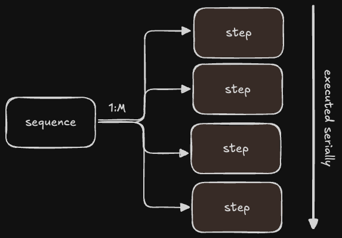
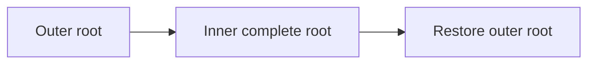
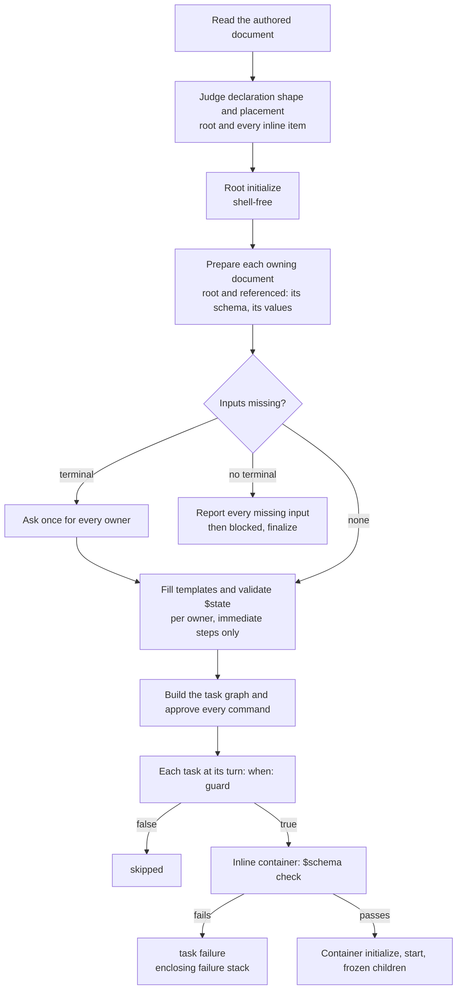
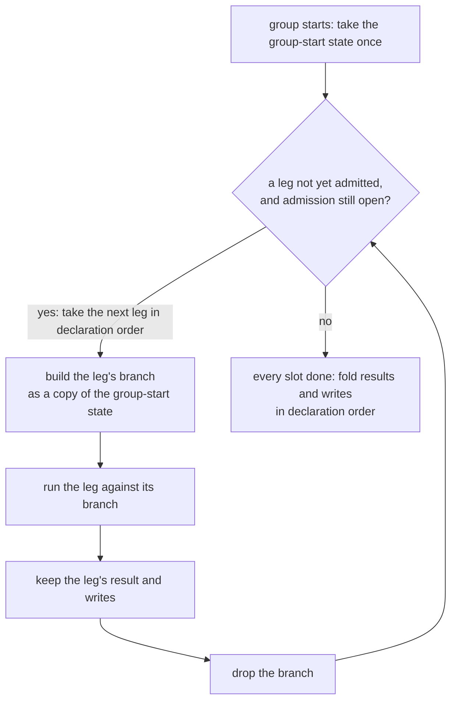
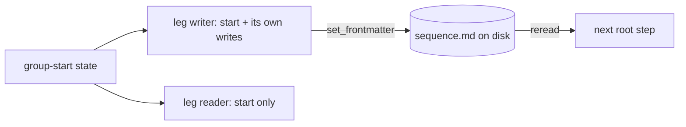
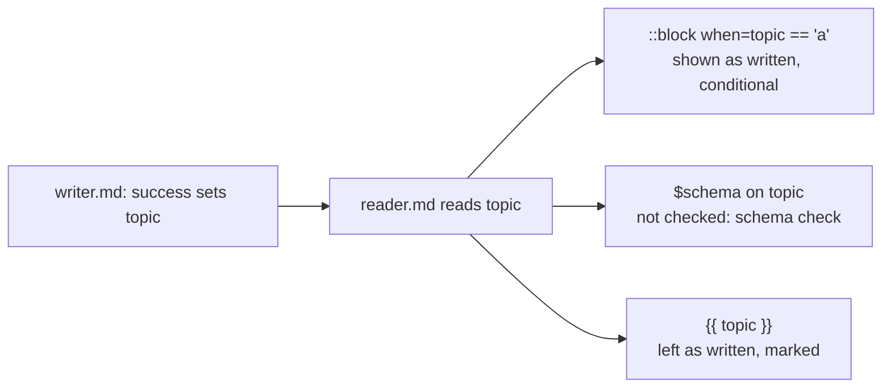
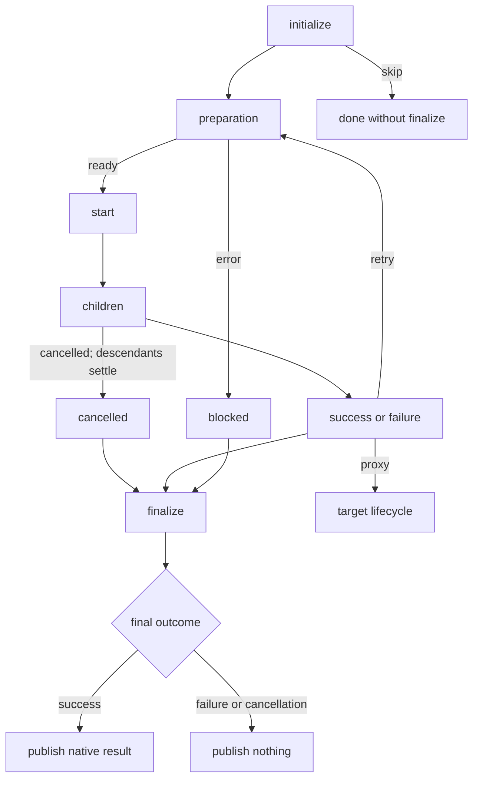
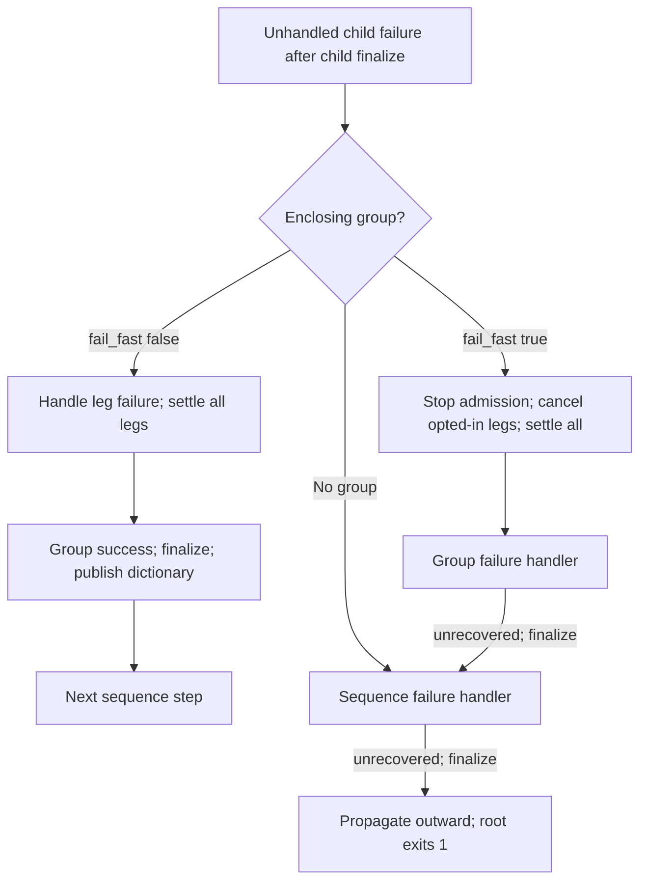
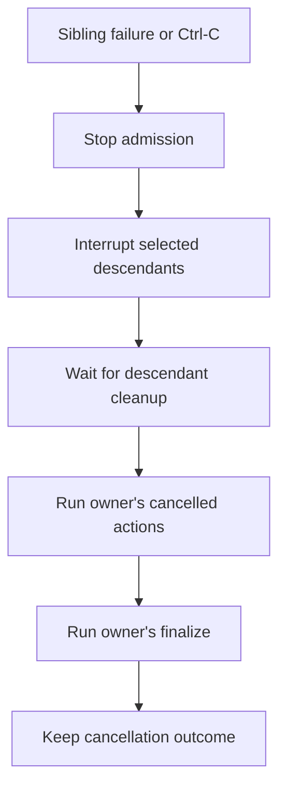

# Sequences in Claudine

A **sequence** runs an ordered list of *steps*. Each step composes and executes
one unit of work, and later steps can see what earlier steps produced.

Use a sequence when work must happen in order, and a group when independent
tasks can run concurrently. Either can contain the other. Each container has
its own lifecycle and returns one value to its parent: an array for a sequence,
or a dictionary keyed by leg name for a group. Read the active container through
`seq` or `group`; ordinary document properties remain under `fm`.



```sh
claudine sequence <file> [key=value ...]
```

## Container grammar

A task can declare a nested `sequence:` list or a file reference using the
same `-> offset` and `::operator` suffixes as a sequence source. It is
exclusive with `prompt`, `shell`, `side_effect`, `group`, and `task`.

```yaml
sequence:
    - name: validate
      sequence:
          - name: check
            shell: just check
      failure:
          - warn: Validation failed
```

Nested containers execute recursively. An empty nested list returns an empty
array and still runs its container lifecycle. Only an inline list can carry container lifecycle events
on its task; a reference carries those events in its referenced document.
The same holds for the container declarations `$schema`, `$state`, and
`template:`: an inline list's task may declare them, and a referenced
document declares its own (see
[Each sequence owns its own declarations](#each-sequence-owns-its-own-declarations)).

A container's `loop:` goes in one of three places: on a group object beside
`tasks:`, at a sequence document's root beside `sequence:`, or on an inline
nested sequence's task entry beside `sequence: [ … ]`. The block uses the
[loop grammar](./looping.md#frontmatter-shape) and is checked when the
sequence is resolved (a group file's when preflight loads it). The container
then repeats by the same rules as a document: `initialize` once, `start`, its
children, its terminal event, and `finalize` each pass, then the loop gate;
see [Composition Looping](./looping.md#iteration-semantics) for the pass order,
results, and retries inside a looping container.

```yaml
sequence:
    - name: retry-build
      loop: { until: "built", max: 3 }   # inline nested sequence: repeats its steps
      sequence:
          - name: build
            shell: just build
    - name: lint
      shell: just lint
      loop: { until: "clean" }           # error: a shell task takes no `loop:`
```

### What a referenced sequence reads

A sequence referenced by file is a document: its events, its conditions, its
`set` values, its lifecycle `shell` commands, and its steps read its own
frontmatter, so it behaves the same whether you run it directly or reference
it. Given `child.md`:

```yaml
---
local_value: child-value
start: [{ stdout: "{{ local_value }}" }]
sequence: []
---
```

both `claudine sequence child.md` and a root with
`sequence: [{ name: child, sequence: child.md }]` print `child-value`, even
when the root declares its own `local_value`. Values reach a referenced
sequence the way they reach a referenced prompt document. Lowest precedence
first:

1. the referenced document's own properties, as its `$schema` prepares them
   (see below)
2. invocation setters (`--set`, shorthand `key=value`)
3. runtime writes made so far, by the caller or by the sequence itself

The caller's authored frontmatter is not among them: a property only the root
declares reads as `null` inside the referenced sequence. To pass a value down,
write it at run time with `set`, or supply it with `--set`. A `set` inside the
referenced sequence is a runtime write, so the caller sees it afterward.

This holds however the document is reached: run directly, named by the root's
own `sequence: child.yaml`, as a nested task, a group leg, a `kind: task`
file, or as the target of a container `proxy`. A step authored in
`child.yaml` reads `child.yaml`'s values everywhere: its `when:` guard, its
`shell` command (both when pre-flight approves it and when it runs), and the
state its task runs in. Given `sub/child.yaml`:

```yaml
kind: sequence
rank: 1
sequence:
    - name: show
      shell: "echo {{ rank }}"
```

`claudine sequence sub/child.yaml`, a root holding `rank: 9` and
`sequence: sub/child.yaml`, and a root holding `rank: 9` and
`sequence: [{ name: n, sequence: sub/child.yaml }]` all print `1`. A step
that reads a property only the root defines fails pre-flight as missing on
every route, as it does when the child runs directly.

A referenced document's `$schema` describes that document: its required
properties are caller inputs, collected with the root's (see
[Requiring caller input](#requiring-caller-input)), and its values are
converted before its `template:` reads them. Its `template:` reads the same
three layers and nothing else, so a key none of them defines stays undefined
and the template's own fallback applies. Given `sub/child.yaml`:

```yaml
kind: sequence
template:
    who: "{{ reviewer || 'none' }}"
sequence:
    - name: work
      shell: "echo {{ seq.who }}"
```

a root that writes `reviewer: leaked` and references `sub/child.yaml` prints
`none`, exactly as running the child directly does. To parameterize a shared
step list from the document that references it, write the value in the root's
`initialize`, a runtime write the referenced template reads:

```yaml
---
sequence: "@claudine/docs/research/_provider-tasks.yaml"
initialize:
    - set:
          research_prompt: "@claudine/docs/research/hooks/_research.md"
---
```

A dry run fires no lifecycle events, so under `--dry-run` that write is not
made and the template reads nothing for it. Supply the value as a setter to
preview such a sequence (`research_prompt=…`); in a real run the
`initialize` write, the higher layer, still wins.

A referenced document is prepared, and judged by its own `$schema`, each time
it runs, not only when the sequence launches. Its events and steps read its
**prepared** values: a schema default fills a property the document leaves
unset, and a value is converted to the type the schema declares. A directly
run document's own events read its prepared values the same way: its
`initialize` reads them under the caller's values (a required input may still
be missing then, and `initialize` may supply it), and each `start` prepares
them again with every value written or collected since, so a derived
property an `initialize` write feeds reads the new value from `start` on.
Pre-flight binds a `shell` command to the same prepared values, so
`shell: "echo {{ who }}"` under `$schema: { who: string(default(ada)) }` is
approved, and runs, as `echo ada` on every route. The schema
then judges the three layers as they stand at that moment, so a value an
earlier task wrote is checked too. Given `sub/check.yaml`:

```yaml
kind: sequence
$schema:
    rank: number(required)
rank: 1
sequence:
    - name: observe
      shell: echo observed
```

a root that runs `- { name: change, side_effect: { set: { rank: bad } } }`
and then references `sub/check.yaml` fails naming `/rank` and
`sub/check.yaml`, and `observe` never runs, exactly as running the child
directly with the same write does. When the check runs depends on how the
document is reached:

| Reached as | Judged |
| --- | --- |
| A nested task, a group leg, or a `kind: task` file | When the container starts: after its own `initialize`, so that event can still supply or correct a value; again at each loop pass and retry |
| A root `sequence: child.yaml` | At each root step, as a directly run document is |

A refusal fails the referenced document before any of its rows run. A started
container still runs its `failure` and `finalize` events, and the enclosing
sequence handles the failed task as it handles any other. A document with no
rows is judged all the same. No check runs between the rows of one pass: a
value a row writes is judged at the next entry. This is a different thing
from an inline container's `$schema`, which is only a check and never
converts or defaults a value (see
[Sequence documents](#sequence-documents-schema-state-and-template)).

A relative file value is resolved from the folder of the file that wrote it.
If `nested/child.yaml` declares `spec: file(required;eager)` and writes
`spec: work/spec.md`, Claudine looks for `nested/work/spec.md`, wherever the
root that references it lives. A setter such as `spec=notes/spec.md` is
resolved from the directory the caller supplied it in.

The references its steps make follow the same rule. Given `sub/child.yaml`
beside `sub/draft.md` and `sub/brief.md`:

```yaml
kind: sequence
sequence:
    - name: draft
      prompt: ./draft.md          # sub/draft.md
      with:
          brief: ./brief.md       # sub/brief.md, if draft.md types it as a file
```

`./draft.md` and `./brief.md` resolve in `sub/`, and so do a step's `task:`,
`sequence:`, and `group:` files, whether you run `sub/child.yaml` directly,
name it from a root (`sequence: sub/child.yaml`), or nest it as a task. A
root that names a whole document this way still runs its rows as the root's
own steps, numbered and in the child's order.

This applies when the reference names a whole sequence document: a Markdown
file with `sequence:`, or a `kind: sequence` YAML, JSON, or JSON5 file,
including one reached through a group leg or an external `task:` file. A
reference with an `-> offset` or `::operator` suffix selects a list of steps
rather than a document, so like an inline list it reads the frontmatter of the
document that authored it. Group files carry no document properties; a group's
own values are its `variables`, read through `group`.

Groups are concurrent: omit `execution:`. Both `execution: parallel` and
`execution: serial` are removed grammar; ordered work uses a nested
`sequence:`. Every group leg requires a unique, nonempty string `name`.
Group `variables:` may not shadow `legs`, `succeeded`, `failed`, or
`cancelled`. Group `fail_fast` is a boolean, defaults to `true`, and rejects
null or quoted boolean strings.

Task `setup:` and `teardown:` are removed. Put `initialize`/`start` and
`finalize` on the prompt document or wrap work in an inline sequence.
A sequence document's `fail_fast:` and `--fail-fast` are removed; failure
handling belongs in lifecycle events. No `CLAUDINE_FAIL_FAST` value is
injected into child sessions. The `cancelled:` lifecycle event accepts an
empty stack as an explicit cancellation opt-in; null is an error.
Container recovery uses `retry` or `proxy`; `resume` requires a live provider
session and is an error on a container. See [Cancellation](#cancellation) for
sibling failure and Ctrl-C cleanup.

## The two meanings of `prompt`

Read this before anything else. `prompt` means different things at two adjacent
levels, and the distinction is load-bearing:

| Level | Value | Meaning |
|---|---|---|
| **Document** (frontmatter root) | prose string | Flips the whole sequence to **inline-compose**: the composed `prompt` is the agent prompt, and the provider's reply replaces the document body on disk. In a YAML sequence file, which has no body, the agent edits the file's properties and the file stays YAML ([inline steps of a YAML sequence file](../composition.md#inline-steps-of-a-yaml-sequence-file)). |
| **Step / task** | file reference | Names a **prompt document** to compose and execute for that step. |

```yaml
---
prompt: "Summarize {{ seq.name }}."   # ← document level: prose, inline-compose
sequence:
    - name: alpha
      prompt: "@prompts/review.md"      # ← step level: a file reference
---
```

The two never occur at the same level, and their value types differ, so
Claudine can always tell them apart. The name was kept because `prompt` is
entrenched in inline-compose throughout the CLI and docs.

## Steps and tasks

There is one execution model. A **task** is the atomic executable unit; a
**step** is an entry in the `sequence:` list — its state, plus optionally the
task fields.

A task declares **exactly one** executable field:

| Field | Runs |
|---|---|
| `prompt: <file-ref>` | The referenced Markdown document (inline-compose if *that* document is configured for it, otherwise a normal compose) |
| `shell: <string \| string[]>` | One or more shell commands |
| `side_effect: <action>` | One Darkmatter side effect, written as a one-verb lifecycle dictionary in short or long form (`side_effect: { set_frontmatter: ["state.md", "status", "done"] }`) |
| `group: <group-ref \| inline group>` | A [group](#groups) |
| `sequence: <list \| file-ref>` | An ordered nested container returning an array |
| `task: <file-ref>` | An externalized `kind: task` file |

Declaring two is a typed error naming both fields.

A step with **no** executable runs the **default action**: it composes the
source document's Markdown body. A step **with** one runs that instead of the
body. A source with no body — a `kind: sequence` YAML file invoked directly —
simply requires every step to carry an executable.

Optional task fields: `name`, `with:`
(frontmatter values for a `prompt` document; see
[Task inputs](#task-inputs-with)), `timeout:` (per shell command),
`operation:`, `flow:`, and `when:` (any task with an executable; see
[Task guards](#task-guards-when)). A field that cannot affect the
chosen executable — say `with:` on a `shell:` task — is a typed error, not a
silent no-op.

```yaml
---
sequence:
    - name: alpha            # no executable → composes this document's body
      topic: parsing
    - name: run-tests
      shell: just test
    - name: review
      prompt: "@prompts/review.md"
      with:
          topic: "{{ seq.topic }}"
    - name: build-phase
      group: build-group@my-catalog.yaml
---
Work on {{ seq.topic }}.
```

### Task inputs (`with:`)

A prompt task's `with:` sets top-level frontmatter values on the document the
task runs, for that run only. It is the same word, and the same rules, as the
`with:` on `proxy`, `retry`, and `prep`
([Passing values with `with:`](flow-control-reference.md#passing-values-with-with)).

```yaml
# sequences/review.md
sequence:
    - name: review
      prompt: "@prompts/_reviews/feature-review.md"
      with:
          spec: "{{ spec }}"
          notes: ./notes/review-hints.md   # sequences/notes/review-hints.md
```

- **When it evaluates.** At the task's turn, against the sequence's live
  state (step values, `seq.*`, runtime `set` writes, `ctx.*`, `env.*`); a
  group leg reads the group's start snapshot. A value that is exactly one
  `{{ … }}` keeps the expression's type; text around a span makes a string.
  The first value that fails stops the task before its document is composed
  (`LifecycleWithEvaluationFailed`, located at the task's `with`).
- **Precedence**, lowest first: the task document's own frontmatter, `with`,
  the caller's setters (`agent=codex`, `--set`), runtime `set` writes, and
  the generated `seq`/`group`/`loop` roots. A `with` key naming one of those
  roots or a generated step field (`index`, `outputs`, …) is refused.
- **Relative files resolve from the file that wrote them**: the sequence
  document for an inline task, the `kind: task` or `kind: group` file for a
  task written there. Only values the document's schema types as `file` are
  resolved; other strings stay strings.
- **Only on `prompt:` tasks.** On `shell:`, `side_effect:`, `group:`,
  `task:`, or nested `sequence:` it is a typed error naming `with`. A
  `task: file` reference cannot carry one beside it; put `with:` inside the
  task file.
- **Shape.** `with:` must be a mapping of static keys: `null`, a list, or a
  scalar is `LifecycleWithNotMapping`, one whole-value
  `with: "{{ payload }}"` is `LifecycleWithWholeMapping`, and a key holding
  `{{ … }}` or `$( … )` is `LifecycleWithDynamicKey`. `with: {}` is the same
  as no `with`.

`params:` is not a task field. On a step it is ordinary step data, read as
`seq.params` like any other key.

Evaluation installs the mapping as a whole. If one value fails, none of its
other values becomes visible to the child, and no child launches. For example,
the following task fails at `with.notes`; it does not first install `phase`:

```yaml
sequence:
    - name: review
      prompt: review.md
      with:
          phase: 2
          notes: "{{ no_such_function() }}"
```

The child receives the evaluated values as data. Text produced by an expression
is not evaluated again just because it contains `{{ ... }}` or `$( ... )`.
File values retain their authoring origin through retry and proxy transitions;
the target's effective schema decides whether and how to resolve them. See
[Caller File Provenance and Materialization](../composition.md#caller-file-provenance-and-materialization)
for eager files, missing lazy files, remote URLs, and ambiguous file/string
unions.

### Task guards (`when:`)

A `when:` beside a task's executable decides, at that task's turn, whether the
task runs at all:

```yaml
sequence:
    - name: stage
      when: "stage == 'all'"          # stage=all on the command line runs it
      shell: git add -A
    - name: review
      when: "length(seq.outputs) > 0"
      prompt: "@prompts/review.md"
```

- **Where it goes.** On every sequence step and group leg that has an
  executable (`prompt:`, `shell:`, `side_effect:`, `group:`, `sequence:`, or
  `task:`), beside that executable. A step without an executable, which runs
  the document body, takes no guard (`WhenMisplaced`: "`when` guards a task
  and goes beside its executable; a step that runs the document body takes no
  guard"). A `when:` at a sequence document's root, or on a group object, is
  also an error; put it beside `group:` on the task.
- **What it must be.** A non-empty string that parses as a condition
  expression, the same surface as a lifecycle item's `when`. `null`, a
  boolean, a number, a list, a map, `""`, or an unparsable expression is a
  typed error naming the task's property (`sequence[0].when`). It is a task
  option, never step state.
- **What it reads.** Live state at the task's turn: the task's frontmatter
  values (document values, caller setters, and runtime `set` writes), `seq`,
  `loop`, and `group`. Truthiness is a lifecycle `when`'s. A guard is
  read-only and runs no shell.
- **False means skipped, not failed.** Nothing is composed or launched, no
  lifecycle event fires, the task's own loop runs zero times, and nothing is
  appended to `seq.outputs`. In a group the leg's outcome is `skipped` with a
  null output. A root step prints `` step N/M skipped (`when` was false) ``;
  a group breakdown shows `skipped`.
- **Inside a loop** the guard is evaluated again on every pass of the
  enclosing loop. A guarded looping container that runs starts its own loop
  from a fresh count.
- **Concurrent legs** read their group's start snapshot: runtime values are
  frozen when the group starts, even for a leg admitted later under
  `max_parallel`. File reads, such as `frontmatter('state.md', 'status')`,
  stay live.
- **An expression error fails the task**, located at the guard
  (`TaskWhenEvaluationFailed`: "task guard `<path>.when` could not be
  evaluated"). It is never read as false. A root step's runtime location reads
  `tasks[N].when`.

A guard never hides a task from [static preflight](#phase-1--static-preflight):
a task whose guard will be false is still validated, and its shell commands are
still approved before step 1.

**What a guard proves to its task.** Pre-flight does use what the guard proves
for the values the sequence itself evaluates for that task: its `shell:`
command and its `with:` values. A value the guard proves present may be
missing before step 1:

```yaml
sequence:
    - name: tag
      when: "release_tag"
      shell: git tag {{ release_tag }}
```

With no `release_tag`, pre-flight passes once the shape
`git tag {{ string }}` is approved. A false guard skips the task without
reading `release_tag`. A true guard reads it when the command starts; a `null`
then fails the task with `MissingValue` and nothing launches. Without the
`when:`, the missing value fails pre-flight. Which guards prove presence, and
how equality treats a missing value, is in Darkmatter's
[What a Guard Proves](../../../../darkmatter/docs/topics/darkmatter-expressions.md#what-a-guard-proves).

- The guard reads the bindings visible when it is evaluated. The task's own
  `with:` values cannot prove their own guard.
- A `prompt:` task's document has its own schema and its own guards; the
  task's `when:` does not narrow its body. A `with:` value written as one
  `{{ … }}` that the guard proves present, but that is missing at pre-flight,
  becomes a late value of that document, checked by the document's own
  barrier.
- **Late values keep their barrier.** An ordinary late value (one reading
  `seq`, `loop`, or `group`) is still checked when its task is reached, before
  any of that task's commands run (`SequenceShellLateValue`). A value the
  guard proves present is not part of that barrier: it is checked by its
  command once the guard has selected the task. That is why a task, or a
  group member, whose guard is false is skipped without failing the barrier,
  while an unguarded late value that is missing still fails it.
- The proof lasts for that task's turn only. Every pass of an enclosing loop,
  and every retry, evaluates the guard and checks the value again.

## Step state

Every step gets a row exposed through `seq`. A bare string is shorthand for `{name: <string>}`:

```yaml
sequence:
    - one
    - two
    - one
```

normalizes to:

```json5
[
    { id: "one",   name: "one", index: 1, count: 3, is_first: true,  is_last: false },
    { id: "two",   name: "two", index: 2, count: 3, is_first: false, is_last: false },
    { id: "one-2", name: "one", index: 3, count: 3, is_first: false, is_last: true  },
]
```

Generated fields — you may read them, never author them:

| Field | Meaning |
|---|---|
| `id` | Unique per step. The dasherized `name`, suffixed `-2`, `-3`, … on collision. |
| `index` | One-based position. |
| `count` | Total steps. |
| `is_first` / `is_last` | Boundary flags. |
| `run_id` | One collision-resistant token per invocation, shared by nested sequences. |

Object steps carry whatever else you want:

```yaml
sequence:
    - name: Bob
      age: 32
    - name: Sally
      age: 36
```

### The `seq` runtime root

Read the active step through `seq`, separately from frontmatter:

| Expression | Value |
|---|---|
| `seq.name`, `seq.age` | Authored fields of the current row |
| `seq.id`, `seq.index`, `seq.count` | Unique ID and one-based position |
| `seq.is_first`, `seq.is_last` | Boundary flags |
| `seq.previous`, `seq.next` | Shallow neighboring rows; `null` at the boundaries |
| `seq.outputs` | Results committed so far |
| `seq.run_id` | Invocation token |

In string text, `The person is {{ seq }}; next is {{ seq.next }}` renders the
rows' names. A whole-value expression still yields the typed row object.
Standalone `compose` and `inline-compose` expose `seq.outputs`; their other
`seq` members are `null`.

These roots are read-only: `set` cannot assign `seq`, `group`, or `loop`.
They are not inserted into frontmatter or saved by inline-compose.
`fm.seq`, `fm.group`, and `fm.loop` always read authored document properties.

The old runtime reads `state`, `previous`, `previous_state`, `next`,
`next_state`, `outputs`, `sequence_id`, `step`, `total_steps`, `is_first`, and
`is_last` raise typed errors naming the corresponding `seq` expression.
For example, replace `{{ state.name }}` with `{{ seq.name }}` and
`{{ last(outputs) }}` with `{{ last(seq.outputs) }}`. A document that declares
its own `previous: null` still reads `previous` as ordinary frontmatter;
property presence, including supplied null values, preserves that behavior.
Explicit `fm.previous`, unrelated members such as `ctx.state`, and quoted
strings never request a retired runtime global.

Each nested sequence or group
replaces its entire same-kind root and restores the enclosing root on exit.
A sequence's own events have null step positions and expose its own outputs
and invocation token. Inner empty outputs never fall back to outer outputs.



A group's own terminal events and loop gate expose `group.legs`, a map from
leg name to `{name, outcome, output, err}`, and the declaration-ordered
`group.succeeded`, `group.failed`, and `group.cancelled` lists. Outcome is
`succeeded`, `failed`, `cancelled`, or `skipped`; skipped legs appear only in
the map. Failed output can contain partial stdout; an unadmitted leg has
null output and retains its cancellation cause. These result fields are
empty during initialize/start/blocked, and absent inside a leg, where only
`group` variables are visible. Terminal events run after every admitted leg
settles.

### Keys you cannot author as state

Rejected with a typed error naming the offending key:

- executable and task keys — `prompt`, `shell`, `side_effect`, `group`, `sequence`, `task`,
  `setup`, `teardown`, `with`, `when`, `timeout`, `operation`, `flow`. A step key
  named `with` or `when` is always read as the task option, never as step
  data; `params` is not on this list, so it is ordinary step data
- generated state keys — `id`, `is_first`, `is_last`, `index`, `count`, `previous`, `next`, `outputs`, `run_id`
- runtime roots — `seq`, `group`, `loop`
- sequence declarations — `$state` and `template`, and `$schema` on any step
  but an inline container's task; they are a typed placement error (see
  [Where declarations may appear](#where-declarations-may-appear))

## Sources

`sequence:` accepts a static list, a typed expression, a shell expansion, or a
file reference.

### Source grammar

```text
sequence: <file-ref> [-> <offset.path>] [::<operator>(<args>)]
```

- `<file-ref>` keeps its full powers — relative paths, `@` magic, `&`
  repository-root, `^` repository-scoped, `~`, `vault:`, and `{{ }}`
  interpolation. Interpolation resolves **before**
  the suffix is parsed, and resolution is relative to the **authoring
  document's** context: implicit paths check its directory before the repository
  root, while explicit `./`/`../` paths stay pinned to its directory.
- `->` is a dot-notation **offset** into the document. YAML/JSON/JSON5 only; a
  typed error on JSONL/NDJSON, whose root is always the list.
- `::` is an **operator** on the resolved list. Exactly one per reference.
- Expression (`{{ … }}`) and shell (`$( … )`) sources produce lists directly and
  take no suffix. A value is an expression source when it is exactly one
  `{{ … }}` expression, which ends where Darkmatter's expression scanner ends
  it: a `}}` inside a quoted string does not close it, so
  `sequence: "{{ load_data(f, \"{a: {b: string}}\") }}"` is an expression,
  not a file reference.
- A stored literal token (`"{{!data:v1:…}}"`, the form Claudine uses to save
  text an agent wrote) is refused with `SequenceInvalid`. It is data, and data
  must not choose which steps run. See
  [Values an Agent Writes](../frontmatter-properties.md#values-an-agent-writes).

The suffix parser respects quoted arguments, so a path containing a space or an
`@`, and an operator argument containing a comma, all survive. A `->` or `::`
inside a complete `{{ … }}` interpolation is part of the reference, even inside
a string with an escaped quote:

```yaml
sequence: '{{ env("a\"}}::b") }}/steps.yaml -> data'   # reference + offset, no operator
```

### Operators

| Operator | Effect | Fails when |
|---|---|---|
| `map(from, to)` | **Renames** `from` to `to` (the original key is removed) | an item lacks `from`, or is a scalar — the error names the item index |
| `name(from)` | **Copies** `from` into `name` (the original is retained) | same as `map` |
| `template(expr)` | Computes `name` per item with a Darkmatter expression; the item's top-level fields shadow globals, each replacing the same-named frontmatter key whole (an item `config: {a: 1}` over frontmatter `config: {b: 2}` makes `config.b`, `fm.config.b`, and `fm['config']['b']` all `null`) | the result is null or empty |

```yaml
sequence: things.yaml -> colors.data                          # names become "1", "2", "3"
sequence: things.yaml -> colors.data::map(color, name)
sequence: things.yaml -> colors.data::name(color)
sequence: things.yaml -> colors.data::template(color + '-is-great')
```

### Data formats

YAML, JSON, JSON5, JSONL, and NDJSON all work and normalize identically.
JSONL/NDJSON take operators but never an offset:

```yaml
sequence: list.ndjson::map(color, name)
```

An object that repeats a key is an error in every format. YAML reports it
itself; for JSON, JSON5, JSONL, and NDJSON, which would otherwise keep only
the last value, the error names the file, the key, and the object's path
(``duplicate key `name` at `sequence[0]` ``), plus the line for JSONL and
NDJSON. JSON5 comments remain ordinary content, and a valid next JSONL record
is unaffected by an error report about an earlier one.

### String list formats

A string source is classified in this order: Markdown list markers (ordered or
unordered) → multiple lines → tabs (TSV) → commas (CSV, quote-aware) → spaces →
otherwise a single-item list. Whitespace-only entries are dropped; CSV/TSV
parsing is delimiter-aware, so quoted delimiters and escaped quotes survive.

```yaml
sequence: "{{ ctx.dirty_files }}"    # typed arrays bypass classification entirely
sequence: "$(ls -1 src)"             # the command must be approved at preflight
```

### Strictness depends on provenance

- **Authored for sequences** — inline lists and formal `kind: sequence`
  documents — stay **strict**. An object must carry a string `name`; a scalar
  must be a string. An omission here is a typo worth catching.
- **Foreign data** — arbitrary data files reached via offset/operator,
  JSONL/NDJSON, `{{ expr }}`, `$( shell )` — is **lenient**. Numbers and
  booleans coerce to string names, and a nameless object receives its one-based
  ordinal (`"1"`, `"2"`, …).

`null` items are a typed error either way.

### Empty lists

Both an authored `sequence: []` and a dynamic source that resolves to no steps
are valid. The container runs its own lifecycle without starting a child and
returns `[]`. A nested empty sequence therefore contributes one empty array
to its parent's results, rather than disappearing like a skipped task.

For example, a clean repository can legitimately make
`sequence: "{{ ctx.dirty_files }}"` empty. The root command reports that it
resolved to zero steps and succeeds unless its own lifecycle fails.

### Sequence documents: `$schema`, `$state`, and `template:`

A sequence document is any document whose `sequence:` property holds its
steps: a Markdown file with `sequence:` in its frontmatter, or a YAML file
(`kind: sequence`, or any YAML file with a root `sequence:` list). Three root
keys describe it, and each has its own scope:

| Key | What it describes | When it is judged |
|---|---|---|
| `$schema` | the **document**: its own properties and the inputs its caller supplies | while the document is prepared, before any step runs |
| `$state` | each **step's state** in this document's inline `sequence:` list | when the list is normalized, after `template:` fills it |
| `template:` | values merged into every step of this document's inline list | when the list is normalized |

All three work the same way in YAML and Markdown, and whether the document is
run directly or referenced from another sequence.

```yaml
kind: sequence
$schema:
    reviewer: string(required) -> who signs off on the colors
$state:
    color: string(required) -> the color being evaluated
    rank: number(required)  -> a 1-5 ranking, 5 being best
    desc: string(required)
template:
    desc: "{{ color }}({{ rank }})"
sequence:
    - name: blue
      color: blue
      rank: 5
```

Here `reviewer` is a caller input: `claudine sequence colors.yaml
reviewer=ada` runs, and without it Claudine asks for it (on a terminal) or
reports it as missing (see [Requiring caller input](#requiring-caller-input)).
Every step must carry `color`, `rank`, and `desc`; a step without one fails
validation, and a required `$state` field never becomes a request for caller
input. The same document as Markdown frontmatter:

```yaml
---
$schema:
    reviewer: string(required)
$state:
    color: string(required)
template:
    desc: "{{ color }} for {{ reviewer }}"
sequence:
    - { name: blue, color: blue }
---
```

> **`$schema` used to type the steps.** Before `$state` existed, a YAML
> sequence document's root `$schema` was applied to each step's state and was
> never checked against the document. It now describes the document in YAML
> exactly as it always did in Markdown. Nothing warns about the change: a file
> that relied on the old reading either fails, because the document lacks the
> step fields its `$schema` requires, or passes by accident. To keep typing
> the steps, rename the key to `$state`.

#### How a list is normalized

Normalization runs in a fixed order: scalar shorthand (`- blue`) expands to
`{name: blue}` first, then `template:` fills in, then the generated fields
(`id`, `index`, `is_first`, …) are added, and `$state` validates the finished
state last. So `desc` is ordinary authored state by the time `id` and `index`
are made, and a `template:` default reaches a scalar step exactly as it
reaches an object one. Executable keys and task options (`prompt`, `with`,
`when`, …) are not part of the state `$state` judges.

A `$state` failure names the step's zero-based index, its id, the failing
property, and which declaration it failed:

```text
sequence step 0 (`a`) failed schema validation at `color`: "color" is a
required property (`$state` of `sequence` in /work/root.md)
```

Validation is passive: `$state` reports problems but never changes the
step. A default it declares is not written into the state, and a value is not
converted: a step holding `"3"` where `$state` says `number` passes, as
numeric text does for any schema, and keeps the text `"3"`.

A `template:` value is `any`, not just a string: a **string** is interpolated
and any **other** value (`rank: 5`, a list, a map) is a literal default. A
default never overwrites a value the step already carries. A string template
reads, lowest precedence first:

1. the owning document's **prepared** values: its own properties, after its
   `$schema` has converted them (a `file(eager)` value is the resolved path)
   and its derived properties have been computed;
2. invocation setters (`--set`, `key=value`);
3. runtime writes the root's `initialize` made;
4. the step's own fields, which shadow all of the above.

```yaml
kind: sequence
$schema:
    spec: file(required;eager) -> the specification to complete
plan: "{{ dirname(spec) + '/plan.md' }}"
template:
    plan_file: "{{ plan }}"          # the derived value, computed from the converted `spec`
sequence:
    - name: draft
      prompt: ./draft.md
```

A relative file in a `$state` reference (`$state: ./types.yaml`), a named
import (`Step@./types.yaml`), or a template's file read resolves from the
folder of the document that declares it, not from the folder you run
`claudine` in and not from a referring document's folder.

`$state` accepts every form `$schema` does: an inline mapping, a file
reference, a named-type import, or a union of these. A malformed or
unloadable declaration is an error even when the list is empty:

```text
sequence declaration `$state` (/work/d.yaml) could not be loaded: could not
resolve $schema reference `nope`
```

#### Each sequence owns its own declarations

Nothing is inherited. A parent's `$state` and `template:` reach only the
parent's **immediate** steps, and its `$schema` describes only the parent
document:

- a nested container step is one of the parent's steps, so the parent's
  `$state` judges that step's own state (its `name` and any data written on
  it) but never the container's children;
- a referenced sequence document is judged by its own root `$schema` and
  `$state`, and filled by its own `template:`;
- an inline nested `sequence:` task may declare its own `$schema`, `$state`,
  and `template:` beside its list, as it may declare lifecycle events and
  `loop:`.

```yaml
kind: sequence
$schema:
    spec: file(required) -> the spec being completed
sequence:
    - name: rank-colors
      $state:                 # types blue's state, not rank-colors' own
          color: string(required)
          rank: number(required)
      sequence:
          - name: blue
            color: blue
            rank: 5
            prompt: ./rank.md
    - name: ship
      shell: just ship        # not judged by rank-colors' `$state`
```

An inline container's `$state` and `template:` behave like a root's: they
fill and type the container's own children, and a template reads the
enclosing document's **prepared** values (the same list as above: defaults
applied, derived properties computed, values converted), then the setters
and the root's `initialize` writes, then the child's own fields. This holds
wherever the container sits: directly in a document, as a group leg, in a
`kind: task` file, or inside a whole document another one references, whose
own prepared values it then reads. A value that is absent, or written as
`null`, takes its `$schema` default:

```yaml
kind: sequence
$schema:
    reviewer: string(default(ada))
sequence:
    - name: nested
      $state:
          who: string(required)
      template:
          who: "{{ reviewer }}"   # `ada`, from the default
      sequence:
          - name: work
            shell: "echo {{ seq.who }}"
```

#### An inline container's `$schema` is a check at its turn

An inline container's `$schema` does not declare new caller inputs. It is a
check of the values the container can see **when it is reached**: the
enclosing document's values, the caller's setters, and every runtime `set`
written so far, including by earlier tasks. So an earlier task can supply
what a later container requires:

```yaml
sequence:
    - name: choose
      side_effect: { set: { reviewer: ada } }
    - name: review
      $schema: { reviewer: string(required) }
      initialize: [{ say: "{{ reviewer }} is reviewing" }]
      sequence:
          - name: sign
            prompt: ./sign.md
```

At the container's turn, its `when:` guard is evaluated first; a false guard
skips both the check and the container. Otherwise the check runs before the
container's `initialize`, against the declaration **as its file reads at that
moment**: if an earlier task edited the container's `$schema` on disk, the
edited check decides, not the one the sequence started with. If it fails, the
container never opens: none of its events or children run, and the failure is
the task's, handled by the enclosing container's `failure` stack like any
other failed task. Tasks that already ran keep their effects. An edit that
leaves the declaration malformed fails the same way, with the declaration
error (`invalid sequence declaration …`) instead of a check failure.

```yaml
sequence:
    - name: tighten           # rewrites `rank: number` below to `rank: number(max(0))`
      shell: ./tighten.sh
    - name: review            # refused here, before `initialize`, when `rank` is 1
      $schema: { rank: number }
      initialize: [{ say: "reviewing" }]
      sequence:
          - name: sign
            prompt: ./sign.md
```

Only the container's own declarations are read again at this point. Its
children and their order stay those the sequence planned, and no command
approval is reopened.

```text
step 2/2 failed: sequence container `tasks[1]` (/work/inl.md) failed its
`$schema` check at `reviewer`: "reviewer" is a required property
```

The check judges a copy: a default or conversion it would apply is
discarded, and it never changes the values later tasks read or replaces the
enclosing document's `$schema`. It runs again at each `start` of the
container (the first one, after `initialize` has written; a retry; the next
loop pass) against the declaration as it is on disk then and the values of
that moment. A failure there is a failure of the
started container, so its `blocked` and `failure` events run.

#### Where declarations may appear

`$state` and `template:` declare an **authored inline list**. On a document
whose `sequence:` is a file reference, an expression, or a `$( … )` shell
source, they are a typed placement error; write them inside the referenced
document, beside its list:

```text
`$state` is not accepted here (/work/b.yaml): `$state` declares the
document's own inline `sequence:` list; this document's `sequence:` is not
a list, so put `$state` in the referenced whole document, beside its list
```

On a task, `$schema`, `$state`, and `template:` are accepted only beside an
inline `sequence: [ … ]`, including one in a group leg or a `kind: task`
file. On a `prompt:`, `shell:`, `side_effect:`, `task:`, or body-only step,
on a task whose `sequence:` is a reference, or on a group object, they are a
typed placement error. A root `$schema` is always the document schema, so it
is accepted beside any `sequence:` source.

The declarations are written in the document, never supplied as values.
Naming `$state` or `template` (or a path under them) in a setter, a prompt
task's `with:`, a runtime `set`, or a `template:` key is a typed error; a
`template:` key may not set `$schema` either:

```text
`template` is not accepted here (/work/c.yaml): `template` is a sequence
declaration, and a setter supplies values, not declarations; write
`template` in the document, beside its inline `sequence:` list
```

Declarations are kept out of ordinary composition. A document's `$state`
and `template:`, and an inline container's `$schema`, `$state`, and
`template:`, are never interpolated with the document's frontmatter, so
`template: { desc: "{{ color }}" }` waits for each step to supply `color`.
The root `$schema` stays in composition: it is the document's schema.

#### Empty lists

An empty list still has a document. `sequence: []` loads its `$state` and
`template:` (a malformed one fails), and its `$schema` is judged, so a
missing required input or a wrong-typed value fails before the container's
`start`. A valid empty sequence runs its lifecycle and returns `[]`.

#### Data selections are not documents

A reference with an `-> offset` or `::operator` suffix selects data, not a
document. It reads the frontmatter of the document that authored the
reference, like an inline list, and never activates the selected file's
`$schema`, `$state`, `template:`, or lifecycle. Foreign data keeps the
lenient rules in [Strictness depends on provenance](#strictness-depends-on-provenance).

#### From authored file to running steps



Two kinds of check appear in this flow:

- **Syntax checks** (step B, and the graph build in step I) judge each
  declaration's shape, placement, and loadability for every container,
  including one behind a false `when:` that will never run. They fail before
  any task starts.
- **Value checks** judge values: the root and referenced documents'
  `$schema` (steps D–E), every owner's `$state` (step H), and an inline
  container's `$schema` at its turn (step L).

What has already happened when a check fails:

- A failure in steps D–I comes after the root's `initialize`, so the root's
  `blocked` and `finalize` stacks run. No `start` runs, no task starts, and no
  provider launches.
- An inline container's check failure (step L) comes after every earlier
  task, whose effects stand. The container's own events do not run.

#### Templates are filled once

Templates are filled when the task graph is built (step H), and the result
is part of the frozen graph described in [Phase 2](#phase-2--just-in-time-composition).
Runtime writes the root's `initialize` made are seen; writes by later tasks
never refill a template, and neither does an edit to the file on disk. A
retry, a loop pass, or a nested container's reread keeps the planned ids and
template-filled state, and a reread never applies a `$state` or `template:`
that was edited on disk after the graph was built to rows already planned.
What a reread does pick up is described there: container events, `variables`,
and the inline `$schema` check, judged at the next entry without reopening
command approval.

The retired external `kind: sequence` + `list:` form is **gone**. Use
`sequence:`.

## Execution

Sequence execution is two phases.

### Phase 1 — Static preflight

After the root sequence’s shell-free `initialize`, and before children start,
Claudine walks the **entire task graph**:

- **Dynamic sources resolve exactly once.** The resulting step list is a
  snapshot; it never re-evaluates mid-run, even if the environment changes.
- **Every referenced document loads transitively** — `kind: group` files,
  `kind: group-catalog` entries, `kind: task` files, nested `sequence:` containers, and every `prompt:`
  document. Reference cycles are rejected with the complete active chain. Reusing a
  sequence later is legal, as is nesting distinct groups from the same catalog.
  Catalog entries appear as `catalog.json#group-name` in cycle diagnostics.
- **Every task's provider is predicted** from its own `agent`, the same way its
  launch chooses it: its prompt document's frontmatter, then its `with:`, then
  the caller's setters. A sequence whose tasks all name providers runs with no
  document-level `agent` and no review screen; a task with none (`null`
  counts as none; an `agent: []` fails here, because an agent list needs at
  least one entry) takes the
  nearest enclosing sequence document's `agent`, and only a task left without
  one opens the review screen (or fails the run without a terminal). A task
  naming a provider that is not installed fails here, before any task launches,
  even behind a false `when:`. A hint that reads a later value (`seq.outputs`,
  `loop`, `group`, `current`, a key a lifecycle `set` writes, or a `$( … )`) is
  *decided at launch* and checked when its task is prepared; an expression
  error in a hint that reads none of those (an unknown function, say) fails
  here like an uninstalled provider. A plain value (no `{{ … }}` or
  `$( … )`) is predicted as written, with nothing evaluated. Prediction runs
  nothing and composes nothing. Each step's status line names the provider that
  ran. See [`claudine sequence` → Choosing providers](../../cli/sequence.md#choosing-providers).
- **Schemas validate and missing properties aggregate** across all steps, all
  referenced prompt documents, and every owning sequence document (the root
  and each referenced one), with one interactive collection pass. Each owner's
  `template:` is filled and its `$state` checked as the graph is built; see
  [Sequence documents](#sequence-documents-schema-state-and-template).
- **Every shell command is approved before the first step** — `shell:` tasks,
  lifecycle `shell` actions and whole-value `set` `$( … )` values,
  and the `::shell` and `$( … )` commands of every referenced document, across
  every step and group, *including branches that may never run*. How a command
  with a placeholder is approved depends on its task's position:

  - **The first task** (the first step's task, or every leg of a first-step
    group, or the first child recursively through nested first-step sequences)
    resolves each command now, under the launch environment and the
    caller's values, and offers exact approval plus shape approval for valid
    placeholders. If exact approval is selected, those bytes are what runs.
    If a later pass of an outer loop changes a value such a command reads (a loop action
    or a runtime `set`), the changed command is refused before it runs
    (`SequenceShellApprovalChanged`, naming `changed: <value>`); it is never
    silently replaced by the approved bytes.
  - **Every later task** approves each command with a placeholder only by its
    typed shape (`just clean --out {{ string }}/build`), even when its values
    are known now, because an earlier task may change them. An `exact` rule for
    today's bytes does not cover it. Position is static: skipped predecessors,
    retries, and resume never make a task first.

  A placeholder reading a value an earlier step produces — `seq.outputs`, `loop`,
  or, inside a group, `group` — is a **late value**: it is not read at
  preflight, and its command is approved only by its shape in any task. A step
  value or a prompt task's `with` entry derived from one is late too. A
  document value derived from other document values (`name: ada`,
  `greeting: "hi {{ name }}"`) is read as the document prepares it, so a
  first-task `echo {{ greeting }}` is approved and runs as `echo hi ada`.
  When a derived value could still change before its command runs (it
  reads `env`, a `$( … )` value, `agent` or `model`, or a value a lifecycle
  or side-effect `set` writes), it is late as well. Every other
  value a command reads (template values, caller values, `fm.*`,
  `ctx.*`, `env.*`) is read now, and a `null` fails preflight before step 1. A
  lifecycle global that never exists at approval (`err`, `timing`, `current`,
  or `group` outside a group) is a typed preflight error
  (`SequenceShellLateBinding`), even beside a late value. `fm.group` still
  reads the document.

  When a task is reached, every late value its commands read is read and
  checked before any of them runs. A `null`, an array or
  object, or a value its type refuses fails that task
  (`SequenceShellLateValue`, never showing the value); earlier steps' effects
  stand. A task command approved by shape runs directly with structured
  arguments: late holes use the checked step-entry values; other holes read
  current state when their command runs. Whole chains
  meet the built-in blacklist and the `!` entries of the captured
  `permissions.shell-commands` before any segment starts. Prompt documents and
  their transclusions pass the same late-value check before task execution; each
  execution retains its own checked values. Sequence-wide document validation
  discovers shells without executing them. See
  [Pre-flight Checks — the first task and later tasks](../pre-flight-checks.md#the-first-task-and-later-tasks).
  Redirections preserve their authored order: `2>&1 > /dev/null` keeps stderr
  in the task output for the next step, while `> /dev/null 2>&1` discards both.
  Lifecycle shells use the same order over the parent process's inherited streams.

  Container lifecycle commands join the same condition-blind audit, including
  shell-valued `set` operations. Commands with placeholders in terminal events
  (`success`, `failure`, `cancelled`, `finalize`, and `blocked`) require typed
  templates, even on the first container. For example, `finalize: [{ shell:
  'git check-ref-format --branch {{ value }}' }]` reads `value` when cleanup
  runs (with Git installed). Templates require native executables; shell
  builtins and aliases are not template targets. A group's own
  `group.*` values are late in its events as well as in its legs. Use a scalar
  expression such as `first(group.succeeded)` when passing an outcome to a command.

  Root retries reuse the original approval set and the original task graph.
  If a nested source changes before preparation, every newly discovered command
  must already belong to the invocation's approval set. Unapproved commands,
  templates, and prompt targets fail preparation before children start;
  concurrent descendants never open another approval prompt.

  A first-task `shell:` or prompt lifecycle command whose values are known
  offers exact approval and, for valid placeholders, shape approval. Saved
  exact rules take priority; shape approval fills each containing argument at dispatch. A first
  task reading a late value still requires a template.

  The group scheduler applies one late-value barrier across the entire group
  before any command runs. Referenced documents
  retain the checked late inputs; ordinary values still read current state at
  command dispatch. Nested sources prepare just before execution. Use
  `seq.outputs` for prior results.

  Each step and group leg later captures its own environment. Before any of
  its stages runs, a task resolves the commands preflight resolved to bytes
  again under that environment. Identical text runs; changed text is refused
  (`SequenceShellApprovalChanged`, naming the command and the variables that
  changed), and nothing in the task runs. Approving `deploy {{ env.TARGET }}`
  as `deploy staging` never authorizes `deploy prod`. See
  [Composition — Approval under a later document's map](../composition.md#approval-under-a-later-documents-map).
- **The document's definitions are read once per walk.** The walk decodes
  the sequence document's frontmatter, including its `sequence:` list, once.
  Each step is checked against that shared state plus its own `seq` row, and
  reads only its own definitions and the values they reach, so checking step
  *k* never re-analyzes the other steps. Results are the same as checking
  each step against a full copy of the document.
- **Git working state is observed once for the whole walk.** Static preflight
  is one discovery run: every referenced document (and every file it includes)
  that names a Git fact such as `ctx.staged_files` reads the same observation.
  Each step then observes Git state again when it runs, as its own composition
  run, so a step still sees what earlier steps changed.
- **Provider and model resolve once per task**, producing one target per
  provider-launching task. This plan reads the launch environment. When a step or group leg starts, it
  captures its own environment, and the model is selected again from it: a
  later step whose environment sets `MODEL=b` launches with `b`, even if the
  launch environment named another model. A predicted provider stands,
  because no environment variable selects it, unless the task's prompt
  document, read fresh at its turn, names a different `agent`. A task
  *decided at launch* resolves its provider at its turn. Either way the
  provider and model are chosen from the document's evaluated frontmatter
  before its body renders, so the body's `env.AGENT`/`env.MODEL` and the
  child's environment name what launches. An `agent` or `model` produced by
  a frontmatter `$( … )` is chosen after that command runs, still before the
  body renders, and each command runs once. A model given with `--model`, or
  confirmed on the review screen, also stands.

A preflight failure aborts the sequence. Preparation
never degrades to best-effort. The run still returns the first failure in
this order, but it prints every other error and warning it can prove at
that point in one report, so one edit can fix them all; see
[Pre-Flight Checks — When preflight stops a sequence](../pre-flight-checks.md#when-preflight-stops-a-sequence).

An include that a prompt's `initialize` would create must already exist at this
boundary. The root sequence's `initialize` runs before this boundary, so a
file it creates is there. A missing include remains a typed preflight failure, with guidance to
create it **before starting the sequence**. An earlier task in the same sequence
cannot create it in time because no task starts before static preflight passes.
Live standalone `compose` and `inline-compose` support initialization-created
includes through [staged preparation](../composition.md#documents-that-declare-initialize).
A sequence task composes its prompt before its own initialization, so a change
to an existing include during that initialization does not alter the prompt
already composed for that task.


### Phase 2 — Just-in-time composition

Each step composes **at its turn**, not up front. At every step boundary
Claudine checks the interrupt flag, **captures the step's environment**,
**re-reads the live source file from disk**, re-layers state, composes,
validates, executes, appends the output, and folds in any mutations. The step's
composition, its task, its prompt document, its loop iterations, retries,
handlers, and `finalize` all read that one environment; a group leg captures
its own. See [Composition — One Environment per Document](../composition.md#one-environment-per-document).

State layering, lowest precedence to highest:

1. source document frontmatter (live, from disk)
2. user setters (`--set`, shorthand `key=value`)
3. accumulated runtime mutations (what `set` writes)

Inside a referenced sequence document, layer 1 is that document's frontmatter,
not the source's ([What a referenced sequence reads](#what-a-referenced-sequence-reads)).
The lexical `seq` root travels beside these frontmatter layers.

Layers 1 and 2 are authored, so their `{{ … }}` and `$( … )` spans are
templates. Runtime mutations and lexical roots are produced by the run, so they reach composition as
**data**: a value holding `{{ ctx.repo }}` stays that text, through arrays and
objects too. Evaluated task `with` values and group `variables` are data for
the same reason.

**Live-disk chaining.** Because each step re-reads the source, an
inline-compose sequence's body write-backs — and any frontmatter an agent edits
mid-run — are visible to later steps. Mid-run *external* edits take effect too;
that is both the feature and the hazard.

What is *not* re-derived at a step boundary: the task graph. The children
preflight discovered — every step, group leg, and nested container, with their
names, order, and executables — run as discovered for the whole invocation,
including every retry. A `sequence: $(ls)` that would enumerate differently
mid-run does not change the plan under execution, and neither does an earlier
task that edits a later container's file. Here the `added` step never runs,
even though its command is already approved:

```yaml
# root.md frontmatter
sequence:
  - name: rewrite
    side_effect: { append_line: [child.yaml, "  - { name: added, shell: echo child }"] }
  - name: nested
    sequence: child.yaml     # child.yaml lists one step: { name: original, shell: echo child }
```

When a nested container prepares, its source is still read again: its own
lifecycle events and a group's `variables` take the current file's values, and
a command, template, or prompt document the reread introduces is refused
because approval has closed. The file is read at every container start, but
parsed only when its text differs from the last parse in this invocation: many
containers authored in one unchanged file share one parse, and a file an
earlier task rewrote is parsed again, so its new events are always seen.
Referenced files follow the same rule: a group file or catalog, a `kind: task`
file, or a referenced sequence file is parsed once per distinct text in an
invocation, however many steps name it. A hundred steps that each name a
different entry of one hundred-entry catalog (`g7@catalog.yaml`) parse the
catalog once, and each step reads only its own entry.
A group decides at its start whether to prepare again by rereading only its
own files: the document it is authored in and every file it references. A
group whose files are unchanged keeps the node the audit built, even when an
earlier task rewrote some other group's file; only that other group prepares
again at its own start.
To let a later step observe a file an earlier
step wrote, read the file when the step runs, through a prompt document or an
expression such as `{{ frontmatter('state.md', 'status') }}`.

**Mid-run failures.** A just-in-time composition failure is a failure of *that
step*: recorded in the summary and routed to the enclosing container
`failure` handler. Without recovery, the sequence stops; document-level
`fail_fast` is rejected.

## The output array

Every completed child publishes one native result to `seq.outputs`, in execution
order, after its `finalize` succeeds.
The previous task's output is `{{ last(seq.outputs) }}`. A skipped child publishes nothing.
Every group leg remains present by name in a successful group result; skipped
or unadmitted legs map to `null`, and failed legs retain partial output.

- A task with no stdout pushes an empty string, so entries stay aligned with
  executed tasks.
- A nested sequence publishes an array; a group publishes a dictionary keyed
  by leg name in declaration order. These values stay native when nested, for
  example `["first", ["inner"], {"lint": "clean"}]`.
- A container that a [`break`](flow-control.md#break) passes through publishes
  the work it completed, once, after its own cleanup: no placeholder for
  children that never ran, and no synthetic break entry.
- A failed container publishes nothing. A group with `fail_fast: true` also
  withholds all leg mutations on failure. With `fail_fast: false`, leg failures
  are handled and their mutations merge in declaration order. A failing
  `finalize` withholds the result and the staged leg mutations. This isolates
  in-memory state only; file edits and other external effects are not rolled
  back.
- Single-document `compose` / `inline-compose` use the same key, so a prompt
  written with `{{ last(seq.outputs) }}` behaves identically standalone and
  mid-sequence.
- The generated `seq.outputs` member is read-only. An authored root property
  named `outputs` is ordinary frontmatter data.
- Entries are **data**. An entry is stored raw and typed, and reaches
  predicates, functions such as `last(seq.outputs)`, logs, and the next step's
  prompt exactly as the task printed it. If a task prints `{{ ctx.repo }}`,
  the next step's `{{ last(seq.outputs) }}` renders the characters `{{ ctx.repo }}`,
  not the repository name, and a printed `$(cmd)` is never offered for
  approval.

**What an entry contains.** The task's captured, undecorated stdout. Terminal
status rendering, stderr, lifecycle messages, color bars, and provider protocol
records are never included. For a prompt task it is the provider's final
assistant text; for a multi-command shell task, the commands' stdout
concatenated in declaration order; for a side effect, its returned text or an
empty string. One trailing transport newline is removed; other whitespace is
preserved.

**Lifecycle timing.** A sequence container's own `seq.outputs` starts empty and gains
one entry after each successful child finalizes. Its `success` and `finalize`
see those completed children. Its enclosing sequence receives the complete
container array or dictionary only after the container's finalization succeeds.
A failing container publishes nothing, even when its private child accumulator
contains partial results. A successful tolerant group's dictionary retains
failed legs' partial outputs; `group.legs` also exposes their errors.

## Mutating state with `set`

`set` is the state-mutation side effect. It works anywhere the lifecycle action
grammar applies — lifecycle events and `side_effect:` tasks:

```yaml
side_effect:
    set:
        ready: "{{ true }}"
```

- Lifecycle YAML accepts only the mapping form `set: {property: value}`. A
  one-entry mapping, a multi-entry mapping, and an empty mapping are all valid.
- a whole-value `{{ expr }}` span carries its typed value — the example above
  writes boolean `true`, not the string `"true"`
- all values in one mapping read the same pre-write snapshot, and the complete
  mapping commits atomically; use two consecutive `set` actions when the second
  assignment must observe the first
- it writes to the **in-memory runtime layer**, never to disk. That is what
  distinguishes it from `set_frontmatter`, which targets a file.
- the value it stores is the evaluation's result, so later steps read it as
  data, not as a template
- top-level keys only; reserved keys are rejected
- outside a sequence it still works, mutating the state visible to later
  lifecycle actions and loop iterations in the same run

Do not confuse this lifecycle YAML action with the capability and loop-control
API spelled `set(key, value)`. That positional API remains unchanged; only
Claudine lifecycle YAML uses `set: {property: value}`.

Mutations are visible to subsequent lifecycle actions, loop iterations, and later steps. `seq`, `seq.previous`, and `seq.next` remain immutable
runtime views; runtime mutation flows through ordinary frontmatter keys.

## Groups

A group bundles one or more tasks under a name, for semantic naming, reuse, and
concurrency. **A group cannot be executed directly** — it runs only as a
sequence task.

### Defining a group

Three places, all behaviorally equivalent once loaded:

**Inline:**

```yaml
sequence:
    - name: build-phase
      group:
          name: ICR
          tasks:
              - name: lint
                shell: just lint
              - name: tests
                shell: just test
```

**A `kind: group` file** — one group per file, normal file-reference grammar:

```yaml
sequence:
    - name: build-phase
      group: my-group-file.yaml
```

**A `kind: group-catalog` file** — a root `groups:` list. One group is
referenced `{name}@{file}`, name first, matching Darkmatter's named-type import
convention. Magic refs compose: `build-group@@catalogs/all.yaml` splits on the
first `@` after the group name.

```yaml
sequence:
    - name: build-phase
      group: build-group@my-catalog.yaml
```

### Group fields

| Field | Meaning |
|---|---|
| `name` (required) | Identifies the group |
| `description` | Optional longer prose |
| `variables` | Group-scoped values exposed to tasks on the `group.*` global, discarded when the group completes |
| `tasks` (required, ≥1) | Concurrent legs, each with a unique, nonempty string `name` |
| `max_parallel` | Cap on simultaneous tasks. Integer ≥ 1. |
| `fail_fast` | Boolean, default `true`; stops admission on failure and cancels running legs that declare `cancelled` |
| `operation` / `flow` | Defaults for the group's tasks; task-level values override |

A single-task group is legitimate — it is the honest way to get a semantic name
or `variables` scoping around one task.

A group leg may itself declare a group or a sequence task. Each leg receives
a private in-memory runtime branch; siblings share the filesystem.

A leg's branch exists only while the leg runs. Claudine validates every leg
and captures each leg's environment when the group starts, but builds a
leg's branch only when the leg is admitted, copied from the group-start
state, and drops it as soon as the leg's result and writes are collected,
before the next leg takes its slot. Under `max_parallel: 2`, a group of a
hundred legs holds at most two branches at a time; the results and writes
of finished legs are all that accumulate. A retried group builds fresh
branches for its legs from the retry's starting state.

Each of the group's slots (`max_parallel` of them, or one per leg without a
cap) runs this loop. A leg that is never admitted, because `fail_fast`
stopped admission or the run was interrupted, never builds a branch:



### What a leg sees

Every leg starts from the state as it was when its group started, and keeps
its own in-memory writes to itself. Files are the one thing legs share.

- **Private, in memory.** A runtime `set`, and a `set_frontmatter` (or another
  frontmatter effect) on the running document, update the leg's own view.
  The leg's later stages and its nested steps read the new value; a sibling
  never does, even one admitted later under `max_parallel`. When the group
  succeeds, the legs' `set` values merge into the sequence in declaration
  order; the legs' views of the document are dropped with the group.
- **Shared, on disk.** A frontmatter effect also writes the file. A sibling's
  `{{ key }}` still reads the group-start value, because legs never reread
  the sequence document. A read of the file itself, such as
  `{{ frontmatter('state.md', 'status') }}`, sees whatever is on disk when it
  runs, in any leg or nested step. The next root step rereads the source and
  sees the write ([Phase 2](#phase-2--just-in-time-composition)).



Here the reader runs after the writer, yet prints the old value; the next
step prints the new one:

```yaml
value: initial
success: [{ stdout: "sibling={{ sibling_saw }};next={{ next_saw }}" }]
sequence:
  - name: legs
    group:
      name: legs
      max_parallel: 1
      tasks:
        - name: writer
          side_effect: { set_frontmatter: [sequence.md, value, written] }
        - name: reader
          side_effect: { set: { sibling_saw: "{{ value }}" } }
  - name: after
    side_effect: { set: { next_saw: "{{ value }}" } }
# prints: sibling=initial;next=written
```

A leg's view is not a copy of the document. Every leg reads the one
group-start state, which still holds the authored `sequence:` list, and
holds only the keys it has written itself. Starting a leg costs the same
whether the document declares ten steps or a thousand. The same holds for
any container: starting it, preparing its spoken phrases ahead of time,
resolving a templated `loop.max`, and judging and staging each loop pass all
read the current state in place, so their cost does not grow with how many
other containers the document declares.

Reading runtime state copies only the part that is read. A task's runtime
writes, a container event's frontmatter, and a loop pass's entry point are
read without copying the `seq.outputs` history, and a task's `when:` guard
reads `seq` only when the task has one. A nested sequence sets the enclosing
outputs aside when it starts and hands the same list back when it ends, so
running one inside a long sequence costs the same as running it first.
Anything that reads `seq` (a guard, a templated value, a task's own actions,
a prompt document) copies the outputs it sees when it runs, and a group copies
them once into each leg's private branch when it admits the leg.

A group object's `loop:` repeats the whole group: every pass admits its legs
again, rebuilds `group.legs` and the outcome lists, and exposes the pass's
dictionary as `loop.last_output`. The parent receives only the final pass's
dictionary; see [Composition Looping](./looping.md#results-of-a-looping-primitive).

### Task references and lifecycle events

An external `task:` reference is exclusive with the other executables and is an
immutable expansion of a `kind: task` file. Overrides at the referencing site
are rejected.

Task `setup:` and `teardown:` are removed grammar, even when their values are
empty or null. For a prompt task, put `initialize`, `start`, and `finalize` on
the prompt document. For ordered non-prompt work, use an inline `sequence:`;
its lifecycle surrounds its ordered children.

```yaml
sequence:
    - name: review
      prompt: review.md
```

The referenced `review.md` can declare its own lifecycle:

```yaml
---
start:
    - info: Starting review
finalize:
    - info: Review finished
---
Review the current changes.
```

A `side_effect` task resolves file-touching effects relative to the document
that authored the task. An externalized `task:` or `group:` file therefore
resolves relative paths from its own directory, even when referenced from
another repository, while every write must still stay inside the working
tree Claudine was launched in (see
[Where file actions write](./lifecycle.md#where-file-actions-write)). A
shared task file outside your project writes into it through an absolute
path, never beside itself.

### Shell tasks

```yaml
sequence:
    - name: JustOne
      shell: just test
    - name: Multiple
      shell:
          - just test
          - just lint
```

Every command gets a **30s** default timeout, overridable with `timeout:` as a
duration (`45s`, `2m`) — a bare integer is rejected because the unit is part of
the grammar, and `0s` is rejected rather than read as unbounded. A task passes
when every command exits `0`. Stdout is concatenated in declaration order.

Each command owns its process tree, so a timeout, a Ctrl-C, or a failing
sibling also stops the background processes the command started. What that
covers on each OS is described in
[Process trees](../../../../sniff/docs/topics/process-trees.md).

A task command is not interactive: its stdin is empty and its stdout is
captured, so it never takes the terminal, and a Ctrl-C you type reaches
Claudine, which stops the task. A command that must prompt belongs in a
lifecycle `shell:` action instead, which runs on Claudine's terminal and holds
its foreground while it runs (see
[Shell Actions](lifecycle.md#shell-actions)):

```yaml
start:
  - shell: "just commit"
```

Caller values (`key=value`, `--set`) are plain names to `shell:` commands and
to authored step data, in the first task and in later ones, so
`claudine sequence ship.md target=staging` lets a task run
`shell: "just deploy {{ target }}"`. A caller value a command reads that is
missing fails preflight.

### Ordered work

Groups always run concurrently. `execution: serial` and `execution: parallel`
are rejected with replacement guidance. An inline `sequence:` expresses ordered
work; its children run in declaration order.

### Parallel groups

```yaml
group:
    name: fan-out
    max_parallel: 3
    tasks:
        - name: a
          prompt: "@prompts/a.md"
        - name: b
          prompt: "@prompts/b.md"
```

- **Scheduling** — all tasks launch at once unless `max_parallel` is set, in
  which case they admit in **declaration order** as slots free up.
- **Snapshot isolation** — every task receives the same state snapshot and the
  same `seq.outputs` view, taken when the group starts. In-memory mutations
  stay private until settlement. Nested steps read live files when they run, so a sibling's
  file edits can be visible to a later nested step. The steps themselves stay
  as preflight discovered them.
- **State merge** — mutations fold in **task-declaration order**, never
  completion order. Disjoint keys merge cleanly; when two tasks wrote the same
  key the later-declared task wins and Claudine warns on stderr naming the key
  and both tasks.
- **Failure policy** — group `fail_fast` defaults to `true`. An unhandled
  failure stops new admissions and cancels running legs that declare
  `cancelled`. Other running legs complete and retain their actual outcomes.
  The failed group withholds all leg mutations and its result. With
  `fail_fast: false`, it succeeds after leg failures and merges failed-leg
  mutations. Cancelled legs contribute no state. Terminal summaries retain
  partial stdout for failed legs. See [Cancellation](#cancellation).
- **No interactivity** — a late required property becomes a task *failure*
  inside a parallel group, never a TTY prompt: N concurrent tasks cannot share
  one terminal. Serial contexts keep the standard interactive collection.
  For the same reason a lifecycle `edit` in a task's events may open only a
  graphical editor (`code --wait`); a terminal editor such as `vim` fails the
  action before the file is created. Write `edit: { file: …, gui: true }` in
  a leg. See [Lifecycle → Edit Actions](lifecycle.md#edit-actions).
- **Write-back collisions** — two tasks whose `prompt` documents are
  inline-compose targets of the same file (or of the sequence source itself) is a
  typed **preflight** error. Racing write-backs are never legal.
- **Process isolation** — each task runs as an independent child with
  spawn-level environment and working directory. Claudine never mutates process
  environment or CWD on behalf of one task while siblings run. A leg's
  `shell:` commands, its prompt lifecycle `shell` actions, and the
  `::shell` and `$( … )` commands its documents run all start from the
  environment that leg captured, so `echo $X` prints the value that
  `{{ env.X }}` reads in the same leg.
- **Timeouts and guards** apply to each task independently. Ctrl+C fans out to
  all running children; the group is marked interrupted and the sequence exits
  `130`.

### Reading concurrent output

Parallel tasks render with line-interleaved color bars: each task takes a color
from a fixed cycling palette, announces itself with a `▶ <task-name>` header,
prefixes its lines with a colored vertical bar, and closes with a footer
carrying its outcome and duration. Lines interleave in arrival order —
attribution comes from the bar and the label, not from ordering.

Serial work renders in the same geometry with an **invisible** bar, so the
stream does not lurch sideways when execution switches between serial and
parallel.

Degradation is by design: without color, the header and footer still name the
task; without Unicode, `▶` becomes `>`. Task and provider data stay on stdout;
headers, footers, status, and warnings go to stderr. One synchronized sink
writes complete frames, so sibling writers cannot tear an ANSI sequence.

## Fail-fast, exit codes, and dry-run

An unhandled step failure stops the sequence. Document `fail_fast:` and the
`--fail-fast` flag are removed grammar. Claudine does not inject
`CLAUDINE_FAIL_FAST` into child processes. Containers handle recovery through
`retry` or `proxy` in their lifecycle events.

| Code | Meaning |
|---|---|
| `0` | Every executed step succeeded (or a dynamic source resolved to 0 steps) |
| `1` | At least one step failed |
| `code` | A looping root sequence ended through `break`; the process exits with the `break`'s `code` (default `0`). See [Looping — Breaking out of a loop](looping.md#breaking-out-of-a-loop) |
| `130` | Ctrl+C interrupted the sequence, or `Esc`/Ctrl+C left the provider review screen before any step started |

### Dry run

`--dry-run` checks the whole sequence and previews each prompt that
composes, without running anything. It reads the tree the way a real run's
preflight does, reports every problem in one pass under the task it belongs
to, and composes each prompt task against the state it has before the run.
A value the run writes before a task composes is not read as settled (see
[What a dry run reads as known only at launch](#what-a-dry-run-reads-as-known-only-at-launch)).
The report goes to stderr, the previews
to stdout, and the exit status is `2` when any finding is an error or a
warning, else `0`. `--json` replaces both with one JSON report on stdout.
See [claudine sequence — Dry run](claudine/docs/cli/sequence.md#dry-run) for the
report's layout.

Nothing runs, even with `--yolo`:

| Element | In a dry run |
|---|---|
| `shell:` task | Not run. Reported as not checked; its command is not approved. |
| `side_effect:` task | Not run. Reported as not checked; no file is written and no runtime `set` is applied. |
| `$( … )` value, `::shell` line, `::shell-block` | Not run. Left as written in the preview, marked `[not evaluated in a dry run]`, and reported as not checked, together with anything that reads its value. |
| A list built by `$( … )` | Not run, so its tasks are reported as not checked. |
| `loop:` | No pass runs and no gate, condition, or action is evaluated. |
| Task `when:` | Not evaluated; the task is checked as if it runs. |
| Inline container `$schema` | Its syntax is checked; the values it judges at its turn are not, and it is reported as not checked. The root's and referenced documents' `$schema`, every `$state`, and missing inputs are judged as in a live run. |
| A sequence document whose own values or `$schema` fail | One error under the document (or the `sequence:` task that reached it). Its prompt tasks' inputs and previews, and its body steps' previews, are reported as not checked, since a live run stops at that verdict before they run. |
| Lifecycle events | None fire. A value an event would `set` is known only at launch: what reads it is not checked (see below). A required input the root's `initialize` writes with a literal `set` is reported as not checked, not missing. A file the root's `initialize` creates is not checked, not missing (see [Files the root's `initialize` creates](#files-the-roots-initialize-creates)). |
| `prep` | Targets do not run. |
| Remote `::file` or `::code` | Fetched when the configured `network` permission allows the host, with nothing cached; a denied host is the same refusal a real run reports. |
| Provider | Chosen by the same rules as a real run, and never launched. The finding lists each source it read; see [claudine sequence — Choosing providers](claudine/docs/cli/sequence.md#choosing-providers). |
| Files | Nothing is written: no configuration, cache, approval record, or `inline-compose` write-back. |

#### What a dry run reads as known only at launch

Some values a task reads are written by the run before the task composes.
The dry run cannot know them, so a check that reads one is reported as
`not checked` instead of being judged on the value the file holds now:

| Value | Example | Known only at launch |
|---|---|---|
| A key any lifecycle `set` in the sequence may write | an earlier task's `success: [{ set: { topic: a } }]`, the root's `initialize` | yes, for every task's prompt |
| A `with:` value that reads such a key, directly or through the sequence's values | `with: { topic: "{{ choice }}" }` with `choice: "{{ topic }}"` | yes |
| `seq.outputs` | `::block when="length(seq.outputs) > 0"` | yes, except for a first step outside any loop, whose outputs are empty |
| `seq.run_id` | | yes |
| `loop.*` inside a looping container or document | `::block when="loop.count >= 1"` | yes |
| `group.*` inside a group (a leg of an inline group, a group file, or a catalog entry, at any depth below it) | `::block when="group.topic == 'research'"` | yes: the group binds it only when it starts, from `variables` it reads again then. Outside every group the read is the scope error both runs refuse |
| The step's position and neighbors | `seq.index`, `seq.name`, `seq.is_last`, `seq.previous` | no: the plan fixes them |
| A literal value | `with: { topic: a }` beside a write of another key | no |

What counts is the value a read selects, not how the expression is
written: `seq.outputs`, `seq['outputs']`, `(seq).outputs`, and
`seq['out' + 'puts']` are all the same launch-time read, and
`seq['index'] == 2` is the same static check as `seq.index == 2`. A
prompt's own `seq:` frontmatter property, read as `fm.seq.outputs` or
`fm['seq'].outputs`, is the document's value and is checked as written.

A read of such a value behaves like any value a dry run leaves as written:



So a prompt wholly guarded by `::block when="topic == 'a'"` previews the
block as written, marked `[not evaluated in a dry run]`, with one
`ℹ not checked: ` row, and is not called empty. When the earlier task
writes an unrelated key instead, `topic` is known and the empty prompt is
the proven error the real run also stops at.

The rule is the same one that decides a provider at launch: a key counts as
written when any lifecycle stack, side effect, or document the walk reads
may `set` it, whatever its position, so a document's own `success` writing
a key it reads also leaves that read unchecked. Two checks keep the value
as it is before the run, because a real run makes them before any task:
an inclusion's target (`::file ./{{ topic }}.md` must exist when the
sequence starts) and a sequence document's own `$schema`. When the
sequence starts no step has a position yet, so an inclusion target that
reads `seq.index` reads it as unset: `::file ./{{ seq.index == 2 ? 'a' :
'missing' }}.md` is checked as `./missing.md`, as the real run checks it. A group value is
likewise unset then: `::file ./{{ group.topic }}.md` in a group leg is
checked as `./.md` and reported missing, as the real run reports it, even
when the group's `topic` names a file that exists. A standalone
`compose` or `inline-compose` composes the document with its own values,
which its `initialize` writes do not change, so those dry runs judge them
as written. A *file* that `initialize` creates is different: see the next
section.

#### Files the root's `initialize` creates

A real run runs the root document's `initialize` before it reads anything
else, so a file that event creates exists by the time an inclusion, a task
file, a schema, or a data read needs it, and a file it appends to already
holds the new lines. The dry run runs no event, so it looks for those
writes in the stack instead: each `ensure_file`, `append_line`, or
`append_jsonl`, including one under a `when:` branch. A verdict that depends
on what such a file holds, or on whether it exists, is reported as
`ℹ not checked`, known only at launch, instead of being judged on the file
as it is now:

```yaml
---
agent: claude
initialize:
  - ensure_file: [gen/notes.md, "Notes."]
sequence:
  - name: review
    prompt: review.md        # review.md has `::file gen/notes.md`
---
```

```text
ℹ not checked: transclusion (reads `gen/notes.md`, which the run creates before this point, so it is known only at launch)
```

| Reader | What is not checked |
|---|---|
| `::file`, `::code`, `prologue:`, `epilogue:` | the inclusion; the preview keeps it as written |
| `prompt:`, `task:`, `group:`, a group catalog, a nested `sequence:` file | the task, and everything below it |
| the root `sequence:` file | the tasks |
| `$schema` | the schema check and the preview it judges |
| `load_data(…)`, `frontmatter(…)`, `try_frontmatter(…)`, `markdown_title(…)`, `markdown_body_empty(…)`, `validate_schema(…)` (the document, its `$schema` file, and the files its named types import) | the interpolation or `::block` condition that reads it |
| `file_exists(…)` | the `::block` condition, for a file that does not exist yet |
| `find_files(…)` | the condition or interpolation, when a file the run creates could join the listing |

What each effect changes decides which verdicts wait:

| Effect | The file does not exist yet | The file exists |
|---|---|---|
| `ensure_file` | its existence and content | nothing: the effect leaves an existing file as it is |
| `append_line`, `append_jsonl` | its existence and content | its content; it still exists, so `file_exists` stays `true` |

For example, a root that appends a row to an existing, blank
`gen/rows.jsonl` leaves `::block when="length(load_data('gen/rows.jsonl')) > 0"`
unchecked, where an `ensure_file` on the same file keeps the empty-body
error, since the run reads the same blank file. An appended row to an
existing root `sequence: list.yaml` leaves the task list unchecked: the run
reads the rows the append adds.

The rules that decide what counts:

- **Only the root's `initialize` counts**: the sequence document's, or the
  document's own for `compose` and `inline-compose`. A prompt's own
  `initialize` and an earlier task run after the sequence pre-flight has
  read every inclusion, so a file they would create is still missing in
  both runs (see [Phase 1 — Static preflight](#phase-1--static-preflight)).
- **A file is matched by the entry it names**, not by its spelling:
  `./gen/../gen/notes.md`, a path through a symbolic link, or another case
  on a case-insensitive volume all name the same file.
- **A file no effect changes is read as it is.**
- **Anything else is still missing.** A sibling `::file missing.md` beside
  an initialized `::file gen/notes.md` is refused in both runs, while the
  initialized one stays unchecked.
- **A target written with `{{ … }}` is resolved as the run resolves it**,
  from the root's own values and the values passed after the file
  (`target: gen/notes.md` and `ensure_file: ["{{ target }}", "Notes."]` is
  the file `gen/notes.md`). It is resolved only when it reads nothing the
  event alone knows: no function call, no `ctx` or `env`, no value a `set`
  in the stack writes, and no value that is itself a `{{ … }}` or `$( … )`.
- **A target the dry run cannot resolve claims no file**, but no file it
  could create is reported missing, and no file it could append to is
  judged on its current bytes. Its literal text bounds where that is:
  `ensure_file: ["gen/{{ lower(name) }}.md"]` leaves a missing
  `gen/anything.md` unchecked and still refuses a missing `other/x.md`; a
  target that starts with `{{ … }}` could be any file in the mutation root.
- **A target outside the mutation root does not count.** The effect refuses
  to write outside the repository (or, outside any repository, the launch
  folder), so the real `initialize` fails there and creates nothing. The
  dry run reads the file as it is, so `ensure_file: ../elsewhere/notes.md`
  beside `::file ../elsewhere/notes.md` is reported missing.

Two more passes of a real run compose a task's prompt before any task
starts, and the dry run makes each with the state the run has then. What
either refuses is an error row, the failure the real run stops at; the
preview of the later composition still leaves the launch-time value
unchecked, so the exit status `2` never comes from a verdict on it:

| Pass | What it composes | State it reads | Example it refuses |
|---|---|---|---|
| Shell approval discovery | every `prompt:` task's document: its frontmatter values, `::shell` directives, and the inline `prompt` | no `seq`, `loop`, or `group` yet: each reads as `null` | `ready: "{{ length(seq.outputs) > 0 ? 'yes' : 'no' }}"`: `length` of `null` (`dm.expression.evaluation_failure`) |
| The pre-run probe of each root step | a root step with no executable composes the root's body | the step's position, no outputs yet, the root `initialize` writes, and nothing a task writes | a body wholly guarded by `::block when="length(seq.outputs) > 0"`, or by a key a prompt task's `success` writes: the empty body (`dm.compose.empty_body`) |

The approval pass reads every `seq` member as `null`, the step's position
included: `step: "{{ seq.index + 1 }}"` in a prompt's frontmatter stops the
run there, though the same expression in the prompt's body, which the pass
does not evaluate, is composed at the task's turn with its position. The
dry run therefore makes this pass for every prompt that reads `seq`,
`loop`, or `group`, or includes another file (whose reads it cannot see
from the prompt), and for no other. The approval pass does not evaluate
`::block` conditions, so a prompt guarded by `seq.outputs` stays conditional; a probe that reads a key the
root's `initialize` writes leaves it unchecked, since the dry run does not
run `initialize`.

Both passes read a value the dry run cannot know as unknown, as the preview
does: a missing input, a `with:` value known only at the task's turn
(`topic: "{{ has_alias('ll') }}"`), a `$( … )` value, or a file the root's
`initialize` creates. A `::file ./{{ topic }}.md` or `prologue:` that
names its file by such a value is `ℹ not checked`, never a parse failure or
a missing file, and a prompt whose only other content was left out is not
reported empty, since the real run includes whatever that value names.

What the approval pass refuses can also be the document's shape rather
than a value. It approves the exact command or inclusion that will run, so
a `::shell` line, `::file`/`::code` target, or `as_markdown(…)` argument
built from a value it does not evaluate as composition will is refused
whatever that value turns out to be: a shell probe (`has_alias(…)`), a
lazy `current.*` read, a frontmatter `$( … )` value, or a frontmatter
value that reads one. The dry run reports that refusal as the run's error
(`dm.shell.failure`, "dynamic command shape"), for a `prompt:` task and for
a root step composing the root's body alike:

```markdown
---
topic: "{{ has_alias('zz') }}"
---
::file ./{{ topic }}.md
```

The same value supplied by the caller is different: a task's
`with: { topic: "{{ has_alias('zz') }}" }` reaches the prompt as data,
which the approval pass reads like any other input, so the shape is known
and only the value waits. Both runs accept it, and the dry run leaves the
inclusion `ℹ not checked`.

A dry run never asks, so a choice a real run would ask you for is graded by
whether that real run could ask:

- **A task with no provider** is a warning when stderr is a terminal (the
  real run opens the provider review screen) and an error otherwise. An
  unknown provider name, or one whose program is not on `PATH`, is an error
  either way.
- **A missing required input** is a warning when the real run could collect
  every missing value (`prompt_for_missing` is on, stdin and stderr are both
  terminals, and each value has a type the input prompt can collect), and an
  error otherwise.

Either way the exit status is `2`, so a script running without a terminal
sees the same verdict a person would.

`--dry-run-shell` was removed; it is a usage error with or without
`--dry-run`. To see what a `shell:` task does, run the sequence.

## Requiring caller input

A document declaring `required` schema properties it does not define is asking
the caller for them. That includes the sequence document itself: its root
`$schema` declares the inputs its caller supplies, in YAML as in Markdown.

```yaml
# complete.yaml
kind: sequence
$schema:
    spec: file(required;eager) -> the specification to complete
plan: "{{ dirname(spec) + '/plan.md' }}"
sequence:
    - name: planning
      sequence:
          - name: plan
            when: "!file_exists(plan)"
            prompt: ./plan.md
            with: { plan: "{{ plan }}" }
```

`claudine sequence complete.yaml spec=work/spec.md` (or with the setter
before the file; argument order does not matter) resolves `spec` from the
directory you ran it in, converts it, derives `plan` from it, and the
`planning` step reads both.

Well-designed sequences front-load that interaction, and Claudine helps two
ways:

1. Preflight approves **all** shell expansion across the entire sequence before
   the first step starts — including commands in conditional blocks that will
   never run. No exceptions. Once the sequence starts, nothing stops to ask.
2. Missing required properties aggregate across every step, every referenced
   prompt document, and every sequence document that owns steps (the root and
   each referenced sequence, reached directly, through a nested container, or
   through a group leg) into one interactive collection pass. An empty
   sequence's document is judged too.

Collection runs after the root's shell-free `initialize`, so a value its
`set` writes counts as supplied. It prepares each document passively: no
lifecycle event, shell command, or provider runs while requirements are
gathered. Without a terminal, Claudine reports every missing input at once
and exits with status 1, after the root's `blocked` and `finalize` stacks:

```text
Missing required schema properties in 2 documents of the sequence.

Document /work/root.md
  - `topic`: string — what is reviewed

Document /work/lists/child.yaml (`sequence[0].sequence`)
  - `reviewer`: string — who signs off
```

A referenced document's entry names the property path that reached it.
A value the root's `initialize` writes counts on every route: the root's own
steps, an empty root, and a document the root or one of its containers
references. Given

```yaml
kind: sequence
$schema:
    who: string(required)
initialize:
    - set: { who: ada }
sequence:
    - name: work
      shell: "echo {{ who }}"
```

`claudine sequence root.yaml` prints `ada`, and nothing is reported missing.
A dry run fires no `initialize`, so under `--dry-run` the same file reports
the input `who` as not checked rather than missing; supply it as a setter
(`who=ada`) to preview with it.

When only the root is missing inputs and it has steps that compose a prompt,
the report lists them under those steps instead (`Step 1: p (/work/f.md)`),
because each such step composes with the root's frontmatter. Two kinds of requirement never ask the caller:
a required `$state` field (a step that lacks it fails validation), and an
inline container's `$schema`, which is checked at the container's turn.

Claudine cannot guarantee that runtime mutations satisfy every later step. If
just-in-time validation still finds a required property missing, the normal
behavior applies: interactive collection in a serial TTY context, a typed error
otherwise. Arrange for earlier tasks to `set` what later tasks require.

**Each step is its own composition, so each step reaches its own completion
verdict.** A step that ends with a `required` property missing or a value of the
wrong type fails at that step and stops the sequence — the schema
describes the document and its lifecycle, not the sequence as a whole. A
property that is only meant to accumulate across steps must therefore not be
declared `required`. Values supplied transiently — a caller `key=value`, step
state, or a `proxy.with` overlay — count toward the verdict exactly as they
count everywhere else, and are still never written to the source. See
[Composition — Completion Verdict](../composition.md#completion-verdict).

## Operations

Any step may define `operation`, whose value becomes the `OPERATION`
environment variable for that step — the same dimension the `--operation` CLI
switch sets, and a reportable field in Claudine's logs.

## Remaining planned behavior

**Planned:** persisted checkpoint/resume; running a `kind: group` file as a
[`prep`](flow-control.md#prep) target; and inventorying `prep` targets in the
front-loaded approval: today a `prep` target is approved as its own invocation
when it runs, under the caller's approval flags (`--yolo`, policy).
Recursive containers, their lifecycle events and loops, task `when:` guards,
`break` and `prep`, cancellation, and native array/dictionary results are
implemented.


## Container lifecycle and recovery

Try the [executable container example](../../examples/sequence-containers.md)
for a sequence containing both a nested sequence and a group.

Root sequences initialize before static preflight. Nested containers initialize
when reached and prepare just before their children start. A body-only step
composes the sequence document body without entering another lifecycle.



`retry.max_attempts` counts additional attempts. Initialize runs once; a retry
starts another preparation and `start`, without finalizing the abandoned
attempt. For a container without `loop:`, child results and group outcome
summaries reset while runtime writes survive. A looping container instead
restores its outputs and runtime writes to the current pass's entry, preserving
completed passes; see [Retrying a looping container](looping.md#retry-inside-a-looping-container).
In either case, evaluated `retry.with` values apply after that reset and never
modify the source file. Finalize runs once after the last attempt of the pass.

```yaml
failure:
  - retry:
      max_attempts: 1
      with: { attempt_note: second }
```

An unhandled child failure runs cleanup from the innermost primitive outward
and exits with status 1. Logging or `stop` in a failure handler does not recover
it. Timeouts follow this failure path, never cancellation.



A dry run fires no lifecycle events, at any depth, and runs no command or
provider. See [Dry run](#dry-run).


## Cancellation

A group with `fail_fast: true` cancels running legs that opt in by declaring
`cancelled:`. An empty stack, `cancelled: []` or `cancelled: {}`, opts in too;
omission does not, and null is invalid. A prompt leg declares the event in its
referenced document. Wrap a shell or side effect in a sequence to give it a
lifecycle and opt it in:

```yaml
sequence:
  - name: checks
    group:
      name: checks
      tasks:
        - name: build
          shell: just build
        - name: review
          sequence:
            - name: review-source
              shell: just review
          cancelled: []
          finalize:
            - info: Review settled
```

If `build` fails while `review` runs, Claudine interrupts the review container
and all its running descendants, including descendants without their own
`cancelled` stack. It waits for those descendants to finish cleanup before
running the container's `cancelled` and then `finalize`. A running leg without
an opt-in runs to completion; its recorded outcome stays succeeded or failed,
but the failed atomic group publishes none of its state. Legs not yet admitted
record `cancelled` with null output and the triggering cause, and fire no events.
The first observed unhandled failure supplies the structured cause, including
the originating group and leg, through `err` in cancellation cleanup.

Ctrl-C interrupts **every** running primitive regardless of opt-in and prevents
later steps from starting. Every entered lifecycle runs its declared
`cancelled` actions followed by `finalize`, with children finishing before
parents begin cleanup. Sibling cleanup can interleave. A primitive that entered
initialize but has not started still gets cleanup, with shells disabled;
a finalized primitive receives no second cleanup. A second Ctrl-C preserves
the force-exit ladder and may cut cleanup short.



Cancellation bypasses `failure` recovery. `stop` ends only the cancellation
stack. Recovery in the following `finalize` raises a typed cancellation-recovery
error and launches no replacement work. Cleanup errors remain secondary
diagnostics: they neither change a cancelled leg's outcome nor replace Ctrl-C's
exit status. A normal execution timeout is a failure, never cancellation;
a cleanup-shell timeout is a secondary cleanup error.

The caller sees these Ctrl-C exit values after cleanup:

| Platform | Root `claudine sequence` | Interrupted native provider result |
|---|---|---|
| macOS, Linux, WSL2 | `130` | Normalized to `130` |
| Native Windows | `130` | Normalized to `130`, including native `0xC000013A` |

See [Signal Handling](../signal-handling.md) for the escalation ladder and
platform-specific signal delivery.
