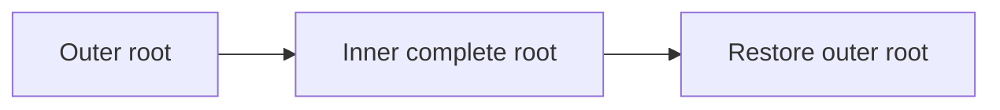
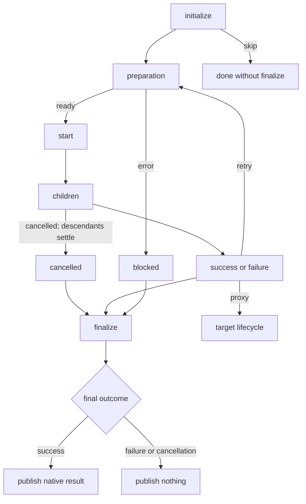
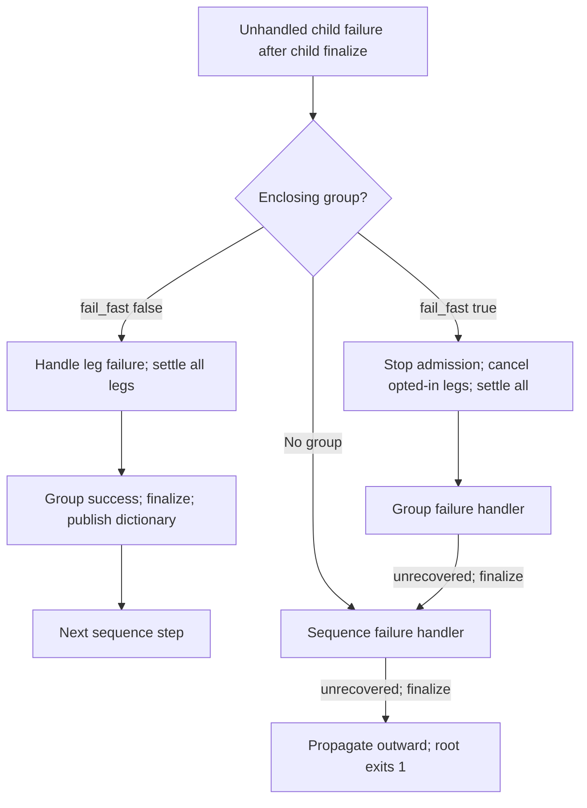
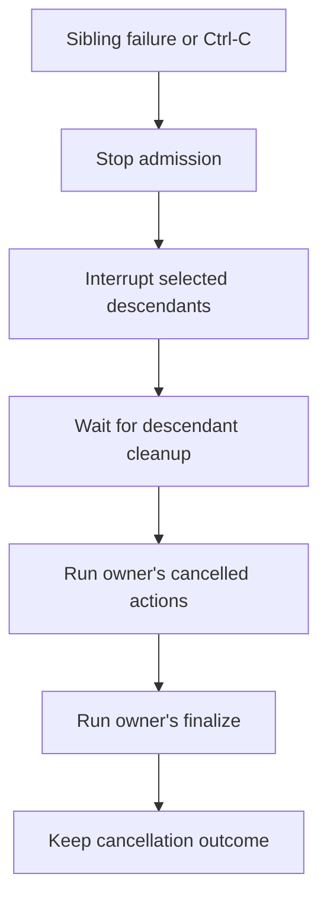

# Sequences in Claudine

A **sequence** runs an ordered list of *steps*. Each step composes and executes
one unit of work, and later steps can see what earlier steps produced.


```sh
claudine sequence <file> [key=value ...]
```

## Container grammar

A task can declare a nested `sequence:` list or a file reference using the
same `-> offset` and `::operator` suffixes as a sequence source. It is
exclusive with `prompt`, `shell`, `side_effect`, `group`, and `task`.

```yaml
sequence:
    - name: validate
      sequence:
          - name: check
            shell: just check
      failure:
          - warn: Validation failed
```

Nested containers execute recursively. An empty nested list returns an empty
array and still runs its container lifecycle. Only an inline list can carry container lifecycle events
on its task; a reference carries those events in its referenced document.

A container's `loop:` goes in one of three places: on a group object beside
`tasks:`, at a sequence document's root beside `sequence:`, or on an inline
nested sequence's task entry beside `sequence: [ … ]`. The block uses the
[loop grammar](./looping.md#frontmatter-shape) and is checked when the
sequence is resolved (a group file's when preflight loads it). The container
then repeats by the same rules as a document: `initialize` once, `start`, its
children, its terminal event, and `finalize` each pass, then the loop gate;
see [Composition Looping](./looping.md#iteration-semantics) for the pass order,
results, and retries inside a looping container.

```yaml
sequence:
    - name: retry-build
      loop: { until: "built", max: 3 }   # inline nested sequence: repeats its steps
      sequence:
          - name: build
            shell: just build
    - name: lint
      shell: just lint
      loop: { until: "clean" }           # error: a shell task takes no `loop:`
```

### What a referenced sequence reads

A sequence referenced by file is a document: its events, its conditions, its
`set` values, its lifecycle `shell` commands, and its steps read its own
frontmatter, so it behaves the same whether you run it directly or reference
it. Given `child.md`:

```yaml
---
local_value: child-value
start: [{ stdout: "{{ local_value }}" }]
sequence: []
---
```

both `claudine sequence child.md` and a root with
`sequence: [{ name: child, sequence: child.md }]` print `child-value`, even
when the root declares its own `local_value`. Values reach a referenced
sequence the way they reach a referenced prompt document. Lowest precedence
first:

1. the referenced document's own properties
2. invocation setters (`--set`, shorthand `key=value`)
3. runtime writes made so far, by the caller or by the sequence itself

The caller's authored frontmatter is not among them: a property only the root
declares reads as `null` inside the referenced sequence. To pass a value down,
write it at run time with `set`, or supply it with `--set`. A `set` inside the
referenced sequence is a runtime write, so the caller sees it afterward.

This applies when the reference names a whole sequence document: a Markdown
file with `sequence:`, or a `kind: sequence` YAML, JSON, or JSON5 file,
including one reached through a group leg or an external `task:` file. A
reference with an `-> offset` or `::operator` suffix selects a list of steps
rather than a document, so like an inline list it reads the frontmatter of the
document that authored it. Group files carry no document properties; a group's
own values are its `variables`, read through `group`.

Groups are concurrent: omit `execution:`. Both `execution: parallel` and
`execution: serial` are removed grammar; ordered work uses a nested
`sequence:`. Every group leg requires a unique, nonempty string `name`.
Group `variables:` may not shadow `legs`, `succeeded`, `failed`, or
`cancelled`. Group `fail_fast` is a boolean, defaults to `true`, and rejects
null or quoted boolean strings.

Task `setup:` and `teardown:` are removed. Put `initialize`/`start` and
`finalize` on the prompt document or wrap work in an inline sequence.
A sequence document's `fail_fast:` and `--fail-fast` are removed; failure
handling belongs in lifecycle events. No `CLAUDINE_FAIL_FAST` value is
injected into child sessions. The `cancelled:` lifecycle event accepts an
empty stack as an explicit cancellation opt-in; null is an error.
Container recovery uses `retry` or `proxy`; `resume` requires a live provider
session and is an error on a container. See [Cancellation](#cancellation) for
sibling failure and Ctrl-C cleanup.

## The two meanings of `prompt`

Read this before anything else. `prompt` means different things at two adjacent
levels, and the distinction is load-bearing:

| Level | Value | Meaning |
|---|---|---|
| **Document** (frontmatter root) | prose string | Flips the whole sequence to **inline-compose**: the composed `prompt` is the agent prompt, and the provider's reply replaces the document body on disk. |
| **Step / task** | file reference | Names a **prompt document** to compose and execute for that step. |

```yaml
---
prompt: "Summarize {{ seq.name }}."   # ← document level: prose, inline-compose
sequence:
    - name: alpha
      prompt: "@prompts/review.md"      # ← step level: a file reference
---
```

The two never occur at the same level, and their value types differ, so
Claudine can always tell them apart. The name was kept because `prompt` is
entrenched in inline-compose throughout the CLI and docs.

## Steps and tasks

There is one execution model. A **task** is the atomic executable unit; a
**step** is an entry in the `sequence:` list — its state, plus optionally the
task fields.

A task declares **exactly one** executable field:

| Field | Runs |
|---|---|
| `prompt: <file-ref>` | The referenced Markdown document (inline-compose if *that* document is configured for it, otherwise a normal compose) |
| `shell: <string \| string[]>` | One or more shell commands |
| `side_effect: <action>` | One Darkmatter side effect, written as a one-verb lifecycle dictionary in short or long form (`side_effect: { set_frontmatter: ["state.md", "status", "done"] }`) |
| `group: <group-ref \| inline group>` | A [group](#groups) |
| `sequence: <list \| file-ref>` | An ordered nested container returning an array |
| `task: <file-ref>` | An externalized `kind: task` file |

Declaring two is a typed error naming both fields.

A step with **no** executable runs the **default action**: it composes the
source document's Markdown body. A step **with** one runs that instead of the
body. A source with no body — a `kind: sequence` YAML file invoked directly —
simply requires every step to carry an executable.

Optional task fields: `name`, `params:`
(user setters passed to a `prompt` document), `timeout:` (per shell command),
`operation:`, `flow:`, and `when:` (any task with an executable; see
[Task guards](#task-guards-when)). A field that cannot affect the
chosen executable — say `params:` on a `shell:` task — is a typed error, not a
silent no-op.

```yaml
---
sequence:
    - name: alpha            # no executable → composes this document's body
      topic: parsing
    - name: run-tests
      shell: just test
    - name: review
      prompt: "@prompts/review.md"
      params:
          topic: "{{ seq.topic }}"
    - name: build-phase
      group: build-group@my-catalog.yaml
---
Work on {{ seq.topic }}.
```

### Task guards (`when:`)

A `when:` beside a task's executable decides, at that task's turn, whether the
task runs at all:

```yaml
sequence:
    - name: stage
      when: "stage == 'all'"          # stage=all on the command line runs it
      shell: git add -A
    - name: review
      when: "length(seq.outputs) > 0"
      prompt: "@prompts/review.md"
```

- **Where it goes.** On every sequence step and group leg that has an
  executable (`prompt:`, `shell:`, `side_effect:`, `group:`, `sequence:`, or
  `task:`), beside that executable. A step without an executable, which runs
  the document body, takes no guard (`WhenMisplaced`: "`when` guards a task
  and goes beside its executable; a step that runs the document body takes no
  guard"). A `when:` at a sequence document's root, or on a group object, is
  also an error; put it beside `group:` on the task.
- **What it must be.** A non-empty string that parses as a condition
  expression, the same surface as a lifecycle item's `when`. `null`, a
  boolean, a number, a list, a map, `""`, or an unparsable expression is a
  typed error naming the task's property (`sequence[0].when`). It is a task
  option, never step state.
- **What it reads.** Live state at the task's turn: the task's frontmatter
  values (document values, caller setters, and runtime `set` writes), `seq`,
  `loop`, and `group`. Truthiness is a lifecycle `when`'s. A guard is
  read-only and runs no shell.
- **False means skipped, not failed.** Nothing is composed or launched, no
  lifecycle event fires, the task's own loop runs zero times, and nothing is
  appended to `seq.outputs`. In a group the leg's outcome is `skipped` with a
  null output. A root step prints `` step N/M skipped (`when` was false) ``;
  a group breakdown shows `skipped`.
- **Inside a loop** the guard is evaluated again on every pass of the
  enclosing loop. A guarded looping container that runs starts its own loop
  from a fresh count.
- **Concurrent legs** read their group's start snapshot: runtime values are
  frozen when the group starts, even for a leg admitted later under
  `max_parallel`. File reads, such as `frontmatter('state.md', 'status')`,
  stay live.
- **An expression error fails the task**, located at the guard
  (`TaskWhenEvaluationFailed`: "task guard `<path>.when` could not be
  evaluated"). It is never read as false. A root step's runtime location reads
  `tasks[N].when`.

A guard never hides a task from [static preflight](#phase-1--static-preflight):
a task whose guard will be false is still validated, and its shell commands are
still approved before step 1.

## Step state

Every step gets a row exposed through `seq`. A bare string is shorthand for `{name: <string>}`:

```yaml
sequence:
    - one
    - two
    - one
```

normalizes to:

```json5
[
    { id: "one",   name: "one", index: 1, count: 3, is_first: true,  is_last: false },
    { id: "two",   name: "two", index: 2, count: 3, is_first: false, is_last: false },
    { id: "one-2", name: "one", index: 3, count: 3, is_first: false, is_last: true  },
]
```

Generated fields — you may read them, never author them:

| Field | Meaning |
|---|---|
| `id` | Unique per step. The dasherized `name`, suffixed `-2`, `-3`, … on collision. |
| `index` | One-based position. |
| `count` | Total steps. |
| `is_first` / `is_last` | Boundary flags. |
| `run_id` | One collision-resistant token per invocation, shared by nested sequences. |

Object steps carry whatever else you want:

```yaml
sequence:
    - name: Bob
      age: 32
    - name: Sally
      age: 36
```

### The `seq` runtime root

Read the active step through `seq`, separately from frontmatter:

| Expression | Value |
|---|---|
| `seq.name`, `seq.age` | Authored fields of the current row |
| `seq.id`, `seq.index`, `seq.count` | Unique ID and one-based position |
| `seq.is_first`, `seq.is_last` | Boundary flags |
| `seq.previous`, `seq.next` | Shallow neighboring rows; `null` at the boundaries |
| `seq.outputs` | Results committed so far |
| `seq.run_id` | Invocation token |

In string text, `The person is {{ seq }}; next is {{ seq.next }}` renders the
rows' names. A whole-value expression still yields the typed row object.
Standalone `compose` and `inline-compose` expose `seq.outputs`; their other
`seq` members are `null`.

These roots are read-only: `set` cannot assign `seq`, `group`, or `loop`.
They are not inserted into frontmatter or saved by inline-compose.
`fm.seq`, `fm.group`, and `fm.loop` always read authored document properties.

The old runtime reads `state`, `previous`, `previous_state`, `next`,
`next_state`, `outputs`, `sequence_id`, `step`, `total_steps`, `is_first`, and
`is_last` raise typed errors naming the corresponding `seq` expression.
For example, replace `{{ state.name }}` with `{{ seq.name }}` and
`{{ last(outputs) }}` with `{{ last(seq.outputs) }}`. A document that declares
its own `previous: null` still reads `previous` as ordinary frontmatter;
property presence, including supplied null values, preserves that behavior.
Explicit `fm.previous`, unrelated members such as `ctx.state`, and quoted
strings never request a retired runtime global.

Each nested sequence or group
replaces its entire same-kind root and restores the enclosing root on exit.
A sequence's own events have null step positions and expose its own outputs
and invocation token. Inner empty outputs never fall back to outer outputs.



A group's own terminal events and loop gate expose `group.legs`, a map from
leg name to `{name, outcome, output, err}`, and the declaration-ordered
`group.succeeded`, `group.failed`, and `group.cancelled` lists. Outcome is
`succeeded`, `failed`, `cancelled`, or `skipped`; skipped legs appear only in
the map. Failed output can contain partial stdout; an unadmitted leg has
null output and retains its cancellation cause. These result fields are
empty during initialize/start/blocked, and absent inside a leg, where only
`group` variables are visible. Terminal events run after every admitted leg
settles.

### Keys you cannot author as state

Rejected with a typed error naming the offending key:

- executable and task keys — `prompt`, `shell`, `side_effect`, `group`, `sequence`, `task`,
  `setup`, `teardown`, `params`, `timeout`, `operation`, `flow`
- generated state keys — `id`, `is_first`, `is_last`, `index`, `count`, `previous`, `next`, `outputs`, `run_id`
- runtime roots — `seq`, `group`, `loop`

## Sources

`sequence:` accepts a static list, a typed expression, a shell expansion, or a
file reference.

### Source grammar

```text
sequence: <file-ref> [-> <offset.path>] [::<operator>(<args>)]
```

- `<file-ref>` keeps its full powers — relative paths, `@` magic, `&`
  repository-root, `^` repository-scoped, `~`, `vault:`, and `{{ }}`
  interpolation. Interpolation resolves **before**
  the suffix is parsed, and resolution is relative to the **authoring
  document's** context: implicit paths check its directory before the repository
  root, while explicit `./`/`../` paths stay pinned to its directory.
- `->` is a dot-notation **offset** into the document. YAML/JSON/JSON5 only; a
  typed error on JSONL/NDJSON, whose root is always the list.
- `::` is an **operator** on the resolved list. Exactly one per reference.
- Expression (`{{ … }}`) and shell (`$( … )`) sources produce lists directly and
  take no suffix.
- A stored literal token (`"{{!data:v1:…}}"`, the form Claudine uses to save
  text an agent wrote) is refused with `SequenceInvalid`. It is data, and data
  must not choose which steps run. See
  [Values an Agent Writes](../frontmatter-properties.md#values-an-agent-writes).

The suffix parser respects quoted arguments, so a path containing a space or an
`@`, and an operator argument containing a comma, all survive.

### Operators

| Operator | Effect | Fails when |
|---|---|---|
| `map(from, to)` | **Renames** `from` to `to` (the original key is removed) | an item lacks `from`, or is a scalar — the error names the item index |
| `name(from)` | **Copies** `from` into `name` (the original is retained) | same as `map` |
| `template(expr)` | Computes `name` per item with a Darkmatter expression; the item's top-level fields shadow globals, each replacing the same-named frontmatter key whole (an item `config: {a: 1}` over frontmatter `config: {b: 2}` makes `config.b`, `fm.config.b`, and `fm['config']['b']` all `null`) | the result is null or empty |

```yaml
sequence: things.yaml -> colors.data                          # names become "1", "2", "3"
sequence: things.yaml -> colors.data::map(color, name)
sequence: things.yaml -> colors.data::name(color)
sequence: things.yaml -> colors.data::template(color + '-is-great')
```

### Data formats

YAML, JSON, JSON5, JSONL, and NDJSON all work and normalize identically.
JSONL/NDJSON take operators but never an offset:

```yaml
sequence: list.ndjson::map(color, name)
```

An object that repeats a key is an error in every format. YAML reports it
itself; for JSON, JSON5, JSONL, and NDJSON, which would otherwise keep only
the last value, the error names the file, the key, and the object's path
(``duplicate key `name` at `sequence[0]` ``), plus the line for JSONL and
NDJSON. JSON5 comments remain ordinary content, and a valid next JSONL record
is unaffected by an error report about an earlier one.

### String list formats

A string source is classified in this order: Markdown list markers (ordered or
unordered) → multiple lines → tabs (TSV) → commas (CSV, quote-aware) → spaces →
otherwise a single-item list. Whitespace-only entries are dropped; CSV/TSV
parsing is delimiter-aware, so quoted delimiters and escaped quotes survive.

```yaml
sequence: "{{ ctx.dirty_files }}"    # typed arrays bypass classification entirely
sequence: "$(ls -1 src)"             # the command must be approved at preflight
```

### Strictness depends on provenance

- **Authored for sequences** — inline lists and formal `kind: sequence`
  documents — stay **strict**. An object must carry a string `name`; a scalar
  must be a string. An omission here is a typo worth catching.
- **Foreign data** — arbitrary data files reached via offset/operator,
  JSONL/NDJSON, `{{ expr }}`, `$( shell )` — is **lenient**. Numbers and
  booleans coerce to string names, and a nameless object receives its one-based
  ordinal (`"1"`, `"2"`, …).

`null` items are a typed error either way.

### Empty lists

A static empty `sequence: []` is an authoring error. A **dynamic** source that
resolves to zero steps is a graceful no-op: Claudine prints a "resolved to 0
steps" notice to stderr and exits `0`. A clean repo legitimately makes
`{{ ctx.dirty_files }}` empty.

### Formal sequence documents

A YAML file using the `sequence:` property is a *formal* sequence document. It
may add `template:` (values merged into every step, with the item's own fields
in scope) and `$schema:`.

```yaml
kind: sequence
sequence:
    - name: blue
      color: blue
      rank: 5
template:
    desc: "{{ color }}({{ rank }})"
$schema:
    color: string(required) -> the color being evaluated
    rank: number(required)  -> a 1-5 ranking, 5 being best
    desc: string(required)
```

Normalization runs in a fixed order: scalar shorthand (`- blue`) expands to
`{name: blue}` first, then `template:` fills in, then the generated fields
(`id`, `index`, `is_first`, …), and `$schema` validates the finished state last.
So `desc` is ordinary authored state by the time `id` and `index` are made, and
a `template:` default reaches a scalar step exactly as it reaches an object one.
A schema failure names the step index, its id, and the failing property path.

A `template:` value is `any`, not just a string: a **string** is interpolated
with the item's fields in scope, and any **other** value (`rank: 5`, a list, a
map) is a literal default. A default never overwrites a value the item already
carries.

> **One shape, both entry modes.** `template:` and `$schema:` behave identically
> whether the file is **referenced** (`sequence: formal.yaml`) or invoked
> **directly** (`claudine sequence formal.yaml`) — both routes share a single
> normalization pipeline. In particular the root `$schema` is always the *step
> state* schema; on a directly invoked document it is not also validated as that
> document's own frontmatter schema. Parity is pinned by
> `a_formal_document_normalizes_identically_through_both_entry_paths` in
> `cli/tests/l1/sequence_sources_cli.rs`.

The retired external `kind: sequence` + `list:` form is **gone**. Use
`sequence:`.

## Execution

Sequence execution is two phases.

### Phase 1 — Static preflight

After the root sequence’s shell-free `initialize`, and before children start,
Claudine walks the **entire task graph**:

- **Dynamic sources resolve exactly once.** The resulting step list is a
  snapshot; it never re-evaluates mid-run, even if the environment changes.
- **Every referenced document loads transitively** — `kind: group` files,
  `kind: group-catalog` entries, `kind: task` files, nested `sequence:` containers, and every `prompt:`
  document. Reference cycles are rejected with the complete active chain. Reusing a
  sequence later is legal, as is nesting distinct groups from the same catalog.
  Catalog entries appear as `catalog.json#group-name` in cycle diagnostics.
- **Schemas validate and missing properties aggregate** across all steps and all
  referenced prompt documents, with one interactive collection pass.
- **Every shell command is approved before the first step** — `shell:` tasks,
  lifecycle `shell` actions and whole-value `set` `$( … )` values,
  and the `::shell` and `$( … )` commands of every referenced document, across
  every step and group, *including branches that may never run*. How a command
  with a placeholder is approved depends on its task's position:

  - **The first task** (the first step's task, or every leg of a first-step
    group, or the first child recursively through nested first-step sequences)
    resolves each command now, under the launch environment and the
    caller's values, and approves those bytes. They are what runs. If a later
    pass of an outer loop changes a value such a command reads (a loop action
    or a runtime `set`), the changed command is refused before it runs
    (`SequenceShellApprovalChanged`, naming `changed: <value>`); it is never
    silently replaced by the approved bytes.
  - **Every later task** approves each command with a placeholder only by its
    typed shape (`just clean --out {{ string }}/build`), even when its values
    are known now, because an earlier task may change them. An `exact` rule for
    today's bytes does not cover it. Position is static: skipped predecessors,
    retries, and resume never make a task first.

  A placeholder reading a value an earlier step produces — `seq.outputs`, `loop`,
  or, inside a group, `group` — is a **late value**: it is not read at
  preflight, and its command is approved only by its shape in any task. A step
  value or a prompt task's `param` derived from one is late too. Every other
  value a command reads (template values, caller values, `fm.*`,
  `ctx.*`, `env.*`) is read now, and a `null` fails preflight before step 1. A
  lifecycle global that never exists at approval (`err`, `timing`, `current`,
  or `group` outside a group) is a typed preflight error
  (`SequenceShellLateBinding`), even beside a late value. `fm.group` still
  reads the document.

  When a task is reached, every late value its commands read is read and
  checked before any of them runs. A `null`, an array or
  object, or a value its type refuses fails that task
  (`SequenceShellLateValue`, never showing the value); earlier steps' effects
  stand. A task command approved by shape runs directly with structured
  arguments: late holes use the checked step-entry values; other holes read
  current state when their command runs. Whole chains
  meet the runtime blacklist before any segment starts. Prompt documents and
  their transclusions pass the same late-value check before task execution; each
  execution retains its own checked values. Sequence-wide document validation
  discovers shells without executing them. See
  [Pre-flight Checks — the first task and later tasks](../pre-flight-checks.md#the-first-task-and-later-tasks).
  Redirections preserve their authored order: `2>&1 > /dev/null` keeps stderr
  in the task output for the next step, while `> /dev/null 2>&1` discards both.
  Lifecycle shells use the same order over the parent process's inherited streams.

  Container lifecycle commands join the same condition-blind audit, including
  shell-valued `set` operations. Commands with placeholders in terminal events
  (`success`, `failure`, `cancelled`, `finalize`, and `blocked`) require typed
  templates, even on the first container. For example, `finalize: [{ shell:
  'git check-ref-format --branch {{ value }}' }]` reads `value` when cleanup
  runs (with Git installed). Templates require native executables; shell
  builtins and aliases are not template targets. A group's own
  `group.*` values are late in its events as well as in its legs. Use a scalar
  expression such as `first(group.succeeded)` when passing an outcome to a command.

  Root retries reuse the original approval set and the original task graph.
  If a nested source changes before preparation, every newly discovered command
  must already belong to the invocation's approval set. Unapproved commands,
  templates, and prompt targets fail preparation before children start;
  concurrent descendants never open another approval prompt.

  A first-task `shell:` or prompt lifecycle command whose values are known
  offers exact approval and, for valid placeholders, shape approval. Saved
  exact rules take priority; shape approval fills each containing argument at dispatch. A first
  task reading a late value still requires a template.

  The group scheduler applies one late-value barrier across the entire group
  before any command runs. Referenced documents
  retain the checked late inputs; ordinary values still read current state at
  command dispatch. Nested sources prepare just before execution. Use
  `seq.outputs` for prior results.

  Each step and group leg later captures its own environment. Before any of
  its stages runs, a task resolves the commands preflight resolved to bytes
  again under that environment. Identical text runs; changed text is refused
  (`SequenceShellApprovalChanged`, naming the command and the variables that
  changed), and nothing in the task runs. Approving `deploy {{ env.TARGET }}`
  as `deploy staging` never authorizes `deploy prod`. See
  [Composition — Approval under a later document's map](../composition.md#approval-under-a-later-documents-map).
- **Git working state is observed once for the whole walk.** Static preflight
  is one discovery run: every referenced document (and every file it includes)
  that names a Git fact such as `ctx.staged_files` reads the same observation.
  Each step then observes Git state again when it runs, as its own composition
  run, so a step still sees what earlier steps changed.
- **Provider and model resolve once**, producing a per-step target vector.
  This plan reads the launch environment. When a step or group leg starts, it
  captures its own environment, and the model is selected again from it: a
  later step whose environment sets `MODEL=b` launches with `b`, even if the
  launch environment named another model. The provider stands as planned,
  because no environment variable selects it. A model given with `--model`, or
  confirmed on the review screen, also stands.

A preflight failure aborts the sequence. Preparation
never degrades to best-effort.

An include that a prompt's `initialize` would create must already exist at this
boundary. A missing include remains a typed preflight failure, with guidance to
create it **before starting the sequence**. An earlier task in the same sequence
cannot create it in time because no task starts before static preflight passes.
Live standalone `compose` and `inline-compose` support initialization-created
includes through [staged preparation](../composition.md#documents-that-declare-initialize).
A sequence task composes its prompt before its own initialization, so a change
to an existing include during that initialization does not alter the prompt
already composed for that task.


### Phase 2 — Just-in-time composition

Each step composes **at its turn**, not up front. At every step boundary
Claudine checks the interrupt flag, **captures the step's environment**,
**re-reads the live source file from disk**, re-layers state, composes,
validates, executes, appends the output, and folds in any mutations. The step's
composition, its task, its prompt document, its loop iterations, retries,
handlers, and `finalize` all read that one environment; a group leg captures
its own. See [Composition — One Environment per Document](../composition.md#one-environment-per-document).

State layering, lowest precedence to highest:

1. source document frontmatter (live, from disk)
2. user setters (`--set`, shorthand `key=value`)
3. accumulated runtime mutations (what `set` writes)

Inside a referenced sequence document, layer 1 is that document's frontmatter,
not the source's ([What a referenced sequence reads](#what-a-referenced-sequence-reads)).
The lexical `seq` root travels beside these frontmatter layers.

Layers 1 and 2 are authored, so their `{{ … }}` and `$( … )` spans are
templates. Runtime mutations and lexical roots are produced by the run, so they reach composition as
**data**: a value holding `{{ ctx.repo }}` stays that text, through arrays and
objects too. Evaluated task `params` and group `variables` are data for the
same reason.

**Live-disk chaining.** Because each step re-reads the source, an
inline-compose sequence's body write-backs — and any frontmatter an agent edits
mid-run — are visible to later steps. Mid-run *external* edits take effect too;
that is both the feature and the hazard.

What is *not* re-derived at a step boundary: the task graph. The children
preflight discovered — every step, group leg, and nested container, with their
names, order, and executables — run as discovered for the whole invocation,
including every retry. A `sequence: $(ls)` that would enumerate differently
mid-run does not change the plan under execution, and neither does an earlier
task that edits a later container's file. Here the `added` step never runs,
even though its command is already approved:

```yaml
# root.md frontmatter
sequence:
  - name: rewrite
    side_effect: { append_line: [child.yaml, "  - { name: added, shell: echo child }"] }
  - name: nested
    sequence: child.yaml     # child.yaml lists one step: { name: original, shell: echo child }
```

When a nested container prepares, its source is still read again: its own
lifecycle events and a group's `variables` take the current file's values, and
a command, template, or prompt document the reread introduces is refused
because approval has closed. To let a later step observe a file an earlier
step wrote, read the file when the step runs, through a prompt document or an
expression such as `{{ frontmatter('state.md', 'status') }}`.

**Mid-run failures.** A just-in-time composition failure is a failure of *that
step*: recorded in the summary and routed to the enclosing container
`failure` handler. Without recovery, the sequence stops; document-level
`fail_fast` is rejected.

## The output array

Every completed child publishes one native result to `seq.outputs`, in execution
order, after its `finalize` succeeds.
The previous task's output is `{{ last(seq.outputs) }}`. A skipped child publishes nothing.
Every group leg remains present by name in a successful group result; skipped
or unadmitted legs map to `null`, and failed legs retain partial output.

- A task with no stdout pushes an empty string, so entries stay aligned with
  executed tasks.
- A nested sequence publishes an array; a group publishes a dictionary keyed
  by leg name in declaration order. These values stay native when nested, for
  example `["first", ["inner"], {"lint": "clean"}]`.
- A container that a [`break`](flow-control.md#break) passes through publishes
  the work it completed, once, after its own cleanup: no placeholder for
  children that never ran, and no synthetic break entry.
- A failed container publishes nothing. A group with `fail_fast: true` also
  withholds all leg mutations on failure. With `fail_fast: false`, leg failures
  are handled and their mutations merge in declaration order. A failing
  `finalize` withholds the result and the staged leg mutations. This isolates
  in-memory state only; file edits and other external effects are not rolled
  back.
- Single-document `compose` / `inline-compose` use the same key, so a prompt
  written with `{{ last(seq.outputs) }}` behaves identically standalone and
  mid-sequence.
- The generated `seq.outputs` member is read-only. An authored root property
  named `outputs` is ordinary frontmatter data.
- Entries are **data**. An entry is stored raw and typed, and reaches
  predicates, functions such as `last(seq.outputs)`, logs, and the next step's
  prompt exactly as the task printed it. If a task prints `{{ ctx.repo }}`,
  the next step's `{{ last(seq.outputs) }}` renders the characters `{{ ctx.repo }}`,
  not the repository name, and a printed `$(cmd)` is never offered for
  approval.

**What an entry contains.** The task's captured, undecorated stdout. Terminal
status rendering, stderr, lifecycle messages, color bars, and provider protocol
records are never included. For a prompt task it is the provider's final
assistant text; for a multi-command shell task, the commands' stdout
concatenated in declaration order; for a side effect, its returned text or an
empty string. One trailing transport newline is removed; other whitespace is
preserved.

**Lifecycle timing.** A sequence container's own `seq.outputs` starts empty and gains
one entry after each successful child finalizes. Its `success` and `finalize`
see those completed children. Its enclosing sequence receives the complete
container array or dictionary only after the container's finalization succeeds.
A failing container publishes nothing, even when its private child accumulator
contains partial results. A successful tolerant group's dictionary retains
failed legs' partial outputs; `group.legs` also exposes their errors.

## Mutating state with `set`

`set` is the state-mutation side effect. It works anywhere the lifecycle action
grammar applies — lifecycle events and `side_effect:` tasks:

```yaml
side_effect:
    set:
        ready: "{{ true }}"
```

- Lifecycle YAML accepts only the mapping form `set: {property: value}`. A
  one-entry mapping, a multi-entry mapping, and an empty mapping are all valid.
- a whole-value `{{ expr }}` span carries its typed value — the example above
  writes boolean `true`, not the string `"true"`
- all values in one mapping read the same pre-write snapshot, and the complete
  mapping commits atomically; use two consecutive `set` actions when the second
  assignment must observe the first
- it writes to the **in-memory runtime layer**, never to disk. That is what
  distinguishes it from `set_frontmatter`, which targets a file.
- the value it stores is the evaluation's result, so later steps read it as
  data, not as a template
- top-level keys only; reserved keys are rejected
- outside a sequence it still works, mutating the state visible to later
  lifecycle actions and loop iterations in the same run

Do not confuse this lifecycle YAML action with the capability and loop-control
API spelled `set(key, value)`. That positional API remains unchanged; only
Claudine lifecycle YAML uses `set: {property: value}`.

Mutations are visible to subsequent lifecycle actions, loop iterations, and later steps. `seq`, `seq.previous`, and `seq.next` remain immutable
runtime views; runtime mutation flows through ordinary frontmatter keys.

## Groups

A group bundles one or more tasks under a name, for semantic naming, reuse, and
concurrency. **A group cannot be executed directly** — it runs only as a
sequence task.

### Defining a group

Three places, all behaviorally equivalent once loaded:

**Inline:**

```yaml
sequence:
    - name: build-phase
      group:
          name: ICR
          tasks:
              - name: lint
                shell: just lint
              - name: tests
                shell: just test
```

**A `kind: group` file** — one group per file, normal file-reference grammar:

```yaml
sequence:
    - name: build-phase
      group: my-group-file.yaml
```

**A `kind: group-catalog` file** — a root `groups:` list. One group is
referenced `{name}@{file}`, name first, matching Darkmatter's named-type import
convention. Magic refs compose: `build-group@@catalogs/all.yaml` splits on the
first `@` after the group name.

```yaml
sequence:
    - name: build-phase
      group: build-group@my-catalog.yaml
```

### Group fields

| Field | Meaning |
|---|---|
| `name` (required) | Identifies the group |
| `description` | Optional longer prose |
| `variables` | Group-scoped values exposed to tasks on the `group.*` global, discarded when the group completes |
| `tasks` (required, ≥1) | Concurrent legs, each with a unique, nonempty string `name` |
| `max_parallel` | Cap on simultaneous tasks. Integer ≥ 1. |
| `fail_fast` | Boolean, default `true`; stops admission on failure and cancels running legs that declare `cancelled` |
| `operation` / `flow` | Defaults for the group's tasks; task-level values override |

A single-task group is legitimate — it is the honest way to get a semantic name
or `variables` scoping around one task.

A group leg may itself declare a group or a sequence task. Each leg receives
a private in-memory runtime branch; siblings share the filesystem.

A group object's `loop:` repeats the whole group: every pass admits its legs
again, rebuilds `group.legs` and the outcome lists, and exposes the pass's
dictionary as `loop.last_output`. The parent receives only the final pass's
dictionary; see [Composition Looping](./looping.md#results-of-a-looping-primitive).

### Task references and lifecycle events

An external `task:` reference is exclusive with the other executables and is an
immutable expansion of a `kind: task` file. Overrides at the referencing site
are rejected.

Task `setup:` and `teardown:` are removed grammar, even when their values are
empty or null. For a prompt task, put `initialize`, `start`, and `finalize` on
the prompt document. For ordered non-prompt work, use an inline `sequence:`;
its lifecycle surrounds its ordered children.

```yaml
sequence:
    - name: review
      prompt: review.md
```

The referenced `review.md` can declare its own lifecycle:

```yaml
---
start:
    - info: Starting review
finalize:
    - info: Review finished
---
Review the current changes.
```

A `side_effect` task resolves file-touching effects relative to the document
that authored the task. An externalized `task:` or `group:` file therefore
uses its own directory and repository, even when referenced from another
repository.

### Shell tasks

```yaml
sequence:
    - name: JustOne
      shell: just test
    - name: Multiple
      shell:
          - just test
          - just lint
```

Every command gets a **30s** default timeout, overridable with `timeout:` as a
duration (`45s`, `2m`) — a bare integer is rejected because the unit is part of
the grammar, and `0s` is rejected rather than read as unbounded. A task passes
when every command exits `0`. Stdout is concatenated in declaration order.

Caller values (`key=value`, `--set`) are plain names to `shell:` commands and
to authored step data, in the first task and in later ones, so
`claudine sequence ship.md target=staging` lets a task run
`shell: "just deploy {{ target }}"`. A caller value a command reads that is
missing fails preflight.

### Ordered work

Groups always run concurrently. `execution: serial` and `execution: parallel`
are rejected with replacement guidance. An inline `sequence:` expresses ordered
work; its children run in declaration order.

### Parallel groups

```yaml
group:
    name: fan-out
    max_parallel: 3
    tasks:
        - name: a
          prompt: "@prompts/a.md"
        - name: b
          prompt: "@prompts/b.md"
```

- **Scheduling** — all tasks launch at once unless `max_parallel` is set, in
  which case they admit in **declaration order** as slots free up.
- **Snapshot isolation** — every task receives the same state snapshot and the
  same `seq.outputs` view, taken when the group starts. In-memory mutations
  stay private until settlement. Nested steps read live files when they run, so a sibling's
  file edits can be visible to a later nested step. The steps themselves stay
  as preflight discovered them.
- **State merge** — mutations fold in **task-declaration order**, never
  completion order. Disjoint keys merge cleanly; when two tasks wrote the same
  key the later-declared task wins and Claudine warns on stderr naming the key
  and both tasks.
- **Failure policy** — group `fail_fast` defaults to `true`. An unhandled
  failure stops new admissions and cancels running legs that declare
  `cancelled`. Other running legs complete and retain their actual outcomes.
  The failed group withholds all leg mutations and its result. With
  `fail_fast: false`, it succeeds after leg failures and merges failed-leg
  mutations. Cancelled legs contribute no state. Terminal summaries retain
  partial stdout for failed legs. See [Cancellation](#cancellation).
- **No interactivity** — a late required property becomes a task *failure*
  inside a parallel group, never a TTY prompt: N concurrent tasks cannot share
  one terminal. Serial contexts keep the standard interactive collection.
- **Write-back collisions** — two tasks whose `prompt` documents are
  inline-compose targets of the same file (or of the sequence source itself) is a
  typed **preflight** error. Racing write-backs are never legal.
- **Process isolation** — each task runs as an independent child with
  spawn-level environment and working directory. Claudine never mutates process
  environment or CWD on behalf of one task while siblings run. A leg's
  `shell:` commands, its prompt lifecycle `shell` actions, and the
  `::shell` and `$( … )` commands its documents run all start from the
  environment that leg captured, so `echo $X` prints the value that
  `{{ env.X }}` reads in the same leg.
- **Timeouts and guards** apply to each task independently. Ctrl+C fans out to
  all running children; the group is marked interrupted and the sequence exits
  `130`.

### Reading concurrent output

Parallel tasks render with line-interleaved color bars: each task takes a color
from a fixed cycling palette, announces itself with a `▶ <task-name>` header,
prefixes its lines with a colored vertical bar, and closes with a footer
carrying its outcome and duration. Lines interleave in arrival order —
attribution comes from the bar and the label, not from ordering.

Serial work renders in the same geometry with an **invisible** bar, so the
stream does not lurch sideways when execution switches between serial and
parallel.

Degradation is by design: without color, the header and footer still name the
task; without Unicode, `▶` becomes `>`. Task and provider data stay on stdout;
headers, footers, status, and warnings go to stderr. One synchronized sink
writes complete frames, so sibling writers cannot tear an ANSI sequence.

## Fail-fast, exit codes, and dry-run

An unhandled step failure stops the sequence. Document `fail_fast:` and the
`--fail-fast` flag are removed grammar. Claudine does not inject
`CLAUDINE_FAIL_FAST` into child processes. Containers handle recovery through
`retry` or `proxy` in their lifecycle events.

| Code | Meaning |
|---|---|
| `0` | Every executed step succeeded (or a dynamic source resolved to 0 steps) |
| `1` | At least one step failed |
| `code` | A looping root sequence ended through `break`; the process exits with the `break`'s `code` (default `0`). See [Looping — Breaking out of a loop](looping.md#breaking-out-of-a-loop) |
| `130` | Ctrl+C interrupted the sequence, or `Esc`/Ctrl+C left the provider review screen before any step started |

### Dry run

`--dry-run` performs the **full preflight**, then just-in-time-composes every
step against the *initial* state — empty `seq.outputs`, no runtime mutations —
without launching a provider and without inline-compose write-back.
Late-binding references render exactly as a first-step composition would see
them. Static validation and shell approval are the same as in a live run.

What a dry run shows instead of doing:

| Element | In a dry run |
|---|---|
| `shell:` task | Rendered, not run: `` rendered (dry-run): would run `<command>` `` with the approved bytes (or the template of a template-mode command). It publishes nothing. |
| `side_effect:` task | Rendered with its authored action and arguments, templates unresolved: `` rendered (dry-run): would run `{"append_line":["note.txt","noted {{ loop.count }}"]}` ``. It never writes a file or applies a runtime `set`. |
| `loop:` | The body is visited once with pass 1's `loop.*` values: `` `loop` previews one pass (dry-run); repetition is not evaluated: until `<expr>`, max N ``. No gate, condition, or action is evaluated. |
| Task `when:` | Shown, not evaluated: `` `<name>` runs when `<expr>` (not evaluated in a dry run) ``; the task is rendered. |
| Lifecycle events | None fire. |
| `prep` | Targets do not run; a literal target is listed as `prep target @helper.md (not run in a dry run)`. |

The run ends with `Sequence previewed (dry-run): N step(s) rendered, none run`.

> **Composition shell work still runs.** `$( … )` expansions in step documents
> execute for real, because their output is what composition needs, so their
> side effects happen. Dry-run does not provide filesystem isolation.

`--dry-run-shell` (only with `--dry-run`; alone it is a usage error, exit `2`)
additionally runs each `shell:` task once, during the single preview pass:

```sh
claudine sequence --dry-run --dry-run-shell release.md
```

Those commands have their real effects (a `git add` stages), but no provider
launches, no `side_effect:` task runs, and no loop repetition or lifecycle
event is turned back on.

## Requiring caller input

A document declaring `required` schema properties it does not define is asking
the caller for them. Well-designed sequences front-load that interaction, and
Claudine helps two ways:

1. Preflight approves **all** shell expansion across the entire sequence before
   the first step starts — including commands in conditional blocks that will
   never run. No exceptions. Once the sequence starts, nothing stops to ask.
2. Missing required properties aggregate across every step and every referenced
   prompt document into one interactive collection pass.

Claudine cannot guarantee that runtime mutations satisfy every later step. If
just-in-time validation still finds a required property missing, the normal
behavior applies: interactive collection in a serial TTY context, a typed error
otherwise. Arrange for earlier tasks to `set` what later tasks require.

**Each step is its own composition, so each step reaches its own completion
verdict.** A step that ends with a `required` property missing or a value of the
wrong type fails at that step and stops the sequence — the schema
describes the document and its lifecycle, not the sequence as a whole. A
property that is only meant to accumulate across steps must therefore not be
declared `required`. Values supplied transiently — a caller `key=value`, step
state, or a `proxy.with` overlay — count toward the verdict exactly as they
count everywhere else, and are still never written to the source. See
[Composition — Completion Verdict](../composition.md#completion-verdict).

## Operations

Any step may define `operation`, whose value becomes the `OPERATION`
environment variable for that step — the same dimension the `--operation` CLI
switch sets, and a reportable field in Claudine's logs.

## Remaining planned behavior

**Planned:** persisted checkpoint/resume; running a `kind: group` file as a
[`prep`](flow-control.md#prep) target; and inventorying `prep` targets in the
front-loaded approval: today a `prep` target is approved as its own invocation
when it runs, under the caller's approval flags (`--yolo`, policy).
Recursive containers, their lifecycle events and loops, task `when:` guards,
`break` and `prep`, cancellation, and native array/dictionary results are
implemented.


## Container lifecycle and recovery

Try the [executable container example](../../examples/sequence-containers.md)
for a sequence containing both a nested sequence and a group.

Root sequences initialize before static preflight. Nested containers initialize
when reached and prepare just before their children start. A body-only step
composes the sequence document body without entering another lifecycle.



`retry.max_attempts` counts additional attempts. Initialize runs once; a retry
starts another preparation and `start`, without finalizing the abandoned
attempt. Child results and group outcome summaries reset, while runtime writes
survive. `retry.with` values become runtime writes and never modify the source
file. Finalize runs once after the last attempt.

```yaml
failure:
  - retry:
      max_attempts: 1
      with: { attempt_note: second }
```

An unhandled child failure runs cleanup from the innermost primitive outward
and exits with status 1. Logging or `stop` in a failure handler does not recover
it. Timeouts follow this failure path, never cancellation.



Dry-run fires no lifecycle events recursively and launches no provider or
inline write-back. It renders shell tasks rather than running them (unless
`--dry-run-shell` is given), but composition shell expansions still run against
initial state and can have real effects. See [Dry run](#dry-run).


## Cancellation

A group with `fail_fast: true` cancels running legs that opt in by declaring
`cancelled:`. An empty stack, `cancelled: []` or `cancelled: {}`, opts in too;
omission does not, and null is invalid. A prompt leg declares the event in its
referenced document. Wrap a shell or side effect in a sequence to give it a
lifecycle and opt it in:

```yaml
sequence:
  - name: checks
    group:
      name: checks
      tasks:
        - name: build
          shell: just build
        - name: review
          sequence:
            - name: review-source
              shell: just review
          cancelled: []
          finalize:
            - info: Review settled
```

If `build` fails while `review` runs, Claudine interrupts the review container
and all its running descendants, including descendants without their own
`cancelled` stack. It waits for those descendants to finish cleanup before
running the container's `cancelled` and then `finalize`. A running leg without
an opt-in runs to completion; its recorded outcome stays succeeded or failed,
but the failed atomic group publishes none of its state. Legs not yet admitted
record `cancelled` with null output and the triggering cause, and fire no events.
The first observed unhandled failure supplies the structured cause, including
the originating group and leg, through `err` in cancellation cleanup.

Ctrl-C interrupts **every** running primitive regardless of opt-in and prevents
later steps from starting. Every entered lifecycle runs its declared
`cancelled` actions followed by `finalize`, with children finishing before
parents begin cleanup. Sibling cleanup can interleave. A primitive that entered
initialize but has not started still gets cleanup, with shells disabled;
a finalized primitive receives no second cleanup. A second Ctrl-C preserves
the force-exit ladder and may cut cleanup short.



Cancellation bypasses `failure` recovery. `stop` ends only the cancellation
stack. Recovery in the following `finalize` raises a typed cancellation-recovery
error and launches no replacement work. Cleanup errors remain secondary
diagnostics: they neither change a cancelled leg's outcome nor replace Ctrl-C's
exit status. A normal execution timeout is a failure, never cancellation;
a cleanup-shell timeout is a secondary cleanup error.

The caller sees these Ctrl-C exit values after cleanup:

| Platform | Root `claudine sequence` | Interrupted native provider result |
|---|---|---|
| macOS, Linux, WSL2 | `130` | Normalized to `130` |
| Native Windows | `130` | Normalized to `130`, including native `0xC000013A` |

See [Signal Handling](../signal-handling.md) for the escalation ladder and
platform-specific signal delivery.
