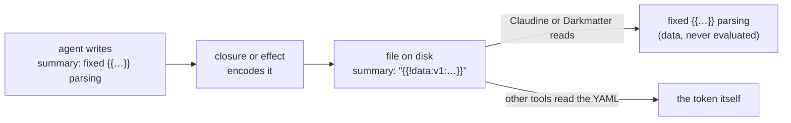

# Frontmatter Properties Reference

Claudine reads and acts on a number of YAML frontmatter properties across its composition, lifecycle notification, linking, and prompt-reporting subsystems. This document catalogs every property that has special meaning, with links to deeper topic docs and the source-level symbols that implement each behavior.

Claudine's [schemas](schemas.md) type these properties. When a document sets a lifecycle event, `loop`, `prompt`, `agent`, or `model` to a non-null value, the `claudine.yaml` trigger schema applies, both in the editor and in the launch verdict, with or without a `$schema`. Every property it declares is optional, and an invalid value fails the launch rather than being dropped, unless the authored `$schema` redeclares that property (see [Composition → Claudine's trigger schemas](composition.md#claudines-trigger-schemas-in-the-launch-verdict)). Keys this page does not list are application data and are never a schema error.

## Composition Core

| Property | Description | Details | Symbols |
|----------|-------------|---------|---------|
| `prompt` | The inline composition request. Its string value is composed through Darkmatter (transclusion, interpolation, shell commands), then wrapped with a header naming the document's native absolute path and the file-aware guardrails, and sent to the provider. The agent writes the document itself; its final response is the caller's summary and never reaches the file. Required for `inline-compose` (satisfiable by a transient `--set` / `key=value` value that is not persisted); absent for `compose`. One of the three closure-owned properties: an agent edit is restored with a warning. | [composition.md](composition.md) | [`CompositionMode::InlineFrontmatterPrompt`](../../lib/src/composition/types.rs) · [`CompositionError::PromptPropertyMissing`](../../lib/src/composition/error/mod.rs) · [`PreparedComposition.prompt`](../../lib/src/composition/types.rs) · [`prepare_inline`](../../lib/src/composition/prepare.rs) |
| `agent` | Selects which agentic CLI (provider) runs the composition. Accepts a single string or an ordered list of strings, fuzzy-matched against known providers. In non-TTY mode the first installed provider wins; in TTY mode it influences the default in the interactive picker. | [composition.md](composition.md) | [`AgentHint`](../../lib/src/composition/types.rs) · [`AgentResolutionState`](../../lib/src/composition/types.rs) · [`EffectiveSelectionHints.agent`](../../lib/src/composition/types.rs) · [`ProviderResolutionReason`](../../lib/src/composition/types.rs) · [`PickerInfluence`](../../lib/src/composition/types.rs) · [`parse_selection_hints_from_frontmatter`](../../lib/src/composition/prepare.rs) |
| `model` | Specifies which model the selected provider should use. Accepts a single string or an ordered list. Resolution: CLI `--model` > provider env var > `MODEL` env var > frontmatter `model` (validated against catalog when available) > provider default. | [composition.md](composition.md) | [`ModelHint`](../../lib/src/composition/types.rs) · [`ModelResolutionReason`](../../lib/src/composition/types.rs) · [`EffectiveSelectionHints.model`](../../lib/src/composition/types.rs) · [`resolve_model`](../../lib/src/composition/select.rs) · [`resolve_model_with_catalog`](../../lib/src/composition/select.rs) |
| `interactive` | Sets the default session mode for `compose` and `inline-compose`. Accepts `true` or `false`; absent or `null` preserves the default non-interactive behavior. Hard-rejected for `sequence` because a sequence is serial automation. Resolution precedence: `--no-interactive` > `-i`/`--interactive` > `interactive` frontmatter > default `false`. | [composition.md](composition.md) | [`SessionInteractivitySource`](../../lib/src/composition/types.rs) · [`ResolvedSessionInteractivity`](../../lib/src/composition/types.rs) · [`EffectiveSelectionHints.interactive`](../../lib/src/composition/types.rs) · [`parse_interactive_hint`](../../lib/src/composition/prepare.rs) · [`CompositionError::InteractiveHintWrongType`](../../lib/src/composition/error/mod.rs) · [`CompositionError::SequenceInteractiveRejected`](../../lib/src/composition/error/mod.rs) |
| `$schema` | Declares a schema constraining the document's other frontmatter values. Accepts inline `SimplifiedSchema` mappings, external YAML/JSON file references, or raw JSON Schema. Applied last, over Claudine's [trigger schemas](schemas.md): a property it redeclares replaces the trigger's declaration and follows the authored rules. Runs between override application and shell expansion, and again at the completion verdict. `eager` controls when a present value is validated; `required` independently controls whether the value must exist. A required non-eager property is collected at launch for `compose` only and is enforced for both modes by the completion verdict. Invalid optional non-eager values of the authored `$schema` are dropped with a warning, while present invalid eager values and invalid Claudine controls fail launch. The schema resolved at launch is the one the verdict uses, so an agent edit to `$schema` governs the *next* run. Argument-token ownership and caller eager-file completion read this authored schema alone. | [composition.md](composition.md#schema-validation) | [`InteractiveSchemaOptions`](../../lib/src/composition/schema/mod.rs) · [`SchemaStatusReport`](../../lib/src/composition/schema/classify.rs) · [`PropertyState`](../../lib/src/composition/schema/classify.rs) · [`PreValidatedSchema`](../../lib/src/composition/schema/mod.rs) · [`MissingProperty`](../../lib/src/composition/error/mod.rs) · [`CompositionError::SchemaLoad`](../../lib/src/composition/error/mod.rs) · [`CompositionError::SchemaValidation`](../../lib/src/composition/error/mod.rs) |
| `last_updated` | Auto-managed date stamp set during inline composition closure. One of the three closure-owned properties: an agent edit is restored from the pre-run snapshot with a warning, then re-stamped. Claudine edits its source node during the final atomic textual rewrite while preserving its existing quote style and every unmanaged authored frontmatter byte. A rollback restores the pre-run value and stamps nothing. | [composition.md](composition.md) | [`InlineClosurePlan`](../../lib/src/composition/types.rs) · [`InlineClosureResult`](../../lib/src/composition/closure.rs) · [`reconcile_inline_artifact`](../../lib/src/composition/closure.rs) · [`restore_properties_text`](../../../darkmatter/lib/src/markdown/hash/write.rs) |
| `hash` | Auto-stamped Darkmatter `Simple` content hash (`<fm>-<body>`, 16 hex per segment) written textually on every successful `inline-compose` closure. Computed with `hash` and `last_updated` excluded, so re-running on an otherwise unchanged document is a fixed point. Forced to `Simple` regardless of any pre-existing `structured`/`detailed` value. The schema accepts either the shorthand string or Darkmatter's longhand object (`{ kind, value, ignored }`), since a document may hold the longhand form before the closure rewrites it. One of the three closure-owned properties: an agent edit is restored with a warning before the fresh stamp. | [composition.md — `hash` property](composition.md#hash-property-auto-stamped) | [`reconcile_inline_artifact`](../../lib/src/composition/closure.rs) · [`apply_hash_save_text`](../../../darkmatter/lib/src/markdown/hash/write.rs) · [`inline_hash_options`](../../lib/src/composition/closure.rs) |
| `fail_fast` | On a group, boolean `true` (default) makes unhandled leg failure fail the group and withhold its in-memory result/mutations; `false` handles leg failures and lets the group succeed after settlement. A sequence document’s `fail_fast` and the CLI `--fail-fast` flag are rejected; no `CLAUDINE_FAIL_FAST` is injected. The separate `loop.fail_fast` remains supported. | [flow-control/sequences.md](flow-control/sequences.md#parallel-groups) · [flow-control/looping.md](flow-control/looping.md) | [Sequence grammar](flow-control/sequences.md#group-fields) · [`LoopConfig`](../../lib/src/composition/types.rs) |
| `sequence` | Defines a list of steps for sequence composition, where each step composes the source body or executes an explicit task. Accepts inline scalar/object lists or a string file reference to external YAML. A stored literal token is refused (`SequenceInvalid`); see [Values an Agent Writes](#values-an-agent-writes). The separate lexical `seq` root exposes the current row, neighbors, invocation token, and native child results; it is never injected into frontmatter. | [composition.md](composition.md) · [flow-control/sequences.md](flow-control/sequences.md) | [`SequencePlan`](../../lib/src/composition/types.rs) · [`SequenceSource`](../../lib/src/composition/types.rs) · [`SequenceStep`](../../lib/src/composition/types.rs) · [`SequenceStepOverlay`](../../lib/src/composition/types.rs) · [`SequenceExecutionOptions`](../../lib/src/composition/types.rs) · [`resolve_sequence_plan`](../../lib/src/composition/sequence/mod.rs) · [`build_step_overlay`](../../lib/src/composition/sequence/mod.rs) |
| `loop` | Defines repeated-execution configuration for a composition document. A YAML object requiring `while` or `until`, optionally supporting `actions`, `max` (a positive integer or a template resolved once), and `on_rate_limit`, plus lifecycle concerns (loose verb keys or a `gate:` list). Read as `fm.loop`; each iteration's values are the separate `loop` global (`loop.count`, …). | [flow-control/looping.md](flow-control/looping.md) · [composition.md](composition.md) | [`LoopConfig`](../../lib/src/composition/types.rs) · [`LoopCondition`](../../lib/src/composition/types.rs) · [`LoopAction`](../../lib/src/composition/types.rs) · [`OnRateLimit`](../../lib/src/composition/types.rs) · [`AmbientVariable`](../../lib/src/composition/types.rs) · [`LoopExecutionOptions`](../../lib/src/composition/looping/types.rs) · [`LoopIterationContext`](../../lib/src/composition/looping/types.rs) · [`execute_loop_with_lifecycle`](../../lib/src/composition/looping/engine.rs) · [`resolve_loop_config`](../../lib/src/composition/looping/config.rs) |
| `argv` | The positional arguments: every bare word after the composition file that no provider switch takes, as an array of strings in the order typed (never JSON5-parsed; the file and anything after an authored `--` are excluded). With at least one positional it overrides an authored `argv`; with none, an authored value is left alone. Reserved: an `argv=…` setter or a `--set` object holding `argv` is an error before `--`. Applied to every `sequence` step and kept through retries and `proxy` hand-offs as caller input; `inline-compose` never writes it into the document. A `$schema` that declares it validates it like any other value. | [composition.md — Positional Arguments](composition.md#positional-arguments) · [argv-normalization.md — Type-aware ownership](argv-normalization.md#type-aware-ownership) | [`ARGV_KEY`](../../lib/src/composition/ownership.rs) · [`own_arguments`](../../lib/src/composition/ownership.rs) · [`parse_composition_positionals`](../../cli/src/commands/compose/setters.rs) · [`merge_set_overrides`](../../cli/src/commands/compose/setters.rs) |
| `title` | A user-facing document title referenced in dry-run metadata tables and schema validation error reporting. Not interpreted for execution control. | [composition.md](composition.md) | [`DryRunRender`](../../cli/src/commands/wrap/composition/dry_run.rs) |
| `description` | A human-readable summary of the document's purpose, shown in the dry-run metadata table and carried through `MissingProperties` and `SequenceMissingPropertiesStep` errors for identification. | [composition.md](composition.md) | [`DryRunRender.description`](../../cli/src/commands/wrap/composition/dry_run.rs) · [`MissingProperty.description`](../../lib/src/composition/error/mod.rs) |

## Run Controls

These properties bound or end the run. A document value is one layer of each control's precedence chain; the linked topics give the full chain (CLI flags, environment variables, and user and repository configuration).

| Property | Description | Details | Symbols |
|----------|-------------|---------|---------|
| `timeout` | Wall-clock ceiling for the run, as a duration string (`30s`, `5m`, `2h`). A number is rejected. | [timeouts.md](timeouts.md#timeout-wall-clock) | [`parse_harness_plan`](../../lib/src/harness/parse/mod.rs) |
| `step_timeout` | Stream-silence ceiling: how long the agent may produce no activity. Same grammar as `timeout`, and it must not exceed `timeout`. | [timeouts.md](timeouts.md#step_timeout-stream-silence) | [`parse_harness_plan`](../../lib/src/harness/parse/mod.rs) |
| `timeout_warn` / `step_timeout_warn` | Non-fatal warnings raised before the corresponding ceiling fires. Same grammar; frontmatter only. | [timeouts.md](timeouts.md#warning-variants) | [`parse_harness_plan`](../../lib/src/harness/parse/mod.rs) |
| `exit_expressions` | Output patterns that end the run. A bare list of entries (`pattern` or `patterns`, `kind: literal \| regex`, `ignore_case`, `scope`) merges into the configured rules; `{ mode: merge \| override, rules }` chooses how. | [timeouts.md](timeouts.md#configuration-surface) | [`extract_frontmatter_exit_expressions`](../../lib/src/runaway/config.rs) · [`ExitExpressionEntry`](../../lib/src/runaway/config.rs) |
| `guard_settings` | Thresholds of the runaway-output guards: `repetition` (`enabled`, `max_repeats`, `max_cycle_length`) and `volume` (`enabled`, `max_lines`, `max_bytes`), non-negative integers. | [timeouts.md](timeouts.md#content-guards-runaway-output) | [`GuardSettings`](../../lib/src/runaway/config.rs) · [`resolve_guard_settings`](../../lib/src/runaway/config.rs) |

`operation` and `yolo` are **not** document controls, although the schema declares them so the editor can describe them. `yolo` comes from `--yolo`/`-y` or `CLAUDINE_YOLO`; `operation` comes from `--operation` or a sequence task's `operation:` field ([sequences.md](flow-control/sequences.md)). Setting either in a prompt's frontmatter changes nothing.

## Values an Agent Writes

Text an agent produces is **data**: it is shown and passed on exactly as written, and never read back as a template or shell command. For frontmatter an agent writes to disk this needs a storage form, because YAML alone cannot record who wrote a value. Two writers use it: the [inline-compose closure](composition.md#inline-composition), for keys the agent added or changed in the document, and the lifecycle effects `set_frontmatter`, `merge_frontmatter`, `append_frontmatter`, and `prepend_frontmatter` (see [Side Effects](state-management/side-effects.md)).

When such a string contains `{{` or `$(`, it is stored as a Darkmatter **literal token**: `{{!data:v1:` plus the UTF-8 text in unpadded URL-safe base64, then `}}`, as a quoted YAML scalar (the inline closure uses double quotes; a lifecycle effect's YAML writer may use single quotes, which is equivalent). Any other value is written as ordinary YAML, and mapping keys are never encoded.

```yaml
# The agent wrote:   summary: fixed {{…}} parsing
# The file stores:
summary: "{{!data:v1:Zml4ZWQge3vigKZ9fSBwYXJzaW5n}}"
```



- **Claudine and Darkmatter decode it.** Composition, `{{ summary }}` in a body, `$schema` validation (launch and completion), sequence sources, and the autocomplete file details all see `fixed {{…}} parsing`. The decoded text is data, so a token holding `$(echo X)` is never offered for approval.
- **Other tools see the token.** A script, linter, or editor that reads the YAML directly gets `{{!data:v1:…}}`. Decode it before comparing or displaying the value.
- **An unchanged token stays as it is.** A later run that leaves the key alone keeps the token's bytes; the file holds the token until someone edits it.

A token is not accepted everywhere a string is. `sequence:` refuses a token (`SequenceInvalid`), because decoding it would let data choose the steps a run executes. Author the list, file reference, expression, or shell expansion directly.

### Editing a token by hand

Replacing the token with plain text makes the value **authored** again, and authored text is a template. Choose the replacement by what you want the value to do:

| You want | Write |
|----------|-------|
| Plain text with no `{{` or `$(` | the text itself: `summary: fixed the parser` |
| Text that keeps literal braces | the `{{{ … }}}` escape: `summary: "see {{{ title }}} for the rule"` (reads as `see {{ title }} for the rule`) |
| A template that fills in | the raw span: `summary: "see {{ title }}"` (this now evaluates) |
| The exact original text, edited | decode, edit, and re-encode the payload (below) |

Writing the decoded text back verbatim, for example `summary: see {{ title }} for the rule`, turns the agent's words into an instruction on the next run. The payload is unpadded URL-safe base64, which the stock macOS `base64` does not decode correctly, so use Python:

```sh
# decode
python3 -c 'import base64,sys; p=sys.argv[1]; print(base64.urlsafe_b64decode(p+"="*(-len(p)%4)).decode())' c2VlIHt7IHRpdGxlIH19IGZvciB0aGUgcnVsZQ
# encode (then write "{{!data:v1:<output>}}")
python3 -c 'import base64,sys; print(base64.urlsafe_b64encode(sys.argv[1].encode()).decode().rstrip("="))' 'see {{ title }} for the rule'
```

A token that is malformed, or that shares its value with other text (`"see {{!data:v1:YQ}}"`), fails composition with its line and column. The [Darkmatter interpolation reference](../../../darkmatter/docs/inline/interpolation.md#literal-tokens) lists every token rule.

## Lifecycle Events

Each lifecycle property is a top-level frontmatter key whose value is a **stack**: an ordered list of actions, or one dictionary of verbs that runs in a fixed canonical order. A list item may be a `when` guard with `then` and optional `else` bodies, nested up to five levels.

```yaml
success:
    - effect: "crowd-applause"
    - say: "the build is green"
    - when: "fm.notify_team"
      then:
          - message: "done: {{ fm.title }}"
```

> **Shell-free initialization.** `initialize` cannot contain shell actions.
> Bootstrap frontmatter `$(...)` expansion and shell execution in early catch
> handlers are forbidden regardless of approval. Use `start` or a later event
> for shell actions after successful preflight. See [lifecycle.md](flow-control/lifecycle.md).

> **Event-time interpolation.** The seven lifecycle event keys (`initialize`, `start`, `success`, `blocked`, `failure`, `finalize`, `loop`) are deferred from compose-time resolution: their `{{ … }}` spans survive raw in `effective_frontmatter` and interpolate **when the event fires**, against the live document state plus the runtime globals (`err`, `timing`, `current`). This is what lets `failure: [{message: "{{err.code}}"}]` report the real error. Resolution fails closed before any side effect dispatches. The single exception is shell commands (the short-form `shell: "…"` action and the long-form `command:` parameter), resolved against early-binding surfaces (`fm.*`/`ctx.*`/`env.*`/read-side functions) at pre-flight so the approved command is byte-identical to the executed one — a late-binding reference there is rejected at prepare time. See [lifecycle.md — When Lifecycle Properties Interpolate](flow-control/lifecycle.md#when-lifecycle-properties-interpolate).

| Property | Description | Details | Symbols |
|----------|-------------|---------|---------|
| `initialize` | Emitted once, after the shell-free frontmatter bootstrap and before body discovery, shell preflight, and the schema verdict. Cannot run shell actions; its schema type has no `shell` arm. A `skip` here opts the whole document out. | [lifecycle.md](flow-control/lifecycle.md) · [composition.md](composition.md#documents-that-declare-initialize) | [`LifecycleStacks.initialize`](../../lib/src/composition/lifecycle/mod.rs) · [`LifecycleSignal::Initialize`](../../lib/src/composition/lifecycle/mod.rs) |
| `start` | Emitted when a composition run begins. Fires once (idempotent) before the provider child process is spawned. | [lifecycle.md](flow-control/lifecycle.md) · [composition.md](composition.md) | [`LifecycleStacks.start`](../../lib/src/composition/lifecycle/mod.rs) [`LifecycleSignal::Start`](../../lib/src/composition/lifecycle/mod.rs) [`LifecycleRunGuard::emit_start_once`](../../lib/src/composition/lifecycle/mod.rs) |
| `success` | Emitted when a composition completes successfully. Once emitted, suppresses the drop safety-net so no duplicate terminal signal fires. | [lifecycle.md](flow-control/lifecycle.md) · [composition.md](composition.md) | [`LifecycleStacks.success`](../../lib/src/composition/lifecycle/mod.rs) · [`LifecycleSignal::Success`](../../lib/src/composition/lifecycle/mod.rs) |
| `blocked` | Emitted when a composition exits before the provider child is spawned (pre-flight denial, user cancellation, schema validation failure). If the guard drops after `start` but before `mark_provider_launched()`, the drop safety-net automatically emits `Blocked`. | [lifecycle.md](flow-control/lifecycle.md) · [composition.md](composition.md) | [`LifecycleStacks.blocked`](../../lib/src/composition/lifecycle/mod.rs)  [`LifecycleSignal::Blocked`](../../lib/src/composition/lifecycle/mod.rs)  [`LifecycleRunGuard::emit_blocked_or_failure`](../../lib/src/composition/lifecycle/mod.rs) |
| `failure` | Emitted when a composition exits after the provider child has been spawned (provider error, crash, timeout). If the guard drops after both `start` and `mark_provider_launched()` without an explicit terminal, the drop safety-net emits `Failure`. | [lifecycle.md](flow-control/lifecycle.md) · [composition.md](composition.md) | [`LifecycleStacks.failure`](../../lib/src/composition/lifecycle/mod.rs) · [`LifecycleSignal::Failure`](../../lib/src/composition/lifecycle/mod.rs) · [`LifecycleRunGuard::mark_provider_launched`](../../lib/src/composition/lifecycle/mod.rs) |
| `finalize` | Emitted once per run (once per loop iteration), immediately after the terminal event, whatever the outcome. | [lifecycle.md](flow-control/lifecycle.md) · [composition.md](composition.md#lifecycle-integration) | [`LifecycleStacks.finalize`](../../lib/src/composition/lifecycle/mod.rs) · [`LifecycleSignal::Finalize`](../../lib/src/composition/lifecycle/mod.rs) |

### Communication Verbs

These verbs appear as list items (`- say: "…"`) or as keys of a dictionary stack. Each takes its text as the short form, or `{ text: "…", no_error: true }` as the long form. A dictionary bundle runs them in this order: `stdout`, `stderr`, `info`, `warn`, `success`, `message`, `notify`, `effect`, `say`/`speak`. Audio is published to Playa in the order the actions run, so in a list `effect` before `say` plays the effect first. The full verb inventory is in [lifecycle.md](flow-control/lifecycle.md).

| Property | Description | Details | Symbols |
|----------|-------------|---------|---------|
| `say` / `speak` | TTS text spoken when the action runs. `speak` is an alias; one dictionary cannot hold both (`LifecycleSayConflict`). | [lifecycle.md](flow-control/lifecycle.md) | [`CommunicationChannel`](../../lib/src/composition/lifecycle/actions.rs) · [`CompositionError::LifecycleSayConflict`](../../lib/src/composition/error/mod.rs) |
| `effect` | Sound effect to play, specified as a kebab-case name from the built-in catalog (e.g., `"confirmation"`, `"sad-trombone"`). A literal name is validated at parse time against the `playa::SoundEffect` catalog; an interpolated name (`effect: "{{effect_name}}"`) is validated against the resolved value at event-time, reporting `LifecycleUnknownEffect` with the authored path. | [lifecycle.md](flow-control/lifecycle.md) | [`is_known_effect`](../../lib/src/composition/lifecycle/audio.rs) · [`CompositionError::LifecycleUnknownEffect`](../../lib/src/composition/error/mod.rs) |
| `message` | Message dispatched via the configured messaging route (Discord, Slack, Signal, WhatsApp, webhooks). Requires a route configured in `claudine.toml`. Failures are non-fatal. | [lifecycle.md](flow-control/lifecycle.md) · [configuring-actions.md](configuring-actions.md) | [`LifecycleEmitter::emit_message`](../../lib/src/composition/lifecycle/mod.rs) |
| `stderr` | Styled status line written to stderr. Rendered as a `Status` component using color-coded state (Info for start, Success for success, Error for blocked/failure). The only emission that still fires under Ctrl+C interrupt. | [lifecycle.md](flow-control/lifecycle.md) | [`LifecycleEmitter::emit_stderr`](../../lib/src/composition/lifecycle/mod.rs) |
| `notify` | Desktop notification title. Zero-config; does not require a messaging route. Independent from `message` (both can fire). Failures are non-fatal. | [lifecycle.md](flow-control/lifecycle.md) | [`LifecycleEmitter::emit_notification`](../../lib/src/composition/lifecycle/mod.rs) |

### Lifecycle Parent Symbols

| Symbol | File |
|--------|------|
| [`LifecycleConfig`](../../lib/src/composition/lifecycle/mod.rs) | Holds the per-event stacks (`LifecycleStacks`) |
| [`LifecycleNode`](../../lib/src/composition/lifecycle/actions.rs) | One stack entry: an action or a `when`/`then`/`else` conditional |
| [`LifecyclePath`](../../lib/src/composition/lifecycle/source_map.rs) | The authored path diagnostics name (`failure[0].else[1].shell`) |
| [`LifecycleSignal`](../../lib/src/composition/lifecycle/mod.rs) | Runtime enum for the seven lifecycle events |
| [`LifecycleRunGuard`](../../lib/src/composition/lifecycle/mod.rs) | RAII guard enforcing state transitions |
| [`LifecycleEmitter`](../../lib/src/composition/lifecycle/mod.rs) | Trait for emitting side effects |
| [`parse_lifecycle_config`](../../lib/src/composition/lifecycle/mod.rs) | Parses lifecycle from frontmatter |

## Loop Sub-properties

These fields appear inside the `loop` frontmatter object.

| Property | Description | Details | Symbols |
|----------|-------------|---------|---------|
| `while` | Boolean expression evaluated at the **end** of each iteration, against the state that iteration ran with; another iteration runs while it is truthy. A loop always runs at least once. Mutually exclusive with `until`. | [flow-control/looping.md](flow-control/looping.md) | [`LoopCondition::While`](../../lib/src/composition/types.rs) · [`evaluate_condition`](../../lib/src/composition/looping/expression.rs) · [`LoopExpressionLookup`](../../lib/src/composition/looping/expression.rs) |
| `until` | Boolean expression evaluated at the **end** of each iteration, against the state that iteration ran with; another iteration runs until it is truthy. A loop always runs at least once. Mutually exclusive with `while`. | [flow-control/looping.md](flow-control/looping.md) | [`LoopCondition::Until`](../../lib/src/composition/types.rs) · [`evaluate_condition`](../../lib/src/composition/looping/expression.rs) |
| `action` / `actions` | One or more frontmatter mutation operations (`increment`, `decrement`, `set`, `append`, `prepend`, `merge`) applied after each successful iteration. `action` and `actions` are aliases; only one may appear. Executed as an all-or-nothing staged transaction. | [flow-control/looping.md](flow-control/looping.md) | [`LoopAction`](../../lib/src/composition/types.rs) · [`ActionStaging`](../../lib/src/composition/looping/actions.rs) · [`parse_actions`](../../lib/src/composition/looping/dsl.rs) |
| `max` | Positive integer setting a hard upper bound on iterations. Defaults to 100. CLI `--max-iterations` and `CLAUDINE_MAX_ITERATIONS` env var take precedence. | [flow-control/looping.md](flow-control/looping.md) | [`LoopConfig.max_iterations`](../../lib/src/composition/types.rs) · [`DEFAULT_MAX_ITERATIONS`](../../lib/src/composition/looping/engine.rs) · [`resolve_max_iterations_from_env`](../../lib/src/composition/looping/config.rs) |
| `on_rate_limit` | Rate limit policy: `"pause"` (sleep until reset), `"abort"` (halt with error), or `"continue"` (proceed without pausing). Defaults to `pause`. | [flow-control/looping.md](flow-control/looping.md) | [`OnRateLimit`](../../lib/src/composition/types.rs) · [`LoopConfig.on_rate_limit`](../../lib/src/composition/types.rs) · [`decide_rate_limit_action`](../../lib/src/composition/looping/engine.rs) · [`RateLimitOutcome`](../../lib/src/composition/looping/engine.rs) |
| `gate` / loose verbs | The loop's lifecycle concerns, run on every gate pass (each time the condition is checked, including the pass that exits). Either loose verb keys at the loop root (a dictionary stack in canonical order) or a `gate:` list (any stack, with `when` guards); never both, and `when` is not allowed at the loop root. | [flow-control/looping.md](flow-control/looping.md) · [lifecycle.md](flow-control/lifecycle.md) | [`LifecycleStacks.loop_gate`](../../lib/src/composition/lifecycle/mod.rs) |

## Loop Values (`loop.*`)

Each loop iteration's values are the host-declared `loop` global, not frontmatter. Read them as `loop.count` (or `loop['count']`; bare `loop` is the whole object) in the body, in frontmatter expressions, in lifecycle events and the loop `gate`, and in `while`/`until`. A missing member reads `null` and never falls back to frontmatter, and `fm.loop` is the `loop:` configuration block. Outside a loop, a `loop` read is a typed `claudine.outside-loop` scope diagnostic. The retired `_loop_*` names are not aliases: reading one (including `fm._loop_count`) fails with `RemovedGrammar` naming the replacement. Plain `md compose` has no `loop` global.

| Property | Description | Details | Symbols |
|----------|-------------|---------|---------|
| `loop.count` | 1-based iteration counter. `1` on the first iteration, incrementing by one each time. Replaces `_loop_count`. | [flow-control/looping.md](flow-control/looping.md) | [`AmbientVariable::Iteration`](../../lib/src/composition/types.rs) · [`LoopAmbient.iteration`](../../lib/src/composition/looping/expression.rs) · [`runtime_bindings_in_loop`](../../lib/src/composition/lifecycle/bindings.rs) |
| `loop.is_first` | `true` on the first iteration, `false` on all subsequent iterations. Replaces `_loop_is_first`. | [flow-control/looping.md](flow-control/looping.md) | [`AmbientVariable::IsFirst`](../../lib/src/composition/types.rs) · [`LoopAmbient.is_first`](../../lib/src/composition/looping/expression.rs) |
| `loop.is_last` | A prediction made before the iteration runs: `true` when the condition already says "stop" against this iteration's state, or when this is the `max`-th iteration. It is wrong when the condition depends on something the iteration itself changes. Replaces `_loop_is_last`. | [flow-control/looping.md](flow-control/looping.md) | [`AmbientVariable::IsLast`](../../lib/src/composition/types.rs) · [`LoopAmbient.is_last`](../../lib/src/composition/looping/expression.rs) |
| `loop.last_output` | Captured stdout/composed output from the previous iteration. Empty string on the first iteration. The raw text is data: a `{{ … }}` or `$( … )` the agent wrote is rendered as written, never evaluated. Replaces `_loop_last_output`. | [flow-control/looping.md](flow-control/looping.md) | [`AmbientVariable::LastOutput`](../../lib/src/composition/types.rs) · [`LoopAmbient.last_output`](../../lib/src/composition/looping/expression.rs) |
| `loop.last_exit_code` | Process-style exit code (0 = success, non-zero = failure) from the previous iteration. `0` on the first iteration. Only meaningful with `CLAUDINE_FAIL_FAST=false`. Replaces `_loop_last_exit_code`. | [flow-control/looping.md](flow-control/looping.md) | [`AmbientVariable::LastExitCode`](../../lib/src/composition/types.rs) · [`LoopAmbient.last_exit_code`](../../lib/src/composition/looping/expression.rs) |

## Sequence and Group Runtime Values

Read sequence position and committed results through `seq`; read a group's variables and settled outcomes through `group`. These are read-only lexical roots, separate from frontmatter. `fm.seq`, `fm.group`, and `fm.loop` always read authored properties. Nested containers replace the complete same-kind root and restore the enclosing root on exit.

| Expression | Description |
|---|---|
| `seq.name`, `seq.<authored-key>` | Active row's authored fields; `{{ seq }}` renders its name in text. |
| `seq.id`, `seq.index`, `seq.count` | Unique step ID, one-based position, and number of steps. |
| `seq.is_first`, `seq.is_last` | Boundary flags. |
| `seq.previous`, `seq.next` | Shallow neighboring rows, or `null` at the boundary. |
| `seq.outputs` | Native results committed after children finalize: strings for primitive tasks, arrays for nested sequences, dictionaries for groups. Read the last with `{{ last(seq.outputs) }}`. |
| `seq.run_id` | Invocation token shared by nested sequences. |
| `group.<variable>` | Group-scoped authored variables. |
| `group.legs` | In the group's terminal events, a map of leg names to `{name, outcome, output, err}`. |
| `group.succeeded`, `group.failed`, `group.cancelled` | Declaration-ordered names with each outcome. Empty in initialize/start/blocked; absent inside a leg. |

A sequence's own events see its outputs/run ID and null step position. Standalone documents expose `seq.outputs`, with the other members null. These roots cannot be assigned by `set` or persisted by inline-compose.

The former runtime reads `state`, `previous`, `previous_state`, `next`, `next_state`, `outputs`, `sequence_id`, `step`, `total_steps`, `is_first`, and `is_last` raise typed rename errors. Use `seq`, `seq.previous`, `seq.next`, `seq.outputs`, `seq.run_id`, `seq.index`, `seq.count`, and the boundary flags instead. An explicitly authored or supplied property with a retired name remains ordinary data, including null; explicit `fm.state` and `fm.outputs` read those properties. See [Sequences](flow-control/sequences.md#the-seq-runtime-root).

## Linking Properties

These frontmatter properties are used in the cross-provider skill/command/agent synchronization subsystem. Claudine's schema imports their types from [`linking.yaml`](../../schemas/linking.yaml), so a linked prompt raises no unknown-key warning; each type keeps every form the providers write.

| Property | Description | Details | Symbols |
|----------|-------------|---------|---------|
| `name` | Identifier for a skill, command, or agent resource. Required across most providers; auto-derived from directory name or file stem when absent. | [skills.md](skills.md) · [non-portable-assets.md](non-portable-assets.md) | [`SkillFrontmatter.name`](../../lib/src/linking/capabilities.rs) · [`SkillInfo.name`](../../lib/src/linking/skills/mod.rs) · [`AgentInfo.name`](../../lib/src/linking/agents.rs) · [`ResourceDefinition.name`](../../lib/src/linking/model.rs) |
| `description` | Human-readable summary of when to activate the skill/command/agent. Required for valid linking; Claudine raises `Invalid` when missing from a canonical SKILL.md. | [skills.md](skills.md) · [non-portable-assets.md](non-portable-assets.md) | [`SkillFrontmatter.description`](../../lib/src/linking/capabilities.rs) · [`REQUIRED_PROPERTIES`](../../lib/src/linking/skills/portable.rs) · [`read_description`](../../lib/src/linking/skills/portable.rs) |
| `allowed-tools` | Restricts which tools are available while a skill or command is active (Claude scoped syntax, e.g., `Bash(git:*)`). Excluded from the non-portable list because other providers ignore the unrecognized key. | [non-portable-assets.md](non-portable-assets.md) · [skills.md](skills.md) | [`SkillFrontmatter.allowed_tools`](../../lib/src/linking/capabilities.rs) · [`SkillFrontmatter::with_allowed_tools`](../../lib/src/linking/capabilities.rs) · [claude skills `properties`](../../lib/src/provider/claude/data.rs) |
| `tools` *(non-portable)* | Declares tools an agent may use. Non-portable because the value format varies across providers (comma-separated string in Claude vs structured YAML in others). | [non-portable-assets.md](non-portable-assets.md) · [agents.md](agents.md) | [`NON_PORTABLE_PROPERTIES`](../../lib/src/linking/compatibility/table.rs) · [`claude_specific_properties`](../../lib/src/linking/compatibility/mod.rs) |
| `skills` *(non-portable)* | Claude-only property on agent definitions referencing skill names to auto-load. No other provider has an equivalent mechanism. | [non-portable-assets.md](non-portable-assets.md) · [agents.md](agents.md) | [`NON_PORTABLE_PROPERTIES`](../../lib/src/linking/compatibility/table.rs) · [claude agents `properties`](../../lib/src/provider/claude/data.rs) |
| `license` | SPDX license identifier for a skill. Optional across Codex, OpenCode, Goose, and KimiCode schemas. | [skills.md](skills.md) | [`SkillFrontmatter.license`](../../lib/src/linking/capabilities.rs) |
| `compatibility` | Environment requirements or runtime constraints for a skill. Optional across extended schemas. | [skills.md](skills.md) | [`SkillFrontmatter.compatibility`](../../lib/src/linking/capabilities.rs) |
| `metadata` | Arbitrary custom key-value pairs for a skill. Optional across extended schemas. | [skills.md](skills.md) | [`SkillFrontmatter.metadata`](../../lib/src/linking/capabilities.rs) |
| `user-invocable` | Claude-only property controlling whether the user can manually invoke the resource. Other providers ignore the key harmlessly. | [skills.md](skills.md) · [non-portable-assets.md](non-portable-assets.md) | [`SkillFrontmatter.user_invocable`](../../lib/src/linking/capabilities.rs) · [claude skills `properties`](../../lib/src/provider/claude/data.rs) |
| `disable-model-invocation` | Claude-only property preventing the model from automatically invoking the resource. Other providers ignore the key harmlessly. | [skills.md](skills.md) · [non-portable-assets.md](non-portable-assets.md) | [`SkillFrontmatter.disable_model_invocation`](../../lib/src/linking/capabilities.rs) · [claude skills `properties`](../../lib/src/provider/claude/data.rs) |
| `argument-hint` | The argument hint a command shows its user (Claude, Codex, and Pi commands). A string, or a list: an unquoted bracketed hint such as `[msg]` reads as a YAML list, and a hint that is not valid YAML (`[--force] [msg]`) is read line by line as text. | [commands.md](commands.md) | [`parse_frontmatter_lines`](../../lib/src/linking/compatibility/frontmatter_io.rs) · [claude commands `properties`](../../lib/src/provider/claude/data.rs) |
| `max_turns` | The most agent turns a Gemini agent may take, as an integer. | [agents.md](agents.md) | [gemini agents `properties`](../../lib/src/provider/gemini/data.rs) |

## Prompt Reporting

| Property | Description | Details | Symbols |
|----------|-------------|---------|---------|
| `verbosity` | Controls prompt reporting output verbosity on `system-prompt.md` documents. Accepts `silent`, `quiet`, or `verbose` in any letter case (surrounding whitespace is trimmed), mapping to `ReportMode` variants; any other value is ignored. Claudine's schema types it as a string that suggests the three values, so `Quiet` stays valid. Combined with CLI flags and env vars through a precedence chain. | [system-prompt.md](system-prompt.md) | [`parse_frontmatter_verbosity`](../../lib/src/render/prompt/frontmatter.rs) · [`ReportMode`](../../lib/src/render/prompt/types.rs) |

## System Prompt

| Property | Description | Details | Symbols |
|----------|-------------|---------|---------|
| `mode` | Controls delivery mode for **automatically discovered** `system-prompt.md` files only. Accepts `append` or `replace`; absent / `null` defaults to `append`. Invalid values are rejected during compose by a baseline `SimplifiedSchema` and surface as a `SystemPromptComposition` error. Explicit `--append-system-prompt` / `--replace-system-prompt` files ignore this key entirely — the flag is authoritative and the explicit path composes without the baseline schema. | [system-prompt.md](system-prompt.md) | [`SystemPromptMode`](../../lib/src/system_prompt/types.rs) · [`mode_from_composed`](../../lib/src/system_prompt/prepare.rs) · [`effective_mode`](../../lib/src/system_prompt/prepare.rs) · [`discovered_baseline_schema`](../../lib/src/system_prompt/prepare.rs) |
