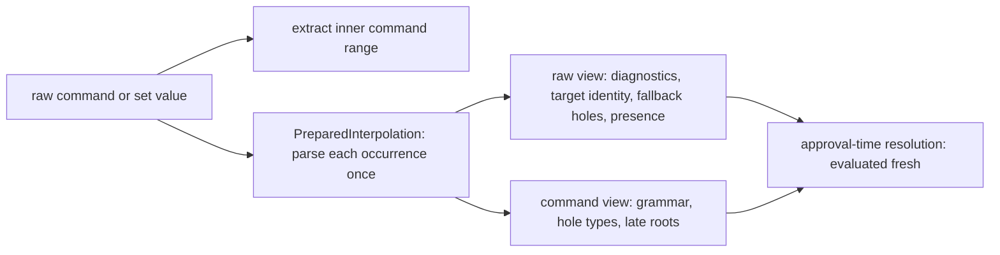
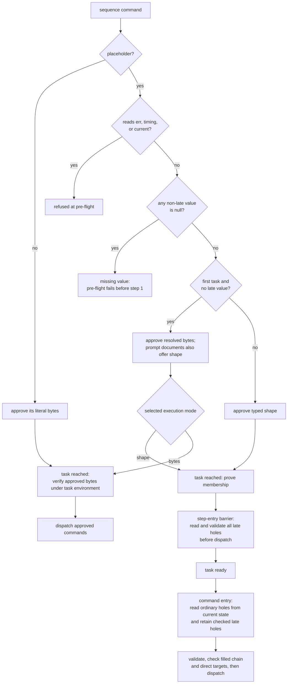

# Pre-Flight Shell Approval

Before any Claudine wrapper session launches a provider, it needs to know that every shell command the session might execute has been authorized. This is what the pre-flight check does: it scans all possible shell commands, resolves their approval status, and asks the user to approve anything that is not already whitelisted. Once the pre-flight completes, the session runs without further shell-related prompts.

## Why This Exists

Shell commands can appear in these places during a Claudine session:

1. **Template `::shell` and `::shell-block` directives** — Darkmatter's compose pipeline executes these during document composition. A prompt like `commit.md` might contain `::shell sniff repo packages` to inject dynamic content.
2. **Frontmatter `$(cmd)` expressions** — top-level frontmatter string values of the form `$(command arg ...)` are evaluated by Darkmatter's frontmatter shell expansion phase, with the command's trimmed `stdout` written back into the frontmatter. Example: `today: $(date +%Y-%m-%d)`.
3. **Lifecycle `shell` stack actions** — short-form `shell: "…"` and long-form `shell: { command: "…" }` actions declared in any reachable lifecycle stack (`initialize`, `start`, `success`, `blocked`, `failure`, `finalize`, `loop`), in both the `then` and `else` bodies of every `when` guard, and every command a lifecycle `set` value written as a whole-value `$( … )` can run (both branches of a ternary). Some are conditional (guarded by `when:` or reachable only on a recovery path) but they still need pre-authorization because there is no opportunity to prompt the user mid-session. A `set` value's command is approved under its bare bytes: `set: { clean: "$(git diff --quiet)::ok" }` approves `git diff --quiet`.

4. **Sequence `shell:` tasks** — primary commands in the root sequence, nested sequences, and group legs, plus their container lifecycle commands. Their approval mode depends on task position and whether they read values produced by the run; see [Sequence Execution](#sequence-execution).

Without pre-flight, a shell command that lacks whitelist coverage would either block the process waiting for interactive approval that will never come (in a non-interactive session) or fail with a confusing error deep inside the composition pipeline. The pre-flight eliminates both problems by resolving all approvals upfront.

## How It Works

The pre-flight runs as part of every wrapper command — `claudine compose`, `claudine inline-compose`, `claudine claude`, `claudine codex`, and all other provider wrappers. It sits between prompt resolution and provider launch:

```
Prompt resolved → Pre-flight shell approval → Provider launches
```

### Initialization before body discovery

Live `compose` and `inline-compose` documents with an authored `initialize`
key use a shell-free frontmatter-only bootstrap. Initialization shell actions
and bootstrap shell expansion are forbidden regardless of approvals. Early
catch handlers also cannot execute shells before successful preflight reaches
`start`. The stabilized reread then discovers body dependencies and audits
their commands plus the remaining lifecycle surface. This permits initialization to create an
include without weakening condition-blind discovery: commands in false
branches still require approval. Newly adopted proxy targets use staged boot
as well; a missing include after initialization still blocks launch.

Direct documents without `initialize` retain the eager discovery described
below. Dry runs do not initialize or traverse dynamic proxies. Sequences keep
static graph preflight, so their includes must exist before the sequence starts.
See [initialization ordering](composition.md#documents-that-declare-initialize).

### Two-Phase Discovery (eager preparation)

Claudine discovers shell commands in two phases because lifecycle stack properties can only be read from the **effective (composed) frontmatter**, which is not available until after Darkmatter composition runs. But composition itself needs the pre-approved command set to execute `::shell` directives. This creates a dependency:

```
Phase 1: Discover template ::shell directives
         → approve them
         → pass approved set to Darkmatter composition
         → composition produces effective frontmatter

Phase 2: Parse lifecycle stacks from effective frontmatter
         → discover lifecycle shell commands
         → approve them (reusing the shared approval cache)
```

Both phases share an **approval cache** keyed by execution mode and policy
root, with exact bytes or a typed shape. Repeating the same authorized site
skips a duplicate prompt. A shape decision cannot manufacture an exact
decision, and changed declarations must still match the rule. Command-result
caching is separate: changed filled arguments require a fresh result, and
runtime validation and blacklist checks still precede reuse.

The `claudine claude` / `claudine codex` passthrough path uses only phase 2 because it has no template composition step — it parses the lifecycle stacks directly from the source file's frontmatter and preflights their shell commands in a single pass.

The `claudine sequence` orchestrator runs both phases **per step** during its upfront discovery loop, so every template and lifecycle command across every step is approved before any provider session starts. See [Sequence Execution](#sequence-execution) below.

### Phase 1: Template Directives

Claudine asks Darkmatter to walk the full document graph and return every
shell site with its source file and location. Discovery retains authored
placeholders alongside any eligible resolved bytes; it never launches a shell
to obtain a value. Transclusion paths must be knowable during this walk.

For resolved-byte approval, **the discovered bytes are the bytes that run**.
For shape approval, the authored argument structure and declared validators
travel to execution instead. Discovery builds its compose options with the
same function the preparation that executes the document uses:

- the document's own frontmatter defaults and derived values;
- the immediate `proxy` `with:` overlay of a handed-off document;
- caller values (`--set`, `key=value`) and run-produced values (loop values, lifecycle `set`, `seq.outputs`);
- the lexical sequence roots (`seq`, `group`, and `loop`), when available; sequence preflight records run-dependent reads without evaluating them;
- the same document environment and the same source-relative base directory (see [Composition — One Environment per Document](composition.md#one-environment-per-document)).

A transcluded partial is discovered with the state composition hands it: its parent's composed values as defaults, overlaid by the directive's own `set.*` values. A partial nested two levels deep inherits through its parent the same way.

```md
<!-- router.md -->
---
start:
  - proxy: {target: './target.md', with: {base: main}}
---

<!-- target.md -->
---
$schema:
  base: string(required)
---
::file ./part.md

<!-- part.md -->
::shell-block when_error="(unavailable)"
git rev-parse --short {{ base }}
::end-block
```

The partial's command is approved as `git rev-parse --short main`, exactly what runs. Commands inside a `when=`-false block or a `::file … when=` that is false are still discovered and approved (discovery is condition-blind), but they do not run.

Some values have no knowable bytes until the command runs: a shell probe such as `has_alias(…)` (discovery never launches the login shell), `as_markdown(…)` content, a lazy `current.*` read, and a frontmatter `$(…)` value that has not been expanded yet. A command built from one of these, directly or through a frontmatter value that reads one (in the same document or inherited by a partial), fails pre-flight with a dynamic command shape error naming the value, instead of being approved in a shape it will not run in. A caller override of such a value makes the command approvable again.

A retired loop-value read (`_loop_count` and the other four `_loop_*` names) that only a transcluded partial introduces is met first by this discovery walk. It fails with the same `RemovedGrammar` error, naming the `loop.*` replacement, that composition would raise (its `path` is `render`), not with the generic `PreFlightDiscoveryFailed`.

Each command is checked against shell policy (blacklist, whitelist, approval cache) and, if not already approved, the user is prompted. Once all template commands are approved, the approved set is passed to Darkmatter as `pre_approved_commands` on the `ComposeOptions` and composition proceeds.

### Missing Values

A shell command never runs with a missing value. A placeholder whose expression evaluates to `null` (an absent property reads as `null`) fails pre-flight before anything runs, on every surface: `::shell`, `::shell-block`, frontmatter `$( … )`, a lifecycle `shell` action, and a lifecycle `set` value written as `$( … )`.

The one exception is a placeholder that a guard enclosing its command proves present: a lifecycle item's `when:` (for its `then:` and the actions beside the `when:`; the negation for its `else:`), or a sequence task's `when:` (for its `shell:` command). Such a command is approved only by its shape and reads the value when its guard has selected it; if the value is `null` then, that action fails with `MissingValue` and none of it launches. A `when: msg` excuses only `msg`, never another placeholder, and a lifecycle `set` of `msg` earlier in the same branch ends the excuse. The excuse never carries over to another event, loop pass, retry, resume, or proxy target, which check their guards again. Pre-flight reads a `file_exists(x)` guard without touching the filesystem: it proves only that `x` is a present string, because today's `file_exists` accepts nothing else, never that the file exists. See [What a guard proves to the actions it selects](flow-control/lifecycle.md#what-a-guard-proves-to-the-actions-it-selects), [Task guards](flow-control/sequences.md#task-guards-when), and Darkmatter's [Guarded values](../../../darkmatter/docs/inline/preflight-checks.md#guarded-values).

```yaml
success:
  - when: "ctx.dirty_files && commit_message"
    then:
      - shell: git commit -m "{{commit_message}}"   # approved by its shape; skipped when the guard is false
```

```md
---
target: null
start:
  - shell: "git init --quiet ran"
---
::shell ls {{ target }}
```

`claudine compose doc.md` stops at pre-flight, naming `ls {{ target }}` and `target`, and the `start` shell never runs. An empty string, `0`, `false`, and a fallback that yields a value (`{{ target || 'src' }}`) are present. Outside shell commands, `null` still renders as an empty string.

### Phase 2: Lifecycle Shell Commands

Shell actions in `initialize` are validation errors, including false branches;
whitelists, cached approvals, and `--yolo` cannot allow them.

After composition, Claudine walks every reachable lifecycle stack in the effective frontmatter and discovers its `shell` actions — short-form `shell: "…"` and long-form `shell: { command: "…" }` actions, in every `then` and `else` body, across `start`, `success`, `blocked`, `failure`, `finalize`, and `loop` — and the commands of every `set` value written as a whole-value `$( … )`. Resolved-byte approval fixes early-binding bytes; shape approval retains the template and validator for execution; see [Reading a Command's Result](flow-control/lifecycle.md#reading-a-commands-result).

These commands flow through the same `resolve_shell_approvals` function and the same shared approval cache. Any command already approved in phase 1 is a cache hit. Only genuinely new commands trigger additional prompts.

A lifecycle command with a placeholder is also offered, and matched, by its shape, exactly like a document command. What approved it decides how it runs:

| Approved by | The action runs |
|---|---|
| an `exact` rule, a cached decision for its bytes, a `prefix` rule, or the exact, prefix, or once choice | the bytes pre-flight resolved, through the system shell, as before |
| a `template` rule, a cached decision for its shape, or the "command shape" choice | its template: each placeholder is read when the action executes, checked against its declared type, and passed as one argument to a program started directly |

```yaml
---
target: src
start:
  - shell: "git add {{ target }}"
---
```

With `template git add {{ string }}` in the whitelist, the action runs `git` with the two arguments `add` and whatever `target` holds when `start` fires, even if an earlier action in the same event changed it, and even if it holds a space or a `;`. With `exact git add src` instead, it runs the pre-flight bytes `git add src`. An exact approval wins when both match. A quoted empty word stays in the bytes: with `commit_message: ""`, `git commit -m "{{ commit_message }}"` is shown and approved as `exact git commit -m ""` and passes `git` an empty argument; `exact git commit -m` approves only the unquoted `git commit -m {{ commit_message }}`. A value that inserts command syntax (`;`, a pipe, an unbalanced quote) leaves no readable bytes, so such a command can then be approved only by its shape. See [Lifecycle → Shell actions approved by their shape](flow-control/lifecycle.md#shell-actions-approved-by-their-shape) for what a template-mode action reads and how it fails.

### Re-Audits: Handoffs, Retries, and Loop Iterations

An approval covers the bytes it was granted for, never a changed command. Every time a document is prepared again with different state, its commands are discovered again with that state and audited:

- **A `proxy` target** gets its own full audit, as if it were invoked directly.
- **A `retry` or `resume`** re-reads the document and audits its template commands with the attempt's state.
- **A loop iteration** audits the template commands and the lifecycle `shell` commands its own state produces (`loop.*`, carried values, lifecycle `set`). A command such as `::shell echo run-{{ n }}` is a new command on every iteration. Before the first iteration `loop` has no value, so a body command reading it is neither run nor audited until an iteration supplies one, and pre-flight does not report its placeholder as missing.

The approval handler is frozen after the first attempt, so these re-audits never prompt behind a running agent: a command already in the approval cache or the whitelist passes, and a new one is refused with the same "requires approval" error pre-flight gives. The first loop iteration is the exception; nothing has launched yet, so it may still prompt. A `proxy` target reopens the approval window for its own commands.

An approval by shape is what lets a changing command pass a frozen re-audit:

```md
---
counter: 0
loop:
  until: "loop.count >= 3"
  action: increment(counter)
---
::shell record run-{{ loop.count }}
```

Approved as **this command shape** (`template record run-{{ string }}`), the command runs on all three iterations, receiving `run-1`, `run-2`, and `run-3` as one argument each, without another prompt. Approved as **this exact command** (`exact record run-1`), iteration 2 is refused, because `record run-2` is a new command. An exact approval never covers a shape, and a shape approval never covers other bytes.

In the passthrough wrapper path (`claudine claude`, `claudine codex`), the harness loop re-audits on every attempt by scanning the raw source text for directives, since there is no template composition step.

### Approval Policy

Each command is checked against Claudine's shell policy:

- Built-in blacklist (dangerous commands like `rm`, `dd`, `chmod`)
- User blacklist (`.darkmatter-shell-blacklist`)
- User whitelist (`.darkmatter-shell-whitelist`)

Commands that match the whitelist are marked as approved. Commands that match a blacklist are rejected immediately with a clear error. Everything else is presented to the user.

The two user files are read at different moments, and neither is cached between reads:

| Moment | Files read | When a file cannot be used |
| --- | --- | --- |
| An approval decision (pre-flight, or a re-audit) | the blacklist and the whitelist under the policy root | a missing or unreadable file has no rules; a policy root whose file locations cannot be worked out denies the command |
| A template-mode command about to start (dispatch) | the blacklist only | a missing or unreadable blacklist, no policy root, or an underivable root gives no user rules; the built-in blacklist still applies |

Dispatch never opens the whitelist, because a command that reaches dispatch is already approved; only the blacklist can still refuse it. The blacklist is read again for every dispatched command, so a rule added while a session runs refuses the next matching command. In both cases a malformed line is warned about and skipped, and the file's valid rules still apply. The policy root is the one captured for the session; neither read looks up the home directory, the working directory, or the repository again.

A document command with a placeholder is also matched by its shape. When no `exact` rule covers its bytes but a `template` rule covers its shape, the command is approved by that shape: an `exact` rule wins, then a `template` rule, then a `prefix` rule. Its bytes are still checked against both blacklists. A document command (`::shell`, `::shell-block`, or a frontmatter `$( … )`) approved by its shape runs as a template: each placeholder is checked against its declared type and fills exactly one argument, the filled command meets both blacklists again before it starts, and its program must run without a shell. See Darkmatter's [Running a command as a template](../../../darkmatter/docs/inline/preflight-checks.md#running-a-command-as-a-template). A lifecycle `shell` action or `set` value approved by its shape runs as a template the same way (see [Phase 2](#phase-2-lifecycle-shell-commands)). Sequence task commands and container lifecycle commands use the same template validation. Late holes are checked at task entry and retained for dispatch, while ordinary holes read current task state at command entry. Structured task dispatch retains process-tree ownership, output capture, timeout, cancellation, and runaway guards.

A command whose value is produced later in the run has no bytes at pre-flight and is approved only by its shape: a `template` rule, `prefix` rules for each of its programs, or a decision for that shape. An `exact` rule or an earlier exact decision never covers it. Discovery reports such a command when its host declares the late root to Darkmatter (`ComposeOptions::with_deferred_shell_roots`); a sequence declares `seq.outputs`, `loop`, and `group` this way (see [Sequence Execution](#sequence-execution)).

### Shape Matching and Dispatch

Shapes match parsed argument positions, literals, chain operators, and ordered
redirections. Quoting and whitespace variants match; extra arguments or moved
holes do not. Only bare properties (`out`, `fm.out`) inherit the owning
document's effective schema declaration. Expressions and untyped properties
use `string`. A `string` rule covers every declaration while retaining its
validator; a narrower string-like rule covers only declarations within that
type. For example, `alphanumeric(allow-slashes)` covers `alphanumeric`, while
`alphanumeric` does not cover `string` or a numeric declaration. Numeric and
union declarations disclose `string (validated as …)` and persist `string`.
See Darkmatter's [policy format](../../../darkmatter/docs/inline/preflight-checks.md#file-format)
for canonical syntax, escaping, and rejected rule lines.

Template dispatch permits fixed program words, arguments, `&&`/`||`, and the
four curated redirections. Pipes, semicolons, background execution,
append/input redirects, and variable programs or redirect targets are refused,
even with prefix or once approval. Special characters inside values remain
data. Policy write failures are typed errors and cache no successful decision;
they do not become an implicit once approval. Blacklists outrank every grant.

### User Prompt

Any command not already covered by the whitelist or approval cache is presented to the user one at a time, when stdin and stderr are both terminals. Claudine installs Darkmatter's `md` prompt, so the two look and behave the same (see Darkmatter's [Interactive Approval](../../../darkmatter/docs/inline/preflight-checks.md#interactive-approval)). The user sees the source file and line, the command, and a numbered list of only the choices that command is eligible for:

| Choice | Listed when | Saves |
|--------|-------------|-------|
| **Allow this exact command** | resolved-byte approval is eligible and every value is known at pre-flight | `exact <resolved command>` to the whitelist |
| **Allow this command shape** | the command has a placeholder and valid template grammar | `template <shape>` to the whitelist |
| **Allow this program with any arguments** | every program word is fixed | `prefix <program>` for each distinct program of the chain, all listed in the prompt |
| **Allow once** | always | nothing; this session only (for a command with no exact choice, its shape for this session) |
| **Deny** | always | nothing; the session aborts |
| **Blacklist and stop** | always | `exact <resolved command>` to the blacklist, or `template <shape>` when no exact choice is listed; the session aborts |

If an authored program contains a placeholder, such as `{{ tool }} probe` or
`git --version && {{ tool }} probe`, an eligible first-task or standalone
lifecycle command offers exact, once, deny, and exact blacklist only. It cannot
save an unrestricted program rule, even when the program resolves to a known
executable. Fixed programs with argument placeholders retain program approval.

A document command with a placeholder shows each placeholder as `{{ name: type }}`, plus its resolved bytes when they are known:

```text
  Command:  just clean --out {{ out: string }}/build
  Resolved: just clean --out dist/build
```

Choosing **Allow this command shape** for it saves `template just clean --out {{ string }}/build`. A placeholder whose declared type is not string-like is saved as `string` and the prompt says so: `{{ count: string (validated as number) }}`. A command whose value is produced later in the run has no `Resolved:` line and no exact choice; its unknown value is never shown as an empty string. A number that names no listed choice is refused and the prompt is asked again, and a choice a request did not offer is treated as a denial.

Without a terminal there is no prompt: an unapproved command fails pre-flight as approval unavailable (`Shell command '…' requires approval but no approval handler is available`), and nothing is written or launched.

If the user denies any command, Claudine stops. No provider session is started. The error message states exactly which command was denied and confirms that nothing was executed.

A persistent choice that cannot be written to its policy file fails pre-flight with `io.write_failed`, naming the file. The decision is not cached, so it is neither a persistent approval nor an implicit "allow once".

### Shared Approval Cache

The approval cache is an in-memory `HashMap<ApprovalKey, CachedApprovalDecision>` wrapped in `Arc<Mutex<...>>`. Each key records its execution mode (the command's resolved bytes, or a template shape with its placeholder types) and the policy root it was judged against, so a decision for bytes never answers for a shape, a shape with a different placeholder type is a different key, and a decision under one policy root never answers under another. It serves three purposes:

1. **Cross-phase deduplication**: A command approved during template discovery (phase 1) is not re-prompted during harness discovery (phase 2).
2. **Cross-step reuse for sequences**: The sequence orchestrator builds a fresh `ShellApprovalOptions` per step but clones the same `Arc` cache into each one. An "allow once" approval from step 1 carries forward to step 5 without re-prompting.
3. **Freeze enforcement**: After pre-flight completes, composition modes remove the interactive approval handler from the `ShellApprovalOptions`. The cache remains, so previously approved commands still pass, but new uncached commands are denied without prompting. This enforces the contract that all shell approvals are resolved before the provider session starts.

## The Claudine/Darkmatter Boundary

Claudine and Darkmatter each have shell approval infrastructure, but they serve different roles during pre-flight:

**Darkmatter's role is discovery.** It knows how to walk the document graph — following transclusions, resolving interpolation, parsing `::shell` directives, and scanning top-level frontmatter values for `$(...)` shell expressions. It exposes a function (`collect_shell_commands`) that returns every shell command in the document tree. It does not check any policy files or make any approval decisions during this call.

**Claudine's role is authorization.** It takes the list from Darkmatter, combines it with commands from the harness, checks everything against the whitelist, and prompts the user for anything that is missing. Claudine is the single source of truth for what is allowed.

**During composition**, Darkmatter receives the pre-approved set (`ShellPreApprovals`: resolved bytes and template shapes) instead of making another whitelist or interactive approval decision. Each command must first prove membership: its resolved bytes are in the exact set, or its authored shape is in the template set. Execution never adds newly filled bytes to that set. A template member still validates every value, checks the filled chain against the built-in and user blacklists, and verifies every direct target before dispatch or result-cache reuse. Pre-approval supplies authorization, not an exemption from runtime checks.

This separation ensures that:

- Claudine never needs to understand transclusion, interpolation, or the document graph
- Darkmatter never needs to understand the harness, interactive prompting, or session lifecycle
- There is exactly one place where shell approval decisions are made (Claudine)
- There is exactly one place where shell commands are discovered in templates (Darkmatter)

## Error Messages

The pre-flight system produces three categories of error, each designed to identify the problem immediately:

### Command Denied During Pre-Flight

The user chose to deny a command. The session was never started.

```
Aborted: shell command 'rm -rf /' was denied during pre-flight approval.
No provider session was started.
```

### Command Not Pre-Approved at Runtime

A shell command encountered during composition or harness execution did not belong to the pre-approved set. This can expose a discovery defect or a source change after approval closed. The run refuses the command rather than granting new approval during execution.

It is always a hard failure of the composition: nothing absorbs it. A `when_error` fallback applies only to a command that ran and failed, a transcluded partial that fails for this reason is not replaced by a "could not transclude" notice, an `as_markdown(…) || fallback` does not fall back, and a lifecycle `no_error` does not suppress it.

```
Shell command 'sniff repo packages' was not pre-approved and cannot
be approved during an active session. This is a bug in the pre-flight
scanner -- please report it.

Source: prompts/commit.md:23
```

### Command Execution Failure

A pre-approved command was executed but failed (non-zero exit or timeout).

```
Shell command 'sniff repo packages' failed after 10s (timeout).

Source: prompts/commit.md:23
Working directory: /path/to/repo

This command was approved and executed but did not complete within
the timeout. If this command normally completes quickly, it may be
blocked by another process or waiting on a resource.
```

## Interaction with Existing Features

### Whitelist Files

The pre-flight uses the same `.darkmatter-shell-whitelist` and `.darkmatter-shell-blacklist` files that Darkmatter and the harness already use. Commands that the user approves with "this exact command", "this command shape", or "this program with any arguments" during pre-flight are persisted to the whitelist, so they will not require approval again in future sessions.

### Non-Interactive Sessions

Pre-flight is especially important for non-interactive sessions where there is no terminal available for mid-session prompts. But it runs on all wrapper commands — including interactive sessions started with a prompt — because the shell commands in the template and lifecycle stacks execute before the interactive session begins.

### Lifecycle Shell Actions

Shell actions declared anywhere in the lifecycle stacks (short-form `shell: "…"` and long-form `shell: { command: "…" }` actions, in either branch of a `when` guard) are included in the pre-flight scan. This means all shell commands across the entire session lifecycle are authorized upfront, not just those in the template.

### Sequence Execution

When running `claudine sequence <file>`, static preflight walks the task graph,
referenced prompt documents, transclusions, and both branches of lifecycle
stacks before any task or provider starts. It resolves approval-time inputs,
records each authored site's position and schema, and approves bytes or shapes
under one shared approval cache. Discovery performs no shell work. A bad
template, missing approval-time value, or denied approval aborts before step 1.

At its turn, each task captures its environment and re-reads its document;
composition is just in time. Filled commands and prior composed output are
not reusable authorization. The runtime must prove membership in the upfront
approval set before executing the current bytes or filling the current shape.

#### One syntax collection per shell site

Static analysis of a sequence shell site (`SequencePreflight::prepare_site`) scans and parses the command's `{{ … }}` placeholders **once**. Darkmatter's `PreparedInterpolation` keeps every occurrence in source order — its byte range, trimmed expression text, and either the spanned syntax or the located parse failure. Every static check then reads that one collection instead of parsing the text again: the approval diagnostics, the target-identity scan, the template grammar, hole typing, late-root classification, and the guard (presence) lookups. A repeated `{{ name }}` is parsed twice because it is two occurrences; the collection is keyed by position, never by text.

```yaml
shell: "tool {{ name }} --label {{ name }}-{{ seq.outputs[0] }}"
# three occurrences -> three parses, however many checks read them
```

The collection lives on the `prepare_site` stack and is dropped when it returns. It is never stored in a template, candidate, approval record, or cache, so it cannot make a value stale: approval-time resolution, runtime fills, and presence evaluation still evaluate the authored text fresh each time. Malformed syntax is retained rather than reported early; it suppresses the approval-diagnostics result as before, while valid reads beside it are still checked for target identity and late roots.

A `set` value is a wrapper (`$( … )` plus an optional suffix). Extraction (`authored_shell_command`) finds the inner command and its byte range inside the value without parsing a template. Approval diagnostics and target identity read the whole raw value; the grammar, typing, and late-root checks read only the command's range, and a view translates each occurrence's coordinates into that range.



The text entry points (`approval_diagnostics`, `first_target_identity_root`, `parse_authored`, `project_types`, `late_roots_of`, `placeholder_guard`, `authored_shell_template`) remain for callers outside sequence preparation; each builds its own parse and shares the analysis body with its parsed counterpart (`…_prepared`, `…_expr`). Frontmatter `set` guard checks and the container, prompt, and discovery paths that bypass `prepare_site` still use the text forms.

#### The first task and later tasks

Upfront graph approval includes every task's `shell:` commands, container lifecycle `shell` actions and shell-valued `set` actions (in every branch), and the commands of every document a `prompt:` task names. How a command with a placeholder is approved depends on where its task sits:

- **The first task** — the root sequence's first task, every leg of a first-task group, or the first child recursively through first-task nested sequences — has known values resolved to bytes. Commands with valid placeholders, including task `shell:` and lifecycle `shell` or shell-valued `set` actions, offer both exact and shape approval. Exact rules retain priority; a saved shape or shape choice selects template execution.
- **Every later task** has each command with a placeholder approved only by its typed shape, even when its values are known now, because an earlier task may change them. "Allow this exact command" is not offered, and an `exact` rule for today's bytes does not cover it. A later command with no placeholder is approved as its literal bytes.

Known first-task lifecycle `shell` commands in referenced prompt documents retain the system shell grammar, including a configured executable (`{{ tool }} probe`) or a semicolon chain (`tool {{ out }}; tool tail` on POSIX). They can use exact approval even when no template shape exists. Later tasks and commands that read late values must satisfy template grammar. Existing restrictions on interpolated executables in document directives and shell-valued `set` still apply.

Position is static: a task that runs first only because the tasks before it were skipped, retried, or resumed past is still a later task.

```yaml
---
$schema:
    out: string -> the build directory
sequence:
    - name: build
      shell: "just build --out {{ out }}"          # approved as `just build --out dist`
    - name: clean
      shell: "just clean --out {{ out }}/build"    # approved as `just clean --out {{ string }}/build`
---
```

Run with `out=dist`, a whitelist holding `exact just clean --out dist/build` does not approve `clean`: without a terminal, pre-flight fails naming `just clean --out {{ out }}/build` before `build` runs. `template just clean --out {{ string }}/build` approves it without asking.

**Late values.** A placeholder reading a value an earlier step produces — `seq.outputs`, `loop`, or, inside a group, `group` — is late. It is not read at pre-flight, and its command is approved only by its shape, in any task (a `group.*` reader is a template even in a first group). Deferral follows step values and task `with` values derived from a late root: with `latest: "{{ last(seq.outputs) }}"` in the sequence's frontmatter, `{{ latest }}` is late, not missing. A prompt task's document reads such a `with` value as late too; the task's other `with` values are read now and carried into the document's discovery. `err`, `timing`, and `current` are not late values: a sequence command reading one is refused (`SequenceShellLateBinding`), even beside a late root, and so is `group` outside a group.



**Missing values.** Every value a command reads that exists at pre-flight — the sequence's frontmatter, caller values (`key=value`, `--set`), step values, `ctx.*`, `env.*` — is checked in every task, later ones included: a `null` fails pre-flight before step 1, naming the command and the value, unless the task's `when:` proves that placeholder present. A late value is checked when its task is reached, before any of that task's commands run: a `null`, an array or object, or a value its type refuses fails the task with `SequenceShellLateValue`, which never shows the value. Effects of earlier steps stand. A group checks every member before any member command runs. A value the task's `when:` proves present is checked instead by its command once the guard has selected the task, so a member whose guard is false is skipped without failing that check. A prompt task's `with:` value written as one `{{ … }}` that its `when:` proves present, but that is missing at pre-flight, is late for the document.

Concurrent groups validate member commands at group entry and retain checked
late inputs for execution. Nested sequences and group lifecycle events are
included in transitive discovery. The late output root is `seq.outputs`;
container terminal-event placeholders and commands reading `group.*` require
templates, including in a first group. Approval remains closed across rereads,
retries, and proxy handoffs.

The sequence graph audits referenced lifecycle commands before the first task.
A referenced prompt task carries its sequence position into every lifecycle
`shell` and shell-valued `set`, including inactive branches in `blocked`,
`failure`, and `loop.gate`. For example, a later task's `start` action
`shell: "tool {{ out }}"` requires a template or prefix approval; an exact
rule for the current filled bytes does not authorize it. A value such as
`out: a b` reaches the program as one argument.

Before task setup, passive preparation checks deferred lifecycle values beside
the document's directives and frontmatter commands. Missing values and arrays
fail this boundary without running setup. The validated late values remain
frozen for lifecycle execution; ordinary values are filled when the action
runs. Group members retain their lexical `group` variables through this path.
