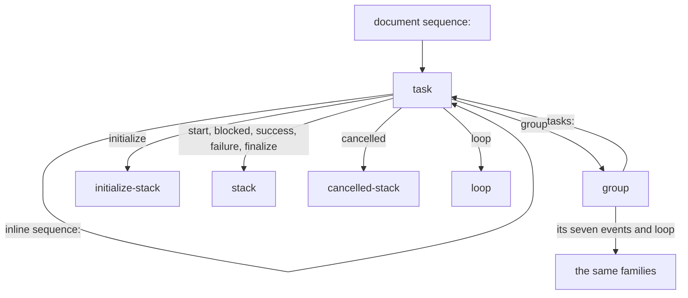
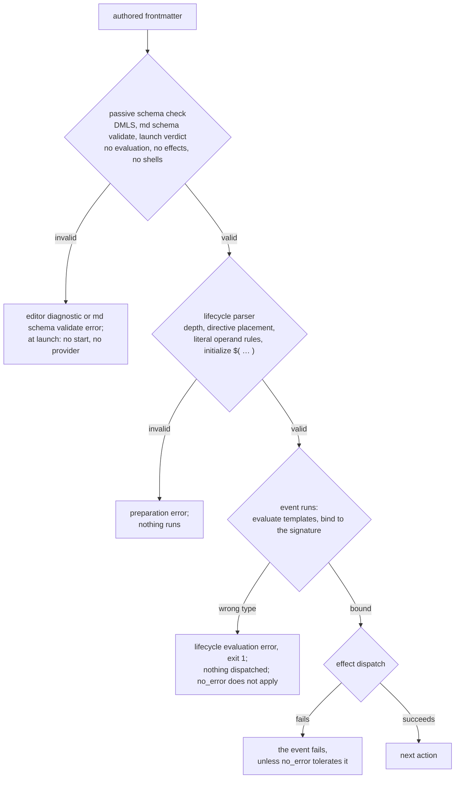
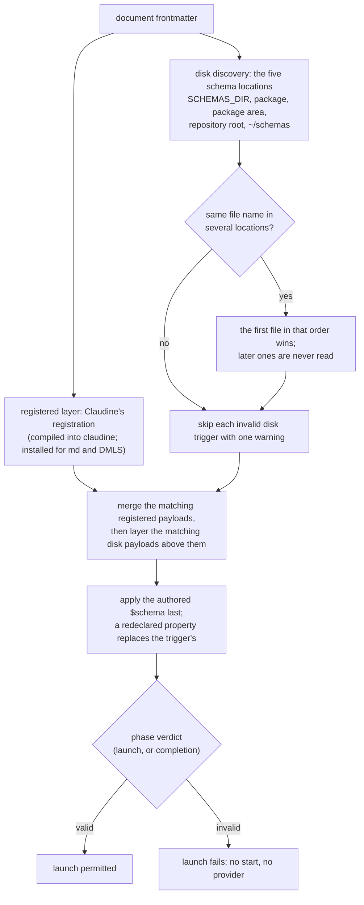
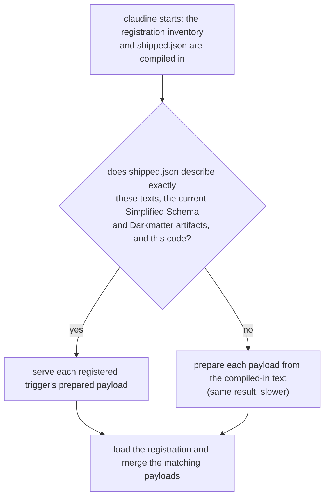
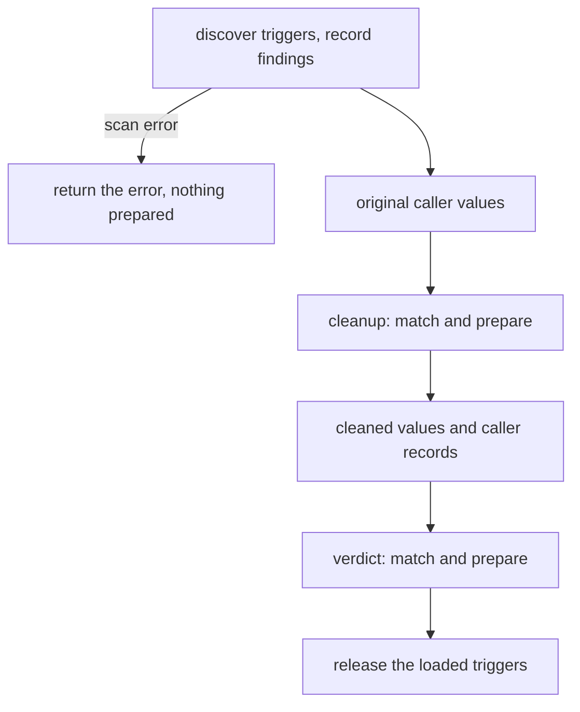
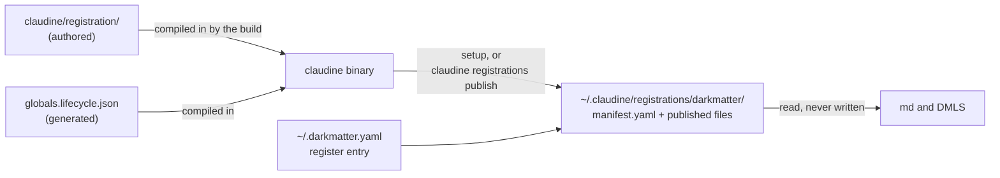

# Schema Support in Claudine

Claudine schemas check the frontmatter that controls a prompt and describe it
in your editor. A misspelled action or a value of the wrong type can be caught
before a provider starts, even when the document declares no `$schema`.
Claudine uses [Darkmatter's schema system](^darkmatter/docs/topics/schemas/index.md);
[DMLS](^darkmatter/docs/topics/dmls.md), the Darkmatter language server, reads
the same schemas for diagnostics, completion, and hover.

Start below with a document's own schema, then see how Claudine's automatic
schemas apply at launch and in the editor. The [reference links](#schema-reference-docs)
cover the full type language and validation rules.

## Defining Schemas

A schema can apply at three levels:

1. Local to where you are working
2. Across the Repo
3. Base Darkmatter and Claudine schemas

### Local Schemas

You can use the `$schema` property of any Markdown document's Frontmatter to impose a schema constraint on the document:

```yaml
$schema:
    name: string(required) -> the name of the product
    description: string -> a description of the product
```

If you want to reuse a schema across several files you can create the schema in a YAML file:

```yaml
$schema:
    name: string(required) -> the name of the product
    description: string -> a description of the product
```

and then point any Markdown documents you want to be bound to that schema by adding the following to the frontmatter:

```yaml
$schema: ./path/to/schema.yaml
```

A file holding only a root `$schema` key is a document schema. A file with
`kind: schema` is a type library instead: it holds `types:`, and a document
reaches it only through an import such as `stack@./lifecycle.yaml`.

A document schema can also declare a sibling `types:` mapping. Its `$schema`
defines the document's properties and `types` defines reusable local names.
For example, `$schema: { runners: runner[] }` can use `types.runner` from the
same file. A local type can still import another definition such as
`identifier@../_types.yaml`; local definitions and cross-file imports can be
used together.

### Repo Wide Schemas

A schema can also apply to documents that never mention it. Darkmatter looks
for **trigger schemas** (files with `kind: schema-trigger`) in five schema
locations, in this order: the folder `SCHEMAS_DIR` names, the document's
package `schemas/`, its package area's `schemas/`, the repository root's
`schemas/`, and `~/schemas`. A trigger has a `match:` condition over the frontmatter and a
`$schema` payload that applies whenever the condition holds. See
[Repository Trigger Schemas](../../../darkmatter/docs/topics/schemas/definition.md#repository-trigger-schemas).
Claudine's own schemas, described next, are trigger schemas too. Outside
the Claudine area they reach `md` and DMLS through the
[host registration](#the-published-host-registration) Claudine's setup
publishes, not through these locations.

## Claudine's Schemas

Claudine types its own frontmatter: the lifecycle events, `loop`, `agent`,
`model`, a sequence document's steps, the timeouts, the linking keys, and the
rest of the
[frontmatter catalog](frontmatter-properties.md). The schemas live in
[`claudine/registration/`](#the-registration-folder) and are used in two places:

- **In the editor.** DMLS reports a misspelled verb, a malformed long form, or
  a `shell` action in `initialize` as you type, with no `$schema` in the
  document, once Claudine's setup has registered its schemas (see
  [How a Document Reaches the Schemas](#how-a-document-reaches-the-schemas)).
- **At launch.** `claudine compose`, `claudine inline-compose`, and
  `claudine sequence` judge these schemas before `start` and provider launch.
  A document's shell-free `initialize` runs before the stabilized launch
  verdict; an invalid Claudine control then fails the launch, so no `start`
  stack runs and no provider starts. See
  [Composition → Claudine's trigger schemas](composition.md#claudines-trigger-schemas-in-the-launch-verdict).

```yaml
---
prompt: "review the diff"
start:
    - shell: { cmd: "git status" }   # invalid: the long form's key is `command`
---
```

The lifecycle parser, shared with Darkmatter and configured by Claudine,
remains the authority on what can run. The schemas catch most mistakes early,
but a document they accept can still be rejected by the parser (see
[What only the parser checks](#what-only-the-parser-checks)).

### The registration folder

Every schema Claudine ships is one file in
[`claudine/registration/`](../../registration/), the **authored** copy you
edit in the repository. The `claudine` binary compiles the whole folder in,
and Claudine's setup **publishes** the same bytes to your home directory for
`md` and DMLS (see
[The published host registration](#the-published-host-registration)). The
folder name says what it is for: everything in it is part of Claudine's
registration with Darkmatter, and nothing else belongs there.
`claudine/schemas/` keeps only schemas used inside this repository, such as
`review.yaml`, and is never compiled in or published.

```text
claudine/registration/                 (authored, in the repository)
├── composition.yaml                   trigger
├── inline-composition.yaml            trigger
├── sequence-document.yaml             trigger
├── formal-sequence-file.yaml          yaml-schema
├── group.yaml, loop.yaml, seq.yaml    namespace-schema
└── action.yaml, claudine-config.yaml, content-policy.yaml, document.yaml,
    lifecycle-events.yaml, linking.yaml, sequence.yaml, shared.yaml
                                       type libraries (kind: schema)
```

Each file declares its role with its `kind`, and the build accepts only
these four:

| `kind` | What it does | Files |
|---|---|---|
| `schema-trigger` | selects a Markdown document by its frontmatter (`match:`) and types it (`$schema`) | `composition.yaml`, `inline-composition.yaml`, `sequence-document.yaml` |
| `yaml-schema` | defines a YAML document kind | `formal-sequence-file.yaml` (a `kind: sequence` YAML file) |
| `namespace-schema` | declares one expression global that Claudine provides | `group.yaml`, `loop.yaml`, `seq.yaml` |
| `schema` with a non-empty `types` and no `$schema` | supplies reusable named types, reached only through imports | the other eight |

A `kind: schema` file that also declares a `$schema`, any other `kind`, or a
file with no `kind` fails the build, and so does a file that is not
`.yaml`, a symlink, or a name that is not portable (see
[How the built-in copy is prepared](#how-the-built-in-copy-is-prepared)).
A trigger or a type library may carry an optional `name`, a kebab-case
display label (`inline-compose-schema`) that diagnostics and
[`claudine registrations`](../cli/registrations.md) show beside the path;
imports always use the path.

| File | Holds |
|---|---|
| [`composition.yaml`](../../registration/composition.yaml) | Claudine's catalog for a document it runs that is not an inline composition: a `compose` prompt, a sequence document, or any document that sets one of Claudine's controls |
| [`inline-composition.yaml`](../../registration/inline-composition.yaml) | the catalog for an inline composition: exactly one of `prompt` or `sections` (see [Inline compositions: `prompt` or `sections`](#inline-compositions-prompt-or-sections)) |
| [`sequence-document.yaml`](../../registration/sequence-document.yaml) | the sequence keys of a Markdown sequence document (`sequence`, `template`, `$state`, and the removed root `fail_fast`); requires `sequence` |
| [`formal-sequence-file.yaml`](../../registration/formal-sequence-file.yaml) | a `kind: sequence` YAML file run directly (see [Sequence declarations](#sequence-declarations)) |
| [`task-file.yaml`](../../registration/task-file.yaml), [`group-file.yaml`](../../registration/group-file.yaml), [`group-catalog-file.yaml`](../../registration/group-catalog-file.yaml) | a `kind: task`, `kind: group`, or `kind: group-catalog` YAML file a sequence references: a task file is a closed `leg`, a group file a closed `group`, and a catalog's `groups:` entries are groups beneath an open root |
| [`shared.yaml`](../../registration/shared.yaml) | `common-attributes`: every control a Claudine Markdown document shares (provider and model, run controls, the lifecycle events, linking keys, managed metadata); declares Darkmatter's `composed` and `failed` as errors naming `start` and `blocked` |
| [`document.yaml`](../../registration/document.yaml) | the document metadata types `prompt`, `sections`, `hash`, and `last_updated` |
| [`lifecycle-events.yaml`](../../registration/lifecycle-events.yaml) | the stack types (`stack`, `initialize-stack`, `cancelled-stack`) and the `loop:` block type |
| [`action.yaml`](../../registration/action.yaml) | the four action types and the dictionary-bundle types, each verb's shape referenced from Darkmatter |
| [`sequence.yaml`](../../registration/sequence.yaml) | the sequence step and container types (`steps`, `step`, `task-fields`, the open step `task`, the closed group `leg`, and `group`), with the retired keys declared `removed(…)` |
| [`linking.yaml`](../../registration/linking.yaml) | the eleven optional linking keys of a linked skill, command, or agent |
| [`content-policy.yaml`](../../registration/content-policy.yaml) | a byte-for-byte copy of Content Policy's types for `content_policy`, so the bundle needs nothing outside it; a test keeps the copy equal to its source |
| [`claudine-config.yaml`](../../registration/claudine-config.yaml) | the schema of Claudine's own `config.yaml` files, used by configuration validation and DMLS rather than by any trigger |
| [`group.yaml`](../../registration/group.yaml), [`loop.yaml`](../../registration/loop.yaml), [`seq.yaml`](../../registration/seq.yaml) | the host globals `group`, `loop`, and `seq` (see [What Claudine adds to expression checking](#what-claudine-adds-to-expression-checking)) |

A library reaches a document only through a trigger's imports. Every
import is an explicit relative path to another file of the folder, or a
reserved `@darkmatter:` reference to Darkmatter's compiled-in schemas, so
the folder works as one self-contained bundle wherever it is copied:

| Trigger | Imports, directly or through another library |
|---|---|
| `composition.yaml` | `shared.yaml` (and through it `document.yaml`, `lifecycle-events.yaml`, `action.yaml`, `linking.yaml`, `content-policy.yaml`), `document.yaml` |
| `inline-composition.yaml` | the same as `composition.yaml` |
| `sequence-document.yaml` | `sequence.yaml` (and through it `lifecycle-events.yaml` and `action.yaml`) |

The controls are declared once, in `shared.yaml`, and both document
triggers extend them, so every control has the same type and description
whichever trigger applies:

```yaml
# composition.yaml
$schema:
    $extends: common-attributes@./shared.yaml
    prompt: prompt@./document.yaml
```

There is no separate identifying trigger: every trigger in
`claudine/registration/` identifies a Claudine document by its own `match:`,
so a document that selects none of them is not Claudine's.

The namespace files `group.yaml`, `loop.yaml`, and `seq.yaml` describe the
host rather than adding document properties. The bundle does not need
Darkmatter's schema files beside it (see
[Verb shapes are Darkmatter's](#verb-shapes-are-darkmatters)).

### When the schemas apply

A trigger selects a document by the **presence of a non-null value**, whatever
its type. A value of the wrong type still selects the trigger, so the payload
can reject it. Exactly one of the two document triggers applies to a Claudine
document: `inline-composition.yaml` when it is an inline composition (it sets
`prompt` or `sections`, or writes `kind: inline-compose`, and is not a
sequence), and `composition.yaml` otherwise.

| Frontmatter | `composition.yaml` | `inline-composition.yaml` | Verdict |
|---|---|---|---|
| `start: [{ say: "hi" }]` | applies | — | valid |
| `start: 42` | applies | — | invalid: `start` is not a stack |
| `agent: []` | applies | — | invalid: an agent list needs at least one entry |
| `start: null` or `start:` | — | — | no Claudine trigger |
| `finalize: [{ info: "done" }]` alone | — | — | no Claudine trigger: `initialize`, `cancelled`, and `finalize` belong to Darkmatter's `md` host too |
| `finalize: [{ info: "done" }]` with `prompt: "write it"` | — | applies | `finalize` is typed by the shared controls |
| `ticket: 123` alone | — | — | no Claudine trigger |
| `prompt: "write it"` | — | applies | valid |
| `prompt: "write it"` with `agent: claude` | — | applies | valid: the inline catalog types `agent` too |
| `sections: { Goal: "fix it" }` | — | applies | valid to the schema (see [below](#inline-compositions-prompt-or-sections)) |
| `prompt: "write it"` with `sections: { Goal: "fix it" }` | — | applies | invalid: an inline composition has one or the other |
| `kind: inline-compose` alone | — | applies | invalid: it needs `prompt` or `sections` |
| `prompt: "write it"` with `sequence: [a, b]` | applies | — | a sequence is not an inline document (`sequence-document.yaml` applies too) |
| `prompt: "write it"` with `sequence: { a: 1 }` | applies | — | invalid: `sequence` is a list or a file reference (`sequence-document.yaml`) |

`sequence-document.yaml` selects every document with a non-null `sequence`
or `kind: sequence`, so a sequence document with no other control is judged
too, and it requires `sequence`:

| Frontmatter | `sequence-document.yaml` | Verdict |
|---|---|---|
| `sequence: [build, test]` | applies | valid |
| `sequence: "@steps.yaml"` | applies | valid: a file reference |
| `sequence: { tasks: [a] }` | applies | invalid: `sequence` is a list or a file reference |
| `sequence: 42` or `sequence: true` | applies | invalid at `/sequence`: a number or boolean is never read as a file reference (the reference is `string(no-coerce)`), in `md schema validate`, `md compose`, and DMLS alike |
| `sequence: "42"` | applies | valid: quoted text is a file reference |
| `sequence: null`, or no `sequence` | — | no sequence trigger |
| `kind: sequence` with no `sequence` | applies | invalid: `sequence` is required |
| `fail_fast: true` beside `sequence:` | applies | invalid: `dm.schema.removed_key` on the root naming `fail_fast`, hint `set fail_fast on a group object` |
| `fail_fast: null` beside `sequence:` | applies | invalid, the same: a removed key is refused whatever its value |

Only `sequence-document.yaml` declares `sequence`. A non-null `sequence` also
selects `composition.yaml`, so a sequence document's events, `loop`, and every
other Claudine control (`timeout`, `agent`, …) are typed there, and
Darkmatter's `composed:` is refused as it is in any Claudine document. A
sequence document is never an inline composition, so it may carry both
`prompt` and `sections`. No key has two declarations to keep in step.

`initialize`, `cancelled`, and `finalize` never select a Claudine trigger on
their own, because Darkmatter's `md` host owns those events too. A document
whose only Claudine-looking keys are those three (a router prompt with only
an `initialize` stack and no `prompt`, `agent`, or `sequence`) is not judged by Claudine's catalog: its schema verdict comes from
Darkmatter's baseline. Claudine's lifecycle parser still checks the stacks at
launch, so a misspelled verb or a `shell` in `initialize` is still refused
before anything runs, by the parser rather than the schema. Add any Claudine
key, such as `agent:`, to have the schema check them as well:

```yaml
# no Claudine key: the parser refuses this at launch, the schema does not
initialize:
    - shell: "git fetch"
```

```yaml
# `agent` selects composition.yaml, so this is also a schema error
agent: claude
initialize:
    - shell: "git fetch"
```

Darkmatter's match grammar does not accept a property-level union inside a
condition, so each identifying key is written as five single-type alternatives
in a `group:` (OR), one per non-null YAML type:

```yaml
match:
    group:
        - start: string(required)
        - start: number(required)
        - start: boolean(required)
        - start: object(required)
        - start: "unknown[](required)"
        # ... the same five alternatives for every other identifying key
```

`inline-composition.yaml` matches `kind: inline-compose` or any of the
`prompt` and `sections` alternatives, under `all:` beside a `none:` of the
`sequence` alternatives and `kind: sequence`. `composition.yaml` repeats that
whole condition under `none:`, which is what keeps the two from ever applying
together. `sequence-document.yaml` matches `kind: sequence` or any of the
`sequence` alternatives.

Selection only adds types where a key appears, so the payloads require
almost nothing: `sequence-document.yaml` requires `sequence`, and
`inline-composition.yaml` requires its one of `prompt` or `sections`.
`inline-compose` also keeps its own missing-`prompt` check, applied after
caller overlays.

### Inline compositions: `prompt` or `sections`

An inline composition carries its prompt in its frontmatter, either whole
(`prompt`) or as `sections`, a mapping from a heading to that section's
content. `inline-composition.yaml`'s payload is a **root union** of two arms,
and a document must match exactly one:

```yaml
$schema:
    - $extends: common-attributes@./shared.yaml
      prompt: "prompt(required)@./document.yaml"
      sections: "null -> an inline composition with a `prompt` has no `sections`"
    - $extends: common-attributes@./shared.yaml
      prompt: "null -> an inline composition with `sections` has no `prompt`"
      sections: "sections(required)@./document.yaml"
```

What the schema checks, the same way in `md`, in DMLS, and in Claudine's own
launch verdict:

| Frontmatter | Verdict |
|---|---|
| `prompt: "Fix the bug."` | valid (the `prompt` arm) |
| `sections: { Goal: "Fix the bug." }` | valid (the `sections` arm) |
| `prompt: "Fix the bug."` with `sections: null` | valid: `null` is absence |
| `prompt` and `sections` both set | invalid: no arm admits both |
| `kind: inline-compose` with neither | invalid: each arm requires its key |
| `prompt: { text: "Fix the bug." }` | invalid: `prompt` is a string |
| `prompt: 42` or `prompt: true` | invalid at `/prompt`: a number or boolean is not prompt text (see [Text that must be written as text](#text-that-must-be-written-as-text)) |
| `prompt: "42"` | valid: quoted digits are text |
| `sections: [Goal]` | invalid: `sections` is a mapping |
| `sections: { Goal: "x" }` with `content_policy: []` | invalid at `/content_policy`: each arm checks every shared control |

What it does **not** check: `sections` is typed only as an object, so the
schema says nothing about its headings or their values, their order, or
whether the result makes a usable prompt. Running a `sections` document is
not built yet either. Its schema verdict passes, and then `claudine
inline-compose` refuses it because it has no `prompt`, before any provider
starts. Treat `sections` as validated-only until that lands.

The document stays **open**: keys Claudine does not know are application data
and are kept.

```yaml
---
prompt: "summarize ticket {{ ticket }}"
ticket: 123          # application data, never a schema error
model: sonnet
---
```

### Lifecycle events and action types

`action.yaml` sorts the verbs into four **action types**:

| Action type | Verbs |
|---|---|
| `communicate` | `say`, `speak`, `effect`, `message`, `notify`, `stderr`, `stdout`, `info`, `warn`, `success` |
| `flow` | `stop`, `skip`, `error`, `proxy`, `retry`, `resume`, `defer`, `break`, `prep` |
| `shell` | `shell` |
| `expression` | `set`, `edit`, plus every Darkmatter side-effect verb (`set_frontmatter`, `append_line`, …) and expression function |

An event's type says which action types it allows:

| Event | `communicate` | `flow` | `shell` | `expression` |
|---|---|---|---|---|
| `initialize` | yes | yes | **no** | yes |
| `start`, `blocked`, `success`, `failure`, `finalize` | yes | yes | yes | yes |
| `cancelled` | yes | `stop` only | yes | yes |
| `loop:` loose verb keys and its `gate:` | yes | yes | yes | yes |

`initialize` is shell-free, so its type has no `shell` arm. A shell there is an
ordinary schema error:

```yaml
initialize:
    - info: "preparing"
    - shell: "git fetch"      # invalid: initialize allows no shell action
start:
    - shell: "git status"     # valid
```

The restriction holds at every conditional depth and in both branches, so a
`shell` in an `else` that would never be selected is still an error, to the
schema and to the parser alike. One way to run a shell in `initialize` is
invisible to the schema: a `$( … )` expansion in a `set` value
(`set: { sha: "$(git rev-parse HEAD)" }`) is plain text to the schema, and
only the parser rejects it.

`cancelled` is cleanup only, so `stop` is its one flow directive. `retry`,
`resume`, `proxy`, `prep`, `skip`, `error`, `break`, and `defer` are schema
errors there, at every conditional depth, on a document and on every typed
container (see [Sequence containers](#sequence-containers)):

```yaml
cancelled:
    - warn: "cancelled"       # valid
    - stop                    # valid: ends only this stack
    - retry: 2                # invalid: cancelled allows no retry
```

### Verb shapes are Darkmatter's

Darkmatter owns the lifecycle grammar (see
[Darkmatter Lifecycle](../../../darkmatter/docs/topics/lifecycle/index.md)), so
it also owns the schema shape of every lifecycle verb, including verbs only
Claudine runs, such as `say`, `retry`, `proxy`, and `break`. Those shapes live
in Darkmatter's partial
[`lifecycle.yaml`](../../../darkmatter/schemas/partials/lifecycle.yaml), as
`<verb>-short` and `<verb>-long` types. Claudine's `action.yaml` and
`lifecycle-events.yaml` choose which verbs each action type and event admits, and
name each shape instead of copying it:

```yaml
communicate:
    say:
        - say-short@darkmatter:lifecycle
        - say-long@darkmatter:lifecycle
```

`Name@darkmatter:<stem>` is a **reserved reference**. It always means type
`Name` in Darkmatter's shipped partial `<stem>.yaml`, read from the schemas
compiled into Darkmatter, never from disk. It therefore resolves the same way
whether the referring file is in the monorepo checkout, embedded in the
`claudine` binary, or published under `~/.claudine/registrations/darkmatter/` without Darkmatter's files, where a relative path to
`darkmatter/schemas/` would not exist. An unknown stem is a schema error
naming the reference.

#### Who owns what

| Piece | Owner | Where |
|---|---|---|
| every verb's short and long shape | Darkmatter | `darkmatter/schemas/partials/lifecycle.yaml` |
| expression-function signatures | Darkmatter | `darkmatter/schemas/partials/functions.yaml` |
| side-effect parameter types | Darkmatter | `darkmatter/schemas/partials/mutations.yaml` |
| the generated verb types, projected from those two catalogs | Darkmatter | the generated regions of `lifecycle.yaml`, written by `darkmatter::lifecycle::schema_projection` |
| which verbs each event and action type admits | Claudine | `claudine/registration/action.yaml` and `claudine/registration/lifecycle-events.yaml` |

Claudine's files select `<verb>-short@darkmatter:lifecycle` and
`<verb>-long@darkmatter:lifecycle` for a single-verb item, and the short form
alone in a bundle and in a `loop:` verb key. Every side effect must have typed
parameters: a test fails when a side-effect descriptor has no typed entry in
`mutations.yaml`, and the generator refuses to emit an untyped value for one.

#### Changing a generated verb

The side-effect and expression-function types sit between
`# BEGIN GENERATED <region>` and `# END GENERATED <region>` lines in
Darkmatter's `lifecycle.yaml` (regions `types`, `expression`, `bundle`, and
`initialize-bundle`). Never edit those lines by hand. When a catalog signature
changes, regenerate them and commit the YAML with the change:

```sh
just -f darkmatter/justfile regen-lifecycle-schema   # from the repository root
just regen-lifecycle-schema                          # from darkmatter/
```

The recipe runs
`cargo run -p darkmatter --example lifecycle_schema_generator -- --write`,
which rewrites only the generated regions; without `--write` the example
prints the projection to stdout. The drift test
`the_generated_regions_are_byte_identical_to_a_regeneration` in
`darkmatter/lib/tests/l1/lifecycle_schema_generation.rs` fails when the
checked-in regions no longer match the catalogs.

Claudine's files name the generated types by reference, so a changed
signature needs no Claudine edit. A verb added to or removed from a catalog
does: its key is listed by name in `action.yaml`'s `expression` type and
bundles and in `lifecycle-events.yaml`'s `loop:` keys, and
`generated_verb_keys_equal_the_darkmatter_catalogs` in
`claudine/lib/tests/l1/claudine_schemas.rs` fails until they match.

### Darkmatter's event names in a Claudine document

Claudine calls Darkmatter's `composed` and `failed` events `start` and
`blocked` (see [Lifecycle](flow-control/lifecycle.md#claudine-is-a-lifecycle-host)).
Which names are typed depends on which schemas apply:

| Key | Darkmatter's baseline alone | With Claudine's trigger |
|---|---|---|
| `initialize`, `cancelled`, `finalize` | typed with the `md` host's verbs; these keys alone never select Claudine's trigger | typed with Claudine's verbs; Claudine's declaration replaces the baseline's |
| `composed`, `failed` | typed with the `md` host's verbs | declared `null`, so any non-null value is an error |
| `start`, `blocked` | untyped frontmatter data | typed lifecycle events |

`shared.yaml` gives the two `null` declarations a description naming the
event to write instead:

```yaml
prompt: "review the diff"
composed:                     # invalid: Claudine names this event `start`
    - info: "starting"
```

`md schema validate` prints that description with the error. In the editor,
DMLS shows it when you hover the key in a document `composition.yaml` types
(an inline composition gets no hover; see [In the editor](#in-the-editor));
the diagnostic itself carries only the
schema error, not the description. The lifecycle parser reports the same
mistake as `LifecycleRenamedEvent` before anything runs (see
[Lifecycle — Validation](flow-control/lifecycle.md#validation)).

Two parity tests keep the schemas and the event registry in step:
`claudine/lib/tests/l1/claudine_schema_parity.rs` checks that Claudine's event
names and per-event action types match Claudine's registry, that the
Darkmatter spellings name Claudine's events, that Claudine's declarations
override the baseline, and that Claudine's action types resolve to
Darkmatter's definitions. `darkmatter/lib/tests/l1/lifecycle_schema_parity.rs`
checks the baseline against the `md` host the same way.

### Single actions, long forms, and bundles

A **single action** is a mapping that holds one verb: a list item, a whole
event written as a dictionary, a `then`/`else` body written as a dictionary,
or a loop's one loose verb. It takes the verb's short form or its long form,
with `no_error` beside it, and `when` beside it in a list item. Long forms are
closed objects, so a misspelled parameter is an error:

```yaml
start:
    - say: "starting"                           # short form
    - say: { text: "starting", no_error: true } # long form
    - when: "fm.draft"
      say: { text: "draft run" }                # long form beside `when`
    - say: { txet: "starting" }                 # invalid: `say` has no `txet`
    - inf0: "starting"                          # invalid: not a verb
finalize:
    ensure_file: { file: notes.md }             # a whole event, one long form
    no_error: true
loop:
    until: "{{ true }}"
    ensure_file: { file: review.txt }           # the loop's one loose verb
```

The schema types a single action with the action categories (`communicate`,
`flow`, `shell`, `expression`), each of which holds one verb; their
`uncounted-keys` constraint leaves `when` and `no_error` out of that one-key
count. Where `when` may sit is one of the lifecycle parser's placement rules,
which schema validation applies too (see
[Placement rules are judged as the parser judges them](#placement-rules-are-judged-as-the-parser-judges-them)):
a `when` in a whole event or body dictionary is refused by both. A
conditional is different, see below.

A **dictionary bundle** puts several verbs in one mapping, optionally guarded
by `when` and softened by `no_error`. A bundle takes **short forms only**; it
is its own type (`bundle`, or `initialize-bundle` without `shell`) because
SimplifiedSchema cannot merge the action types into one object. A loop's
loose verbs are a bundle too when there are several of them.

```yaml
success:
    - when: "fm.notify"
      message: "done"
      shell: "git push"                 # valid: a guarded bundle
    - info: "pushed"
      say: { text: "pushed" }           # invalid: a long form inside a bundle
loop:
    until: "{{ true }}"
    ensure_file: { file: review.txt }
    info: "reviewed"                    # invalid: a long form beside another loose verb
```

A whole event can also be one bundle (a root dictionary), and a bare
zero-argument verb is a valid list item:

```yaml
success:
    info: "done"
    effect: "click"
failure:
    - warn: "giving up"
    - stop
```

A conditional item is `when` with `then` and an optional `else`. It cannot
carry sibling verbs:

```yaml
start:
    - when: "fm.draft"
      then:
          - info: "draft run"
      info: "always"            # invalid: then/else beside a sibling verb
```

A conditional is a list item only. A whole event, or a `then`/`else` body,
written as a dictionary holds actions, never a condition, so the schema
refuses a `then` there:

```yaml
start:
    when: "fm.ready"            # invalid: a conditional must be a list item
    then: [stop]
success:
    - when: "fm.ready"          # valid
      then: [stop]
```

### How deep the schema checks

Every stack family is recursive: a conditional's `then` and `else` take the
same stack type as the event that holds it, so the schema types every action
at every depth, in both branches. Each event keeps its own restrictions all
the way down:

| Stack | Family | Restriction at every depth |
|---|---|---|
| `start`, `blocked`, `success`, `failure`, `finalize`, and the loop's `gate:` | `stack` | none beyond the action types |
| `initialize` | `initialize-stack` | no `shell` |
| `cancelled` | `cancelled-stack` | `stop` is the only flow directive |

```yaml
initialize:
    - when: "fm.a"                   # level 1
      then:
          - when: "fm.b"             # level 2
            then:
                - when: "fm.c"       # level 3
                  then:
                      - info: "ok"
                  else:
                      - shell: "git fetch"   # invalid: initialize allows no shell,
                                             # even in an unselected branch
```

A conditional requires `when` and `then`, allows `else`, and takes no sibling
verb, at any depth. An `else` without `then` is a schema error, and so is a
`when` with nothing to guard (`- when: "fm.x"` alone). A `no_error` you write
beside `then` is refused, `false` included: the flag belongs on the actions in
the body. A `null` flag is no flag, so it passes:

```yaml
start:
    - when: "fm.x"
      then: [{ info: "a" }]
      no_error: null    # valid: a null flag is no flag
    - when: "fm.x"
      then: [{ info: "a" }]
      no_error: false   # invalid: no flag beside `then`
    - when: "fm.x"         # invalid: `when` guards nothing
```

The conditional types still declare `no_error: literal(false)`: completion
fills `no_error: false` at every place an action could sit, conditionals
included, and that filled flag must not make a valid document invalid. It is
not a flag you wrote, so it is never refused.

The schema has **no depth limit**. The parser allows conditionals five levels
deep and rejects a sixth with `LifecycleStackInvalidShape`, naming the path of
the sixth level, so a six-level stack of valid actions passes the schema and
the editor but fails before anything runs. A guarded bundle (`when` beside
verbs, such as `- { when: "fm.x", info: "hi" }`) inside a fifth-level
conditional counts as a sixth level to the parser, though the schema accepts
it. A misspelled verb is a schema error at any depth, including the sixth:

```yaml
success:
    - when: "fm.a"            # level 1 … level 6 below: schema valid,
      then:                   # the parser rejects the sixth level
          - when: "fm.b"
            then:
                - when: "fm.c"
                  then:
                      - when: "fm.d"
                        then:
                            - when: "fm.e"
                              then:
                                  - when: "fm.f"
                                    then:
                                        - say: "leaf"    # `sya:` here is a schema error
```

### Sequence containers

`sequence-document.yaml` types a document's `sequence:` list with the step
types of `sequence.yaml`. A step is a name (a bare value) or a `task` object; a
task's inline `sequence:` list, its `group:`, and a group's `tasks:` legs are
typed too. You can import the types for your own properties, for example
`$schema: { nested: task@./sequence.yaml }`.

```yaml
sequence:
    - name: build
      cancelled: [{ retry: 2 }]          # invalid: task `cancelled` allows no retry
      sequence:
          - name: compile
            shell: "just build"
            with: [release]              # invalid: `with` is a mapping
    - group:
          name: checks
          execution: parallel            # invalid: removed, with its replacement as the hint
          max_paralel: 2                 # invalid: misspelled `max_parallel`
          tasks:
              - name: lint
                shell: "just lint"
                setup: ./prepare.md      # invalid: removed from every task
    - name: docs
      prompt: ./docs.md
      owner: docs-team                   # valid: step data, read as `seq.owner`
      promt: ./other.md                  # valid, with a near-miss warning: did you mean `prompt`?
```

A **group object is closed**, so a removed key (`execution`) or a misspelled
one (`max_paralel`) is a schema error. Because a group's value can also be a
file reference, the problem is reported at the group (`/sequence/1/group`)
with the group's value, which names the offending key. A **group leg is
closed** too: it takes the task fields (and a task file's `kind`), nothing
else, as the task parser reads a leg.

A **sequence step is open**: a key Claudine does not reserve, such as `params`
or `owner`, is authored step data, never a schema error. Because a typo would
also be kept as data, a step key one edit from a single declared field (`promt`
beside `prompt`) gets a `dm.schema.near_miss_key` **warning** in the editor and
in `md compose`'s findings; the step still runs. `agent` and `model` are never
advised on, since Claudine reports them on their own.

### Removed keys

Retired keys are declared `removed(<replacement>)` in the shipped schemas, so
the editor, `md schema validate`, and a run all refuse them with the same
replacement advice. A removed key is refused whatever its value, `null`
included.

| Key | Where | Replacement |
|---|---|---|
| `fail_fast` | the document root | set fail_fast on a group object |
| `setup` | any task or leg | use a preceding `side_effect:` task for an action or `shell:` task for a command |
| `teardown` | any task or leg | use a group's `finalize:`; wrap a single task in a group of one |
| `execution` | any task, leg, or group | omit execution; use a nested sequence for ordered work |
| `fail_fast` | any task or leg | `fail_fast` belongs on a `group:` object only |

The sequence parser reads the same table, so a run reports the removal as its
own `RemovedGrammar` error with that replacement (`execution: serial` adds an
example of the nested sequence to write instead).

The container types are recursive: a task's inline `sequence:` items are
`task` again and a group's `tasks:` legs are `leg` (the same fields, closed), so a container is typed the same way
at every depth, and each container event takes the same family as the
document event of that name:



```yaml
sequence:
    - name: outer
      sequence:
          - group:
                tasks:
                    - name: inner
                      sequence: [deploy]
                      initialize: [{ shell: "ls" }]     # invalid: initialize allows no shell
                      cancelled: [{ retry: 2 }]         # invalid: cancelled allows no retry
                      start: [{ pr_list: three }]       # invalid: pr_list takes a count or a query
```

The schema adds no container-depth limit, and the task parser accepts
unlimited nesting. Each container event starts its own conditional count, so
a five-level stack is valid in every event of every container.

A task's `when:` is typed by shape only: non-empty text.

A referenced sequence or group file (`sequence: "@tasks.yaml"`) is not
Markdown, so no trigger schema judges it; the task parser checks it when the
sequence is prepared. A referenced sequence document's own `$schema` and
`$state` still apply to it.

### Sequence declarations

A sequence document has two schema keys with different scopes. Its root
`$schema` is the document schema, exactly as in any other document: it types
the document's properties and caller inputs, in YAML and Markdown alike. Its
root `$state` types each step's normalized state in the document's inline
`sequence:` list. `sequence.yaml` declares `$state` with the shared `schema`
type, so the editor checks and completes it like a `$schema`, and declares
`template` as an object:

```yaml
kind: sequence
$schema:
    reviewer: string(required)        # the document's input
$state:
    color: string(required)           # every step's state
template:
    desc: "{{ color }}"
sequence:
    - { name: blue, color: blue }
```

On a task, `sequence.yaml` declares `$schema`, `$state`, and `template`
as an inline nested sequence's own options: `$state` and `template` for its
children, and `$schema` as a check of the values the container sees at its
turn. Because a task object is open and one type covers every task, the
schema cannot tell an inline container from a `shell:` task; the task parser
refuses the three keys anywhere but beside an inline `sequence: [ … ]`, and
refuses a root `$state` or `template` beside a file reference, expression, or
shell source. A group object is closed, so the schema reports them there
too. See [Sequences → Sequence documents](flow-control/sequences.md#sequence-documents-schema-state-and-template)
for what each declaration does and when it is checked.

A YAML file that declares `kind: sequence` and an inline `sequence:` list is
also judged, as written, by the formal sequence kind
([`formal-sequence-file.yaml`](../../registration/formal-sequence-file.yaml))
that `md schema validate` and DMLS use. `claudine sequence` checks it with
the copy compiled into the binary, after the sequence parser has accepted the
list and before any step runs; a value of the wrong type is a schema
validation error naming the file and the property:

```yaml
kind: sequence
description: [not, text]    # refused: `/description` is not a string
sequence:
    - review
```

A Markdown sequence document, and a YAML file whose `sequence` is a file
reference, expression, or `$( … )` source, are judged by the sequence parser
alone.

### Keeping recursive schemas small and quick to validate

For schema maintainers, recursive references serve two purposes: they keep
the same rules at every nesting level, and they avoid copying each recursive
family into every place that uses it. The resolver stores recursive types in
JSON Schema's `$defs` section and points to them with local `$ref` values.
It stores the repeated structured helpers there too, such as the action
categories, the loop helpers, and the verb short forms, because each is used
from two or more places in one trigger payload (see
[Shared Named Types](../../../simplified-schema/docs/topics/language/objects-and-named-types.md#shared-named-types)).
Some uses are still copied: a union named as an arm of another union (such as
`entry` inside `item` in `lifecycle-events.yaml`) and any type used only once. The
bundles are copied for that reason: each is written once, inside `entry`,
and `entry` is copied into both `stack` and `item`. The Darkmatter baseline
layer stores its own repeated types in its own definitions, which are never
pooled with the payload's, and a baseline definition only overridden
properties reached is dropped from the merged schema. Reuse the recursive families rather
than adding a fixed number of copied container or conditional levels.

The embedded-bundle regression test
`embedded_trigger_payloads_resolve_within_one_megabyte` in
`lib/tests/l1/claudine_schemas_embedded.rs` checks three cases: the
`composition.yaml` trigger, the `sequence-document.yaml` trigger, and both together. Each
resolved effective schema must fit within **1,000,000 UTF-8 bytes** of compact
JSON, including `$defs` and the built-in baseline. The test resolves the
embedded bundle in isolation, with no user schemas or disk bundle, so its
result describes the shipped schemas. This is a deterministic size check,
not a time limit.

To investigate validation time, choose a representative Markdown sequence
with nested containers and a reachable disk bundle, then run:

```sh
md schema validate path/to/sequence.md -vv
```

The report separates discovery, trigger matching, resolution, validator
compilation, and validation. A one-shot validation under 200 milliseconds on
the development Mac is a development goal, not a guaranteed latency or a
test threshold. Record the document, command, machine load, and stage
breakdown when comparing a change. See
[validation timing and cold/warm comparisons](../../../darkmatter/docs/inline/schema-validation.md#comparing-cold-and-warm-validation)
for the existing benchmark workflow.

### Malformed templates in any action

Every string the lifecycle parser reads as a template is checked for syntax
by the schema too, at its own path and source position, whatever the type
accepts there: a communication verb's text, a directive's strings (`error`,
`proxy`, `retry`, `resume`, `defer`, `break`, `prep`), a `shell` command, a
`set` value, and every value of a `with:` overlay, as well as a generated
verb's arguments (see
[Deferred values](#deferred-values-and-what-happens-at-the-event)):

```yaml
start:
    - say: "{{ 1 + }}"                           # invalid at /start/0/say: malformed template
    - error: { reason: "failed {{ 1 + }}" }      # invalid at /start/1/error/reason
    - proxy: { target: next.md, with: { round: "{{ 1 + }}" } }  # invalid at /start/2/proxy/with/round
    - set: { round: "{{ fm.round + 1 }}" }       # valid
    - info: "{{ unclosed"                        # valid: an unclosed `{{` is text
```

The schema reads exactly what the parser reads, so a `set` value written as a
whole-value `$( … )` command is not checked as a template, nor is `no_error`
or `break.code`. A `when` condition is already parsed as an expression. A
malformed template fails `md schema validate`, the editor, and the launch
verdict alike, because no rendering can repair it.

### What only the parser checks

The schema cannot express these rules; the lifecycle parser enforces them
before anything runs:

- an unconditional ending directive (`stop`, `retry`, `proxy`, …) placed
  last in its list, and at most one directive per bundle; `prep` returns, so
  another item may follow it
- `skip` only in `initialize`
- no `when` at the `loop:` root, and `gate:` never beside loose loop verbs
- the five-level conditional nesting limit, in every event, including a
  guarded bundle (`when` beside verbs, such as `- { when: "fm.x", stop: null }`)
  placed inside a fifth-level `when`, which the parser counts as a sixth level
- a shell expansion hidden in a `set` value in `initialize`
  (`set: { sha: "$(git rev-parse HEAD)" }`)
- the literal operand rules of the generated verbs: a literal YAML `null`,
  list, or mapping as one operand is rejected with a hint to write a
  whole-value `{{ … }}` template (see
  [Generated verbs have typed arguments](#generated-verbs-have-typed-arguments))

Passing the schema, in the editor or at launch, is therefore not proof that a
lifecycle stack can execute.

### Placement rules are judged as the parser judges them

Some lifecycle rules are about where you wrote something rather than what
type it has. JSON Schema cannot express them, so schema validation runs the
lifecycle parser's own rules on every action dictionary it types. The editor
and the launch check therefore report these as schema problems, at the
offending key, with the parser's message:

| You wrote | Why it is refused |
| --- | --- |
| `- { when: "fm.x", then: [stop], no_error: false }` | a flag belongs on the actions in the body |
| `- { info: { text: hi, no_error: true }, no_error: true }` | one flag, two places; keep one, even when they agree |
| `- { set: { done: true }, no_error: null }` | `set` takes no flag, not even `null` |
| `- { when: "fm.x" }` | the `when` guards nothing |
| `start: { when: "fm.x", info: hi }` | a dictionary of verbs never carries `when`; use a guarded list item |
| `- { ensure_file: { file: a.md, no_error: 1 } }` | a flag is a boolean or text such as `"yes"`, never a number |

Only flags you wrote count. Before validation the schema fills
`no_error: false` wherever an action can sit, beside `then` and both beside
and inside a long form included, and those filled flags are never a second
placement or a flag on `set`. The launch check knows which flags those are,
because it reads the document as you wrote it (with any proxy `with:` overlay
and `--set` values) beside the completed frontmatter, exactly as the parser
does.


The reverse also holds: the parser does not type-check a literal operand, so
`pr_list: three` passes the parser. The schema rejects it, and because the
launch verdict runs the schema, no `start` stack or provider runs. Shell-free
initialization may already have run before that verdict.

### Generated verbs have typed arguments

Every Darkmatter side effect (`ensure_file`, `set_frontmatter`,
`append_line`, …) and every expression function (`min`, `pr_list`, `ping`, …)
is a lifecycle verb, listed one key per name. Its value is typed from the
verb's catalog signature, so a wrong argument is reported in the editor and
at launch rather than when the event runs.

#### Argument forms

A verb takes its arguments in one of three spellings:

| Form | Spelling | Where |
|---|---|---|
| short, single value | the only argument, for an overload that takes one | anywhere |
| short, positional list | the parameters in order | anywhere |
| long | a closed mapping keyed by parameter name, plus an optional `no_error: boolean` | single-verb items only, not in a bundle |

Each overload of a signature is a separate alternative. `ensure_file(file)`
and `ensure_file(file, content)` therefore accept five spellings:

```yaml
start:
    - ensure_file: notes.md                              # valid: (file)
    - ensure_file: [notes.md]                            # valid: (file)
    - ensure_file: [notes.md, "# Notes"]                 # valid: (file, content)
    - ensure_file: { file: notes.md }                    # valid: long form
    - ensure_file: { file: notes.md, content: "# Notes" }  # valid: long form
    - ensure_file: { file: notes.md, body: "# Notes" }   # invalid: no `body` parameter
    - min: ["1", 2, 3]                                   # invalid: min takes two arguments
```

A bundle takes short forms only, as it does for every verb. The variadic `and`
and `or` take a list of operands (or stand bare, as `- and`) and have no long
form. The catalog function `set(key, value)` is not generated: the lifecycle
verb `set` owns that name, takes a mapping of destinations to values, and has
no long form and no `no_error`.

#### Optional is not nullable

Whether a parameter may be omitted and whether it accepts `null` are separate
questions. Leaving out an optional parameter is always fine; writing `null`
for it is accepted only when the parameter's type admits `null`:

```yaml
start:
    - ping: "127.0.0.1"                                  # valid: timeout omitted
    - ping: ["127.0.0.1", null]                          # invalid at /start/1/ping/1
    - ping: { address: "127.0.0.1", timeout: null }      # invalid: timeout is optional, not nullable
    - set_frontmatter: [notes.md, status, null]          # valid: value is `unknown | null`
```

This differs from a top-level Claudine property, where the schema reads an
explicit `null` as absent (see
[Optional inputs and open metadata](#optional-inputs-and-open-metadata)).

#### Numeric text

A number parameter accepts text that converts to a number, as the call would
at run time:

```yaml
start:
    - pr_list: 3          # valid
    - pr_list: "3"        # valid: numeric text converts
    - pr_list: three      # invalid at /start/2/pr_list
    - min: ["1", 2]       # valid
```

The error names the path and the source position of the value.

#### The verb's own rules decide

The value types are only a projection of the signature. Every check above
then binds the arguments through the same registration the call uses when
the event runs, and that verdict decides the literal arguments, including
the rules a type cannot spell:

```yaml
start:
    - number: [pear, 7]                  # valid: the fallback 7 replaces text that is not a number
    - round: { x: pear, fallback: 2.7 }  # valid: the same recovery in long form
    - number: pear                       # invalid: no fallback, and "pear" is not a number
    - length: [true]                     # invalid at /start/3/length/0: length does not accept a boolean
    - length: [hi]                       # valid
```

The binder also chooses between overloads as the call does: a call two
overloads accept only after converting its value is ambiguous and is reported,
though each overload's type accepts it. Templates stay deferred, and an
unknown parameter, an extra argument, or a bad `no_error` beside a bound
argument is still reported. A bundle still takes short forms only.

#### Deferred values and what happens at the event

A whole-value `{{ … }}` template is accepted wherever an argument is typed,
because its value is not known until the event runs:

```yaml
start:
    - pr_list: "{{ fm.count }}"                  # valid
    - min: [1, "{{ fm.x }}"]                     # valid
    - pr_list: { count: "{{ fm.count }}" }       # valid
```

A template accepts only its own position. It never hides a mistake beside it:

```yaml
start:
    - min: [three, "{{ fm.x }}"]                 # invalid at /start/0/min/0: the literal is still checked
    - min: ["{{ fm.x }}", 2, 3]                  # invalid: an extra argument
    - pr_list: { count: "{{ fm.count }}", limit: 3 }  # invalid: no `limit` parameter
```

A `{{ … }}` span that does not parse is never deferred. It is a syntax error
at the argument's path and source position, whatever the parameter's type
accepts, whether it is the whole value or part of the text:

```yaml
start:
    - ensure_file: "{{ 1 + }}"                   # invalid at /start/0/ensure_file: malformed template
    - trim: { text: "hello {{ 1 + }}" }          # invalid at /start/1/trim/text
    - pr_list: "{{ 1 + }}"                       # invalid at /start/2/pr_list: the syntax, not the type
    - ensure_file: "{{ unclosed"                 # valid: an unclosed `{{` is text
```

A stored literal token (`{{!data:v1:…}}`, the form a lifecycle effect writes
data in) is data, not a template, even when the text it holds looks like one.
Its text is checked as the argument, at launch, in DMLS, and in
`md schema validate` alike:

```yaml
start:
    - abs: "{{!data:v1:e3sgZm0uY291bnQgfX0}}"    # invalid at /start/0/abs: the text `{{ fm.count }}` is not a number
    - trim: "{{!data:v1:e3sgZm0uY291bnQgfX0}}"   # valid: the text is a string
```

It fails every passive check: `md schema validate`, the editor, and the
Claudine launch verdict. `md compose`'s own gate reports it as an expression
parse error.

When the event runs, the template is evaluated and its value is bound to the
signature before the effect runs. A value of the wrong type fails there.
With `target: [a, b]` in the frontmatter:

```yaml
target: [a, b]
start:
    - ensure_file: "{{ target }}"     # schema valid; fails when start runs
```

`claudine compose` exits 1 without launching the provider and reports a
`CompositionError` "lifecycle evaluation error" naming the event and the
action (`start[0].ensure_file`), with a `Reason:` line naming the parameter
(`expected string; received list`). Nothing is dispatched, and the document's
authored value is left unchanged. `no_error: true` does not suppress a
binding failure; it softens only a failure of the effect itself.

### `break`, `prep`, and the planned `defer`

`break` and `prep` are accepted by the schema and the parser alike
(`break: "done"`, `break: { reason: done, code: 2 }`,
`prep: "@prompts/next.md"`); the schema checks `code` is an integer from 0 to
255 and `prep`'s target is a non-empty string. Both run; see
[Flow Control](flow-control/flow-control.md#break). `defer` parses but is not
executed yet (**planned**). The schema reads `prep: null` as
absent, so that spelling is left to the parser, which rejects it.

### `edit`

`edit` opens a file in the caller's editor (see
[Edit Actions](flow-control/lifecycle.md#edit-actions)). It is a hand-written
lifecycle verb, not a catalog function, so its shapes are
`edit-short@darkmatter:lifecycle` and `edit-long@darkmatter:lifecycle`, and
Claudine lists it by name. It is an `expression` action, so every event
admits it, `initialize` and `cancelled` included, as do bundles and `loop:`
verb keys; a bundle takes the short form only. The schema accepts it in
`cancelled` because the parser does, but it never opens an editor there: an
`edit` reached after cancellation fails when it runs.

| Form | Shape |
|---|---|
| short | a non-blank file name, or a one-item array holding one: `edit: "{{ fqn }}"`, `edit: ["{{ fqn }}"]` |
| long | `{ file, create_new, gui, no_error }`, closed; `file` is a required non-blank file name, and `create_new`, `gui`, and `no_error` are literal flags |

The schema, `md schema validate`, and the editor's language server apply the
lifecycle parser's own rules to `edit`, so they accept and refuse exactly what
the parser does. A number or boolean file name is read as its text. A flag
takes a YAML boolean or Boolean-like text (`"yes"`, `"false"`), and `null` is
the same as leaving it out (`create_new` and `no_error` then default to
`false`; `gui` lets either kind of editor open). A number, any other text,
and a `{{ … }}` template are refused for a flag, because flags are never
evaluated:

```yaml
initialize:
    - edit: "{{ fqn }}"                         # valid
    - edit: { file: "{{ fqn }}", create_new: true, gui: false }   # valid
    - edit: 5                                   # valid: opens the file named `5`
    - edit: { file: notes.md, gui: "yes" }      # valid: Boolean-like text converts
    - edit: { file: notes.md, create_new: null } # valid: the same as leaving it out
    - edit: "   "                               # invalid: blank
    - edit: null                                # invalid: names no file (also bare `edit` and `edit: []`)
    - edit: { file: notes.md, gui: 1 }          # invalid: a number is not a flag
    - edit: { file: notes.md, gui: "{{ fm.gui }}" } # invalid: flags are literal
    - edit: { path: notes.md }                  # invalid: unknown parameter
```

A flag or `file` error is reported at the parameter itself
(`initialize[0].edit.gui`); a short-form error at the action. A file name
computed by a `{{ … }}` template is not known until the event runs, so it is
checked then.

### Where each check runs

A lifecycle action passes four checks on its way to running. The first two
see only what was authored; the last two see evaluated values:



The diagram orders the checks by what they can see, not strictly by when
they run: at launch, Claudine parses every stack before `initialize` and
reaches the schema verdict after it (see
[Composition → Claudine's trigger schemas](composition.md#claudines-trigger-schemas-in-the-launch-verdict)).
Either failure stops the launch before `start` and the provider. A schema
refusal does not undo `initialize`: whatever its actions already did (a
file created, frontmatter set, an editor session) stands, so an invalid
document is not one that ran nothing. Validation and editor requests never
run an action: no expression is evaluated, no effect is dispatched, and no
shell is started.

### What Claudine adds to expression checking

Claudine is a host of Darkmatter's expression language. It extends the
language in one way only: it declares the globals `seq`, `loop`, and `group`
in its host catalog, one `kind: namespace-schema` file per global:
[`group.yaml`](../../registration/group.yaml),
[`loop.yaml`](../../registration/loop.yaml), and
[`seq.yaml`](../../registration/seq.yaml). They form a catalog, never a
document schema or a trigger. Darkmatter types every
read of those roots from it, so a call such as `min(loop.count, 5)` is
checked like a call on a schema-declared property, both before launch and in
DMLS:

```yaml
---
loop: { max: 3 }
finalize:
    - say: "{{ min(loop.count, 'many') }}"   # rejected before launch: 'many' is not a number
---
```

Claudine registers **no expression function** of its own. Every function a
Claudine document calls is a Darkmatter built-in, so Claudine ships no
function catalog and no facts artifact, and needs none for DMLS to check its
calls. Adding a Claudine function takes all three of these together:

1. a `function(...)` catalog in `claudine/schemas/` declaring its
   signatures;
2. a Rust registration through Darkmatter's
   `expression::host::HostFunctions`, installed when the CLI starts;
3. the generated `<stem>.facts.json` artifact beside the catalog, with a test
   that fails when it is stale.

`claudine/lib/tests/l1/host_catalog.rs` fails while a catalog or an artifact
exists without the others. How registration, the artifact, and DMLS's
incomplete-analysis warning work is described in Darkmatter's
[Host Expression Functions](../../../darkmatter/docs/topics/host-functions.md).

Claudine's lifecycle differs from the `md` host's: `composed` is `start`,
`failed` is `blocked`, `success`, `failure`, and `loop` are Claudine events,
and verbs such as `say`, `retry`, and `proxy` run. So DMLS can check
lifecycle expressions as a launch does, Claudine writes its event
registration and parse options to
[`globals.lifecycle.json`](../../lib/generated/globals.lifecycle.json), whose
`catalog_hash` is Darkmatter's hash of the three namespace files. With it, a guard narrows the calls it selects in every
Claudine event and verb, and a `set` ends the fact, in the editor exactly as
before launch:

```yaml
---
$schema:
    count: number
count: 1
success:
    - when: count
      then:
          - say: "{{ min(count, 5) }}"   # silent
          - set:
                count: 7
          - say: "{{ min(count, 6) }}"   # with [expressions] strict: may be null
---
```

The file is generated with the shipped artifact: run `just shipped-schemas`
from the repository root after changing a namespace file, the event
registry, or the sound-effect catalog. The generator writes the new artifact
only after loading it as a reader would, against the namespace files'
current hash, so a candidate built over other namespace bytes replaces
nothing. `host_catalog.rs` fails while it is stale, and DMLS reports a stale
or missing one as `dm.lifecycle.incomplete_analysis`, analyzing the document
as the `md` host's until it is regenerated. The format and the editor's
behavior are described in Darkmatter's
[Host Lifecycle Artifacts](../../../darkmatter/docs/topics/lifecycle/host-artifact.md).

Claudine also no longer walks expressions itself to find which roots and
paths they read (loop control variables, retired `seq`/`loop` spellings,
sequence target identities, guard subjects). It asks Darkmatter
(`static_access_reads` and `static_variable_reads`) and filters the answer by
its own names, so a read hidden in parentheses, brackets, or either branch of
a ternary is found the same way everywhere. A source guard,
`claudine/lib/tests/l1/type_scope_ownership_guard.rs`, fails on a new
hand-written walk.

### Text that must be written as text

Most of Claudine's text properties accept a number or boolean and read it as
text, as any SimplifiedSchema `string` does: `title: 5` is the title `"5"`.
The properties below are different. Claudine reads each one as text only when
you wrote text, and refuses a number or boolean before it runs anything, so
the schema types them `string(no-coerce)` and reports the same mistake in
`md schema validate`, `md compose`, DMLS, and Claudine's launch verdict:

| Property | Why a number is refused |
|---|---|
| `prompt` | it is the prompt itself; `claudine inline-compose` and `claudine sequence` refuse a non-string one |
| `agent`, each `agent` list item | it names a provider |
| `model`, each `model` list item | it names a model |
| `timeout`, `step_timeout`, `timeout_warn`, `step_timeout_warn` | a duration needs its unit, such as `30s` or `5m` |
| `exit_expressions` `pattern`, `patterns`, `scope` | the rule reader accepts only text |
| a sequence's `sequence` reference, a task's `prompt` or `group` reference | a file reference is never a number |

```yaml
---
prompt: 42        # invalid at /prompt
model: "5"        # valid: quoted, so it is text
timeout: 30       # invalid at /timeout: write 30s
---
```

A setter is judged the same way: `claudine compose doc.md model=5` passes the
number `5` and is refused; `--set '{"model":"5"}'` passes the text.

### Optional inputs and open metadata

Every Claudine property is optional, and the schema reads an explicit `null`
as absent. Some readers are stricter: `loop`, the four timeouts,
and `prompt` reject an explicit `null` when the document is parsed. Lifecycle
events are completed like any value, so a `no_error` you left out holds its
default, `false`, once the schema stage has filled in defaults; the parser
still treats it as unwritten. A `loop:` block is the exception: the schema
judges it but fills nothing into it, so the effective block is exactly what
you wrote. An unwritten `no_error` in its gate still
reads `false`, from the lifecycle parser. A few
properties are declared only so the editor
can describe them:

- `operation` and `yolo` are set by a flag (or, for `operation`, a sequence
  task), never read from a document.
- `seq`, `group`, and `loop` are lexical runtime roots, separate from the
  document's schema instance. Older injected names such as `state` and
  `outputs` are ordinary authored frontmatter properties; they are no longer
  declared as generated overlays. Group `fail_fast` is a boolean on the group
  schema; document-level `fail_fast` is rejected.
- `metadata` (linking) and the `with:` overlays of `proxy` and `retry` are
  open mappings.

## How a Document Reaches the Schemas

Claudine's schemas reach a document through one route everywhere: its
**registration**, the files of `claudine/registration/` loaded as a
registered host. The `claudine` CLI loads the copy compiled into its binary;
`md` and DMLS load the copy Claudine's setup installs and registers. Schema
files you place in the five schema locations are ordinary triggers that
apply **on top of** the registration, never instead of it.



### On disk

Darkmatter searches five locations: the folder `SCHEMAS_DIR` names first,
then the package, package-area, and repository-root `schemas/` folders, then
`~/schemas`. The first file of a name **shadows** every later file of that
name in those locations. `md schema triggers <file>` lists the locations, the
shadowed files, and which triggers matched.

Nothing needs to be copied for Claudine's own schemas. Claudine's setup
publishes them with a `darkmatter-host` manifest and registers that manifest
in `~/.darkmatter.yaml`, so `md` and DMLS type a Claudine document in any
folder (see
[The published host registration](#the-published-host-registration) and
[Host registration](../../../darkmatter/docs/topics/host-registration.md)).
The five locations are the place for your own schemas, `~/schemas` included.

A trigger file in one of the locations applies on top of the registered
triggers, whatever its name. A disk file named `composition.yaml` does not
replace Claudine's `composition.yaml`: both apply when both match, and the
disk file's declaration of a property replaces the registered one for that
property only. For example, with this repository-root file

```yaml
# schemas/composition.yaml
kind: schema-trigger
match:
    start: "unknown[](required)"
$schema:
    model: number
```

a document with a `start` stack has a numeric `model`, while Claudine's types
for `start` and every other control still apply. A property a disk trigger
takes over this way is no longer a Claudine control: its invalid value is
cleaned like an authored optional instead of failing the launch.

A disk trigger must come with what it imports, and imports only from disk,
never from the registration's files. A lone trigger whose `@./document.yaml`
import has no disk copy beside it is skipped with a warning; the registered
triggers still apply.

A disk trigger's payload must be one object schema. Only a registered
trigger may be a root union, such as `inline-composition.yaml`'s
`prompt` / `sections` arms, so a copy of that file in a schema location is
skipped with a warning.

These routes do **not** work:

- **Symlinking individual files.** Discovery reads regular files only; a
  symlinked `composition.yaml` is ignored.
- **Pointing `$schema` at a trigger.** `$schema: composition.yaml` fails with
  "schema-trigger file referenced as document schema": triggers activate by
  placement and match, never by reference.
- **A `.dmls.toml` extension.** Extension settings configure only the editor,
  never the CLI, and an extension path is loaded like a `$schema` reference,
  so it cannot name a trigger file.

### In the `claudine` CLI

The `claudine` binary compiles in the files of `claudine/registration/` and
loads them, from memory, the way Darkmatter loads an installed registration:
the manifest's digests are checked against the compiled bytes, each member is
classified by its `kind`, and the matching trigger payloads are merged into
one checked layer. So an installed binary validates Claudine controls with
no checkout, no published registration, and no disk bundle.

- The registered triggers always apply where they match; no disk file hides
  them, a malformed one included.
- Their origins name the bundle path, such as
  `embedded:claudine/schemas/composition.yaml`; no host file is named.
- A property is a **Claudine control** when its winning declaration comes
  from a registered Claudine trigger. A disk trigger or an authored
  `$schema` that redeclares it takes it over.
- The compiled registration is built once per process.

### How the built-in copy is prepared

Turning a trigger file into something a document can be checked against
takes work: each payload's imports are resolved, the result is converted
to JSON Schema, and it is checked to merge and compile. The host catalog (the
namespace files) and the `kind: sequence` YAML definition are prepared the
same way. Instead of repeating that work in every `claudine` process, the
result is checked into the repository as
`claudine/lib/generated/shipped.json` (the **shipped artifact**) and compiled
into the binary next to the files of `claudine/registration/`.

The build compiles that folder in whole, sorted by path, and refuses a
folder that is not a valid registration inventory: a file that is not
`.yaml`, a name that is not portable (ASCII letters, digits, `.`, `_`, and
`-`, not a Windows device name), a symlink or junction, two paths that differ
only in letter case, text that is not UTF-8, or a file whose envelope is
ill-formed: an unknown `kind`, a key its kind does not allow, a missing
required key, or a value of the wrong type (`name: null`, a library with no
`types`). That envelope check is the one Darkmatter's registration runs on
the published files, so the build accepts exactly what registration accepts;
the full preparation of each file still happens when the shipped artifact is
generated. The build's error lists every problem, each at its file's path;
a file that declares a valid `name` is shown by that name beside its path:

```text
`claudine/registration/` is not a valid registration inventory:
  - `inline-compose-schema (inline-composition.yaml)`: `review-typo` is not a field of a `schema-trigger`; …
```



**What you do.** After editing any file in `claudine/registration/`, or code
that changes how they are prepared, run from the repository root:

```sh
just shipped-schemas
```

It regenerates Simplified Schema's, Darkmatter's, and Claudine's artifacts in
that order, because Claudine's is built over the other two, and Claudine's
lifecycle artifact `claudine/lib/generated/globals.lifecycle.json` with them.
Fresh generation verifies the compiled inventory and prepares trigger payloads
from its source files. The resulting artifact can then serve those payloads
at runtime. Every candidate is checked before any file is replaced. Inside `claudine/`,
`just shipped-schemas` rewrites only Claudine's artifact and `just
shipped-schemas --check` only reports whether it is current; both stop and
name the root command when either lower artifact is out of date. If you
forget, the L1 test `shipped_artifacts::shipped_artifact_is_fresh` fails with
the same command in its message. A code-only change that alters the prepared
result also increments `PREPARATION_REVISION` in
[`schema/shipped.rs`](../../lib/src/composition/schema/shipped.rs) (see
[When to bump the preparation revision](../../../simplified-schema/docs/topics/shipped-artifacts.md#when-to-bump-the-preparation-revision)).

**When the artifact does not fit, nothing breaks.** The artifact is used only
when its header proves it was generated from exactly the compiled-in texts,
over the current lower artifacts, at the current preparation revision. When
any of that is not true (an edited YAML file, a stale lower artifact, a
damaged record), the artifact is refused and Claudine prepares from the text
as it did before, with the same result; no warning is printed. The registered
payloads, the host catalog, and the YAML kinds are separate sections, so a
damaged catalog record leaves the prepared payloads in use, and the other way
around.

**The prepared form changes nothing a document sees.** A served payload is
the one the compiled text prepares to, and:

- Disk triggers are always prepared from disk at run time, with every check,
  while the registered payloads still come from the artifact.
- A registration that is not exactly the compiled one (a test's edited
  inventory, for example) is prepared from its own text.
- `md` and DMLS do not read Claudine's artifact. They read the host catalog
  and the lifecycle artifact from the
  [published host registration](#the-published-host-registration).

How artifacts are encoded, checked, and loaded is described in
[Shipped Artifacts](../../../simplified-schema/docs/topics/shipped-artifacts.md).

### When a trigger is invalid

A trigger file that cannot be used, such as an unfinished
`~/schemas/memory.yaml` with unsupported envelope keys or an empty `match:`,
or one whose payload or import fails to load, does not stop the launch. The
CLI skips that one trigger, applies the valid ones as usual, and prints one
warning for it before the provider starts:

```text
warning: [schema_validation] ignoring invalid schema trigger /home/me/schemas/memory.yaml: invalid schema-trigger: found unknown keys: title, notes
```

- **One warning per trigger per invocation.** Claudine loads a document's
  schema several times before a launch (pre-validation, dropping invalid
  optionals, the launch verdict, interactive re-runs) and again on every loop
  iteration and retry. The same trigger is reported once, with the first
  reason seen, in discovery order. A trigger only a transcluded document
  discovers is reported the same way.
- **Shown even when the run fails.** If the prompt is then rejected for an
  unrelated reason, the warning is printed before the error, and the error is
  never blamed on the skipped trigger.
- **Each invocation reports again.** A new `claudine` run, and a `prep`
  target (which runs as an invocation of its own), print the warning again
  while the file stays broken. `--silent` hides it.
- **A skipped file hides nothing registered.** An invalid disk
  `composition.yaml` is skipped, and Claudine's registered `composition.yaml`
  still judges the document.
- **A reference is still an error.** A `$schema` that names a trigger file
  fails whether or not the trigger is valid, and so does an
  authored `$schema` that cannot load.

`md` and DMLS skip an invalid trigger the same way; see
[Schemas Applied by Triggers](../../../darkmatter/docs/topics/schemas/schema-triggers.md).

#### How long discovered triggers live

A single launch pre-validation discovers the trigger files once and keeps the
loaded rules and payloads for the length of that call. Matching still happens
twice, against each pass's own values: first the cleanup pass (which drops
invalid optional values), then the verdict.



Example: a trigger matches when `count` is a string or a number and also
requires `ticket`, while the document's own `$schema` declares `count` as an
optional number. A document whose `count` is a string matches the trigger in
the cleanup pass, so the invalid `count` is dropped. The verdict pass sees no
`count`, no longer selects that trigger, and the launch proceeds without
`ticket`. (Cleanup drops only values the document's own `$schema` declares
optional; a property declared only by a trigger is never cleaned away.)

- **Edits between calls are seen.** Each call (and each standalone cleanup,
  status report, or launch schema load) discovers again, so a trigger created,
  changed, removed, or repaired between calls takes effect.
- **Edits between the two passes are not.** The loaded trigger contents are
  not replaced mid-call, and discovery is not an atomic snapshot of the
  filesystem.
- **An authored `$schema` still resolves in each preparation.**
- **A failed scan stops the call.** A root that cannot be enumerated or read
  (for example a trigger file that is not valid UTF-8) fails with a schema
  load error before any preparation; standalone cleanup instead returns its
  input unchanged.

### In the editor

DMLS has no Claudine dependency and reads Claudine's schemas only through
the host manifest registered in `~/.darkmatter.yaml` (disk triggers in the
five locations apply above them, as in the CLI). Once Claudine's setup has
published and registered it, a Claudine prompt with no `$schema` gets
diagnostics, completion, and hover from the matching triggers:

- top-level keys (`mod` completes to `mode` and `model`) and their values
  (`mode:` offers `append` and `replace`, `interactive:` offers `true` and
  `false`);
- lifecycle items (`- sa` completes to `say`; an empty `- ` offers the action
  keys and the bare verbs such as `stop`), long-form parameters (`text` under
  `say:`), and `loop:` keys (`max`);
- hover on a property describes its type and purpose; hovering `text` in a
  `say` item also names the communication alternative the item matches;
- generated verbs and their long-form parameters (`file` under
  `ensure_file:`), at any depth in `then`/`else`. Completion leaves `shell`
  out of `initialize` and offers `cancelled` only its restricted verbs.
  Hover finds a parameter that only a later overload declares, such as
  `ensure_file`'s `content`.

Key completion works in block mappings only: DMLS offers no keys inside a
YAML flow mapping such as `ensure_file: { fi }`.

Each key is declared by one of the triggers that apply, and completion
offers only the keys of triggers that already apply. A sequence document matches both
`sequence-document.yaml` and `composition.yaml`, because `sequence` identifies a Claudine
document, so it is offered `start`, `loop`, and the other root keys too. A
document whose only Claudine-looking keys are shared events (`initialize`,
`cancelled`, `finalize`) matches neither and is completed as an `md` document.

A property the document's own `$schema` redeclares is completed and hovered
from the author's declaration, as it is validated (see below). Two limits
remain:

- A document gets editor help only when Claudine's host registration is in
  place (run `claudine setup` once), even though the CLI validates it
  without one.
- An inline composition (a document `inline-composition.yaml` selects, such
  as one whose frontmatter is just `prompt: hi`) gets diagnostics but no
  completion or hover from Claudine's schemas, because that trigger's payload
  is a root union and DMLS builds editor help only from a single object
  schema. Validation is unaffected.

See [DMLS Schema Support](../../../darkmatter/docs/topics/schemas/dmls-schema-support.md).

### The published host registration

Darkmatter can also learn Claudine's schemas without a checkout: a
`register` entry in `~/.darkmatter.yaml` naming
`~/.claudine/registrations/darkmatter/manifest.yaml` points `md` and DMLS at
a format 3 `darkmatter-host` manifest that Claudine writes from its
compiled-in copies (see
[Host registration](../../../darkmatter/docs/topics/host-registration.md)).
Claudine publishes it like this:

```text
~/.claudine/registrations/
├── .darkmatter.lock           held while a publish (or setup) runs
└── darkmatter/
    ├── manifest.yaml          every file below and its BLAKE3 digest
    ├── globals.lifecycle.json
    └── schemas/…              the files of `claudine/registration/`
```

The published tree is the authored folder plus two generated files. Each
authored file keeps its relative path under `schemas/`, so the imports
between them (`@./shared.yaml`) resolve the same way in both places:

| Authored, in the repository | Published, in your home |
|---|---|
| `claudine/registration/composition.yaml` | `~/.claudine/registrations/darkmatter/schemas/composition.yaml` |
| `claudine/registration/<file>.yaml` (every file) | `~/.claudine/registrations/darkmatter/schemas/<file>.yaml` |
| `claudine/lib/generated/globals.lifecycle.json` (generated by `just shipped-schemas`) | `~/.claudine/registrations/darkmatter/globals.lifecycle.json` |
| none: written by the publisher from the files above | `~/.claudine/registrations/darkmatter/manifest.yaml` |

`claudine/registration/` holds YAML members only. Claudine ships no host
expression catalog (`kind: expression-schema`) and no `.facts.json`
companion (`expression-facts`) today; when an inventory includes an
`expression-schema` catalog, its generated `.facts.json` companion sits
beside it in `digests` (never in `files`) and is verified through
Darkmatter's shared bundle preparation before anything is published.
The inventory reserves `manifest.yaml` for the file it generates. It rejects
any supplied member or companion with that name, regardless of ASCII case.
`kind: mutation-schema` members are refused for host publication
(`host-defined actions are not supported`).

The published bytes are the ones compiled into the `claudine` binary that
published them, not the files of any checkout. Editing
`claudine/registration/` changes nothing in your home until a binary built
from that edit publishes. [`claudine registrations`](../cli/registrations.md)
lists exactly what the running binary would publish.



- There is one tree at fixed paths, with no version folders. Every file is
  replaced only when its bytes differ, and the manifest is written last, so
  a reader that meets a publish in progress sees files that do not match
  the old manifest and refuses the host with a warning rather than mixing
  two releases. The next publish finishes the job.
- A file the previous manifest listed and the new one does not is removed.
  Any other file in the folder is left alone. The previous manifest is
  trusted for this only when Darkmatter would accept its shape and paths
  (it does not matter whether the old files still match it, so the publish
  after an interrupted one still cleans up). If it is malformed in any way,
  for example an empty `version`, a bad digest, or one entry with a path
  outside the folder, nothing is removed.
- On a volume that ignores letter case (macOS and Windows by default), an
  old spelling that reaches a current file is that file, not a retired one:
  a previous manifest listing `schemas/Action.yaml` never removes the
  current `schemas/action.yaml`. On a case-sensitive volume (Linux) the two
  names are two files, and the old one is removed.
- Publishing what is already installed writes nothing.
- A symbolic link or a junction anywhere on the way stops the publish before
  anything is written; the link and its target are left alone.

#### When Claudine publishes and registers

- **Setup.** Claudine's setup (the wizard a first run starts, interactive or
  headless, and [`claudine setup`](../cli/setup.md), which you can run at any
  time) does four things in order:
  1. publishes the registration; if that fails, setup stops with an error and
     writes nothing else, listing any registration file the publish had
     already written or removed;
  2. writes Claudine's configuration and completes the `permissions`
     handshake with `.darkmatter.yaml` of the same scope;
  3. puts `~/.claudine/registrations/darkmatter/manifest.yaml` in the
     `register` list of the **user's** `~/.darkmatter.yaml`, whichever scope
     was set up, even when step 2 reported a `permissions` conflict;
  4. removes the files earlier releases published, `~/.claudine/darkmatter-host.yaml`
     and the `~/.claudine/darkmatter-host/` folder, once step 3 succeeded.

  Step 3 changes only the entries that name the old
  `~/.claudine/darkmatter-host.yaml` (in any spelling, and even when that
  file is already gone) or the new manifest. The first such entry is
  rewritten in place to the new spelling and keeps the comment on its line;
  every later one is removed together with the comment on its line, and
  with none the new entry is appended. Other hosts' entries and every other
  comment, including one on its own line above a removed entry, are kept:

  ```yaml
  # ~/.darkmatter.yaml before setup
  register:
      - ~/hosts/mine.yaml
      - ~/.claudine/darkmatter-host.yaml   # Claudine
  # after setup
  register:
      - ~/hosts/mine.yaml
      - ~/.claudine/registrations/darkmatter/manifest.yaml   # Claudine
  ```

  Setup holds the publisher lock (`~/.claudine/registrations/.darkmatter.lock`)
  from step 1 through step 4, so another publisher, such as
  `claudine registrations publish` in a second terminal, waits until setup
  has finished rather than publishing between its steps.

  A repository's `.darkmatter.yaml` is never changed. A failure in step 3 is
  a warning (Claudine's own configuration is already saved) and step 4 is
  skipped, so the next setup finishes both. Step 4 removes nothing else
  under `~/.claudine`: if a symbolic link or junction stands anywhere in the
  old files, it removes nothing, follows nothing, and warns; delete them
  yourself. If a removal fails partway (a read-only `~/.claudine`, for
  example, keeps the folder after its contents are gone), the warning lists
  every entry already removed, and the next setup removes only the rest.
- **`claudine registrations publish`.** The hidden
  [`registrations`](../cli/registrations.md) command publishes on request,
  and Claudine's `just install` runs it with the binary it just built, so an
  upgrade installed that way updates the registration. It writes only
  Claudine's own registration files, never `~/.darkmatter.yaml`, and a
  failure exits nonzero with the cause on stderr.
- **Never otherwise.** No other `claudine` command reads, publishes, or
  repairs the installed files, so a missing or edited file stays that way
  until the next publish.

Registration is for `md` and DMLS only. A `claudine` run always uses the
schemas and event registry compiled into the binary, even when a repository
registers some other manifest that claims to be `claudine`.

The order is what makes setup safe to interrupt and to run again; the
[setup diagram](configuration.md#darkmatters-permissions) shows each step's
failure path.

#### Hand edits, recovery, and overrides

**The publisher owns the published files.** Do not edit them. `md` and DMLS
check every file against the digest the manifest records, so an edited,
missing, or half-written file makes them refuse Claudine's whole
registration with a `dm.host.registration` warning that names the file;
they never use some files of one publish and some of another. Until it is
fixed, Claudine documents get no Claudine schemas in `md` or the editor.
`claudine` runs are unaffected, because they use the compiled-in copy.

To find out what is wrong, run [`claudine doctor`](../cli/doctor.md). Its
`registration` row compares every published file with the binary's copy,
lists extra files in the folder and leftovers of the format 1 registration,
and checks the `register` entry, including any entry still naming the
format 1 manifest after its files were deleted; it changes none of these
files.
`claudine doctor --fix` repairs all of it in one step: it publishes,
removes extra files inside `~/.claudine/registrations/darkmatter/`, writes
the `register` entry and drops any format 1 entry, checks each step from
disk, and only then removes the format 1 files.

To recover, publish again. Each of these rewrites only the files that
differ from the binary's copy, removes leftover temporary files, and writes
the manifest last:

| Situation | What to run |
|---|---|
| a published file was edited or deleted | `claudine registrations publish` |
| a publish was interrupted (killed, or the disk filled) | `claudine registrations publish` |
| you upgraded Claudine with `just install` | nothing: it publishes with the new binary |
| you upgraded Claudine some other way | `claudine registrations publish` |
| `md` or the editor warns that `~/.claudine/darkmatter-host.yaml` is a format 1 manifest (registered by an earlier release) | `claudine setup` |
| `md` or `claudine doctor` reports an unsupported format version (such as format 2) at `~/.claudine/registrations/darkmatter/manifest.yaml` | update Darkmatter and Claudine, then run `claudine doctor --fix` or `claudine setup` to upgrade in place to format 3 |
| `md` warns that a `register` entry naming `~/.claudine/darkmatter-host.yaml` names no existing file (the old files were deleted by hand) | `claudine doctor --fix` or `claudine setup`; both remove the entry and keep the others |
| `~/.darkmatter.yaml` lost Claudine's `register` entry | `claudine setup` (it keeps your settings), or add `~/.claudine/registrations/darkmatter/manifest.yaml` to its `register` list by hand; `registrations publish` never edits `~/.darkmatter.yaml` |
| a publish reports a symbolic link or junction | remove or replace the link it names, then publish again |
| you are not sure which of these applies | `claudine doctor`, then `claudine doctor --fix` |

**To change what a Claudine property accepts, override it; do not edit the
registration.** Two overrides are supported, and both apply above the
registered schemas without touching them:

- **A trigger file in one of the five schema locations** (`SCHEMAS_DIR`,
  the package, package-area, or repository-root `schemas/`, or `~/schemas`).
  Its declaration of a property replaces the registered one wherever both
  triggers match (see [On disk](#on-disk)). A copy of a registered file under
  the same name is just another such trigger: it never replaces or hides the
  registered file.
- **A document's own `$schema`**, which applies last (see
  [The authored `$schema` applies last](#the-authored-schema-applies-last)).

A file placed inside `~/.claudine/registrations/darkmatter/` is not an
override. One the manifest does not list is ignored by `md` and DMLS and
left alone by the publisher, but `claudine doctor` warns about it and
`claudine doctor --fix` removes it; editing one it does list disables the whole
registration, as described above.

### The authored `$schema` applies last

Darkmatter merges the matching trigger payloads first and the document's own
`$schema` last, replacing whole top-level properties. A property the author
redeclares belongs to the author:

```yaml
---
$schema:
    model: string(required) -> the model this prompt must name
start:
    - info: "go"
---
```

Here `model` follows the authored declaration, so it is now required, while
`start` is still judged by `composition.yaml`. Redeclaring a Claudine property can weaken its type; the
parser still enforces the execution rules.


## Schema Reference Docs

- [Authoring Schemas](^darkmatter/docs/topics/schemas/authoring-schemas.md)
    - [Schema Types](^simplified-schema/docs/topics/language/schema-types.md)
    - [Schema Constraints](^darkmatter/docs/topics/schemas)
    - [Schema Triggering](^darkmatter/docs/topics/schemas/)
- [CLI Validation](../../../darkmatter/docs/topics/schemas/definition.md#cli-md-schema-validate)
- [CLI Schema Detection](../../../darkmatter/docs/topics/schemas/definition.md#cli-md-schema-detect)
- [DMLS Support for Schemas](../../../darkmatter/docs/topics/schemas/dmls-schema-support.md)
- Schemas
    - Darkmatter ([all global namespaces](^darkmatter/schemas/darkmatter.yaml))
        - [Frontmatter Base Schema (`fm` namespace)](^darkmatter/schemas/partials/fm.yaml)
            - [Style Schema (for the `style` property in `fm` namespace)](^darkmatter/schemas/partials/style.yaml)
        - [Context Variables Schema (`ctx` and `current` namespaces)](^darkmatter/schemas/partials/context-variables.yaml)
        - [Error Schema (`err` namespace)](^darkmatter/schemas/partials/error.yaml)
        - [Timing Schema (`timing` namespace)](^darkmatter/schemas/partials/timing.yaml)
    - Claudine ([overview of the registration folder](#the-registration-folder))
        - [Composition trigger](../../registration/composition.yaml)
        - [Inline-compose trigger](../../registration/inline-composition.yaml)
        - [Sequence-document trigger](../../registration/sequence-document.yaml)
        - [Formal `kind: sequence` YAML file](../../registration/formal-sequence-file.yaml)
        - Host globals: [`group`](../../registration/group.yaml), [`loop`](../../registration/loop.yaml), [`seq`](../../registration/seq.yaml)
        - [Shared controls (`common-attributes`)](../../registration/shared.yaml)
        - [Action types](../../registration/action.yaml)
        - [Lifecycle stacks and `loop:`](../../registration/lifecycle-events.yaml)
        - [Sequence steps and containers](../../registration/sequence.yaml)
        - [Linking keys](../../registration/linking.yaml)
        - [Document metadata (`prompt`, `sections`, `hash`, `last_updated`)](../../registration/document.yaml)
        - [Content Policy types (bundled copy)](../../registration/content-policy.yaml)
        - [Claudine's configuration files](../../registration/claudine-config.yaml)
