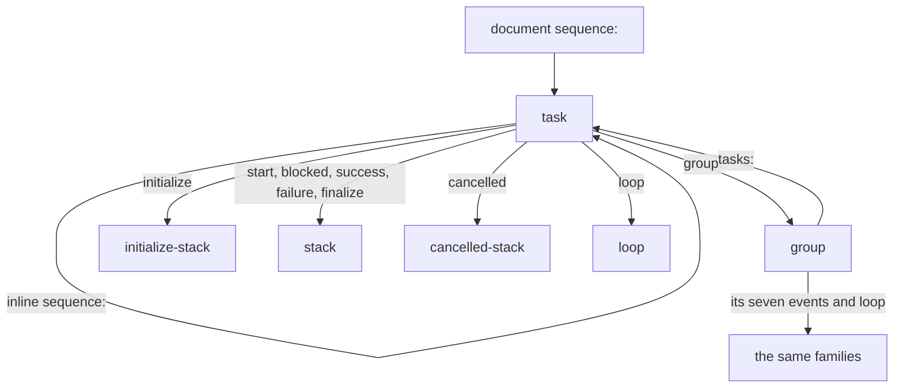
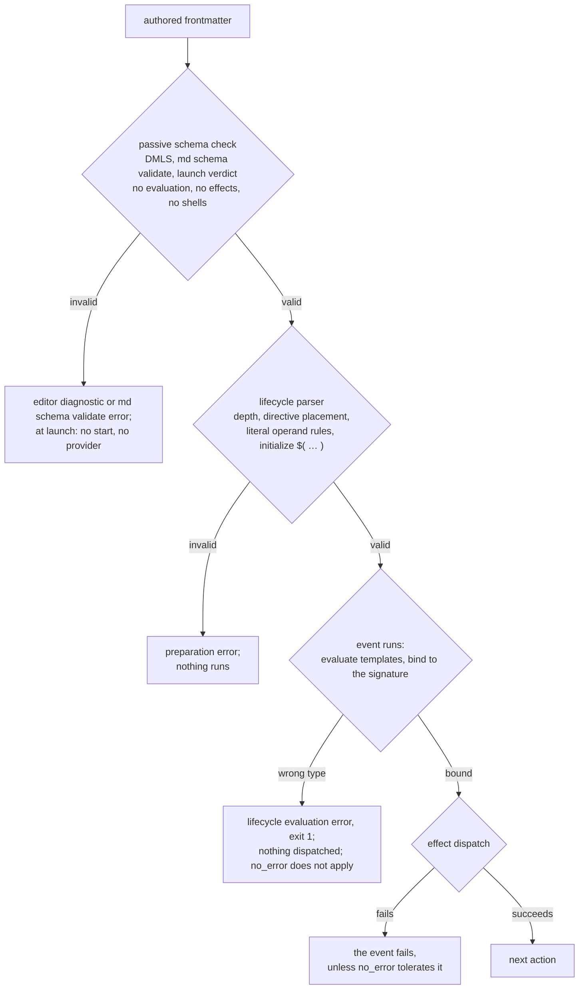
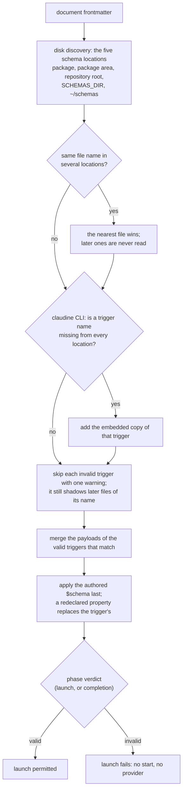
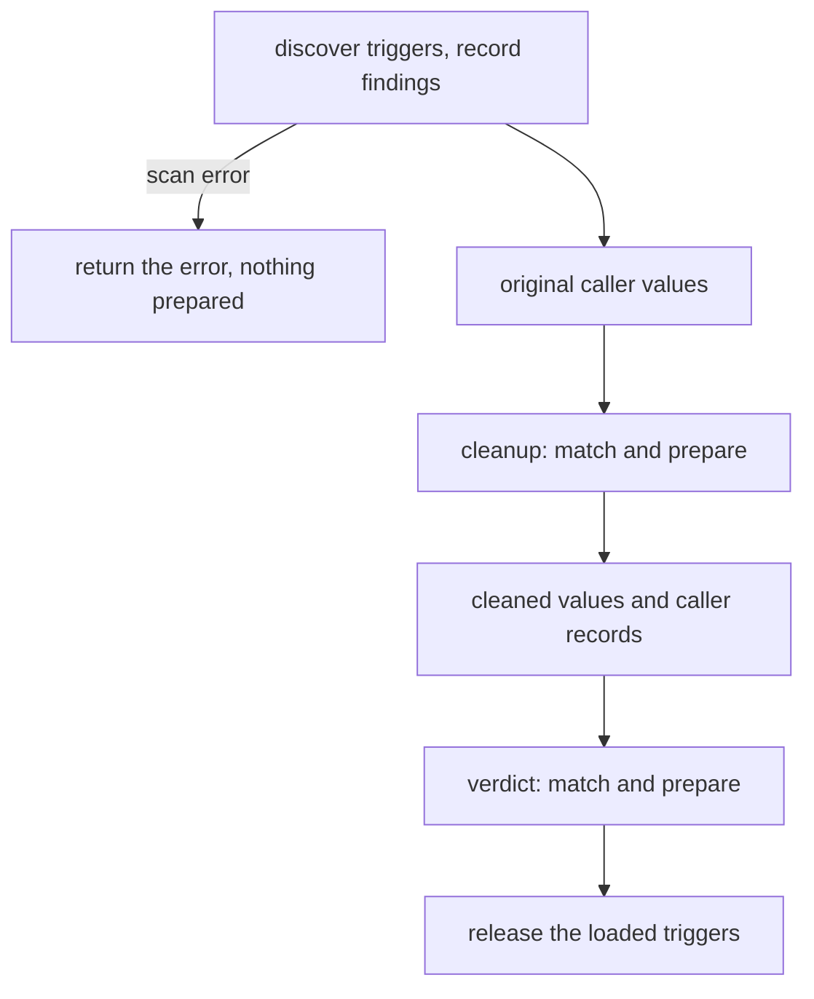

# Schema Support in Claudine

Claudine schemas check the frontmatter that controls a prompt and describe it
in your editor. A misspelled action or a value of the wrong type can be caught
before a provider starts, even when the document declares no `$schema`.
Claudine uses [Darkmatter's schema system](^darkmatter/docs/topics/schemas/index.md);
[DMLS](^darkmatter/docs/topics/dmls.md), the Darkmatter language server, reads
the same schemas for diagnostics, completion, and hover.

Start below with a document's own schema, then see how Claudine's automatic
schemas apply at launch and in the editor. The [reference links](#schema-reference-docs)
cover the full type language and validation rules.

## Defining Schemas

A schema can apply at three levels:

1. Local to where you are working
2. Across the Repo
3. Base Darkmatter and Claudine schemas

### Local Schemas

You can use the `$schema` property of any Markdown document's Frontmatter to impose a schema constraint on the document:

```yaml
$schema:
    name: string(required) -> the name of the product
    description: string -> a description of the product
```

If you want to reuse a schema across several files you can create the schema in a YAML file:

```yaml
$schema:
    name: string(required) -> the name of the product
    description: string -> a description of the product
```

and then point any Markdown documents you want to be bound to that schema by adding the following to the frontmatter:

```yaml
$schema: ./path/to/schema.yaml
```

A file holding only a root `$schema` key is a document schema. A file with
`kind: schema` is a type library instead: it holds `types:`, and a document
reaches it only through an import such as `stack@./lifecycle.yaml`.

### Repo Wide Schemas

A schema can also apply to documents that never mention it. Darkmatter looks
for **trigger schemas** (files with `kind: schema-trigger`) in five schema
locations: the document's package `schemas/`, its package area's `schemas/`,
the repository root's `schemas/`, the folder `SCHEMAS_DIR` names, and
`~/schemas`. A trigger has a `match:` condition over the frontmatter and a
`$schema` payload that applies whenever the condition holds. See
[Repository Trigger Schemas](../../../darkmatter/docs/topics/schemas/definition.md#repository-trigger-schemas).
Claudine's own schemas, described next, are delivered this way.

## Claudine's Schemas

Claudine types its own frontmatter: the lifecycle events, `loop`, `agent`,
`model`, a sequence document's steps, the timeouts, the linking keys, and the
rest of the
[frontmatter catalog](frontmatter-properties.md). The schemas live in
[`claudine/schemas/`](../../schemas/README.md) and are used in two places:

- **In the editor.** DMLS reports a misspelled verb, a malformed long form, or
  a `shell` action in `initialize` as you type, with no `$schema` in the
  document. This works under `claudine/` out of the box, and elsewhere once a
  disk copy of the schemas is reachable (see
  [How a Document Reaches the Schemas](#how-a-document-reaches-the-schemas)).
- **At launch.** `claudine compose`, `claudine inline-compose`, and
  `claudine sequence` judge these schemas before `start` and provider launch.
  A document's shell-free `initialize` runs before the stabilized launch
  verdict; an invalid Claudine control then fails the launch, so no `start`
  stack runs and no provider starts. See
  [Composition → Claudine's trigger schemas](composition.md#claudines-trigger-schemas-in-the-launch-verdict).

```yaml
---
prompt: "review the diff"
start:
    - shell: { cmd: "git status" }   # invalid: the long form's key is `command`
---
```

The lifecycle parser, shared with Darkmatter and configured by Claudine,
remains the authority on what can run. The schemas catch most mistakes early,
but a document they accept can still be rejected by the parser (see
[What only the parser checks](#what-only-the-parser-checks)).

### The eight files

| File | Kind | Holds |
|---|---|---|
| [`action.yaml`](../../schemas/action.yaml) | library (`kind: schema`) | the four action types and the two dictionary-bundle types, each verb's shape referenced from Darkmatter |
| [`lifecycle.yaml`](../../schemas/lifecycle.yaml) | library (`kind: schema`) | the stack types (`stack`, `initialize-stack`, `cancelled-stack`) and the `loop:` block type |
| [`sequence-types.yaml`](../../schemas/sequence-types.yaml) | library (`kind: schema`) | the sequence step and container types (`steps`, `step`, `task`, `group`) |
| [`linking.yaml`](../../schemas/linking.yaml) | library (`kind: schema`) | the eleven optional linking keys of a linked skill, command, or agent |
| [`document.yaml`](../../schemas/document.yaml) | library (`kind: schema`) | the document metadata types (`prompt`, `hash`, `last_updated`) that both `claudine.yaml` and `inline-compose.yaml` import, so the two triggers declare them identically |
| [`claudine.yaml`](../../schemas/claudine.yaml) | trigger (`kind: schema-trigger`) | Claudine's frontmatter catalog, applied to a document with a non-null lifecycle event, `loop`, `prompt`, `agent`, or `model`; declares Darkmatter's `composed` and `failed` as errors naming `start` and `blocked` |
| [`inline-compose.yaml`](../../schemas/inline-compose.yaml) | trigger (`kind: schema-trigger`) | inline-compose's document metadata (`prompt`, `hash`, `last_updated`), applied to a document with a non-null `prompt` and no non-null `sequence` |
| [`sequence.yaml`](../../schemas/sequence.yaml) | trigger (`kind: schema-trigger`) | the sequence document's catalog (`sequence`, `template`, and the removed root `fail_fast`), applied to a document with a non-null `sequence` |

Three of the eight are triggers; the other five are libraries. A library
reaches a document only through a trigger's imports, so the eight files work
as one bundle:

| Trigger | Imports, directly or through another library |
|---|---|
| `claudine.yaml` | `document.yaml`, `lifecycle.yaml` (and through it `action.yaml`), `linking.yaml` |
| `inline-compose.yaml` | `document.yaml` |
| `sequence.yaml` | `sequence-types.yaml` (and through it `lifecycle.yaml` and `action.yaml`) |

The document metadata is declared once, in `document.yaml`, and both
metadata triggers import it by name:

```yaml
# claudine.yaml and inline-compose.yaml
$schema:
    prompt: prompt@./document.yaml
    hash: hash@./document.yaml
    last_updated: last_updated@./document.yaml
```

So `prompt`, `hash` (shorthand string or longhand mapping), and
`last_updated` have the same type and description whichever trigger applies.
The library is not a trigger: the two triggers still match, apply, and are
shadowed independently.

Copy all eight files together (see [On disk](#on-disk)). For editor analysis of
Claudine's host globals and lifecycle events, also copy `globals.yaml` and
`globals.lifecycle.json`; these describe the host rather than adding document
properties. The bundle does not need Darkmatter's schema files beside it (see
[Verb shapes are Darkmatter's](#verb-shapes-are-darkmatters)).

### When the schemas apply

A trigger selects a document by the **presence of a non-null value**, whatever
its type. A value of the wrong type still selects the trigger, so the payload
can reject it:

| Frontmatter | `claudine.yaml` | `inline-compose.yaml` | Verdict |
|---|---|---|---|
| `start: [{ say: "hi" }]` | applies | — | valid |
| `start: 42` | applies | — | invalid: `start` is not a stack |
| `agent: []` | applies | — | invalid: an agent list needs at least one entry |
| `start: null` or `start:` | — | — | no Claudine trigger |
| `ticket: 123` alone | — | — | no Claudine trigger |
| `prompt: "write it"` | applies | applies | judged by both |
| `prompt: "write it"` with `sequence: [a, b]` | applies | — | a sequence is not an inline document (`sequence.yaml` applies too) |
| `prompt: "write it"` with `sequence: { a: 1 }` | applies | — | invalid: `sequence` is a list or a file reference (`sequence.yaml`) |

`sequence.yaml` selects every document with a non-null `sequence`, so a
sequence document with no other control is judged too:

| Frontmatter | `sequence.yaml` | Verdict |
|---|---|---|
| `sequence: [build, test]` | applies | valid |
| `sequence: "@steps.yaml"` | applies | valid: a file reference |
| `sequence: { tasks: [a] }` | applies | invalid: `sequence` is a list or a file reference |
| `sequence: 42` or `sequence: true` | applies | valid to the schema, which coerces a top-level number or boolean to text; the sequence parser rejects it before anything runs |
| `sequence: null`, or no `sequence` | — | no sequence trigger |
| `fail_fast: true` beside `sequence:` | applies | invalid at `/fail_fast`: a sequence document has no `fail_fast` |
| `fail_fast: null` beside `sequence:` | applies | valid to the schema; the sequence parser rejects any root `fail_fast`, null included, before anything runs |

Only `sequence.yaml` declares `sequence`. A sequence document's lifecycle
events and `loop` select `claudine.yaml` whenever they are set, and are typed
there, so no key has two declarations to keep in step.

Darkmatter's match grammar does not accept a property-level union inside a
condition, so each identifying key is written as five single-type alternatives
in a `group:` (OR), one per non-null YAML type:

```yaml
match:
    group:
        - start: string(required)
        - start: number(required)
        - start: boolean(required)
        - start: object(required)
        - start: "unknown[](required)"
        # ... the same five alternatives for every other identifying key
```

`inline-compose.yaml` wraps a `group:` of the five `prompt` alternatives in
`all:` beside a `none:` of the five `sequence` alternatives, and
`sequence.yaml` matches a `group:` of the five `sequence` alternatives.

The payloads declare **no required property**. Selection only adds types where
a key appears; it never asks for an execution input. `inline-compose` keeps its
own missing-`prompt` check, applied after caller overlays.

The document stays **open**: keys Claudine does not know are application data
and are kept.

```yaml
---
prompt: "summarize ticket {{ ticket }}"
ticket: 123          # application data, never a schema error
model: sonnet
---
```

### Lifecycle events and action types

`action.yaml` sorts the verbs into four **action types**:

| Action type | Verbs |
|---|---|
| `communicate` | `say`, `speak`, `effect`, `message`, `notify`, `stderr`, `stdout`, `info`, `warn`, `success` |
| `flow` | `stop`, `skip`, `error`, `proxy`, `retry`, `resume`, `defer`, `break`, `prep` |
| `shell` | `shell` |
| `expression` | `set`, plus every Darkmatter side-effect verb (`set_frontmatter`, `append_line`, …) and expression function |

An event's type says which action types it allows:

| Event | `communicate` | `flow` | `shell` | `expression` |
|---|---|---|---|---|
| `initialize` | yes | yes | **no** | yes |
| `start`, `blocked`, `success`, `failure`, `finalize` | yes | yes | yes | yes |
| `cancelled` | yes | `stop` only | yes | yes |
| `loop:` loose verb keys and its `gate:` | yes | yes | yes | yes |

`initialize` is shell-free, so its type has no `shell` arm. A shell there is an
ordinary schema error:

```yaml
initialize:
    - info: "preparing"
    - shell: "git fetch"      # invalid: initialize allows no shell action
start:
    - shell: "git status"     # valid
```

The restriction holds at every conditional depth and in both branches, so a
`shell` in an `else` that would never be selected is still an error, to the
schema and to the parser alike. One way to run a shell in `initialize` is
invisible to the schema: a `$( … )` expansion in a `set` value
(`set: { sha: "$(git rev-parse HEAD)" }`) is plain text to the schema, and
only the parser rejects it.

`cancelled` is cleanup only, so `stop` is its one flow directive. `retry`,
`resume`, `proxy`, `prep`, `skip`, `error`, `break`, and `defer` are schema
errors there, at every conditional depth, on a document and on every typed
container (see [Sequence containers](#sequence-containers)):

```yaml
cancelled:
    - warn: "cancelled"       # valid
    - stop                    # valid: ends only this stack
    - retry: 2                # invalid: cancelled allows no retry
```

### Verb shapes are Darkmatter's

Darkmatter owns the lifecycle grammar (see
[Darkmatter Lifecycle](../../../darkmatter/docs/topics/lifecycle/index.md)), so
it also owns the schema shape of every lifecycle verb, including verbs only
Claudine runs, such as `say`, `retry`, `proxy`, and `break`. Those shapes live
in Darkmatter's partial
[`lifecycle.yaml`](../../../darkmatter/schemas/partials/lifecycle.yaml), as
`<verb>-short` and `<verb>-long` types. Claudine's `action.yaml` and
`lifecycle.yaml` choose which verbs each action type and event admits, and
name each shape instead of copying it:

```yaml
communicate:
    say:
        - say-short@darkmatter:lifecycle
        - say-long@darkmatter:lifecycle
```

`Name@darkmatter:<stem>` is a **reserved reference**. It always means type
`Name` in Darkmatter's shipped partial `<stem>.yaml`, read from the schemas
compiled into Darkmatter, never from disk. It therefore resolves the same way
whether the referring file is in the monorepo checkout, embedded in the
`claudine` binary, or copied into `~/schemas` without Darkmatter's files, where a relative path to
`darkmatter/schemas/` would not exist. An unknown stem is a schema error
naming the reference.

#### Who owns what

| Piece | Owner | Where |
|---|---|---|
| every verb's short and long shape | Darkmatter | `darkmatter/schemas/partials/lifecycle.yaml` |
| expression-function signatures | Darkmatter | `darkmatter/schemas/partials/functions.yaml` |
| side-effect parameter types | Darkmatter | `darkmatter/schemas/partials/mutations.yaml` |
| the generated verb types, projected from those two catalogs | Darkmatter | the generated regions of `lifecycle.yaml`, written by `darkmatter::lifecycle::schema_projection` |
| which verbs each event and action type admits | Claudine | `claudine/schemas/action.yaml` and `claudine/schemas/lifecycle.yaml` |

Claudine's files select `<verb>-short@darkmatter:lifecycle` and
`<verb>-long@darkmatter:lifecycle` for a single-verb item, and the short form
alone in a bundle and in a `loop:` verb key. Every side effect must have typed
parameters: a test fails when a side-effect descriptor has no typed entry in
`mutations.yaml`, and the generator refuses to emit an untyped value for one.

#### Changing a generated verb

The side-effect and expression-function types sit between
`# BEGIN GENERATED <region>` and `# END GENERATED <region>` lines in
Darkmatter's `lifecycle.yaml` (regions `types`, `expression`, `bundle`, and
`initialize-bundle`). Never edit those lines by hand. When a catalog signature
changes, regenerate them and commit the YAML with the change:

```sh
just -f darkmatter/justfile regen-lifecycle-schema   # from the repository root
just regen-lifecycle-schema                          # from darkmatter/
```

The recipe runs
`cargo run -p darkmatter --example lifecycle_schema_generator -- --write`,
which rewrites only the generated regions; without `--write` the example
prints the projection to stdout. The drift test
`the_generated_regions_are_byte_identical_to_a_regeneration` in
`darkmatter/lib/tests/l1/lifecycle_schema_generation.rs` fails when the
checked-in regions no longer match the catalogs.

Claudine's files name the generated types by reference, so a changed
signature needs no Claudine edit. A verb added to or removed from a catalog
does: its key is listed by name in `action.yaml`'s `expression` type and
bundles and in `lifecycle.yaml`'s `loop:` keys, and
`generated_verb_keys_equal_the_darkmatter_catalogs` in
`claudine/lib/tests/l1/claudine_schemas.rs` fails until they match.

### Darkmatter's event names in a Claudine document

Claudine calls Darkmatter's `composed` and `failed` events `start` and
`blocked` (see [Lifecycle](flow-control/lifecycle.md#claudine-is-a-lifecycle-host)).
Which names are typed depends on which schemas apply:

| Key | Darkmatter's baseline alone | With Claudine's trigger |
|---|---|---|
| `initialize`, `cancelled`, `finalize` | typed with the `md` host's verbs | typed with Claudine's verbs; Claudine's declaration replaces the baseline's |
| `composed`, `failed` | typed with the `md` host's verbs | declared `null`, so any non-null value is an error |
| `start`, `blocked` | untyped frontmatter data | typed lifecycle events |

`claudine.yaml` gives the two `null` declarations a description naming the
event to write instead:

```yaml
prompt: "review the diff"
composed:                     # invalid: Claudine names this event `start`
    - info: "starting"
```

`md schema validate` prints that description with the error. In the editor,
DMLS shows it when you hover the key; the diagnostic itself carries only the
schema error, not the description. The lifecycle parser reports the same
mistake as `LifecycleRenamedEvent` before anything runs (see
[Lifecycle — Validation](flow-control/lifecycle.md#validation)).

Two parity tests keep the schemas and the event registry in step:
`claudine/lib/tests/l1/claudine_schema_parity.rs` checks that Claudine's event
names and per-event action types match Claudine's registry, that the
Darkmatter spellings name Claudine's events, that Claudine's declarations
override the baseline, and that Claudine's action types resolve to
Darkmatter's definitions. `darkmatter/lib/tests/l1/lifecycle_schema_parity.rs`
checks the baseline against the `md` host the same way.

### Single actions, long forms, and bundles

A **single action** is a mapping that holds one verb: a list item, a whole
event written as a dictionary, a `then`/`else` body written as a dictionary,
or a loop's one loose verb. It takes the verb's short form or its long form,
with `no_error` beside it, and `when` beside it in a list item. Long forms are
closed objects, so a misspelled parameter is an error:

```yaml
start:
    - say: "starting"                           # short form
    - say: { text: "starting", no_error: true } # long form
    - when: "fm.draft"
      say: { text: "draft run" }                # long form beside `when`
    - say: { txet: "starting" }                 # invalid: `say` has no `txet`
    - inf0: "starting"                          # invalid: not a verb
finalize:
    ensure_file: { file: notes.md }             # a whole event, one long form
    no_error: true
loop:
    until: "{{ true }}"
    ensure_file: { file: review.txt }           # the loop's one loose verb
```

The schema types a single action with the action categories (`communicate`,
`flow`, `shell`, `expression`), each of which holds one verb; their
`uncounted-keys` constraint leaves `when` and `no_error` out of that one-key
count. The schema does not check where `when` may sit beside an action: a
`when` in a whole event or body dictionary passes the schema, and the
lifecycle parser refuses it. A conditional is different, see below.

A **dictionary bundle** puts several verbs in one mapping, optionally guarded
by `when` and softened by `no_error`. A bundle takes **short forms only**; it
is its own type (`bundle`, or `initialize-bundle` without `shell`) because
SimplifiedSchema cannot merge the action types into one object. A loop's
loose verbs are a bundle too when there are several of them.

```yaml
success:
    - when: "fm.notify"
      message: "done"
      shell: "git push"                 # valid: a guarded bundle
    - info: "pushed"
      say: { text: "pushed" }           # invalid: a long form inside a bundle
loop:
    until: "{{ true }}"
    ensure_file: { file: review.txt }
    info: "reviewed"                    # invalid: a long form beside another loose verb
```

A whole event can also be one bundle (a root dictionary), and a bare
zero-argument verb is a valid list item:

```yaml
success:
    info: "done"
    effect: "click"
failure:
    - warn: "giving up"
    - stop
```

A conditional item is `when` with `then` and an optional `else`. It cannot
carry sibling verbs:

```yaml
start:
    - when: "fm.draft"
      then:
          - info: "draft run"
      info: "always"            # invalid: then/else beside a sibling verb
```

A conditional is a list item only. A whole event, or a `then`/`else` body,
written as a dictionary holds actions, never a condition, so the schema
refuses a `then` there:

```yaml
start:
    when: "fm.ready"            # invalid: a conditional must be a list item
    then: [stop]
success:
    - when: "fm.ready"          # valid
      then: [stop]
```

### How deep the schema checks

Every stack family is recursive: a conditional's `then` and `else` take the
same stack type as the event that holds it, so the schema types every action
at every depth, in both branches. Each event keeps its own restrictions all
the way down:

| Stack | Family | Restriction at every depth |
|---|---|---|
| `start`, `blocked`, `success`, `failure`, `finalize`, and the loop's `gate:` | `stack` | none beyond the action types |
| `initialize` | `initialize-stack` | no `shell` |
| `cancelled` | `cancelled-stack` | `stop` is the only flow directive |

```yaml
initialize:
    - when: "fm.a"                   # level 1
      then:
          - when: "fm.b"             # level 2
            then:
                - when: "fm.c"       # level 3
                  then:
                      - info: "ok"
                  else:
                      - shell: "git fetch"   # invalid: initialize allows no shell,
                                             # even in an unselected branch
```

A conditional requires `when` and `then`, allows `else`, and takes no sibling
verb or `no_error`, at any depth. An `else` without `then` is a schema error.

The schema has **no depth limit**. The parser allows conditionals five levels
deep and rejects a sixth with `LifecycleStackInvalidShape`, naming the path of
the sixth level, so a six-level stack of valid actions passes the schema and
the editor but fails before anything runs. A guarded bundle (`when` beside
verbs, such as `- { when: "fm.x", info: "hi" }`) inside a fifth-level
conditional counts as a sixth level to the parser, though the schema accepts
it. A misspelled verb is a schema error at any depth, including the sixth:

```yaml
success:
    - when: "fm.a"            # level 1 … level 6 below: schema valid,
      then:                   # the parser rejects the sixth level
          - when: "fm.b"
            then:
                - when: "fm.c"
                  then:
                      - when: "fm.d"
                        then:
                            - when: "fm.e"
                              then:
                                  - when: "fm.f"
                                    then:
                                        - say: "leaf"    # `sya:` here is a schema error
```

### Sequence containers

`sequence.yaml` types a document's `sequence:` list with the step types of
`sequence-types.yaml`. A step is a name (a bare value) or a `task` object; a
task's inline `sequence:` list, its `group:`, and a group's `tasks:` legs are
typed too. You can import the types for your own properties, for example
`$schema: { nested: task@./sequence-types.yaml }`.

```yaml
sequence:
    - name: build
      cancelled: [{ retry: 2 }]          # invalid: task `cancelled` allows no retry
      sequence:
          - name: compile
            shell: "just build"
            with: [release]              # invalid: `with` is a mapping
    - group:
          name: checks
          execution: parallel            # invalid: removed; a group is closed
          max_paralel: 2                 # invalid: misspelled `max_parallel`
          tasks:
              - name: lint
                shell: "just lint"
                owner: docs-team         # valid: step data, read as `seq.owner`
```

A **group object is closed**, so a removed key (`execution`) or a misspelled
one (`max_paralel`) is a schema error. Because a group's value can also be a
file reference, the problem is reported at the group (`/sequence/1/group`)
with the group's value, which names the offending key. A **task object is
open**: a key Claudine does not reserve, such as `params` or `owner`, is
authored step data, never a schema error. A document-level `fail_fast` is
removed and reported at `/fail_fast`; set `fail_fast` on a group object
instead.

The container types are recursive: a task's inline `sequence:` items and a
group's `tasks:` legs are `task` again, so a container is typed the same way
at every depth, and each container event takes the same family as the
document event of that name:



```yaml
sequence:
    - name: outer
      sequence:
          - group:
                tasks:
                    - name: inner
                      sequence: [deploy]
                      initialize: [{ shell: "ls" }]     # invalid: initialize allows no shell
                      cancelled: [{ retry: 2 }]         # invalid: cancelled allows no retry
                      start: [{ pr_list: three }]       # invalid: pr_list takes a count or a query
```

The schema adds no container-depth limit, and the task parser accepts
unlimited nesting. Each container event starts its own conditional count, so
a five-level stack is valid in every event of every container.

A task's `when:` is typed by shape only: non-empty text.

A referenced sequence or group file (`sequence: "@tasks.yaml"`) is not
Markdown, so no schema judges it; the task parser checks it when the
sequence is prepared.

### Keeping recursive schemas small and quick to validate

For schema maintainers, recursive references serve two purposes: they keep
the same rules at every nesting level, and they avoid copying each recursive
family into every place that uses it. The resolver stores recursive types in
JSON Schema's `$defs` section and points to them with local `$ref` values.
It stores the repeated structured helpers there too, such as the action
categories, the loop helpers, and the verb short forms, because each is used
from two or more places in one trigger payload (see
[Shared Named Types](../../../darkmatter/docs/topics/schemas/definition.md#shared-named-types)).
Some uses are still copied: a union named as an arm of another union (such as
`entry` inside `item` in `lifecycle.yaml`) and any type used only once. The
bundles are copied for that reason: each is written once, inside `entry`,
and `entry` is copied into both `stack` and `item`. The Darkmatter baseline
layer stores its own repeated types in its own definitions, which are never
pooled with the payload's, and a baseline definition only overridden
properties reached is dropped from the merged schema. Reuse the recursive families rather
than adding a fixed number of copied container or conditional levels.

The embedded-bundle regression test
`embedded_trigger_payloads_resolve_within_one_megabyte` in
`lib/tests/l1/claudine_schemas_embedded.rs` checks three cases: the
`claudine.yaml` trigger, the `sequence.yaml` trigger, and both together. Each
resolved effective schema must fit within **1,000,000 UTF-8 bytes** of compact
JSON, including `$defs` and the built-in baseline. The test resolves the
embedded bundle in isolation, with no user schemas or disk bundle, so its
result describes the shipped schemas. This is a deterministic size check,
not a time limit.

To investigate validation time, choose a representative Markdown sequence
with nested containers and a reachable disk bundle, then run:

```sh
md schema validate path/to/sequence.md -vv
```

The report separates discovery, trigger matching, resolution, validator
compilation, and validation. A one-shot validation under 200 milliseconds on
the development Mac is a development goal, not a guaranteed latency or a
test threshold. Record the document, command, machine load, and stage
breakdown when comparing a change. See
[validation timing and cold/warm comparisons](../../../darkmatter/docs/inline/schema-validation.md#comparing-cold-and-warm-validation)
for the existing benchmark workflow.

### Malformed templates in any action

Every string the lifecycle parser reads as a template is checked for syntax
by the schema too, at its own path and source position, whatever the type
accepts there: a communication verb's text, a directive's strings (`error`,
`proxy`, `retry`, `resume`, `defer`, `break`, `prep`), a `shell` command, a
`set` value, and every value of a `with:` overlay, as well as a generated
verb's arguments (see
[Deferred values](#deferred-values-and-what-happens-at-the-event)):

```yaml
start:
    - say: "{{ 1 + }}"                           # invalid at /start/0/say: malformed template
    - error: { reason: "failed {{ 1 + }}" }      # invalid at /start/1/error/reason
    - proxy: { target: next.md, with: { round: "{{ 1 + }}" } }  # invalid at /start/2/proxy/with/round
    - set: { round: "{{ fm.round + 1 }}" }       # valid
    - info: "{{ unclosed"                        # valid: an unclosed `{{` is text
```

The schema reads exactly what the parser reads, so a `set` value written as a
whole-value `$( … )` command is not checked as a template, nor is `no_error`
or `break.code`. A `when` condition is already parsed as an expression. A
malformed template fails `md schema validate`, the editor, and the launch
verdict alike, because no rendering can repair it.

### What only the parser checks

The schema cannot express these rules; the lifecycle parser enforces them
before anything runs:

- an unconditional ending directive (`stop`, `retry`, `proxy`, …) placed
  last in its list, and at most one directive per bundle; `prep` returns, so
  another item may follow it
- `skip` only in `initialize`
- no `when` beside the actions of a root or body dictionary, or at the
  `loop:` root, and `gate:` never beside loose loop verbs (a conditional's
  `then` in such a dictionary is a schema error too)
- the five-level conditional nesting limit, in every event, including a
  guarded bundle (`when` beside verbs, such as `- { when: "fm.x", stop: null }`)
  placed inside a fifth-level `when`, which the parser counts as a sixth level
- a shell expansion hidden in a `set` value in `initialize`
  (`set: { sha: "$(git rev-parse HEAD)" }`)
- the literal operand rules of the generated verbs: a literal YAML `null`,
  list, or mapping as one operand is rejected with a hint to write a
  whole-value `{{ … }}` template (see
  [Generated verbs have typed arguments](#generated-verbs-have-typed-arguments))

Passing the schema, in the editor or at launch, is therefore not proof that a
lifecycle stack can execute.

The reverse also holds: the parser does not type-check a literal operand, so
`pr_list: three` passes the parser. The schema rejects it, and because the
launch verdict runs the schema, no `start` stack or provider runs. Shell-free
initialization may already have run before that verdict.

### Generated verbs have typed arguments

Every Darkmatter side effect (`ensure_file`, `set_frontmatter`,
`append_line`, …) and every expression function (`min`, `pr_list`, `ping`, …)
is a lifecycle verb, listed one key per name. Its value is typed from the
verb's catalog signature, so a wrong argument is reported in the editor and
at launch rather than when the event runs.

#### Argument forms

A verb takes its arguments in one of three spellings:

| Form | Spelling | Where |
|---|---|---|
| short, single value | the only argument, for an overload that takes one | anywhere |
| short, positional list | the parameters in order | anywhere |
| long | a closed mapping keyed by parameter name, plus an optional `no_error: boolean` | single-verb items only, not in a bundle |

Each overload of a signature is a separate alternative. `ensure_file(file)`
and `ensure_file(file, content)` therefore accept five spellings:

```yaml
start:
    - ensure_file: notes.md                              # valid: (file)
    - ensure_file: [notes.md]                            # valid: (file)
    - ensure_file: [notes.md, "# Notes"]                 # valid: (file, content)
    - ensure_file: { file: notes.md }                    # valid: long form
    - ensure_file: { file: notes.md, content: "# Notes" }  # valid: long form
    - ensure_file: { file: notes.md, body: "# Notes" }   # invalid: no `body` parameter
    - min: ["1", 2, 3]                                   # invalid: min takes two arguments
```

A bundle takes short forms only, as it does for every verb. The variadic `and`
and `or` take a list of operands (or stand bare, as `- and`) and have no long
form. The catalog function `set(key, value)` is not generated: the lifecycle
verb `set` owns that name, takes a mapping of destinations to values, and has
no long form and no `no_error`.

#### Optional is not nullable

Whether a parameter may be omitted and whether it accepts `null` are separate
questions. Leaving out an optional parameter is always fine; writing `null`
for it is accepted only when the parameter's type admits `null`:

```yaml
start:
    - ping: "127.0.0.1"                                  # valid: timeout omitted
    - ping: ["127.0.0.1", null]                          # invalid at /start/1/ping/1
    - ping: { address: "127.0.0.1", timeout: null }      # invalid: timeout is optional, not nullable
    - set_frontmatter: [notes.md, status, null]          # valid: value is `unknown | null`
```

This differs from a top-level Claudine property, where the schema reads an
explicit `null` as absent (see
[Optional inputs and open metadata](#optional-inputs-and-open-metadata)).

#### Numeric text

A number parameter accepts text that converts to a number, as the call would
at run time:

```yaml
start:
    - pr_list: 3          # valid
    - pr_list: "3"        # valid: numeric text converts
    - pr_list: three      # invalid at /start/2/pr_list
    - min: ["1", 2]       # valid
```

The error names the path and the source position of the value.

#### The verb's own rules decide

The value types are only a projection of the signature. Every check above
then binds the arguments through the same registration the call uses when
the event runs, and that verdict decides the literal arguments, including
the rules a type cannot spell:

```yaml
start:
    - number: [pear, 7]                  # valid: the fallback 7 replaces text that is not a number
    - round: { x: pear, fallback: 2.7 }  # valid: the same recovery in long form
    - number: pear                       # invalid: no fallback, and "pear" is not a number
    - length: [true]                     # invalid at /start/3/length/0: length does not accept a boolean
    - length: [hi]                       # valid
```

The binder also chooses between overloads as the call does: a call two
overloads accept only after converting its value is ambiguous and is reported,
though each overload's type accepts it. Templates stay deferred, and an
unknown parameter, an extra argument, or a bad `no_error` beside a bound
argument is still reported. A bundle still takes short forms only.

#### Deferred values and what happens at the event

A whole-value `{{ … }}` template is accepted wherever an argument is typed,
because its value is not known until the event runs:

```yaml
start:
    - pr_list: "{{ fm.count }}"                  # valid
    - min: [1, "{{ fm.x }}"]                     # valid
    - pr_list: { count: "{{ fm.count }}" }       # valid
```

A template accepts only its own position. It never hides a mistake beside it:

```yaml
start:
    - min: [three, "{{ fm.x }}"]                 # invalid at /start/0/min/0: the literal is still checked
    - min: ["{{ fm.x }}", 2, 3]                  # invalid: an extra argument
    - pr_list: { count: "{{ fm.count }}", limit: 3 }  # invalid: no `limit` parameter
```

A `{{ … }}` span that does not parse is never deferred. It is a syntax error
at the argument's path and source position, whatever the parameter's type
accepts, whether it is the whole value or part of the text:

```yaml
start:
    - ensure_file: "{{ 1 + }}"                   # invalid at /start/0/ensure_file: malformed template
    - trim: { text: "hello {{ 1 + }}" }          # invalid at /start/1/trim/text
    - pr_list: "{{ 1 + }}"                       # invalid at /start/2/pr_list: the syntax, not the type
    - ensure_file: "{{ unclosed"                 # valid: an unclosed `{{` is text
```

A stored literal token (`{{!data:v1:…}}`, the form a lifecycle effect writes
data in) is data, not a template, even when the text it holds looks like one.
Its text is checked as the argument, at launch, in DMLS, and in
`md schema validate` alike:

```yaml
start:
    - abs: "{{!data:v1:e3sgZm0uY291bnQgfX0}}"    # invalid at /start/0/abs: the text `{{ fm.count }}` is not a number
    - trim: "{{!data:v1:e3sgZm0uY291bnQgfX0}}"   # valid: the text is a string
```

It fails every passive check: `md schema validate`, the editor, and the
Claudine launch verdict. `md compose`'s own gate reports it as an expression
parse error.

When the event runs, the template is evaluated and its value is bound to the
signature before the effect runs. A value of the wrong type fails there.
With `target: [a, b]` in the frontmatter:

```yaml
target: [a, b]
start:
    - ensure_file: "{{ target }}"     # schema valid; fails when start runs
```

`claudine compose` exits 1 without launching the provider and reports a
`CompositionError` "lifecycle evaluation error" naming the event and the
action (`start[0].ensure_file`), with a `Reason:` line naming the parameter
(`expected string; received list`). Nothing is dispatched, and the document's
authored value is left unchanged. `no_error: true` does not suppress a
binding failure; it softens only a failure of the effect itself.

### `break`, `prep`, and the planned `defer`

`break` and `prep` are accepted by the schema and the parser alike
(`break: "done"`, `break: { reason: done, code: 2 }`,
`prep: "@prompts/next.md"`); the schema checks `code` is an integer from 0 to
255 and `prep`'s target is a non-empty string. Both run; see
[Flow Control](flow-control/flow-control.md#break). `defer` parses but is not
executed yet (**planned**). The schema reads `prep: null` as
absent, so that spelling is left to the parser, which rejects it.

### Where each check runs

A lifecycle action passes four checks on its way to running. The first two
see only what was authored; the last two see evaluated values:



The diagram orders the checks by what they can see, not strictly by when
they run: at launch, Claudine parses every stack before `initialize` and
reaches the schema verdict after it (see
[Composition → Claudine's trigger schemas](composition.md#claudines-trigger-schemas-in-the-launch-verdict)).
Either failure stops the launch before `start` and the provider. Validation
and editor requests never run an action: no expression is evaluated, no
effect is dispatched, and no shell is started.

### What Claudine adds to expression checking

Claudine is a host of Darkmatter's expression language. It extends the
language in one way only: it declares the globals `seq`, `loop`, and `group`
in its host catalog, [`globals.yaml`](../../schemas/globals.yaml). That file
is a catalog, never a document schema or a trigger. Darkmatter types every
read of those roots from it, so a call such as `min(loop.count, 5)` is
checked like a call on a schema-declared property, both before launch and in
DMLS:

```yaml
---
loop: { max: 3 }
finalize:
    - say: "{{ min(loop.count, 'many') }}"   # rejected before launch: 'many' is not a number
---
```

Claudine registers **no expression function** of its own. Every function a
Claudine document calls is a Darkmatter built-in, so Claudine ships no
function catalog and no facts artifact, and needs none for DMLS to check its
calls. Adding a Claudine function takes all three of these together:

1. a `function(...)` catalog in `claudine/schemas/` declaring its
   signatures;
2. a Rust registration through Darkmatter's
   `expression::host::HostFunctions`, installed when the CLI starts;
3. the generated `<stem>.facts.json` artifact beside the catalog, with a test
   that fails when it is stale.

`claudine/lib/tests/l1/host_catalog.rs` fails while a catalog or an artifact
exists without the others. How registration, the artifact, and DMLS's
incomplete-analysis warning work is described in Darkmatter's
[Host Expression Functions](../../../darkmatter/docs/topics/host-functions.md).

Claudine's lifecycle differs from the `md` host's: `composed` is `start`,
`failed` is `blocked`, `success`, `failure`, and `loop` are Claudine events,
and verbs such as `say`, `retry`, and `proxy` run. So DMLS can check
lifecycle expressions as a launch does, Claudine writes its event
registration and parse options to
[`globals.lifecycle.json`](../../schemas/globals.lifecycle.json), beside
`globals.yaml`. With it, a guard narrows the calls it selects in every
Claudine event and verb, and a `set` ends the fact, in the editor exactly as
before launch:

```yaml
---
$schema:
    count: number
count: 1
success:
    - when: count
      then:
          - say: "{{ min(count, 5) }}"   # silent
          - set:
                count: 7
          - say: "{{ min(count, 6) }}"   # with [expressions] strict: may be null
---
```

The file is generated: run `just regen-lifecycle-artifact` in `claudine/`
after changing `globals.yaml`, the event registry, or the sound-effect
catalog. `host_catalog.rs` fails while it is stale, and DMLS reports a stale
or missing one as `dm.lifecycle.incomplete_analysis`, analyzing the document
as the `md` host's until it is regenerated. The format and the editor's
behavior are described in Darkmatter's
[Host Lifecycle Artifacts](../../../darkmatter/docs/topics/lifecycle/host-artifact.md).

Claudine also no longer walks expressions itself to find which roots and
paths they read (loop control variables, retired `seq`/`loop` spellings,
sequence target identities, guard subjects). It asks Darkmatter
(`static_access_reads` and `static_variable_reads`) and filters the answer by
its own names, so a read hidden in parentheses, brackets, or either branch of
a ternary is found the same way everywhere. A source guard,
`claudine/lib/tests/l1/type_scope_ownership_guard.rs`, fails on a new
hand-written walk.

### Optional inputs and open metadata

Every Claudine property is optional, and the schema reads an explicit `null`
as absent. Some readers are stricter: `loop`, the four timeouts,
and `prompt` reject an explicit `null` when the document is parsed. A few
properties are declared only so the editor
can describe them:

- `operation` and `yolo` are set by a flag (or, for `operation`, a sequence
  task), never read from a document.
- `seq`, `group`, and `loop` are lexical runtime roots, separate from the
  document's schema instance. Older injected names such as `state` and
  `outputs` are ordinary authored frontmatter properties; they are no longer
  declared as generated overlays. Group `fail_fast` is a boolean on the group
  schema; document-level `fail_fast` is rejected.
- `metadata` (linking) and the `with:` overlays of `proxy` and `retry` are
  open mappings.

## How a Document Reaches the Schemas

The editor and the `claudine` CLI find the same files, with one difference:
the CLI carries a built-in copy.



### On disk

Darkmatter searches five locations, most local first, and the first file of a
name **shadows** every later file of that name. A document whose package area
is `claudine/` therefore reaches `claudine/schemas/` with no setup. `md schema
triggers <file>` lists the locations, the shadowed files, and which triggers
matched.

Anywhere else, install a **complete** bundle of regular files in one of
these locations:

- the repository root's `schemas/` folder (a real directory, not a symlink)
- the folder an absolute `SCHEMAS_DIR` names, such as
  `SCHEMAS_DIR=/opt/team/claudine-schemas`
- `~/schemas`

Complete means all eight bundle files side by side, so the relative imports
(`@./document.yaml`, `@./lifecycle.yaml`, …) resolve:

- the triggers `claudine.yaml`, `inline-compose.yaml`, and `sequence.yaml`;
- the libraries `action.yaml`, `document.yaml`, `lifecycle.yaml`,
  `linking.yaml`, and `sequence-types.yaml`.

Darkmatter's own schema files need not be copied: the
`@darkmatter:lifecycle` references resolve from the copy built into `md`, DMLS,
and `claudine`. This command copies the bundle together with the host files
`globals.yaml` and `globals.lifecycle.json`:

```sh
mkdir -p ~/schemas
cp claudine/schemas/*.yaml claudine/schemas/globals.lifecycle.json ~/schemas/
```

A disk trigger imports only from disk, never from the `claudine` binary's
embedded files. This matters most when you place one trigger on disk to
replace the embedded one: copy the libraries it imports (see the table under
[The eight files](#the-eight-files)) into the same folder. A lone
`inline-compose.yaml` without `document.yaml` cannot resolve its imports, so
it is skipped with a warning and, because a skipped file still shadows, the
embedded `inline-compose.yaml` does not apply either.

These routes do **not** work:

- **Symlinking individual files.** Discovery reads regular files only; a
  symlinked `claudine.yaml` is ignored.
- **Pointing `$schema` at a trigger.** `$schema: claudine.yaml` fails with
  "schema-trigger file referenced as document schema": triggers activate by
  placement and match, never by reference.
- **A `.dmls.toml` extension.** Extension settings configure only the editor,
  never the CLI, and an extension path is loaded like a `$schema` reference,
  so it cannot name a trigger file.

### In the `claudine` CLI

The `claudine` binary embeds the eight files (`include_str!` in
[`schema/bundle.rs`](../../lib/src/composition/schema/bundle.rs)), so an
installed binary validates Claudine controls with no checkout and no disk
bundle. The embedded copy is the **last** location:

- An embedded trigger is added only for a name no disk location holds. A disk
  `claudine.yaml` always wins, even one that does not match the document.
- A malformed disk trigger is skipped with a warning (see
  [When a trigger is invalid](#when-a-trigger-is-invalid)); the embedded copy
  never stands in for it.
- Each winning file resolves its imports from its own origin: a disk trigger
  imports from disk, never from the embedded files.
- Embedded triggers come after disk files in the merge, and a later layer's
  declaration of a property replaces an earlier one's. So a disk copy of
  `inline-compose.yaml` types `prompt`, `hash`, and `last_updated` only where
  it applies alone: when the embedded `claudine.yaml` matches too, its
  declarations of those three properties win.

`md` and DMLS register no embedded bundle. They see Claudine's schemas only
when a disk bundle is reachable.

### When a trigger is invalid

A trigger file that cannot be used, such as an unfinished
`~/schemas/memory.yaml` with unsupported envelope keys or an empty `match:`,
or one whose payload or import fails to load, does not stop the launch. The
CLI skips that one trigger, applies the valid ones as usual, and prints one
warning for it before the provider starts:

```text
warning: [schema_validation] ignoring invalid schema trigger /home/me/schemas/memory.yaml: invalid schema-trigger: found unknown keys: name, description
```

- **One warning per trigger per invocation.** Claudine loads a document's
  schema several times before a launch (pre-validation, dropping invalid
  optionals, the launch verdict, interactive re-runs) and again on every loop
  iteration and retry. The same trigger is reported once, with the first
  reason seen, in discovery order. A trigger only a transcluded document
  discovers is reported the same way.
- **Shown even when the run fails.** If the prompt is then rejected for an
  unrelated reason, the warning is printed before the error, and the error is
  never blamed on the skipped trigger.
- **Each invocation reports again.** A new `claudine` run, and a `prep`
  target (which runs as an invocation of its own), print the warning again
  while the file stays broken. `--silent` hides it.
- **A skipped file still shadows.** An invalid disk `claudine.yaml` still
  hides the embedded `claudine.yaml`, so Claudine's control schema is absent
  until the file is fixed or removed; nothing falls back to the embedded copy.
- **A reference is still an error.** A `$schema` that names a trigger file
  fails whether or not the trigger is valid, and so does an
  authored `$schema` that cannot load.

`md` and DMLS skip an invalid trigger the same way; see
[Schemas Applied by Triggers](../../../darkmatter/docs/topics/schemas/schema-triggers.md).

#### How long discovered triggers live

A single launch pre-validation discovers the trigger files once and keeps the
loaded rules and payloads for the length of that call. Matching still happens
twice, against each pass's own values: first the cleanup pass (which drops
invalid optional values), then the verdict.



Example: a trigger matches when `count` is a string or a number and also
requires `ticket`, while the document's own `$schema` declares `count` as an
optional number. A document whose `count` is a string matches the trigger in
the cleanup pass, so the invalid `count` is dropped. The verdict pass sees no
`count`, no longer selects that trigger, and the launch proceeds without
`ticket`. (Cleanup drops only values the document's own `$schema` declares
optional; a property declared only by a trigger is never cleaned away.)

- **Edits between calls are seen.** Each call (and each standalone cleanup,
  status report, or launch schema load) discovers again, so a trigger created,
  changed, removed, or repaired between calls takes effect.
- **Edits between the two passes are not.** The loaded trigger contents are
  not replaced mid-call, and discovery is not an atomic snapshot of the
  filesystem.
- **An authored `$schema` still resolves in each preparation.**
- **A failed scan stops the call.** A root that cannot be enumerated or read
  (for example a trigger file that is not valid UTF-8) fails with a schema
  load error before any preparation; standalone cleanup instead returns its
  input unchanged.

### In the editor

DMLS has no Claudine dependency and reads the schemas only from disk, through
the same five locations. When the bundle is reachable, a Claudine prompt with
no `$schema` gets diagnostics, completion, and hover from the matching
triggers:

- top-level keys (`mod` completes to `mode` and `model`) and their values
  (`mode:` offers `append` and `replace`, `interactive:` offers `true` and
  `false`);
- lifecycle items (`- sa` completes to `say`; an empty `- ` offers the action
  keys and the bare verbs such as `stop`), long-form parameters (`text` under
  `say:`), and `loop:` keys (`max`);
- hover on a property describes its type and purpose; hovering `text` in a
  `say` item also names the communication alternative the item matches;
- generated verbs and their long-form parameters (`file` under
  `ensure_file:`), at any depth in `then`/`else`. Completion leaves `shell`
  out of `initialize` and offers `cancelled` only its restricted verbs.
  Hover finds a parameter that only a later overload declares, such as
  `ensure_file`'s `content`.

Key completion works in block mappings only: DMLS offers no keys inside a
YAML flow mapping such as `ensure_file: { fi }`.

Each key is declared by exactly one trigger, and completion offers only the
keys of triggers that already apply. A sequence document whose root has only
`sequence` (and `template`) matches `sequence.yaml` alone, so it is not
offered `start`, `loop`, or the other root event keys. Once one of those keys
is written, `claudine.yaml` applies and the rest are offered and typed.

A property the document's own `$schema` redeclares is completed and hovered
from the author's declaration, as it is validated (see below). One limit
remains: a document outside the Claudine area gets editor help only when a
complete bundle is reachable on disk, even though the CLI validates it.

See [DMLS Schema Support](../../../darkmatter/docs/topics/schemas/dmls-schema-support.md).

### The authored `$schema` applies last

Darkmatter merges the matching trigger payloads first and the document's own
`$schema` last, replacing whole top-level properties. A property the author
redeclares belongs to the author:

```yaml
---
$schema:
    model: string(required) -> the model this prompt must name
start:
    - info: "go"
---
```

Here `model` follows the authored declaration, so it is now required, while
`start` is still judged by `claudine.yaml`. Redeclaring a Claudine property can weaken its type; the
parser still enforces the execution rules.


## Schema Reference Docs

- [Authoring Schemas](^darkmatter/docs/topics/schemas/authoring-schemas.md)
    - [Schema Types](^darkmatter/docs/topics/schemas/schema-types.md)
    - [Schema Constraints](^darkmatter/docs/topics/schemas)
    - [Schema Triggering](^darkmatter/docs/topics/schemas/)
- [CLI Validation](../../../darkmatter/docs/topics/schemas/definition.md#cli-md-schema-validate)
- [CLI Schema Detection](../../../darkmatter/docs/topics/schemas/definition.md#cli-md-schema-detect)
- [DMLS Support for Schemas](../../../darkmatter/docs/topics/schemas/dmls-schema-support.md)
- Schemas
    - Darkmatter ([all global namespaces](^darkmatter/schemas/darkmatter.yaml))
        - [Frontmatter Base Schema (`fm` namespace)](^darkmatter/schemas/partials/fm.yaml)
            - [Style Schema (for the `style` property in `fm` namespace)](^darkmatter/schemas/partials/style.yaml)
        - [Context Variables Schema (`ctx` and `current` namespaces)](^darkmatter/schemas/partials/context-variables.yaml)
        - [Error Schema (`err` namespace)](^darkmatter/schemas/partials/error.yaml)
        - [Timing Schema (`timing` namespace)](^darkmatter/schemas/partials/timing.yaml)
    - Claudine ([overview of the bundle](../../schemas/README.md))
        - [Frontmatter catalog trigger](../../schemas/claudine.yaml)
        - [Inline-compose trigger](../../schemas/inline-compose.yaml)
        - [Host globals catalog (`seq`, `loop`, `group`)](../../schemas/globals.yaml)
        - [Action types](../../schemas/action.yaml)
        - [Lifecycle stacks and `loop:`](../../schemas/lifecycle.yaml)
        - [Linking keys](../../schemas/linking.yaml)
        - [Document metadata (`prompt`, `hash`, `last_updated`)](../../schemas/document.yaml)
