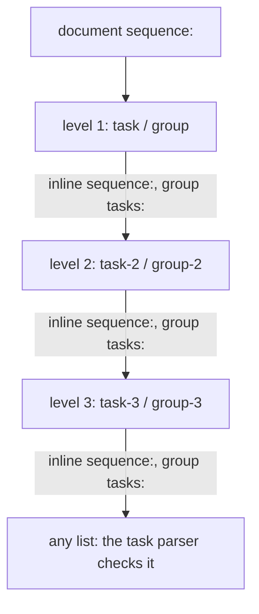
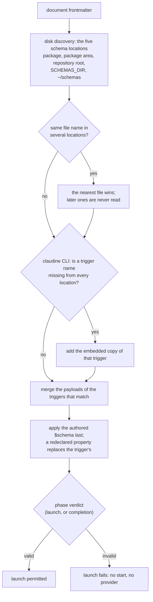

# Schema Support in Claudine

Claudine inherits and extends the powerful schema system that [Darkmatter](^darkmatter/docs/topics/schemas/index.md) provides. This schema system allows you to get rich LSP support from [DMLS](^darkmatter/docs/topics/dmls.md) (aka, Darkmatter's LSP for Markdown and YAML).

This document will provide you a breadth wide overview of schemas but there is a lot of powerful features under the hood. If you want to dig into these details use the links [Schema Details](#schema-reference-docs) section.

## Defining Schemas

You can think of schema's as being defined at three levels:

1. Local to where you are working
2. Across the Repo
3. Base Darkmatter and Claudine schemas

### Local Schemas

You can use the `$schema` property of any Markdown document's Frontmatter to impose a schema constraint on the document:

```yaml
$schema:
    name: string(required) -> the name of the product
    description: string -> a description of the product
```

If you want to reuse a schema across several files you can create the schema in a YAML file:

```yaml
$schema:
    name: string(required) -> the name of the product
    description: string -> a description of the product
```

and then point any Markdown documents you want to be bound to that schema by adding the following to the frontmatter:

```yaml
$schema: ./path/to/schema.yaml
```

A file holding only a root `$schema` key is a document schema. A file with
`kind: schema` is a type library instead: it holds `types:`, and a document
reaches it only through an import such as `stack@./lifecycle.yaml`.

### Repo Wide Schemas

A schema can also apply to documents that never mention it. Darkmatter looks
for **trigger schemas** (files with `kind: trigger-schema`) in five schema
locations: the document's package `schemas/`, its package area's `schemas/`,
the repository root's `schemas/`, the folder `SCHEMAS_DIR` names, and
`~/schemas`. A trigger has a `match:` condition over the frontmatter and a
`$schema` payload that applies whenever the condition holds. See
[Repository Trigger Schemas](../../../darkmatter/docs/topics/schemas/definition.md#repository-trigger-schemas).
Claudine's own schemas, described next, are delivered this way.

## Claudine's Schemas

Claudine types its own frontmatter: the lifecycle events, `loop`, `agent`,
`model`, a sequence document's steps, the timeouts, the linking keys, and the
rest of the
[frontmatter catalog](frontmatter-properties.md). The schemas live in
[`claudine/schemas/`](../../schemas/README.md) and are used in two places:

- **In the editor.** DMLS reports a misspelled verb, a malformed long form, or
  a `shell` action in `initialize` as you type, with no `$schema` in the
  document. This works under `claudine/` out of the box, and elsewhere once a
  disk copy of the schemas is reachable (see
  [How a Document Reaches the Schemas](#how-a-document-reaches-the-schemas)).
- **At launch.** `claudine compose`, `claudine inline-compose`, and
  `claudine sequence` judge the same schemas before anything runs. An invalid Claudine control fails the
  launch: no `start` stack runs and no provider starts. See
  [Composition → Claudine's trigger schemas](composition.md#claudines-trigger-schemas-in-the-launch-verdict).

```yaml
---
prompt: "review the diff"
start:
    - shell: { cmd: "git status" }   # invalid: the long form's key is `command`
---
```

The lifecycle parser in `claudine/lib/src/composition/lifecycle/` remains the
authority on what can run. The schemas catch most mistakes early, but a
document they accept can still be rejected by the parser (see
[What only the parser checks](#what-only-the-parser-checks)).

### The seven files

| File | Kind | Holds |
|---|---|---|
| [`action.yaml`](../../schemas/action.yaml) | library (`kind: schema`) | the four action types and the two dictionary-bundle types |
| [`lifecycle.yaml`](../../schemas/lifecycle.yaml) | library (`kind: schema`) | the stack types (`stack`, `initialize-stack`, `cancelled-stack`) and the `loop:` block type |
| [`sequence-types.yaml`](../../schemas/sequence-types.yaml) | library (`kind: schema`) | the sequence step and container types (`steps`, `step`, `task`, `group`) |
| [`linking.yaml`](../../schemas/linking.yaml) | library (`kind: schema`) | the eleven optional linking keys of a linked skill, command, or agent |
| [`claudine.yaml`](../../schemas/claudine.yaml) | trigger (`kind: trigger-schema`) | Claudine's frontmatter catalog, applied to a document with a non-null lifecycle event, `loop`, `prompt`, `agent`, or `model` |
| [`inline-compose.yaml`](../../schemas/inline-compose.yaml) | trigger (`kind: trigger-schema`) | inline-compose's document metadata (`prompt`, `hash`, `last_updated`), applied to a document with a non-null `prompt` and no non-null `sequence` |
| [`sequence.yaml`](../../schemas/sequence.yaml) | trigger (`kind: trigger-schema`) | the sequence document's catalog (`sequence`, `template`, and the removed root `fail_fast`), applied to a document with a non-null `sequence` |

A library reaches a document only through a trigger's imports, so the seven
files work as one bundle. Copy all of them together.

### When the schemas apply

A trigger selects a document by the **presence of a non-null value**, whatever
its type. A value of the wrong type still selects the trigger, so the payload
can reject it:

| Frontmatter | `claudine.yaml` | `inline-compose.yaml` | Verdict |
|---|---|---|---|
| `start: [{ say: "hi" }]` | applies | — | valid |
| `start: 42` | applies | — | invalid: `start` is not a stack |
| `agent: []` | applies | — | invalid: an agent list needs at least one entry |
| `start: null` or `start:` | — | — | no Claudine trigger |
| `ticket: 123` alone | — | — | no Claudine trigger |
| `prompt: "write it"` | applies | applies | judged by both |
| `prompt: "write it"` with `sequence: [a, b]` | applies | — | a sequence is not an inline document (`sequence.yaml` applies too) |
| `prompt: "write it"` with `sequence: { a: 1 }` | applies | — | invalid: `sequence` is a list or a file reference (`sequence.yaml`) |

`sequence.yaml` selects every document with a non-null `sequence`, so a
sequence document with no other control is judged too:

| Frontmatter | `sequence.yaml` | Verdict |
|---|---|---|
| `sequence: [build, test]` | applies | valid |
| `sequence: "@steps.yaml"` | applies | valid: a file reference |
| `sequence: { tasks: [a] }` | applies | invalid: `sequence` is a list or a file reference |
| `sequence: 42` | applies | valid to the schema, which coerces a top-level number to text; the sequence parser rejects it before anything runs |
| `sequence: null`, or no `sequence` | — | no sequence trigger |
| `fail_fast: true` beside `sequence:` | applies | invalid at `/fail_fast`: a sequence document has no `fail_fast` |

Only `sequence.yaml` declares `sequence`. A sequence document's lifecycle
events and `loop` select `claudine.yaml` whenever they are set, and are typed
there, so no key has two declarations to keep in step.

Darkmatter's match grammar does not accept a property-level union inside a
condition, so each identifying key is written as five single-type arms under
`any:`, one per non-null YAML type:

```yaml
match:
    any:
        - start: string(required)
        - start: number(required)
        - start: boolean(required)
        - start: object(required)
        - start: "unknown[](required)"
        # ... the same five arms for every other identifying key
```

`inline-compose.yaml` wraps the five `prompt` arms in `all:` beside a `none:`
of the five `sequence` arms, and `sequence.yaml` matches the five `sequence`
arms.

The payloads declare **no required property**. Selection only adds types where
a key appears; it never asks for an execution input. `inline-compose` keeps its
own missing-`prompt` check, applied after caller overlays.

The document stays **open**: keys Claudine does not know are application data
and are kept.

```yaml
---
prompt: "summarize ticket {{ ticket }}"
ticket: 123          # application data, never a schema error
model: sonnet
---
```

### Lifecycle events and action types

`action.yaml` sorts the verbs into four **action types**:

| Action type | Verbs |
|---|---|
| `communicate` | `say`, `speak`, `effect`, `message`, `notify`, `stderr`, `stdout`, `info`, `warn`, `success` |
| `flow` | `stop`, `skip`, `error`, `proxy`, `retry`, `resume`, `defer`, `break`, `prep` |
| `shell` | `shell` |
| `expression` | `set`, plus every Darkmatter side-effect verb (`set_frontmatter`, `append_line`, …) and expression function |

An event's type says which action types it allows:

| Event | `communicate` | `flow` | `shell` | `expression` |
|---|---|---|---|---|
| `initialize` | yes | yes | **no** | yes |
| `start`, `blocked`, `success`, `failure`, `finalize` | yes | yes | yes | yes |
| `cancelled` | yes | `stop` only | yes | yes |
| `loop:` loose verb keys and its `gate:` | yes | yes | yes | yes |

`initialize` is shell-free, so its type has no `shell` arm. A shell there is an
ordinary schema error:

```yaml
initialize:
    - info: "preparing"
    - shell: "git fetch"      # invalid: initialize allows no shell action
start:
    - shell: "git status"     # valid
```

`cancelled` is cleanup only, so `stop` is its one flow directive. `retry`,
`resume`, `proxy`, `prep`, `skip`, `error`, `break`, and `defer` are schema
errors there, at every conditional depth, on a document and on every typed
container (see [Sequence containers](#sequence-containers)):

```yaml
cancelled:
    - warn: "cancelled"       # valid
    - stop                    # valid: ends only this stack
    - retry: 2                # invalid: cancelled allows no retry
```

### Single actions, long forms, and bundles

A **single-verb item** takes the verb's short form or its long form. Long forms
are closed objects, so a misspelled parameter is an error:

```yaml
start:
    - say: "starting"                           # short form
    - say: { text: "starting", no_error: true } # long form
    - say: { txet: "starting" }                 # invalid: `say` has no `txet`
    - inf0: "starting"                          # invalid: not a verb
```

A **dictionary bundle** puts several verbs in one mapping, optionally guarded
by `when` and softened by `no_error`. A bundle takes **short forms only**; it
is its own type (`bundle`, or `initialize-bundle` without `shell`) because
SimplifiedSchema cannot merge the action types into one object.

```yaml
success:
    - when: "fm.notify"
      message: "done"
      shell: "git push"                 # valid: a guarded bundle
    - info: "pushed"
      say: { text: "pushed" }           # invalid: a long form inside a bundle
```

A whole event can also be one bundle (a root dictionary), and a bare
zero-argument verb is a valid list item:

```yaml
success:
    info: "done"
    effect: "click"
failure:
    - warn: "giving up"
    - stop
```

A conditional item is `when` with `then` and an optional `else`. It cannot
carry sibling verbs:

```yaml
start:
    - when: "fm.draft"
      then:
          - info: "draft run"
      info: "always"            # invalid: then/else beside a sibling verb
```

### How deep the schema checks

The parser allows conditionals five levels deep; a sixth level is a parser
error. How much of that the schema covers depends on the event:

| Stack | Typed conditional levels | Below them |
|---|---|---|
| `cancelled` | all five | a sixth-level `when` with `then` is a schema error |
| `initialize`, `start`, `blocked`, `success`, `failure`, `finalize`, and the loop's `gate:` | three | a body inside a level-3 `when` is accepted as any list or mapping |

So a directive that `cancelled` forbids is a schema error wherever the parser
would accept its position:

```yaml
cancelled:
    - when: "fm.a"                   # level 1
      then:
          - when: "fm.b"             # level 2
            then:
                - when: "fm.c"       # level 3
                  then:
                      - when: "fm.d" # level 4
                        then:
                            - retry: 2   # invalid: cancelled allows no retry
```

In the other events, an action inside a level-3 `when` passes the schema, and
the parser rejects it before anything runs:

```yaml
initialize:
    - when: "fm.a"                   # level 1: typed
      then:
          - when: "fm.b"             # level 2: typed
            then:
                - when: "fm.c"       # level 3: typed
                  then:
                      - shell: "git fetch"   # loose body: the schema accepts it,
                                             # the parser rejects it
```

`cancelled` reaches every level by typing `then` and `else` as one pattern
key, which keeps the compiled schema small. The editor therefore does not
complete `then`/`else` inside a `cancelled` conditional, and an `else`
without `then` there is left to the parser.

### Sequence containers

`sequence.yaml` types a document's `sequence:` list with the step types of
`sequence-types.yaml`. A step is a name (a bare value) or a `task` object; a
task's inline `sequence:` list, its `group:`, and a group's `tasks:` legs are
typed too. You can import the types for your own properties, for example
`$schema: { nested: task@./sequence-types.yaml }`.

```yaml
sequence:
    - name: build
      cancelled: [{ retry: 2 }]          # invalid: task `cancelled` allows no retry
      sequence:
          - name: compile
            shell: "just build"
            with: [release]              # invalid: `with` is a mapping
    - group:
          name: checks
          execution: parallel            # invalid: removed; a group is closed
          max_paralel: 2                 # invalid: misspelled `max_parallel`
          tasks:
              - name: lint
                shell: "just lint"
                owner: docs-team         # valid: step data, read as `seq.owner`
```

A **group object is closed**, so a removed key (`execution`) or a misspelled
one (`max_paralel`) is a schema error. Because a group's value can also be a
file reference, the problem is reported at the group (`/sequence/1/group`)
with the group's value, which names the offending key. A **task object is
open**: a key Claudine does not reserve, such as `params` or `owner`, is
authored step data, never a schema error. A document-level `fail_fast` is
removed and reported at `/fail_fast`; set `fail_fast` on a group object
instead.

SimplifiedSchema copies a named type into every place that uses it, so a type
cannot contain itself. The container types are therefore unrolled into
**three typed levels**, and the third level's lists are any list:



A document nested deeper than three container levels is still valid: the
schema checks less there, and the task parser, which accepts unlimited
nesting, checks the rest before anything runs.

Each level inlines the next one twice (through a task's `sequence:` and its
group's `tasks:`), so the size of a container field multiplies with every
level. A typed container checks only what stays cheap:

| Container field | Level 1 | Level 2 | Level 3 |
|---|---|---|---|
| `name`, `when`, `with`, `group`, `tasks`, `max_parallel`, `fail_fast`, … | typed | typed | typed |
| `cancelled` | restricted stack | restricted stack | list or mapping |
| `loop` (on a group, or beside an inline `sequence:`) | the `loop` type | object | object |
| `initialize`, `start`, `blocked`, `success`, `failure`, `finalize` | list or mapping | list or mapping | list or mapping |

Typing a container's events like a document's makes every Claudine launch
about three seconds slower, because the compiled schema is built for every
launch. The lifecycle and loop parsers check what the schema leaves loose.
The document's own events and `loop` are typed fully by `claudine.yaml`.

A task's `when:` is typed by shape only: non-empty text.

A referenced sequence or group file (`sequence: "@tasks.yaml"`) is not
Markdown, so no schema judges it; the task parser checks it when the
sequence is prepared.

### What only the parser checks

The schema cannot express these rules; the lifecycle parser enforces them
before anything runs:

- a directive (`stop`, `retry`, `proxy`, …) placed last in its list, and at
  most one directive per bundle
- `skip` only in `initialize`
- no `when` on a root dictionary or at the `loop:` root, and `gate:` never
  beside loose loop verbs
- in every event except `cancelled`, anything inside a level-3 `when`, and
  the five-level nesting limit
- in `cancelled`, an `else` written without `then`, and a guarded bundle
  (`when` beside verbs, such as `- { when: "fm.x", stop: null }`) placed
  inside a fifth-level `when`, which the parser counts as a sixth level
- a container's events other than `cancelled`, the `cancelled` of a
  third-level container, the contents of a `loop` below the first container
  level, and any container below the three typed container levels
- a shell expansion hidden in a `set` value in `initialize`
  (`set: { sha: "$(git rev-parse HEAD)" }`)
- the arguments of the generated verbs (below)

Passing the schema, in the editor or at launch, is therefore not proof that a
lifecycle stack can execute.

### Generated and planned verbs

The Darkmatter side-effect verbs and expression functions are listed one key
per name, so a misspelled name still fails. Their **values are untyped**: the
parser judges the arguments.

```yaml
start:
    - set_frontmatter: [a, b, c]    # schema valid; the parser judges the arguments
```

`break` and `prep` are accepted by the schema and the parser alike
(`break: "done"`, `break: { reason: done, code: 2 }`,
`prep: "@prompts/next.md"`); the schema checks `code` is an integer from 0 to
255 and `prep`'s target is a non-empty string. Both run; see
[Flow Control](flow-control/flow-control.md#break). `defer` parses but is not
executed yet (**planned**). The schema reads `prep: null` as
absent, so that spelling is left to the parser, which rejects it.

### Optional inputs and open metadata

Every Claudine property is optional, and the schema reads an explicit `null`
as absent. Some readers are stricter: `loop`, the four timeouts,
and `prompt` reject an explicit `null` when the document is parsed. A few
properties are declared only so the editor
can describe them:

- `operation` and `yolo` are set by a flag (or, for `operation`, a sequence
  task), never read from a document.
- `seq`, `group`, and `loop` are lexical runtime roots, separate from the
  document's schema instance. Older injected names such as `state` and
  `outputs` are ordinary authored frontmatter properties; they are no longer
  declared as generated overlays. Group `fail_fast` is a boolean on the group
  schema; document-level `fail_fast` is rejected.
- `metadata` (linking) and the `with:` overlays of `proxy` and `retry` are
  open mappings.

## How a Document Reaches the Schemas

The editor and the `claudine` CLI find the same files, with one difference:
the CLI carries a built-in copy.



### On disk

Darkmatter searches five locations, most local first, and the first file of a
name **shadows** every later file of that name. A document whose package area
is `claudine/` therefore reaches `claudine/schemas/` with no setup. `md schema
triggers <file>` lists the locations, the shadowed files, and which triggers
matched.

Anywhere else, install a **complete** bundle of regular files (every file in
`claudine/schemas/`, so the relative imports resolve) in one of:

- the repository root's `schemas/` folder (a real directory, not a symlink)
- the folder an absolute `SCHEMAS_DIR` names, such as
  `SCHEMAS_DIR=/opt/team/claudine-schemas`
- `~/schemas`

```sh
mkdir -p ~/schemas
cp claudine/schemas/*.yaml ~/schemas/
```

These routes do **not** work:

- **Symlinking individual files.** Discovery reads regular files only; a
  symlinked `claudine.yaml` is ignored.
- **Pointing `$schema` at a trigger.** `$schema: claudine.yaml` fails with
  "trigger-schema file referenced as document schema": triggers activate by
  placement and match, never by reference.
- **A `.dmls.toml` extension.** Extension settings configure only the editor,
  never the CLI, and an extension path is loaded like a `$schema` reference,
  so it cannot name a trigger file.

### In the `claudine` CLI

The `claudine` binary embeds the seven files (`include_str!` in
[`schema/bundle.rs`](../../lib/src/composition/schema/bundle.rs)), so an
installed binary validates Claudine controls with no checkout and no disk
bundle. The embedded copy is the **last** location:

- An embedded trigger is added only for a name no disk location holds. A disk
  `claudine.yaml` always wins, even one that does not match the document.
- A malformed disk trigger fails the launch visibly; the embedded copy never
  stands in for it.
- Each winning file resolves its imports from its own origin: a disk trigger
  imports from disk, never from the embedded files.

`md` and DMLS register no embedded bundle. They see Claudine's schemas only
when a disk bundle is reachable.

### In the editor

DMLS has no Claudine dependency and reads the schemas only from disk, through
the same five locations. When the bundle is reachable, a Claudine prompt with
no `$schema` gets diagnostics, completion, and hover from the matching
triggers:

- top-level keys (`mod` completes to `mode` and `model`) and their values
  (`mode:` offers `append` and `replace`, `interactive:` offers `true` and
  `false`);
- lifecycle items (`- sa` completes to `say`; an empty `- ` offers the action
  keys and the bare verbs such as `stop`), long-form parameters (`text` under
  `say:`), and `loop:` keys (`max`);
- hover on a property describes its type and purpose; hovering `text` in a
  `say` item also names the communication alternative the item matches.

A property the document's own `$schema` redeclares is completed and hovered
from the author's declaration, as it is validated (see below). One limit
remains: a document outside the Claudine area gets editor help only when a
complete bundle is reachable on disk, even though the CLI validates it.

See [DMLS Schema Support](../../../darkmatter/docs/topics/schemas/dmls-schema-support.md).

### The authored `$schema` applies last

Darkmatter merges the matching trigger payloads first and the document's own
`$schema` last, replacing whole top-level properties. A property the author
redeclares belongs to the author:

```yaml
---
$schema:
    model: string(required) -> the model this prompt must name
start:
    - info: "go"
---
```

Here `model` follows the authored declaration, so it is now required, while
`start` is still judged by `claudine.yaml`. Redeclaring a Claudine property can weaken its type; the
parser still enforces the execution rules.


## Schema Reference Docs

- [Authoring Schemas](^darkmatter/docs/topics/schemas/authoring-schemas.md)
    - [Schema Types](^darkmatter/docs/topics/schemas/schema-types.md)
    - [Schema Constraints](^darkmatter/docs/topics/schemas)
    - [Schema Triggering](^darkmatter/docs/topics/schemas/)
- [CLI Validation]()
- [CLI Observation]()
- [DMLS Support for Schemas](../../../darkmatter/docs/topics/schemas/dmls-schema-support.md)
- Schemas
    - Darkmatter ([all global namespaces](^darkmatter/schemas/darkmatter.yaml))
        - [Frontmatter Base Schema (`fm` namespace)](^darkmatter/schemas/partials/fm.yaml)
            - [Style Schema (for the `style` property in `fm` namespace)](^darkmatter/schemas/partials/tracking.yaml)
        - [Context Variables Schema (`ctx` and `current` namespaces)](^darkmatter/schemas/partials/context-variables.yaml)
        - [Error Schema (`err` namespace)](^darkmatter/schemas/partials/error.yaml)
        - [Tracking Schema (`tracking` namespace)](^darkmatter/schemas/partials/tracking.yaml)
    - Claudine ([overview of the bundle](../../schemas/README.md))
        - [Frontmatter catalog trigger](../../schemas/claudine.yaml)
        - [Inline-compose trigger](../../schemas/inline-compose.yaml)
        - [Action types](../../schemas/action.yaml)
        - [Lifecycle stacks and `loop:`](../../schemas/lifecycle.yaml)
        - [Linking keys](../../schemas/linking.yaml)
