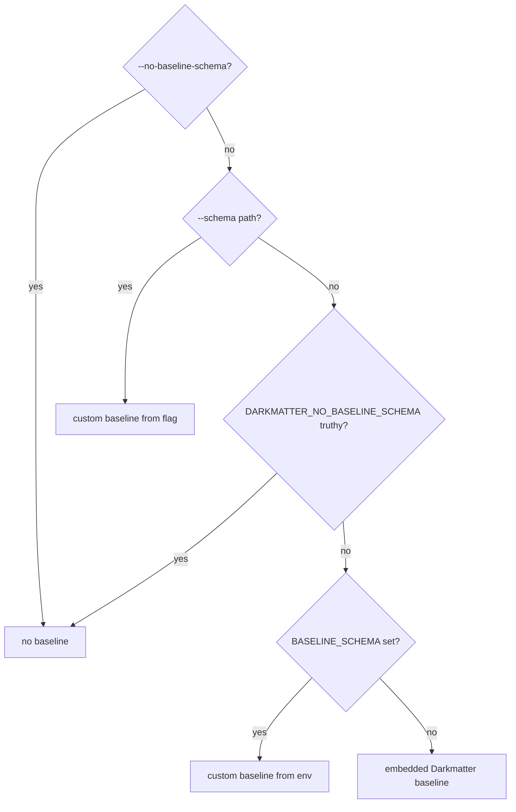

# Compile Content Policy's Schema into the Base Schema

Darkmatter should check a Markdown document's `content_policy` list without
requiring the author to declare `$schema`. These checks should work in
`md schema validate`, `md compose`, and DMLS, including installed binaries
running outside this repository.

The baseline is the schema inherited by default; a document can add or replace
property declarations through its own `$schema`. This work builds on
`2026-10-14-union-type-constraints`, the Darkmatter feature that lets `[]`,
`min(…)`, and `(required)` apply to a reference to a named union type (a type
with alternative shapes). Content Policy needs that capability twice: the
policy list is a list of a union (each entry is either a compact rule string or
a mapping containing `rule` and `action`), and the long form's `rule` is a
required reference to the compact-rule union. Item-level diagnostics (a
problem reported at the offending list entry or field, not at the
`content_policy` key) come from `2026-10-15-diagnostic-node-positions`.

The `content-policy` package exports
[`EDITOR_SCHEMA`](../../../content-policy/lib/src/lib.rs), the compiled-in
text of its editor schema. Using this constant keeps the schema version aligned
with the parser Darkmatter links. The caller-owned adoption decision in the
**Decided** section of `2026-09-28-content-policy` assigns this work to
Darkmatter and intentionally changes the CLI's validation default.

For example, this ordinary document needs no schema declaration:

```yaml
---
last_updated: 2026-10-04
content_policy:
  - ValidFor(3mo)
  - rule: ValidUntil(2027-01-01)
    action: archive
---
```

Its declaration passes the editor checks. Replacing a rule with
`Duration(3mo)`, the action with `delete`, or dropping `rule:` from the long
entry produces a validation problem. Passing these checks does not establish
whether the document is fresh.

> **Naming note.** This spec runs before `2026-10-18-fm-namespace`, so any
> expression roots it mentions use today's names. It adds no expression
> surface of its own.

## Decided

- **Use the exported artifact.** Add `content-policy` to the Darkmatter
  library with `default-features = false`, without enabling `file-adapter`.
  Content Policy must continue to have no dependency on Darkmatter, including
  with all features enabled. Do not copy its schema or embed its source path
  directly from Darkmatter production code.
- **Type a non-empty list in the runtime baseline.** In the baseline loaded
  today from
  [darkmatter/docs/schemas/darkmatter.yaml](../../../darkmatter/docs/schemas/darkmatter.yaml),
  add:

  ```yaml
  content_policy: "policy[](min(1))@../../../content-policy/schemas/content-policy.yaml"
  ```

  The minimum applies to the list, not each rule string. An empty list is an
  invalid Content Policy declaration. The property remains optional, with no
  default: missing `content_policy` does not insert a policy or `null` during
  composition. Preserve Darkmatter's existing optional-property treatment of
  explicit `null`; the policy parser rejects a null declaration. This is a
  documented difference, not a change to Darkmatter's null convention.
- **`rule` is required in long-form entries.** Decided 2026-10-10. The editor
  schema states the parser's contract: a long-form entry without `rule`, or
  with `rule: null`, is rejected by both the parser and the schema. This is
  normal scope of this spec, delivered by `2026-10-14-union-type-constraints`
  (`(required)` on a union-typed reference). No new resolver capability is
  built here.
- **Update the shipped Content Policy editor schema.** The implementation of
  this spec edits
  [content-policy/schemas/content-policy.yaml](../../../content-policy/schemas/content-policy.yaml)
  (which ships through `EDITOR_SCHEMA`):
  - `long_form.rule` gains `(required)`;
  - same-file references use bare local names, as
    `2026-10-13-named-type-presence-and-local-names` allows (`@` is only for
    types from other files);
  - the header note that `rule` cannot be `(required)` is removed; the
    remaining header notes (pattern escapes, date shape, path limits) stay.

  The resulting types section:

  ```yaml
  long_form:
    rule: "short_form(required)"
    action: "enum(refresh, archive, remove; required)"
  policy:
    - short_form
    - long_form
  ```

- **Use the built-in baseline at default validation entry points.** The CLI
  change applies to documents both with and without `$schema`. Existing
  library callers that attach the Darkmatter baseline receive the new typing.
  Keep the deliberately unconfigured library constructor
  [`DarkmatterSchemas::new`](../../../darkmatter/lib/src/markdown/schemas/mod.rs),
  which callers use to select their own baseline or none. Do not silently
  attach the default to explicitly configured validation APIs.
- **Keep schema precedence.** A custom baseline replaces the built-in one;
  matching triggers and a document's schema retain their existing precedence.
  If a document redefines `content_policy`, its declaration wins. The baseline
  is a default contract, not an unoverrideable enforcement layer.
  In DMLS, matching extension baselines continue to overlay the built-in
  baseline before triggers and the document schema; this feature does not
  replace the editor's existing configuration with the CLI selection rules.
- **Keep validation passive.** Import preparation may resolve declared schema
  dependencies, but policy checks must not evaluate freshness, execute
  expressions, read watched files, fetch URLs, stamp `last_updated`, or renew
  content. The standard key `content_policy` is the only key added here;
  configurable policy keys and date properties remain Content Policy caller
  options.

> **Reader's note:** The authored global catalog at
> [darkmatter/schemas/darkmatter.yaml](../../../darkmatter/schemas/darkmatter.yaml)
> is a different artifact from the runtime baseline. Updating only that catalog
> would leave default document validation unchanged. Similarly, making the
> low-level unconfigured constructor attach a baseline would change callers
> that intentionally validate against another schema. This design changes the
> default entry points while preserving explicit configuration.

## Embedded schema resolution

The embedded baseline currently parses its text without expanding imports
(the Darkmatter library’s
[`darkmatter_base_schema_ref`](../../../darkmatter/lib/src/markdown/schemas/mod.rs)
loads the baseline with the bare YAML parser on an `include_str!`). Adding the
policy reference alone therefore fails conversion and can panic when DMLS first loads the cached
JSON Schema. Both the typed schema used for completion and the compiled schema
used for validation must be fully resolved.

Use a small internal table of embedded schema documents, with stable,
repository-relative virtual paths:

| Virtual path | Embedded text |
| --- | --- |
| `darkmatter/docs/schemas/darkmatter.yaml` | Darkmatter's runtime baseline |
| `content-policy/schemas/content-policy.yaml` | Content Policy's `EDITOR_SCHEMA` |

Resolve the baseline's relative import against this table, and the policy
schema's bare local names within its own embedded document. Reuse the normal
named-type parser, import expansion, and lowering rules; do not create a
second grammar. The table is an internal source for shipped schemas, not a new
public file-reference scheme.

Separate how the existing resolver obtains schema text from how it parses and
expands named types. The embedded source supplies registered text and virtual
identities; the filesystem source retains its request-scoped resolution.
Both feed the same expansion logic. Keep this seam internal and limited to
schema loading rather than adding a general-purpose resource registry.

- Resolve virtual paths lexically with portable `/` separators. Do not
  canonicalize them as host files, use the process's current directory, or
  require a repository checkout.
- An embedded import must stay within the table's virtual root and name a
  registered document. Missing documents, missing types, and malformed imports
  are errors; never fall back to disk or the network. Apply the resolver's
  existing cycle and definition rules rather than introducing another cycle
  policy.
  Here the virtual root is the repository root, not the importing document's
  folder: the baseline's three `..` segments are legal and lead to
  `content-policy/schemas/content-policy.yaml`. Reject traversal above that
  root and host-path or URL forms. Use a distinct internal embedded identity,
  so a disk file with the same repository-relative spelling remains a
  different source.
- Resolve and lower once per process, preserving the existing shared caches.
  Carry any referenced definitions through baseline merging and DMLS's typed
  schema view, including schema unions. Virtual definition identities must not
  collide with document or trigger definitions resolved from disk.
- Embedded entries are immutable build inputs. Do not add their virtual names
  to filesystem dependency watchers or report them as existing source files.
  Problems in document values must retain baseline origin, the offending
  instance path, and the source position of the offending node.
- Loading the authored baseline from disk through the normal resolver must
  produce equivalent validation behavior and type information. User-supplied
  schema references continue to use Biscuit File's `FileReference` and the
  request's captured resolution context; the embedded table does not intercept
  them.

The internal preparation operation returns the existing typed schema errors
with the importing virtual document and requested type identified. Negative
tests exercise that operation with a test-owned table. Keep the public
baseline accessors' existing infallible signatures and documented panic
contract for an invalid shipped artifact; a passive test must prepare, lower,
and compile the actual shipped baseline so such defects fail before release.
Do not turn an embedded preparation failure into an empty baseline or partial
validation success.

The **Embedded Schema Reference** findings under `2026-09-28-content-policy`
already demonstrate installed-binary operation and a prototype of about 110
lines. That prototype used a non-union placeholder, so it does not prove the
real policy list or required-field behavior. No additional performance spike
is required: integrate the real artifact and verify cache reuse through tests.

## CLI defaults and compatibility

Update the Darkmatter CLI's
[`load_api`](../../../darkmatter/cli/src/commands/schema/validate.rs), which
builds the validator for `md schema validate`, and its argument definition.
Add `--no-baseline-schema` and honor `DARKMATTER_NO_BASELINE_SCHEMA` from the
request snapshot. Use the disable values already accepted by compose:
`1`, `true`, `TRUE`, `yes`, and `YES`.

Choose the baseline in this order:

1. `--no-baseline-schema`: disable baselines, including `BASELINE_SCHEMA`.
   Make it conflict with explicit `--schema` as a CLI usage error.
2. `--schema <path>`: use that custom baseline, even when the disable
   environment variable is set.
3. A truthy `DARKMATTER_NO_BASELINE_SCHEMA`: disable the default and ignore
   `BASELINE_SCHEMA`.
4. `BASELINE_SCHEMA`: use that custom baseline.
5. Otherwise, use the embedded Darkmatter baseline.



Read environment values from the captured request, not a new process lookup.
Resolve custom paths in the launch context and document references in their
document context. A selected custom baseline that cannot load remains an
error; it must not fall back to the built-in baseline.

These selection rules apply to `md schema validate`. Compose retains its
existing `--baseline-schema` flag and DMLS retains its extension settings;
neither gains `BASELINE_SCHEMA` behavior as an incidental effect of this
change. Reuse the disable-value definition without calling compose's current
helper that reads the live process environment. For example,
`DARKMATTER_NO_BASELINE_SCHEMA=true md schema validate --schema custom.yaml notes.md`
still uses `custom.yaml`, while `md schema validate --no-baseline-schema notes.md`
only validates schemas supplied by the document or matching triggers.

Disabling the baseline does not disable the document's schema or triggers.
`--no-trigger-schemas` keeps its separate existing meaning. Success without
schema checks means no effective schema remains, not merely that `$schema` is
absent. Keep the JSON output fields and exit codes: `0` for valid, `1` for
validation failure, `2` for schema-load failure, and `3` for document-open or
parse failure. The existing JSON `schema` field identifies a document's string
schema reference; it may remain null when validation used the built-in
baseline. Pretty output must not describe such a document as having no
effective schema.

> **Intentional compatibility change:** A document with
> `last_updated: not-a-date` and no `$schema` currently passes this CLI command
> when no custom baseline is selected. It will fail after this feature, as it
> already does in default compose. All existing baseline fields become active,
> not only `content_policy`. Document the opt-out for callers that need the
> former behavior, update assertions that depend on validation without a
> schema, and keep tests for that behavior when explicitly requested. Do not
> loosen the baseline to preserve the old default.

## Schema coverage and parser agreement

Content Policy's
[`Policy::from_declaration`](../../../content-policy/lib/src/model.rs)
parses a policy list and is the authority for declaration validity. Its editor
schema deliberately checks a subset. Test a shared collection of complete
declarations, not isolated strings placed in unrelated properties.

For cases the schema claims to express, the parser and validator must agree.
For documented limitations, record both expected outcomes explicitly so that
new differences fail the test instead of being silently accepted. Cover:

| Cases | Expected contract |
| --- | --- |
| Each supported rule, legal actions, and a mixed compact/long-form list | Both accept; test `Evergreen` alone because the parser forbids combining it with other rules |
| `Duration(3mo)`, invalid units or capitalization, zero/leading-zero durations, nested property references, missing action, unknown action, non-null values that are not lists, empty lists | Both reject |
| Missing `rule` in a long-form entry, `rule: null`, `action: null`, null list items, wrong-typed `rule`/`action`, and extra long-form fields | Both reject; object entries are closed and list items are not wrapped as nullable |
| Impossible calendar dates, duration overflow, unsupported path prefixes such as `vault:` or URLs, and `{{` inside a path | Parser rejects; editor patterns may accept, as documented |
| `Evergreen` with another rule, and explicit null for the whole list | Parser rejects; schema accepts under the existing cross-entry and optional-property limits |
| `FileChanged(notes/a(b.md, @fp)`, `FileChanged(&Cargo.toml, @fp)`, and `FileChanged(^README.md, @fp)` | Both accept; the path grammar permits an opening parenthesis and the repository/package-root prefixes |

> **Reader’s note:** Null is allowed for the optional `content_policy`
> property, but not for an item inside its array or either required long-form
> field. Extra fields in a long-form mapping are rejected by the established
> closed-object schema rules. These are distinct from the remaining limitations
> above; accepting arbitrary fields or nullable items would accidentally weaken
> the declaration contract. A missing field has no source node: report its
> containing mapping’s position under the prerequisite diagnostic contract.

The existing test
`long_form_without_rule_is_not_flagged_by_the_schema` in
`darkmatter/lib/tests/l1/content_policy_editor_schema.rs` pins the old
limitation; it is replaced by a both-reject assertion.

Use real YAML shapes, including block lists and quoted flow-list rules with
commas. Retire the old fixture that treated `Evergreen` alongside other rules
as a valid policy. Preserve valid path cases such as `&Cargo.toml`,
`^README.md`, and `../x.md`: declaration parsing does not check whether these
files exist or stay within the runtime boundary. That check belongs to policy
evaluation. Keep the declared rule strings unchanged during checks;
no trimming or coercion may turn an invalid declaration into a valid one.
Validate declaration syntax without providing evidence or a clock;
missing baseline dates or fingerprints belong to evaluation, not these checks.
Do not expand this feature into exact parser enforcement or a new regex
language. Any corrected schema pattern remains owned by Content Policy and
ships through its exported constant.

## Work

1. Confirm the prerequisites hold in the tree: `policy[](min(1))@…` loads,
   validates, survives baseline/trigger/document merging, and is visible in
   the typed view (`2026-10-14-union-type-constraints`); `short_form(required)`
   as a bare local name loads (`2026-10-13-named-type-presence-and-local-names`
   and `2026-10-14-union-type-constraints`); and validation diagnostics carry
   the offending node's position (`2026-10-15-diagnostic-node-positions`).
2. Update the shipped editor schema as described under **Decided** and adjust
   Content Policy's own `EDITOR_SCHEMA` equivalence test if it pins the text.
3. Add the dependency and embedded source table, expand the actual shipped
   schema, and update the runtime baseline. Ensure every baseline accessor
   returns the resolved representation needed by its callers. Preserve the
   existing public signatures; record any necessary API departure and its
   caller impact in the implementation log.
4. Implement the CLI selection rules, including argument conflicts, captured
   environment access, output, and compatibility tests.
5. Extend
   [the editor-schema tests](../../../darkmatter/lib/tests/l1/content_policy_editor_schema.rs)
   to use the default policy list, add the declaration comparison cases, and
   update existing baseline corpus tests that currently parse and convert the
   authored baseline without import expansion. Keep passive shipped-artifact
   coverage as well as normal-entry-point coverage.
6. Update Darkmatter's schema definition, baseline contract, CLI
   documentation, and DMLS schema-support documentation. Update the affected
   READMEs, `darkmatter/docs/dependencies.md`, the repository dependency
   catalog, and the Darkmatter and Content Policy skills (the Content Policy
   skill's "Editor schema" section currently says `policy[]` cannot load and
   `rule` is not required). Remove base-schema **planned** wording and the
   missing-`rule` limitation from Content Policy's README and policy-lifecycle
   page, retaining the remaining parser/schema limitations. Current topic
   pages must explain the behavior without referencing this feature directory.

## Out of scope

- Constraints on union-typed references and list-of-union lowering:
  `2026-10-14-union-type-constraints`.
- Presence survival through named-type references and bare local names:
  `2026-10-13-named-type-presence-and-local-names`.
- Node-level diagnostic positions: `2026-10-15-diagnostic-node-positions`.
- Recursive named types: `2026-10-29-recursive-schema-types`.
- The `doc` → `fm` rename: `2026-10-18-fm-namespace`.

## Acceptance criteria

1. A schema-free document containing the example above passes library baseline
   validation, `md schema validate`, `md compose`, and DMLS. An ordinary
   document with no policy remains valid and gains no policy property.
2. The same entry points reject an unknown rule, unknown action, empty list,
   wrong list shape, and a long-form entry with no `rule` or `rule: null`.
   Diagnostics identify the offending list item or field (instance path such as
   `/content_policy/1/rule`, with the line and column of the value when
   present). For missing required fields, use the containing mapping's position;
   for an empty or wrong-typed list, use the `content_policy` value. Retain
   typed problem information and baseline origin. DMLS also completes
   supported rule forms and actions and provides hover information inside list
   entries. Assert completion inside a compact item, `rule:` values, `action:`
   values, and long-form keys, with hover on both compact and long-form rules.
   Preserve branch descriptions and shipped suggestions through embedding.
3. A library baseline test and subprocess tests for the built `md` and DMLS
   run outside the repository with only the test documents available. Baseline
   validation and DMLS completion work without schema files on disk or a
   schema environment override. A second schema load reuses the cached
   resolved baseline within that process; do not infer cache reuse by comparing
   separate subprocesses. Isolate fixture homes and captured environments,
   including `BASELINE_SCHEMA`, `DARKMATTER_NO_BASELINE_SCHEMA`, and
   `SCHEMAS_DIR`, so host configuration cannot supply the missing artifact.
4. Disk-resolved and embedded copies of the real schema have equivalent
   behavior and type information. Tests cover bare local-name references
   inside an embedded document, missing embedded documents/types, invalid
   virtual paths, and definition isolation when a document or trigger supplies
   its own schema using the same type names.
5. Tests prove the CLI precedence above, including a broken custom baseline,
   explicit opt-out, environment opt-out, every supported truthy spelling and
   representative non-disabling values, the explicit flag conflict,
   document/trigger validation after opt-out, and a document schema that
   replaces `content_policy`. JSON fields,
   quiet behavior, and existing failure exit codes remain compatible.
6. The shared declaration cases distinguish agreement from each documented
   schema limitation; the missing-`rule` row is both-reject. The shipped
   `content-policy.yaml` declares `rule: "short_form(required)"`, uses bare
   same-file names, and no longer carries the "`rule` … is not `(required)`"
   header note. Validation leaves document bytes and frontmatter unchanged,
   performs no policy evidence reads, and does not evaluate or renew the
   policy. A valid `FileChanged` declaration naming a nonexistent file still
   passes these syntax checks. Compose retains its established pending-value
   handling: authored pending expressions are checked after resolution, while
   already-resolved invalid values are rejected. Also verify that an explicit
   document declaration of `content_policy` retains the existing composition
   rule that may materialize an absent optional property as `null`; the new
   baseline declaration alone must not materialize it.
7. Use the repository Test Toolkit and existing subprocess fixtures for
   isolated documents and environment settings. Run `just test` and `just lint`
   in Darkmatter and Content Policy; these are nextest-based unit and process
   tests. No new real-terminal or browser tier is needed for schema behavior,
   and tests must not activate editor or terminal windows. The virtual source
   logic and subprocess fixtures must be portable to macOS, Linux, native
   Windows, and WSL2; use the existing OS coverage rather than adding CI cells
   or performance workloads for this feature.

## Open questions

None.
