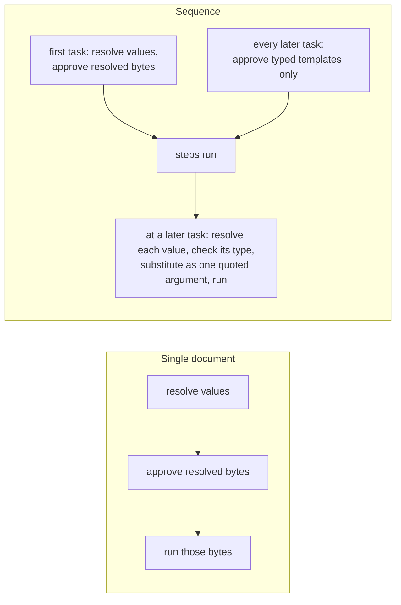

# Shell template approval

A shell command can today be approved only as the exact bytes it will run, or
as "this program with any arguments". That forces a choice between approving
too little (every new value re-prompts, and a value that does not exist until
an earlier sequence step produces it cannot be approved at all) and approving
too much. This spec adds a third kind of approval: a **typed template**. The
author approves the *shape* of a command once, with each variable part typed
(`some-command {{ alphanumeric(allow-slashes) }}/build`); any later command
of that shape whose variables are declared with a type the template allows is
covered, and each value is checked against its type and substituted as exactly
one quoted argument before anything runs. It also settles what happens when a
value a shell command needs is missing: the command never runs.

## Background: two execution models

A reader new to this repository needs one distinction first, because the rest
of the spec depends on it.

**Single document** (`md compose`, `claudine compose`, `claudine
inline-compose`, and the provider wrappers given a prompt). One document is
composed and run. Every value a shell command can read — frontmatter, caller
setters (`key=value`, `--set`), `ctx.*`, `env.*` — is known before anything
runs. Preflight therefore resolves each command to its final bytes, asks for
approval of those bytes, and runs exactly them. A loop iteration, `retry`,
`resume`, or `proxy` target re-resolves with its own state and re-audits
(after the first launch the prompt is frozen, so a new command is refused
rather than prompted).

**Sequence** (`claudine sequence`). An ordered list of steps runs one after
another, and later steps can read what earlier steps produced — the outputs
array, loop counters, group results. All approval is front-loaded: before the
first step starts, Claudine walks the whole task graph and approves every
command any step could run, so the operator can walk away. A value produced
by an earlier step does not exist at that moment. Today such a command is a
typed preflight error (`SequenceShellLateBinding`); this spec makes it
approvable as a template. More generally, by the time a later task runs,
earlier tasks may have changed the values its commands read, so this spec
approves the first task's commands with their resolved values and every later
task's commands only as typed templates (section 10).



## Decided

Decided 2026-10-10 by the owner.

### 1. A shell command never runs with a missing value

A value is **missing** when the expression it comes from evaluates to `null`
or reads an absent property. An empty string is present.

| Where the value comes from | When it is missing |
|---|---|
| Any value in a single document (`::shell`, `::shell-block`, frontmatter `$( … )`, lifecycle `shell`, a whole-value `$( … )` in a `set`) | Preflight fails with a typed error naming the variable, the command, and its source location. Nothing runs. |
| A caller value (`key=value`, `--set`) or any other approval-time value in a sequence | Sequence preflight fails the same way, before the first step. |
| A value an earlier sequence step produces (a [late value](#10-sequence-approval-the-first-task-resolved-every-later-task-as-a-template)), or any value a later task's template reads | The command is approved as a typed template. When its step is reached, a still-missing value fails **that step** before anything in the step runs, with the same typed error. |

The strict-mode contract that `null` renders as an empty string keeps
applying everywhere except shell commands: body text, lifecycle messages,
`set` values, and other frontmatter are unchanged.

```md
---
target: null
---
::shell ls {{ target }}
```

`md compose` fails before running anything: `shell command 'ls {{ target }}'
reads 'target', which is missing (doc.md:4)`. Today it runs `ls` with no
argument.

### 2. Typed placeholders

Every `{{ … }}` span in a shell command is a **placeholder**. In a template
it is a typed hole: the template records the span's type, not its variable
name.

- **Declared type.** A placeholder whose expression is a bare top-level
  property reference (`{{ dir }}`, `{{ fm.dir }}`) has that property's
  declared type, read from the document's existing typed schema projection,
  `EffectiveSchema.simplified`
  (`darkmatter/lib/src/markdown/schemas/mod.rs`). No new type projection is
  built.
- **Fallback to `string`.** The type is `string` when the document has no
  typed projection (raw JSON Schema, or a root union of mixed shapes), when
  the property is undeclared, when the expression is anything other than a
  bare top-level property (`{{ last(seq.outputs) }}`, `{{ dir + '/x' }}`), and
  for every reserved-root value (`seq.*`, `loop.*`, `group.*`, `ctx.*`,
  `env.*`).
- **`string` here only.** Treating an undeclared name as `string` is a rule
  of shell templates. Everywhere else an undeclared name keeps the type
  `unknown`, as the strict-mode fix decided.

### 3. How the prompt shows a template, and what is saved

The approval prompt shows each placeholder with its name and type:

```text
Command:  some-command {{ dir: alphanumeric(allow-slashes) }}/build
```

The persisted rule keeps the type only. The rule keyword is `template`:

```text
template some-command {{ alphanumeric(allow-slashes) }}/build
```

A placeholder whose expression is not a bare property shows the expression
text as its name: `{{ last(seq.outputs): string }}`. Rules may be written by
hand in `.darkmatter-shell-whitelist`. A rule placeholder holds one type
expression with its type options and no `;` constraints; constraints in a
hand-written rule are a load error for that line (reported, the line
skipped, as malformed lines are today). The existing `exact <command>` and
`prefix <executable>` rules are unchanged.

### 4. Substitution: one quoted argument per value

When a command runs under a template, each placeholder's value fills exactly
one argument slot and is quoted, so a value can never add shell syntax,
another argument, a redirect, or a second command.

- A placeholder that is a whole word (`ls {{ dir }}`) becomes one argument.
- A placeholder inside a word (`{{ dir }}/build`) or inside quotes
  (`"repairs from {{ name }}"`) stays inside that one argument.
- The command is rebuilt from its argument list; every argument that holds a
  placeholder is emitted as one fully quoted word using the quoting routine
  of the shell runner that executes it (POSIX single-quote escaping under
  `sh`; the native Windows runner's quoting on Windows).
- A scalar value (string, number, boolean) is converted to text by
  Darkmatter's one conversion engine. An array or object value cannot fill
  one argument and fails the run-time check below.

| Value of `dir` | Template `ls {{ dir }}` runs | Today's textual interpolation would run |
|---|---|---|
| `src` | `ls 'src'` | `ls src` |
| `a b` | `ls 'a b'` (one argument) | `ls a b` (two arguments) |
| `x; rm -rf ~` | `ls 'x; rm -rf ~'` (one argument, no second command) | two commands |

### 5. Matching is on the argument list

A template rule covers a command when, after both are parsed into argument
lists (shell words, with quoting and whitespace removed):

1. they have the same number of arguments, and the same chain operators
   (`&&`, `||`, `|`, `;`) in the same positions;
2. every literal segment is byte-equal;
3. placeholders sit at the same positions within the same arguments; and
4. each placeholder's declared type is **covered** by the rule's type at that
   position (section 7).

Whitespace and quoting style do not matter: `ls   'a'` and `ls "a"` are the
same argument list. A command whose program word (the first word of a chain
segment) contains a placeholder can never be approved as a template; it is
offered only exact, once, deny, and blacklist when its bytes are known, and
fails preflight with a typed error when its program depends on a late value.

### 6. The value is checked before substitution

At run time, before substituting, each value is checked against the
placeholder's **declared type including its constraints** (`min-len`,
`match`, …). A missing value (section 1), a non-scalar value, or a value the
type rejects runs nothing: in a single document the composition fails; in a
sequence the step fails before any of its commands run. The error names the
placeholder, the declared type, and the source location, and never prints the
value (it may be a secret).

### 7. Which types a rule covers

A saved rule covers a later command if and only if the variable's declared
type allows only values that the rule's type allows. The relation is
"covers", defined by 2026-10-16-core-schema-types; this spec uses it and does
not redefine it. It is limited to string-like types and their `allow-*` /
`block-*` type options. Ordinary constraints after `;` (`min-len`, `max-len`,
`match`, …) do not affect matching; they are enforced by the run-time check.

With the rule `template build {{ alphanumeric(allow-slashes) }}`:

| Variable declared as | Covered? | Why |
|---|---|---|
| `alphanumeric(allow-slashes)` | yes | identical |
| `alphanumeric` | yes | narrower: allows a subset |
| `alphanumeric(allow-slashes; min-len(3))` | yes | constraints do not affect matching |
| `alphanumeric(allow-slashes, block-leading-slash)` | yes | a narrowing option allows a subset |
| `alphanumeric(allow-slashes, allow-periods)` | no | wider: allows `.` |
| `string`, or undeclared | no | wider |
| `email` | no | not a subtype |

A rule placeholder of type `string` covers every placeholder, because every
declared type converts to text that `string` allows; it is the template
equivalent of a single-argument `*`. There is no separate glob syntax.

### 8. What the prompt offers

| Choice | Offered when | Persists |
|---|---|---|
| **This exact command** | the command's bytes are known: a single document, or a sequence's first task with no late values | `exact <resolved command>` |
| **This command shape** | the command has at least one placeholder, including in single-document runs | `template <shape>` |
| **This program with any arguments** | always | `prefix <executable>` |
| **Once** | always | nothing; this session only (for a template, the shape for this session) |
| **Deny** | always | nothing; the run aborts |
| **Blacklist** | always | `exact <resolved command>` when the bytes are known, otherwise `template <shape>`, in `.darkmatter-shell-blacklist`; the run aborts |

Both prompts gain the template choice: Darkmatter's `md` prompt
(`darkmatter/cli/src/approval.rs`) and the approval handler Claudine
installs (`claudine/lib/src/harness/shell.rs`), with a new
`ShellApprovalDecision` variant for it.

A `template` line in a **blacklist** matches on shape only: positions 1–3 of
section 5 must hold, and every placeholder matches any placeholder whatever
its type. A deny list must err toward refusing.

### 9. Which execution path a command takes

| The command… | Approved through | Runs as |
|---|---|---|
| has no placeholders | exact, prefix, once | its bytes (unchanged) |
| has placeholders, all known at approval, in a single document or a sequence's first task | exact, prefix, or once | its resolved bytes (unchanged) |
| has placeholders, all known at approval, in a single document or a sequence's first task | a template rule or the "command shape" choice | template mode: type check, then one quoted argument per value |
| has at least one late value (sequences only) | a template rule, "command shape", prefix, or once | template mode |
| has placeholders and belongs to a later task of a sequence (section 10) | a template rule, "command shape", prefix, or once | template mode |

In template mode every placeholder is a hole, including ones whose values
were known at approval. The approval cache keys resolved bytes for the first
two rows and the template shape for the last two, so a re-audit (loop
iteration, `retry`, `resume`) of a template-approved command is a cache hit
whatever its new values are, and its values are type-checked at run time.

### 10. Sequence approval: the first task resolved, every later task as a template

Decided 2026-10-11. In a sequence, approval depends on which task a command
belongs to:

- **The first task's** shell commands are approved with their resolved
  values, exactly as in a single document: approval-time values are resolved
  at preflight and the resolved bytes are what the operator approves (or the
  operator picks "this command shape"). A first-task command that reads a
  late value (below) is the exception: that value does not exist at
  preflight, so the command is approved as a template.
- **Every later task's** shell commands are approved **only as typed
  templates**, whether or not their values are known at approval. A command
  with placeholders in the second or any later task is shown and saved as its
  shape (`rm -rf {{ string }}/build`), never as resolved bytes; "this exact
  command" is not offered for it. When its step is reached, each placeholder's
  value is resolved from the values current at that moment, checked against
  its declared type (section 6), and substituted as one quoted argument
  (section 4). A later task's command with no placeholders is approved and
  run as its literal bytes, as before.

```yaml
---
$schema:
    out: string -> the build directory
sequence:
    - name: build
      shell: "just build --out {{ out }}"     # first task: approved as `just build --out dist`
    - name: clean
      shell: "rm -rf {{ out }}/build"         # later task: approved as `rm -rf {{ string }}/build`
---
```

Run with `out=dist`, preflight shows the first command resolved
(`just build --out dist`) and the second as a template
(`rm -rf {{ out: string }}/build`), even though `out` is already known.
Choosing "this command shape" for the second saves
`template rm -rf {{ string }}/build`; when `clean` is reached, `out` is read,
checked against `string`, and passed as one argument.

Single documents keep resolved-value approval; this rule applies only to
sequences.

A **late value** is a placeholder whose value is produced by the run and
does not exist at sequence preflight. The late roots are exactly:

- the outputs accumulator (`seq.outputs`; spelled `outputs` until
  2026-10-24-sequence-containers renames it, and the late set follows the
  rename);
- `loop.*` (the innermost loop's counters and last output);
- `group.*` (the enclosing group's variables and results).

Every other value a sequence shell command reads is an **approval-time
value**: frontmatter, caller setters, step data, `ctx.*`, and `env.*`. In the
first task, approval-time values keep resolved-bytes approval. In a later
task they are template holes like any other placeholder, read when the step
is reached. An approval-time value that is missing at preflight fails
preflight (section 1).

`err`, `timing`, and `current.*` stay refused in sequence shell commands with
today's typed error; they are not late values.

Darkmatter's discovery reports, for each command, its authored template and
which spans read a root the host declared late; Claudine declares the late
roots for its sequence approval scope through the existing `BindingView`
availability mechanism (`claudine/lib/src/composition/lifecycle/bindings.rs`),
as a new availability meaning "becomes a typed placeholder" alongside today's
"unavailable". This covers every surface sequence preflight approves:
`shell:` tasks, lifecycle `shell` actions and `$( … )`-valued `set`, and the
`::shell`, `::shell-block`, and frontmatter `$( … )` commands of task
documents.

```yaml
---
$schema:
    pkg: alphanumeric(allow-dashes) -> the package to test
sequence:
    - name: pick
      prompt: "@prompts/pick-package.md"     # prints a package name
    - name: test
      shell: "just test {{ last(seq.outputs) }} --package {{ pkg }}"
---
```

`test` is a later task, so preflight shows its command as a template:
`just test {{ last(seq.outputs): string }} --package {{ pkg:
alphanumeric(allow-dashes) }}`. Choosing "this command shape" saves
`template just test {{ string }} --package {{ alphanumeric(allow-dashes) }}`.
When `test` is reached, the last output is checked against `string`, `pkg`
against `alphanumeric(allow-dashes)`, and each is passed as one argument. If
`pick` printed nothing, the value is an empty string and is present; if the
expression yields `null`, `test` fails before running.

### 11. Single-document runs gain the shape choice, not new late values

In a single document every value is known at approval, so there are no late
values. The prompt still offers "this command shape" for any command with
placeholders; choosing it saves the template and runs this command in
template mode. A later run, or a later loop iteration whose
`::shell echo run-{{ loop.count }}` produces new bytes, is then covered
without prompting.

## Requirements

1. **Store.** `store.rs` parses `template <shape>` lines into a new
   `ShellRuleEntry` variant holding the parsed argument-list shape; a line
   whose shape fails to parse, holds a constraint, or puts a placeholder in a
   program word is reported and skipped like any malformed line. Writing a
   template rule appends one line, deduplicated by parsed shape.
2. **Matcher.** `ShellRuleSet` gains template matching per sections 5 and 7
   for the whitelist and section 8 (shape-only) for the blacklist. The built-in
   blacklist is checked against the literal words of a template command
   (program and literal arguments), as it is against resolved commands today.
3. **Types.** The declared-type lookup (section 2) and the "covers" relation
   (section 7, from 2026-10-16-core-schema-types) are the only type inputs.
4. **Run-time check and substitution** (sections 4 and 6) live in Darkmatter's
   shell execution path, shared by Darkmatter composition and Claudine's
   sequence task runner, so the two can never substitute differently.
5. **Missing values** (section 1) are one typed Darkmatter error, raised at
   preflight for approval-time values and at the step for late values.
6. **Claudine sequence preflight** approves the first task's commands with
   resolved values and every later task's commands with placeholders as
   templates (section 10); replaces the `SequenceShellLateBinding` refusal
   for the late roots of section 10 with template approval, keeps it for
   `err`, `timing`, and `current.*`; and records each template-approved
   command's template so the step runner executes it in template mode.
7. **Docs.** `darkmatter/docs/inline/preflight-checks.md` and
   `claudine/docs/topics/pre-flight-checks.md` describe template rules, the
   prompt choices, matching, the run-time check, and the missing-value rule;
   `claudine/docs/topics/flow-control/sequences.md` and `lifecycle.md` replace
   "a shell string referencing `outputs` … is a typed preflight error" with the
   template behavior. The `claudine` and `darkmatter` skills are updated.

## Out of scope

- The `alphanumeric` type, its options, and the "covers" relation:
  2026-10-16-core-schema-types.
- Renaming `outputs` to `seq.outputs` and the `seq`/`group` roots:
  2026-10-24-sequence-containers.
- Loops on groups and sequences, and `--dry-run` no longer running `shell:`
  tasks: 2026-10-25-loops-and-flow-control.
- Typing expression variables beyond a bare top-level property (Phase B's
  expression-variable projection): 2026-10-28-schema-enhancements.

## Acceptance criteria

All L1 unless noted; `just test` and `just lint` green in `darkmatter/` and
`claudine/`. Tests use `CliProcessFixture` with a private CWD and home, fake
providers, and `PLAYA_DRY_RUN`; none focuses a window or launches a real
provider; all are portable to macOS, Linux, native Windows, and WSL2 (the
quoting cases run against each platform's runner). No new CI cell.

1. **Missing, single document.** `md compose` and `claudine compose` of a
   document whose `::shell`, frontmatter `$( … )`, and lifecycle `shell` each
   read a `null` or absent value fail preflight with the typed missing-value
   error naming variable and location; a stub command records that nothing
   ran. An empty-string value runs.
2. **Missing, sequence.** A sequence shell task reading an absent caller value
   fails preflight before step 1; one reading `last(seq.outputs)` where the
   expression yields `null` fails its own step, and earlier steps' effects
   stand.
3. **Store round trip.** Writing, reading, writing, and reading a whitelist
   with `exact`, `prefix`, and `template` lines preserves all three; a
   template line with a constraint or a program-word placeholder is skipped
   with a warning.
4. **Argument-list matching.** Table-driven: whitespace and quoting variants
   match; a different literal, an extra argument, a moved placeholder, or a
   different chain operator does not.
5. **Covers table.** Every row of section 7 is a test case.
6. **One quoted argument.** With values `a b`, `x; rm -rf ~`, `$(id)`, and
   `` `id` ``, a template-mode command passes exactly one argument per value
   to a recording stub, on every platform.
7. **Run-time check.** A value rejected by the declared type (or by its
   `min-len`), and an array value, run nothing and fail with an error that
   does not contain the value.
8. **Prompt.** A scripted prompt session shows `{{ name: type }}`, offers
   "this exact command" only when bytes are known, offers "this command
   shape" whenever placeholders exist (single document included), and each
   choice persists the row of section 8.
9. **Late approval end to end.** The section 10 example runs against stub
   providers with a pre-written template rule and no prompt; with the rule
   removed and no terminal, preflight fails before step 1 naming the command.
10. **Loop re-audit.** A single-document loop with `::shell echo
    run-{{ loop.count }}` approved as a template runs three iterations with no
    refusal; approved as exact, iteration 2 is refused as today.
11. **First task resolved, later tasks templates.** The section 10
    `build`/`clean` example with `out=dist`: a scripted prompt shows the
    first command resolved and offers "this exact command"; it shows the
    second as `rm -rf {{ out: string }}/build` and does not offer "this exact
    command"; choosing "this command shape" persists
    `template rm -rf {{ string }}/build`. A pre-existing
    `exact rm -rf dist/build` rule does not cover the later task. The later
    task runs in template mode: a recording stub receives `dist/build` as one
    argument after the type check. A single document with the same `clean`
    command is still offered "this exact command".
12. **Unchanged paths.** Existing `exact`/`prefix` tests and the shell
    approval corpus pass unmodified; `err`/`timing`/`current.*` in a sequence
    shell command still raise `SequenceShellLateBinding`.

## Open questions

None.
