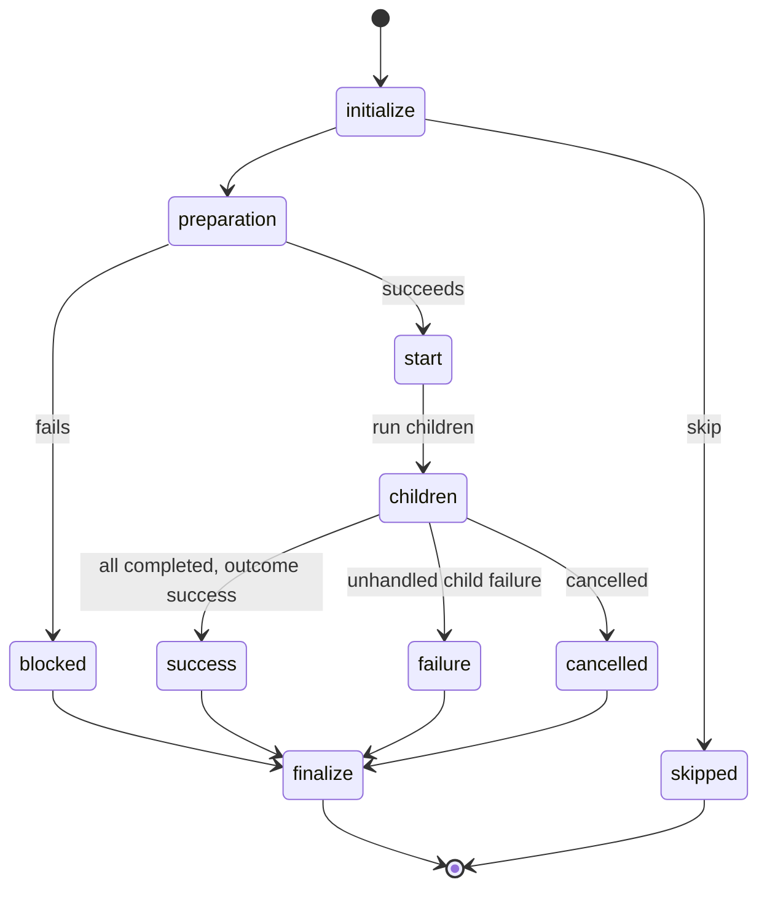

# Sequence containers

Claudine runs three **executable primitives**: a Markdown **document**, a
**group** of tasks, and a **sequence** of steps. Today only the document has
lifecycle events, groups are serial or parallel, sequences cannot nest, a task
needs its own `setup:`/`teardown:` mini-lifecycle, failure handling is split
between lifecycle events and a `fail_fast` flag that means different things at
different levels, and the values a sequence injects (`state`, `previous`,
`outputs`, …) share a namespace with the author's frontmatter.

This spec makes the two containers — groups and sequences — first-class
primitives with the same lifecycle events as a document, makes groups always
concurrent and lets sequences nest for ordered work, puts all failure
handling in lifecycle events (with `fail_fast` kept only as a group's "are
the legs atomic?" switch), adds a `cancelled` event, removes the budget
ledger (`claudine budget`, `claudine sequence --budget-ledger`), and moves
every built-in container value to three reserved roots: `seq`, `loop`, and
`group`.
An author gets one mental model: every primitive initializes, prepares, then
starts or is blocked; a started primitive succeeds, fails, or is cancelled,
and finalizes with the exceptions below. Every container returns a
result (an array for a sequence, a dictionary for a group); and a page reads
only the container it is directly inside.

`suggestions.md` in this directory is the 2026-09-27 input the original spec
was written from; it is kept as history and is not normative.

> **Examples use `with:`.** Task `params:` is renamed `with:` by
> 2026-10-26-task-inputs-and-providers, which lands after this spec. The
> examples here use the final spelling; until that spec lands the
> implementation and its tests spell it `params:`.

## Decided

Decided 2026-10-10 by the owner unless noted.

### 1. Primitives and nesting

| Primitive | Defined by | Runs |
|---|---|---|
| document | a Markdown file with frontmatter | its body through a provider, or `inline-compose` |
| group | a `group:` object, inline or in a `kind: group` / `kind: group-catalog` file | its legs (`tasks:`) **concurrently** |
| sequence | a document whose frontmatter has `sequence:`, a `kind: sequence` file, or a task's inline `sequence:` list | its steps in order |

**Groups are concurrent only.** A group keeps its name and always runs its
legs at the same time, admitted in declaration order when `max_parallel` caps
them. The `execution:` key is removed: `execution: parallel` and
`execution: serial` are both typed errors. The `parallel` error says to omit
the key; the `serial` error says ordered work is a sequence and shows the
nested-sequence spelling.

**Sequences nest.** A task may run a sequence, written like an inline group:

```yaml
sequence:
    - name: build
      sequence:                       # inline nested sequence
          - name: compile
            shell: just build
          - name: test
            shell: just test
    - name: release-notes
      sequence: "@sequences/notes.md" # nested sequence by file reference
    - name: lint-all
      group:                          # concurrent legs
          name: lint
          tasks:
              - name: rust
                shell: just lint
              - name: docs
                shell: just lint-docs
```

A file reference names any sequence document (Markdown with `sequence:`
frontmatter, or a `kind: sequence` file) and uses the full file-reference
grammar, including the `-> offset` and `::operator` suffixes `sequence:`
accepts today. An inline list follows the same step grammar as a root
sequence.

`sequence:` joins `prompt:`, `shell:`, `side_effect:`, `group:`, and `task:`
as an exclusive executable field: combining two on one entry is a typed
error. External `task:` expansion remains immutable and may contain either
container. Groups still require at least one leg; an empty sequence, including
an empty dynamic source, succeeds with `[]` and runs its own lifecycle once.
Sequence source discovery, offsets, operators, and string-step normalization
keep their existing behavior at every nesting level. A nested sequence
without a Markdown body requires every step to have an executable; an inline
sequence's body-only steps use its authoring sequence document's body.

**Any container may hold any container.** A group leg may be a sequence (the
way to do ordered work inside concurrency) or a group; a sequence step may be
a group or a sequence. The v1 rule "groups do not nest" is removed. Static
preflight walks every nested container transitively and rejects a reference
cycle with the complete chain, including sequence, task, group, and catalog
references. Cycle detection uses the active reference chain, not a global
visited-file ban: invoking the same reusable sequence twice is legal, and
two different groups in one catalog are different targets. References use
the existing request-scoped `biscuit-file` resolution and retain their
authoring-file origin for relative paths and file-touching actions.

**Where a container's own keys live.** A group's lifecycle events, its
`fail_fast`, and (from 2026-10-25-loops-and-flow-control) its `loop:` sit on
the group object beside `tasks:`. A sequence document's sit at its
frontmatter root beside `sequence:`. A task whose executable is an inline
`sequence:` list carries that nested sequence's lifecycle events (and later
its `loop:`) on the task entry beside `sequence:`; on any other task those
keys are a typed error.

For a referenced sequence, events belong in the target's frontmatter, not on
the referencing task. A prompt leg opts into sibling cancellation through its
prompt document; a container leg through its own container definition.
`shell:` and `side_effect:` tasks have no authored document lifecycle. Wrap
either in a group of one to add events or opt into sibling cancellation;
Ctrl-C still interrupts their processes. Presence of a valid `cancelled:`
key, including an empty stack, is the opt-in; it is not inherited from a
descendant.

**A sequence document's root events belong to the sequence.** In a document
that has `sequence:`, the root lifecycle events and `loop:` are the
sequence's. A step with no executable composes the document's body as today,
but runs no lifecycle events of its own (today the root events fire for
every body step).

### 2. Lifecycle events on every primitive

Documents, groups, and sequences all have the same lifecycle events, with
document semantics. They are how failures are handled at every level.

| Event | Document (today) | Group or sequence |
|---|---|---|
| `initialize` | before composition | when the container is reached, before its preparation. The root sequence's runs before static preflight. Shell-free, as for documents. `skip` here skips the whole container. |
| `start` | composition and preflight succeeded | the container's preparation succeeded (root sequence: static preflight passed; nested: its just-in-time preparation — re-reading its source, evaluating group `variables`); immediately before its first child starts |
| `blocked` | composition or preflight failed | the container's preparation failed; no child started |
| `success` | the provider finished and the verdict passed | every child completed and the container's outcome is success |
| `failure` | the provider or verdict failed | an unhandled child failure reached the container (section 3) |
| `cancelled` | **new** (section 4) | **new** (section 4) |
| `finalize` | always last | always last (section 5) |
| `loop` | the loop gate | the loop gate, from 2026-10-25-loops-and-flow-control |



Recovery in a container's `failure` event uses the same directives as a
document's. Existing setup restrictions still apply: `retry` in `initialize`
and `retry`/`resume`/`proxy` in a preflight `blocked` event raise the existing
typed setup-recovery error. This feature does not add recovery from denied
preflight. `proxy` from `initialize` remains a supported handoff.

- **`retry`** runs the container again from its beginning: a sequence from
  its first step, a group with all of its legs. All old legs must settle
  before a new attempt starts. `initialize` fires once per container
  invocation, not once per retry; each attempt has its own `start` and
  terminal event. An accepted `retry` re-enters immediately without running
  the failed attempt's `finalize`; `finalize` runs once, after the attempt
  that does not re-enter (section 5).
  `max_attempts` counts additional attempts and cannot be reset by re-entry;
  exhaustion keeps the failed outcome. A `retry.with` mapping is evaluated
  once in the source event and its values enter the container's runtime
  state for the new attempt, as the container's `with:` values; there is no
  separate retry overlay for a container. They are validated afresh and never
  persisted or written back into the source file.
- **What survives a container retry.** The failed attempt's results are
  discarded and its mutations are kept. Before the next attempt the
  container's child accumulator (`seq.outputs`) and group outcome records
  (`group.legs`, `group.succeeded`, `group.failed`, `group.cancelled`) are
  cleared, so the final result never contains duplicates from an abandoned
  attempt. Frontmatter and runtime mutations already applied to the
  container's state are kept, including those made by the failure handler
  that requested the retry and the retry's `with:` values. The rerun is
  therefore not a clean slate: children may read values an earlier attempt
  produced. No disk edits or other external effects are rolled back.
  For nested retries, an enclosing sequence's `seq.outputs` holds only the
  published results of its completed children: while a child container
  retries, nothing from its discarded attempts appears there, and its result
  is appended once, when it completes after its `finalize`. Exhausting
  `max_attempts` keeps the failed outcome, and the container publishes
  nothing.
- **`resume`** needs a live agent session; a container has none, so `resume`
  in a container event is the existing typed runtime error, as in
  `initialize`.
- **`proxy`** hands the container's place in the run to the target; the
  target's outcome becomes the container's outcome, and the container's
  remaining events, its `finalize` included, do not fire, exactly as for a
  document (section 5).

`--dry-run` fires no lifecycle events, for containers as for documents.
It preserves today's dry-run behavior recursively: it still runs shell tasks
and composition shell expansions against initial state, performs no provider
launch or inline write-back, and does not simulate runtime `set` mutations.
Help and docs must explain that shell work can have real effects.

### 3. Failure handling

**An unhandled failure anywhere stops execution.** A failure travels upward:
a task's own document gets its `failure` event first; if that does not
recover it (`retry`, `resume`, `proxy`), the failure reaches the enclosing
container's `failure` event; and so on up to the root, which exits `1`. Each
level's `finalize` runs on the way. A sequence never moves on to its next step
after an unhandled failure.

**`fail_fast` is a group key and nothing else.** It answers "are the legs
atomic?":

| `fail_fast` | When a leg fails |
|---|---|
| `true` (default) | the group fails. Running legs that opt into cancellation are cancelled (section 4); the rest run to completion and their state is not passed forward; legs not yet admitted never start. Once every leg has settled, the group's `failure` event fires. |
| `false` | the other legs keep working. Once every leg has completed, the group **always succeeds**, whatever each leg's outcome. `fail_fast: false` is the explicit handling of leg failures; the group's own events read which legs failed from `group.failed` (section 7). |

Here "always succeeds" means leg failures alone do not fail the group.
Preparation errors, errors in the group's own events, and Ctrl-C still fail
or cancel it. `stop` ends an event stack and keeps the current outcome; merely
logging a failure or using `stop` does not recover it.

**Atomic results, not reversible work.** A failed `fail_fast: true` group
publishes no leg mutations or output to its parent, including those from legs
that finished before the failure. Retain private leg state until settlement
and the group's terminal events and `finalize` have completed. A successful
`fail_fast: false` group keeps today's declaration-order merge of completed
legs' mutations, including failed legs; cancelled and skipped legs contribute
none. Its terminal events see that staged merge, and their own mutations are
included on publication. A group whose own `finalize` fails publishes neither
the staged leg mutations nor its result.

> **Reader's note:** withholding a failed atomic group's state is an intended
> change from today's group runner, which merges completed legs even when the
> group fails. File edits, shell commands, provider work, and notifications
> already performed cannot be rolled back. Authors who need compensation
> must provide cleanup in lifecycle events; `fail_fast` is not a filesystem
> transaction.

`fail_fast` is removed everywhere else: a sequence document's `fail_fast` and
the `--fail-fast` flag are typed errors naming the replacement, and Claudine
stops exporting `CLAUDINE_FAIL_FAST` to children. (A `loop:` block's
`fail_fast` is removed by 2026-10-25-loops-and-flow-control, which owns
loops.) Darkmatter
composition behavior that keyed off the effective `fail_fast` (mixed-string
leniency, …) behaves as it did under the old default, `true`.

**Continuing past a failure** is spelled as a group of one with
`fail_fast: false`:

```yaml
sequence:
    - name: optional-docs
      group:
          name: optional-docs
          fail_fast: false             # this step's failure does not stop the run
          tasks:
              - name: docs
                prompt: "@prompts/docs.md"
          finalize:
              - when: "length(group.failed) > 0"
                then:
                    - warn: "docs step failed; continuing"
    - name: release
      prompt: "@prompts/release.md"
```

**Timeouts are failures.** A `timeout` (wall-clock) or `step_timeout` (stream
silence) is a failure, handled through `failure` recovery (for example
`retry`). It never fires `cancelled`. A timed-out leg of a `fail_fast: true`
group is a leg failure like any other.

### 4. Cancellation: the `cancelled` event

`cancelled` is a new lifecycle event on every primitive.

- **Causes.** There are exactly two: a sibling failure in a `fail_fast: true`
  group, and Ctrl-C. A timeout is never a cancellation.
- **Sibling failure is opt-in.** When a `fail_fast: true` group fails, only a
  running leg that declares `cancelled` is cancelled. A running leg without
  `cancelled` is not cancelled: it runs to completion, its outcome is
  recorded in `group.legs`, and its state is not passed forward (its `set`
  mutations are not merged and its output is not published).
- **Ctrl-C always ends execution** (decided 2026-10-11), whether or not a
  page declares `cancelled`. It interrupts every running primitive as it does
  today (signal ladder). Each primitive whose lifecycle was entered runs its
  declared `cancelled` actions and then its `finalize`, after its descendants
  finish their cleanup; then the process exits `130`. A primitive
  without `cancelled` is still interrupted and still runs `finalize`. A
  second Ctrl-C keeps today's force-exit ladder and may cut those events
  short.
- **Cancelling a leg.** Cancelling a cancellable leg terminates its running
  child process, or for a container leg cancels its running children (whose
  own `cancelled` fires where declared). Then the leg's `cancelled` fires,
  then its `finalize`. Its outcome is `cancelled`.
- **`err`.** `cancelled` and the `finalize` after it read `err`, describing
  the cause: the sibling leg whose failure triggered it, or the interrupt.
- **Actions.** `cancelled` accepts communication, expression (`set`,
  side-effect verbs, expression functions), and `shell` actions, and the
  `stop` directive. `retry`, `resume`, `proxy`, `prep`, `skip`, `error`,
  `break`, and `defer` are typed parse errors there. A `shell` action runs only
  when cancellation happens after the primitive's `start` (the existing
  rule that lifecycle shells are disabled before preflight succeeds).
- **`finalize` still runs** after `cancelled`.

Cancellation stops admission first and waits for running descendants to settle
before invoking their owner's terminal events. An opted-in container leg
interrupts all its running descendants, including descendants without their
own `cancelled` stack; the opt-in belongs to the leg as a whole. A primitive
already finalized is not cancelled again. Preparation that has entered
`initialize` but not `start` still receives cancellation cleanup, with shells
disabled; an unadmitted primitive fires no events. Across concurrent siblings
cleanup may interleave, but every child's cleanup finishes before its parent's
cleanup starts. No ordering between sibling cleanup stacks is promised.

`stop` in `cancelled` only ends that stack. Cancellation remains terminal:
recovery directives in a following `finalize` cannot restart work or replace
the target, and must raise a typed cancellation-recovery error. Cleanup errors
are retained as secondary diagnostics; Ctrl-C still exits `130`, and sibling
cancellation still records `cancelled`. A timeout caused by a cleanup shell
is a cleanup error, not a new cancellation or a recovered run. Cancellation
causes use the existing structured diagnostic contract, with the originating
group and leg identified for sibling failure; they are not unstructured
strings. If failures race, the first observed unhandled failure triggers
cancellation and is recorded as its cause, even if other legs later fail.

```yaml
group:
    name: fan-out
    fail_fast: true
    tasks:
        - name: slow-review
          prompt: "@prompts/review.md"   # declares `cancelled:`, so it is cancelled
        - name: quick-check
          shell: just check              # no `cancelled:`; runs to completion
    failure:
        - warn: "failed: {{ as_csv(group.failed) }}; cancelled: {{ as_csv(group.cancelled) }}"
```

### 5. `finalize` always runs, except after `skip`, `proxy`, `retry`, or `resume`

`finalize` is the last event of every primitive whose lifecycle was entered,
including a primitive blocked before `start`. Success,
failure, `blocked`, cancellation, and (from 2026-10-25-loops-and-flow-control)
`break` all run it. `skip`, `proxy`, `retry`, and `resume` are the exceptions,
and the only ones:

- `skip` from `initialize`: a skipped primitive fires no further events,
  `finalize` included.
- `proxy` (decided 2026-10-11, keeping today's behavior): the primitive that
  hands off to a proxy target does not run its own `finalize`; the target
  runs its own lifecycle, including its own `finalize`.
- `retry` and `resume`: an accepted recovery re-enters immediately without
  running the current attempt's `finalize`. The re-entered attempt runs its
  own events; `finalize` runs at the end of the attempt that finishes without
  re-entering. Authors who need cleanup before a retry put it in the
  `failure` stack ahead of the `retry` directive.

A container's result is published to the enclosing accumulator only after its
`finalize` completes; if `finalize` raises an error, the container fails and
publishes nothing.

Exactly-once means once for an invocation that does not end in `skip` or
`proxy`, including pre-start catch paths: attempts that end in `retry` or
`resume` run no `finalize`, and the attempt that does not re-enter runs it
once. A terminal-event error
follows the existing catch routing; an error in `finalize` never re-enters
that same `finalize`. Preserve the original failure as primary and attach
cleanup failures as secondary diagnostics; a cleanup error after otherwise
successful work turns that work into failure. A malformed primitive rejected
before its lifecycle can be parsed cannot run its own events; the initialized
enclosing container receives the preparation failure instead.

This matches the shared lifecycle dispatch in
[runtime.rs](../../lib/src/composition/lifecycle/runtime.rs), which already
re-enters immediately on `retry` or `resume` without requesting `finalize`;
documents keep that behavior and containers adopt it.

### 6. Task `setup:` and `teardown:` are removed

Every primitive now has lifecycle events, so the per-task mini-lifecycle goes.
A task carrying `setup:` or `teardown:` is a typed error that names the
replacement:

- **instead of `setup:`**, a preceding task (a `side_effect:` task for an
  action, a `shell:` task for a command);
- **instead of `teardown:`**, a group's `finalize` — wrap a single task in a
  group of one.

```yaml
# before
- name: review
  prompt: "@prompts/review.md"
  teardown:
      - when: "ctx.dirty_files"
        then:
            - message: "I've made a mess of the place"

# after
- name: review
  group:
      name: review
      tasks:
          - name: review
            prompt: "@prompts/review.md"
      finalize:
          - when: "ctx.dirty_files"
            then:
                - message: "I've made a mess of the place"
```

### 7. Built-in values live on `seq`, `loop`, and `group`

`seq`, `loop`, and `group` are reserved roots (reserved by
2026-10-18-fm-namespace; `loop.*` replaced `_loop_*` in
2026-10-20-lifecycle-grammar). This spec gives `seq` and `group` their
contents and removes the `state` root. A bare name is a frontmatter
property (`fm`), except these reserved roots, which win; a frontmatter
property named `seq`, `loop`, or `group` is read as `fm.seq`, `fm.loop`,
`fm.group`.

**Innermost only.** A page sees only the loop, group, and sequence it is
inside — the nearest ancestor of each kind, never a second ancestor of that
same kind.
Coordination across levels goes through frontmatter. In a container's own
lifecycle events the root of its kind names the container itself: a group's
`failure` reads its own `group`, a sequence's `finalize` its own `seq`. A
document in a group in a sequence reads `group` (that group) and `seq` (that
sequence).

Shadow the complete root, not individual fields: an inner sequence with empty
outputs cannot fall back to outer outputs. Leaving a nested container restores
the enclosing bindings. An absent group keeps today's typed outside-group
error; an absent loop keeps its existing availability rules. These runtime
roots are not frontmatter and cannot be assigned through `set` or persisted
by inline-compose. `fm.group` remains ordinary authored frontmatter even
outside a group.

#### `seq`

| Value | Meaning |
|---|---|
| `seq.<field>` | the current step's authored fields: a step `{ name: Bob, age: 32 }` is read as `seq.name`, `seq.age` |
| `seq.id` | the step's id: dasherized `name`, suffixed `-2`, `-3`, … to be unique |
| `seq.index` | one-based position |
| `seq.count` | total steps |
| `seq.is_first`, `seq.is_last` | boundary flags |
| `seq.previous`, `seq.next` | the neighboring step rows, whole (`seq.previous.name`, `seq.next.id`); `null` at the ends |
| `seq.outputs` | the sequence's results so far: one entry per executed child, in order (section 8) |
| `seq.run_id` | one collision-resistant token per invocation, the same in every nested sequence of that invocation |

The generated values are read-only. In a sequence's own events the step
fields and step-position values are `null`; `seq.outputs` and `seq.run_id`
are set, so a sequence's `success` or `finalize` reads its whole result as
`seq.outputs`.

`{{ seq }}` in string context is shorthand for `{{ seq.name }}`; a whole-value
`{{ seq }}` in an expression context yields the object. The same shorthand
applies to `seq.previous` and `seq.next`; an absent neighbor stays `null`.

```md
The person's name is {{ seq }}, age {{ seq.age }}; next up is {{ seq.next }}.
```

A step entry that authors a generated name — `id`, `index`, `count`,
`is_first`, `is_last`, `previous`, `next`, `outputs`, or `run_id` — is a typed
error naming the step and key. Task keys stay reserved as today, with
`sequence` added and `setup`/`teardown` now removed-grammar errors.
Neighbor rows contain authored step data and generated identity/position
fields, not recursively embedded neighbors or live output accumulators.
IDs are unique within each sequence; different nested sequences may reuse
an ID, so diagnostics identify the containing sequence and full task path.

Standalone `compose` and `inline-compose` keep a `seq` root holding only
`seq.outputs`, with its current standalone contents, so a prompt written with
`{{ last(seq.outputs) }}` behaves the same standalone and mid-sequence; every
other `seq.*` value is `null` there.

**Hard rename.** Every old name is gone, with a typed error naming the
replacement. The error is raised where an expression reads the old name and
the reading document neither declares nor is supplied a frontmatter property
of that name; a document that defines its own `previous` reads it as normal.

Check parsed root reads, including static bracket access, across body,
conditions, lifecycle operands, and shell discovery; do not search literal
text to generate these errors. Property presence, including a declared or
supplied `null`, is enough to preserve ordinary frontmatter behavior.
`fm.previous` explicitly asks for frontmatter and is never a renamed runtime
root. Do not classify unrelated members such as `ctx.state` or quoted strings
as legacy globals. Removing generated frontmatter overlays also removes
implicit access through `fm.outputs` and `fm.state`: callers must migrate
those reads to `seq` unless they refer to their own authored properties.

| Old | New |
|---|---|
| `state` (the step object), `state.<field>` | `seq`, `seq.<field>` |
| `state.id`, `state.index`, `state.count` | `seq.id`, `seq.index`, `seq.count` |
| `previous`, `previous_state` | `seq.previous` |
| `next`, `next_state` | `seq.next` |
| `outputs` | `seq.outputs` |
| `sequence_id`, `state.sequence_id` | `seq.run_id` |
| `step` | `seq.index` |
| `total_steps` | `seq.count` |
| `is_first`, `is_last` (root), `state.is_first`, `state.is_last` | `seq.is_first`, `seq.is_last` |

#### `group`

| Value | Meaning |
|---|---|
| `group.<variable>` | the group's `variables`, as today |
| `group.legs` | a map keyed by leg name; each entry is `{ name, outcome, output, err }` |
| `group.succeeded`, `group.failed`, `group.cancelled` | lists of leg names with that outcome, in declaration order |

- **Every leg has a name**, unique within its group. A missing or duplicate
  leg name is a typed preflight error naming the group.
- **`outcome`** is one of `succeeded`, `failed`, `cancelled`, `skipped`. A leg
  that never started because a `fail_fast: true` group failed first is
  `cancelled` and fired no events. A leg skipped by `skip` (or, later, by a
  false `when:`) is `skipped`.
- **`output`** is the leg's result (section 8), including the partial stdout
  of a failed leg; `null` for a leg that never ran.
- **`err`** is the leg's structured failure or cancellation cause, or `null`
  for success and skip. An unadmitted cancelled leg records the triggering
  sibling failure even though it fires no events.
- `group.legs` and the summary lists are populated in the group's own
  `success`, `failure`, `cancelled`, and `finalize` events (and its loop
  gate), once every leg has settled. In its `initialize`, `start`, and
  `blocked` they are an empty map and empty lists. Inside a leg, `group`
  holds the variables only: concurrent legs cannot see each other's results.
- A `variables` entry named `legs`, `succeeded`, `failed`, or `cancelled` is a
  typed error.
- Iterating the map with `keys()`/`values()` arrives with
  2026-10-28-schema-enhancements; until then the summary lists cover the
  common cases (`length(group.failed) > 0`, `as_csv(group.cancelled)`) and a
  single leg is read by name (`group.legs.lint.output`).

Each leg also fires its own events, as any primitive does.
Shell and side-effect legs use the wrapper rule in section 1 to author events.

### 8. Container results

A sequence returns an **array**; a group returns a **dictionary** keyed by leg
name (in declaration order). A document or `shell:`/`side_effect:` task returns
its captured stdout as a string, as today. Nesting composes: a sequence inside
a sequence is one element that is itself an array; a group inside a sequence is
one element that is a dictionary.

```yaml
sequence:
    - name: A
      shell: echo "A out"
    - name: inner
      sequence:
          - { name: X, shell: echo "X out" }
          - { name: Y, shell: echo "Y out" }
    - name: checks
      group:
          name: checks
          tasks:
              - { name: lint, shell: echo "lint out" }
              - { name: test, shell: echo "test out" }
    - name: B
      shell: echo "B out"
```

`seq.outputs` at the end is
`["A out", ["X out", "Y out"], { lint: "lint out", test: "test out" }, "B out"]`.
A parallel group's entry changes from today's declaration-ordered array to
this dictionary.

- A nested sequence has its own `seq.outputs`, starting empty, holding only its
  own children's results; the enclosing sequence receives the finished array
  as one entry.
- Entries are data, exactly as today: stored raw and never re-evaluated.
- A skipped child appends nothing to a sequence. A failed child appends
  nothing to a sequence. In a group dictionary every leg name is a key; a leg
  that never ran or was skipped maps to `null`. An executed failed leg retains
  its partial result in a successful `fail_fast: false` group's dictionary.
- A `fail_fast: true` group that failed appends nothing; a `fail_fast: false`
  group that finishes without an error in its own lifecycle appends its full
  dictionary.

Keep array/object results as native values through the task result, runtime
accumulator, and expression adapters; do not flatten them to stdout or encode
them as JSON strings. Human-readable rendering is separate from stored data.
Shell-command trailing newlines retain today's capture behavior; the example
above abbreviates those newlines. A failed nested container can expose its
completed children's partial result through its parent's `group.legs` for
diagnosis, but that result is not published to `seq.outputs`.

### 9. Lift-ready event model

`cancelled` and `finalize` are document-lifecycle events that
2026-10-27-darkmatter-lifecycle-ownership moves to Darkmatter. This spec
implements them in Claudine, written so that move changes no behavior: the
event names, their order, the `finalize` guarantee with its `skip`, `proxy`,
`retry`, and `resume` exceptions, the
`cancelled` action set, and the container event table live in the lift-ready
parser and action-model slice (`claudine/lib/src/composition/lifecycle/`
`parse.rs`, `action_shape.rs`, `actions.rs`, `validate.rs`, `signatures.rs`),
which imports no Claudine runtime types. What triggers a cancellation (a group
policy or a signal) stays in Claudine's runtime and reaches the event
model through a host-neutral "cancel this primitive with this cause" call.

### 10. The budget ledger is removed

Decided 2026-10-11. The budget ledger (added 2026-09-17) is removed
completely: the `claudine budget` command with all of its subcommands
(`init`, `grant`, `resume`, …), the `claudine sequence --budget-ledger <PATH>`
option, the ledger code, its exit codes `76` (exhausted) and `77` (blocked),
its docs, and its shell completions. Nothing replaces it in Claudine. A run's
limits are its timeouts (`timeout`, `step_timeout`), which are failures
(section 3), and Ctrl-C, which is a cancellation (section 4). After the
removal:

- `claudine budget …` is an unknown-subcommand usage error, like any other
  unknown subcommand.
- `claudine sequence --budget-ledger <PATH> …` is an unknown-option usage
  error.
- Exit codes `76` and `77` are no longer produced or documented by Claudine.

Messenger's research refresh is the known other user; the repository-wide
migration search must verify that no additional consumer remains. Its use of the ledger is
removed with it: `messenger research prepare` no longer creates a ledger
(`claudine budget init … --exclusive-lock …`) and no longer passes
`--budget-ledger` to `claudine sequence`, and every messenger behavior that
reads the ledger goes: the `LedgerView` read of `budget.json`, the ledger
resting states applied to a run record (the `exhausted` run status, and the
`interrupted`/`stopped` derivation from the ledger), the `RefreshError::Ledger`
refusal and its `claudine budget grant`/`resume` guidance, the ledger-lock
check in cleanup, the ledger line in `messenger research runs`, and the
"within the same budget" wording of `--resume`.

Removing the ledger also removes its shared `fleet.lock`, runtime liveness
signal, and crash-to-interrupted transition. Those are behavior changes,
not merely obsolete command arguments. Preserve Messenger's run-record
validation, stage checks, resume limit, preparation lock, and refusal to
promote incomplete research. Do not delete unrelated locks or timeout limits.
Decided 2026-10-11: Messenger keeps its run protection itself, without a
budget ledger. A Messenger-owned runner holds an OS-backed fleet lock (one
research run at a time) for the whole execution and records completion or
interruption (`finished`, `interrupted`, `stopped`) in its existing run
record; the per-refresh cap on agent runs stays. Cleanup and promotion are
refused while a run is live. An `active` record whose runner no longer holds
the lock is a stale run, recovered explicitly (the record is marked
`interrupted`), never silently. This replaces the ledger lock path before
that path is deleted. Existing run
records must remain readable or produce an actionable migration error before
any run is launched or deleted; do not silently discard old ledger artifacts
or reinterpret an old `exhausted` record as successful research.

## Requirements

1. **Parser.** Accept the container lifecycle events in the places section 1
   lists; `cancelled` everywhere events are accepted, with the section 4
   action set; `fail_fast` on group objects only; the inline `sequence:`
   executable. Typed errors for: `execution:`; `fail_fast` outside a group;
   `--fail-fast`; task `setup:`/`teardown:`; container event keys on a task
   that is not an inline sequence; missing or duplicate leg names; reserved
   step keys; reserved group variable names; the renamed names of section 7.
2. **Runtime.** One container runner drives groups and sequences through the
   section 2 event order using Claudine's existing
   [LifecycleRunGuard](../../lib/src/composition/lifecycle/mod.rs), which records
   event delivery and prevents duplicate terminal cleanup (extended with
   `cancelled`), so every primitive has the same exactly-once guarantees.
   Failure propagation follows section 3; cancellation section 4; results
   section 8. Declaration-order state merge, no interactivity in concurrent
   legs, the write-back collision preflight error, process isolation, and the
   concurrent output rendering all keep their current rules for group legs,
   including legs that are sequences. Snapshot isolation is defined for
   nested sequences as follows: each leg gets a private in-memory runtime
   state branched from the group-start state, so a leg's nested steps see
   their own earlier mutations and never a sibling's. The discovered task
   graph stays frozen, but prompt sources are reread from disk at their
   normal preparation boundaries, so a later nested step can observe file
   edits made by a sibling leg or by its own earlier steps. Isolation covers
   in-memory bindings only, not the filesystem; write-back collision
   rejection is retained. Docs state this limit explicitly.
3. **Preflight.** Static preflight walks nested sequences and groups,
   validates every container's events, and approves their shell commands
   (late values through 2026-10-23-shell-template-approval, whose late roots
   are now `seq.outputs`, `loop.*`, and `group.*`). Shell commands in container
   events read the container's own root values as late values.
   Freeze discovered task graphs for the invocation, and retain transitive
   write-back collision checks across nested containers. A reread or proxy
   target introducing an unapproved command is refused after approval closes;
   concurrent descendants never prompt. First-task resolved-value approval
   follows the execution position through the whole invocation
   (2026-10-23-shell-template-approval, section 13): only a task along an
   all-first-step ancestry, before any earlier executable work, qualifies; a
   group that is the first task qualifies with all its legs; a nested
   sequence that is the first task qualifies only for its own first task,
   recursively; container terminal-event commands (such as a container's
   `finalize`) and commands reading `group.*` are typed templates. This feature does not make `err`,
   `timing`, or `current.*` legal in sequence shell commands.
4. **Bindings.** `seq`, `loop`, and `group` resolve innermost-only through
   Claudine's [binding catalog](../../lib/src/composition/lifecycle/bindings.rs),
   which uses Darkmatter's shared binding view for both validation and runtime
   expressions; the event availability table in
   `lifecycle.md` gains `cancelled` and the container events.
5. **Schemas.** Claudine's schemas (2026-10-21-claudine-schemas) gain the
   `cancelled` event, typed with the section 4 action set, on every primitive;
   the `claudine.yaml` payload drops the document-level `fail_fast` and the
   generated sequence overlays (`state`, `previous`, `next`, `outputs`,
   `sequence_id`, `previous_state`, `next_state`, `step`, `total_steps`, root
   `is_first`/`is_last`). Their replacement fields belong to the `seq` runtime
   root; the old individual names are not newly reserved. Update existing
   group, task, and lifecycle schema partials and their editor-facing
   completions for the grammar landing here; do not defer validation of
   nested containers to a later feature. The `sequence.yaml` trigger schema is written by
   2026-10-26-task-inputs-and-providers.
6. **Migration sweep.** Every shipped prompt, fixture, test, doc page, and the
   `claudine` skill that reads `state`, `previous`, `next`, `outputs`,
   `sequence_id`, `previous_state`, `next_state`, `step`, `total_steps`, root
   `is_first`/`is_last`, or uses `execution:`, `fail_fast` outside a group,
   `--fail-fast`, or task `setup:`/`teardown:` is migrated. Search the whole
   repository; absence from shipped prompts alone is not enough. The
   route-drift fixture under `claudine/cli/tests/fixtures/` is re-derived and
   its hash refreshed if a prompt in that route changes.
   Classify search hits by behavior: migrate runtime-global reads and removed
   grammar, while preserving legitimate authored properties, unrelated code,
   and historical spec snapshots. Audit `fm.outputs`/`fm.state` reads too.
7. **Docs.** `sequences.md` (steps, step state, reserved keys, groups, outputs,
   fail-fast, out-of-scope list), `lifecycle.md` (event table, availability
   table, state machine), `flow-control.md`, `flow-control-reference.md`,
   `frontmatter-properties.md`, `composition.md`, and `timeouts.md` describe
   the behavior above, with Mermaid diagrams for the container event order and
   failure propagation. No page links to or names a spec.
8. **Budget ledger removal (section 10).**
   - Delete the ledger code. `rg -l -i 'budget_ledger|BudgetLedger|budget-ledger' -t rust`
     lists 12 files at the time of writing: in `claudine/cli`,
     `src/budget/mod.rs`, `src/budget/model.rs`, `src/budget/tests.rs`,
     `src/commands/budget.rs`, `src/commands/sequence.rs` (the option and its
     plumbing), `src/completion/engine/tests.rs`,
     `src/commands/wrap/exec/termination/windows.rs` (comments that cite the
     ledger), `tests/l1/sequence_budget.rs`, `tests/l1/completion_ownership.rs`,
     and `tests/common/owned_value_options.rs`; in `messenger`,
     `lib/src/research/refresh/prepare.rs` and `lib/tests/research_refresh.rs`.
     Also remove the ledger's other touch points the search does not name
     (the `budget` subcommand registration, `BUDGET_EXHAUSTED_EXIT_CODE` /
     `BUDGET_BLOCKED_EXIT_CODE`, the ledger hooks in
     `claudine/cli/src/commands/wrap/harness_orch/loop_control.rs`), and in
     messenger the ledger readers in `lib/src/research/refresh/state.rs`,
     `mod.rs`, `check.rs`, `select.rs`, `promote.rs`, `cleanup.rs`, and
     `cli/src/research_lifecycle.rs`. Delete tests whose only subject is the
     ledger; edit the others to drop their ledger cases.
   - Shell completions: the `budget` subcommand and `--budget-ledger` leave
     the completion engine, its owned-value option tables, and every
     generated completion script.
   - Docs: delete `claudine/docs/cli/budget.md`; remove the ledger from
     `claudine/docs/cli/sequence.md` (the option row), `claudine/README.md`,
     `claudine/docs/topics/completions/shell-completions.md` (the
     `sequence --budget-ledger` mention only; its candidate and wall-clock
     "budget" wording is unrelated and stays), `claudine/docs/dependencies.md`
     and `docs/dependencies.md` (the "Budget Ledger Process Identity" text,
     keeping the `sysinfo` edge for its remaining user),
     `messenger/cli/README.md`, `messenger/docs/user-guide.md`, and the
     `claudine` and `messenger` skills. Remove exit codes `76` and `77` from
     every exit-code table. Add a dated entry to
     `.claude/skills/claudine/timeline.md`.
   - Dependencies: if removing the ledger leaves a crate unused in
     `claudine-cli` or `messenger`, remove it and update the dependency docs.

## Out of scope

- Loops on documents, groups, and sequences; `break`; `prep`; `when:` on
  tasks; and the defect that **a looping document placed in a sequence runs
  one iteration and reports success**. That defect is a loop behavior and is
  fixed in 2026-10-25-loops-and-flow-control, which owns uniform loops; a
  group carrying `loop:` stays rejected until that spec lands.
- `params:` → `with:`, per-task provider selection, and the `sequence.yaml`
  schema: 2026-10-26-task-inputs-and-providers.
- Moving lifecycle event ownership to Darkmatter:
  2026-10-27-darkmatter-lifecycle-ownership.
- `keys()`/`values()`: 2026-10-28-schema-enhancements.
- Persisted checkpoint and resume; implementing `defer`.

## Acceptance criteria

All L1 unless noted. Tests use `CliProcessFixture` with a private CWD and
home, stub providers that record each prompt, and `PLAYA_DRY_RUN` with a
private spool (asserting no audio was published); none launches a real
provider, changes the developer's Git index, or focuses a window; all are
portable to macOS, Linux, native Windows, and WSL2. `just test`, `just lint`,
and (for affected integration behavior) `just test-l2` are green in
`claudine/`. No new CI cell.

1. **Nesting.** The section 8 example runs and its final `seq.outputs` equals
   the shown value; an inline nested sequence and the same steps by file
   reference produce identical results; a sequence file reaching itself is a
   preflight cycle error naming the chain; a group leg that is a sequence runs
   its steps in order while sibling legs run concurrently.
2. **Removed keys.** `execution: serial`, `execution: parallel`, sequence-level
   `fail_fast`, `--fail-fast`, task `setup:`, and task `teardown:` each raise
   their typed error with the replacement before anything runs.
3. **Container events.** For a group and a sequence (root and nested): the
   event order of section 2 on success, on an unhandled child failure, on a
   preparation failure (`blocked`), and on `skip` (no further events, no
   `finalize`), each `finalize` exactly once.
4. **Failure propagation.** A failing document with no recovery fails its
   enclosing group and then the root sequence (exit `1`), later steps do not
   start, and every level's `finalize` runs innermost first; a `retry` in the
   group's `failure` re-runs every leg without running the failed attempt's
   `finalize` and, on success, the sequence continues with the group's
   `finalize` having run exactly once;
   `resume` in a container event raises the typed no-session error.
5. **`fail_fast`.** With `true`: a leg failure cancels a leg that declares
   `cancelled` (its child is terminated; `cancelled` then `finalize` fire),
   lets a leg without it finish without merging its state, never starts an
   unadmitted leg (outcome `cancelled`, no events), and fires the group's
   `failure`. With `false`: the group succeeds after a leg fails, and its
   `finalize` reads the failed leg in `group.failed`.
6. **Timeouts.** A leg that hits `timeout` fails (its `failure` fires and can
   `retry`) and never fires `cancelled`.
7. **Ctrl-C.** An L2 test interrupts a running sequence with a group in which
   one running leg declares `cancelled` and one does not: execution ends
   (no later step starts and the leg without `cancelled` does not run to
   completion), every started primitive declaring `cancelled` runs those
   actions before its `finalize`, every started primitive runs `finalize`
   innermost first, and the process exits `130`.
8. **`group` root.** `group.legs`, `group.succeeded`, `group.failed`, and
   `group.cancelled` hold the section 7 values in the group's terminal events
   and are empty in `start`; a leg cannot read sibling results; missing and
   duplicate leg names and a reserved variable name are typed errors.
9. **`seq` root.** Every `seq.*` value resolves as specified on the first,
   middle, and last step; `{{ seq }}` renders the name and a whole-value
   `{{ seq }}` yields the object; a nested sequence's `seq` is its own, its
   `seq.outputs` starts empty, and `seq.run_id` matches the outer; a step
   authoring any reserved generated key fails naming the step and key.
10. **Rename errors.** Each old name in the section 7 table raises the typed
    error naming its replacement; a document that declares its own `previous`
    reads it without error.
11. **Innermost only.** A document inside a group inside a nested sequence
    inside an outer group reads the inner group and the inner sequence only.
    An empty inner accumulator never reads the outer accumulator; after return
    the next outer step reads its restored roots. Loop integration is tested
    by the subsequent loops feature, not required to land this feature.
12. **Body steps.** In a sequence document with a body and root `success`,
    the `success` fires once for the sequence, not once per body step.
13. **Results publication.** A container whose `finalize` raises an error
    publishes nothing to the enclosing `seq.outputs`.
14. **Lift-ready.** A guard test asserts the lifecycle parser and
    action-model modules import no Claudine runtime types (settings, provider
    layer, messaging, TTS/Playa).
15. **Budget ledger gone.** `claudine budget init x.json` fails as an unknown
    subcommand and `claudine sequence --budget-ledger x.json run.md` as an
    unknown option, each with a usage error and without running anything;
    `rg -n -i 'budget_ledger|BudgetLedger|budget-ledger|claudine budget'`
    outside `**/features/**`, `**/fixes/**`, and `timeline.md` returns no
    hit; `claudine/docs/cli/budget.md` does not exist; no Claudine source or
    doc defines exit code `76` or `77`; generated completion scripts contain
    neither `budget` as a subcommand nor `--budget-ledger`; and
    `just test` and `just lint` pass in `messenger/` with
    `messenger research prepare` emitting a `claudine sequence` command that
    has no `--budget-ledger` and no `claudine budget init` step.
16. **`proxy` skips the source's `finalize`.** A container whose `failure`
    returns `proxy` does not run its own `finalize`; the target's `finalize`
    runs.
17. **Shipped prompts.** `shipped_prompt_contract`,
    `shipped_prompt_route_drift`, and the shipped-prompt lifecycle walker pass
    after the migration; a repository-wide search for the removed names and
    keys finds no remaining use as removed runtime globals or task grammar.
    Legitimate authored properties, unrelated symbols, snapshots, and
    `timeline.md` are classified rather than required to disappear.
18. **Edge cases.** An empty sequence returns `[]` with one lifecycle; a
    skipped leg maps to `null` without events after `initialize`; reusing a
    sequence twice succeeds while mixed task/group/sequence reference cycles
    fail with their chain; nested same-target inline writes are rejected.
19. **Cleanup and state.** A preparation failure before `start` finalizes
    once with shells disabled. A successful group whose `finalize` fails
    publishes no result or leg mutations. A failed atomic group publishes
    none of its successful siblings' state; a non-atomic group retains
    completed failed-leg mutations in declaration order. An opted-in nested
    container cancels all descendants; cleanup errors preserve cancellation,
    and a recovery directive after cancellation never launches more work.
20. **Retry retention, recovery cleanup, and nested rereads.**
    - A sequence completes two children, sets a frontmatter value, fails on
      its third child, and its `failure` sets another value and returns
      `retry`: the next attempt starts with empty `seq.outputs`, both set
      values readable, and its final result has exactly one entry per
      child. The same holds after two retries; exhausting `max_attempts`
      keeps the failed outcome and publishes nothing. A retried group starts
      with empty `group.legs`/`succeeded`/`failed`/`cancelled`.
    - A nested sequence that retries inside an enclosing sequence: the
      enclosing `seq.outputs`, read from the next sibling, holds only the
      completed children's results and the nested sequence's single final
      result.
    - `retry` from `failure` on a document, a group, and a sequence, and
      `resume` on a document, re-enter without running `finalize`; the
      final attempt runs `finalize` exactly once, and no work is launched
      twice. Event recordings show the failed attempt's terminal event
      followed directly by the next attempt's events.
    - Two legs of a group are nested sequences coordinated by deterministic
      fixture signals: leg A's second step sees leg A's first-step mutation
      but not leg B's in-memory mutation, and does see a file leg B wrote
      before A's second step was prepared. A write-back collision between
      the legs is still rejected in preflight.
21. **Nested approval positions.** With an outer first task that is a group,
    every leg's commands are offered resolved-value approval; with an outer
    first task that is a nested sequence, only its own first task is, and its
    second task's command is a template; the first group's `finalize` command
    and a command reading `group.*` are templates; a command in a task after
    an outer `set` is a template filled with the post-`set` value at run
    time; no approval prompt appears once execution has begun.
22. **Messenger run protection.** Focused Messenger tests cover a live runner
    (a second run is refused while the fleet lock is held), an interrupted
    runner (recorded `interrupted`), a stale `active` record recovered
    explicitly, an old ledger-era `exhausted` record (readable or an
    actionable migration error, never treated as successful research), and
    cleanup and promotion refused during a live run. No CI environment or
    performance study is added.
23. **Container `retry.with`.** A container `failure` event returning
    `retry` with `with: { attempt_note: "second" }` re-runs the container from
    its start with `attempt_note` readable in its runtime state; the source
    file is unchanged afterward.

## Open questions

None.
