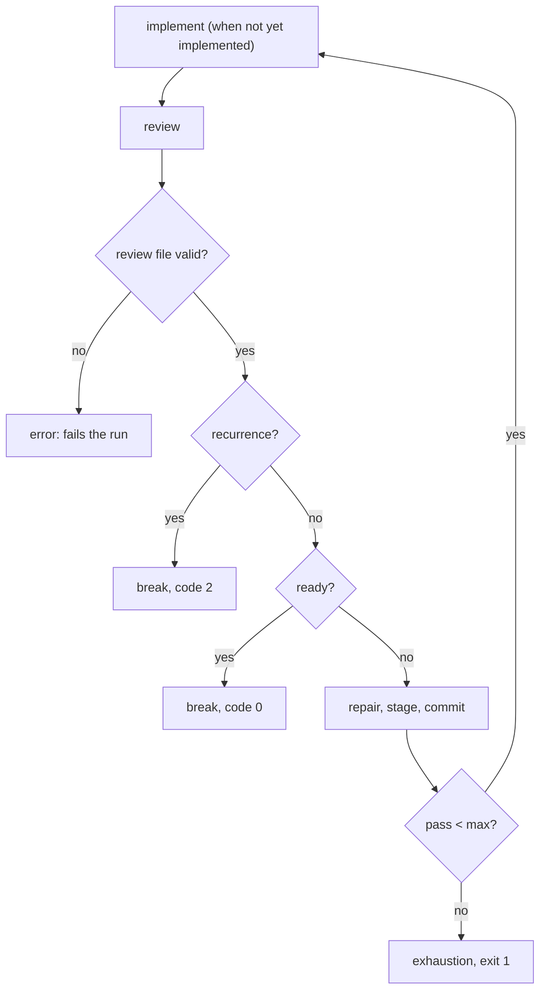

# Loops and flow control

Only a document can loop today, and a looping document placed in a sequence
runs **one** iteration and reports success. A cycle of two prompts must be
unrolled by hand (the review/repair draft was 21 steps for a cap of five),
every task after a "done" signal needs its own guard, a helper prompt cannot
be called and returned from, and `--dry-run` commits for real when a sequence
has a `shell: git add .` step.

This spec gives every executable primitive — document, group, sequence — the
same `loop:`, adds the `break` directive that leaves a loop, the `prep`
directive that calls another primitive and returns, and `when:` on any task;
migrates `prompts/review-loop.md` onto them; and stops `--dry-run` from running
`shell:` tasks.

The primitives, container lifecycle events, failure handling, `cancelled`,
and the `seq`/`loop`/`group` roots are defined by
2026-10-24-sequence-containers; read its sections 2–7 first.

## Decided

Decided 2026-10-10 by the owner, carrying forward the 2026-09-27 decisions
(every loop behaves the same; the condition is checked after the run; `when:`
decides whether a primitive runs, `loop:` whether it runs again; `break`
leaves a loop; `prep` calls and returns).

### 1. One `loop:` on every primitive

```yaml
loop:
    until: <expr>        # or while: <expr>; exactly one
    action: <mutation>   # optional; `actions` is an alias; applied only when the loop continues
    max: <number>        # optional positive integer; default 100
    # lifecycle concerns: loose verb keys, or a `gate:` list, never both
```

| Primitive | Where `loop:` goes |
|---|---|
| document | its frontmatter root, as today |
| group | the group object, beside `tasks:` |
| sequence document | its frontmatter root, beside `sequence:` |
| inline nested sequence | the task entry, beside `sequence:` |

The loop-gate grammar is 2026-10-20-lifecycle-grammar's: loose verb keys (a
root dictionary bundle) or a `gate:` list; mixing them, or `when` at the loop
root, is a parse error. The existing `action` shapes (string, object, list),
mutation operations, and atomic action staging are unchanged.

- **No `fail_fast` on a loop.** `fail_fast` is a group key only. A `loop:`
  block carrying it is a typed error naming the replacement: a failed
  iteration is an unhandled failure unless a `failure` event handles it (the
  iteration's document's, or the looping container's).
- **Cap.** A templated `max` is resolved once before the loop starts; zero,
  negative, fractional, unresolved, and overflowing values are typed errors.
  The existing runtime option and environment precedence over the authored
  cap, and the default of 100, are kept; overrides apply to each loop
  independently. A `retry` within an iteration does not advance its count.
- **Unknown keys** under `loop:` are rejected, with today's `did you mean`
  hints.

### 2. Loop semantics, the same everywhere

- **The condition is checked after the run.** An iteration runs, its events
  through `finalize` fire, the loop gate fires, and then `until`/`while` is
  evaluated against current values and fresh file reads. A loop therefore
  runs at least once unless its task's `when:` is false or its `initialize`
  skips.
- **`action`** is applied only if another iteration will run: after a
  continuing condition, before the next iteration, never after the cap, a
  `break`, a cancellation, or a failure that stops the run. On a document it
  mutates the in-memory frontmatter; on a group or sequence it mutates the
  container's runtime `set` layer, which every child reads as ordinary
  frontmatter keys.
- **Lifecycle per iteration.** A looping primitive runs `initialize` once per
  invocation; `start`, its terminal event (`success`, `failure`, `blocked`, or
  `cancelled`), and `finalize` once per iteration; then the loop gate. This
  is today's document rule, applied to containers through the same
  `LifecycleRunGuard`. When an outer loop repeats a child, each pass is a new
  child invocation with its own `initialize` and a fresh inner count; a child
  skipped on one outer pass may run on the next.
- **Live re-read.** Prompt content and frontmatter are re-read at the
  existing preparation boundaries. The step graph and loop configuration are
  frozen for the invocation. Shell approval follows
  2026-10-23-shell-template-approval: in a single document, and in a
  sequence's first task, approved resolved bytes are frozen for the
  invocation, and a changed executable or shell plan needs approval before
  use and, with the prompt frozen after the first launch, is refused rather
  than prompted. Every later task of a sequence is approved only as typed
  templates, so it has no frozen bytes. A command approved as a template, in
  any position, recomputes its values each iteration and type-checks them.
- **`loop.*`.** `loop.count` (1-based), `loop.is_first`, `loop.is_last`,
  `loop.last_output`, and `loop.last_exit_code` name the **innermost** loop the
  page is inside, on any primitive. They are readable in the loop owner's
  events, its gate, its condition and action, and every descendant page whose
  innermost loop it is. `loop.is_last` is `true` only on the final pass the cap
  permits (`count == max`); it never predicts the condition (the current
  engine's predictive evaluation is removed). `loop.last_output` is the
  previous iteration's result in the body and `start`, and the iteration that
  just finished in the condition, action, and gate; for a group it is the
  pass's dictionary and for a sequence the pass's array
  (2026-10-24-sequence-containers section 8). `loop.last_exit_code` keeps its meaning; with loop
  `fail_fast` gone it is non-zero only where a `failure` event recovered an
  iteration.
- **Nesting.** Loops nest (a looping document in a looping group in a looping
  sequence). Loop nesting consumes no handoff hops; reference cycles are still
  rejected at preflight.

**Outputs of a looping primitive.**

| Looping primitive | Inside it, across passes | Published to its parent, once, when the loop ends |
|---|---|---|
| document | `loop.last_output` | its final iteration's output |
| sequence | its `seq.outputs` keeps growing, with no per-pass nesting: two passes of `A`, `B` read `["A", "B", "A", "B"]`, so `last(seq.outputs)` on pass 2's first step is pass 1's last result | its whole `seq.outputs` array |
| group | `loop.last_output` (the previous pass's dictionary) | its final pass's dictionary |

Iteration numbers belong in summaries and `loop.*`, never in extra output
nesting.

**Outcomes.** A loop ends in exactly one of three ways, each distinct in the
summary:

| Outcome | Meaning | Result |
|---|---|---|
| condition met | `until` became true or `while` became false | success |
| cap reached | the final permitted iteration still asks for another | a typed exhaustion failure of the loop owner, reported to its parent like any unhandled failure; at the root, exit `1` |
| broken | a `break` ended the loop (section 4) | success, unless the `break` carries a non-zero `code` |

The condition is tested before exhaustion is classified: meeting it on the
last permitted pass succeeds. Failures, handoffs, cancellations, and timeouts
are separate outcomes and are never reported as condition completion; a later
true condition never erases an earlier unhandled failure (which has already
stopped the run).

### 3. The looping-document defect is fixed here

A document's own `loop:` runs when the document is a sequence step or a group
leg, exactly as it does under `claudine compose`. `shell:` and `side_effect:`
tasks repeat only by belonging to a looping container; tasks gain no `loop:`
key of their own except an inline nested sequence's (section 1).

Reproduction, which becomes acceptance criterion 1:

```yaml
# count.md
---
n: 1
loop:
    until: "n >= 3"
    action: "increment(n)"
---
Iteration {{ n }}
```

```yaml
# seq.md
---
sequence:
    - name: counting
      prompt: "@count.md"
---
```

| Invocation | Prompts the provider receives today | After this spec |
|---|---|---|
| `claudine compose @count.md` | Iteration 1, 2, 3 | Iteration 1, 2, 3 |
| `claudine sequence @seq.md` | Iteration 1, and the step reports success | Iteration 1, 2, 3 |

### 4. `break`

A flow-control directive accepted in every lifecycle event and the loop gate.

```yaml
- break                                   # no reason
- break: "recurring finding class"        # positional reason
- break: { reason: "recurring finding class", code: 2 }
```

| Parameter | Required | Meaning |
|---|---|---|
| `reason` | no | Recorded as the loop's outcome and shown in the summary. Positional. |
| `code` | no | Integer `0..=255`. The process exit code when the loop this `break` ends is the root invocation's. Default `0`. |

**Which loop.** `break` exits the **nearest enclosing loop**, whether that
loop is on a document, a group, or a sequence. With nested loops only the
innermost ends; the outer one evaluates its own condition as usual. Whether a
loop encloses the `break` is a runtime fact: `break` with no enclosing loop is
a typed runtime error when it fires, in the same class as `resume` with no
session.

**What a `break` does**, from any event:

1. The rest of that event's actions are skipped; actions before the `break`
   in that event stand (frontmatter and `set` mutations are kept).
2. No further event fires on any primitive between the `break` and the loop
   it ends, except `finalize`, which always runs. The loop gate does not
   fire.
3. No sibling task after it, in that iteration, starts — at any level up to
   the loop owner.
4. The loop ends without evaluating its condition or applying its `action`.
   The loop owner's outcome is "broken"; its parent continues with its next
   child.

**From `initialize`**, composition and the agent launch are skipped, no
provider output is fabricated, nothing is appended to `seq.outputs` (there is
no stdout), the primitive's `finalize` runs, and it is not a failure.

**In a concurrent group**, a `break` whose loop lies outside the leg is
**pending**: the other legs finish (a leg is never cancelled by a `break`),
then the group breaks with the reason and code of the first breaking leg in
declaration order, and the loop ends after the group completes. A `break`
inside a leg that ends a loop within that leg (the leg's own loop) stays
there.

**A failure always beats a pending `break`.** If an unhandled failure occurs
before the loop has ended — in a sibling leg, in a `finalize` that runs during
the break, or because the `break` itself fired from a `failure` event — the
failure is the outcome and propagates; the `break` is discarded.

**Exit code.** When the loop that ended is the root invocation's, the process
exits with `code`. When it is an inner loop, `code` is recorded in the summary
and the run continues.

**No `continue`.** There is no directive that ends only the current iteration.
`skip` keeps its `initialize`-only meaning. The rare "the agent completed but
did not achieve the goal" case is handled with `when:` guards on the following
tasks (section 6). A task that fails is handled by failure handling, unchanged.

The list-local placement rule of 2026-10-20-lifecycle-grammar applies: an
unconditional `break` must be the last item in its list.

### 5. `prep`

A flow-control directive accepted in every lifecycle event. Where `proxy`
hands off and never returns, `prep` **calls**: the target runs to completion
and the caller's event continues with the item after the directive.

```yaml
initialize:
    - when: "stage == 'all'"
      then:
          - prep: "@prompts/_git/stage-all.md"
    - when: "length(current.staged_files) == 0"
      then:
          - skip
```

| Parameter | Required | Meaning |
|---|---|---|
| `target` | yes | The document, group (`kind: group` file), or sequence to run. Positional. |
| `with` | no | Frontmatter values for the target, with `proxy`'s overlay semantics. Key/value form only. |

- **Disk-only return.** The target's output is rendered and reported under the
  child invocation but is not appended to the caller's `seq.outputs`. The
  target owns a fresh runtime layer and output accumulator; its frontmatter,
  loop frames, and `set` mutations never merge back. The caller observes
  results through files: fresh read functions, or its next preparation.
- **Preparation.** The target is prepared exactly as a `proxy` target: its own
  `initialize`, schema validation, and shell approval. In a sequence, the
  front-loaded approval inventory includes every statically known `prep`
  target, transitively, without running it. A target known only at run time
  must pass the same preparation and approval before it launches; with the
  prompt frozen after the first launch, an unapproved command in it is
  refused. Approval never transfers between targets or commands.
- **From `initialize`: allowed.** The child is prepared and approved on its
  own; the parent is never treated as approved because of the child, and the
  parent's shell-free `initialize` guard stays in force. The parent's
  preflight runs after the child returns, against current content.
- **Failure.** A target that fails fails the caller's current event; the run
  takes the existing lifecycle error route with the child's error attached as
  its cause. From `failure` or `finalize` the same event is never re-entered,
  the original error stays primary, and cleanup stays exactly-once.
- **Cycles.** `prep` obeys `proxy`'s cycle rule and hop limit over the
  combined active chain of calls and handoffs: a target cannot `prep` or
  `proxy` an active ancestor. Returning releases the child's place in the
  chain, so calling the same helper again later is legal.
- **Control-flow boundary.** A `break` inside the target cannot escape to a
  loop in the caller. A target may `proxy`; the proxied document then owns the
  rest of the target's run, and control returns to the caller when that run
  ends.
- **Shared limits.** Cancellation and timeouts pass through to the target.
- **Implementation.** One shared target runner, never a recursive CLI
  invocation.

### 6. `when:` on any task

A `when:` expression is accepted on every sequence step and group leg, beside
its executable. It is evaluated at the task's turn, against live state, with
the same expression surface as a lifecycle `when`.

```yaml
sequence:
    - name: implement
      prompt: "@prompts/_implement/implement-plan.md"
      when: "frontmatter(spec, 'implemented') != true"
      with:
          spec: "{{ spec }}"
```

- **False** records the task as **skipped**: nothing is composed, no provider
  launches, no event fires, its loop runs zero times, nothing is appended to
  `seq.outputs`, and in a group its leg outcome is `skipped`. A skipped task is
  not a failure.
- It is re-evaluated on every pass of an enclosing loop.
- Concurrent legs evaluate `when:` against their group's start snapshot.
- An expression error fails the task with its source location; it is never
  read as false.
- Static preflight still validates every task, including ones whose `when:`
  will be false; `when:` cannot hide an invalid command or bypass approval.
- `when:` at a sequence document's frontmatter root is a typed error: the
  document's body is not a step. `when:` is a task key, distinct from a
  lifecycle item's `when`, and is parsed with the task options, not as step
  data.

### 7. Caller values in sequence tasks

Caller setters (`key=value`, `--set`) are known before the first step, so a
sequence `shell:` task reads them as plain names (`{{ agent }}`), and authored
step data may interpolate caller setters and frontmatter when the step list
is normalized. Today both render empty. In the first task such a command is
approved with its resolved values; in every later task it is approved only
as a typed template and its values are read and type-checked when the step
is reached, per 2026-10-23-shell-template-approval. Existing overlay
precedence is unchanged, and caller values never replace built-ins. A missing
caller value fails preflight, per the same spec. Values earlier steps produce
(`seq.outputs`, `loop.*`, `group.*`) are approved as typed templates by that
spec; the old rule rejecting them in preapproved shell strings is dropped.

### 8. `--dry-run` stops running `shell:` tasks

`--dry-run` still runs `$( … )` expansions, whose output composition needs.
It no longer runs `shell:` tasks: each is rendered with its approved bytes
(or, for a template-mode command, its template) and reported as
`rendered (dry-run): would run …`, contributing an empty placeholder to the
dry-run report only, never to a runtime ledger. `--dry-run-shell` restores
running them for a sequence that needs the side effect during rehearsal; it
requires `--dry-run`, is documented as mutating, and never launches a provider.

A dry run visits each loop body once, labels repetition as unevaluated, and
neither applies loop actions nor iterates toward a file-dependent condition.
Tasks with `when:` are rendered with their condition shown, not predicted.
Lifecycle events do not fire and `prep` targets do not run (known targets are
listed for reporting). Static validation and approval are unchanged. CLI help
states that `$( … )` side effects still happen.

### 9. `stop` becomes `skip` in `commit.md`

`stop` ends an event; the provider still launches. `prompts/commit.md` ends its
`initialize` with `stop` when nothing is staged, so every commit step after a
loop has closed launches an agent with nothing to do. That item becomes
`skip`. The lifecycle guide notes that `stop` in `initialize` is rarely what an
opt-out wants.

### 10. Path functions use the shared resolver

Path functions resolve their input with the shared resolver, never a
separate path join: explicit `./` and `../` are document-relative; a bare
reference probes the document directory, then the repository root; a caller
file value keeps its caller provenance; `@`, `~`, `&`, `^`, and vault
prefixes keep their rules; outside a repository no root is invented. The
implementation uses Darkmatter's document reference resolver
(`darkmatter/lib/src/markdown/compose/expression/resolve_ctx.rs`) and
biscuit-file's `FileReference`.

- A file-index operation (`increment_file_index`, `decrement_file_index`, …)
  resolves its input with its provenance first, then edits the filename,
  keeping the resolved parent.
- `absolute` accepts a missing local target and returns the resolver's first
  candidate, as other path-building functions do.
- Permission errors, invalid references, and remote-fetch failures are never
  turned into missing-file success. Existence checks and reads keep their
  return types and missing-file behavior.
- Darkmatter's function docs and catalog are updated with the change.

### 11. `review-loop.md` migration

`prompts/review-loop.md` becomes a looping sequence: implement once if needed,
then repeat review → repair → stage → commit, ending through `break` when the
review is ready (code `0`) or a finding class recurred (code `2`, for a human),
or through exhaustion at the cap.



```yaml
---
$schema:
    spec: file(required; eager; match(**/*spec*.md)) -> the specification under review
    agent: string(required) -> the agent for every step
    max: number -> review passes before exhaustion
max: 5
# the review this pass produces, derived from the spec's own counter
latest_review: "{{ replace(spec, basename(spec), 'review-' + (frontmatter(spec, 'review_iterations') || 0) + '.md') }}"
loop:
    while: "true"            # ends only through `break` or the cap
    max: "{{ max }}"
sequence:
    - name: implement
      prompt: "@prompts/_implement/implement-plan.md"
      when: "frontmatter(spec, 'implemented') != true"
      with: { spec: "{{ spec }}" }
    - name: review
      group:
          name: review
          tasks:
              - name: review
                prompt: "@prompts/_reviews/feature-review.md"
                with: { spec: "{{ spec }}" }
          success:
              - when: "!file_exists(latest_review)"
                then:
                    - error: "the review did not write {{ latest_review }}"
              - when: "frontmatter(latest_review, 'recurrence') != true && frontmatter(latest_review, 'recurrence') != false"
                then:
                    - error: "{{ latest_review }} has no boolean `recurrence`"
              - when: "frontmatter(latest_review, 'ready') != true && frontmatter(latest_review, 'ready') != false"
                then:
                    - error: "{{ latest_review }} has no boolean `ready`"
              - when: "frontmatter(latest_review, 'recurrence') == true"
                then:
                    - warn: "a finding class recurred; stopping for a human"
                    - break: { reason: "recurring finding class", code: 2 }
              - when: "frontmatter(latest_review, 'ready') == true"
                then:
                    - message: "review marked the work ready"
                    - break: "ready"
    - name: repair
      prompt: "@prompts/_implement/implement-suggestions.md"
      with: { spec: "{{ spec }}" }
    - name: stage
      shell: git add .
    - name: commit
      prompt: "@prompts/commit.md"
      with: { agent: "{{ agent }}", message: "repairs from {{ basename(latest_review) }}" }
---
```

- The review step is a group of one so that the sequence, not the shipped
  `feature-review.md` (which also runs standalone, outside any loop), owns the
  `break`.
- `latest_review` is re-read at every task boundary, so after the review writes
  its file and bumps `review_iterations`, the review group's `success` reads
  the new review.
- Recurrence wins when both flags are true. Missing, stale (not written this
  pass), or malformed review files fail before any repair or staging.
- The cap counts review passes: with `max: 5`, at most five reviews and five
  repairs run, and a final repair that no later review verified ends in
  exhaustion. The shipped prompt documents this difference from the old
  five-repair, six-review list.
- The `in_loop` gates in `feature-review.md`, `implement-suggestions.md`, and
  `implement-plan.md` are removed, now that `when:` and `break` cover both
  `ready` and `recurrence`. The explicit `spec`, `agent`, and commit-message
  inputs are kept.

## Requirements

1. **Loop engine.** One repetition mechanism drives document, group, and
   sequence loops (sections 1–3), keeping each container's own state,
   schema, neighbor relationships, and failure handling; containers are not
   rewritten into one another.
2. **Directives.** `break` and `prep` move from planned to implemented in the
   action enumeration (2026-10-20-lifecycle-grammar) and Claudine's schemas
   (2026-10-21-claudine-schemas), with the parameters above.
3. **Task options.** `when:` joins the task options and the reserved task keys.
4. **Dry run.** The `--dry-run-shell` flag, its `--dry-run` requirement, and
   its help text.
5. **Shipped prompts.** `review-loop.md`, `commit.md`, and the three `in_loop`
   prompts are migrated; the route-drift fixture is re-derived and its hash
   refreshed if a prompt in that route changes.
6. **Docs.** `looping.md` (drop the planned markers and the defect note),
   `flow-control.md` and `flow-control-reference.md` (`break` with `code`,
   `prep` with disk-only return — remove the sentence saying a `prep` target's
   output is appended to outputs), `sequences.md` (`when:`, loops on containers,
   dry run, remove group `loop` from the out-of-scope list), `lifecycle.md`,
   and the `claudine` skill describe the behavior above, with Mermaid diagrams
   for the loop iteration order and `break` propagation. `defer` stays planned.
   No page names a spec.

## Out of scope

- Container lifecycle events, `cancelled`, failure handling, `fail_fast`, and
  the `seq`/`loop`/`group` roots: 2026-10-24-sequence-containers.
- Template approval mechanics: 2026-10-23-shell-template-approval.
- `params:` → `with:` and its file provenance (until it lands, `prep`'s `with`
  follows `proxy.with`'s current rules), and per-task providers:
  2026-10-26-task-inputs-and-providers.
- Implementing `defer`; persisted checkpoint and resume; changing `proxy`'s
  cycle rule or hop limit.

## Acceptance criteria

All L1 unless noted. Tests use the Test Toolkit and `CliProcessFixture` with a
private CWD and home, stub providers that record each prompt, scratch Git
repositories the test creates, and `PLAYA_DRY_RUN` with a private spool. None
launches a real provider, changes the developer's index, or focuses a window;
all are portable to macOS, Linux, native Windows, and WSL2. `just test` and
`just lint` are green in `claudine/` and, for the path-function changes,
`darkmatter/`; `just test-l2` only for affected integration behavior. No new
CI cell.

1. **Defect.** The section 3 reproduction yields three prompts both directly
   and as the only step of a sequence, and as the only leg of a group.
2. **Uniform loops.** A looping group of two legs and a looping three-step
   sequence each run three passes, with the outputs of section 2's table, the
   `loop.*` values on each pass, and per-iteration `start`/terminal/`finalize`
   plus one `initialize`.
3. **Outcomes.** For each primitive: condition met (exit `0`), cap reached
   (typed exhaustion, exit `1`, no action applied after the last pass),
   condition met on the final permitted pass (success), and broken.
4. **Loop keys.** `fail_fast` under `loop:`, invalid caps, and unknown keys are
   typed errors; a runtime cap override applies per loop.
5. **`break`.** From a leg document inside a looping group; from a group
   inside a looping sequence; nested loops ending only the innermost; from
   `initialize` (no launch, nothing appended, `finalize` runs, success); no
   enclosing loop (typed runtime error); a pending break in a concurrent group
   waiting for sibling legs and recording the first breaking leg in
   declaration order; a sibling failure beating a pending break; `code`
   reaching the process exit only when the root loop ends.
6. **`prep`.** Control returns to the next item; disk-only return (caller
   `seq.outputs`, frontmatter, and runtime layer unchanged); target failure
   fails the caller's event with the child cause; cycle refusal across mixed
   `prep`/`proxy`; legal repeated helper calls; transitive preflight approval
   of a statically known target's shell in a sequence; `prep` from
   `initialize` with the parent's preflight running after return; a `break` in
   the target not escaping; cancellation and timeout passing through.
7. **`when:`.** A false `when:` launches nothing, fires no event, appends
   nothing, records `skipped`, and is not a failure; it is re-evaluated each
   outer pass; an expression error fails the task; a false `when:` over an
   invalid task still fails preflight; `when:` at the sequence root is a typed
   error.
8. **Caller values.** A caller setter is readable in a `shell:` task and in
   authored step data; a missing one fails preflight.
9. **Dry run.** A sequence with `shell: git add .` leaves a scratch
   repository's index untouched under `--dry-run` and stages under
   `--dry-run-shell`; `--dry-run-shell` without `--dry-run` is a usage error; a
   dry run of a loop whose condition depends on an agent-written file
   terminates after one preview pass with no lifecycle or `prep` side effects.
10. **Path anchors.** Table-driven fixtures cover document/repository filename
    collisions, explicit relative paths, caller file provenance, prefixed and
    absolute references, missing targets, and operation outside a repository,
    asserting each function's own return type, with Windows, macOS, Linux, and
    WSL2 path cases.
11. **Review loop rehearsal.** `review-loop.md` runs in a scratch repository
    with stub providers twice: with an unimplemented two-phase plan (both
    phases run, the spec is marked implemented, one review is not ready, one
    repair and commit run, the next review breaks with `ready`, exit `0`); and
    with an implemented spec (implement skipped, first review ready, no commit
    step launches). Also: recurrence (exit `2`, no repair/stage/commit),
    missing, stale, and malformed review files (fail before repair), and cap
    exhaustion (exit `1`), including a ready review on the last allowed pass.
12. **`commit.md`.** With nothing staged, the commit step launches no provider.
13. **Shipped prompts.** `shipped_prompt_contract`,
    `compose_caller_file_provenance`, `compose_initialize_acceptance`, and
    `shipped_prompt_route_drift` pass after migration.

## Open questions

None.
