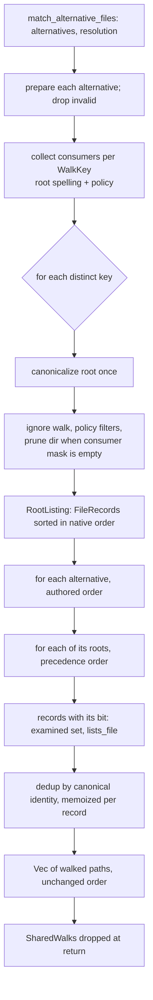

# Candidate design: one shared walk for file alternatives in completion (X2)

**Status: candidate design, not implemented.** This feature delivers the
design only. Implementing it needs its own dated spec, which may adopt,
change, or reject what follows.

## The problem in one paragraph

A schema property such as `spec: file(match('docs/*.md')) | file(match('**/*spec*.md'))`
has two _file alternatives_. When you press TAB after `spec=`, or open the
ENTER-path chooser, Claudine walks the filesystem **once per alternative**,
even when both alternatives search the same folder. The phase 1 spike
measured this on macOS (APFS, warm cache, one run on a loaded host, load
average `{ 21.38 42.47 49.88 }` before and `{ 69.48 51.77 51.60 }` after):

| Alternatives | Walks | Files found | Time (provisional) |
| ------------ | ----- | ----------- | ------------------ |
| 1 | 1 | 10,000 | 372 ms |
| 2 | 2 | 10,000 | 642 ms |
| 4 | 4 | 10,000 | 1,333 ms |
| 8 | 8 | 10,000 | 3,214 ms |

Tree: 12,000 files (20 folders × 500 Markdown + 100 JSON). The "Walks" column
is the alternative count by construction (`tests/x2_spike.rs:62` prints it);
no counter observed it. About 270–400 ms is added per extra alternative. This
sample does not gate the design; it is recorded so an implementation has a
baseline to beat.

## Current behavior

All three callers reach one function, so one change point covers them:

- TAB: `engine/mod.rs:271` → `candidates::property_value` → `file_candidates`
  (`candidates.rs:135-160`) → `match_alternative_files`.
- ENTER chooser and provided partials: `commands/schema_interactive/mod.rs:376`
  and `:665` → `file_candidate_paths` (`candidates.rs:172-185`) →
  `match_alternative_files`.

`match_alternative_files` (`claudine/cli/src/completion/schema_completion/candidates.rs:196-217`):

1. For each alternative in authored order, parse its groups
   (`MatchGroups::new`, line 203; an invalid glob list is skipped silently).
2. Call `match_glob_files` (line 206) — **one full walk per alternative**.
3. Deduplicate across alternatives by canonical path: `canonicalize_simplified`
   on every hit, falling back to the walked spelling on error (lines 209-210).
   A file keeps the position of the first alternative that offered it.

`match_glob_files` (`candidates.rs:242-295`), per alternative:

| Step | Line | What it does |
| ---- | ---- | ------------ |
| Prepare | 243 | `FileMatchGroups::prepare` resolves every group's roots once (Darkmatter `schemas/file_match.rs:153`). `None` ⇒ contributes nothing. |
| Roots | 249 | `PreparedFileMatch::roots()` (`file_match.rs:177`): the **first group's** roots in precedence order, e.g. launch dir then repo root for a bare pattern. biscuit-file already merges duplicate roots by identity (`glob/list.rs:50`). |
| Canonical root | 250 | `canonicalize_simplified(root)`; failure skips that root. |
| Walk policy | 254-257 | `ignore::WalkBuilder`: `hidden(true)` (skip dot-entries), `git_ignore(true)`, `require_git(false)`, crate defaults otherwise (`.ignore`, global gitignore, `.git/info/exclude`, parent ignore files, **symlinks not followed**, no depth limit). |
| Entry filter | 258-269 | `walker::entry_passes_filters` (`walker.rs:218`: `_`-prefix and `SKIP_DIRS` at `walker.rs:55`), and for a real directory `prepared.may_list_below(canonical_root + names)`: the **pruning** check. |
| Errors | 271 | `walker.flatten()` drops every `Err` entry: unreadable folder, permission denied, vanished entry. Nothing is reported. |
| File test | 273 | `path.is_file()` follows a symlink, so a broken symlink and a directory symlink are dropped. |
| Examined set | 282 | Identity `canonical_root.join(below_root)` (lexical, no syscall). The first root that reaches a file decides it; a later root never re-offers it. |
| Judge | 285 | `prepared.lists_file(path)`: every group must list the file. Per call this canonicalizes the file's parent (`canonical_prefix`, biscuit-file `glob/roots.rs:410`), reads `symlink_metadata`, and for a symlink canonicalizes the target to drop one that leaves the tree (`glob/matches.rs:23-29`, `glob/list.rs:40`). |
| Order | 291 | Sort the root's hits by (component count, components): "native order". Roots are concatenated in precedence order. |

So the only inputs that differ between alternatives are **the roots** and
**the pruning and judging rules**. The walk policy is a constant.

Canonicalization today, per request with K alternatives: each root K times;
each reached file's parent K times (inside `lists_file`); each offered file
once more per offering alternative (dedup).

## Design

### Request-owned walk key

A walk is shared only between consumers with an equal `WalkKey`:

```rust
struct WalkKey {
    root: PathBuf,            // the root exactly as prepare() spelled it (byte-equal)
    policy: WalkPolicy,       // today a single constant value
}
struct WalkPolicy { hidden: bool, git_ignore: bool, require_git: bool,
                    follow_links: bool, skip_filters: bool, max_depth: Option<usize> }
```

"Identical" means the same root **spelling** and the same policy. Two
spellings of one folder (`/var/x` and `/private/var/x` on macOS, an 8.3
short name on Windows) are **different keys**: the walk reports paths in
the root's spelling, and `candidate_value` (`candidates.rs:323`) requires
that spelling, so merging them could change what is displayed. The policy is
part of the key now, although it is constant, so a later caller with a
different policy (say `follow_links`) can never share by accident.

**Overlapping roots walk separately.** A bare pattern launched from
`repo/pkg` walks `repo/pkg` and then `repo`. The `repo/pkg` listing cannot be
cut out of the `repo` walk: if the launch folder sits under `.claude/`,
`_drafts/`, or `build/`, the `repo` walk prunes it while a walk rooted there
does not (the filters skip descendants, never the root). Sharing is therefore
per root, and the saving is "K alternatives × R roots" walks becoming "number
of distinct roots".

### What one walk yields

One walk per key produces a `RootListing`: the canonical root, computed once,
and one `FileRecord` per regular file the walk reaches (after `is_file`):

```rust
struct FileRecord {
    path: PathBuf,                 // walked spelling: root + native names (display source)
    names: Vec<OsString>,          // components below the root (native-order sort key)
    examined: PathIdentity,        // canonical_root.join(names), lexical, as line 282
    consumers: ConsumerMask,       // which consumers reached it without pruning (below)
    canonical: OnceCell<PathIdentity>, // cross-alternative dedup identity, computed on first use
}
```

Records are sorted once per root with the line-291 comparator. Display
spelling is untouched: records keep native separators, TAB still renders
through `candidate_value` (`to_portable_string`, bare launch-relative, never
`./`), and the chooser still receives `path`.

### Conservative combined pruning

A _consumer_ is one (alternative, root) pair: alternative `i` consumes root
`r` when `r` is in its `roots()`. One walk serves every consumer of its key.

A directory is pruned only when **no** consumer may list below it. Each
directory gets a mask of consumers still interested:

```text
mask(root)  = { i : may_list_below_i(canonical_root) }
mask(dir)   = mask(parent) ∩ { i : may_list_below_i(canonical_root + names) }
descend     ⇔ entry_passes_filters(dir) ∧ mask(dir) ≠ ∅
record.mask = mask(parent directory of the file)
```

Taking the intersection with the parent reproduces exactly what each
alternative's own walk would have seen: alternative `i` never sees a file
under a folder _it_ would have pruned, even if another alternative kept the
walk going. The design therefore does **not** rely on the (documented but
unproven here) invariant that `may_list_below == false` implies `lists_file
== false` below; results stay exact even if that invariant were broken. If
every bit is empty at the root, the root is not walked at all.

`may_list_below` is still called once per directory per consumer, as today.
The masks are kept in a map from directory path to mask, consulted by the
`filter_entry` closure (which must be `Send + Sync + 'static`, so an
uncontended `Arc<Mutex<HashMap<PathBuf, ConsumerMask>>>`; the walk is
single-threaded). `ConsumerMask` is a `u64`; a key with more than 64
consumers falls back to today's per-alternative walks rather than adding a
bitset type for a case no authored schema reaches.

The hidden, gitignore, `_`-prefix and `SKIP_DIRS` filters are policy, not
per-alternative, so they run once per entry exactly as today.

### Per-alternative filtering, authored-order merge, dedup

```text
for alternative i in authored order (skipping invalid / unpreparable ones):
    examined_i = {}
    for root r in alternative i's roots(), in precedence order:
        listing = shared listing for WalkKey(r)        # walked at most once
        for record in listing (native order) where i ∈ record.consumers:
            if !examined_i.insert(record.examined): continue   # line 282
            if !prepared_i.lists_file(record.path):  continue  # line 285
            id = record.canonical.get_or_init(canonicalize_simplified(path) or lexical)
            if seen.insert(id): out.push(record.path)          # lines 209-212
```

- Filtering a pre-sorted root listing gives the same order as sorting the
  filtered subset (names are unique within a root), so native order holds.
- `examined_i` stays **per alternative**, so "the most local root decides"
  keeps its per-alternative meaning.
- The cross-alternative `seen` set and its first-position rule are
  unchanged; only the canonical identity is now computed at most once per
  record instead of once per offering alternative.

### Symlinks, errors, and Windows

Every rule below is today's rule, and the shared walk keeps it because the
policy is identical and the walk is the same `ignore` walk:

- **Directory symlinks** are not followed, so a symlink loop cannot occur.
  Such an entry fails `is_file()` and is dropped.
- **File symlinks** are kept at the link's own spelling; `lists_file` drops
  one whose target leaves the tree for a bare, `./` or `../` pattern, without
  a warning. **Broken symlinks** fail `is_file()` and are dropped.
- **Errors** (unreadable folder, permission denied, an entry removed during
  the walk) are dropped by `flatten()`. A folder every consumer would have
  read yields no entries for all of them, which is what each separate walk
  gave. A root whose canonicalization fails is skipped for all its
  consumers, as each did on its own.
- **Windows**: roots are canonicalized with `canonicalize_simplified` (no
  `\\?\` prefix; `os` skill, windows-paths trap 1), identities are
  `PathIdentity` (drive letters compared case-insensitively), separators stay
  native until `to_portable_string`. A directory junction is whatever the
  `ignore` crate makes of it today; the shared walk neither adds nor removes
  traversal of it. Keying on the byte-equal root spelling means an 8.3 short
  name and its long name walk separately, which is redundant but never wrong.
- One observable difference, an improvement: today's K walks happen one after
  another, so a file created mid-request can appear for one alternative and
  not another. The shared walk is a single observation.

### Memory lifetime and freshness

The listings live in a `SharedWalks` value created inside
`match_alternative_files` and dropped when it returns. There is no `static`,
no process-wide cache, and nothing persisted. Each TAB is a separate
`claudine __complete` process anyway; in a long-lived `compose` process, each
chooser or provided-partial call builds its own `SharedWalks`, so the next
request always walks the filesystem again and observes any change.
Peak memory grows from one root's listing to all distinct roots' listings at
once (records for reached files, roughly path + names, plus one mask per
directory), released at return.

### Flow



## Implementation sketch

All in `claudine/cli/src/completion/schema_completion/`; no public API
changes in biscuit-file or Darkmatter.

- New private module `shared_walk.rs`: `WalkKey`, `WalkPolicy`
  (`WalkPolicy::MATCH_COMPLETION`, the constants at `candidates.rs:254-257`),
  `ConsumerMask`, `FileRecord`, `RootListing`, and
  `fn walk_root(key: &WalkKey, consumers: &[(usize, &PreparedFileMatch)]) -> Option<RootListing>`
  holding today's `WalkBuilder` code from `match_glob_files`.
- `candidates.rs`: `match_alternative_files` prepares all alternatives
  first, builds the key → consumers table, walks each key lazily on first use
  (so a root no valid alternative needs is never walked), then runs the merge
  loop above. `match_glob_files` is deleted; its doc comment's contract moves
  to `walk_root` and `match_alternative_files`.
- `PreparedFileMatch` is not `Clone`; consumers borrow it, the walk closure
  needs only `may_list_below`, so wrap each in `Arc` as line 246 does now.
- Call sites (`file_candidates`, `file_candidate_paths`) do not change.
- Test-only walk counter: `#[cfg(test)] static ROOT_WALKS: AtomicUsize`
  incremented in `walk_root` before `build()`. claudine-cli has no
  `work-counters` feature and nextest runs each test in its own process, so a
  `cfg(test)` atomic is enough.
- Docs to update in that change: `claudine/docs/topics/completions/shell-completions.md`
  ("Property values" and "Type-driven chooser": state that alternatives sharing
  a folder share one walk), and the `claudine` skill's schema-validation row,
  which currently says "walk each alternative".

### Optional second step: share the per-file judgment probe

The spike notes that one walk alone costs 372 ms and that per-file
canonicalization may be the larger lever. After sharing the walk,
`lists_file` still canonicalizes the parent of every reached file once per
alternative. The parent's canonical prefix and the file's `is_symlink` are
properties of the path at request time, not of the alternative, so they could
be computed once per record if biscuit-file exposed a pre-resolved probe
(for example `PreparedGlobReference::lists_probe(&FileProbe)`, passed through
`PreparedFileMatch`). That is a public API change in two other package areas
and belongs in the follow-up spec as a separate, separately measured step.

## Future acceptance cases

1. **Walk count.** Using the x2_spike tree with the launch folder at the repo
   root (one distinct root), 1, 2, 4, and 8 alternatives each record
   `ROOT_WALKS == 1`. Launched from a subfolder with bare patterns (two roots),
   the count is 2 for every K.
2. **Distinct scopes walk separately.** `./docs/*.md` and `&**/*.md` launched
   from a subfolder: two walks, one per root; a key that differs only in
   policy (constructed in a unit test) does not share.
3. **Parity.** For a fixture matrix, output equals the pre-change algorithm
   byte for byte, in order. Keep the old per-alternative code as a
   `#[cfg(test)]` oracle in `parity_tests.rs` until the follow-up closes.
   Matrix rows: exclusions in one alternative only; overlapping roots;
   launch folder inside a hidden, `_`-prefixed, and `SKIP_DIRS` folder; a
   file reachable through two roots; file symlink inside and outside the
   tree; broken symlink; directory symlink; unreadable folder (Unix,
   `chmod 000`); an invalid alternative between two valid ones.
4. **Conservative pruning.** `docs/*.md` and `**/*.md` together still offer
   `notes/a.md`, and `docs/*.md` alone still prunes `notes/` (masks
   observed through a test hook, or by the walk visiting `notes/` only in the
   combined case).
5. **Authored order and dedup.** A file both alternatives admit appears once,
   at the first alternative's position.
6. **Fresh next request.** Request 1, create `docs/new.md`, request 2 offers
   it; delete it, request 3 does not.
7. **Latency.** Re-run x2_spike on a quiet host and record before/after for
   K = 1, 2, 4, 8 with load averages. The goal is near-flat time in K for one
   root; not a gate.

## Open questions for the reviewer

- **Key granularity.** Chosen: byte-equal root spelling. Alternative:
  canonical root identity, re-spelling paths per consumer. That saves walks for
  alias spellings but risks display changes; redo by changing `WalkKey.root`
  to the canonical identity and adding a per-consumer spelling map.
- **Exact masks versus the pruning invariant.** Chosen: per-consumer masks,
  exact even if `may_list_below` were unsound. Alternative: prune on the union
  and filter only with `lists_file`, which is simpler but relies on the
  invariant; redo by dropping `FileRecord.consumers` and adding an invariant
  test in biscuit-file.
- **Scope of a request.** Chosen: one property's value completion. Sharing
  across properties in one chooser session would need the listings to outlive
  a call; not proposed.
