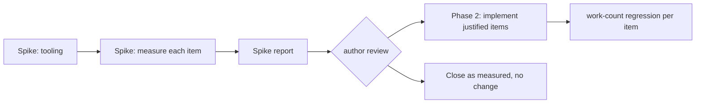

# Pipeline work reduction: measure, then remove repeated work

The `2026-10-25-pipeline-improvements` review recorded 26 findings that are
neither defects nor diagnostics. Three are medium and 23 are low. Each one
names work that is visibly repeated or copied: a whole object cloned to read
one field, an unchanged expression reparsed, a validator compiled again for an
identical fragment. Almost every finding ends with "not measured".

This feature does those findings in two phases:

1. **A measurement spike.** It adds tooling, measures every finding against a
   synthetic workload and a realistic one, and writes a report. It changes no
   production behavior.
2. **Implementation of the findings the measurements justify.** Each one keeps
   a deterministic work-count regression test. Findings the numbers do not
   justify are closed as "measured, no change", not filed away.

The author reviews the spike report before phase 2 starts (`human_review:
true`).

The other tracks of the same review are specified separately:
`2026-10-25-fix-now`, `2026-10-25-host-function-catalog-leak`,
`2026-10-25-schema-diagnostic-provenance`, and
`2026-10-25-shared-acyclic-definitions`.

## Design rules for every phase-2 change

The review's findings fall into three repeated patterns. Each pattern has one
rule, so each change applies a decided rule instead of deciding again:

1. **Process-wide caches.** Keep the latest revision per path, or bound the
   cache. Get every validator from `ValidatorCache`. Never use `Box::leak` on a
   path that loads data at runtime.
2. **Unchanged syntax.** Parse once and keep the parsed tree beside the
   authored text. **Always evaluate fresh**: a retained tree never carries a
   value, a refinement, an approval decision, or a file-function result.
3. **Leaf reads.** Read the field directly, and materialize the whole object
   only when the whole root is asked for. Never hold a lock or borrow while
   lifecycle actions run.

A change that cannot follow its rule is brought back to the author, not
worked around.

## Phase 1: the measurement spike

### What the spike may change

- It **may** add measurement tooling: the counting allocator, feature-gated
  work counters, benches, and spike scenarios.
- It **must not** change production behavior. Every counter compiles away
  unless the test-only `work-counters` feature is enabled, which is how
  Darkmatter's existing counters work.
- It produces `spike-report.md` in this feature's directory.

### Tooling to add

| Tool | Where | What it measures | Notes |
| ---- | ----- | ---------------- | ----- |
| **Counting allocator** | `tools/test-toolkit`: a `CountingAllocator` wrapping `std::alloc::System`, plus `AllocationSnapshot { allocations, bytes_allocated, peak_live_bytes }` with `since()` | allocations, bytes, and peak live bytes over a scope | Process-wide atomics, so threaded work such as group legs is counted. Each measuring bench binary declares `#[global_allocator] static A: CountingAllocator = …;` A global allocator can only be declared in the final binary, so the libraries never declare one. No new third-party crate is needed. |
| **Darkmatter work counters** | extend the existing `work-counters` feature in `darkmatter/lib` (today it covers `alias_search_work`) | named events: validator compilations, expression parses, YAML document parses, `effective_for` preparations, trigger discoveries, `positions_for` builds, `LifecycleSourceMap` builds, scope-join ancestor visits, operand-site comparisons | Thread-local counters with before/after deltas, following `yaml_scalar.rs::alias_search_work`. |
| **Claudine work counters** | a new test-only `work-counters` feature in `claudine/lib`, mirroring Darkmatter's | `RuntimeState` snapshots and the bytes they clone, live-frontmatter copies, hook-payload materializations, loop-ambient materializations, pre-warm state constructions, provider-prediction state constructions, environment-map copies | Off by default; production builds compile none of it. Enabled for Claudine's L1 tests by the same mechanism Darkmatter uses (`local-features`). |
| **DMLS counters** | the existing `dmls/src/work_counters.rs` | reads, hashes, parses, enumerations, registry scans | Already sufficient for the DMLS items; add events only if an item needs them. |
| **Criterion benches** | new `darkmatter/lib/benches/pipeline_work.rs` and `claudine/lib/benches/pipeline_work.rs`, each registered as a `[[bench]]` and runnable through the area's `just bench` | wall time, with `Throughput` set to the workload size | Timing benches use the **system allocator**. Allocation measurements run in separate `pipeline_work_alloc` bench targets, so counting never distorts timings. |

The spike also records the measurement pattern in the `rust-testing` skill:
work-count deltas for regressions, the counting allocator for allocation
claims, and Criterion only for timing.

### What to measure for each item

Each item gets three measurements:

1. **The direct cost.** The counter or allocation number that names the
   repeated work, for example "validator compilations per rewrite".
2. **Scaling.** The same number at three workload sizes, usually 1×, 10×, and
   100×, to show whether the cost grows linearly, with the batch size, or
   quadratically.
3. **Share of a realistic operation.** The item's cost as a percentage of
   wall time and of allocated bytes for the end-to-end operation that contains
   it, measured on the realistic anchor in the next section.

#### Realistic anchors

These are end-to-end operations built only from content that exists in the
repository, or plausible scale-ups of it, at no more than 10× the largest real
instance:

| Anchor | Operation | Built from |
| ------ | --------- | ---------- |
| **A1 corpus validate** | validate the existing 1,000-document corpus | `darkmatter/lib/benches/schema_validation.rs` corpus |
| **A2 Claudine bundle** | resolve and validate a Claudine document against the frozen Claudine schema bundle, cold and warm | `benches/fixtures/claudine-schemas` |
| **A3 DMLS edit loop** | one diagnostics publish, one completion, and two hovers on a large lifecycle-heavy Claudine document, driven in-process the way DMLS L1 tests drive providers | the largest lifecycle document in `claudine/prompts`, frozen as a fixture |
| **A4 sequence preflight** | dry-run preflight of a 50-step sequence containing a 200-leg group (`max_parallel: 4`), prompt documents with 100 KB of frontmatter, and literal `agent:` hints | synthetic; shapes taken from `claudine` sequence fixtures |
| **A5 event dispatch** | dispatch 100 lifecycle events with a 1 MB `tool_response`, each running templates and conditions that read 10 `hook.*` leaves and 5 `loop.*` scalars | synthetic |
| **A6 shell preparation** | prepare a 100-step sequence whose steps run template commands with 10 typed holes each | synthetic |

#### The items

The ID is used in the report and in commit messages. The "candidate" column
is the option the review recommended, and the one phase 2 implements if the
measurements justify it.

**Claudine runtime**

| ID | Finding | Direct metric | Synthetic sizes | Anchor | Candidate |
| -- | ------- | ------------- | --------------- | ------ | --------- |
| C1 | Group allocates private state for every leg up front (medium) | peak live bytes; `RuntimeState` constructions | 10/100/1,000 legs, `max_parallel: 4`, 100 KB base state | A4 | create the state when the leg is admitted |
| C2 | Dotted `hook.<path>` materializes the whole payload (medium) | bytes allocated per leaf read | `tool_response` of 10 KB, 100 KB, and 1 MB | A5 | closed per-member resolver |
| C3 | Full `RuntimeState` snapshot for single-field reads | bytes cloned per container event | 10/100/1,000 committed outputs of 10 KB | A4 | narrow owned projections under one lock |
| C4 | `loop.<member>` clones the previous result | bytes allocated per scalar read | `last_output` of 10 KB, 100 KB, and 1 MB | A5 | direct member projection |
| C5 | Loop conditions reparsed every pass | expression parses per pass | 10/100/1,000 passes | loop of a trivial shell task | evaluation entry point that takes a parsed tree |
| C6 | Pre-warm rebuilds state per phrase | state constructions and bytes per batch | 2/20/200 phrases over 10 KB and 200 KB frontmatter | A4 | literal fast path, with shared state built lazily |
| C7 | Provider prediction clones state for literal hints | bytes cloned per task | 10/100/1,000 tasks, 100 KB frontmatter | A4 | classify hints before building state |
| C8 | Document entry copies environment maps it replaces | environment-map copies and bytes per document entry | 10/100/1,000 tasks, 50 and 500 variables | A4 | derive the replacement without copying first |

**Darkmatter schemas and expressions**

| ID | Finding | Direct metric | Synthetic sizes | Anchor | Candidate |
| -- | ------- | ------------- | --------------- | ------ | --------- |
| D1 | Eager-file rewrite recompiles union-arm validators per item (medium) | validator compilations per rewrite | 10/100/1,000 items, two eligible object arms | A1 variant with a file-list property | memo scoped to one rewrite invocation |
| D2 | `md schema validate` prepares the effective schema twice | `effective_for` preparations per file | A1 as is | A1 | report plus preparation summary |
| D3 | Claudine's optional scrub and launch check each rediscover triggers | trigger discoveries per preflight | 1/10/100 schema-root files | A4 | share the registry via `with_trigger_registry` |
| D4 | Source positions built before knowing a schema applies | `positions_for` builds for schema-free and valid documents | A1 | A1 | build positions only in the `Some(effective)` branch |
| D5 | Scope join rebuilds ancestor sets | ancestor visits per join | shared prefix of 10/100/1,000 facts, one new fact per branch | A3 | one-pass history split with a pointer-equality fast path |
| D6 | Diagnostic positions rescan the prefix | bytes scanned per batch | 10/100/1,000 findings near the end of a 10,000-line file | A3 | per-batch line index |
| D7 | Operand-site discovery scans linearly and recomputes markers | site comparisons; `marks` recomputations | 10/100/1,000 actions | A2, A3 | path-to-index map and a marker memo local to the walker |
| D8 | Placeholders reparsed across analysis passes | expression parses per command | 1/10/50 holes | A6 | parse each distinct expression once per candidate construction |
| D9 | Lifecycle grammar clones excluded subtrees | bytes cloned per parse | gate or bundle values of 1 KB, 10 KB, and 100 KB | A3, A4 | borrowed `(&str, &Value)` collections |
| D10 | `LifecycleSourceMap` built separately per validation pass | source-map builds per preparation | A3, A4 | A3, A4 | build once and pass a borrow |
| D11 | Rejected-candidate diagnostics built on successful binds | allocations per successful bind | object of 1, 10, and 100 KB, with 1/4/8 rejected alternatives | A2 | build failure records only on failure |
| D12 | Named-type memo clears completely at 256 entries | reparses after an edit to an unrelated table | edit-and-reuse loop over 10/300 imported files | A3 | latest revision per path (rule 1) |
| D13 | Alphanumeric annotation checks compile validators directly | validator compilations per resolution | 1/10/100 imports of one suggested type | A2 | `ValidatorCache` structural slot (rule 1) |

D12 and D13 follow directly from rule 1 and are **implemented whatever their
numbers**. Their measurements only confirm that nothing got slower.

**Deferred unless the spike shows a need**

These are measured only cheaply. Each gets its direct metric at one large
size. A full candidate design is written only if that number crosses a
threshold below:

| ID | Finding |
| -- | ------- |
| X1 | Cached alternative matchers for editor hover |
| X2 | One shared directory walk for multiple file alternatives in completion |
| X3 | Memo of completed recursive conversion targets |
| X4 | Key-to-child index for locating many problems in wide mappings |

**Not a performance item**

| ID | Finding | Resolution |
| -- | ------- | ---------- |
| P1 | Content Policy's duration grammar repeated in editor regexes | add the lexical parity matrix (the review's option 2) in phase 2, no measurement needed; the generator option is not adopted |

### Decision rule

An item is **justified** when any one of these holds:

1. **Share.** On its realistic anchor, it accounts for at least **5%** of
   wall time or of allocated bytes.
2. **Scaling.** Its direct metric grows faster than the useful work, for
   example quadratically, or in proportion to batch size where the fix makes
   it constant. It must also reach at least **10 ms** or **10 MB** at a
   plausible size (no more than 10× the largest real instance in the
   repository).
3. **Memory.** Peak live bytes grow with a count that has no cap. C1 is the
   expected example: legs declared, not legs running.

An item that meets none of them is closed as **measured, no change**. Its
numbers go in the report, and nothing is filed under `_unscheduled`.

The thresholds are a starting proposal. The author may adjust them when
reviewing the report, and the report states the thresholds that were applied.

### The spike report

`spike-report.md` (`kind: implementation-log`) contains:

- the host, toolchain, profile (`bench`), and commit measured;
- one row per item:
  - the direct metric at each size;
  - the scaling class;
  - the share of its anchor (time and bytes);
  - which decision-rule clause applies, if any;
  - the recommendation: implement the candidate, implement a different
    option (with the reason), or close;
- for each anchor, its total time and bytes, so the shares can be checked;
- the Criterion baseline name saved for the post-change comparison
  (`just bench-baseline pipeline-work-pre`).

Timings come from the macOS development host. Counts and bytes are the same
on every OS. A claim that depends on OS-specific behavior, such as filesystem
walks in X2, is marked as such.

## Spike outcome and decided scope (2026-10-26)

The spike ran and its verdicts are in [spike-report.md](spike-report.md).
The author's decisions on that report fix phase 2's scope:

| Group | Items |
| ----- | ----- |
| **Implement** | C1, C2, C3, C4, C7, D1 (option B: the context-aware `ValidatorCache` slot), D2, D4 (with the lazy position provider), plus D12, D13, and P1 by rule |
| **Re-measure after the sequence fix, then decide** | C6, D3, D8. Any that still meets a clause gets its own dated spec, written immediately |
| **Write a candidate design** | X2, after its timing is confirmed on a quiet host |
| **Closed: measured, no change** | C5, C8, D5, D6, D7, D9, D10, D11 |
| **Still deferred** | X3, X4 |
| **Delivered by `2026-10-26-dmls-frontmatter-typing-allocation`** | X1 (see Design Decisions) |

This feature is the shared final step after two parallel worktrees. Both
start from `2026-10-26-dmls-frontmatter-typing-allocation`:

- `2026-10-26-sequence-quadratic-frontmatter`;
- `2026-10-25-fix-now` → `2026-10-25-host-function-catalog-leak` →
  `2026-10-25-schema-diagnostic-provenance` →
  `2026-10-25-shared-acyclic-definitions`.

Phase 2 starts only after:
1. both worktrees have merged, through
   `2026-10-26-sequence-quadratic-frontmatter` and
   `2026-10-25-shared-acyclic-definitions`. The two defect fixes inflate
   the totals this feature's shares are measured against, and the
   other specs change the schema payload, DMLS diagnostics, and the resolver
   files this feature edits;
2. the counting benches have been re-run on the merged code and the report
   updated;
3. a quiet-host timing pass has been saved as `pipeline-work-pre`.

## Phase 2: implementation

Phase 2 starts after the author has reviewed the spike report and recorded
which items proceed.

- Each justified item is one focused change that follows its design rule.
  Unrelated items are never mixed in one commit.
- Each change adds an **L1 work-count regression test** that asserts the
  direct metric. For example, "1,000 items compile two validators", or "a
  scalar `loop.count` read allocates no copy of `last_output`". Wall-time
  assertions are not used.
- Each change keeps every invariant the review named for its item. Among
  them:
  - C1: group legs are still validated and their contexts captured eagerly;
    cancellation outcomes and declaration-order folding are unchanged.
  - C2: `hook.env.*` stays absent, and a missing member never falls through to
    another namespace.
  - C3: retry clearing and lexical restoration are unchanged.
  - C5, D8: errors are reported at the same time; file functions run on every
    evaluation.
  - D1: exactly one accepting eligible arm is still required before a
    rewrite. Compiled validators may be shared through `ValidatorCache`'s
    context-aware slot, but never across resolution contexts. Verdicts are
    never cached: every value is judged afresh.
- After all items land, the benches run against the saved baseline
  (`just bench-compare pipeline-work-pre`), and the implementation log records
  each anchor's before/after time and bytes.

## Design Decisions

### X1 was delivered by the frontmatter typing allocation fix

- **Decision:** X1 (cached alternative matchers for editor hover) is no
  longer deferred: `2026-10-26-dmls-frontmatter-typing-allocation` built it
  while closing its hover allocation target. DMLS keeps prepared matchers,
  and synthesized array-item definitions, across edits in
  `dmls/src/overlay/analysis.rs::CrossSnapshotSchema`, keyed by the
  library's `alternative_fingerprint`. Phase 2 does not schedule X1, and its
  A3 re-measurement compares against that fix's recorded hover bytes (verb
  58,763, expression 105,025).
- **Alternatives considered:** Keep X1 listed as deferred; that would invite
  a second matcher cache.
- **Why:** The spike measured X1 at under 1% of A3 because its hover was
  dominated by whole-document typing; once that fix removed the typing, the
  matcher preparation was most of what remained (about 6.8 MB warm, 15 MB
  cold per verb hover), so the fix had to build it.
- **Downsides:** None for this feature; the spike report keeps its original
  verdict as a record of that measurement.

### Re-baseline A2 and A3 after shared acyclic definitions

- **Decision:** `2026-10-25-shared-acyclic-definitions` changed the totals
  this feature measures, so phase 2's re-measurement on the merged code (its
  precondition 2) is the only valid comparison point; no spike-report figure
  for A2 or A3 is compared against directly. On the same macOS host, the
  Claudine effective schema for both triggers fell from 1,844,516 to 768,262
  compact bytes (cold resolve 529 → 304 ms, compile 444 → 168 ms), and A3's
  a3x1-warm totals fell from 804 MB to 53 MB allocated (diagnostics 437 MB →
  37 MB). A3's verb hover rose from 58,763 to 66,277 bytes, because a stored
  union now hovers by opening its top-level alternatives; expression hover
  is 69,943. These replace the 58,763/105,025 hover figures in the X1
  decision as the reference for A3's hovers.
- **Alternatives considered:** keep the spike-report and X1 figures as
  baselines; they would credit this feature with savings sharing produced.
- **Why:** the measurements are recorded in that feature's implementation
  log; items such as D1, D4, and D12 act on validator compilation and
  resolver work whose size sharing reduced by more than half.
- **Downsides:** some items that met a clause in the spike may now fall
  below the 10 ms / 10 MB floor and close as "measured, no change".

## Out of scope

- Every item that other tracks specify (listed above).
- The `prep` group-target decision, which needs an author decision.
- New caches beyond what a candidate names. Any wider cache, such as a
  request-scoped DMLS observation or a prepared operand-discovery plan, needs
  its own spec backed by spike numbers.

## Implementation surfaces

- Spike tooling: `tools/test-toolkit` (counting allocator), `darkmatter/lib`
  (`work-counters` feature), `claudine/lib` (new `work-counters` feature and
  its CI metadata), the new bench targets, and their `Cargo.toml` entries.
- Phase 2: the files named by each finding in `2026-10-25-pipeline-improvements`.

## Documentation

- `tools/test-toolkit/README.md`: the counting allocator, and why it is
  declared only in bench binaries.
- The `rust-testing` skill: when to use work counters, the allocator, or
  Criterion.
- `darkmatter/docs/dependencies.md` and `claudine/docs/dependencies.md` only if
  a crate is added. None is planned.
- Phase 2: each item updates the canonical page that describes the behavior
  it touches, where a contract or lifetime is described there, such as cache
  lifetimes and when values are evaluated.

## Acceptance and verification

**Spike**

1. The tooling compiles away by default. `cargo build` of `darkmatter`,
   `claudine`, and their CLIs without test features contains no counter state.
2. Every item C1–C8, D1–D13, and X1–X4 has a row in `spike-report.md`, with
   all three measurements (X items: direct metric only) and a recommendation.
3. The Criterion baseline `pipeline-work-pre` is saved.
4. `just test` and `just lint` pass in `darkmatter/`, `claudine/`, and
   `tools/test-toolkit`. No production behavior change appears in the diff
   outside `cfg(feature = "work-counters")`.

**Phase 2**

5. Every implemented item has an L1 work-count regression that fails before
   the change and passes after it.
6. D12, D13, and P1 are implemented.
7. The implementation log records each anchor's before/after numbers from
   `just bench-compare pipeline-work-pre`. No anchor regresses by more than
   Criterion's noise threshold.
8. `just test`, `just test-l2` where an area has relevant L2 tests, and
   `just lint` pass in every touched area. No test exceeds five seconds.
