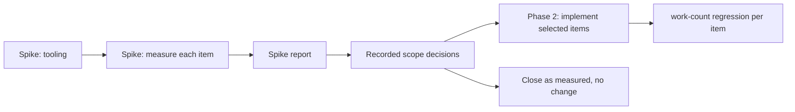

# Pipeline work reduction: measure, then remove repeated work

The `2026-10-25-pipeline-improvements` review recorded 26 findings that are
neither defects nor diagnostics. Three are medium and 23 are low. Each one
names work that is visibly repeated or copied: a whole object cloned to read
one field, an unchanged expression reparsed, a validator compiled again for an
identical fragment. Almost every finding ends with "not measured".

This feature does those findings in two phases:

1. **A measurement spike.** It adds tooling, measures every finding against a
   synthetic workload and a realistic one, and writes a report. It changes no
   production behavior.
2. **Implementation of the findings the measurements justify.** Each one keeps
   a deterministic work-count regression test. Findings the numbers do not
   justify are closed as "measured, no change", not filed away.

The spike is complete. The recorded author decisions and the Design Decisions
below settle the implementation scope; no further approval is required. The
dependency order still applies before implementation begins.

The other tracks of the same review are specified separately:
`2026-10-25-fix-now`, `2026-10-25-host-function-catalog-leak`,
`2026-10-25-schema-diagnostic-provenance`, and
`2026-10-25-shared-acyclic-definitions`.

## Design rules for every phase-2 change

The review's findings fall into three repeated patterns. Each pattern has one
rule, so each change applies a decided rule instead of deciding again:

1. **Process-wide caches.** Keep the latest revision per path, or bound the
   cache. Get every validator from `ValidatorCache`. Never use `Box::leak` on a
   path that loads data at runtime.
2. **Unchanged syntax.** Parse once and keep the parsed tree beside the
   authored text. **Always evaluate fresh**: a retained tree never carries a
   value, a refinement, an approval decision, or a file-function result.
3. **Leaf reads.** Read the field directly, and materialize the whole object
   only when the whole root is asked for. Never hold a lock or borrow while
   lifecycle actions run.

Preserve the contracts below when applying these rules. Record routine
implementation choices in the plan or implementation log; they do not reopen
the settled scope.

## Phase 1: the measurement spike (completed)

This section records the original measurement brief. The completed report
and the decided scope below govern the remaining work; do not repeat the
full spike or add workloads, hosts, repetitions, or statistical gates.

### What the spike may change

- It **may** add measurement tooling: the counting allocator, feature-gated
  work counters, benches, and spike scenarios.
- It **must not** change production behavior. Every counter compiles away
  unless the test-only `work-counters` feature is enabled, which is how
  Darkmatter's existing counters work.
- It produces `spike-report.md` in this feature's directory.

### Tooling to add

| Tool | Where | What it measures | Notes |
| ---- | ----- | ---------------- | ----- |
| **Counting allocator** | `tools/test-toolkit`: a `CountingAllocator` wrapping `std::alloc::System`, plus `AllocationSnapshot { allocations, bytes_allocated, peak_live_bytes }` with `since()` | allocations, bytes, and peak live bytes over a scope | Process-wide atomics, so threaded work such as group legs is counted. Each measuring bench binary declares `#[global_allocator] static A: CountingAllocator = …;` A global allocator can only be declared in the final binary, so the libraries never declare one. No new third-party crate is needed. |
| **Darkmatter work counters** | extend the existing `work-counters` feature in `darkmatter/lib` (today it covers `alias_search_work`) | named events: validator compilations, expression parses, YAML document parses, `effective_for` preparations, trigger discoveries, `positions_for` builds, `LifecycleSourceMap` builds, scope-join ancestor visits, operand-site comparisons | Use the existing process-wide atomic counters with before/after deltas so group worker threads are included; the older thread-local alias counter alone cannot measure that work. |
| **Claudine work counters** | a new test-only `work-counters` feature in `claudine/lib`, mirroring Darkmatter's | `RuntimeState` snapshots and the bytes they clone, live-frontmatter copies, hook-payload materializations, loop-ambient materializations, pre-warm state constructions, provider-prediction state constructions, environment-map copies | Off by default; production builds compile none of it. Enable explicitly for the regression tests through the existing test recipe feature mechanism; keep installed builds at default features. |
| **DMLS counters** | the existing `dmls/src/work_counters.rs` | reads, hashes, parses, enumerations, registry scans | Already sufficient for the DMLS items; add events only if an item needs them. |
| **Criterion benches** | new `darkmatter/lib/benches/pipeline_work.rs` and `claudine/lib/benches/pipeline_work.rs`, each registered as a `[[bench]]` and runnable through the area's `just bench` | wall time, with `Throughput` set to the workload size | Timing benches use the **system allocator**. Allocation measurements run in separate `pipeline_work_alloc` bench targets, so counting never distorts timings. |

The spike also records the measurement pattern in the `rust-testing` skill:
work-count deltas for regressions, the counting allocator for allocation
claims, and Criterion only for timing.

### What to measure for each item

Each item gets three measurements:

1. **The direct cost.** The counter or allocation number that names the
   repeated work, for example "validator compilations per rewrite".
2. **Scaling.** The same number at three workload sizes, usually 1×, 10×, and
   100×, to show whether the cost grows linearly, with the batch size, or
   quadratically.
3. **Share of a realistic operation.** The item's cost as a percentage of
   wall time and of allocated bytes for the end-to-end operation that contains
   it, measured on the realistic anchor in the next section.

#### Realistic anchors

These are end-to-end operations built only from content that exists in the
repository, or plausible scale-ups of it, at no more than 10× the largest real
instance:

| Anchor | Operation | Built from |
| ------ | --------- | ---------- |
| **A1 corpus validate** | validate the existing 1,000-document corpus | `darkmatter/lib/benches/schema_validation.rs` corpus |
| **A2 Claudine bundle** | resolve and validate a Claudine document against the frozen Claudine schema bundle, cold and warm | `benches/fixtures/claudine-schemas` |
| **A3 DMLS edit loop** | one diagnostics publish, one completion, and two hovers on a large lifecycle-heavy Claudine document, driven in-process the way DMLS L1 tests drive providers | the largest lifecycle document in `claudine/prompts`, frozen as a fixture |
| **A4 sequence preflight** | dry-run preflight of a 50-step sequence containing a 200-leg group (`max_parallel: 4`), prompt documents with 100 KB of frontmatter, and literal `agent:` hints | synthetic; shapes taken from `claudine` sequence fixtures |
| **A5 event dispatch** | dispatch 100 lifecycle events with a 1 MB `tool_response`, each running templates and conditions that read 10 `hook.*` leaves and 5 `loop.*` scalars | synthetic |
| **A6 shell preparation** | prepare a 100-step sequence whose steps run template commands with 10 typed holes each | synthetic |

#### The items

The ID is used in the report and in commit messages. The "candidate" column
is the option the review recommended, and the one phase 2 implements if the
measurements justify it.

**Claudine runtime**

| ID | Finding | Direct metric | Synthetic sizes | Anchor | Candidate |
| -- | ------- | ------------- | --------------- | ------ | --------- |
| C1 | Group allocates private state for every leg up front (medium) | peak live bytes; `RuntimeState` constructions | 10/100/1,000 legs, `max_parallel: 4`, 100 KB base state | A4 | create the state when the leg is admitted |
| C2 | Dotted `hook.<path>` materializes the whole payload (medium) | bytes allocated per leaf read | `tool_response` of 10 KB, 100 KB, and 1 MB | A5 | closed per-member resolver |
| C3 | Full `RuntimeState` snapshot for single-field reads | bytes cloned per container event | 10/100/1,000 committed outputs of 10 KB | A4 | narrow owned projections under one lock |
| C4 | `loop.<member>` clones the previous result | bytes allocated per scalar read | `last_output` of 10 KB, 100 KB, and 1 MB | A5 | direct member projection |
| C5 | Loop conditions reparsed every pass | expression parses per pass | 10/100/1,000 passes | loop of a trivial shell task | evaluation entry point that takes a parsed tree |
| C6 | Pre-warm rebuilds state per phrase | state constructions and bytes per batch | 2/20/200 phrases over 10 KB and 200 KB frontmatter | A4 | literal fast path, with shared state built lazily |
| C7 | Provider prediction clones state for literal hints | bytes cloned per task | 10/100/1,000 tasks, 100 KB frontmatter | A4 | classify hints before building state |
| C8 | Document entry copies environment maps it replaces | environment-map copies and bytes per document entry | 10/100/1,000 tasks, 50 and 500 variables | A4 | derive the replacement without copying first |

**Darkmatter schemas and expressions**

| ID | Finding | Direct metric | Synthetic sizes | Anchor | Candidate |
| -- | ------- | ------------- | --------------- | ------ | --------- |
| D1 | Eager-file rewrite recompiles union-arm validators per item (medium) | validator compilations per rewrite | 10/100/1,000 items, two eligible object arms | A1 variant with a file-list property | context-aware `ValidatorCache` lookup, retaining each arm validator within the rewrite |
| D2 | `md schema validate` prepares the effective schema twice | `effective_for` preparations per file | A1 as is | A1 | report plus preparation summary |
| D3 | Claudine's optional scrub and launch check each rediscover triggers | trigger discoveries per preflight | 1/10/100 schema-root files | A4 | share the registry via `with_trigger_registry` |
| D4 | Source positions built before knowing a schema applies | `positions_for` builds for schema-free and valid documents | A1 | A1 | lazy position provider, built only when a reported problem needs source locations |
| D5 | Scope join rebuilds ancestor sets | ancestor visits per join | shared prefix of 10/100/1,000 facts, one new fact per branch | A3 | one-pass history split with a pointer-equality fast path |
| D6 | Diagnostic positions rescan the prefix | bytes scanned per batch | 10/100/1,000 findings near the end of a 10,000-line file | A3 | per-batch line index |
| D7 | Operand-site discovery scans linearly and recomputes markers | site comparisons; `marks` recomputations | 10/100/1,000 actions | A2, A3 | path-to-index map and a marker memo local to the walker |
| D8 | Placeholders reparsed across analysis passes | expression parses per command | 1/10/50 holes | A6 | parse each distinct expression once per candidate construction |
| D9 | Lifecycle grammar clones excluded subtrees | bytes cloned per parse | gate or bundle values of 1 KB, 10 KB, and 100 KB | A3, A4 | borrowed `(&str, &Value)` collections |
| D10 | `LifecycleSourceMap` built separately per validation pass | source-map builds per preparation | A3, A4 | A3, A4 | build once and pass a borrow |
| D11 | Rejected-candidate diagnostics built on successful binds | allocations per successful bind | object of 1, 10, and 100 KB, with 1/4/8 rejected alternatives | A2 | build failure records only on failure |
| D12 | Named-type memo clears completely at 256 entries | reparses after an edit to an unrelated table | edit-and-reuse loop over 10/300 imported files | A3 | latest revision per path (rule 1) |
| D13 | Alphanumeric annotation checks compile validators directly | validator compilations per resolution | 1/10/100 imports of one suggested type | A2 | `ValidatorCache` structural slot (rule 1) |

D12 and D13 follow directly from rule 1 and are **implemented whatever their
numbers**. Their measurements only confirm that nothing got slower.

**Deferred unless the spike shows a need**

These are measured only cheaply. Each gets its direct metric at one large
size. A full candidate design is written only if that number crosses a
threshold below:

| ID | Finding |
| -- | ------- |
| X1 | Cached alternative matchers for editor hover |
| X2 | One shared directory walk for multiple file alternatives in completion |
| X3 | Memo of completed recursive conversion targets |
| X4 | Key-to-child index for locating many problems in wide mappings |

**Not a performance item**

| ID | Finding | Resolution |
| -- | ------- | ---------- |
| P1 | Content Policy's duration grammar repeated in editor regexes | add the lexical parity matrix (the review's option 2) in phase 2, no measurement needed; the generator option is not adopted |

### Decision rule

An item is **justified** when any one of these holds:

1. **Share.** On its realistic anchor, it accounts for at least **5%** of
   wall time or of allocated bytes.
2. **Scaling.** Its direct metric grows faster than the useful work, for
   example quadratically, or in proportion to batch size where the fix makes
   it constant. It must also reach at least **10 ms** or **10 MB** at a
   plausible size (no more than 10× the largest real instance in the
   repository).
3. **Memory.** Peak live bytes grow with a count that has no cap. C1 is the
   expected example: legs declared, not legs running.

An item that meets none of them is closed as **measured, no change**. Its
numbers go in the report, and nothing is filed under `_unscheduled`.

The thresholds are settled by the recorded author decisions. Apply them
unchanged to the remaining conditional items; the report states the clause
and evidence used. Estimated shares must be labeled as estimates, not
presented as measured time attribution.

### The spike report

`spike-report.md` (`kind: implementation-log`) contains:

- the host, toolchain, profile (`bench`), and commit measured;
- one row per item:
  - the direct metric at each size;
  - the scaling class;
  - the share of its anchor (time and bytes);
  - which decision-rule clause applies, if any;
  - the recommendation: implement the candidate, implement a different
    option (with the reason), or close;
- for each anchor, its total time and bytes, so the shares can be checked;
- the Criterion baseline name saved for the post-change comparison
  (a target-specific Criterion `--save-baseline pipeline-work-pre` run).

Timings and allocation bytes describe the measured macOS host, toolchain,
allocator, and workload. They are not portable byte budgets. Work-count tests
assert the algorithmic contract on each supported platform without assuming
identical filesystem observations. Mark filesystem-dependent evidence as such;
this feature does not add a cross-platform performance campaign.

## Spike outcome and decided scope (2026-10-26)

The spike ran and its verdicts are in [spike-report.md](spike-report.md).
The author's decisions on that report fix phase 2's scope:

| Group | Items |
| ----- | ----- |
| **Implement** | Group state at admission (C1); direct hook and loop member reads (C2, C4); narrow runtime projections, including task and leg mutation reads (C3); literal provider hints without state copies (C7); cached union-arm validators (D1); single schema preparation (D2); lazy diagnostic positions (D4); latest named-type revisions (D12); cached alphanumeric checks (D13); duration lexical parity tests (P1) |
| **Apply the settled measurement rule after the sequence fix** | Pre-warm state reuse (C6), duplicate trigger discovery (D3), and placeholder parsing (D8). Update their existing measurements; for each qualifying item, deliver its own dated active spec immediately, as already required by the author. Otherwise record measured, no change. This classification is automatic and needs no approval. |
| **Deliver a candidate design** | Shared completion walks (X2): use the request-local design below. The existing walk counts establish repeated work; the already-required single-host timing pass reports its latency without gating the design. |
| **Closed: measured, no change** | C5, C8, D5, D6, D7, D9, D10, D11 |
| **Measured, no change** | Recursive conversion memoization (X3: no anchor reaches it) and wide-mapping position indexing (X4: negligible in the corpus) |
| **Delivered by `2026-10-26-dmls-frontmatter-typing-allocation`** | X1 (see Design Decisions) |

This feature is the shared final step after two parallel worktrees. Both
start from `2026-10-26-dmls-frontmatter-typing-allocation`:

- `2026-10-26-sequence-quadratic-frontmatter`;
- `2026-10-25-fix-now` → `2026-10-25-host-function-catalog-leak` →
  `2026-10-25-schema-diagnostic-provenance` →
  `2026-10-25-shared-acyclic-definitions`.

Phase 2 starts only after:

1. both worktrees have merged, through
   `2026-10-26-sequence-quadratic-frontmatter` and
   `2026-10-25-shared-acyclic-definitions`. The two defect fixes inflate
   the totals this feature's shares are measured against, and the
   other specs change the schema payload, DMLS diagnostics, and the resolver
   files this feature edits;
2. the counting benches have been re-run on the merged code and the report
   updated;
3. a quiet-host timing pass has been saved as `pipeline-work-pre`.

## Phase 2: implementation

The scope above is approved. Planning can start now; implementation follows
the dependency and baseline prerequisites above. Refresh only the existing
measurements affected by the merged dependencies. Confirmed implementation
items remain selected even if their shares fall after those fixes.

- Each justified item is one focused change that follows its design rule.
  Unrelated items are never mixed in one commit.
- Each performance change adds an **L1 work-count regression test** that
  asserts the direct metric. The duration parity matrix is a behavior test. For example, "1,000 items compile two validators", or "a
  scalar `loop.count` read allocates no copy of `last_output`". Wall-time
  assertions are not used.
- Each change keeps every invariant the review named for its item. Among
  them:
  - C1: group legs are still validated and their contexts captured eagerly;
    cancellation outcomes and declaration-order folding are unchanged.
  - C2: `hook.env.*` stays absent, and a missing member never falls through to
    another namespace.
  - C3: retry clearing and lexical restoration are unchanged.
  - Placeholder parsing (D8), if selected for its required follow-up spec:
    errors are reported at the same time and file functions run on every
    evaluation. Loop-condition parsing (C5) remains closed.
  - D1: exactly one accepting eligible arm is still required before a
    rewrite. Compiled validators may be shared through `ValidatorCache`'s
    context-aware lookup for file-sensitive schemas. Context-free schemas may
    use its existing structural slot. Verdicts are never cached: every value
    is judged afresh, including after files are created or removed.
- After all items land, the benches run against the saved baseline
  (the same timing targets with Criterion `--baseline pipeline-work-pre`).
  The implementation log records each anchor’s before/after time and bytes.
  Use target-specific invocations through the area benchmark recipe; the
  allocation and DMLS targets are separate, and Claudine has no
  `bench-compare` recipe. Record the exact invocations in the log.

## Required contracts and regression coverage

The item codes in the tables identify report rows. Each requirement below
also names the operation so a reader need not memorize the codes.

- **Group state at admission (C1).** Capture one immutable group-start seed
  after the existing validation and context capture. Allocate a leg's mutable
  runtime and frontmatter view only after admission, always from that seed.
  Extract the final result and required mutation/output deltas, then release
  the private state before admitting replacement work. Cover both library
  and CLI scheduling paths, capped and uncapped groups, nested groups,
  retries, interruption, fail-fast, and never-admitted cancellation outcomes.
  Sibling writes stay private and result folding stays in declaration order.
  With a cap, heavyweight live branches are bounded by active legs; required
  result storage and eagerly captured metadata may still grow with the number
  of declared legs. Total branch constructions over a completed group remain
  one per admitted leg; assert peak live branches, not constant total work.
- **Hook and loop leaf reads (C2, C4).** Resolve the requested member before
  constructing a whole root object. Scalars must not clone a large sibling;
  requesting a large value itself may copy that value. Whole-root reads keep
  their existing representation and values. Compare leaf results with the
  whole-root projection, including absent and null values, nested members,
  arrays, and reserved or unknown members. `hook.env.*` remains absent; a
  missing hook member cannot fall through into frontmatter. Each evaluation
  reads current event/loop state; retain no values between events or passes.
- **Narrow runtime projections (C3).** Audit task and leg mutation reads as
  well as container events. Clone only requested fields while holding one
  lock so multi-field reads are coherent, and release the lock before any
  lifecycle action. Retain full snapshots for operations that require them.
  Cover retry clearing, lexical restoration, mutation ordering, and concurrent
  reads without copying unrelated output history.
- **Literal provider hints (C7).** Classify the effective `agent` and `model`
  hints before building expression state, including the caller's redundant
  frontmatter copy. Preserve document, task `with:`, and caller-setter
  precedence, runtime-written and late-value deferral, ordinary expression
  failures, and launch-time authority. Compare literal and expression paths
  that resolve to the same selection, and retain dependency analysis for
  referenced or runtime-written keys even when their current value is text.
- **Union-arm validators (D1).** Compile the complete arm schema with its
  reachable shared definitions, not an isolated fragment containing dangling
  references. Use the existing bounded cache and retain returned validators
  for the rewrite invocation, avoiding repeated hashing/lookups per list item.
  Exactly one accepting eligible arm is required; zero or multiple matches
  leave the value unchanged. Test reused validators across values, warm
  requests, changed schema bodies, document/caller origins, and changed file
  existence. Reuse never freezes a file-validation verdict.
- **Single preparation (D2).** Return the effective-schema presence and
  preparation metadata alongside the validation result from the same
  preparation; the CLI consumes them for timing and the no-schema message.
  Keep existing validation entry points usable by delegating to the same
  operation. Cover absent schema with the baseline disabled, baseline-only,
  explicit and trigger schemas, preparation errors, pending values, and all
  existing output formats and exit statuses. Never prepare again merely to
  decide what message to print. When assignments are present, keep the earlier
  schema preparation used to coerce assignment values and a separate final
  preparation after assignments, because assignments can change trigger
  selection. Assert one final preparation, or two total with assignments,
  including an assignment that changes the selected trigger.
- **Lazy positions (D4).** Supply a request-local lazy source-position
  provider to validation. Successful validation, including baseline-only
  documents, builds no position map; a report needing positions builds it at
  most once and shares it among problems. Preserve problem codes, instance
  paths, source spans, declaration origins, and original-versus-composed
  source mapping, including aliases and shared definitions. Do not delay
  validation or diagnostics merely to avoid constructing positions.
- **Named-type revisions (D12).** Key the memo by the existing resolved path
  identity and store only its latest successful content hash and parsed table.
  Keep reading and hashing on use so edits and deletion remain visible; a
  failed read or parse never returns the previous revision. Do not clear all
  entries when a revision changes or the old 256-entry boundary is crossed.
  Cover more than 256 paths, an edit followed by reuse of an unchanged path,
  malformed content, deletion, and old revisions still held by active requests.
- **Alphanumeric checks (D13).** Reuse the existing structural validator
  cache for default and suggestion checks, including the complete constraints
  in the key. Preserve acceptance and diagnostic provenance across equal and
  different alphanumeric options; no validation-result cache is introduced.
- **Content Policy lexical parity (P1).** Build the matrix from one rule and
  duration-unit roster, exercising both the production parser and shipped
  editor patterns. Exercise every unit in default-baseline, property-baseline,
  and inline-date forms. Cover whitespace, references, and malformed
  spellings. Distinguish lexical acceptance from semantic checks such as
  positive counts and valid calendar dates; record intentional differences
  explicitly rather than making regexes duplicate the full parser. Exercise
  the shipped schema through Darkmatter as well as testing fragments. Keep
  Content Policy independent of Darkmatter in production.

## Design Decisions

### The completed spike and recorded author scope govern planning

- **Decision:** Adopt the report's recorded implementation choices, including
  cached union-arm validators and lazy source positions. Remove the obsolete
  author-review gate; implementation still waits for the two named dependencies
  and the existing before-change baseline.
- **Alternatives considered:** Ask for the same approval again; repeat the
  complete spike after dependency merges.
- **Why:** The report already records the author's choices and reliable work
  counts. The dependency changes require updated measurements, not a new vote.
- **Downsides:** The original timing results remain provisional; the report
  must distinguish them from the refreshed baseline.

### Conditional measurements have a settled outcome rule

- **Decision:** Refresh the existing pre-warm, trigger-discovery, and
  placeholder-parsing measurements after the sequence fix. Apply the unchanged
  thresholds automatically and deliver any qualifying dated active specs
  immediately, as the author already directed. Close recursive conversion
  memoization and wide-mapping indexing as measured, no change on the current
  evidence; neither authorizes a new optimization here.
- **Alternatives considered:** Leave these as pending author choices; implement
  all candidates regardless of measurements.
- **Why:** This retains the author's measurement-dependent scope without
  leaving an unanswered design question or expanding the performance work.
- **Downsides:** The later measurements determine which follow-up specs exist;
  the current plan must include producing those concrete outcomes.

### Completion enumeration is shared only within one request

- **Decision:** Deliver the completion-walk candidate design here: enumerate
  once per identical resolved search scope and traversal policy within a
  completion request, then apply each alternative's filters and merge results
  using existing ordering and deduplication. Different roots or traversal
  policies keep separate walks; no process-wide filesystem-result cache is
  introduced. The candidate must account for per-file canonicalization once
  per enumerated candidate where existing semantics permit it.
- **Alternatives considered:** Keep one walk per alternative; persist listings
  across completion requests.
- **Why:** The existing macOS sample reports 1, 2, 4, and 8 walks for the same
  tree. That count already establishes duplicated enumeration; another timing
  spike is unnecessary to choose a request-local design. The normal timing
  pass can report latency without delaying this deliverable.
- **Downsides:** Distinct search scopes still require distinct walks. This
  feature delivers the requested candidate design, not completion code; the
  design must preserve file visibility, symlink handling, errors, ordering,
  and fresh observations on the next request.

### Runtime savings preserve the group-start view and event-time values

- **Decision:** Use the immutable group-start seed, admission-time private
  state, and prompt cleanup of completed branches described above. Use narrow
  owned projections for runtime, hook, and loop reads, and build provider
  expression state only when the effective hints need it.
- **Alternatives considered:** Capture state anew when each leg starts; retain
  completed private branches until the entire group ends; cache leaf values.
- **Why:** Claudine's [runtime state](../../lib/src/composition/runtime_state.rs)
  and [group executor](../../lib/src/composition/sequence/task/group.rs)
  require sibling isolation and a group-start snapshot. Retaining all finished
  private copies would defeat the peak-memory goal even with capped admission.
- **Downsides:** Required results, eager context captures, and mutation deltas
  still occupy memory proportional to declared or completed work. Reading a
  large requested leaf still costs the size of that leaf.

### Validator reuse preserves the existing file-validation contract

- **Decision:** Use Darkmatter's [ValidatorCache](../../../darkmatter/lib/src/markdown/schemas/validate.rs)
  context-aware lookup for eager rewrite arms, including shared definitions.
  Keep existing ordinary `file(eager)` existence validation, passive editor
  behavior, and compose-only normalization unchanged. Use its structural slot
  for context-free alphanumeric checks.
- **Alternatives considered:** A rewrite-local compiler only; a syntax-only
  validator for every arm; moving existence checks out of ordinary validation.
- **Why:** The author chose compiled-validator reuse, not verdict reuse. The
  report's file-timing discussion is resolved here by preserving the documented
  [Files contract](../../../darkmatter/docs/topics/schemas/definition.md#files).
  Moving existence checks would change public validation behavior and is not
  necessary to remove repeated compilation.
- **Downsides:** Context-sensitive validators retain separate cache entries;
  validation still performs fresh file judgments for each value.

### Schema metadata and source positions come from the validation that uses them

- **Decision:** Return a validation report plus a small preparation summary
  from one shared library operation, with existing entry points delegating to
  it. Build source positions lazily when a problem needs them. Keep the
  pre-assignment coercion preparation separate from final validation.
- **Alternatives considered:** Have the CLI duplicate library validation;
  reuse the pre-assignment schema after assignments; build positions eagerly
  whenever any effective schema exists.
- **Why:** Darkmatter's [schema validation command](../../../darkmatter/cli/src/commands/schema/validate.rs)
  currently prepares again only to display schema presence. Assignments can
  change trigger selection, so that earlier preparation remains necessary.
  The default baseline applies to ordinary documents, making a simple
  schema-present check insufficient to avoid position construction.
- **Downsides:** The shared validation path needs a summary and a lazy source
  mapping interface; callers with assignments still prepare twice by design.

### Duration grammar maintenance uses lexical parity tests

- **Decision:** Adopt the review's matrix recommendation across all duration
  units and the three baseline forms, comparing Content Policy's parser with
  the shipped editor schema while naming their intentional semantic differences.
- **Alternatives considered:** Generate editor patterns from a new grammar
  description; require editor regexes to perform full semantic validation.
- **Why:** The original review found no current lexical disagreement. The
  matrix catches missed spelling changes without a generator or a new
  production dependency from Content Policy to Darkmatter.
- **Downsides:** Authored patterns still repeat grammar fragments; maintainers
  must update them together, with the matrix detecting omissions.

### Named-type memoization retains the latest revision per path

- **Decision:** Replace revision-keyed accumulation and whole-cache clearing
  with one latest successful entry per existing resolved path identity. Keep
  read/hash freshness checks and active requests' owned parsed tables.
- **Alternatives considered:** Keep the 256-entry clear; introduce an unrelated
  eviction policy; cache failed parses or skip reading unchanged paths.
- **Why:** Darkmatter's [named-type loader](../../../darkmatter/lib/src/markdown/schemas/resolve.rs)
  currently clears unrelated files at the capacity boundary. The settled
  latest-revision rule removes that churn without changing freshness.
- **Downsides:** Memory still scales with distinct paths observed in a process;
  this is not a fixed byte budget. Superseded tables may remain alive while an
  active request uses them.

### Verification measures removed work without machine-specific test budgets

- **Decision:** Use the existing process-wide counters under nextest, reset
  the allocation peak immediately before each isolated allocation scenario,
  join worker threads before taking the final snapshot, and keep timing in
  separate system-allocator benches. Reuse the existing macOS workloads and
  one brief timing pass; report uncertainty without a new statistical gate.
  The duration parity matrix is a behavior test, exempt from work counters.
- **Alternatives considered:** Thread-local group counters; subtracting lifetime
  allocator peaks; exact byte or wall-time assertions in L1; timing every OS.
- **Why:** The shipped counters include worker threads, and the
  [counting allocator](../../../tools/test-toolkit/src/alloc_count.rs) requires
  `reset_peak()` for a scoped peak. Bytes depend on the platform and toolchain;
  deterministic counts prove the reduction without timing noise.
- **Downsides:** Counters prove only their named operations, so behavior tests
  and allocation reports remain necessary. Performance evidence is specific
  to the measured host.

### X1 was delivered by the frontmatter typing allocation fix

- **Decision:** X1 (cached alternative matchers for editor hover) is no
  longer deferred: `2026-10-26-dmls-frontmatter-typing-allocation` built it
  while closing its hover allocation target. DMLS keeps prepared matchers,
  and synthesized array-item definitions, across edits in
  Darkmatter DMLS’s [cross-snapshot schema analysis](../../../darkmatter/dmls/src/overlay/analysis.rs),
  keyed by the library’s alternative fingerprint. Phase 2 does not schedule X1, and its
  A3 re-measurement compares against that fix's recorded hover bytes (verb
  58,763, expression 105,025).
- **Alternatives considered:** Keep X1 listed as deferred; build a second
  matcher cache in this feature.
- **Why:** The spike measured X1 at under 1% of A3 because its hover was
  dominated by whole-document typing; once that fix removed the typing, the
  matcher preparation was most of what remained (about 6.8 MB warm, 15 MB
  cold per verb hover), so the fix had to build it.
- **Downsides:** None for this feature; the spike report keeps its original
  verdict as a record of that measurement.

## Out of scope

- Every item that other tracks specify (listed above).
- Changes to which group targets `prep` may call. Existing target semantics
  remain authoritative; no decision about them is required for this feature.
- New caches beyond what a candidate names. Any wider cache, such as a
  request-scoped DMLS observation or a prepared operand-discovery plan, needs
  its own spec backed by spike numbers.

## Implementation surfaces

- Spike tooling (already present): `tools/test-toolkit` (counting allocator), `darkmatter/lib`
  (`work-counters` feature), `claudine/lib` (new `work-counters` feature and
  its CI metadata), the new bench targets, and their `Cargo.toml` entries.
- Claudine group scheduling and projections: [group execution](../../lib/src/composition/sequence/task/group.rs),
  [runtime state](../../lib/src/composition/runtime_state.rs),
  [loop expression lookup](../../lib/src/composition/looping/expression.rs), and
  [provider prediction](../../lib/src/composition/sequence/preflight/providers.rs),
  including their CLI callers.
- Darkmatter schema work: [validator cache](../../../darkmatter/lib/src/markdown/schemas/validate.rs),
  [schema resolution](../../../darkmatter/lib/src/markdown/schemas/resolve.rs), and
  [schema validation command](../../../darkmatter/cli/src/commands/schema/validate.rs).
  Follow the original finding to the eager rewrite, alphanumeric lowering,
  and source-position callers; include shared-definition consumers introduced
  by the dependency feature.
- Completion candidate design: [Claudine completion](../../cli/src/completion/schema_completion).
  The original review supplies background, not missing requirements.

## Documentation

- `tools/test-toolkit/README.md`: the counting allocator, and why it is
  declared only in bench binaries.
- The `rust-testing` skill: when to use work counters, the allocator, or
  Criterion.
- `darkmatter/docs/dependencies.md` and `claudine/docs/dependencies.md` only if
  a crate is added. None is planned.
- Phase 2: each item updates the canonical page that describes the behavior
  it touches, where a contract or lifetime is described there, such as cache
  lifetimes and when values are evaluated.

## Acceptance and verification

**Spike**

1. The tooling compiles away by default. `cargo build` of `darkmatter`,
   `claudine`, and their CLIs without test features contains no counter state.
2. Every item C1–C8, D1–D13, and X1–X4 has a row in `spike-report.md`.
   Retain the existing measurement limitations and identify estimates,
   unreachable anchors, and provisional times explicitly; no invented shares
   or extra measurement campaign is required to complete the report.
3. After the dependencies merge, save `pipeline-work-pre` for the existing
   timing targets on the macOS development host. Use the same host, features,
   profile, and workloads for the comparison; record the measured revision
   and any uncommitted changes. Timing targets use the system allocator.
4. `just test` and `just lint` pass in `darkmatter/`, `claudine/`, and
   `tools/test-toolkit`. No production behavior change appears in the diff
   beyond instrumentation and bench/test support. Counter calls may sit in
   production functions only when their disabled expansion is empty.

**Phase 2**

5. Every implemented performance item has a deterministic L1 regression for
   the removed work and behavior coverage for the required contracts above. Use small
   fixtures, explicit cold/warm cache state where relevant, and nextest
   process isolation for global counter deltas. The duration parity item uses
   a lexical acceptance matrix rather than an artificial work counter.
6. D12, D13, and P1 are implemented.
7. The implementation log records each existing anchor's before/after
   timing and allocation bytes. Record Criterion's reported uncertainty; a
   timing estimate alone is not a pass/fail test. Resolve a reproducible
   regression attributable to the change using the direct work evidence,
   without adding hosts, workloads, repetitions, or statistical gates.
8. `just test`, `just test-l2` where an area has relevant L2 tests, and
   `just lint` pass in every touched code area, including DMLS when affected.
   Run the counter-enabled L1 cases through nextest using the area recipes;
   prove default-feature library and CLI builds separately. L1 tests stay
   under five seconds; long measurements remain benches. Terminal and browser
   tests never activate windows or take focus.
9. The report records a terminal classification for pre-warm state reuse,
   trigger discovery, and placeholder parsing, and any qualifying item has
   its required dated active spec. The completion-walk candidate design is
   delivered. No item waits for another author ruling.
10. Public output, diagnostics, file-resolution behavior, approval membership,
    retry behavior, and lifecycle ordering remain unchanged except for the
    reductions in repeated work specified here.
