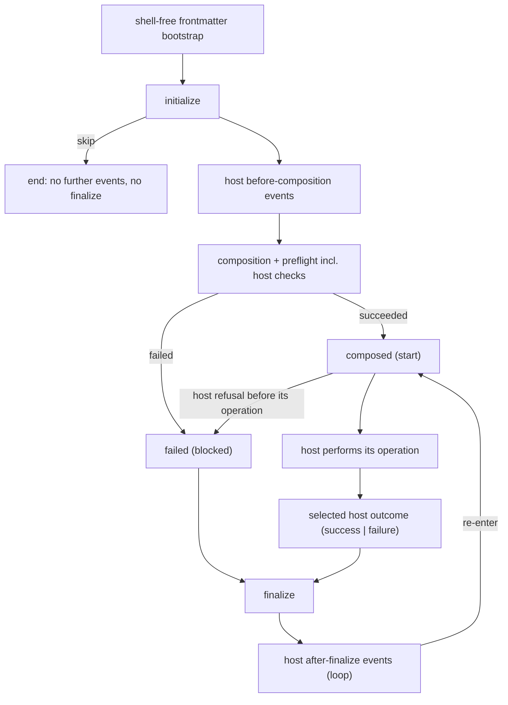

# Darkmatter Owns Lifecycle Events

After this change any Darkmatter document, not only a Claudine prompt, can
carry lifecycle events, and `md compose` fires them. Darkmatter becomes the one
authority for the lifecycle grammar, its action model, and the engine that runs
it; Claudine becomes a **host** that plugs its own events, names, checks, and
services into that engine. A Claudine author sees no difference: every shipped
prompt and sequence behaves exactly as before, proven by the same tests passing
before and after the move. Three pieces of schema housekeeping ride along
because they touch the same surfaces: one file declares the shape of every
global, the trigger kind and flag get their final names, and trigger
conditions combine with AND at the top level and OR inside a `group`.

## Where things stand when this spec starts

By pipeline step 17 these have landed in Claudine, written lift-ready (no
imports of Claudine settings, provider, messaging, or TTS/Playa types in the
parser and action-model slice):

- the flat lifecycle grammar with `when`/`then`/`else` and nesting
  (`2026-10-20-lifecycle-grammar`);
- lifecycle events, including `cancelled`, on documents, groups, and
  sequences; concurrent-only groups; the `seq`, `loop`, and `group` roots
  (`2026-10-24-sequence-containers`);
- loops on every primitive, `break`, `prep`, and `when:` on tasks
  (`2026-10-25-loops-and-flow-control`);
- task `with:` inputs and per-task provider selection
  (`2026-10-26-task-inputs-and-providers`);
- the `fm` namespace and Darkmatter's fixed reserved roots `fm`, `ctx`,
  `env`, `current` (`2026-10-18-fm-namespace`), with Claudine declaring
  `err`, `timing`, `seq`, `loop`, and `group` per scope through its
  `BindingView` until this spec moves every global into one declaration.

These are implementation prerequisites, not a claim that the dated drafts
have already shipped in this checkout. Stage 1 starts only after the task-input
and provider-selection prerequisite and its transitive prerequisites have
landed. Record the starting revision and capture traces from that revision;
otherwise the extraction could accidentally preserve behavior those changes
were meant to replace.

The lifecycle code lives under `claudine/lib/src/composition/lifecycle/`
(parser, action model, executor, run guard, catch protocol, control admission,
binding catalog) with orchestration in
`claudine/cli/src/commands/wrap/harness_orch/loop_control/` and iteration in
`claudine/lib/src/composition/looping/`.

The supporting documents in this directory (`against-statement.md`,
`benefit-statement.md`, `impact-statement.md`, `spike-results.md`,
`transition-table.md`) are historical input from 2026-09-19. They use the old
grammar and the old event split. Their findings that still matter are restated
below in this spec's own terms; where they disagree with this spec, this spec
wins.

## Decided

Decided 2026-10-10 unless noted.

### 1. Darkmatter owns the moment; the host owns the name

Darkmatter owns five document-lifecycle events. A host owns every other event
and may rename two of Darkmatter's.

| Darkmatter event | Fires when | `err` | Claudine's name |
|---|---|---|---|
| `initialize` | After the shell-free frontmatter bootstrap, before body discovery, preflight, and composition | unavailable | `initialize` (cannot be renamed) |
| `composed` | Composition and preflight succeeded | unavailable | `start` |
| `failed` | Composition or preflight failed, or the host reported a refusal before its operation started (see [section 8](#8-the-spikes-event-model-gaps-are-documented-not-redesigned)) | available | `blocked` |
| `cancelled` | The run was cancelled: Ctrl-C (always ends execution) or a `fail_fast: true` sibling failure (opt-in per page) | as defined by `2026-10-24-sequence-containers` | `cancelled` (cannot be renamed) |
| `finalize` | Always last, except after `skip`, `proxy`, `retry`, or `resume` (`retry` and `resume` re-enter without running it); closes the lifecycle once per loop iteration (see section 8) | available (`null` when there is no error) | `finalize` (cannot be renamed) |

Claudine owns `success` and `failure` (the end of the agent loop) and `loop`
(the post-`finalize` iteration gate).

The same document, written for each host:

```yaml
# report.md, run with `md compose report.md`
initialize:
    - when: "!file_exists('CHANGELOG.md')"
      then:
          - error: "CHANGELOG.md is missing"
composed:
    - info: "composed {{ title }}"
    - shell: "git status --short"
failed:
    - warn: "could not compose {{ title }}: {{ err.msg }}"
finalize:
    - info: "done"
```

```yaml
# review.md, run with `claudine compose review.md`
initialize:
    - when: "length(current.staged_files) == 0"
      then:
          - message: "nothing staged in {{ ctx.repo }}"
          - skip
start:
    - say: "starting the review"
blocked:
    - warn: "review could not start: {{ err.msg }}"
success:
    - say: "review finished"
failure:
    - when: "err.is_transient"
      then:
          - retry: 3
      else:
          - warn: "{{ err.msg }}"
finalize:
    - info: "review closed"
```

### 2. One name per host, no aliases

- A host may expose a Darkmatter event under its own name. Each event has
  exactly **one** name in a given host; there are no aliases.
- Claudine exposes `composed` as `start` and `failed` as `blocked`, so a
  Claudine document never holds both `failed` and `failure`.
- `initialize`, `cancelled`, and `finalize` are guarantees and cannot be
  renamed. A host registration that tries is a registration error.
- In a document run by a host that renamed an event, the Darkmatter name is a
  typed parse error before any effect, naming the host's spelling. A Claudine
  document with a `composed:` key fails with an error that says to use
  `start`; one with `failed:` fails with an error that says to use `blocked`.
- A host-only event name (`start`, `blocked`, `success`, `failure`, `loop`)
  has no meaning to a different host. Under `md compose` such a key is ordinary
  frontmatter data; it is neither parsed as a stack nor fired.
- Editor and schema typing use the host's names wherever the host's schemas
  apply. Under Claudine's schema `start` and `blocked` are typed lifecycle
  events and `composed` and `failed` are schema errors with the same
  replacement guidance; under Darkmatter's baseline `composed` and `failed`
  are typed and `start`/`blocked` are untyped frontmatter.

### 3. Hosts register their own events

A host registers each of its events with:

| Field | Meaning |
|---|---|
| name | The authored frontmatter key. Must not collide with a Darkmatter event name, another registered name, or a reserved root. |
| position | `before-composition`, `after-composition`, or `after-finalize` (see the diagram below). |
| role | `notification` (an ordinary ordered stack), `terminal-outcome` (shares the run's one terminal slot with `failed`), or `iteration-gate` (runs after `finalize` and decides whether the run re-enters). |
| globals | The globals readable in the event and whether each is available, unavailable with a reason, or execution-dependent, using Darkmatter's existing host-binding declaration (`BindingView`). This is how `err` is offered or refused. |
| action types | The action types allowed in the event (see [section 5](#5-action-types-and-the-invariants-darkmatter-enforces)). |

Claudine's registrations:

| Event | Position | Role | `err` |
|---|---|---|---|
| `success` | after-composition | terminal-outcome (success) | unavailable |
| `failure` | after-composition | terminal-outcome (failure; catch handler) | available |
| `loop` | after-finalize | iteration-gate | unavailable |

**Terminal-event selection.** Position and name cannot tell the engine which
terminal event to fire after the host reports completion, so terminal-event
registration carries a typed outcome disposition. A host registers its
successful and failed alternatives as a pair, each with its binding view, and
the permitted downgrade target (for Claudine, `success` and `blocked` may
downgrade to `failure`). The host's completion reply names an outcome, not an
event; the engine selects the registered alternative and owns catch routing,
so Darkmatter never recognizes Claudine names. Registration rejects a
duplicate or missing alternative. A host with no post-composition outcome
pair, such as `md`, registers none: its terminal slot holds only `failed`.

Order of one run, with Claudine's names in parentheses:



- `initialize` is the first event; `finalize` closes the lifecycle subject
  to section 8. A host's before-composition events fire after `initialize`,
  and its after-composition events fire before `finalize`.
  Cancellation can interrupt any started run, including an in-progress
  `initialize`. An authored `cancelled` stack runs before `finalize`; without
  that stack, the run still cancels and finalizes.
- Within one position, eligible notification events fire in registration
  order, never hash order. Terminal outcomes are alternatives: only the
  selected outcome fires, with the existing downgrade rules in section 8.
  An iteration gate runs after ordinary finalization to decide whether another
  iteration is admitted, never after `skip`, an adopted handoff, or cancellation.
  Authored action order inside a stack is unchanged.
- Registration is fixed for a run. A handler cannot emit an event. A host
  cannot fire an event out of its position or role, and a name alone never
  grants a terminal or re-entry role.
- Claudine registers no before-composition event today; the position exists
  for hosts and is proven by the Stage 1 prototype host.

### 4. Preflight is Darkmatter's process

Preflight is Darkmatter's process, and a host adds its checks into it instead of
running a separate pre-launch path. Claudine's agent resolution, launch-schema
validation, and lifecycle-shell audit become host checks registered into
Darkmatter's preflight. A failed host check is a preflight failure and fires
`failed` (`blocked` in Claudine). The approval set stays condition-blind, and
`execution_set ⊆ approval_set` still holds. The shell audit now also covers
lifecycle shell commands in documents run by `md compose`.

Claudine's sequence-wide, front-loaded approval inventory stays a Claudine
feature, but it runs Darkmatter's preflight collection for each task document
with Claudine's checks registered, so the same process approves the same
commands ahead of time. Approvals, prompts, diagnostics, and their order are
unchanged for Claudine.

The existing `md` blacklist, whitelist, batched approval, non-interactive
refusal, shell timeout, and remote-host consent rules also govern lifecycle
commands. A document containing only lifecycle shells still needs this audit,
even when no body shell operation is enabled. Disabling a compose shell
operation must not accidentally authorize lifecycle shells. Report-only
`md compose --shell` collects lifecycle candidates without firing stacks,
executing commands, or prompting; dry runs likewise execute no lifecycle
effects.

Lifecycle shell permission and composition shell permission are distinct:
body/frontmatter shells can run during composition after their audit succeeds;
lifecycle shells unlock only upon entering `composed`. Both use the same
approval authority. Reuse the approved discovery graph and remote-fetch
runtime rather than collecting or fetching everything again. Runtime `set`
mutations cannot change an approved command unnoticed: execution must still
match an existing exact approval or an admitted typed template, with the
missing-value, type-checking, and argument-quoting rules established by
`2026-10-23-shell-template-approval`. A mismatch is refused before execution.
This extraction adds no new approval prompt after a Claudine launch.

### 5. Action types and the invariants Darkmatter enforces

The action model moves whole: Darkmatter's parser knows every verb's shape,
including `say`, `retry`, `proxy`, `prep`, and `break`. A verb **runs** only
when the current host provides its service. The action types are those of
`2026-10-21-claudine-schemas`: `expression` (`set`, side-effect verbs,
expression functions), `flow`, `communicate`, and `shell`.

- A host declares, per event (its own and Darkmatter's), which action types
  are allowed. What happens to an action the host has no service for is the
  host's rule, and it is never a silent no-op:
    - **Claudine** provides every action it parses today; an unknown verb
      stays a typed parse error before any effect, naming the verb (today's
      behavior).
    - **`md`** ignores an action it does not understand, with a warning on
      stderr naming the action and the event, and never an error (decided
      2026-10-11). This covers an unknown verb and a verb only another host
      provides, such as Claudine's `say`, `retry`, or `break`. The rest of the
      stack runs.
- Darkmatter enforces these invariants whatever a host declares, and a host
  cannot relax them:
    - `initialize` excludes `shell` (its type has no `shell` arm), and so do
      the bootstrap frontmatter and any `failed`/`finalize` path reached before
      preflight succeeded, including dead branches and catch routes. A
      whole-value `$( … )` in `set` counts as a shell. `no_error`, approval
      flags, whitelists, and cached approvals cannot grant an exception.
      Shells unlock only at `composed`, and proxy adoption locks them again.
    - `skip` is valid only in `initialize`. It ends the run: no later event
      fires, `finalize` included.
    - `finalize` runs on success, failure, `break`, and cancellation; `skip`,
      `proxy`, `retry`, and `resume` are the only exceptions (`proxy` hands
      off before the source's `finalize`, which never runs; an accepted
      `retry` or `resume` re-enters without running the current attempt's
      `finalize`; see
      [section 8](#8-the-spikes-event-model-gaps-are-documented-not-redesigned)
      for how recovery interacts with it).
    - Approved shell command text is executed exactly as approved; a typed
      template is materialized only through the existing approved substitution
      rules, never by unconstrained event-time string expansion.
- Claudine allows exactly the actions it allows today in each of its events,
  including the recovery directives (`retry`, `resume`, `proxy`, `prep`) and
  `break`, which only Claudine provides.

### 6. `md compose` fires Darkmatter's events

`md compose` fires `initialize`, `composed`, `failed`, `cancelled`, and
`finalize` around composition. `md` only ever fires Darkmatter's events; a
host-only key is frontmatter data to it (section 2). Ordinary library compose, render, schema
validation, and DMLS remain passive: nothing executes a stack unless a host
creates and drives a run, and `md compose` is now such a host. Transcluded
documents never fire events; only the root document does. Dry runs fire no
events.

The `md` host's behavior (decided 2026-10-11):

- **Darkmatter's actions.** `expression` (`set`, side-effect verbs,
  expression functions); `shell` (not in `initialize`, per section 5); the
  terminal `communicate` verbs `stdout`, `stderr`, `info`, `warn`, `success`,
  and `message`; and the `flow` verbs `stop`, `skip`, and `error`. These are
  the actions `md` runs. In `cancelled`, its flow actions are restricted to
  `stop`; `skip` and `error` are typed errors, preserving the cancellation
  contract established by `2026-10-24-sequence-containers`.
- **Any other action is ignored with a warning.** Audio (`say`, `speak`,
  `effect`), `notify`, the recovery directives, `break`, `prep`, `defer`, and
  any verb `md` does not know have no `md` service. `md` skips each such
  action, writes a warning to stderr naming the action and the event, and
  continues with the rest of the stack; it never fails the run for one. To
  run a document written for another host with its actions, use that host
  (for Claudine, `claudine compose`).
- **Ignored actions remain inert.** Preserve their authored name and source
  span, but never interpolate their operands, evaluate their conditions, run
  their nested payloads, request a service, or collect commands hidden inside
  that payload. Warn once per ignored action occurrence reached during an
  event, including a verb in a selected conditional branch or mixed bundle;
  an unselected branch produces no warning. This tolerance does not apply to
  malformed YAML, malformed shared control structures, invalid operands of a
  supported action, or a supported action forbidden in that event. Those are
  typed errors. For example, `shell` in `initialize` and `skip` in `composed`
  must fail rather than be treated as unknown actions.
- **Schema.** Darkmatter's event-action schema names action keys with
  `suggest`, not `enum`. Darkmatter's own actions are typed and offered as
  completions; an unknown action (for example Claudine's `say`) passes the
  schema without error and is not suggested. A host's schemas add the host's
  actions; Claudine's schemas add `say` and the rest of Claudine's actions
  (see "Passive tooling and schemas").
- **Output order.** The composed document is written after `composed` and
  before `finalize`. `stdout` actions write to stdout in stack order, so
  output from `composed` appears before the document and output from
  `finalize` after it; every other terminal verb writes to stderr.
- **`stop`.** Ends only the current event's stack. It preserves the current
  outcome and does not suppress composition, document output, or `finalize`.
- **Errors.** An evaluation or dispatch error in `initialize` routes to
  `failed`, then `finalize`. An error in the `composed` stack does not route
  to `failed`, because composition and preflight already succeeded: `md`
  runs `finalize`. In both cases `md` exits non-zero with the selected error. As in Claudine, an evaluation error raised inside `failed` or
  `finalize` replaces the original error.
- **`skip`.** Writes no document and exits 0.
- **`set`.** Changes run state for later events; it never recomposes the body.
  Mutations in `initialize` are input to the first full composition. Once
  composed, the output body is fixed; later changes to effective frontmatter
  follow the existing runtime-state behavior and do not rewrite the source
  file unless an explicit side-effect action does so.
- **Output failures.** Writing the composed document is the `md` host
  operation after `composed`. A write failure, including a broken stdout pipe,
  does not select `failed`, because composition and preflight already
  succeeded: `md` runs `finalize` and exits non-zero. Output already written
  is not rolled back or repeated. An error in `failed`
  updates the selected error without recursively running `failed` again;
  an error in `finalize` never re-enters either cleanup stack.
- **Interrupts.** Ctrl-C stops further normal actions and document output,
  cancels pending composition or host work, and runs an authored `cancelled`
  stack followed by `finalize`. Without `cancelled`, only `finalize` runs.
  Cleanup errors remain diagnosable but cannot change the interrupted exit
  code of 130. A second Ctrl-C may cut cleanup short, preserving Claudine's
  force-exit rule. Before lifecycle shells unlock, cancellation cleanup
  cannot execute a shell either.

### 7. No behavior change in Claudine

The lifecycle parser, action model, and execution engine move into Darkmatter.
Nothing a Claudine author or user can observe changes. That covers event order,
action order, the selected terminal event, `err` contents, diagnostics and
their source spans, exit codes, recovery and its retry/resume budgets, audio handoff to Playa,
approval prompts, and loop and sequence behavior. The proof is the test suites
that exist at the start of this spec passing unchanged at the end, plus the
Stage 1 trace recordings.

### 8. The spike's event-model gaps are documented, not redesigned

The 2026-09-19 control-flow spike found four places where a simple event-role
model does not describe Claudine. Each is resolved by documenting what Claudine
does at the start of this spec and keeping it, proven by the same tests. The
Stage 1 traces are the authority if this section and the code disagree. The
code wins, and this section and the docs are corrected. The descriptions below
use Claudine's names.

**Recovery mode.** One event can run in two modes, and the engine, not the
adapter, selects the mode from how the event was entered:

- *normal recovery:* a terminal event or a normal `finalize` may return
  `retry`, `resume`, or `proxy`, and the engine requests that recovery from
  the host;
- *catch-only cleanup:* `blocked`/`failure`/`finalize` reached through the
  catch protocol after an evaluation failure or a refused control do not
  dispatch their own recovery. A later evaluation error in cleanup replaces
  the earlier error.

**Failure stage.** The host reports the stage and entry reason of a failure,
not only whether its operation started. The engine selects the event from
those facts:

| Failure | Event |
|---|---|
| Composition, preflight, or a host preflight check fails (shell audit denial, launch-schema validation, agent resolution, a missing include after `initialize`) | `blocked` |
| An internal setup failure (materialization, target lifecycle parse) before the provider launched | `blocked` |
| A refused proxy handoff (cycle, resolution failure, no owning coordinator) before the provider launched, even when `start` already fired | `blocked` |
| Launch construction or the pre-spawn part of an attempt fails after `start` | `failure` |
| A `resume` is refused as session-incompatible after re-entering at `start` | `failure` |
| The provider fails, or the completion verdict fails | `failure` |
| A refused handoff after the provider launched | `failure` |

**`blocked` routes.** Because of the third row, `blocked` (Darkmatter's
`failed`) can follow `start` (`composed`) when a host reports a refusal before
its operation starts. Under `md`, `failed` never follows `composed`: an error
in the `composed` stack or a failed output write is a non-zero exit after
`finalize` (section 6). `blocked` reached from compose
preflight cannot `retry`, `resume`, or `proxy`
(`LifecycleSetupPhaseRecoveryUnsupported`). When an explicit error in a
`success` or `blocked` stack redesignates the terminal slot to `failure`, the
`failure` stack runs. Communications the first stack already emitted are not
undone.

**`finalize` is not an unconditional `finally`.** `finalize` closes a
document's lifecycle once per loop iteration:

- `skip` ends the run with no `finalize`.
- A `retry` or `resume` admitted from a terminal event continues the same
  lifecycle: that attempt's `finalize` does not run, and `finalize` runs once
  when the lifecycle ends.
- A `proxy` from a terminal event hands off before the source's `finalize`,
  and the source's `finalize` never runs (decided 2026-10-11: today's
  behavior is kept); the target runs its own lifecycle.
- The exceptions to the `finalize` guarantee are therefore exactly `skip`,
  `proxy`, `retry`, and `resume`: `retry` and `resume` re-enter immediately
  without running the current attempt's `finalize`.
- A recovery chosen inside `finalize` happens after that `finalize` ran, and
  is never followed by a second `finalize` for the old attempt.
- An error inside `finalize` never finalizes again.
- `break` and cancellation run `finalize`, after `cancelled` for a
  cancellation.

Re-entry keeps its rules: `retry` and `resume` re-read and re-audit without a
second `initialize`; a new loop iteration re-enters at `start` using the
already-audited plan; proxy adoption starts a fresh lifecycle (new
`initialize`, shells locked) for the target.

### Run preparation and context lifetime

A host opens the root source and parses its lifecycle structure before any
stack effect. An unreadable root, malformed frontmatter, or malformed lifecycle
structure fails without attempting to execute untrusted or incomplete cleanup
stacks. Once the lifecycle is structurally valid, shell-free frontmatter
bootstrap precedes `initialize`; failures after the run starts use the catch
protocol. Preserve Claudine's existing distinction between initial parse
failure and target-parse failure during recovery.

Use Darkmatter's existing staged frontmatter projection in
[the compose module](../../../darkmatter/lib/src/markdown/compose/mod.rs)
rather than composing the body twice. Keep the active host's lifecycle
operands deferred through bootstrap and full composition; evaluate them only
in their event's binding view. Body discovery follows `initialize`, so an
initialization side effect can create a file the body includes. Child
transclusions never register or run their own lifecycle, even if their
frontmatter is merged into the root: the root's parsed stacks retain their
identity and source spans.

Every host run takes a Darkmatter
[ComposeRequest](../../../darkmatter/lib/src/markdown/compose/context/request.rs),
the library's captured composition settings and file-resolution context.
Bootstrap, preflight, composition, event expressions, services, and shell audit
reuse that request or a source-derived view of it. They never recapture CWD,
home, repository roots, environment, network policy, or approval identity in
an adapter. Passed `with:` values preserve their originating file context and
remain data, following the task-input prerequisite's rules.

The engine distinguishes run, loop iteration, and recovery attempt: an
admitted retry/resume continues the current lifecycle without another
`initialize`, while proxy adoption creates a new lifecycle. `env` and
file-resolution environment stay coherent with their request at every
boundary; a recovery re-read does not by itself authorize a process-environment
recapture. `current` keeps its existing lazy observation behavior, while `ctx`
keeps its captured behavior; sharing their schema does not make their values
identical or permit a new filesystem context. Concurrent subjects hold separate
mutable run state and terminal/finalize accounting. They may share immutable
registry definitions and authorized cache infrastructure.

### 9. One file declares every global

`darkmatter/schemas/darkmatter.yaml` is the single declaration of the shape of
every Darkmatter global. The runtime, `md schema`, and DMLS all consume the
same resolved definitions, and none of them rebuilds a global's shape another
way. Its `$schema` declares:

```yaml
kind: schema
description: the shapes of every Darkmatter global
$schema:
    fm: fm@./partials/fm.yaml -> the frontmatter; its resolved definition is the built-in document baseline
    ctx: context@./partials/context-variables.yaml -> context captured once at the start of the document's lifecycle
    current: context@./partials/context-variables.yaml -> the same context, materialized lazily when an event reads it
    env: object -> environment variables captured once at the start of the document's lifecycle
    err: err@./partials/error.yaml -> the active failure
    timing: timing@./partials/timing.yaml -> observed durations
```

- The frontmatter partial is `partials/fm.yaml` (today `partials/doc.yaml`;
  renamed here if `2026-10-18-fm-namespace` has not already done so).
- `ctx` and `current` reference one context type. There is no `current_env`;
  `env` is captured once per document lifecycle.
- `timing` declares the fields the runtime fills: `document_ms`, `total_ms`,
  `step_ms` (each an optional integer; `step_ms` is `null` outside a
  sequence). The file's current `tracking` entry is a stale name for this
  global and is renamed `timing`. The runtime is authoritative.
- The built-in document baseline is the resolved `fm` definition, not the
  whole file. It replaces the separately embedded
  `darkmatter/docs/schemas/darkmatter.yaml`. Where that embedded baseline and
  the catalog's partial disagree today (for example `draft` as `boolish`
  versus `boolean`, `last_updated` as `date` versus `date | datetime`), the
  embedded baseline is what runs, so its definitions are copied into the
  catalog partial first and runtime behavior does not change. Docs that
  transclude the old file transclude the partial instead.
- The catalog is registered explicitly as the global catalog. It never
  auto-applies as a document schema, even when discovery reaches it through
  another path, and its types-only partials never auto-apply. An authored
  `fm.ctx` property stays independent of the `ctx` global.
- A host declares its own globals in one host catalog file in the same format,
  registered with its event registration. Claudine's declares `seq`, `loop`,
  and `group`, with the shapes `2026-10-24-sequence-containers` defined. The
  host catalog feeds the same `BindingView` declarations the events use, so
  prepare-time validation, event-time evaluation, and DMLS cannot disagree.
- Catalog entries describe shapes, not unconditional availability. The four
  fixed roots remain `fm`, `ctx`, `env`, and `current`. Darkmatter now owns
  declarations for `err` and `timing` in lifecycle and approval binding views;
  unavailable `err` must fail with the view's reason rather than fall back to
  `fm.err`. Claudine declares `seq`, `loop`, and `group` in its host views.
  Outside those views, existing frontmatter lookup behavior is preserved.
- Generated or embedded artifacts work without the source YAML on the deployed
  filesystem. Resolve the catalog and its transitive relative imports from one
  embedded bundle, without runtime network access or dependence on the launch
  directory. Preserve baseline overrides, document-schema merge precedence,
  and disable-baseline behavior. Generated metadata is derived from YAML;
  parity tests compare it to the resolved catalog, not to a second manual list.

### 10. Trigger renames

- The trigger envelope kind is `schema-trigger`. `kind: trigger-schema` is a
  typed load error naming `schema-trigger` as the replacement. Discovery never
  silently ignores it, and DMLS reports incomplete validation within the
  rule's discovery scope, as for any broken trigger. There is no alias.
- The flag `--no-trigger-schemas` on `md compose`, `md schema validate`, and
  `md clean` becomes `--no-schema-triggers`, with no alias. Passing the old
  flag is a usage error whose message names `--no-schema-triggers`.
- Every trigger file in the repository is migrated in the same change,
  including Claudine's trigger files (those added by
  `2026-10-21-claudine-schemas` under `claudine/schemas/`, and the fixtures
  under `darkmatter/tests/fixtures/schema-triggers/schemas/`), along with the
  parser, the DMLS overlay, tests, docs, shell completions, and skills.
  Completed and historical specs are not edited.
- The repository-root `schemas/memory.yaml` is a placeholder trigger with an
  empty `match:` and no rule. Once `schema-trigger` loads, discovery would
  try to apply it, so it moves out of `schemas/` (with `git mv`, to a
  location no schema-root walk reaches) until it has a real rule.

### 11. Trigger conditions: AND at the top level, OR in a `group`

Decided 2026-09-18, with the concrete encoding confirmed 2026-09-19:

- A `match:` written as a **list** combines its entries with **AND**. Today
  a list is an outer OR of arms. The kind rename is the boundary: every file
  that loads as `kind: schema-trigger` uses the new meaning, and nothing tries
  to detect "legacy OR lists".
- A `group:` mapping holds a list whose entries combine with **OR**. Groups
  are always explicit `group:` mappings, never anonymous nested lists.
- A `match:` written as a **mapping** is one expression, as today: sibling
  property conditions combine with AND.
- Property conditions, `$path`, `none`, `all`, and `min-match` keep their
  meaning and may nest inside `group` and inside each other.
- The existing vacuity rule applies to the whole expression: every way of
  satisfying it must include a satisfiable presence gate or `$path`.
- Migration preserves meaning. A rule that relied on a multi-entry top-level
  list for OR is rewritten as one `group`.

```yaml
kind: schema-trigger
match:
    - kind: enum(claudine; required)
    - group:
          - prompt: string(required)
          - steps: unknown[](required)
$schema: claudine.yaml
```

This activates when `kind` is `claudine` **and** either `prompt` or `steps` is
present. Each condition uses a concrete type: `required` has no effect on
`any`/`unknown` (since `2026-10-16-core-schema-types`), so `steps: any(required)`
would be vacuous.

Decided 2026-10-11: `group` and the existing `any` combinator mean the same thing. To keep one
spelling, `any` is removed: `any:` in a `schema-trigger` is a typed load error
naming `group` as the replacement, and the migration rewrites each `any:` as a
`group:`.

## Design

### Placement and dependency direction

The lifecycle lives in a `darkmatter::lifecycle` module of the `darkmatter`
library. Add a separate crate only if a concrete dependency or build
constraint requires one, and record why in the implementation log. Claudine
depends on Darkmatter. Darkmatter never depends on Claudine, its CLI, its
provider catalog, or rendezvous.

### What moves and what stays

| Moves to Darkmatter | Stays in Claudine |
|---|---|
| Parser, action shapes, signatures, validation, source maps (`parse.rs`, `action_shape.rs`, `actions.rs`, `validate.rs`, `signatures.rs`, `source_map.rs`) | Provider launch, streams, sessions, completion verdict, inline closure |
| Executor: ordered evaluation, `set` snapshot semantics, deferred spans, event-time interpolation | Service adapters: terminal rendering, Playa audio, messaging, notifications |
| Run state: the run guard, the one terminal slot, finalize accounting, shell lock | Recovery execution: retry/resume budgets, proxy coordinator and adoption, session compatibility |
| Catch protocol and control admission (`runtime.rs`, `control.rs`) | Loop engine (driving the `loop` iteration gate) and sequence/group coordination |
| Event registry, host names, positions, roles; Darkmatter's five events | Claudine's registrations (`success`, `failure`, `loop`), its names (`start`, `blocked`), its host checks, its host globals catalog |
| The binding catalog's generic part (`err`, `timing` availability per event) | Claudine's `seq`/`loop`/`group` availability rules |
| The `md` host (`md compose`) | Claudine's provider hooks and their separate 16-event model (untouched) |

Temporary re-exports from Claudine are acceptable during the move. Two
independently evolving parsers or engines are not, even for one commit that
is pushed.

### Engine shape

The engine is the host-driven, request-returning design the spike favored.
The run is synchronous and inert between calls. It returns the next unit of
work (evaluate an event, prepare, perform the host operation, recover), and
the host performs it and replies with facts. Requirements:

- Requests carry owned data or stable handles, so a host never holds a mutable
  borrow of the run across an `await`.
- Each request is bound to its run, document, attempt, and a monotonically
  increasing generation. Stale, duplicate, foreign, and wrong-kind replies
  fail without changing state.
- Replies carry typed facts: preparation and preflight results (tied to an
  approval epoch), operation start and completion, the completion verdict,
  session availability, retry/resume budget admission, and proxy adoption or refusal,
  each with failure stage and entry reason where relevant. A caller's claim of
  approval is never a security boundary; shell dispatch consults the existing
  approval authority.
- Cancelling a run invalidates outstanding normal-work generations before
  cleanup starts. A late reply from cancelled work cannot emit an outcome,
  reopen shells, write output, or finalize again. Host drivers retain ownership
  of stopping their subprocesses and draining required services; dropping an
  engine request is not proof that the underlying work stopped. Interrupts
  during cleanup use the existing force-exit rule rather than starting another
  cleanup pass.
- Recovery mode and cleanup mode are named types (normal recovery,
  fatal-evaluation cleanup, refusal cleanup), not boolean flags.
- The run is subject-neutral. Claudine drives document, group, and sequence
  runs through the same engine with the semantics
  `2026-10-24-sequence-containers` gave them.

Rust names and signatures are left to the implementer.

### Services

Effects and communication reach the engine through injected, neutral service
traits. Darkmatter never imports Claudine's `GlobalSettings`, messaging
configuration, provider summaries, or TTS settings. Today's
`LifecycleEmitter` takes Claudine messaging and TTS configuration, so it is
split: the trait moves, and the configuration stays in Claudine's adapter. A
missing service is a typed error. Terminal output goes through
`TerminalRenderable`. File references go through `biscuit_file::FileReference`
in the captured `FileResolutionContext`. Remote access stays deny-all under
`FetchPolicy`. The move grants no new filesystem, network, or shell authority.

The error envelope keeps code, category, disposition, origin, severity,
details, message, one-level cause, and source location. Host error categories
project into it, and Claudine's effective-diagnostic selection feeds
rendering, machine output, and `err` identically for engine-originated
failures.

### Passive tooling and schemas

The registry's event descriptors (name, position, role, globals, action types)
work without runtime services and drive:

- which frontmatter keys are lifecycle stacks (so composition defers their
  interpolation);
- the per-event `BindingView`;
- schema typing.

Darkmatter's baseline types `initialize`, `composed`, `failed`, `cancelled`,
and `finalize` with the `md` host's action unions. The moved action shapes
and parameter definitions are owned by Darkmatter,
including the neutral shapes of host-provided verbs. Host profiles select
which definitions to expose and which actions to admit. Darkmatter's baseline
exposes only the `md` profile; Claudine's schema remains closed to unknown
verbs and includes Claudine's definitions without copying their shapes. Action names there are
`suggest`ed, not `enum`erated: Darkmatter's actions are typed and suggested,
and an action key Darkmatter does not know passes the baseline unsuggested
and untyped, so a document written for Claudine raises no baseline schema
error for `say`. Claudine's schemas
(`2026-10-21-claudine-schemas`) reference those definitions rather than
redefining them, and keep typing Claudine's event keys under Claudine's names.
A parity test checks that the registry and schemas agree on authored event
names and allowed actions for both hosts. Position and role belong to registry
metadata, not ordinary frontmatter schema properties; test their parity
against the host descriptors. The open unknown-action branch must exclude all
known `md` action names, including ones forbidden in the current event, so it cannot swallow an invalid
`info` long form or a `shell` in `initialize`. Shared conditional and bundle
structure retains the grammar prerequisite's validation. Preserve the existing
three typed nesting levels and runtime validation below them until the separate
recursive-schema work lands. No new hand-maintained list
of event names or late-binding roots is introduced.

### The control-flow spike tests

`spike/model.rs` and `spike/scenarios.rs` stay where they are. Two L1 tests
include them by path (`darkmatter/lib/tests/l1/lifecycle_control_flow_spike.rs`
and `claudine/lib/tests/l1/lifecycle_control_flow_spike.rs`). Both tests keep
passing. The Claudine one compares the model against production catch and
control APIs, so its imports are re-pointed at the moved Darkmatter types.

## Implementation phases

### Stage 1: boundary prototype and trace baseline (gate)

1. Record ordered traces with fake services for: normal success; both
   `blocked` routes (preflight denial and a refused proxy handoff after
   `start`); catch failures in every catch event; terminal downgrade
   (`success`/`blocked` → `failure`); errors in `finalize`; admitted and
   refused `retry`/`resume` (including incompatible resume after re-entry);
   proxy adoption and failed proxy bootstrap; loop iterations with `break`;
   `cancelled` with and without a handler; `skip`; and a sequence with a
   nested group. Each trace records events, actions, state snapshots, the
   selected error, and the shell-lock transitions. Traces are committed as test
   fixtures and asserted by L1 tests.
2. Build a small deterministic non-agent host with no Claudine types. It
   registers one before-composition notification, one after-composition
   terminal-outcome pair, and one host rename. It exercises a `set` mutation,
   a typed failure, an unavailable `err`, and a refused shell in `initialize`.
3. **Gate:** the registry API is ergonomic, one owner holds shell permission,
   and every Stage 1 trace is reproducible through the request/reply engine
   without callbacks that mutate engine state or moving Claudine's
   coordinator or provider harness. If the gate fails, stop and record the
   blocking finding in the implementation log; do not continue to Stage 2.

### Stage 2: move the parser, action model, and engine

Move the code and its tests and split out the services. Claudine consumes the
moved engine through adapters. Every pre-existing Claudine test and every
Stage 1 trace passes unchanged.

### Stage 3: registry, host names, preflight checks

Replace the fixed seven-plus-`cancelled` signal set with Darkmatter's five
events plus Claudine's registrations and renames. Claudine's pre-launch
checks become host checks in Darkmatter's preflight. Direct and inline
composition, sequences, groups, tasks, and loops all run through the one
engine. Delete the superseded Claudine implementation.

### Stage 4: `md compose`, globals, triggers

Add the `md` host. Make the global catalog authoritative and switch the
runtime baseline to its `fm` definition. Rename the trigger kind and flag, add
the AND/OR grammar, and migrate the trigger files.

### Stage 5: documentation

- Write `darkmatter/docs/topics/lifecycle/index.md` and `error-handling.md`
  (both empty today) for a developer new to the repository. Cover Darkmatter's
  events, host registration, host names, the `md` host, and the
  section-8 behavior, each with a Mermaid diagram.
- Update `claudine/docs/topics/flow-control/lifecycle.md` to describe
  Claudine as a host. Its event table keeps Claudine's names and links to the
  Darkmatter topic.
- Update `darkmatter/docs/topics/schemas/definition.md`, `authoring-schemas.md`,
  and `schema-targeting.md` for `schema-trigger`, `--no-schema-triggers`, and
  AND/OR, removing the "intended contract, not current implementation" caveat
  for the parts that land.
- Update the `md` CLI reference, both READMEs, and the `darkmatter` and
  `claudine` skills.
- Update `docs/dependencies.md` only if a dependency changes.

### Effort

Re-estimated for the prerequisite revision: the grammar, container, loop, and
input work will be done, and the parser and action-model slice will be lift-ready.
At that prerequisite revision, about 29,000 lines of lifecycle and looping code and tests exist today. Most of
it moves rather than being rewritten.

| Work | Engineer-days |
|---|---|
| Stage 1 traces and prototype host | 3–4 |
| Stage 2 move (parser and action model ~1; engine and service split 3–5) | 4–6 |
| Stage 3 registry, renames, preflight host checks | 3–5 |
| Stage 4 `md` host | 2–3 |
| Stage 4 global catalog and baseline switch | 1.5–2.5 |
| Stage 4 trigger renames and AND/OR grammar | 1.5–2 |
| Stage 5 documentation and skills | 1.5–2 |
| **Total** | **16–25 (likeliest 19)** |

The previous 25–45 day estimate included designing and building the grammar
and container model, which are now done.

## Out of scope

- The lifecycle grammar itself: `2026-10-20-lifecycle-grammar`.
- Container semantics, `cancelled` semantics, and group/sequence results:
  `2026-10-24-sequence-containers`.
- `break`, `prep`, loops, and `--dry-run` shell behavior:
  `2026-10-25-loops-and-flow-control`.
- Claudine's schema files and their action-type unions:
  `2026-10-21-claudine-schemas`. This spec only makes those files reference
  Darkmatter's action type definitions and migrates their trigger kind.
- Recursive lifecycle schemas: `2026-10-29-recursive-schema-types` and
  `2026-10-30-claudine-recursive-schemas`.
- Trigger predicates beyond property conditions and `$path` (document
  expressions, file, executable, repository, OS, timezone, and time
  conditions) and their refresh policy. This spec changes only the Boolean
  combination and the names.
- The `defer` scheduler, provider-hook changes, durable exactly-once effects
  across crashes, and any new expression language.

## Acceptance criteria

Run with the package-area recipes (`just test`, `just lint` in `darkmatter/`
and `claudine/`; `just test-l2` only where a real terminal is the subject).
Tests use the Test Toolkit and nextest, never focus a terminal or browser
window, keep audio silent (`PLAYA_DRY_RUN=1`, private spool), and are portable
to macOS, Linux, native Windows, and WSL2. Do not add speculative CI cells for this review or extraction; the existing
planner still schedules the required cells for packages whose code changes.

1. **Stage 1 gate recorded.** The trace fixtures and the non-agent prototype
   host exist as L1 tests and pass, and the implementation log records the gate
   verdict before any Stage 2 commit.
2. **No Claudine behavior change.** Every Claudine library and CLI test that
   exists when this spec starts passes without its assertions being edited.
   Import paths and fixture paths may change. Every Stage 1 trace is identical
   before and after Stages 2–3.
3. **Dependency direction.** A test or lint guard fails if `darkmatter`
   (lib, cli, dmls) depends on any Claudine crate. The moved modules import
   no Claudine type.
4. **One implementation.** After Stage 3 no lifecycle parser, executor, run
   guard, catch protocol, or control-admission code remains in Claudine
   (checked by a source guard listing the removed symbols).
5. **Host names.** In a Claudine-run document, `composed:` and `failed:` are
   typed parse errors naming `start` and `blocked`. Registering a rename of
   `initialize`, `cancelled`, or `finalize`, or a second name for one event,
   fails registration.
6. **Registration checks.** Unit tests reject duplicate names, collisions with
   Darkmatter events or reserved roots, an unknown position or role, a handler
   emitting an event, and an out-of-position emission. Each error is typed and
   carries a source location where one exists.
7. **Prototype host.** The non-agent host's before-composition event fires
   after `initialize` and before composition. Its terminal-outcome pair shares
   the terminal slot with `failed`, is selected through the outcome
   disposition (a successful and a failed completion each fire their
   registered alternative, and a downgrade reaches only the registered
   target), and its rename is honored in parsing and diagnostics. The
   core-only `md` host registers no outcome pair, and registering a pair
   with a duplicate or missing alternative is a typed error.
8. **Shell invariants.** For both hosts: `shell` in `initialize`, in a dead
   branch of `initialize`, as a `set` whole-value `$( … )`, and in a
   `failed`/`finalize` path reached before preflight succeeded is refused
   before execution. `no_error` and approval flags do not bypass it. Proxy
   adoption locks shells again. An approved command executes byte-identical.
9. **Preflight host checks.** A failed Claudine agent resolution or
   launch-schema validation surfaces as a preflight failure that fires
   `blocked` then `finalize`, with the same diagnostic and exit code as before.
   Sequence front-loaded approval produces the same prompts in the same order.
10. **Section 8 behavior.** Each row of the failure-stage table, each
    `finalize` rule, and both recovery modes has an L1 test under its new
    owner. These include `blocked` after `start` on a refused handoff,
    `failure` on an incompatible resume, no `finalize` after `skip`, and no
    second `finalize` after a recovery chosen in `finalize`.
11. **`md compose` events.** CLI L1 tests through `md compose` cover: each of
    the successful path (`initialize`, `composed`, `finalize`) and the
    separate failure and cancellation paths; `failed` then `finalize` on a preflight
    denial and on a missing include; `skip` writing no document and exiting
    0 with no `finalize`; on an interrupt, `cancelled` then `finalize` when
    `cancelled` is authored and `finalize` alone when it is not, exiting 130
    either way;
    output order relative to `stdout` actions; `say` and `retry` each skipped
    with one stderr warning naming the action and event while the rest of the
    stack runs and the exit status is unaffected; an unknown verb treated the
    same way; and host-only keys (`start`, `success`) treated as plain
    frontmatter. Dry runs fire nothing.
12. **Passive surfaces stay passive.** `md schema validate`, `md read`, the
    library compose API without a host run, and DMLS execute no stack (checked
    with recording fake services).
13. **Editor typing.** DMLS tests: under Darkmatter's baseline `composed` is
    typed and `start` is untyped; a `say` action in `composed` raises no
    diagnostic and is not offered as a completion, while `info` is offered and
    a misspelled long-form key of `info` is a schema error. Under Claudine's schema `start` is typed and
    `composed` is a schema error naming `start`. The parity test of section
    "Passive tooling and schemas" passes for both hosts.
14. **Global catalog.** Tests cover transitive import resolution;
    generated/loaded parity for every global; identical `ctx` and `current`
    shapes; `timing` fields matching the runtime values; independent `fm.ctx`
    and `ctx`; the catalog never auto-applying as a document schema even when
    rediscovered through another path; and the runtime baseline being the
    catalog's `fm` definition, with the existing baseline validation tests
    unchanged. `darkmatter/docs/schemas/darkmatter.yaml` no longer exists and
    no code includes it.
15. **Host globals.** Claudine's host catalog declares `seq`, `loop`, and
    `group`. Hover and completion for them come from that file, and their
    per-event availability matches the runtime `BindingView`.
16. **Trigger kind.** `kind: schema-trigger` loads. `kind: trigger-schema` is
    a typed error naming `schema-trigger`, which fails the scan and, in DMLS,
    reports incomplete validation only within the rule's discovery scope.
    No active shipped trigger, user example, or completion still uses the old
    spelling. Negative migration fixtures and the diagnostics that name the
    rejected spelling are explicit source-guard exceptions, along with
    completed and historical specs.
17. **Trigger flag.** `--no-schema-triggers` works on `md compose`,
    `md schema validate`, and `md clean`. `--no-trigger-schemas` fails with a
    message naming `--no-schema-triggers`. Shell completions list only the new
    flag.
18. **AND/OR.** Matcher tests distinguish a top-level list (AND) from a
    `group` (OR), cover `group` nested inside `none`, `all`, and `min-match`
    and the reverse, reject an anonymous nested list, apply the vacuity rule
    across the whole expression, and reject `any:` with a typed error naming
    `group`. Each migrated trigger file matches exactly the documents it
    matched before migration (tested against the existing trigger fixtures'
    match/defeat cases).
19. **Spike tests.** Both `lifecycle_control_flow_spike` tests pass, with
    `spike/model.rs` and `spike/scenarios.rs` unmoved.
20. **Docs.** The Stage 5 pages exist and describe the shipped behavior. No
    `docs/` page names this spec, and the lint recipes pass in both areas.

21. **Lifecycle boundaries and output failures.** L1 tests cover an unreadable
    root and malformed lifecycle failing before effects; initialization creating
    a missing include; child stacks not firing or replacing root stacks;
    initialization mutations reaching composition; `stop` preserving output
    and finalization; output-write failure and a `composed` stack error each
    running `finalize` and exiting non-zero without `failed`; cleanup failures
    not recursively firing cleanup; cancellation during `initialize`,
    composition, and output; and late replies after cancellation. Use fake
    cancellation and failing writers where possible; real signal delivery is
    not required for these engine tests.
22. **Approval and tolerant parsing.** Tests cover a lifecycle-only command
    being audited, report-only mode causing no effects or prompts, `set`
    invalidating an exact approval, and the existing typed-template rules.
    An ignored action's operand and payload cause no effects, while malformed
    supported actions and forbidden supported actions still fail. Test the
    schema fallback with those same cases.

## Open questions

None.
