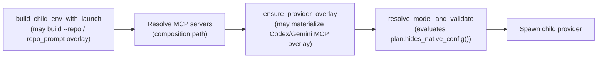
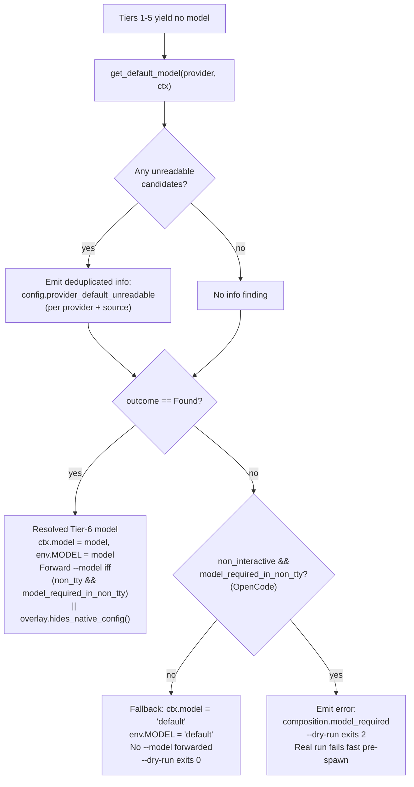

# Spike 2: Unified Passive `get_default_model(provider: Provider)` Across All 10 Providers & 4 OSes

This spike grounds the design of `get_default_model(provider: Provider)` for `2026-11-18-ergonomic-sequences` (`spec.md` Decision 5.4 and Candidate Spike #2). No production source files were modified. Every path, field name, parser dependency, source guard, and overlay capability below is verified directly against the current repository state.

---

## Executive Verdict

1. **All 10 registered providers have passively readable local model configuration.** None requires a subprocess, network call, or permanent `"default"`-only stub (including Antigravity, whose `~/.gemini/antigravity-cli/settings.json` carries a top-level `"model"` string).
2. **Zero new crate dependencies are required in `claudine/lib/Cargo.toml`.** All four file formats are already covered:
   - JSON → `serde_json` (`1.0`, `claudine/lib/Cargo.toml:64`)
   - JSONC (comments + trailing commas) → `biscuit_file::Json5::from_str` (`biscuit-file` with `features = ["json5"]`, `claudine/lib/Cargo.toml:52`)
   - TOML → `toml` (`1.0`, `claudine/lib/Cargo.toml:100`)
   - YAML → `serde_yaml_ng` (`0.10`, `claudine/lib/Cargo.toml:67`)
3. **Three live metadata discrepancies and one cross-OS environment-lookup bug were surfaced and must be fixed during implementation:**
   - **Bug 1 (`pi`):** `claudine/lib/src/provider/pi/data.rs:400` has `model_env_vars: &["PI_OFFLINE"]` (a boolean offline flag, not a model selector). Fix in `claudine/docs/providers/overrides/pi.yaml` and regenerate via `claudine-gen`.
   - **Bug 2 (`kilo`):** `claudine/lib/src/provider/kilo/data.rs:339` has `model_env_vars: &["KILO_PROVIDER"]` (an upstream provider selector, not a model ID). Fix in `claudine/docs/providers/overrides/kilo.yaml` and regenerate via `claudine-gen`.
   - **Nuance 3 (`kimi`):** `overlay_selector` (`KIMI_CODE_HOME` / `~/.kimi-code`, `claudine/lib/src/provider/kimi/data.rs:315-325`) is **correct** for current Kimi Code 2.x, while `config_paths` (`~/.kimi/config.*`) and `docs/research/model-config/kimi.md` reflect archived Python `kimi-cli` 1.x (`KIMI_SHARE_DIR` / `~/.kimi`). `get_default_model(Provider::KimiCode)` must read `~/.kimi-code/config.toml` (`$KIMI_CODE_HOME`) first and fall back to legacy `~/.kimi/config.{toml,json}` (`$KIMI_SHARE_DIR`) only when `KIMI_CODE_HOME` is unset.
   - **Cross-OS Bug 4 (`DocumentEnvironment::get`):** `claudine/lib/src/invocation_context/document_environment.rs:34-36` uses case-sensitive `HashMap::get(name)`, unlike `EnvBaseline::get` (`invocation_context.rs:638-648, 762-768`), which uses Windows ASCII case-insensitive matching. On native Windows, `AppData` / `ProgramData` / `UserProfile` frequently use mixed case and will miss an exact-case lookup.
4. **Two architectural refinements to `spec.md` are required before planning:**
   - **Memoization key:** `(Provider, config_root)` in `spec.md:68, 397` is insufficient because 7 of 10 providers read project-scoped config files relative to `(cwd, repo_root)` and OpenCode/Kilo read multiple config env vars (including inline JSON env vars). Use `(Provider, ConfigPlatform, home, project_cwd, repo_root, provider_env_fingerprint)`.
   - **Overlay-forwarding timing:** In `claudine/cli/src/commands/exec_prep/mod.rs:140-171`, `ensure_provider_overlay` can materialize a Codex/Gemini MCP overlay *after* `build_child_env_with_launch`. Tier-6 `--model` forwarding must evaluate `overlay_hides_native_config` against the final planned/effective overlay state (not only an already-built `env_plan.overlay`).

---

## 1. Full 10-Provider Audit & Metadata Reconciliation

### 1.1 Live Catalog Metadata Audit (`claudine/lib/src/provider/*/data.rs`)

Every `claudine/lib/src/provider/<slug>/data.rs` is generated by `claudine-gen` (`cargo run -p claudine-gen -- generate`; drift-checked by `cargo run -p claudine-gen -- check`). Do **not** hand-edit `data.rs`. The field `model_env_vars` is generated from `docs/research/agent-models/<slug>.md` → `model_selection` via `Coercion::EnvVarSitesToStringSlice` (`claudine/gen/src/registry.rs:609-619`) unless pinned in `claudine/docs/providers/overrides/<slug>.yaml`.

| Provider | `data.rs` `model_env_vars` | `data.rs` `overlay_selector` | `model_required_in_non_tty` | Audit Verdict & Required Action |
| --- | --- | --- | :---: | --- |
| `Claude` | `&["CLAUDE_MODEL", "ANTHROPIC_MODEL"]` (`claude/data.rs:284`) | `CLAUDE_CONFIG_DIR` (`ProviderDir`, `~/.claude`, `:342-352`) | `false` | **Clean.** Pinned in `overrides/claude.yaml:5-11`. |
| `Codex` | `&["CODEX_MODEL", "OPENAI_MODEL"]` (`codex/data.rs:256`) | `CODEX_HOME` (`ProviderDir`, `~/.codex`, `:291-303`) | `false` | **Clean.** Pinned in `overrides/codex.yaml:16-24`. |
| `Gemini` | `&["GEMINI_MODEL"]` (`gemini/data.rs:303`) | `GEMINI_CLI_HOME` (`ParentOfProviderDir { child: ".gemini" }`, `~/.gemini`, `:350-362`) | `false` | **Clean.** From `agent-models/gemini.md`. |
| `Goose` | `&["GOOSE_MODEL"]` (`goose/data.rs:238`) | `GOOSE_PATH_ROOT` (`ParentOfProviderDir { child: "config" }`, `source_root: None`, `:273-285`) | `false` | **Clean metadata; OS path caveat.** Goose v1.52.0 compiles `etcetera` with `default-features = false` (XDG on all OSes, `agent-cli/goose.md:95`), while older docs/builds used `%APPDATA%\Block\goose\config` (Windows) and `~/Library/Application Support/Block/goose/config` (macOS). Check XDG primary + OS-legacy fallback. |
| `KimiCode` | `&["KIMI_MODEL"]` (`kimi/data.rs:272`) | `KIMI_CODE_HOME` (`ProviderDir`, `~/.kimi-code`, `:315-325`) | `false` | **Two-generation layout (NOT a bug in `overlay_selector`).** Kimi Code 2.1.1 uses `KIMI_CODE_HOME` / `~/.kimi-code/config.toml` (`agent-cli/kimi.md:911-942, 1061, 1265`); legacy Python `kimi-cli` 1.x used `KIMI_SHARE_DIR` / `~/.kimi/config.{toml,json}` (`model-config/kimi.md:9-21`, `overrides/kimi.yaml:22-32`). `get_default_model` must probe `~/.kimi-code` first, then legacy `~/.kimi` when `KIMI_CODE_HOME` is unset. `KIMI_MODEL` is intentionally pinned in `overrides/kimi.yaml:15-21`. |
| `OpenCode` | `&["OPENCODE_MODEL"]` (`opencode/data.rs:635`) | `OPENCODE_CONFIG_DIR` (`ProviderDir`, `additive: true`, `source_root: None`, `:676-682`) | **`true`** | **Clean metadata; current CLI reader incomplete.** `cli/src/commands/wrap/profile/opencode.rs:20-42` only checks global dir via raw `std::env::var_os` and misses `OPENCODE_CONFIG_CONTENT`, `OPENCODE_CONFIG`, `OPENCODE_CONFIG_DIR`, project configs, and managed configs. Replace with unified `claudine-lib` lookup. |
| `QwenCode` | `&["QWEN_MODEL"]` (`qwen/data.rs:288`) | `QWEN_HOME` (`ProviderDir`, `~/.qwen`, `:323-329`) | `false` | **Intentional pin.** Upstream Qwen uses protocol-scoped `OPENAI_MODEL` / `ANTHROPIC_MODEL` / `GEMINI_MODEL` / `GOOGLE_MODEL` (`model-config/qwen.md:232`), but `overrides/qwen.yaml:5-13` deliberately pins `QWEN_MODEL` to prevent cross-provider contamination in multi-provider sequences. Keep pin. |
| `Kilo` | **`&["KILO_PROVIDER"]`** (`kilo/data.rs:339`) | `KILO_CONFIG_DIR` (`ProviderDir`, `additive: true`, `source_root: None`, `:380-386`) | `false` | **BUG — must fix.** `KILO_PROVIDER` selects an upstream provider ID, not a model ID; leaked from `agent-models/kilo.md:60-61` due to missing override. Add `model_env_vars: { value: [], reason: ... }` to `claudine/docs/providers/overrides/kilo.yaml` and run `cargo run -p claudine-gen -- generate`. |
| `Pi` | **`&["PI_OFFLINE"]`** (`pi/data.rs:400`) | `PI_CODING_AGENT_DIR` (`ProviderDir`, `~/.pi/agent`, `:435-445`) | `false` | **BUG — must fix.** `PI_OFFLINE=1` disables startup network checks; leaked from `agent-models/pi.md:108-111`. Currently `PI_OFFLINE=1` would make Tier 2 pass `--model 1`! Add `model_env_vars: { value: [], reason: ... }` to `claudine/docs/providers/overrides/pi.yaml` and run `cargo run -p claudine-gen -- generate`. |
| `Antigravity` | `&[]` (`antigravity/data.rs:268`) | `None` (`antigravity/data.rs:303`) | `false` | **Clean.** Passive config lives at `<home>/.gemini/antigravity-cli/settings.json` on all 4 OSes (`agent-cli/antigravity.md:1340-1344`). |

---

### 1.2 Verified 10-Provider Passive Default-Model Matrix

All paths are listed in **highest-to-lowest precedence** (first readable file containing a non-empty model string wins, except `Pi` where `defaultProvider` and `defaultModel` merge across project and user settings).

> **Passive-read exclusions (intentional):**
> - OS-level non-file policy stores (macOS MDM `.mobileconfig` plists, Windows Registry keys) are **not** queried — they require platform APIs or subprocesses.
> - Auto-loaded `.env` files (Gemini/Qwen `.env`) are **not** parsed by `get_default_model` — they frequently store raw API keys and govern env-var injection (Tier 2), not structured settings files.
> - Profile-scoped Codex files (`$CODEX_HOME/<profile>.config.toml`) apply only when a `--profile` CLI flag is passed and are therefore outside passive default discovery.

| # | Provider | Env Overrides (Config Dir / File) | Precedence Chain (Highest → Lowest) | Format & Crate | Key / Extraction Rule |
| :-: | --- | --- | --- | --- | --- |
| 1 | **Claude** | `CLAUDE_CONFIG_DIR` (`ProviderDir`) | 1. Managed file: macOS `/Library/Application Support/ClaudeCode/managed-settings.json`, Linux/WSL2 `/etc/claude-code/managed-settings.json`, Win `%ProgramData%\ClaudeCode\managed-settings.json`<br>2. Project local: `<project_root>/.claude/settings.local.json`<br>3. Project shared: `<project_root>/.claude/settings.json`<br>4. User: `$CLAUDE_CONFIG_DIR/settings.json` else `<home>/.claude/settings.json` | JSON (`serde_json`) | Within each file, check `env.ANTHROPIC_MODEL` first (persisted env override takes precedence over `model` in Claude Code, `model-config/claude.md:312`), then top-level `"model"`. Trim; require non-empty string. |
| 2 | **Codex** | `CODEX_HOME` (`ProviderDir`) | 1. Project: `<dir>/.codex/config.toml` (closest to `cwd` walking up to `repo_root`; see trust note below)<br>2. User: `$CODEX_HOME/config.toml` else `<home>/.codex/config.toml`<br>3. System (Unix/WSL2): `/etc/codex/config.toml` | TOML (`toml`) | Top-level `model` (TOML string). Trim; require non-empty. Ignore legacy `~/.codex/config.json` (`model-config/codex.md:221`). |
| 3 | **Gemini** | `GEMINI_CLI_HOME` (`ParentOfProviderDir { child: ".gemini" }`), `GEMINI_CLI_SYSTEM_SETTINGS_PATH`, `GEMINI_CLI_SYSTEM_DEFAULTS_PATH` | 1. System override: `$GEMINI_CLI_SYSTEM_SETTINGS_PATH` else macOS `/Library/Application Support/GeminiCli/settings.json`, Linux/WSL2 `/etc/gemini-cli/settings.json`, Win `%ProgramData%\gemini-cli\settings.json`<br>2. Project: `<project_root>/.gemini/settings.json`<br>3. User: `$GEMINI_CLI_HOME/.gemini/settings.json` else `<home>/.gemini/settings.json`<br>4. System defaults: `$GEMINI_CLI_SYSTEM_DEFAULTS_PATH` else `.../system-defaults.json` | JSON (`serde_json`) | Nested `model.name` (`root.get("model")?.get("name")?.as_str()`). Trim; require non-empty. |
| 4 | **Goose** | `GOOSE_PATH_ROOT` (`ParentOfProviderDir { child: "config" }`, exclusive), `XDG_CONFIG_HOME`, `APPDATA` (Win legacy), `GOOSE_ADDITIONAL_CONFIG_FILES` | 1. **If `GOOSE_PATH_ROOT` set & absolute (exclusive):** `$GOOSE_PATH_ROOT/config/config.yaml` *(stop — do not consult user/XDG/legacy)*<br>2. User primary (XDG on all 4 OSes in v1.52.0): `$XDG_CONFIG_HOME/goose/config.yaml` else `<home>/.config/goose/config.yaml`<br>3. User legacy fallback (if primary absent/no key): Win `%APPDATA%\Block\goose\config\config.yaml`; macOS `<home>/Library/Application Support/Block/goose/config/config.yaml`<br>4. `GOOSE_ADDITIONAL_CONFIG_FILES` (split by `:` on Unix / `;` on Windows, last entry wins)<br>5. System: Unix/WSL2 `/etc/goose/config.yaml`; Win `%ProgramData%\goose\config.yaml` → `%ProgramData%\Block\goose\config\config.yaml` | YAML (`serde_yaml_ng`) | Top-level `GOOSE_MODEL` (YAML string). Trim; require non-empty. (Do not concatenate `GOOSE_PROVIDER`; `goose run --model` takes the model ID alone.) |
| 5 | **KimiCode** | `KIMI_CODE_HOME` (`ProviderDir`, exclusive 2.x), `KIMI_SHARE_DIR` (`ProviderDir`, legacy 1.x fallback) | 1. **If `KIMI_CODE_HOME` set & absolute (exclusive):** `$KIMI_CODE_HOME/config.toml` *(stop — no legacy fallback)*<br>2. Current user (2.x): `<home>/.kimi-code/config.toml`<br>3. Legacy fallback (only when `KIMI_CODE_HOME` unset and step 2 absent/no key):<br>   - If `KIMI_SHARE_DIR` set & absolute: `$KIMI_SHARE_DIR/config.toml` → `$KIMI_SHARE_DIR/config.json`<br>   - Else: `<home>/.kimi/config.toml` → `<home>/.kimi/config.json` | TOML (`toml`) + JSON fallback (`serde_json`) | Top-level `default_model` (string). Trim; require non-empty. The value is a `[models]` alias key (e.g. `"kimi-code/kimi-for-coding"`) and is directly valid for `kimi --model` (`agent-cli/kimi.md:368-376`). |
| 6 | **OpenCode** | `OPENCODE_CONFIG_CONTENT` (inline JSON), `OPENCODE_CONFIG_DIR` (additive dir), `OPENCODE_CONFIG` (custom file), `XDG_CONFIG_HOME` | 1. Managed: macOS `/Library/Application Support/opencode/`, Linux/WSL2 `/etc/opencode/`, Win `%ProgramData%\opencode\` (`opencode.jsonc` > `opencode.json`)<br>2. Inline env: `OPENCODE_CONFIG_CONTENT`<br>3. Additive custom dir: `$OPENCODE_CONFIG_DIR/{opencode.jsonc,opencode.json}`<br>4. Project (walk `cwd` up to `repo_root`, closest dir wins): `opencode.jsonc` > `opencode.json` > `.opencode/opencode.jsonc` > `.opencode/opencode.json`<br>5. Custom file env: `$OPENCODE_CONFIG`<br>6. Global user (`$XDG_CONFIG_HOME/opencode` else `<home>/.config/opencode` on **all 4 OSes**): `opencode.jsonc` > `opencode.json` > `config.json` | JSONC (`biscuit_file::Json5::from_str`); JSON (`serde_json`) for inline env | Top-level `"model"` (string, e.g. `"zai-coding-plan/glm-5.2"`). Trim; require non-empty. |
| 7 | **QwenCode** | `QWEN_HOME` (`ProviderDir`), `QWEN_CODE_SYSTEM_SETTINGS_PATH`, `QWEN_CODE_SYSTEM_DEFAULTS_PATH` | 1. System override: `$QWEN_CODE_SYSTEM_SETTINGS_PATH` else macOS `/Library/Application Support/QwenCode/settings.json`, Linux/WSL2 `/etc/qwen-code/settings.json`, Win `%ProgramData%\qwen-code\settings.json`<br>2. Project: `<project_root>/.qwen/settings.json`<br>3. User: `$QWEN_HOME/settings.json` else `<home>/.qwen/settings.json`<br>4. System defaults: `$QWEN_CODE_SYSTEM_DEFAULTS_PATH` else `.../system-defaults.json` | JSON (`serde_json`) | Nested `model.name` (`root.get("model")?.get("name")?.as_str()`). Trim; require non-empty. |
| 8 | **Kilo** | `KILO_CONFIG_CONTENT` (inline JSON), `KILO_CONFIG_DIR` (additive dir), `KILO_CONFIG` (custom file), `KILO_DISABLE_PROJECT_CONFIG`, `XDG_CONFIG_HOME` | 1. Managed: macOS `/Library/Application Support/kilo/`, Linux/WSL2 `/etc/kilo/`, Win `%ProgramData%\kilo\` (`kilo.jsonc` > `kilo.json` > `opencode.jsonc` > `opencode.json`)<br>2. Inline env: `KILO_CONFIG_CONTENT`<br>3. Additive custom dir: `$KILO_CONFIG_DIR/{opencode.jsonc,opencode.json,kilo.jsonc,kilo.json}`<br>4. Project (skipped if `KILO_DISABLE_PROJECT_CONFIG` is truthy; walk `cwd` up to `repo_root`): root `{kilo,opencode}.{jsonc,json}` > `.kilo/{kilo,opencode}.{jsonc,json}` > `.kilocode/{kilo,opencode}.{jsonc,json}`<br>5. Custom file env: `$KILO_CONFIG`<br>6. Global user (`$XDG_CONFIG_HOME/kilo` else `<home>/.config/kilo` on **all 4 OSes**, verified `agent-cli/kilo.md:3791` — Windows uses `home/.config`, **not** `%APPDATA%`): `opencode.jsonc` > `opencode.json` > `kilo.jsonc` > `kilo.json` > `config.json` (reverse of upstream load order `config.json, kilo.json, kilo.jsonc, opencode.json, opencode.jsonc`) | JSONC (`biscuit_file::Json5::from_str`); JSON (`serde_json`) for inline env | Top-level `"model"` (string, e.g. `"anthropic/claude-sonnet-4.6"`). Trim; require non-empty. |
| 9 | **Pi** | `PI_CODING_AGENT_DIR` (`ProviderDir`) | 1. Project: `<project_root>/.pi/settings.json` *(note: Pi's structured non-interactive stream passes `--no-approve`, `pi/data.rs:108`, which skips project-local files! See §1.3 note below)*<br>2. User: `$PI_CODING_AGENT_DIR/settings.json` else `<home>/.pi/agent/settings.json` | JSON (`serde_json`) | **Compound merge (`defaultProvider` + `defaultModel`):**<br>- Take `defaultModel` from highest layer that defines it; take `defaultProvider` from highest layer that defines it (independent field merge, because Pi merges nested settings objects across `.pi/settings.json` and `~/.pi/agent/settings.json`).<br>- If `defaultModel` is absent/empty → `NotConfigured` (`defaultProvider` alone never selects a model, `agent-models/pi.md:91`).<br>- If `defaultProvider` is present and `!defaultModel.starts_with(&format!("{defaultProvider}/"))` → emit `"{defaultProvider}/{defaultModel}"` (e.g. `"omlx/Qwen3.6-35B-A3B-oQ6"`), which `pi --model` accepts verbatim (`pi/data.rs:728`).<br>- Otherwise emit `defaultModel`. |
| 10 | **Antigravity** | *(none)* | 1. User only: `<home>/.gemini/antigravity-cli/settings.json` (on macOS, Linux, WSL2, and Windows `%USERPROFILE%\.gemini\antigravity-cli\settings.json`, `agent-cli/antigravity.md:1340-1344`) | JSON (`serde_json`) | Top-level `"model"` (string, e.g. `"Gemini 3.1 Pro (High)"`). Trim leading/trailing whitespace only; preserve internal spaces and parentheses verbatim. |

### 1.3 Subtle Provider Edge Cases Flagged by Audit

1. **Pi `--no-approve` vs. `.pi/settings.json`:** In `claudine/lib/src/provider/pi/data.rs:108` and `pi/data.rs:771`, Claudine's structured stream companion flag is `--no-approve` ("Ignores project-local files for this run"). When Pi runs under `--no-approve` (non-interactive structured mode), Pi itself ignores `.pi/settings.json`.
   - **Recommendation:** Expose an optional `include_project_config: bool` (default `true` for general lookup / interactive, or let `Provider::Pi` check project `.pi/settings.json` only when project files are enabled). At minimum, document this in the resolver so interactive vs. non-interactive Pi runs never surprise authors with a project-pinned model that `--no-approve` would skip.
2. **Codex project trust gating:** `model-config/codex.md:20` notes `.codex/config.toml` is loaded by Codex only when the project is trusted (`[projects."<path>"].trust_level = "trusted"` in user `config.toml`). For passive lookup, checking `<dir>/.codex/config.toml` directly is simple and matches all other providers, or (optional refinement) verifying trust in the user `config.toml` if already parsed. Given that Claudine runs inside trusted developer workspaces, reading project `.codex/config.toml` directly (with user `config.toml` fallback) is consistent and predictable; note the trust precondition in docs.
3. **Project root anchor for project-scoped configs:**
   - Single-file project configs (`Claude`, `Gemini`, `QwenCode`, `Pi`): check `repo_root` (if known), else `cwd`. If `cwd != repo_root`, check `cwd` before `repo_root` only for providers that walk up (`Codex`, `OpenCode`, `Kilo`).
   - Upward-walking providers (`Codex`, `OpenCode`, `Kilo`): walk `dir = cwd`, `dir = dir.parent()` up to and including `repo_root` (if `cwd` is inside `repo_root`; otherwise check `cwd` alone — never walk above `repo_root` or into `/`!). Bound walk depth defensively (e.g., max 32 ancestors) to protect `< 10ms` latency.

---

## 2. Cross-OS Path Resolution via `DocumentEnvironment` + `HomeBaseline`

### 2.1 Existing Guards & Invariants in `claudine/lib`

Two L1 source guards and one Clippy configuration strictly govern `claudine/lib/src/`:

| Guard | Location | Enforced Rule |
| --- | --- | --- |
| **Context Construction Guard** | `claudine/lib/tests/l1/context_construction_guard.rs` + `darkmatter/cli/tests/common/context_guard.rs:11-23` | **Forbids** any new ambient process read in `claudine/lib/src/`: `std::env::{var, var_os, vars, vars_os, current_dir, home_dir}`, `dirs::home_dir`, `home::home_dir`, `biscuit_file::home_dir`, `biscuit_file::capture_env`. Allowlist is exact-count pinned (`context_construction_guard.rs:22-167`); any new call fails L1. |
| **Path Lookup Guard** | `claudine/lib/tests/l1/path_lookup_guard.rs` + `darkmatter/cli/tests/common/path_lookup_guard.rs:5-17` | **Forbids** direct `std::fs::canonicalize`, `.canonicalize()`, `dunce::canonicalize` (use `biscuit_file::canonicalize_simplified`) and direct `dirs::home_dir` / `std::env::home_dir` / `home::home_dir`. |
| **Clippy `disallowed_methods`** | `claudine/lib/src/lib.rs:3` + `claudine/lib/clippy.toml:11-16` | Denies `std::process::Command::new`, `tokio::process::Command::new`, and `env_clear` in non-test builds (structurally enforces zero subprocesses). |

**Consequence:** `get_default_model` in `claudine/lib` **must take all inputs explicitly** — zero `std::env::*`, zero `biscuit_file::home_dir()`, zero `std::env::current_dir()`. All callers already hold:
- `HomeBaseline` (`InvocationContext::home_baseline()`) → `home: Option<&Path>` via `HomeBaseline::resolved()` (`invocation_context.rs:695`)
- `DocumentEnvironment` (`InvocationContext::environment()` / document's captured environment) or `EnvBaseline`
- `cwd: Option<&Path>` and `repo_root: Option<&Path>` (from `InvocationContext` / `LaunchWorkspaceContext` / `SourceContext`)

### 2.2 Critical Windows Bug Found in `DocumentEnvironment::get`

In `claudine/lib/src/invocation_context/document_environment.rs:34-36`:
```rust
pub fn get(&self, name: &str) -> Option<&str> {
    self.vars.get(name).map(String::as_str)
}
```
Compare with `EnvBaseline::get` (`claudine/lib/src/invocation_context.rs:638-648, 762-768`):
```rust
fn env_names_match(left: &OsStr, right: &OsStr) -> bool {
    #[cfg(windows)]
    { left.to_string_lossy().eq_ignore_ascii_case(&right.to_string_lossy()) }
    #[cfg(not(windows))]
    { left == right }
}
```
Because `biscuit_file::capture_env()` preserves raw OS casing (`AppData`, `ProgramData`, `UserProfile`, `Path`), `DocumentEnvironment::get("APPDATA")` or `DocumentEnvironment::get("PROGRAMDATA")` will return `None` on native Windows whenever Windows preserves mixed case!

**Required fix during implementation:** Add a platform-aware lookup helper on `DocumentEnvironment` (or in `default_model.rs` accepting `ConfigPlatform`):
- For `ConfigPlatform::Windows`: exact `vars.get(name)` fast path, falling back to `vars.iter().find(|(k, _)| k.eq_ignore_ascii_case(name)).map(|(_, v)| v.as_str())`.
- For `ConfigPlatform::MacOs` / `ConfigPlatform::Linux`: exact `vars.get(name)`.
This keeps `O(1)` fast path on all OSes and guarantees deterministic case-insensitive behavior on Windows AND in cross-platform unit tests running on Linux/macOS!

### 2.3 Platform Abstraction (`ConfigPlatform`) & 4-OS Path Rules

Follow the exact pattern proven in `biscuit-file/lib/src/file_reference/context.rs:1541-1571` (`CacheOs` + `user_cache_dir_from`):

```rust
#[derive(Debug, Clone, Copy, PartialEq, Eq, Hash)]
pub enum ConfigPlatform {
    MacOs,
    /// Covers both native Linux and WSL2 (WSL2 runs Linux binaries and follows
    /// Linux code paths — `.claude/skills/os/SKILL.md:135`).
    Linux,
    Windows,
}

impl ConfigPlatform {
    pub const fn current() -> Self {
        if cfg!(target_os = "macos") {
            Self::MacOs
        } else if cfg!(windows) {
            Self::Windows
        } else {
            Self::Linux
        }
    }
}
```

#### Concrete 4-OS Resolution Table

| Dimension | macOS | Linux | WSL2 | Native Windows |
| --- | --- | --- | --- | --- |
| **`ConfigPlatform`** | `MacOs` | `Linux` | `Linux` | `Windows` |
| **User `<home>`** | `HomeBaseline::resolved()` (`$HOME`) | `HomeBaseline::resolved()` (`$HOME`) | `HomeBaseline::resolved()` (`$HOME`, Linux guest home) | `HomeBaseline::resolved()` (`%USERPROFILE%`, never `HOME` alone — `windows-paths.md` Trap #5) |
| **XDG Config Base** (OpenCode, Kilo, Goose primary) | `$XDG_CONFIG_HOME` (if absolute), else `<home>/.config` | `$XDG_CONFIG_HOME` (if absolute), else `<home>/.config` | `$XDG_CONFIG_HOME` (if absolute), else `<home>/.config` | `$XDG_CONFIG_HOME` (if absolute), else `<home>\.config` *(verified: OpenCode, Kilo, and Goose v1.52.0 all use `.config` on Windows, not `%APPDATA%`)* |
| **Legacy Roaming AppData** (Goose Windows fallback only) | — | — | — | `%APPDATA%\Block\goose\config\config.yaml` (only if `APPDATA` set & absolute) |
| **Legacy Apple Support** (Goose macOS fallback only) | `<home>/Library/Application Support/Block/goose/config/config.yaml` | — | — | — |
| **System / Managed Base** | `/Library/Application Support/<App>/` (ClaudeCode, GeminiCli, QwenCode, opencode, kilo); `/etc/{codex,goose}/` | `/etc/<app>/` | `/etc/<app>/` | `%ProgramData%\<app>\` (only if `ProgramData` set & absolute; fallback `None`, never hardcode `C:\ProgramData`) |
| **Path-list Separator** (`GOOSE_ADDITIONAL_CONFIG_FILES`) | `:` | `:` | `:` | `;` |
| **Env-var Name Matching** | Case-sensitive | Case-sensitive | Case-sensitive | Case-insensitive ASCII |

#### Cross-OS Path Traps Explicitly Mitigated (`.claude/skills/os/windows-paths.md`)

1. **No `/` inside `Path::join` (`windows-paths.md` Traps #4 & #8):** Never write `home.join(".gemini/antigravity-cli/settings.json")`. Always join component-by-component: `home.join(".gemini").join("antigravity-cli").join("settings.json")`. Note `PathTemplate::resolve_with_home` (`path_template.rs:176-183`) uses `home.join(rest)` with literal `/`; `default_model` must construct paths via chained `.join()` (or `rest.split('/').fold(home.to_path_buf(), |p, s| p.join(s))`) so Windows paths never carry mixed separators or break under `\\?\` verbatim prefixes.
2. **Absolute-only env-var overrides (`context.rs:1565`, `plan.rs:518`):** Every path-valued env var (`CLAUDE_CONFIG_DIR`, `CODEX_HOME`, `GEMINI_CLI_HOME`, `GOOSE_PATH_ROOT`, `KIMI_CODE_HOME`, `KIMI_SHARE_DIR`, `OPENCODE_CONFIG`, `OPENCODE_CONFIG_DIR`, `QWEN_HOME`, `KILO_CONFIG`, `KILO_CONFIG_DIR`, `PI_CODING_AGENT_DIR`, `XDG_CONFIG_HOME`, `APPDATA`, `PROGRAMDATA`, `*_SYSTEM_*_PATH`) must be trimmed, non-empty, and checked for platform-appropriate absoluteness (on `ConfigPlatform::Windows`, drive-qualified `C:\...` / `C:/...` or UNC `\\server\share`; on Unix, leading `/` — using a small platform-aware `is_absolute_for(platform, raw)` helper so unit tests on Linux can validate Windows paths without `std::path::Path::is_absolute` rejecting `C:\Users\...`!).
3. **Windows `ErrorKind::InvalidFilename` (`windows-paths.md` Trap #16):** Treat both `io::ErrorKind::NotFound` and `io::ErrorKind::NotADirectory` as "candidate absent" (silent skip, not an unreadable error). Any other I/O error (`PermissionDenied`, `InvalidData`, `InvalidFilename`, `Other`) on an existing/explicitly named path produces `UnreadableConfig` (`config.provider_default_unreadable`).
4. **No `canonicalize` in `get_default_model`:** Candidate paths are read directly and surfaced as-built (matching `HomeBaseline` / `cwd` spelling, avoiding verbatim `\\?\` leakage and 8.3 short-name mismatches). Only if comparing `cwd` against `repo_root` for upward walking should we use `biscuit_file::canonicalize_simplified` (or lexical `strip_prefix` after normalizing components).
5. **WSL2 `drvfs` safety (`.claude/skills/os/wsl.md`):** `get_default_model` performs strictly read-only `File::open` + `metadata` + `read`, never checks Unix mode bits (`0o600`), never calls `chmod` or `renameat2`. Works identically on ext4 and `/mnt/<drive>`.

---

## 3. Overlay-Hiding Predicate (`OverlayPlan` / `OverlaySelectorSpec`) for Tier-6 `--model` Forwarding

### 3.1 How Overlays Actually Work Across All 10 Providers

Audited across `claudine/lib/src/provider_overlay/{mod,plan,selector}.rs`, `claudine/cli/src/commands/wrap/provider_overlay.rs`, `claudine/lib/src/mcp/inject.rs`, and `claudine/fixes/_completed/2026-09-12-shadow-home/audit.md`:

| Provider | `overlay_selector` | `additive` | Relocates `Config`? | Active Overlay Reasons (`OverlayCapability`) | Does Active Overlay Redirect/Hide Native Config Root? | Tier-6 `--model` Forwarding Condition |
| --- | --- | :---: | :---: | --- | :---: | --- |
| **Claude** | `CLAUDE_CONFIG_DIR` (`ProviderDir`) | `false` | **Yes** | `RepoResources: NativeRoot` | **Yes** when `plan.requires_materialization()` | Forward iff `overlay_hides_native_config` |
| **Codex** | `CODEX_HOME` (`ProviderDir`) | `false` | **Yes** | `RepoResources`, `RepoPrompt`, `Mcp`: all `NativeRoot` | **Yes** when `plan.requires_materialization()` (and `Mcp` rewrites overlay `config.toml`) | Forward iff `overlay_hides_native_config` |
| **Gemini** | `GEMINI_CLI_HOME` (`ParentOfProviderDir { ".gemini" }`) | `false` | **Yes** | `RepoResources`, `Mcp`: `NativeRoot` | **Yes** when `plan.requires_materialization()` (and `Mcp` rewrites overlay `.gemini/settings.json`) | Forward iff `overlay_hides_native_config` |
| **Goose** | `GOOSE_PATH_ROOT` (`ParentOfProviderDir { "config" }`, `source_root: None`) | `false` | **Yes** | All `Unsupported` today | No overlay possible today (`Yes` automatically if `NativeRoot` is ever enabled) | Never today; automatic if overlay added |
| **KimiCode** | `KIMI_CODE_HOME` (`ProviderDir`, `~/.kimi-code`) | `false` | **Yes** | `RepoResources: NativeRoot` | **Yes** when `plan.requires_materialization()` (critically: `KIMI_CODE_HOME=<overlay>` **completely hides** legacy `~/.kimi/config.toml`!) | Forward iff `overlay_hides_native_config` |
| **OpenCode** | `OPENCODE_CONFIG_DIR` (`ProviderDir`, `source_root: None`) | **`true`** | Yes (additive) | `Mcp: ComposableInjection` (inline `OPENCODE_CONFIG_CONTENT`; **no** storage root); `RepoResources: Unsupported` | **No** (`requires_materialization() == false`, `additive == true`) | **Always in non-interactive mode** (`model_required_in_non_tty == true`) |
| **QwenCode** | `QWEN_HOME` (`ProviderDir`) | `false` | **Yes** | `RepoResources: NativeRoot` | **Yes** when `plan.requires_materialization()` | Forward iff `overlay_hides_native_config` |
| **Kilo** | `KILO_CONFIG_DIR` (`ProviderDir`, `source_root: None`) | **`true`** | Yes (additive) | `Mcp: ComposableInjection` (inline `KILO_CONFIG_CONTENT`; **no** storage root); `RepoResources: Unsupported` | **No** (`requires_materialization() == false`, `additive == true`) | Never (additive inline MCP leaves native config untouched) |
| **Pi** | `PI_CODING_AGENT_DIR` (`ProviderDir`, `~/.pi/agent`) | `false` | **Yes** | `RepoResources: NativeRoot` | **Yes** when `plan.requires_materialization()` | Forward iff `overlay_hides_native_config` |
| **Antigravity** | `None` | — | No | All `Unsupported` | **No** (no overlay possible) | Never |

### 3.2 Exact Predicate (Provider-Neutral, Zero `match Provider`)

Place this pure predicate in `claudine/lib/src/provider_overlay/plan.rs` (on `OverlayPlan`) so both `claudine-lib` and `claudine-cli` share one source of truth:

```rust
impl OverlayPlan {
    /// Whether this overlay redirects the provider away from its native
    /// configuration root via an exclusive (non-additive) config selector.
    ///
    /// True for materialized `NativeRoot` overlays whose selector relocates
    /// `OverlayResourceClass::Config` exclusively (Claude, Codex, Gemini,
    /// KimiCode, Pi, QwenCode — and Goose if it ever gains a `NativeRoot`
    /// strategy). False for inline `ComposableInjection` plans (OpenCode and
    /// Kilo MCP injection, which acquire no storage root and merge additively).
    pub fn hides_native_config(&self) -> bool {
        if !self.requires_materialization() {
            return false;
        }
        crate::provider::provider_info(self.provider)
            .overlay_selector
            .is_some_and(|spec| {
                !spec.additive && spec.relocates(OverlayResourceClass::Config)
            })
    }
}
```

And the unified Tier-6 `--model` child argv forwarding rule in `exec_prep::resolve_model_and_validate`:

```rust
let must_forward_tier6 = (non_interactive && info.model_required_in_non_tty)
    || overlay_hides_native_config;
```

### 3.3 Why Materialized `NativeRoot` Overlays MUST Count as "Hiding Native Config"

Even though `mirror_source_root` (`claudine/cli/src/commands/wrap/provider_overlay.rs:338-369`) mirrors top-level files from `source_root` into `provider_visible_root`, treating every materialized exclusive `Config`-relocating overlay as `hides_native_config() == true` is load-bearing for three verified reasons:

1. **Kimi two-generation divergence:** `OverlayPlanner` builds from `source_root = ~/.kimi-code` (`kimi/data.rs:324`). If the user's `default_model` lives in legacy `~/.kimi/config.toml` and `~/.kimi-code` does not exist yet, `materialize()` creates an **empty** overlay and sets `KIMI_CODE_HOME=<overlay>`, hiding `~/.kimi/config.toml` completely. Forwarding `--model` keeps execution consistent with `ctx.model` / `env.MODEL`.
2. **In-overlay config mutation (Codex & Gemini MCP):** `CodexInjector` (`mcp/inject.rs:207-299`) and `GeminiInjector` (`mcp/inject.rs:339-384`) rewrite `config.toml` / `settings.json` inside `provider_visible_root`. Forwarding the Tier-6 default guarantees the child cannot silently pick a different model from a modified or blank overlay config.
3. **Zero impact on normal launches:** Without `--repo`, Codex repo prompts, or Codex/Gemini `--mcp`, `env_plan.overlay` is `None`, so `hides_native_config` is `false` and Tier-6 defaults are never injected onto argv unnecessarily (preserving native provider behavior and user passthrough flags).

### 3.4 Critical Pipeline-Ordering Catch (`exec_prep/mod.rs`)

In `claudine/cli/src/commands/exec_prep/mod.rs:140-171`, `ensure_provider_overlay` handles the composition path where MCP servers are resolved *after* `build_child_env_with_launch`:



**Requirement for implementation:** `resolve_model_and_validate` must either execute **after** `ensure_provider_overlay` (passing `env_plan.overlay.as_ref()`) OR take a boolean `overlay_hides_native_config = env_plan.overlay.as_ref().is_some_and(OverlayPlan::hides_native_config) || (needs_mcp_overlay && provider.overlay_capability(OverlayReason::Mcp) == OverlayCapability::NativeRoot)`. Evaluating `hides_native_config` before `ensure_provider_overlay` would miss Codex and Gemini composition runs that request MCP servers without `--repo`.

---

## 4. Rust API Design, Memoization, `< 10ms` Budget & Malformed-Config Resilience

### 4.1 Proposed Public API in `claudine/lib`

Module location: `claudine/lib/src/provider/default_model.rs` (re-exported from `claudine::provider`).

```rust
/// Where a passive default model (or an unreadable config diagnostic) came from.
#[derive(Debug, Clone, PartialEq, Eq, Hash)]
pub enum DefaultModelSource {
    /// A configuration file on the local filesystem.
    File(PathBuf),
    /// An inline JSON configuration environment variable
    /// (e.g. `OPENCODE_CONFIG_CONTENT`, `KILO_CONFIG_CONTENT`).
    InlineEnv(&'static str),
}

impl DefaultModelSource {
    /// Human-readable location label for diagnostics and `--dry-run` provenance.
    pub fn display_location(&self) -> String {
        match self {
            Self::File(path) => path.display().to_string(),
            Self::InlineEnv(var) => format!("${var}"),
        }
    }
}

/// Classification of why a candidate config could not be read or parsed.
#[derive(Debug, Clone, Copy, PartialEq, Eq, Hash)]
pub enum UnreadableConfigKind {
    /// I/O error (permission denied, non-regular file, invalid filename, etc.).
    Io,
    /// File or inline value exceeded `MAX_CONFIG_FILE_BYTES` (1 MiB).
    TooLarge,
    /// Malformed JSON, JSONC/JSON5, TOML, or YAML syntax.
    Parse,
    /// Root document or model field had an unexpected non-object / non-string type.
    InvalidType,
}

/// One candidate config that existed (or was explicitly named) but could not be read.
#[derive(Debug, Clone, PartialEq, Eq)]
pub struct UnreadableConfig {
    pub provider: Provider,
    pub source: DefaultModelSource,
    pub kind: UnreadableConfigKind,
    pub reason: String,
}

/// Primary lookup outcome for `get_default_model`.
#[derive(Debug, Clone, PartialEq, Eq)]
pub enum DefaultModelOutcome {
    /// A configured default model was found.
    Found {
        model: String,
        source: DefaultModelSource,
    },
    /// No candidate config existed or none declared a non-empty model.
    NotConfigured,
    /// No valid model was found, and at least one candidate config was unreadable.
    /// (The primary failure is carried here; all unreadable candidates are also
    /// listed on `DefaultModelLookup::unreadable`.)
    Unreadable {
        source: DefaultModelSource,
        kind: UnreadableConfigKind,
        reason: String,
    },
}

/// Complete passive lookup result, including any higher-precedence unreadable
/// configs skipped before falling through to a lower-precedence valid default.
#[derive(Debug, Clone, PartialEq, Eq)]
pub struct DefaultModelLookup {
    pub outcome: DefaultModelOutcome,
    /// Every candidate encountered during this lookup that was unreadable/malformed
    /// (empty when all inspected candidates were missing or valid).
    pub unreadable: Vec<UnreadableConfig>,
}

impl DefaultModelLookup {
    pub fn model(&self) -> Option<&str> {
        match &self.outcome {
            DefaultModelOutcome::Found { model, .. } => Some(model.as_str()),
            DefaultModelOutcome::NotConfigured | DefaultModelOutcome::Unreadable { .. } => None,
        }
    }
}

/// Pure, explicit inputs for passive default-model resolution (zero ambient reads).
#[derive(Debug, Clone, Copy)]
pub struct DefaultModelContext<'a> {
    pub home: Option<&'a Path>,
    pub env: &'a DocumentEnvironment,
    pub cwd: Option<&'a Path>,
    pub repo_root: Option<&'a Path>,
    pub platform: ConfigPlatform,
    /// Set to `false` when the provider launch disables project-local configs
    /// (e.g. Pi's structured `--no-approve` mode). Defaults to `true`.
    pub include_project_config: bool,
}

/// Strictly passive default-model lookup for any of the 10 registered providers.
pub fn get_default_model(
    provider: Provider,
    ctx: &DefaultModelContext<'_>,
) -> DefaultModelLookup;
```

**Why `DefaultModelLookup { outcome, unreadable }` beats a bare 3-variant enum:**
If `.claude/settings.local.json` has a JSON syntax error AND `~/.claude/settings.json` sets `"model": "sonnet"`, `outcome` is `Found { model: "sonnet", source: File("~/.claude/settings.json") }` while `unreadable` still captures `.claude/settings.local.json` so Claudine can emit the deduplicated `config.provider_default_unreadable` (`info`) finding without throwing away the working user default.

### 4.2 Exact Memoization Key & Cache Placement (`InvocationContext`)

`spec.md:68, 397` sketched keying memoization by `(Provider, config_root)`. Because 7 providers consult project-local configs (`Claude`, `Codex`, `Gemini`, `OpenCode`, `QwenCode`, `Kilo`, `Pi`) and 4 providers consult multiple config env vars (including inline JSON env vars), a single `config_root` is insufficient and would serve stale results when a sequence switches directories or runs a task with a different `DocumentEnvironment`.

**Exact memoization key:**

```rust
#[derive(Debug, Clone, PartialEq, Eq, Hash)]
pub struct DefaultModelCacheKey {
    pub provider: Provider,
    pub platform: ConfigPlatform,
    pub home: Option<PathBuf>,
    /// Populated only for providers that read project-local config files
    /// (Claude, Codex, Gemini, OpenCode, QwenCode, Kilo, Pi).
    /// Normalized to `None` for user-only providers (Goose, KimiCode, Antigravity)
    /// so tasks across different subdirectories share one cache entry.
    pub project_cwd: Option<PathBuf>,
    /// Populated only for providers that read project-local config files.
    pub repo_root: Option<PathBuf>,
    /// Whether project-local config files are enabled (relevant to Pi `--no-approve`).
    pub include_project_config: bool,
    /// Ordered snapshot of ONLY this provider's config-locating env vars.
    pub env_fingerprint: Vec<(&'static str, Option<String>)>,
}
```

Per-provider `env_fingerprint` variable lists (exact & minimal):

| Provider | Project-Scoped? | Env Vars Included in `env_fingerprint` |
| --- | :---: | --- |
| `Claude` | Yes | `CLAUDE_CONFIG_DIR`, `PROGRAMDATA` *(Windows)* |
| `Codex` | Yes | `CODEX_HOME` |
| `Gemini` | Yes | `GEMINI_CLI_HOME`, `GEMINI_CLI_SYSTEM_SETTINGS_PATH`, `GEMINI_CLI_SYSTEM_DEFAULTS_PATH`, `PROGRAMDATA` *(Windows)* |
| `Goose` | **No** | `GOOSE_PATH_ROOT`, `XDG_CONFIG_HOME`, `APPDATA` *(Windows)*, `GOOSE_ADDITIONAL_CONFIG_FILES`, `PROGRAMDATA` *(Windows)* |
| `KimiCode` | **No** | `KIMI_CODE_HOME`, `KIMI_SHARE_DIR` |
| `OpenCode` | Yes | `OPENCODE_CONFIG_CONTENT`, `OPENCODE_CONFIG_DIR`, `OPENCODE_CONFIG`, `XDG_CONFIG_HOME`, `PROGRAMDATA` *(Windows)* |
| `QwenCode` | Yes | `QWEN_HOME`, `QWEN_CODE_SYSTEM_SETTINGS_PATH`, `QWEN_CODE_SYSTEM_DEFAULTS_PATH`, `PROGRAMDATA` *(Windows)* |
| `Kilo` | Yes | `KILO_CONFIG_CONTENT`, `KILO_CONFIG_DIR`, `KILO_CONFIG`, `KILO_DISABLE_PROJECT_CONFIG`, `XDG_CONFIG_HOME`, `PROGRAMDATA` *(Windows)* |
| `Pi` | Yes | `PI_CODING_AGENT_DIR` |
| `Antigravity` | **No** | `[]` *(depends only on `home`)* |

**Ownership & lifetime:** Store `DefaultModelCache` directly on `InvocationContext` (matching `RepositoryCache` in `claudine/lib/src/invocation_context.rs:620`, behind `Mutex<HashMap<DefaultModelCacheKey, DefaultModelLookup>>`) alongside a deduplication set `reported_unreadable_defaults: Mutex<HashSet<(Provider, DefaultModelSource)>>`.
- Thread-safe across parallel `group:` legs.
- Automatically scoped to a single CLI invocation (no process-global static leaking between L1 tests!).
- Expose a convenience method `InvocationContext::default_model(&self, provider: Provider, env: &DocumentEnvironment, cwd: Option<&Path>, repo_root: Option<&Path>) -> DefaultModelLookup`.

### 4.3 Guaranteeing `< 10ms` Latency & Strict Passivity

1. **Zero subprocesses, zero network, zero directory walks (`read_dir` / `walkdir`):** Every provider probes a small, statically ordered list of exact file paths.
2. **Bounded file reads (`MAX_CONFIG_FILE_BYTES = 1_048_576` — 1 MiB):**
   - Open file with `std::fs::File::open(&path)`.
   - Inspect `file.metadata()`:
     - If `!meta.is_file()` (e.g., FIFO, named pipe, directory, socket) → return `UnreadableConfigKind::Io` without blocking on `read()`!
     - If `meta.len() > MAX_CONFIG_FILE_BYTES` → return `UnreadableConfigKind::TooLarge` immediately without reading a byte!
   - Read with `file.take(MAX_CONFIG_FILE_BYTES + 1)` into a `Vec<u8>`, verify `len <= MAX_CONFIG_FILE_BYTES`, validate UTF-8, and parse in a single pass.
   - Apply the same `1 MiB` byte cap to `OPENCODE_CONFIG_CONTENT` and `KILO_CONFIG_CONTENT`.
3. **Single-pass short-circuiting:**
   - Stop immediately on the first highest-precedence candidate returning a valid non-empty model string.
   - Exception: `Pi` inspects at most 2 files (`<project>/.pi/settings.json` and `<user>/settings.json`) and only opens the second file if either `defaultModel` or `defaultProvider` is still missing after the first.
   - Bounded upward walk for `Codex` / `OpenCode` / `Kilo`: cap at `MAX_ANCESTOR_DEPTH = 32` directories, stopping at `repo_root`.
4. **Worst-case latency budget:**
   - Typical provider (1–4 `open` syscalls, 1 file of ~1–20 KiB parsed): **0.05–0.8 ms** on Linux/macOS/WSL2, **0.2–2.0 ms** on native Windows.
   - Worst-case provider (Kilo with 4 nested dirs inside repo, 16 `ENOENT` probes + 1 JSONC parse via `biscuit_file::Json5`): **< 3 ms** cold, **< 0.01 ms** memoized hit.
   - Comfortably inside the `< 10 ms` per-provider target across all 4 OSes.

### 4.4 Malformed-Config Resilience & Diagnostic Interaction

#### Diagnostic Registration (`claudine/lib/src/diagnostics/registry.rs`)

Add `config.provider_default_unreadable` to `CODES` in `claudine/lib/src/diagnostics/registry.rs` (remembering to update `catalog_covers_the_ratified_count` at line `714` alongside the other 5 new codes from `spec.md`):

```rust
CodeSpec {
    code: "config.provider_default_unreadable",
    category: Category::Config,
    disposition: Disposition::Correctable,
    origin: Origin::Environment,
    severity_override: Some(Severity::Info),
    detail: &["provider", "path", "kind", "reason"],
},
```

*(Note: `composition.model_required` is introduced by prerequisite `2026-11-22-better-errors-and-dry-run` — see `claudine/features/2026-11-22-better-errors-and-dry-run/spec.md:313, 547` — and reused here.)*

#### Deduplication Rule

Deduplicate `config.provider_default_unreadable` per `(Provider, DefaultModelSource)` per invocation.
- If a 20-step sequence runs 15 Claude steps against a malformed `~/.claude/settings.json`, the `info` finding is emitted **exactly once**.
- If both `.claude/settings.local.json` and `~/.claude/settings.json` are malformed, each distinct broken file is reported once (which is more helpful than collapsing both under `(Provider, config_root)`).

#### Exact Interaction Between `config.provider_default_unreadable` and `composition.model_required`



Verified outcomes across all failure modes:
1. **Non-OpenCode provider, malformed config, no Tier 1–5 model:** Emits 1× `config.provider_default_unreadable` (`info`), falls back to `"default"`, `--dry-run` exits **`0`** (third-party config quirks never break CI!).
2. **OpenCode (non-TTY / sequence), malformed global `opencode.jsonc`, no Tier 1–5 model, no other valid config:** Emits 1× `config.provider_default_unreadable` (`info`) explaining *why* `opencode.jsonc` was skipped, followed by `composition.model_required` (`error`); `--dry-run` exits **`2`** and real run aborts before spawn.
3. **OpenCode (non-TTY / sequence), malformed project `opencode.json` BUT valid global `~/.config/opencode/opencode.jsonc`:** Emits 1× `config.provider_default_unreadable` (`info`) for the broken project file, falls through to the valid global default, resolves Tier 6 cleanly, forwards `--model`, and `--dry-run` exits **`0`**.
4. **OpenCode (non-TTY / sequence), Tier 1–5 sets a model (e.g. `--model` or `fm.model`):** `get_default_model` is **not even called** (short-circuited at Tiers 1–5); broken third-party config never emits noise.

---

## 5. Recommended Spec Adjustments & Pre-Implementation Checklist

Before starting implementation of `2026-11-18-ergonomic-sequences`, fold these concrete ground-truth adjustments into the plan (and update `spec.md` where noted):

1. **Fix `model_env_vars` metadata bugs via `claudine-gen`:**
   - Add `model_env_vars: { value: [], reason: ... }` to `claudine/docs/providers/overrides/pi.yaml` (removes `PI_OFFLINE`).
   - Add `model_env_vars: { value: [], reason: ... }` to `claudine/docs/providers/overrides/kilo.yaml` (removes `KILO_PROVIDER`).
   - Run `cargo run -p claudine-gen -- generate` and verify `cargo run -p claudine-gen -- check` passes.
2. **Fix Windows case-insensitive lookup on `DocumentEnvironment`:**
   - Add case-insensitive lookup on Windows (`ConfigPlatform::Windows`) so `APPDATA` / `ProgramData` / `USERPROFILE` / `XDG_CONFIG_HOME` never miss due to OS casing (`AppData`, `ProgramData`).
3. **Refine `spec.md` Memoization & Deduplication Wording:**
   - Update `spec.md:68, 397, 558` memoization key from `(Provider, config_root)` to `(Provider, ConfigPlatform, home, project_cwd, repo_root, include_project_config, provider_env_fingerprint)` (normalized to `project_cwd = None, repo_root = None` for user-only providers).
   - Update `spec.md:460` deduplication key from `(Provider, config_root)` to `(Provider, source)` (exact file path or inline env var name).
4. **Replace `OpencodeWrapper::configured_default_model` & wire `select.rs`:**
   - Retire `claudine/cli/src/commands/wrap/profile/opencode.rs:12-42, 117-119` (and `WrapperProfile::configured_default_model`) in favor of `claudine::provider::get_default_model`.
   - Wire `claudine/lib/src/composition/select.rs:283-293` to consult `get_default_model` (Tier 6) before failing with `composition.model_required`, eliminating the current split between `select.rs` and `exec_prep::resolve_model_and_validate`.
   - Ensure `exec_prep::resolve_model_and_validate` evaluates `OverlayPlan::hides_native_config()` **after** `ensure_provider_overlay` (or accounts for pending `NativeRoot` MCP overlays).
5. **Cross-OS L1 Test Coverage Plan (runs on all 4 OSes without `#[cfg]` dead code):**
   - Parameterize path-resolution unit tests over all three `ConfigPlatform::{MacOs, Linux, Windows}` variants so Linux/macOS CI exercises Windows `%APPDATA%`, `%ProgramData%`, mixed-case env keys (`AppData`), drive-qualified vs. relative env-var rejection, and `;` vs. `:` path-list splitting.
   - Add L1 tests for every one of the 10 providers covering: (a) happy-path extraction including compound `Pi` merge and `KimiCode` `~/.kimi-code` → `~/.kimi` fallback, (b) project > user precedence, (c) malformed config → `config.provider_default_unreadable` + fall-through / `"default"` / OpenCode `composition.model_required`, (d) `> 1 MiB` file cap, (e) memoization reuse & cache invalidation across different `cwd`/`env`, and (f) `OverlayPlan::hides_native_config()` across all 10 providers.
   - Confirm `context_construction_guard` and `path_lookup_guard` remain 100% green with **zero** new allowlist entries.
