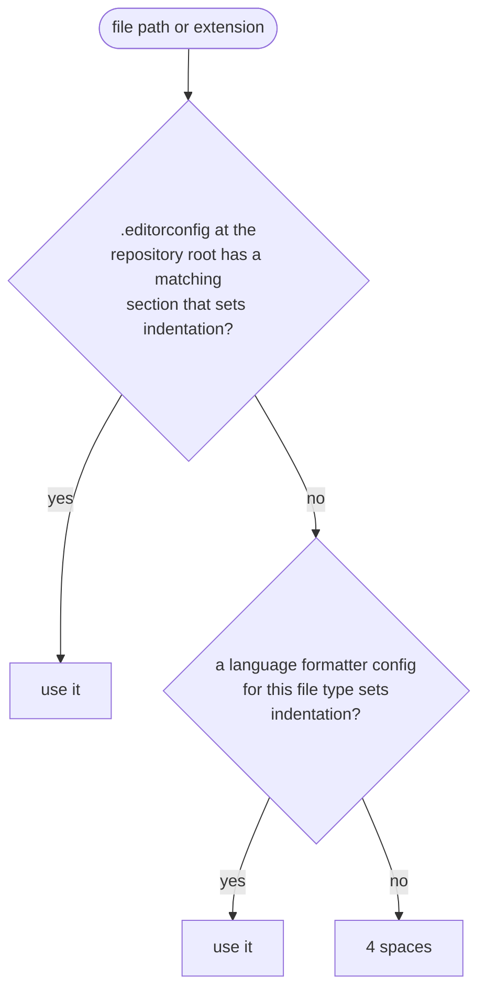

# Contextual Indents

The repository's YAML output uses libyaml's emitter style. Lists sit at the
same column as their key, and nested mappings are indented by two spaces,
whatever indentation the project uses. `~/.claudine/config.yaml` shows this:

```yaml
permissions:
  file-read:
  - ./*.txt
  - ./*.md
```

That is valid YAML, but it is harder to read than the indented form, and it
ignores this repository's own `.editorconfig`, which asks for four spaces in
`*.yaml`. This feature has three parts:

1. **Sniff resolves indentation.** Given a repository and a file (or a file
   extension), Sniff answers "what indentation does this project want here?"
   and says where the answer came from.
2. **The `sniff repo indentation [<file-ext>]` command** exposes that answer
   on the command line.
3. **biscuit-file owns YAML writing.** One shared writer takes an indentation
   and produces indented YAML. Every place in the repository that writes YAML
   moves to it.

## Indentation Policy

Indentation is resolved for a file in a repository by checking these sources
in order. The first one that states an indentation wins.



1. **`.editorconfig` at the repository root.** Sections are matched against
   the file's path relative to the root, following EditorConfig rules: later
   matching sections override earlier ones, property by property. A generic
   `[*]` section that sets `indent_size` counts as stating an indentation, so
   it outranks the language configs in step 2. That is intended: an
   `.editorconfig` is the project's explicit, cross-language statement.
2. **A language-specific formatter config at the repository root**, chosen by
   the file type (see the table below).
3. **Default: 4 spaces.**

Files outside any repository (for example `~/.claudine/config.yaml`) skip
steps 1 and 2 and get the default.

### EditorConfig details

Sniff's existing `detect_formatting` already reads only the root
`.editorconfig` and does not walk parent directories. Resolution keeps that
behavior. Sniff stores each section's glob but does not match globs today, so
this feature adds a matcher for EditorConfig's glob syntax: `*`, `**`, `?`,
`[name]`, `[!name]`, `{a,b}`, `{1..3}`, and the rule that a pattern without
`/` matches at any depth.

The two indentation properties combine like this:

| `indent_style` | `indent_size` | Result |
| -------------- | ------------- | ------ |
| `space` | `2` | 2 spaces |
| `space` | unset | not stated; continue to step 2 for the size, keep `space` |
| `tab` | any or unset | tabs, displayed at `tab_width` (else `indent_size`, else 4) |
| unset | `2` | 2 spaces |
| any | `tab` | tabs, displayed at `tab_width` |

A section that sets `indent_style = space` without a size still decides the
style. The size then comes from step 2 or the default.

### Language-specific sources

Only configs at the repository root are read, matching the EditorConfig rule.
Each row is a single entry in a lookup table, so adding a language later
means adding one row.

| File types | Config files, in order | Keys read |
| ---------- | ---------------------- | --------- |
| `rs` | `rustfmt.toml`, `.rustfmt.toml` | `hard_tabs`, `tab_spaces` |
| `js` `jsx` `ts` `tsx` `mjs` `cjs` `json` `json5` `yaml` `yml` `md` `css` `scss` `html` `vue` | `.prettierrc` (JSON or YAML), `.prettierrc.json`, `.prettierrc.yaml`, `.prettierrc.yml`, `.prettierrc.toml`, `package.json` (`prettier` key) | `useTabs`, `tabWidth`, and an `overrides` entry whose `files` matches |
| same as the previous row | `biome.json`, `biome.jsonc` | `formatter.indentStyle`, `formatter.indentWidth`, and the language block's overrides (for example `javascript.formatter`) |
| same as the previous row | `deno.json`, `deno.jsonc` | `fmt.useTabs`, `fmt.indentWidth` |
| `py` | `pyproject.toml` (`[tool.ruff]`, `[tool.ruff.format]`), `ruff.toml`, `.ruff.toml` | `indent-width`, `format.indent-style` |
| `go` | none; `gofmt` always uses tabs | tabs, width 4 |

Within a row, the first config file that exists is used. Prettier, Biome, and
Deno are mutually exclusive in practice; if more than one exists, the order in
the table decides. Prettier configs written in JavaScript
(`prettier.config.js`, `.prettierrc.cjs`, ...) are not executed: Sniff
reports them as present and unread, and resolution continues.

### Tabs in YAML

YAML forbids tabs for indentation. When the resolved indentation for a YAML
file is tabs, the YAML writer uses that many spaces as the tab width instead
of tabs, and reports this in the resolution's provenance (see below). Other
languages receive tabs as resolved.

## Sniff Library API

Resolution lives in `sniff::filesystem::indentation`, next to the existing
`formatting` module, and reuses its `.editorconfig` parser.

```rust
pub enum IndentStyle { Spaces, Tabs }

pub struct Indentation {
    pub style: IndentStyle,
    /// Columns per level: the space count, or the tab display width.
    pub width: u8,
}

pub enum IndentSource {
    EditorConfig { path: PathBuf, sections: Vec<String> },
    LanguageConfig { path: PathBuf, key: String },
    Default,
}

pub struct ResolvedIndentation {
    pub indentation: Indentation,
    /// Where the style and the width came from; they can differ (an
    /// `.editorconfig` that sets only `indent_style`).
    pub style_source: IndentSource,
    pub width_source: IndentSource,
    /// Formatter configs that exist but could not be read
    /// (JavaScript Prettier configs, unparsable files).
    pub skipped: Vec<PathBuf>,
}

/// Resolve indentation for `path`. Finds the repository root itself;
/// a path outside a repository resolves to the default.
pub fn resolve_for_path(path: &Path) -> Result<ResolvedIndentation>;

/// Resolve indentation for a file extension (with or without the
/// leading dot) as if for a file at the repository root.
pub fn resolve_for_extension(repo_root: &Path, ext: &str) -> Result<ResolvedIndentation>;
```

`resolve_for_path` is the accurate form, because `.editorconfig` sections can
target directories (`[docs/**.md]`). `resolve_for_extension` serves the CLI
and callers that have no concrete file yet; it does not match path-scoped
sections.

`Indentation` is defined in **biscuit-file**, not Sniff, and re-exported by
Sniff. The reason is the dependency direction: Sniff already depends on
biscuit-file, so the YAML writer cannot call Sniff. A caller resolves with
Sniff and passes the resulting `Indentation` to biscuit-file. Defining the
type in biscuit-file lets both crates use the same value without a
conversion and without a dependency cycle.

## `sniff repo indentation` Command

```text
sniff repo indentation [<file-ext>] [-b/--base <DIR>] [--json]
```

`<file-ext>` accepts `yaml` or `.yaml`.

**With an extension**, it prints the resolved indentation and its source:

```text
$ sniff repo indentation rs
4 spaces  (.editorconfig [*], [*.rs])
```

**Without an extension**, it prints the repository default (what a file with
no more specific rule gets), then every extension whose result differs from
it. The extensions are those named in `.editorconfig` section globs and in
the language-specific table above.

```text
$ sniff repo indentation
default  4 spaces  (.editorconfig [*])
go       tabs (width 4)  (gofmt)
```

Outside a repository, the command prints the default and exits `0`. `--json`
emits the `ResolvedIndentation` (with an extension) or a
`{ default, overrides: { ext: ResolvedIndentation } }` object (without one),
following `sniff/docs/topics/json-output.md`. `skipped` configs are printed
as a dimmed note after the result.

## biscuit-file YAML Writer

biscuit-file gains a single YAML serialization entry point:

```rust
pub fn to_yaml_string<T: Serialize>(value: &T, indentation: Indentation) -> Result<String, YamlError>;
```

with a matching `Yaml` method. It serializes with `serde_yaml_ng`, then
re-indents the output to the requested width, with list items indented under
their key:

```yaml
permissions:
    file-read:
        - ./*.txt
        - ./*.md
    servers:
        - name: local
          url: http://localhost
```

Re-indenting rules:

- every nesting level is `width` spaces, for mappings and sequences alike;
- a sequence's `- ` sits one level in from its parent key, and the keys of a
  mapping inside a list item align two columns after the dash (the layout
  Prettier produces);
- the content of block scalars (`|`, `>`) is moved with its parent and never
  re-indented relative to it; an explicit indentation indicator (`|2`) is
  rewritten if the shift requires it;
- before returning, the writer parses its output and compares the value with
  the input's value. A mismatch is a bug in the writer and returns an error
  rather than writing a different document.

biscuit-file does not resolve indentation itself. Callers that have no
repository context pass `Indentation::default()` (4 spaces).

## Migrating Writers

Every non-test call to `serde_yaml_ng::to_string` or `to_writer` moves to the
biscuit-file writer: about 30 sites across Claudine, Darkmatter, DMLS,
simplified-schema, biscuit-tui, research, schematic, and biscuit-file itself.
Each one passes indentation resolved by `sniff` for the file it writes, or
the default when the output is not a file in a repository (strings returned
to a caller, stdout, a file in the home directory).

Writers that edit a YAML file in place, keeping comments and ordering (for
example Claudine's per-key configuration edits), keep the indentation the
file already uses. They use the resolved indentation only for content they
add that has no existing pattern to follow.

After migration, a lint stops new code from calling `serde_yaml_ng`'s
serializer directly: a `clippy.toml` `disallowed-methods` entry in each
affected crate, with biscuit-file's writer exempted.

## Out of Scope

- JSON, JSON5, and TOML writers. biscuit-file's JSON5 formatter has its own
  indentation; switching it to `Indentation` is a natural next step but is
  not part of this feature.
- Reformatting files that already exist. Files change style only when a
  migrated writer next rewrites them.
- Walking parent directories for `.editorconfig` above the repository root.

## Phases

### Phase 1: Shared type and YAML writer (biscuit-file)

- add `Indentation` and `IndentStyle`, with `Default` = 4 spaces;
- add `to_yaml_string` and the `Yaml` method, with the round-trip check;
- tests: nested mappings, lists of scalars, lists of mappings, lists of
  lists, block scalars with and without indentation indicators, empty
  collections (`[]`, `{}`), widths 2, 4, and 8, and the existing YAML corpus
  round-tripping at each width;
- update `biscuit-file/docs/design/yaml-design.md` (or a new
  `docs/topics/yaml-writing.md`) and the `biscuit-file` skill.

### Phase 2: Resolution (sniff library)

- EditorConfig glob matcher and property merge;
- language-specific lookup table and readers;
- `resolve_for_path`, `resolve_for_extension`, provenance, and `skipped`;
- tests: each table row, precedence between the steps, style-only and
  size-only sections, `indent_size = tab`, path-scoped sections, missing and
  unparsable configs, and paths outside a repository;
- document under `sniff/docs/topics/indentation.md` and update the `sniff`
  skill.

### Phase 3: CLI (sniff-cli)

- `sniff repo indentation [<file-ext>]` with the outputs above;
- `sniff/docs/cli/repo_indentation.md` and the `sniff repo` reference;
- an L2 test of the plain and `--json` outputs against fixture repositories.

### Phase 4: Migrate writers

Phase 4 can run in parallel per package once Phase 2 lands.

- move every write site to the biscuit-file writer with resolved
  indentation;
- add the `disallowed-methods` lint;
- update golden and snapshot fixtures whose YAML layout changes, and check
  each changed fixture by parsing it, not only by accepting the new snapshot.

## Success Criteria

- `sniff repo indentation yaml` in this repository prints 4 spaces sourced
  from `.editorconfig`.
- Re-saving Claudine's configuration writes `permissions.file-read` items
  indented under their key, four spaces deep.
- In a fixture repository with no `.editorconfig` and a `rustfmt.toml`
  setting `tab_spaces = 2`, `sniff repo indentation rs` reports 2 spaces
  from `rustfmt.toml`, and `sniff repo indentation yaml` reports the
  default.
- No non-test code outside biscuit-file calls `serde_yaml_ng::to_string` or
  `serde_yaml_ng::to_writer`, and the lint enforces it.
- The suite passes on macOS, Linux, and Windows; path-scoped `.editorconfig`
  matching uses `/` separators on Windows.
