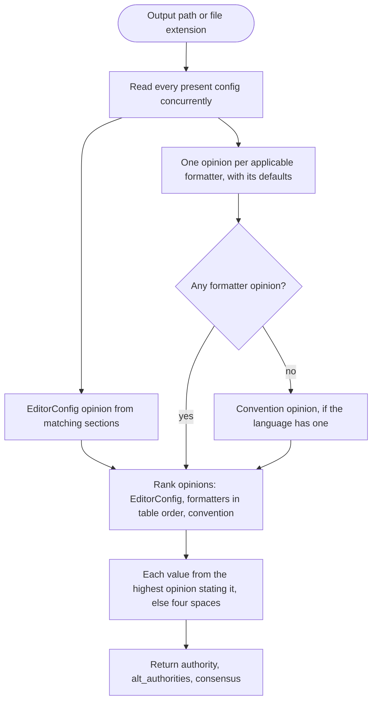

# Contextual Indents

Some YAML writers in the repository use the backend's default layout.
For example, a generated configuration can place a list at the same
indentation as its key:

```yaml
permissions:
  file-read:
  - ./*.txt
  - ./*.md
```

The layout is valid YAML. Newly generated files should use the destination's
indentation preference, with four spaces as the default when there is none.
This feature has three parts:

1. **Sniff resolves indentation.** Given a repository and a file (or a file
   extension), Sniff answers "what indentation does this project want here?"
   and says where the answer came from.
2. **The `sniff repo indent [<file-ext>]` command** exposes that answer
   on the command line.
3. **biscuit-file owns YAML writing.** One shared writer takes an indentation
   and produces indented YAML for newly generated documents and new parts of
   existing documents.

## Indentation Policy

Sniff reads formatting settings at the Git worktree root. Each applicable
source contributes an **opinion**. Rank those opinions in this order:

1. the root `.editorconfig`;
2. the file type's supported, enabled formatter configuration. An omitted
   value takes **that formatter's documented default**, such as Biome's
   tabs or Prettier's two spaces;
3. the file type's built-in language convention, for languages with one
   canonical formatter (`gofmt`, `rustfmt`, PEP 8);
4. the fallback of four spaces, which supplies any unresolved property and
   is the authority only when there are no opinions.

The highest-ranked opinion is the **authority**; the rest are
**alternative authorities**. The resolved style and width each come from
the highest-ranked opinion that states it, so an `.editorconfig` that sets
only `indent_style` takes its width from the next opinion. **Consensus**
holds when every opinion agrees on each value it states; zero or one
opinion is a consensus. A generic `[*]` rule can therefore override
formatter settings for every file while the result still shows the
disagreement. The fallback never participates in consensus or appears among
alternative authorities. Files outside a worktree read no EditorConfig or formatter configuration;
a built-in language convention still applies, because it describes the
language rather than a repository, and anything else uses the fallback.

> **Reader’s note.** Sniff puts EditorConfig first so generated files follow
> the repository’s general editing policy. Some formatters give their own
> settings priority. The alternative opinions show where a later formatter
> run may change the generated indentation.

```yaml
# sniff repo indent ts --json, with .editorconfig at 4 spaces and a bare biome.json
indent_using: space
indent: 4
authority:
    source: editorconfig
    path: .editorconfig
    via: ["*", "*.{js,ts,jsx,tsx,vue,json,yaml,yml,toml}"]
    indent_using: space
    indent: 4
alt_authorities:
    - source: biome
      path: biome.json
      via: []            # no indentation keys: Biome's defaults
      indent_using: tab
      indent: 2
consensus: false
skipped: []
```



### EditorConfig details

Reuse the parser behind [`detect_formatting`](../../../sniff/lib/src/filesystem/formatting.rs),
which Sniff uses to read root formatting settings. Preserve the existing
formatting report's public representation while retaining enough information
internally to distinguish missing properties, explicit `unset`, and
`indent_size = tab`. Match sections against the root-relative path with
forward slashes on every platform. Follow EditorConfig's glob syntax,
including escaped literals, numeric ranges, and basename matching for a
pattern without a slash. Merge matching sections from top to bottom one
property at a time. `unset` clears an earlier value and allows fallback.
Emit an EditorConfig opinion only when the merged settings state a style
or a width. Its `via` lists matching sections that supplied a valid
indentation setting or cleared one, in file order. Invalid settings leave
previous valid assignments in place.
The root-only search is a deliberate limit on discovery. [EditorConfig specification](https://spec.editorconfig.org/)

| Effective settings | Resolution |
| ------------------ | ---------- |
| `indent_style = space`, `indent_size = 2` | Two spaces |
| `indent_style = space` only | Spaces, with width from the next opinion that states one |
| Numeric `indent_size` only | Use that width, with style from the next opinion that states one |
| `indent_size = tab` | Use `tab_width` if stated, then the normal width fallback. Resolve style independently |
| `indent_style = tab` with no `indent_size` | Use `tab_width` if stated, then the normal width fallback |
| Numeric `indent_size` and a different `tab_width` | Use `indent_size` for columns per level |

The API reports columns per level and a preferred indentation character.
It does not describe the exact mix of tabs and spaces an editor might use
when the configured tab display width differs from the level width. Accept
widths from 1 through 255. Ignore invalid individual settings and include
their file, key, and reason in diagnostics so lower-priority values can
still apply.

### Language-specific sources

Read local configuration as data. The rows describe supported indentation
settings, not full formatter emulation. Parse JSONC configuration
(`biome.jsonc`, `deno.jsonc`, `dprint.jsonc`, `.oxfmtrc.jsonc`) with biscuit-file's JSON5
reader, which Sniff already depends on.

| File types | Root configuration files, in order | Settings | Formatter default |
| ---------- | ----------------------------------- | -------- | ----------------- |
| `rs` | `.rustfmt.toml`, `rustfmt.toml` | `hard_tabs`, `tab_spaces` | 4 spaces |
| `js` `jsx` `ts` `tsx` `mjs` `cjs` `mts` `cts` `json` `jsonc` `json5` `yaml` `yml` `md` `mdx` `css` `scss` `less` `graphql` `gql` `html` `vue` | `package.json` or `package.yaml` (`prettier` key), `.prettierrc` (JSON or YAML), `.prettierrc.json`, `.prettierrc.yaml`, `.prettierrc.yml`, `.prettierrc.json5`, `.prettierrc.toml` | `useTabs`, `tabWidth`, and matching `overrides[].options` | 2 spaces |
| `js` `jsx` `ts` `tsx` `mjs` `cjs` `mts` `cts` `json` `jsonc` `css` `graphql` `gql` | `biome.json`, `biome.jsonc`, `.biome.json`, `.biome.jsonc` | `formatter.indentStyle`, `formatter.indentWidth`, and the language block (`javascript`, `json`, `css`, `graphql`) | Tabs, width 2 |
| `js` `jsx` `ts` `tsx` `mjs` `cjs` `mts` `cts` `json` `jsonc` `yaml` `yml` `md` `css` `scss` `sass` `less` `html` `vue` | `deno.json`, `deno.jsonc` | `fmt.useTabs`, `fmt.indentWidth` | 2 spaces |
| `js` `jsx` `ts` `tsx` `mjs` `cjs` `mts` `cts` `json` `jsonc` | `dprint.json`, `dprint.jsonc`, `.dprint.json`, `.dprint.jsonc` | `useTabs`, `indentWidth`, and the plugin block (`typescript`, `json`) | 2 spaces |
| `js` `jsx` `ts` `tsx` `mjs` `cjs` `mts` `cts` `json` `jsonc` `json5` `yaml` `yml` `toml` `md` `mdx` `css` `scss` `less` `graphql` `gql` `html` `vue` | `.oxfmtrc.json`, `.oxfmtrc.jsonc` | `useTabs`, `tabWidth`, and matching `overrides[].options` | 2 spaces |
| `py` `pyi` | `.ruff.toml`, `ruff.toml`, `pyproject.toml` | `indent-width`, `format.indent-style` (under `tool.ruff` in `pyproject.toml`) | 4 spaces |
| `toml` | `.tombi.toml`, `tombi.toml`, `.config/tombi.toml`, `pyproject.toml` (`tool.tombi`) | `format.rules.indent-style`, `format.rules.indent-width` | 2 spaces |
| `toml` | `.taplo.toml`, `taplo.toml` | `formatting.indent_string` | 2 spaces |
| `yaml` `yml` | `.yamlfmt`, `.yamlfmt.yaml`, `.yamlfmt.yml`, `yamlfmt.yaml`, `yamlfmt.yml` | `formatter.indent` | 2 spaces |
| `lua` `luau` | `stylua.toml`, `.stylua.toml` | `indent_type`, `indent_width` | Tabs, width 4 |
| `c` `h` `cc` `cpp` `cxx` `hh` `hpp` `hxx` `m` `mm` `proto` | `.clang-format`, `_clang-format` | `IndentWidth`, `UseTab`, and `BasedOnStyle` from the built-in preset table below | LLVM preset |
| `swift` | `.swift-format` | `indentation`, `tabWidth` | 2 spaces |
| `rb` `rake` `gemspec` `ru` | `.rubocop.yml`, `.config/.rubocop.yml`, `.config/rubocop/config.yml` | `Layout/IndentationStyle` `EnforcedStyle`, `Layout/IndentationWidth` `Width` | 2 spaces |
| `cs` `csx` | `.csharpierrc` (JSON or YAML), `.csharpierrc.json`, `.csharpierrc.yaml` | `useTabs`, `indentSize` | 4 spaces |

Each row contributes at most one opinion, ranked in table order. Sniff
uses the first readable, parseable candidate that declares the formatter,
in the order shown. Record subsequent existing candidates in the same row
as shadowed. A manifest without its formatter key contributes nothing.
Record an unreadable or unparseable candidate and continue to the next
one. An explicitly disabled formatter contributes no opinion and still
shadows lower-priority files in the row. For Biome, use the language's
`formatter.enabled` when present, then the global setting.

> **Reader’s note.** The table specifies Sniff's deterministic search
> order. Taplo and yamlfmt can choose between simultaneous candidates in
> a different order. A shadowing diagnostic identifies the additional
> file so the discrepancy can be traced.

Values the configuration leaves unstated take that row's formatter default,
so a formatter opinion always states both values; `via` lists only the keys
actually read. This keeps Sniff's fallback from contradicting a formatter
the project visibly uses: a `biome.json` that only enables linting rules
still means tab-indented JavaScript.

#### Concurrent reads

Build the distinct set of candidate files from EditorConfig and the
relevant formatter rows for a single target. Summary mode and reusable
`RepoIndentation::load` use all supported rows. Probe candidates and read
and parse independent files concurrently, following Sniff's existing
repository discovery patterns. Read and parse each file at most once per
lookup, even when several rows or file types share it (`package.json`,
`deno.json`, `pyproject.toml`). Collect results by table position, not
completion order, so output stays deterministic. Summary mode and callers
resolving many paths load the set once through `RepoIndentation` and
evaluate each file type against it without reading again.

Value mapping, where the formatter's own vocabulary is not a plain
style/width pair:

- Taplo's `indent_string` of only spaces gives that many spaces; one or
  more tabs gives tabs with the formatter’s default width. Other strings are
  diagnosed and ignored.
- StyLua's `indent_type` is `Tabs` or `Spaces`.
- Tombi's `indent-style` is `space` or `tab`; `indent-width` applies to
  spaces only, so tabs take the formatter's default width.
- swift-format's `indentation` is exactly one of `{"spaces": N}` (N
  spaces) or `{"tabs": N}` (tabs, width N × `tabWidth`, which defaults
  to 8).
- RuboCop's `EnforcedStyle` is `spaces` or `tabs`.
- clang-format's `UseTab: Never` means spaces. Recognized modes that
  permit tabs for block indentation give a tabs preference. Diagnose
  unknown values and use the selected preset's style.
  `BasedOnStyle` reads a small built-in table, not external files: `LLVM`,
  `Google`, `Chromium`, `Mozilla`, and `GNU` indent 2 spaces; `WebKit` and
  `Microsoft` indent 4. Layer settings from the matching `Language`
  document over settings from the document without `Language`, then
  fill remaining properties from the selected preset. A file with no
  applicable document gives no opinion. Diagnose unsupported presets
  and use LLVM defaults for the properties the file leaves unresolved.

Apply matching Prettier and oxfmt overrides in file order, with later values taking
precedence per property. Match `files` and `excludeFiles` against the
root-relative path using Prettier's glob rules, accepting strings and lists.
For Biome and dprint, apply the language or plugin block over the global
settings. This first version reads the local file's indentation settings.
It does not execute JavaScript or TypeScript configs (`.prettierrc.js`,
`prettier.config.*`, `oxfmt.config.ts`), load shared presets or `extends` chains (including a
string-valued `prettier` key in `package.json` and RuboCop's
`inherit_from`/`inherit_gem`), evaluate formatter
include/ignore rules (apart from Prettier override selection), or apply
Biome's, dprint's, and CSharpier's top-level path overrides, Taplo's
`[[rule]]` tables, or Tombi's `[[overrides]]`. For Deno, accept legacy `fmt.options` values when the corresponding
flat setting is absent. Report unsupported forms in lookup diagnostics.
An unsupported executable config or preset reference with no local
settings gives no opinion on its own. A supported local config with an
unsupported inheritance directive contributes its local values and uses
the row defaults for the remaining properties. Diagnose invalid individual
values and continue with the applicable formatter defaults.
[Prettier configuration](https://prettier.io/docs/configuration),
[Biome configuration](https://biomejs.dev/reference/configuration/),
[Deno formatter](https://docs.deno.com/runtime/reference/cli/fmt/),
[dprint configuration](https://dprint.dev/config/),
[Ruff settings](https://docs.astral.sh/ruff/settings/),
[oxfmt configuration](https://oxc.rs/docs/guide/usage/formatter/config),
[Taplo configuration](https://taplo.tamasfe.dev/configuration/),
[Tombi](https://tombi-toml.github.io/tombi/),
[swift-format configuration](https://github.com/swiftlang/swift-format/blob/main/Documentation/Configuration.md),
[RuboCop configuration](https://docs.rubocop.org/rubocop/latest/configuration.html),
[CSharpier configuration](https://csharpier.com/docs/Configuration),
[StyLua](https://github.com/JohnnyMorganz/StyLua),
[clang-format options](https://clang.llvm.org/docs/ClangFormatStyleOptions.html),
[verified formatter reference](formatters.md)

### Built-in language conventions

These apply only when no formatter configuration was selected. They cover
languages whose canonical formatter is ubiquitous and fixed or nearly so,
and give an opinion with `source: convention` and the convention's name in
`via`.

| File types | Convention | Indentation |
| ---------- | ---------- | ----------- |
| `go` | `gofmt` | Tabs, width 8 (the tab width gofmt aligns with) |
| `rs` | `rustfmt` defaults | 4 spaces |
| `py` `pyi` | PEP 8 (Black is not configurable) | 4 spaces |
| `zig` | `zig fmt` | 4 spaces |
| `dart` | `dart format` | 2 spaces |
| `ex` `exs` | `mix format` | 2 spaces |
| `tf` `tfvars`, and path suffixes `.tftest.hcl`, `.tfmock.hcl`, `.tfquery.hcl` | `terraform fmt` | 2 spaces |
| `elm` | `elm-format` | 4 spaces |
| `gleam` | `gleam format` | 2 spaces |
| `mk`, and exact basenames `Makefile`, `makefile`, `GNUmakefile` | Make recipe syntax | Tabs (see format constraints) |

Path suffixes such as `.tftest.hcl` match only in path lookup; an
extension query for `hcl` does not select the Terraform convention.

### Format constraints

Some formats fix the indentation character whatever the project prefers.
Sniff applies these to the resolved value after ranking, leaves each
opinion's own values unchanged, and records an explicit adjustment in the
result. Consensus is computed on the opinions, before adjustment.

- **YAML forbids tabs.** For `yaml` and `yml`, Sniff reports spaces at the
  resolved level width if the selected style is tabs. The biscuit-file writer
  applies the same conversion to a tabs preference passed directly by a
  caller. Markdown frontmatter uses the containing Markdown file's settings
  and this same YAML conversion at the writer boundary.
- **Make recipe lines require a prefix.** A tab is Make's default
  recipe prefix. Sniff reports the file's general indentation preference,
  using the Make convention when applicable. A writer generating recipes
  must handle the prefix separately, including any custom recipe prefix.

> **Reader’s note.** A Makefile contains rules, assignments, and recipes.
> Applying a file-wide tab requirement would override legitimate project
> settings and could put a recipe prefix on a line that is not a recipe.

## Sniff Library API

Resolution lives in `sniff::filesystem::indentation`, next to the existing
`formatting` module, and reuses its `.editorconfig` parser.

```rust
pub enum IndentStyle { Spaces, Tabs }

pub struct Indentation {
    pub style: IndentStyle,
    /// Columns per indentation level.
    pub width: NonZeroU8,
}

/// Serialized as kebab-case values: `editorconfig`, `clang-format`, …
pub enum IndentAuthority {
    EditorConfig, Rustfmt, Prettier, Biome, Deno, Dprint, Oxfmt, Ruff,
    Tombi, Taplo, Yamlfmt, Stylua, ClangFormat, SwiftFormat, Rubocop,
    Csharpier,
    /// A built-in language convention; `via` names it (`gofmt`).
    Convention,
    /// Sniff's fallback; used as the authority only when no opinion exists.
    Default,
}

pub struct IndentOpinion {
    pub source: IndentAuthority,
    /// Absent for `Convention` and `Default`.
    pub path: Option<PathBuf>,
    /// EditorConfig sections, formatter keys read, or the convention name.
    /// Empty for a formatter whose defaults supplied every value.
    pub via: Vec<String>,
    /// Absent only on an EditorConfig opinion that does not state it.
    pub indent_using: Option<IndentStyle>,
    pub indent: Option<NonZeroU8>,
}

pub struct ResolvedIndentation {
    pub indent_using: IndentStyle,
    /// Columns per indentation level.
    pub indent: NonZeroU8,
    pub authority: IndentOpinion,
    /// Remaining opinions in rank order.
    pub alt_authorities: Vec<IndentOpinion>,
    /// Every opinion agrees on each value it states.
    pub consensus: bool,
    /// Present when the target's format requires a style adjustment.
    pub adjustment: Option<IndentAdjustment>,
    pub skipped: Vec<IndentationDiagnostic>,
}

impl ResolvedIndentation {
    /// The value to pass to biscuit-file's writer.
    pub fn indentation(&self) -> Indentation;
}

pub struct IndentAdjustment {
    /// The style ranking selected before the format constraint applied.
    pub requested: IndentStyle,
    pub reason: AdjustmentReason, // YamlForbidsTabs
}

pub struct IndentationDiagnostic {
    pub path: PathBuf,
    pub key: Option<String>,
    pub reason: String,
}
```

Keep the result deterministic and include all of these details in JSON,
following Sniff's snake_case key convention. `IndentStyle` serializes as
`space` or `tab`, and absent opinion values are omitted. Opinion and
diagnostic paths are worktree-relative and serialize with `/` separators, so
output is identical across platforms.

```rust
/// Resolve indentation for `path`. Finds the repository root itself;
/// a path outside a repository resolves to its language convention, if
/// any, then the default.
pub fn resolve_for_path(path: &Path) -> Result<ResolvedIndentation>;

/// Resolve indentation for a file extension (with or without the
/// leading dot) as if for a file at the repository root.
pub fn resolve_for_extension(repo_root: &Path, ext: &str) -> Result<ResolvedIndentation>;

/// Every present configuration in one worktree, read once.
pub struct RepoIndentation { /* … */ }

impl RepoIndentation {
    pub fn load(repo_root: &Path) -> Result<Self>;
    pub fn resolve_for_path(&self, path: &Path) -> Result<ResolvedIndentation>;
    pub fn resolve_for_extension(&self, ext: &str) -> ResolvedIndentation;
}
```

The free functions load only the inputs for one target and share the
same resolution logic as `RepoIndentation`. A snapshot's path method
accepts absolute paths inside its worktree, matches them relative to that
root, and returns an error for a path outside it rather than matching it
against the snapshot's rules. A snapshot does not detect nested
repositories; callers that need automatic discovery use the free function,
or load a separate snapshot for the nested repository.

Use existing Sniff worktree discovery, including linked worktrees and
nested Git repositories. For new output files, find the worktree from the
nearest existing ancestor and match against the full destination path.
Callers that follow a symlink when writing pass the same effective destination
they will write. A missing repository is a normal fallback. Reserve
resolution errors for failures that prevent identifying the destination or
worktree. A failed lookup in a human-facing writer uses the default and
surfaces the reason through its existing diagnostics.

Extension lookup strips one leading dot, normalizes ASCII case for file-type
selection, and matches a synthetic root basename such as `file.yaml` for
extension patterns. Ignore filename-specific rules and directory-scoped rules
for this lookup. Apply `[*]` and basename-wide suffix patterns such
as `[*.yaml]` or `[*.{yaml,yml}]`. Apply the same restriction to
Prettier overrides: a rule whose include or exclude depends on a
particular basename or directory is deferred to path lookup. Exact paths
use their real basename and can match rules such as `[Makefile]` or
`[docs/**.md]`.

`Indentation` and `IndentStyle` belong to biscuit-file and Sniff re-exports
them. The caller passes its resolved setting into the writer, keeping
biscuit-file independent of Sniff and usable without a repository.

## `sniff repo indent` Command

```text
sniff repo indent [<file-ext>] [-b/--base <DIR>] [--json]
```

`<file-ext>` accepts `yaml` or `.yaml`.

**With an extension**, it prints the resolved indentation, its authority,
and whether the sources agree:

```text
$ sniff repo indent rs
4 spaces  (.editorconfig [*], [*.rs])
also: rustfmt.toml  4 spaces
consensus: yes
```

When the authority states only one value, plain output names the opinion or fallback
that supplied the other. Each alternative authority is listed with its
values, and a disagreeing value is highlighted.

**Without an extension**, print the result of applying the generic `[*]`
sections and the fallback, followed by extension-specific results whose
effective style or width differs. Build a sorted, deduplicated list from the
formatter and built-in convention tables and root EditorConfig patterns that name literal suffixes
(for example `*.rs` and `*.{yaml,yml}`). A wildcard or range inside a suffix
does not enumerate file types. Callers can query a specific extension
directly.

```text
$ sniff repo indent
default  4 spaces  (.editorconfig [*])
```

Use the current directory or the existing `--base` directory to discover the
worktree. Outside a worktree the command exits successfully with the language
convention for the extension, if any, or the default
and, in summary mode, an empty overrides map. An extension must start with an ASCII letter or digit after the optional
leading dot. Its remaining characters may be ASCII letters, digits,
underscores, plus signs, or hyphens. Other inputs are usage errors. Plain
output identifies separate style and width sources when they differ and
shows adjustment and skipped-config notes. A missing consensus is not an
error; the exit status stays 0. Use biscuit-terminal's
renderable components for terminal formatting.

`--json` writes only the result, including provenance, adjustment, and
diagnostics. An extension returns a single `ResolvedIndentation` in the shape
shown under the indentation policy. Summary
mode returns `{ default, overrides: { ext: ResolvedIndentation }, skipped }`.
The summary-level `skipped` list deduplicates diagnostics across all queries,
including extensions whose effective indentation matches the default. Add
the summary payload under `indent` in `sniff repo --json` as required by
the [Sniff JSON output contract](../../../sniff/docs/topics/json-output.md).
Calculate it only for `sniff repo indent` and `sniff repo --json` so
unrelated repository queries avoid formatter configuration reads.
Preserve the existing plain `sniff repo` default and the JSON shapes of
other focused commands. Summary `default` uses only the generic
EditorConfig rules and can differ from the four-space fallback.

## biscuit-file YAML Writer

biscuit-file gains a single YAML serialization entry point:

```rust
pub fn to_yaml_string<T: Serialize>(value: &T, indentation: Indentation) -> Result<String, YamlError>;
```

Expose the indentation types with or without biscuit-file's `yaml`
feature. Gate only the YAML writer and its wrapper method on that
feature.

Add a matching formatted-output method to biscuit-file's
[`Yaml`](../../../biscuit-file/lib/src/yaml/types.rs) wrapper, which holds
a parsed YAML value. Existing methods that expose source text still return
that text.

```yaml
permissions:
    file-read:
        - ./*.txt
        - ./*.md
    servers:
        - name: local
          url: http://localhost
```

Serialize the caller's value once with the existing YAML backend. Apply
indentation using YAML structure and source spans so that text resembling
YAML syntax inside a quoted or block scalar is handled as content. Indent
block sequences one level under their mapping key. In a compact mapping
item such as `- name: local`, align continuation keys with the first key.
Use the same compact-item rule for nested sequences. Preserve empty
collections, mapping order, tags, scalar types, and the content of
multiline scalars, including leading spaces, blank lines and trailing
newlines. Explicit scalar indentation indicators must remain valid even
when the requested width exceeds YAML's single-digit indicator range.
Choose an equivalent scalar spelling when needed, for example an escaped
double-quoted string when a block scalar cannot express the layout.

Before returning, compare the parsed formatted document with the parsed
backend output using YAML values, including tagged values and non-string
mapping keys. Compare mapping order separately where the value comparison
ignores it. The comparison must treat an unchanged YAML non-finite
number, including NaN, as equivalent. Preserve serializer errors as
typed errors and report layout or equivalence failures through the
same result type. A layout or semantic failure returns `YamlError` before any
caller replaces a file. Callers without a destination use
`Indentation::default()` (four spaces).

## Migrating Writers

> **Reader's note.** The goal is consistent indentation in YAML people read
> or edit. A blanket serializer migration would also change bytes used as
> hash inputs, convert comment-preserving edits into document rewrites, and
> add parsing to paths that never write a document. Those calls keep their
> existing encoding or editing contract.

- **Whole-document output.** Migrate production serializers that emit YAML
  documents to users or files. Audit call sites across Claudine, Darkmatter,
  DMLS, simplified-schema, biscuit-tui, research, schematic, and biscuit-file,
  including serializers reached through imports or re-exports. A repository
  file uses the destination's settings. Standalone strings, stdout and user
  configuration outside a repository use the default. Carry an already
  known destination into the write boundary so generic conversions do not
  discover a repository or use the caller's current directory implicitly.
  Keep existing machine-output envelopes and serialization error handling.
- **Edits to existing text.** Claudine and Darkmatter keep
  [`ConfigTransaction`](../../../darkmatter/lib/src/config/write.rs),
  Darkmatter's shared lock, validation and atomic write service. Pass
  resolved indentation as a fallback to its edit path. Resolve it for
  the same effective destination the transaction writes. Resolve each
  destination once per write and keep discovery out of parsers, schema
  validation, editor diagnostics, and no-op paths. Determine local
  layout from the text re-read under the lock. Keep the transaction’s
  validation and replacement checks. Prefer the touched
  collection's indentation, then the nearest comparable block, then the
  resolved preference. Preserve comments, ordering, and untouched text,
  including existing indentless sequences. Apply the same approach to
  frontmatter edits in DMLS and Darkmatter's Markdown editing paths.
  New documents use the shared layout for both the initial skeleton and
  the edits that complete it. A generated stub has no authored local
  examples. In an existing document, local style may be inferred only
  from actual collection structure, so whitespace inside multiline
  values cannot become an indentation example. When a newly inserted
  collection has no local example, use the shared layout. Existing no-op saves stay byte-identical.
- **Byte-sensitive and internal uses.** Preserve existing encoding for
  Darkmatter's frontmatter hash and simplified-schema's declaration
  fingerprint. Audit other consumers before changing output used as a
  cache key, coercion result, embedded fragment, or diagnostic text. Keep
  formatting-independent uses on their existing contract and record the
  exceptions with their reason.
- **Enforcement.** Gate direct serializer calls in production code with a
  source guard and a narrow, reasoned allowlist for the backend and
  contract-bound exceptions. Recognize imported and re-exported calls so
  changing import syntax cannot bypass the guard. Attach the check to
  existing verification for affected packages.

## Out of Scope

- JSON, JSON5, and TOML writers. biscuit-file's JSON5 formatter has its own
  indentation; switching it to `Indentation` is a natural next step but is
  not part of this feature.
- Reformatting files that already exist. Files change style only when a
  migrated writer next rewrites them.
- Discovering nested EditorConfig files, walking above the worktree root,
  or running external formatters.

## Phases

### Phase 1: Shared type and YAML writer (biscuit-file)

- add `Indentation` and `IndentStyle`, with `Default` = 4 spaces;
- add `to_yaml_string` and the `Yaml` method, with the round-trip check;
- tests: nested mappings, lists of scalars, lists of mappings, lists of
  lists, tagged values, non-string keys, quoted multiline strings, block
  scalars with explicit indentation and chomping indicators, empty
  collections, and widths 1, 2, 4, 8, and greater than 9. Round-trip the
  existing YAML corpus and assert layout separately from value equivalence;
- update `biscuit-file/docs/design/yaml-design.md` (or a new
  `docs/topics/yaml-writing.md`) and the `biscuit-file` skill.

### Phase 2: Resolution (sniff library)

- EditorConfig glob matcher and property merge;
- language-specific lookup table and readers;
- `RepoIndentation`, `resolve_for_path`, `resolve_for_extension`, opinions,
  consensus, and `skipped`, with concurrent config reads;
- tests: each formatter and convention row, including a configuration that
  states no indentation (formatter default applies, not the fallback),
  ranking and value filling across opinions, consensus with agreeing,
  disagreeing, and partial opinions, shadowed candidates, each shared file
  read once, the YAML constraint and Make recipe distinction, style-only
  and size-only sections, explicit `unset`, `indent_size = tab`, conflicting
  tab and level widths, path-scoped sections, formatter overrides, malformed
  configs, new paths, linked worktrees, and paths outside a repository;
- document under `sniff/docs/topics/indentation.md` and update the `sniff`
  skill.

### Phase 3: CLI (sniff-cli)

- `sniff repo indent [<file-ext>]` with the outputs above;
- `sniff/docs/cli/repo_indent.md` and the `sniff repo` reference;
- L1 subprocess tests of plain output, JSON leaf and parent payloads,
  invalid arguments, and outside-repository fallback using fixture
  repositories. These assertions need no real terminal.

### Phase 4: Migrate writers

Phase 4 starts after Phases 1 and 2. Land shared editor and transaction
support before migrating callers that use it. Consumer-only migrations
can then proceed independently.

- migrate whole-document output and thread the indentation fallback through
  existing editors. Cover Claudine setup and legacy JSON migration through
  their normal entry points. Preserve migration read-back and backup handling;
- add the serializer guard and check that retained hashes and fingerprints
  match their pre-migration values;
- update affected output fixtures, check parsed values and exact layout,
  and verify create, edit, and repeated no-op saves through the normal
  entry points;
- update the affected package docs and caller skills for visible behavior
  changes and publish the updated caller skills.

## Success Criteria

- `sniff repo indent yaml` in this repository prints 4 spaces sourced
  from `.editorconfig`.
- A newly created Claudine configuration using the four-space preference
  puts `file-read` four spaces under `permissions` and its list items four
  spaces under `file-read`. Editing an existing commented configuration
  preserves its local indentation and comments.
- In a fixture repository with no `.editorconfig` and a `rustfmt.toml`
  setting `tab_spaces = 2`, `sniff repo indent rs` reports 2 spaces
  from `rustfmt.toml`, and `sniff repo indent yaml` reports the
  default.
- In a fixture repository with no `.editorconfig` and a `biome.json` that
  sets no formatter options, `sniff repo indent ts` reports tabs from
  Biome's formatter default. With this repository's `.editorconfig` added,
  it reports 4 spaces from `.editorconfig`, Biome as an alternative
  authority, and `consensus: false`.
- The serializer guard rejects new direct production calls outside
  the documented exceptions, and existing hash outputs stay stable.
- The implementation works on macOS, Linux, native Windows, and WSL2.
  EditorConfig matching uses `/` separators on every platform.

## Open Questions

No author rulings remain.
