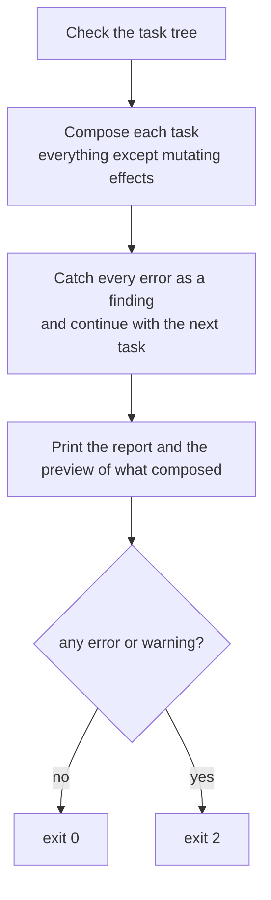

# Better errors and a diagnostic dry run

## Why this exists

Most people who use Claudine and Darkmatter are writing documents: prompts,
sequences, and schemas. When one of those documents is wrong, the error message
is the only thing standing between the author and a fix. Today the messages
often fall short in the same few ways: they report the first problem and stop,
they lose the task or file that led to the problem, they guess at causes, and
they say nothing at all about keys that have no effect.

This spec makes three changes:

1. **`--dry-run` becomes a diagnostic pass.** It checks everything it can
   without side effects, then reports every problem together.
2. **One error-message standard** applies to both Claudine and Darkmatter.
   Tests enforce it, so it cannot decay.
3. **Each capability has one owner.** Anything true of a document regardless of
   agents is built once, in Darkmatter or below, so `md`, DMLS, and Claudine
   share it. Claudine keeps only what needs agent knowledge.

The spec lives in Claudine because the features users see (`--dry-run`,
sequence diagnostics) are Claudine's. **Most of the implementation lands in
Darkmatter, Simplified Schema, and biscuit-file.** That is intended. Every
phase, check, and inventory row below names the package that owns it.

## The motivating sessions

Two real sessions, both running `claudine sequence _fleet.yaml --dry-run`
against this file. These are the test fixtures for Phase 1
(`fixtures/check/fleet-run1/` and `fixtures/check/fleet-run2/`).

`renderers/_fleet.yaml`, as of Run 1:

```yaml
kind: sequence
sequence:
    - name: find
      description: Find the Mermaid renderers and provide basic research
      agent: opencode
      model: gemini/neon
      prompt: ./_find.md
      with:
          output: "./overview.md"
    - name: metadata
      description: extract metadata
```

`_find.md` exists and names no `agent`. Run 2 adds
`prompt: ./_frontmatter.md` to `metadata`; that file does not exist yet.

**Run 1 output:**

```text
 Providers:
 find → no provider
 metadata → no provider
 CompositionError: composed prompt is empty
┃ Composition produced an empty prompt body for .../renderers/_fleet.yaml.
┃ Mode: chained (compose)
┃ No key=value overrides were provided.
┃ The document composed without error, but every block in the body was stripped by its when
┃ condition (or the body was empty to begin with). ...
┃ Check that the variables you passed match the ::block when=… conditions ...
```

What actually happened: `metadata` has no executable, so it composes the
sequence document's own body, and a YAML file has no body. The message never
names the task and blames `::block when=` conditions that do not exist. The
`find → no provider` line is the bigger problem, because a non-interactive run
fails on it, but the dry run presents it as information.

**Run 2 output:**

```text
 CompositionError: composition failed
┃ failed to load external sequence file: ./_frontmatter.md: file not found
```

This message calls a `prompt:` reference an "external sequence file". It names
neither the task, the resolved path, nor the directory it searched. It also
aborts the dry run, so `find`'s provider problem and the two misplaced keys are
never reported.

## Current behavior

These details explain what the motivating runs reported and which behavior
the new checks need to preserve.

| Question | Current behavior |
|---|---|
| `agent` and `model` on a task are "not valid task keys; silently ignored" | Task objects are **open by design** (`claudine/schemas/sequence-types.yaml`: "an undeclared key is authored step data, read as `seq.<key>`"). Both keys are kept as step data. They do not affect the provider, because provider selection reads only caller setters, the task's `with:`, and the prompt's frontmatter (`composition/sequence/preflight/providers.rs::predict_key`). A schema validator therefore cannot call them unknown. The same keys **are** rejected in a `kind: task` file and in a group leg, which use the closed `parse_task_object`. |
| `kind: sequence` is deprecated | It is current (`flow-control/sequences.md`). Only the old `kind: sequence` + `list:` form is gone. It is not listed as a removed spelling. |
| Dry run is passive | It is not. After preflight it composes every step for the preview, and composition runs `$( … )` expansions and fetches approved remote transclusions (documented in `flow-control/sequences.md`, "Composition shell work still runs"). On a terminal it also prompts for missing inputs (`phase1c.rs::collect_or_report`). `--dry-run-shell` runs `shell:` tasks for real. **This is a defect, and this spec fixes it:** a dry run has no side effects. |
| The schemas already list the removed task keys | Only one removed key is written in a schema, as prose: `fail_fast: "null -> removed: …"` in `sequence.yaml`. The real list is in the parser (`grammar.rs::removed_task_key`: `setup`, `teardown`, `execution`, `fail_fast`; container events on a non-inline task). DMLS defines `dm.schema.deprecated_key` and never emits it. |
| DMLS has "did you mean" for unknown keys | Only `md clean` suggests keys (`schemas/clean.rs`). Neither the schema validator nor DMLS does. |
| The provider chain has several links, such as a CLI `--agent` and the configured favorite | Today's chain, in order: a provider flag (`--claude`, `--codex`, …, or `--provider <name>`) decides **every** task, overriding any task `with:` or prompt that names another agent. Without one: the caller setter `agent=…`, then the task's `with.agent`, then the prompt's frontmatter `agent`, then the nearest enclosing sequence document whose `agent` resolves. A root `agent:` is therefore only a fallback, and a prompt's own `agent` beats it. There is no generic `--agent` flag. `preferred_agent` only seeds the review screen and never selects a provider in a sequence. No environment variable selects a provider. Only the winning link is recorded, never the empty ones. `2026-11-18-ergonomic-sequences` changes this chain (defined and default values); see [Non-goals](#non-goals). |
| An empty composition has a known cause | Darkmatter does not detect an empty composed body at all. Claudine's `ComposedBodyEmpty` (`prepare.rs`) knows only the path, mode, and override keys. `SequenceStepNotExecutable`, which does name the task, is unreachable in chained mode because `ComposedBodyEmpty` fires first. |

## Goals

- `claudine sequence <file> --dry-run` gives as many insights as it can. It
  composes everything that cannot mutate anything, catches every error as a
  finding, and reports all of them together, grouped by task. It exits `0`
  when it observed no problem and `2` when it observed any error or warning.
- A dry run of `claudine sequence`, `compose`, or `inline-compose` runs no
  shell command, launches no provider, writes no file, fires no lifecycle
  event, and never prompts.
- A user who runs `--dry-run` never gets the standard error report. Every
  failure, including one that would abort a real run, is a finding in the
  dry-run report.
- A real run keeps its existing stop points. Where it already stops at
  preflight, it reports every preflight problem together instead of the
  first one.
- Every finding and error follows one message standard: what, where, why, and
  how to fix it.
- Darkmatter shares document findings across `md`, its language server
  (DMLS), and Claudine. Terminal commands share report rendering. DMLS
  sends findings to the editor with its existing diagnostic protocol.
- After Phase 1, `md compose` on a document with a missing `::file` and an
  empty body reports both problems, at the same quality as Claudine and from
  the same code.

## Non-goals

- Closing sequence task objects. Step data stays open and can still be read
  through `seq`.
- Changing how a sequence passes state to its children. Defined and default
  values (`default-values`), and what `--<provider>` and `--model` mean for
  each task, belong to `2026-11-18-ergonomic-sequences`. This spec's
  provider-chain finding reports whichever chain the code implements.
- Fixing every error message in either package. The cut line is in
  [Sweep and cut line](#sweep-and-cut-line).
- A new `md` command. `md compose` and `md validate refs` adopt the shared
  collector. Revisit a standalone check command after using those reports.
- Any change to `err.*` codes or `when:` matching for errors that exist today.

## Ownership

### The rule

**A fact about a document belongs to Darkmatter or below. A fact that needs an
agent belongs to Claudine.** "Needs an agent" means it depends on the task tree,
provider resolution, provider requirements, or Claudine's lifecycle. Everything
else is a document fact, even when the document is a Claudine sequence:
whether a referenced file exists, whether a key is declared, whether a body is
empty.

### Decisions

| Capability | Owner | What the other side consumes | Why |
|---|---|---|---|
| The finding type: code, severity, message, location, related locations, fix hint, trail, and its JSON form | **Darkmatter**: extend [`Diagnostic`](../../../darkmatter/lib/src/markdown/compose/expression/diagnostics.rs), the record the CLI sends in machine output | Claudine produces the same record for its own findings | One record already reaches `md --output json`, DMLS, and the CLI. A second type would split every renderer. |
| Severity | **Darkmatter** `Severity` (`error`, `warning`, `info`), unchanged | Claudine | It already exists, and a blocking policy never changes it. |
| Collecting findings across a document tree without stopping | **Darkmatter**: a new `findings` module (`FindingSink`, `FindingReport`) | Claudine's sequence walk pushes into the same sink | `md compose`'s pre-composition checks need the same collection. |
| "How we got here": transclusion chain, iteration, task path | **Darkmatter** `Trail`, which unifies `included_via` and `iteration_path` and adds host frames | Claudine pushes `task`, `group`, and `sequence` frames | It is the same idea in three places today. Hosts add frames; they do not invent a second trail. |
| Reporting a missing or unresolvable file reference | **Darkmatter** finding builder over **biscuit-file**'s `DetailedResolution` | Claudine calls it for `prompt:`, `task:`, `group:`, and `sequence:` references with its own construct phrase | Resolution and the probe record are biscuit-file's. Rendering them is a document fact. Today Claudine has two renderings and the sequence path has none. |
| Unknown keys, removed keys, near-miss suggestions | **Simplified Schema** for key checks and suggestions, using the existing ranking algorithm moved below Darkmatter | DMLS and the Claudine runtime read the validator's problems | The schema is the source of truth. Today DMLS and the runtime check different things. |
| Empty-composition result and its cause | **Darkmatter** compose outcome | Claudine decides whether empty is fatal for a provider launch | Only the composer knows which blocks it excluded. |
| Grouped report rendering for terminal, plain, and data output | **Darkmatter** `FindingReport` (a `renderable::CommandOutput`), generalized from the `md validate refs` report | Claudine renders the dry-run report and the preflight failure through it | The reference report already groups problems by subject, shows trails, and closes with a tally. Generalize it rather than write a second one. |
| The task tree, the provider chain, provider requirements, lifecycle | **Claudine** | Pushes findings into Darkmatter's sink | Agent knowledge. |
| Failure identity (`err.*` facets: category, disposition, origin, detail) | **Claudine**, unchanged | | See below. |

### Document findings and lifecycle errors

The [Claudine error architecture](../../docs/topics/error-architecture.md#where-diagnostic-identity-lives)
assigns the fields matched by lifecycle `when:` clauses, such as `err.code`
and `err.detail`, to Claudine. Darkmatter already publishes `dm.*` codes for
document findings. The report uses those codes for the problems it shows.
The error returned by a real run still has Claudine's lifecycle fields.

- Keep the typed error the existing run would return. Select it in the old
  preflight order, including the order within each stage. When an earlier
  stage still needs input or an approval, let it resolve before returning a
  later error. Keep the same lifecycle routing and retry behavior.
- `CheckFailed` owns the report. Under the existing diagnostic selector it
  is a `Semantic` wrapper that supplies its lifecycle fields and persisted
  cause information from the selected typed error. It renders the report
  once and has no new public failure code.
- Project typed document failures through the Claudine wrapper their
  original boundary already uses. A missing target can occur during
  sequence resolution, prompt loading, or Darkmatter transclusion. Guard
  the supported combinations of finding and boundary, and verify all
  lifecycle fields against the old failure.

> **Reader's note.** The first row can belong to a task the old preflight
> never reached. Choosing the lifecycle error in the existing failure order
> keeps the same `when:` clauses matching when reports are grouped by task.

## The finding model

### The record

`Diagnostic` is extended **additively**. Existing fields keep their names and
JSON form.

| Field | Status | Meaning |
|---|---|---|
| `code`, `severity`, `message`, `source`, `span`, `expected_type`, `actual_type` | existing | unchanged |
| `hint` | **new**, `Option<String>` | the next step. Required for new actionable findings in scope (see [Enforcement](#enforcement)). |
| `related` | **new**, `Vec<RelatedLocation { source, message }>` | other places that matter, such as the finding that blocked this check or the declaration a key conflicts with. DMLS maps these to LSP `relatedInformation`. |
| `trail` | **new**, `Trail` | how the problem was reached, outermost first (see below) |
| `iteration_path`, `included_via` | existing, now **projections** of `trail` | preserve existing JSON, including `[]` versus omitted `included_via` |
| `reference_details`, `data_location`, `grants_needed`, `schema_default` | existing | unchanged |

`message` states **what** failed and **why**, in the author's terms, and never
names a cause the producer has not established. `hint` states how to fix it.
`source` states where. Omit new fields when they have no value. In JSON,
tag trail frames with `kind` (`included`, `iteration`, or `host`). A host
frame has a separate `host` noun and authored property path. Use the
existing portable-path and authored-position conventions. Update the
published compose output schema with these additions.

### The trail

A `Trail` is a list of frames, outermost first:

```rust
pub enum TrailFrame {
    /// Reached through a transclusion at this authored position.
    Included { file: String, line: Option<usize> },
    /// Inside a `::map`/`::filter` item.
    Iteration { collection: String, position: IterationPosition },
    /// A host construct, such as a Claudine task.
    Host { host: &'static str, label: String, property: String, source: Option<DiagnosticSource> },
}
```

`host` is a host-owned noun such as `task`, `group`, or `sequence`. `property`
is the authored path (`sequence[1].prompt`). The renderer prints a trail as one
line: `task metadata (sequence[1]) → _frontmatter.md`.

Errors carry trail context **as typed data**, never by formatting it into a
message. A Claudine error raised while loading a task carries
`site: Box<TaskSite>` (boxed context, per rule 2 of
[Rules for a typed wrapper](../../docs/topics/error-architecture.md#rules-for-a-typed-wrapper)),
and the projection to `Diagnostic` turns it into a `Host` frame. Darkmatter's
`MarkdownError::InIteration` and the reference trail already produce the other
two kinds.

### The collector

```rust
// darkmatter::findings
pub struct FindingSink { /* ordered findings and subjects */ }

impl FindingSink {
    pub fn push(&mut self, subject: &SubjectId, finding: Diagnostic) -> FindingId;
    /// Record that `check` could not run for `subject`, and which finding
    /// blocked it. Emits one `dm.check.not_checked` info finding.
    pub fn not_checked(&mut self, subject: &SubjectId, check: &str, reason: &str, blocked_by: Option<FindingId>);
    pub fn has_errors(&self) -> bool;
    pub fn finish(self) -> FindingReport;
}
```

- A **subject** is what findings are grouped under: a document for `md`, or a
  task for Claudine. Identify a task by its occurrence in the graph. Two
  tasks can share a file or label, and a finding can point to a more
  specific property without changing its subject.
- **Not checked** findings replace silence. When a missing prompt file means
  that task's provider and inputs cannot be checked, the sink records one
  `info` finding per skipped check, with `related` pointing at the finding that
  blocked it when that finding has a proven location. A deferred value can
  block a check without producing an error.
- Register subjects in authored order and preserve check order within
  each subject. Deduplicate equivalent findings for the same subject,
  authored location, and typed cause. Keep separate findings for distinct
  task occurrences, including when both load the same document.

### Codes

| Namespace | Owner | Examples |
|---|---|---|
| `dm.*` | Darkmatter, in the `COMPOSE_DIAGNOSTIC_CODES` catalog | `dm.reference.missing_document`, `dm.schema.removed_key`, `dm.schema.near_miss_key`, `dm.compose.empty_body`, `dm.check.not_checked` |
| Claudine catalog (`composition.*`) | Claudine, in `diagnostics/registry.rs` | `composition.provider_unresolved`, `composition.selection_key_as_data`, `composition.no_executable`, `composition.model_required` |

Each new code is declared once. The producing check assigns severity. `dm.schema.deprecated_key`,
which DMLS declares and never emits, is removed; `dm.schema.removed_key`
replaces it.

### Blocking

A Claudine dry run blocks nothing: it exits `2` when it observed any error
or warning (see [Exit status](#exit-status)). `md compose` keeps its
reference recoveries, warning policy, and disabled operations. Recovering
a missing transclusion still uses `dm.reference.missing_transclusion` and
produces the same result as today. New policy-addressable warnings join
the existing catalog.

## Dry run as a diagnostic pass

### What the user does

```sh
claudine sequence _fleet.yaml --dry-run           # every observation, plus a preview of what composed
claudine sequence _fleet.yaml --dry-run --json    # the same observations as data, for CI
```

### The principle

**A dry run gives as many insights as possible without mutating anything.**
It composes as much as it can, including evaluating expression functions,
which are not allowed to mutate the file system. It skips only what can
mutate: shell commands and the other effects listed below. An error met along
the way is caught and recorded as a finding, and the walk goes on, so one
problem never hides the next.



### What runs and what does not

| Construct | In a dry run |
|---|---|
| Expressions (`{{ … }}`) and expression functions, `::block when=`, `::map`, `::filter` | Evaluated, as in a real run. |
| Local reads (`::file`, `::code`, `prologue:`/`epilogue:`, local `load_data`, schema slots) | Read under the existing file-read permission. A read that would need approval is not prompted for; it is an `info` finding ("needs read approval; a real run asks"), and content that depends on it is not checked. |
| Remote reads (the same constructs with a URL) | Fetched when the captured `network` permission already allows it. Under `ask`, not fetched: an `info` finding ("needs network approval; a real run asks"). Under `deny`, the same refusal a real run reports, as an error finding. |
| Frontmatter `$( … )`, `::shell`, and a command-backed sequence source | Not run. Shown as written and marked skipped. Checks that depend on their output are `not checked`; a command-backed sequence list leaves its children unchecked. |
| `shell:` and `side_effect:` tasks | Described, not dispatched. |
| Lifecycle events (`initialize`, `start`, …) | Do not fire. Values they would write are `not checked` where a later check needs them. |
| Provider launch, `edit`, `prep` targets, messaging, speech and pre-warming | Not run. |
| A missing input | Never prompted for. The placeholder stays in the preview, marked missing, and the input is a finding. |
| Task guards, loops, runtime schemas | Described without entering a task or evaluating runtime state. A `::block` whose condition depends on a skipped value is shown as conditional. |
| Caches | Nothing is written. Dry-run results stay out of the normal composition caches. |

Enforce this at Darkmatter's shared dispatch boundaries for commands,
remote reads, schema slots, and other effectful calls, using its existing
effect classifications, so a nested document or callback cannot turn an
effect back on (**Darkmatter**-owned). An expression function the catalog
classifies as effectful is not called and is reported as skipped. Enter the
dry-run branch before staged initialization, source-shell execution, or
approval. Track skipped values through authored syntax, so a placeholder can
never become an executable, a path to resolve, a schema value, or a false
condition.

### The preview

The preview shows each task that composed, in order. A task that could not
compose shows its findings in place of its preview, and the tasks after it
are still previewed. A failure while rendering one task's preview is a
finding for that task. With `--json`, composition still runs (it is how the
findings are found), but no preview text is printed.

### Never the standard error report

Under `--dry-run`, nothing reaches the CLI's standard error report (the
`StatusBlock` error rendering a failed real run prints). Every failure is a
finding in the dry-run report, in both the human and the JSON form. That
includes a root document that cannot be read or parsed, an invalid
configuration, a schema that fails to load, and an unexpected internal error
caught at the dry-run boundary (reported as `internal.bug` with its message).
The one exception is a command-line usage error such as an unknown flag,
which clap reports with its usage message before any dry run starts.

**`--dry-run-shell` is removed** from `sequence`, `compose`, and
`inline-compose`. Whenever interpreted as a Claudine option, it is a usage
error. Existing help precedence and the `--` boundary for forwarded
arguments still apply.

```text
error: `--dry-run-shell` was removed. Dry runs skip commands.
  hint: use `--dry-run` to check and preview, or run the command without it
```

### What the check pass walks

The pass walks the available task tree: the root
document, every task, inline and referenced nested sequences, groups (inline,
referenced, and catalog entries), `kind: task` files, and every prompt
document. In each prompt document it also walks frontmatter transclusions
(`prologue:`, `epilogue:`) and body references (`::file`, `::code`), using the
condition-blind walk that Darkmatter's preflight already does.

Reuse the [Claudine preflight loader](../../lib/src/composition/sequence/preflight/mod.rs),
which builds the task graph and detects cycles, along with its input discovery
and provider prediction. A failed subtree becomes findings and the walk
continues with siblings whose boundaries are known. A root parse failure
reports the root problem and leaves the task walk unchecked. Keep cycle
checks, catalog entry identity, and source reuse. Share loaded sources and
prepared values within the invocation so each new check does not reread or
reparse the same document.

### How each effectful check is handled

| Check that normally has an effect | In the check pass |
|---|---|
| A frontmatter value written as `$( … )` | Not run. A check that needs its value is reported as `not checked` ("depends on a shell expansion"). |
| A remote `::file` or `::code` URL | Fetched when `network` already allows it. A settled refusal is an error. A fetch that would need approval is an `info` finding, and its content remains unchecked. |
| A provider's installed state | Reuse read-only PATH and configuration observations. Skip process-backed version probes and catalog refreshes. |
| A model a provider requires | Read from flags, environment variables, and the provider's config file (reading a file is passive). |
| Missing required inputs | Judged by the same value preparation a real run uses, with shell expansions skipped. No prompt is shown. An input whose value depends on a skipped command is `not checked`. |
| Shell command approval | Not asked: a dry run runs no command, so it approves none. A real run asks as today. |
| A task `when:` guard and an inline container's `$schema` | Not evaluated, as today. The task is checked as if it runs. |
| A value only known at launch (`seq.*`, `loop.*`, a runtime `set`) | Record the dependent check as unchecked. Static values in those scopes can still be checked when prediction proves them. |

### Severity

An **error** is a proven failure for the invocation being rehearsed. A
**warning** describes an actionable concern or a problem the real command
could resolve by asking. **Info** gives context, including checks that depend
on unavailable data.

Use each real command's own rules to decide whether it can ask. Sequence
provider review uses stderr's terminal status and the selection outcome.
An explicitly invalid provider that the real selector refuses is an error
even on a terminal. Direct and inline composition use their target resolver,
including the configured preferred-agent fallback where eligible. For
missing inputs, use the shared interactive-input policy (configuration,
stdin, stderr, and `--silent`), check whether the schema shape can be
collected, and preserve the mode's rule about when the input is required.
A real command that would refuse the input produces an error in dry run.
An eligible bare-name picker or file-input chooser is described as a pending
choice when an existing passive search proves matches. If a search cannot
complete passively, mark the choice unchecked. The same rules apply in JSON
mode. Provider explanations show where each input came from and whether it
can be used. Apply the existing redaction of secret-shaped values to both
report formats.

### Exit status

| Situation | Exit |
|---|---|
| No problem observed: the report holds only `info` findings, or none | `0` |
| At least one `error` or `warning` finding, including any failure caught during the dry run | `2`, after the full report is printed |
| Usage error (an unknown flag, `--json` without `--dry-run`, or the removed `--dry-run-shell`) | `2`, from clap's usage message, with no report |

A script tells a usage error from observed problems by the output: a usage
error prints clap's message on stderr and no report (and, with `--json`, no
JSON on stdout). A dry run never exits `1`.

### Report formats

The human report goes to stderr, starting with the root document and showing
tasks in authored order. Each row includes its severity, message, location
when known, and fix. List unchecked checks together under their subject and
end with counts. Use biscuit-terminal components and existing stream-based
plain rendering. Keep stdout available for the command's existing preview.

`--json` requires `--dry-run`. It emits one report on stdout and prints no
preview text. Every failure, including a document that cannot be loaded or
parsed, stays inside that report. Usage
errors stay on stderr and emit no JSON. The report shares `file`,
`outcome`, and diagnostic records with Darkmatter's
[document output](../../../darkmatter/docs/cli/data-contracts.md).
Claudine's `summary` counts diagnostics by severity. Darkmatter's
`DocumentEnvelope.summary` counts references and keeps its existing shape.
Use `null` for `file` when no input path exists. Suppress human progress
and preview text in JSON mode. Claudine still refuses `-o` and `--output`.

### A real run uses the same checks

A real sequence reuses checks at the existing boundaries, with the inputs
and state available there. Root `initialize` can create files or assign
values before the task graph is built. Keep real input collection, provider
review, and shell authorization in their existing order. Where a preflight
failure is already determined, collect independent passive findings, render
the report once, and return the typed preflight error described in
[Document findings and lifecycle errors](#document-findings-and-lifecycle-errors).

On successful preflight, print new advisory warnings before the first task.
Let real prompts resolve eligible input and provider gaps, then recheck
findings that depended on their answers. Preserve closed approval on retry,
the frozen plan, and task order.

**A real run keeps its existing stop points** (decided 2026-11-22). A
problem a real run meets only at a task's turn, such as a later prompt that
composes to an empty body, still surfaces at that turn through that task's
lifecycle. It is not moved to preflight, because root `initialize` and
earlier tasks can create the files and values later tasks need, and because
moving it would change which lifecycle handler sees it. `--dry-run` is where
an author sees every problem up front.

### Other commands

- `claudine compose` and `claudine inline-compose` use the same passive
  flow for one document. Inline preview leaves the input file intact.
  The checks use the applicable command's target and input rules.
- `md compose` collects independent findings available at the existing
  pre-composition boundary. In lifecycle mode, keep that boundary after
  `initialize`. For stdin, preserve existing reference eligibility. Keep
  the passive call gate ahead of expressions and effects. If a bad call or
  failed preparation prevents a check from reaching a verdict, record the
  later check as unchecked. Share the existing data memo and read set.
- `md validate refs` reuses the report renderer and preserves its existing
  text, machine output, and exit behavior.

## Checks

Each check names its source of truth. Where a source exists, the check is
derived from it rather than hand-written.

| Code | Severity | Owner | Source of truth | Reports |
|---|---|---|---|---|
| `dm.reference.missing_document` | error | Darkmatter (builder), biscuit-file (resolution) | [biscuit-file's detailed resolution result](../../../biscuit-file/lib/src/file_reference/mod.rs) | A confirmed no-match for a Claudine document-valued reference such as `prompt:`, `task:`, `group:`, or `sequence:`. Existing Darkmatter constructs use their current codes, including `dm.reference.missing_transclusion`. Retain the written reference, its base, and the candidates actually checked. Show a resolved candidate when resolution provides one. Keep ambiguity, policy refusal, and I/O errors distinct. |
| `dm.schema.unknown_key` | per schema | Simplified Schema | the effective schema | A key a closed object does not declare. Add a suggestion when one is close and preserve existing severity. |
| `dm.schema.near_miss_key` | warning | Simplified Schema | the effective sequence step declaration | A key an open step accepts as data but which closely resembles a declared field, such as `promt` beside `prompt`. Only explicitly opted-in objects emit this advisory. |
| `dm.schema.removed_key` | error | Simplified Schema | the new `removed(…)` declaration | A removed key, with its replacement as the hint. |
| `dm.compose.empty_body` | warning in `md`; error for a proven empty provider prompt | Darkmatter | the compose result or a separately proven passive outcome | Empty authored body, whitespace, all contributing blocks excluded, or an empty rendered result with no proven cause. A partially evaluated body with an unknown contribution is unchecked. |
| `composition.selection_key_as_data` | warning | Claudine | provider prediction's selection keys (`agent`, `model`) | A task carrying `agent` or `model` as step data. Says it is read as `seq.agent` and does not choose the provider, and that `with: { agent: … }` does. |
| `composition.no_executable` | error when the source has no body | Claudine | the task grammar and the source format | A task with no executable. In a document with a body it is `info` ("composes the body of `release.md`"). In a YAML, JSON, or JSON5 source, which has no body, it is an error. Reuse the typed empty-prompt cause when returning a real failure at its existing boundary. A dry-run finding has its own code. |
| `composition.provider_unresolved` | error or warning (see [asking](#severity)) | Claudine | provider prediction and `select_target` | A provider-launching task whose provider cannot be decided. Lists the chain in order and marks each link `empty`, `not installed`, `ambiguous`, or `unknown`, linking to a `selection_key_as_data` finding when one explains the gap. |
| `composition.model_required` | error | Claudine | `ProviderInfo::model_required_in_non_tty` and `exec_prep::resolve_model_and_validate` | A task whose resolved provider requires a model for a non-interactive run (OpenCode today) when none is found in flags, the provider's model variable, `MODEL`, hints, or the provider's configured default. Sequence tasks never run interactively, so this is always an error. A task decided at launch is `not checked`. |
| `composition.missing_properties` (existing code) | error or warning (see [asking](#severity)) | Claudine, over Darkmatter's schema verdict | each prompt's `$schema` | An input still missing after existing value preparation applies caller input, scoped values, and schema defaults. Preserve required-key presence semantics and defer gaps that depend on runtime work. One finding per input, under its task. |
| `dm.check.not_checked` | info | Darkmatter | the sink | A check that could not run and why, with the blocking finding in `related`. |

### Reference suggestions and empty body

Suggest up to three nearby files for a confirmed local no-match using the
resolver's recorded search locations. Reuse the existing Claudine search
and biscuit-file's literal-glob hint. Use the originating request context
and permissions. Preserve search-root order and reuse each permitted
directory listing within the invocation. Keep the existing bounded
repository search for top-level bare-name suggestions. Nested reference
suggestions stay within the resolver's permitted search directories.

Record the reason for an empty result while evaluating page blocks, with
authored positions for the blocks that account for the result. When a
reference failure stops `md compose`, report a prospective empty body only
if passive evaluation can prove it independently. A condition-blind
reference walk can discover a missing file. The block condition still has
to be evaluated passively to prove which content would survive. Keep the
current rule for broken references inside excluded blocks, including
existing recovery policy.

### Suggestions for accepted step data

Move the existing string ranking below Darkmatter so Simplified Schema
can use it without introducing a reverse dependency. Preserve `md clean`'s
current suggestions. Use the effective declaration for each object,
including imports and composition. Emit open-object advice only for an
explicitly opted-in sequence step with a unique close candidate.
Legitimate extension keys declared by a pattern, removed keys, and the
dedicated `agent` and `model` checks take precedence. Keep these advisories
out of strict validation failures.

### Removed spellings

Phase 2 adds a first-class Simplified Schema declaration, `removed(<replacement>)`,
and moves Claudine's removed-grammar list into the shipped schemas:

```yaml
# claudine/schemas/sequence.yaml
$schema:
    fail_fast: "removed(set fail_fast on a group object)"

# claudine/schemas/sequence-types.yaml, task:
    setup: "removed(use a preceding `side_effect:` task for an action or `shell:` task for a command)"
    teardown: "removed(use a group's `finalize:`; wrap a single task in a group of one)"
    execution: "removed(omit execution; use a nested sequence for ordered work)"
    fail_fast: "removed(`fail_fast` belongs on a `group:` object only)"

# claudine/schemas/sequence-types.yaml, group:
    execution: "removed(omit execution; use a nested sequence for ordered work)"
```

- A `removed(…)` declaration applies to a named object property. Its presence
  is forbidden even when the authored value is null. Lower it as a false
  property schema. Store replacement metadata on the owning object, since
  a boolean JSON Schema has no annotation fields. For the same key, report
  the removal once even if a pattern also matches. Reject
  combinations with defaults or required declarations. Omit removed keys
  from completion and near-miss candidates. Validation preserves the
  authored value for reporting.
- Simplified Schema returns a typed problem and replacement hint.
  Darkmatter projects it as `dm.schema.removed_key`. The Claudine parser
  uses the same prepared, owner-specific declaration for its existing typed
  refusal. Verify coverage at the root, on sequence steps, in groups, and
  in group legs and standalone task files wherever the parser currently
  refuses the key. Keep the closed-field grammar for standalone task files
  and group legs even where the editor currently uses an open step schema.
- `execution` gets one replacement for both of today's value-dependent
  messages. The parser may still add the value-specific sentence.
- Container events on a non-inline task are a placement rule, not a removed
  key. They stay in the parser.
- `kind: sequence` is current and is not listed.

### Reconciling with sibling specs

- **`2026-11-22-claudine-doctor`** reports unknown configuration keys with the
  same validator. Its `stray-config-keys` rows gain near-miss suggestions from
  this work when doctor displays the shared validator hint. Doctor keeps
  one row per check.
- **`2026-11-18-ergonomic-sequences`** replaces `prompt:` with `compose:`,
  `inline-compose:`, and `sequence:` verbs. Every message in this spec takes
  its construct noun from one table keyed by executable
  (`ExecutableField::noun`), so a renamed verb changes one row. The check
  `composition.no_executable` and the reference construct phrases are written
  against that table, not literal `prompt:` text.
- **`2026-10-09-frontmatter-warnings`** records lossy `md clean` repairs in a
  `_warnings` frontmatter list. That is persisted document state, not a
  finding, and it has no severity. No overlap. If that spec's warnings are
  ever reported at compose time, they should use this spec's record.

## The error-message standard

New and revised errors in the scope of this spec state four things.

1. **What failed, in the author's terms.** Name the construct by the noun the
   author wrote (`prompt:` of task `metadata`, not "external sequence file"),
   the value as written, and the resolved form when one exists.
2. **Where.** The file and position. Show an excerpt only when the position is
   proven (`SourceRef::OnDiskSpan`). Otherwise name the file alone, and never
   guess a line.
3. **Why.** The cause that actually applies. A message never lists causes it
   has not established. Where one variant covers several causes today, split
   it or carry the cause as data, and render only the cause that applies.
4. **How to fix it.** One concrete next step in the hint.

Rules that go with it:

- **Nouns come from the construct.** A reference's noun comes from the
  authored construct. Claudine supplies the noun for its executable fields
  and Darkmatter supplies the wording for its directives.
- **Context travels as data.** Task, key, and transclusion context ride on
  the trail and typed fields. A message is never assembled by concatenating
  context at the top level.
- **Severity is the finding's.** A message never says "error" when its
  severity is a warning.
- **Origins are honest.** A value the document did not author is attributed
  to its supplier (`SourceRef::Supplied`), as Darkmatter does today.
- **Rendering conventions are unchanged.** `StatusBlock` with a `Vec<Prose>`
  body, `SourceContext` excerpts, escaped user tokens (`darkmatter/docs/errors/`).

### Example of the standard

```text
✗ task metadata: the prompt file does not exist
    prompt: ./_frontmatter.md
    resolved to renderers/_frontmatter.md (relative to renderers/_fleet.yaml)
    at renderers/_fleet.yaml:12:15
    hint: create renderers/_frontmatter.md before a real run, or correct the reference
```

Line by line: *what* is the first line, *where* is `at …`, *why* is
"does not exist" together with the resolved path, and *fix* is the hint.

### Enforcement

| Mechanism | Owner | Fails when |
|---|---|---|
| **Finding builder.** New actionable errors and warnings in scope use a builder that requires a hint. Existing diagnostics can be projected with their current optional hint. | Darkmatter | a new finding skips the fix step |
| **Catalog snapshot guard.** Every new or changed report code in this spec has a fixture and a rendered snapshot (terminal plain and JSON). | both | a code has no snapshot, or a snapshot names no fixture |
| **Catch-all burn-down guard.** `render/provider.rs`'s `_ =>` arm (header "composition failed") may render only variants on an allowlist in `error_guards/`, each with a burn-down tag. A new variant reaching it fails. A stale entry fails. | Claudine | a new sequence error falls through to "composition failed" |
| **Site guard.** A `CompositionError` variant whose name starts with `Sequence` must carry a `site` (or `source_path` plus `property`) field. `syn` scan, beside the existing `error_guards`. | Claudine | a sequence error loses its task and key |
| **Noun guard.** Literal construct nouns ("external sequence file", "external YAML file") are refused in `#[error]` strings and `status_block` bodies outside the noun table. | Claudine | a message hard-codes a noun |
| **Mapping guard.** Each blocking document finding at a changed Claudine failure boundary retains the typed cause and the original wrapper. | Claudine | a document finding loses its lifecycle identity |
| **Parity tests.** DMLS and the check pass report the same schema findings for the same document (see [Tests](#tests)). | Darkmatter, Claudine | the editor and the runtime disagree |

## Inventory

The error sites on the sequence load, compose, and dry-run path. "Breaks"
refers to the four rules of the standard (What, Where, Why, Fix).

| Site | Current text | Breaks | Replacement | Owner |
|---|---|---|---|---|
| `SequenceExternalLoad` from `source.rs::resolve_sequence_reference`, used for `prompt:`, `task:`, `group:`, and `sequence:` references | `failed to load external sequence file: ./_frontmatter.md: file not found` | What (wrong noun), Where (no task, key, resolved path, or base), Fix | `dm.reference.missing_document` through the shared builder, with the construct noun and task trail. The variant splits: reference resolution goes to the builder; a parse failure of a loaded file keeps a `SequenceSourceParse` variant naming the file | Darkmatter (builder), Claudine (call sites, split) |
| `SequenceExternalLoad` from `data.rs` (parse and read failures) | `failed to load external sequence file: <path>: <cause>` | What (noun: it may be a group or task file) | Separate typed read and parse failures with the noun from the construct that referenced the file | Claudine |
| `ComposedBodyEmpty`, rendered in `render/provider.rs` | `composed prompt is empty` … "every block in the body was stripped by its `when` condition (or the body was empty to begin with)" … hint about `::block when=` | Why (lists causes it has not established), What (no task) | Carries Darkmatter's `EmptyBodyCause`. Renders only that cause: "has no body", "contains only whitespace", or "all 2 blocks were excluded: `::block when=\"draft\"` at doc.md:4, …". The hint follows the cause. In a sequence it carries the task trail | Darkmatter (cause), Claudine (render) |
| Bodyless source plus a task with no executable (Phase 1c, `phase1c.rs`) | the `ComposedBodyEmpty` block above, naming the sequence file | What, Why | `composition.no_executable` at check time: "task `metadata` has no executable, so it would compose the body of `_fleet.yaml`, and a YAML file has no body". Hint: "add an executable such as `prompt: ./metadata.md`" | Claudine |
| `SequenceStepNotExecutable` (`iterate.rs`) | names the step, but unreachable in chained mode | | Reuse the same executable check for the diagnostic and the real run. Keep the existing typed real failure where it applies and use a task-specific message. | Claudine |
| Dry-run provider rows (`providers.rs::plan_rows`) | `metadata → no provider` | Why, Fix; also severity (a non-interactive run fails) | `composition.provider_unresolved` with the chain. The `Unresolved` target already holds `state`; prediction records each empty link | Claudine |
| `SequenceExclusiveExecutable` | `…a step may declare at most one of prompt/shell/side_effect/group/task` | What (omits `sequence`, the sixth executable), Where (index only) | List from `EXECUTABLE_KEYS`; carry the site | Claudine |
| `SequenceStepNameMissing`, `SequenceStepNameWrongType`, `SequenceReservedStateKey`, `SequenceInvalidTaskField` | `sequence step at index {index} …` (zero-based) | Where (no file or property; `origin` and `property` are in scope but dropped) | Carry the site; render `sequence[2]` in its file, one-based in prose to match `SequenceStepNotExecutable` | Claudine |
| `RemovedGrammar` from `grammar.rs::removed_task_key` | `` `fail_fast` uses the removed `fail_fast` grammar (…) `` | Where (`path` is the bare key; the task's property is dropped) | `dm.schema.removed_key` from the schema; the parser's error carries the full property (`sequence[2].fail_fast`) | Simplified Schema, Claudine |
| `expect_reference` (`preflight/mod.rs`) | `SequenceReferenceInvalid` with `path: PathBuf::new()`, rendering `… (): must be a non-empty file reference` | Where (empty path) | Carry the referencing file and property | Claudine |
| `parse_task_object` (`kind: task` files, group legs) | `` `{key}` is not a task field; expected one of … `` with context `"task"` | Where (property is a parameter but dropped) | Carry the site; add a near-miss suggestion from the same `suggest_strings` | Claudine |
| `SequenceInvalid` strings (`grammar.rs`, `inputs.rs`) | `invalid sequence definition: …` | Where (no path) | Carry the site | Claudine |
| `SequenceSelectionFailed` | `sequence selection failed for N step(s): {failures:?}` (Debug formatting) | What | Nothing outside tests constructs it. Delete it | Claudine |
| First-error abort in graph build and input discovery (`preflight/mod.rs`, `inputs.rs`) | (behavior) | collects nothing | Push findings and continue with siblings | Claudine |
| Darkmatter reference failure in `md compose` | stops at the reference family | collects one family | Pushes into the shared sink with the call check and schema verdict | Darkmatter |
| `TransclusionError::Io` for a missing `::file` in `md compose` | `TransclusionError: I/O failure` / `File not found: ./missing.md` / hint `Check file existence and permissions.` | Where (no file or line), Why (permissions not established), What (no construct) | the existing reference code rendered through the shared builder: the construct, the location, the resolved path, and one hint for the cause that applies. A permission failure keeps its own `io` hint | Darkmatter |
| `PageBlockError::UnterminatedBlock` excerpt | the gutter numbers lines from the start of the body (`> 1 │ ::block …` for file line 4) | Where (the number is not a file position) | Number excerpt lines in the file's frame (`loaded_source_context_for_errors`), as the errors skill already requires | Darkmatter |
| Schema problems with no suggestion (`ValidationProblem` `UnknownKey`) | `` `x` is not declared `` | Fix | Add the near-miss suggestion as the hint; move the matching out of `md clean` into the validator | Simplified Schema, Darkmatter |

## Sweep and cut line

The same patterns elsewhere, found while building the inventory.

**In scope, because the shared mechanisms fix them cheaply:**

- Every `Sequence*` variant that drops `origin` or `property` gains a site
  (the site guard forces it, and the data is already in scope).
- `md clean`'s unknown-key suggestion moves into the validator, so DMLS,
  `md schema validate`, and doctor get it for free.
- `md validate refs` and `md compose` render reference problems through
  `FindingReport`, so the report has one implementation.
- DMLS stops declaring the unused `dm.schema.deprecated_key`.
- Claudine's two missing-file renderings (`FileReferenceNoMatch` for a
  top-level document, and none for a sequence reference) become one Darkmatter
  builder. The suggestion search that `with_file_reference_suggestions`
  attaches today moves with it.

**Out of scope, with the reason:**

| Site or pattern | Reason |
|---|---|
| Lifecycle error rendering (`LifecycleErrorInfo`, `RemovedGrammar` for lifecycle verbs) | Already typed, located by `LifecyclePath`, and covered by its own guards. |
| Provider runtime errors (`provider.*` codes) | Not authoring errors. A different audience and a different spec. |
| Configuration errors | `2026-11-22-claudine-doctor` owns them. |
| Darkmatter expression and call-check messages | Already located, coded, and collected by the passive call check. |
| The passive call check stopping at the first rejected call | Fixable, but expression typing has its own collection rules. Follow-up. |
| Other `md` changes | Only shared key diagnostics affect `md clean` and `md schema validate`. No new command. |

**The cut line:** a site is in scope when it is on the sequence load,
compose, or dry-run path, or when a mechanism this spec builds fixes it with
no new design. Everything else waits for a follow-up spec.

## Before and after

### Run 1

Before: see [the motivating sessions](#the-motivating-sessions).

After (`--dry-run`, stderr redirected, plain layout):

```text
Dry run of renderers/_fleet.yaml (no commands run)

task find (sequence[0])
  ⚠ `agent: opencode` is step data (read as `seq.agent`), not the task's provider
      at renderers/_fleet.yaml:5:7
      hint: to choose the provider, move it into the task's inputs: `with: { agent: opencode }`
  ⚠ `model: gemini/neon` is step data (read as `seq.model`), not the task's model
      at renderers/_fleet.yaml:6:7
      hint: to choose the model, move it into the task's inputs: `with: { model: gemini/neon }`
  ✗ no provider for this task; a non-interactive run fails here
      1. --provider flag             not given
      2. agent= setter               not given
      3. with.agent                  not set (see `agent:` above)
      4. _find.md frontmatter agent  not set
      5. _fleet.yaml agent           not set
      hint: add `with: { agent: opencode }`, or run with `--provider opencode`
  ℹ not checked: model requirement (no provider)

task metadata (sequence[1])
  ✗ this task has no executable, so it would compose the body of
    renderers/_fleet.yaml, and a YAML file has no body
      at renderers/_fleet.yaml:10:7
      hint: add an executable such as `prompt: ./metadata.md`
  ℹ not checked: provider, inputs (no executable)

Dry run found 2 errors and 2 warnings; 3 checks not run. Previewed 1 of 2 tasks.
```

The numbered chain shows today's links. Once `2026-11-18-ergonomic-sequences`
lands, the same finding lists that spec's defined and default links instead,
in its order.

Exit status `2`. The preview of `find`'s composed prompt follows the report
on stdout. On a terminal, the provider finding is a warning ("an interactive
run asks you to choose"); the exit status is `2` either way.

### Run 2

After (same conditions, `metadata` now has `prompt: ./_frontmatter.md`):

```text
Dry run of renderers/_fleet.yaml (no commands run)

task find (sequence[0])
  … the same three findings as Run 1 …

task metadata (sequence[1])
  ✗ the prompt file does not exist
      prompt: ./_frontmatter.md
      resolved to renderers/_frontmatter.md (relative to renderers/_fleet.yaml)
      at renderers/_fleet.yaml:12:15
      hint: create renderers/_frontmatter.md before a real run, or correct the reference
  ℹ not checked: provider, inputs (the prompt file could not be read)

Dry run found 2 errors and 2 warnings; 3 checks not run. Previewed 1 of 2 tasks.
```

The find findings are no longer hidden behind the missing file.

`--json` for Run 2 (abridged; each record is the shared `Diagnostic`):

```json
{
  "file": "/work/renderers/_fleet.yaml",
  "outcome": "failure",
  "diagnostics": [
    {
      "code": "composition.selection_key_as_data",
      "severity": "warning",
      "message": "`agent: opencode` is step data (read as `seq.agent`), not the task's provider",
      "source": { "file": "/work/renderers/_fleet.yaml", "line": 5, "column": 7, "inserted": false },
      "trail": [{ "kind": "host", "host": "task", "label": "find", "property": "sequence[0].agent" }],
      "hint": "to choose the provider, move it into the task's inputs: `with: { agent: opencode }`",
      "span": null,
      "expected_type": null,
      "actual_type": null,
      "iteration_path": []
    },
    {
      "code": "dm.reference.missing_document",
      "severity": "error",
      "message": "the prompt file does not exist",
      "source": { "file": "/work/renderers/_fleet.yaml", "line": 12, "column": 15, "inserted": false },
      "reason": "file not found",
      "construct": "prompt:",
      "reference": "./_frontmatter.md",
      "failure": "no-match",
      "included_via": [],
      "trail": [{ "kind": "host", "host": "task", "label": "metadata", "property": "sequence[1].prompt" }],
      "hint": "create renderers/_frontmatter.md before a real run, or correct the reference",
      "span": null,
      "expected_type": null,
      "actual_type": null,
      "iteration_path": []
    }
  ],
  "summary": { "errors": 2, "warnings": 2, "info": 3 }
}
```

### The equivalent `md` case

```markdown
---
title: Release notes
draft: false
---
::block when="draft"
::file ./missing.md
::end-block
```

Before (`md compose notes.md`, observed 2026-11-22):

```text
⤫ TransclusionError: I/O failure
┃ File not found: ./missing.md
┃ failure: no-match
┃ Check file existence and permissions.
```

The message omits the file and position and gives a permissions hint for
a missing target. In the observed case, an unset `draft` excluded the block,
but the reference check still reported its missing target. This fixture uses
an explicit false value so passive evaluation can prove the condition.

After: one report, from the same sink and renderer Claudine uses.

```text
notes.md
  ✗ file not found in `::file`  `./missing.md`  notes.md:6:1
      resolved to ./missing.md (relative to notes.md)
      hint: create missing.md, or correct the reference
  ⚠ the body would be empty: its only block is excluded
      `::block when="draft"` at notes.md:5:1 (`draft` is false)
      hint: set `draft`, or add content outside the block

Checked notes.md: 1 error, 1 warning
```

The reference check finds the missing target. Independent passive
evaluation proves that `draft: false` excludes the only body content. If
the condition depends on a shell result, report the empty-body check as
unchecked.

## Documentation to update

Behavior not yet built is written in and marked **planned** by the change that
decides it, and the marker is removed by the change that ships it. No doc names
this spec.

**Claudine**

- `claudine/docs/cli/sequence.md`, "Dry run": the two stages, `--json`, exit
  statuses, and an example report. Remove `--dry-run-shell` from the section
  and from the Flags table, and add it to the removed spellings.
- `claudine/docs/topics/flow-control/sequences.md`, "Dry run": the passivity
  table, the asking rule, and that preflight collects every finding. Replace
  the "Composition shell work still runs" callout with the passive-preview
  table.
- `claudine/docs/topics/composition.md` and `claudine/docs/topics/output.md`:
  passive checks, preview output, and the removal of `--dry-run-shell` for
  direct and inline composition.
- `claudine/docs/topics/error-architecture.md`: shared document findings,
  selection of the typed cause, and the new guards.
- `claudine/docs/topics/pre-flight-checks.md`: which checks collect
  independent findings and which existing boundaries can refuse a run.

**Darkmatter**

- `darkmatter/docs/cli/data-contracts.md`: `hint`, `related`, and `trail`;
  `iteration_path` and `included_via` as projections; the new codes.
- A new `darkmatter/docs/errors/message-standard.md`: the four rules, the
  nouns rule, and the enforcement table, linked from `README.md`.
- `darkmatter/docs/errors/composition-problems.md`: the new stopping rule
  (collect across families) and `dm.compose.empty_body`.
- `darkmatter/docs/cli/compose.md` and `validate.md`: the shared report.
- The Darkmatter library docs for the dry-run compose option (what it leaves
  unexpanded and how it marks it).
- `darkmatter/docs/topics/schemas/dmls-schema-support.md`: removed keys,
  near-miss suggestions, and related locations.

**Simplified Schema**

- `simplified-schema/docs/topics/language/types.md` (or the declaration-options
  page): `removed(<replacement>)`.
- `simplified-schema/docs/topics/diagnostics.md`: the `removed_key` and
  `near_miss_key` problem codes.

**Skills**

- Repo skills: `.claude/skills/darkmatter/errors.md` (the builder, standard,
  and sink), `.claude/skills/claudine/` (check pass and typed cause),
  `.claude/skills/simplified-schema/`.
- Caller skills: `use-claudine` (dry run and `--json`), `use-darkmatter` (the
  diagnostic fields), and `use-dmls` (removed and near-miss findings). Then run
  `just publish-skills` in each area.

## Tests

### Fixture documents per finding

One fixture directory per check under `claudine/cli/tests/fixtures/check/`
(Claudine findings) and `darkmatter/lib/tests/fixtures/findings/` (document
findings). Each holds the smallest document that produces exactly one finding,
plus the two session fixtures. Each finding fixture also has a control that
produces none, so a check cannot pass by firing on everything.

### Rendered-output snapshots

- `insta` snapshots of the plain terminal report and of `--json` for every
  fixture, rendered at width 80 with `NO_COLOR=1`.
- The catalog snapshot guard ([Enforcement](#enforcement)) ties every code to
  a fixture for each new or changed report code.
- `md validate refs` output is snapshotted before and after the move to
  `FindingReport` and must be byte-identical.

### Parity

- **DMLS and the runtime.** Load the same schema revision through DMLS's
  registered host path and Claudine's embedded bundle. For the same authored
  input compare code, message, and hint. Compare ranges after converting to
  the editor's negotiated position encoding. Cover unknown keys, opted-in
  near-misses, and removed keys.
- **Removed grammar.** For each applicable object, test absent, null, and
  non-null keys. Keep `group.fail_fast` legal and report `group.execution`
  with its replacement. Verify that opted-in advice does not reject
  valid step data or appear on arbitrary open objects.
- **Preflight and dry run.** With identical inputs and a failure both
  surfaces can prove, compare the shared findings. Add a fixture where the
  first displayed row differs from the old primary failure. Check all
  lifecycle fields, including the persisted result, against the prior
  behavior. Cover an earlier `initialize` or task writing a value or file
  needed later: the real run still succeeds, because it keeps its stop
  points, while the dry run reports the dependent check as not checked.

### Exit status and passivity

- Test exit 0 when only `info` findings (or none) are observed, 2 when any
  error or warning is, and 2 with clap's usage message and no report for a
  usage error. A dry run never exits 1. Assert stream separation and a single
  parseable JSON result for every non-usage outcome, including an unreadable
  root document and an invalid configuration.
- Never the standard error report: for every failure fixture under
  `--dry-run`, assert that stderr holds no standard `StatusBlock` error
  report, only the dry-run report.
- The preview continues past a failed task: a fixture whose second of three
  tasks fails to compose previews the first and third.
- Expressions run: a fixture whose body reads `file_exists(...)` and a
  `::block when=` over a literal composes as in a real run.
- Network follows permission: with a loopback responder, `network: allow`
  fetches, `ask` records an `info` finding with no request, `deny` reports
  the real run's refusal.
- Use separate fixtures for each kind of effect. Cover each command's
  effect-capable entry points, including shell-frontmatter and body
  directives, a command-backed sequence source, a `shell:` task, remote
  includes and data/schema reads, and an input that would prompt in a real
  run. Use marker-file commands and a loopback responder. Assert that no
  effect, cache write, prompt, or lifecycle event occurred and that an
  eligible human preview marks its deferred constructs.
- On all three commands, verify the targeted error for `--dry-run-shell`,
  the requirement that `--json` accompany `--dry-run`, and help and
  forwarding boundaries.
- Exercise provider review and input collection separately. Cover redirected
  streams, `--silent`, disabled input prompting, unsupported input shapes,
  and invalid provider hints. Use the area's CLI fixture with injected
  terminal observations where sufficient. Use a focus-safe terminal harness
  only where a real terminal is required, with the repository's tier rules.
- Verify that `md compose` keeps its reference recovery and warning policy,
  and that a failed passive call check still prevents effects. Use the
  repository test toolkit and area test recipes.

### Cross-platform paths

Run on macOS, Linux, native Windows, and WSL2 (load the `os` skill before
writing these):

- Displayed relative paths use `/` on every OS; JSON `file` values are
  portable paths (`biscuit_file::to_portable_string`).
- Windows: drive-letter absolute references, `\` written in a reference, and a
  UNC base directory.
- macOS default case-insensitive volumes: `./_Frontmatter.md` against
  `_frontmatter.md` resolves as today, and a near-miss suggestion never
  proposes a file that differs only by case on such a volume.
- CRLF sources report the same line and column as LF.
- `@` magic references list their search roots in the same order on every OS.

## Phases

Each task is labeled with the package that owns it.

### Phase 1 — Shared findings and passive dry runs

- **Darkmatter:** extend `Diagnostic` with `hint`, `related`, and `trail`,
  keeping `iteration_path` and `included_via` as projections. Add the
  finding builder.
- **Darkmatter:** add `findings::{FindingSink, FindingReport}` and
  `dm.check.not_checked`. Extract the `md validate refs` renderer into
  `FindingReport`, byte-identical.
- **Darkmatter** over **biscuit-file:** add the missing-document reference
  builder over `DetailedResolution`, with search locations and suggestions,
  moving Claudine's suggestion search down.
- **Darkmatter:** compose reports `EmptyBodyCause`; add
  `dm.compose.empty_body`; `md compose` pushes reference, call-check,
  schema-verdict, and empty-body findings into one sink when each can be
  established independently.
- **Claudine:** add the check pass over the preflight loader, collecting
  instead of aborting; `composition.no_executable`,
  `composition.selection_key_as_data`, and `composition.provider_unresolved`
  with the recorded chain; route sequence references through the Darkmatter
  builder.
- **Darkmatter:** the dry-run compose option: expressions evaluate;
  `$( … )`, `::shell`, and effectful functions are left as written and
  marked; reads follow the captured permissions without prompting; missing
  inputs keep their placeholders; every failure is returned as a finding.
- **Claudine:** ship the passive check and preview flow for all three
  document commands together. Include missing-input and model checks,
  removal of `--dry-run-shell`, `--json`, and the exit contracts. The real
  sequence reuses the existing checks and returns a report with the typed
  cause at its existing preflight boundary.
- **Claudine:** the site, catch-all, noun, and mapping guards for every site
  this phase touches.
- **Both:** the session fixtures, the `md` equivalent fixture, and their
  snapshots.

### Phase 2 — Schema-derived checks

- **Simplified Schema:** add `removed(<replacement>)`, key suggestions for
  closed objects, and opt-in advice for open objects.
- **Darkmatter:** use the shared suggestions in `md clean` and project the
  typed schema findings. DMLS publishes the hints and related locations.
  Remove the unused `dm.schema.deprecated_key`.
- **Claudine:** move `fail_fast`, `setup`, `teardown`, and `execution` into the
  shipped schemas as `removed(…)`; the parser reads the replacements from them;
  run `just shipped-schemas`.
- **Claudine:** the check pass runs the schema validator over every sequence,
  group, and task document passively.
- **Both:** the DMLS and runtime parity test; the removed-grammar parity test.

### Phase 3 — Remaining error sites

- **Claudine:** split `SequenceExternalLoad`; give every `Sequence*` variant a
  site; fix `SequenceExclusiveExecutable`, `expect_reference`, and
  `parse_task_object`; delete `SequenceSelectionFailed`; empty the catch-all
  allowlist for sequence variants.
- **Darkmatter:** apply the standard to any reference or schema message the
  scoped snapshot guard still flags.

## Decisions

Recorded 2026-11-22, after review.

1. **A dry run gives as many insights as possible.** It composes everything
   that cannot mutate, including expression functions; skips shell commands
   and other mutating effects; catches every error as a finding; and never
   shows the standard error report. See [The principle](#the-principle).
2. **Exit status.** `0` when no error or warning was observed, `2` when one
   was. Usage errors also exit `2`, with clap's message and no report.
3. **Network reads follow the captured permission.** `allow` fetches, `ask`
   becomes an `info` finding instead of a prompt, `deny` is the real run's
   refusal.
4. **A real run keeps its existing stop points.** It reports every preflight
   problem together where it already stops at preflight, and moves nothing
   else forward. See [A real run uses the same checks](#a-real-run-uses-the-same-checks).

## Open questions

None.