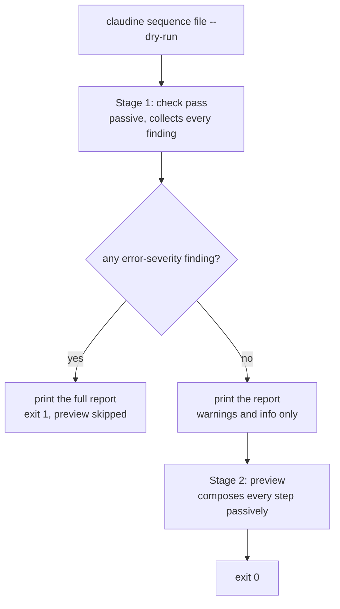

# Better errors and a diagnostic dry run

## Why this exists

Most people who use Claudine and Darkmatter are writing documents: prompts,
sequences, and schemas. When one of those documents is wrong, the error message
is the only thing standing between the author and a fix. Today the messages
often fall short in the same few ways: they report the first problem and stop,
they lose the task or file that led to the problem, they guess at causes, and
they say nothing at all about keys that have no effect.

This spec makes three changes:

1. **`--dry-run` becomes a diagnostic pass.** It checks everything it can
   without side effects, then reports every problem together.
2. **One error-message standard** applies to both Claudine and Darkmatter.
   Tests enforce it, so it cannot decay.
3. **Each capability has one owner.** Anything true of a document regardless of
   agents is built once, in Darkmatter or below, so `md`, DMLS, and Claudine
   share it. Claudine keeps only what needs agent knowledge.

The spec lives in Claudine because the features users see (`--dry-run`,
sequence diagnostics) are Claudine's. **Most of the implementation lands in
Darkmatter, Simplified Schema, and biscuit-file.** That is intended. Every
phase, check, and inventory row below names the package that owns it.

## The motivating sessions

Two real sessions, both running `claudine sequence _fleet.yaml --dry-run`
against this file. These are the test fixtures for Phase 1
(`fixtures/check/fleet-run1/` and `fixtures/check/fleet-run2/`).

`renderers/_fleet.yaml`, as of Run 1:

```yaml
kind: sequence
sequence:
    - name: find
      description: Find the Mermaid renderers and provide basic research
      agent: opencode
      model: gemini/neon
      prompt: ./_find.md
      with:
          output: "./overview.md"
    - name: metadata
      description: extract metadata
```

`_find.md` exists and names no `agent`. Run 2 adds
`prompt: ./_frontmatter.md` to `metadata`; that file does not exist yet.

**Run 1 output:**

```text
 Providers:
 find → no provider
 metadata → no provider
 CompositionError: composed prompt is empty
┃ Composition produced an empty prompt body for .../renderers/_fleet.yaml.
┃ Mode: chained (compose)
┃ No key=value overrides were provided.
┃ The document composed without error, but every block in the body was stripped by its when
┃ condition (or the body was empty to begin with). ...
┃ Check that the variables you passed match the ::block when=… conditions ...
```

What actually happened: `metadata` has no executable, so it composes the
sequence document's own body, and a YAML file has no body. The message never
names the task and blames `::block when=` conditions that do not exist. The
`find → no provider` line is the bigger problem, because a non-interactive run
fails on it, but the dry run presents it as information.

**Run 2 output:**

```text
 CompositionError: composition failed
┃ failed to load external sequence file: ./_frontmatter.md: file not found
```

This message calls a `prompt:` reference an "external sequence file". It names
neither the task, the resolved path, nor the directory it searched. It also
aborts the dry run, so `find`'s provider problem and the two misplaced keys are
never reported.

## What the code says (corrections to the brief)

The brief for this spec stated several beliefs as hypotheses. Where the code
disagrees, the code is right, and the design below follows it.

| Belief | What the code does |
|---|---|
| `agent` and `model` on a task are "not valid task keys; silently ignored" | Task objects are **open by design** (`claudine/schemas/sequence-types.yaml`: "an undeclared key is authored step data, read as `seq.<key>`"). Both keys are kept as step data. They do not affect the provider, because provider selection reads only caller setters, the task's `with:`, and the prompt's frontmatter (`composition/sequence/preflight/providers.rs::predict_key`). A schema validator therefore cannot call them unknown. The same keys **are** rejected in a `kind: task` file and in a group leg, which use the closed `parse_task_object`. |
| `kind: sequence` is deprecated | It is current (`flow-control/sequences.md`). Only the old `kind: sequence` + `list:` form is gone. It is not listed as a removed spelling. |
| Dry run is passive | It is not. After preflight it composes every step for the preview, and composition runs `$( … )` expansions and fetches approved remote transclusions (documented in `flow-control/sequences.md`, "Composition shell work still runs"). On a terminal it also prompts for missing inputs (`phase1c.rs::collect_or_report`). `--dry-run-shell` runs `shell:` tasks for real. **This is a defect, and this spec fixes it:** a dry run has no side effects. |
| The schemas already list the removed task keys | Only one removed key is written in a schema, as prose: `fail_fast: "null -> removed: …"` in `sequence.yaml`. The real list is in the parser (`grammar.rs::removed_task_key`: `setup`, `teardown`, `execution`, `fail_fast`; container events on a non-inline task). DMLS defines `dm.schema.deprecated_key` and never emits it. |
| DMLS has "did you mean" for unknown keys | Only `md clean` suggests keys (`schemas/clean.rs`). Neither the schema validator nor DMLS does. |
| The provider chain has several links, such as a CLI `--agent` and the configured favorite | Today's chain, in order: a provider flag (`--claude`, `--codex`, …, or `--provider <name>`) decides **every** task, overriding any task `with:` or prompt that names another agent. Without one: the caller setter `agent=…`, then the task's `with.agent`, then the prompt's frontmatter `agent`, then the nearest enclosing sequence document whose `agent` resolves. A root `agent:` is therefore only a fallback, and a prompt's own `agent` beats it. There is no generic `--agent` flag. `preferred_agent` only seeds the review screen and never selects a provider in a sequence. No environment variable selects a provider. Only the winning link is recorded, never the empty ones. `2026-11-18-ergonomic-sequences` changes this chain (defined and default values); see [Non-goals](#non-goals). |
| An empty composition has a known cause | Darkmatter does not detect an empty composed body at all. Claudine's `ComposedBodyEmpty` (`prepare.rs`) knows only the path, mode, and override keys. `SequenceStepNotExecutable`, which does name the task, is unreachable in chained mode because `ComposedBodyEmpty` fires first. |

## Goals

- `claudine sequence <file> --dry-run` reports every finding it can establish
  passively, grouped by task, then exits non-zero only if an error-severity
  finding exists.
- A dry run of `claudine sequence`, `compose`, or `inline-compose` has no side effects: no
  shell, no network, no provider, no file write, no prompt.
- A real run's preflight uses the same pass, so a failed preflight shows the
  same full report and no task starts.
- Every finding and error follows one message standard: what, where, why, and
  how to fix it.
- The finding type, the collector, file-reference findings, empty-body
  detection, schema-driven key checks, and report rendering exist once, in
  Darkmatter or below, and `md`, DMLS, and Claudine all use them.
- After Phase 1, `md compose` on a document with a missing `::file` and an
  empty body reports both problems, at the same quality as Claudine and from
  the same code.

## Non-goals

- Closing sequence task objects. Step data stays open (decided 2026-11-22; see
  [Open questions](#open-questions)).
- Changing how a sequence passes state to its children. Defined and default
  values (`default-values`), and what `--<provider>` and `--model` mean for
  each task, belong to `2026-11-18-ergonomic-sequences`. This spec's
  provider-chain finding reports whichever chain the code implements.
- Fixing every error message in either package. The cut line is in
  [Sweep and cut line](#sweep-and-cut-line).
- A new `md` command. `md compose` and `md validate refs` adopt the shared
  collector; a standalone `md check` is an open question.
- Any change to `err.*` codes or `when:` matching for errors that exist today.

## Ownership

### The rule

**A fact about a document belongs to Darkmatter or below. A fact that needs an
agent belongs to Claudine.** "Needs an agent" means it depends on the task tree,
provider resolution, provider requirements, or Claudine's lifecycle. Everything
else is a document fact, even when the document is a Claudine sequence:
whether a referenced file exists, whether a key is declared, whether a body is
empty.

### Decisions

| Capability | Owner | What the other side consumes | Why |
|---|---|---|---|
| The finding type: code, severity, message, location, related locations, fix hint, trail, and its JSON form | **Darkmatter**: extend `compose::expression::diagnostics::Diagnostic` | Claudine produces the same record for its own findings | One record already reaches `md --output json`, DMLS, and the CLI. A second type would split every renderer. |
| Severity | **Darkmatter** `Severity` (`error`, `warning`, `info`), unchanged | Claudine | It already exists, and a blocking policy never changes it. |
| Collecting findings across a document tree without stopping | **Darkmatter**: a new `findings` module (`FindingSink`, `FindingReport`) | Claudine's sequence walk pushes into the same sink | `md compose`'s pre-composition checks need the same collection. |
| "How we got here": transclusion chain, iteration, task path | **Darkmatter** `Trail`, which unifies `included_via` and `iteration_path` and adds host frames | Claudine pushes `task`, `group`, and `sequence` frames | It is the same idea in three places today. Hosts add frames; they do not invent a second trail. |
| Reporting a missing or unresolvable file reference | **Darkmatter** finding builder over **biscuit-file**'s `DetailedResolution` | Claudine calls it for `prompt:`, `task:`, `group:`, and `sequence:` references with its own construct phrase | Resolution and the probe record are biscuit-file's. Rendering them is a document fact. Today Claudine has two renderings and the sequence path has none. |
| Unknown keys, removed keys, near-miss suggestions | **Simplified Schema** (the validator) with **Darkmatter**'s `catalog::suggest_strings` | DMLS and the Claudine runtime read the validator's problems | The schema is the source of truth. Today DMLS and the runtime check different things. |
| Empty-composition result and its cause | **Darkmatter** compose outcome | Claudine decides whether empty is fatal for a provider launch | Only the composer knows which blocks it excluded. |
| Grouped report rendering for terminal, plain, and data output | **Darkmatter** `FindingReport` (a `renderable::CommandOutput`), generalized from the `md validate refs` report | Claudine renders the dry-run report and the preflight failure through it | The reference report already groups problems by subject, shows trails, and closes with a tally. Generalize it rather than write a second one. |
| The task tree, the provider chain, provider requirements, lifecycle | **Claudine** | Pushes findings into Darkmatter's sink | Agent knowledge. |
| Failure identity (`err.*` facets: category, disposition, origin, detail) | **Claudine**, unchanged | | See below. |

### Option A: amended, not replaced

`error-architecture.md` says Claudine owns diagnostic identity and lower layers
have none ("Option A"). That is already only half true. Darkmatter's
`Diagnostic` carries `dm.*` codes that `md --output json` and DMLS publish.
Option A was really about the **failure facets** that a lifecycle `when:`
clause matches. This spec writes that distinction down:

- **Finding identity is shared.** A finding's `code` names the authoring
  mistake. Document facts use Darkmatter's `dm.*` namespace. Claudine's
  findings use Claudine catalog codes (`composition.*`). Both use one record.
- **Failure identity stays Claudine's.** When a finding stops a real run, the
  error the run returns, and therefore `err.code`, `err.category`, and
  `err.detail`, is still a Claudine catalog projection. A Darkmatter finding
  never becomes an `err.*` value directly.

What this costs:

1. **One mapping table.** Each `dm.*` code that can stop a Claudine run maps to
   one Claudine catalog code, for example `dm.reference.missing_document` to
   `composition.invalid_file_reference`. A guard fails when a `dm.*` code a
   Claudine run can surface has no row.
2. **A third diagnostic role.** A failed preflight now carries a whole report
   but must keep today's `err.code`. The new `CompositionError::CheckFailed`
   has the role **`Aggregate`**: it owns rendering (the full report) and
   delegates facets to its **primary** error, the first error-severity finding
   in report order. `select_effective_diagnostic` treats `Aggregate` like
   `Transparent` for facets and like `Semantic` for rendering. The registry
   and role guards learn the new role.
3. **Typed errors are kept.** Each error-severity Claudine finding keeps the
   typed `CompositionError` it was projected from, so the primary is a real
   error and not a restored snapshot.

Rejected alternatives:

- **Option A unchanged.** Darkmatter findings would have to be re-wrapped as
  Claudine errors to be reported at all. That is today's model, and it is why
  `md` and Claudine render the same missing file in three different ways.
- **Darkmatter owns failure facets too.** This would move `err.*` and the
  catalog into Darkmatter, a cross-area contract in exchange for no user
  benefit in this spec.

## The finding model

### The record

`Diagnostic` is extended **additively**. Existing fields keep their names and
JSON form.

| Field | Status | Meaning |
|---|---|---|
| `code`, `severity`, `message`, `source`, `span`, `expected_type`, `actual_type` | existing | unchanged |
| `hint` | **new**, `Option<String>` | the one concrete next step. Required for `error` and `warning` (see [Enforcement](#enforcement)). |
| `related` | **new**, `Vec<RelatedLocation { source, message }>` | other places that matter, such as the finding that blocked this check or the declaration a key conflicts with. DMLS maps these to LSP `relatedInformation`. |
| `trail` | **new**, `Trail` | how the problem was reached, outermost first (see below) |
| `iteration_path`, `included_via` | existing, now **projections** of `trail` | kept in JSON so existing consumers keep working |
| `reference_details`, `data_location`, `grants_needed`, `schema_default` | existing | unchanged |

`message` states **what** failed and **why**, in the author's terms, and never
names a cause the producer has not established. `hint` states how to fix it.
`source` states where.

### The trail

A `Trail` is a list of frames, outermost first:

```rust
pub enum TrailFrame {
    /// Reached through a transclusion at this authored position.
    Included { file: ComposeSource, line: Option<usize> },
    /// Inside a `::map`/`::filter` item.
    Iteration { collection: String, position: IterationPosition },
    /// A host construct, such as a Claudine task.
    Host { kind: &'static str, label: String, property: String, file: PathBuf, line: Option<usize> },
}
```

`kind` is a host-owned noun such as `task`, `group`, or `sequence`. `property`
is the authored path (`sequence[1].prompt`). The renderer prints a trail as one
line: `task metadata (sequence[1]) → _frontmatter.md`.

Errors carry trail context **as typed data**, never by formatting it into a
message. A Claudine error raised while loading a task carries
`site: Box<TaskSite>` (boxed context, per rule 2 of
[Rules for a typed wrapper](../../docs/topics/error-architecture.md#rules-for-a-typed-wrapper)),
and the projection to `Diagnostic` turns it into a `Host` frame. Darkmatter's
`MarkdownError::InIteration` and the reference trail already produce the other
two kinds.

### The collector

```rust
// darkmatter::findings
pub struct FindingSink { /* ordered findings and subjects */ }

impl FindingSink {
    pub fn push(&mut self, finding: Diagnostic);
    /// Record that `check` could not run for `subject`, and which finding
    /// blocked it. Emits one `dm.check.not_checked` info finding.
    pub fn not_checked(&mut self, subject: &Trail, check: &str, blocked_by: Option<FindingId>);
    pub fn has_errors(&self) -> bool;
    pub fn finish(self) -> FindingReport;
}
```

- A **subject** is what findings are grouped under: a document for `md`, or a
  task for Claudine. A subject is identified by its trail.
- **Not checked** findings replace silence. When a missing prompt file means
  that task's provider and inputs cannot be checked, the sink records one
  `info` finding per skipped check, with `related` pointing at the finding that
  blocked it. A blocked check never invents a second error.
- The sink keeps findings in walk order. The report sorts nothing except by
  subject, so output is deterministic.

### Codes

| Namespace | Owner | Examples |
|---|---|---|
| `dm.*` | Darkmatter, in the `COMPOSE_DIAGNOSTIC_CODES` catalog | `dm.reference.missing_document`, `dm.schema.removed_key`, `dm.schema.near_miss_key`, `dm.compose.empty_body`, `dm.check.not_checked` |
| Claudine catalog (`composition.*`) | Claudine, in `diagnostics/registry.rs` | `composition.provider_unresolved`, `composition.selection_key_as_data`, `composition.no_executable`, `composition.model_required` |

Each new code is declared once with its severity. `dm.schema.deprecated_key`,
which DMLS declares and never emits, is removed; `dm.schema.removed_key`
replaces it.

### Blocking

No new policy is added. Error-severity findings block. In `md`, the existing
`--allow`/`--deny`/`--disable` policy still decides whether a warning blocks,
and the new `dm.*` codes join its catalog. Claudine does not gain a policy
flag in this spec.

## Dry run as a diagnostic pass

### What the user does

```sh
claudine sequence _fleet.yaml --dry-run           # check, then preview if clean
claudine sequence _fleet.yaml --dry-run --json    # the check as data, for CI
```

### Two stages



**A dry run has no side effects.** Neither stage runs a shell command, makes a
network request, launches a provider, writes a file, fires a lifecycle event,
or prompts. This reverses two documented behaviors: today the preview runs
`$( … )` expansions and fetches approved remote transclusions, and on a
terminal it asks for missing inputs.

- **Stage 1, the check pass,** is new. It reports every finding it can
  establish.
- **Stage 2, the preview,** is today's per-step rendering, now passive. It runs
  only when Stage 1 found no error. With `--json`, Stage 2 never runs, so
  stdout holds exactly one JSON value.

The preview composes through a Darkmatter **passive compose** option
(**Darkmatter**-owned), which `md` can use too:

| Construct | In the preview |
|---|---|
| `$( … )` in frontmatter, and `::shell` in the body | Left as written and marked: `$(date +%F)` *(not run in a dry run)*. A value derived from it shows the expression, not a guess. |
| A remote `::file`, `::code`, `prologue:`, or `epilogue:` URL | Not fetched; shown as the reference with *(not fetched in a dry run)*. |
| A missing input | Left as its placeholder (`{{ topic }}`) and marked *(no value)*. The check pass has already reported it. |
| A `shell:` task | `would run `<command>``, as today. |
| A `side_effect:` task, `loop:`, `when:`, inline `$schema`, `prep` | As today (already passive). |

**`--dry-run-shell` is removed** from `claudine sequence`, `compose`, and
`inline-compose`. It ran each `shell:` task for real during the preview, which
a dry run cannot do. Passing it is a usage error (exit `2`) naming the
replacement:

```text
error: `--dry-run-shell` was removed: a dry run runs no commands.
  hint: use `--dry-run` to check and preview, or run the sequence
```

### What the check pass walks

The pass walks the whole tree that a real run's preflight would load: the root
document, every task, inline and referenced nested sequences, groups (inline,
referenced, and catalog entries), `kind: task` files, and every prompt
document. In each prompt document it also walks frontmatter transclusions
(`prologue:`, `epilogue:`) and body references (`::file`, `::code`), using the
condition-blind walk that Darkmatter's preflight already does.

It reuses Claudine's existing preflight machinery (`preflight::Loader`,
`discover_sequence_inputs`, provider prediction) with one change: **a failure
in one subtree becomes findings, and the walk continues with its siblings.**
The loader's documented rule "preflight never degrades to best-effort"
(`preflight/mod.rs`) changes to: preflight collects every finding, then
refuses to start if any is an error.

### How each effectful check is handled

| Check that normally has an effect | In the check pass |
|---|---|
| A frontmatter value written as `$( … )` | Not run. A check that needs its value is reported as `not checked` ("depends on a shell expansion"). |
| A remote `::file` or `::code` URL | Not fetched. The reference is checked for syntax and fetch policy only. |
| A provider's installed state | Read from the same passive host snapshot provider prediction already uses. |
| A model a provider requires | Read from flags, environment variables, and the provider's config file (reading a file is passive). |
| Missing required inputs | Judged against frontmatter prepared with shells disabled (`prepare_sequence_document_values`), never by composing. No prompt is shown. |
| Shell command approval | Not asked: a dry run runs no command, so it approves none. A real run asks as today. |
| A task `when:` guard and an inline container's `$schema` | Not evaluated, as today. The task is checked as if it runs. |
| A value only known at launch (`seq.*`, `loop.*`, a runtime `set`) | Reported as `not checked` when a check needs it. Provider prediction already classifies these as "decided at launch". |

### Severity

- **error**: a real run would fail.
- **warning**: suspicious, ignored, or likely a mistake, but a real run would
  proceed.
- **info**: context, including `not checked`.

**Problems a real run resolves by asking.** A missing input or an unresolved
provider does not fail a run that can ask: on a terminal, the run shows its
review screen or input prompt. The check pass reports these as `warning` when
the run it rehearses could ask (stdin and stderr are terminals and `--silent`
is not set), and as `error` otherwise. The message says which: "a
non-interactive run fails here; an interactive run asks you to choose". This
keeps a CI dry run honest: it fails exactly when the CI run would.

Removed grammar is refused by the parser today, so a removed key is an
**error**, not a warning.

### Exit status

| Situation | Exit |
|---|---|
| No error-severity finding (the preview, if run, succeeded) | `0` |
| At least one error-severity finding | `1`, after the full report is printed |
| Usage error (for example `--json` without `--dry-run`, or the removed `--dry-run-shell`) | `2` |

### Report formats

**Terminal and plain** (stderr, like today's dry-run status lines): grouped by
subject, the root document first, then tasks in authored order, nested tasks
under their container. Each finding is one row with its severity, message,
location, and hint. `not checked` findings for one subject fold into one line.
A summary closes the report. The full layout is in
[Before and after](#before-and-after).

**`--json`** (stdout): one value, shaped like Darkmatter's `DocumentEnvelope`
so one parser reads both tools:

```json
{
  "file": "/work/renderers/_fleet.yaml",
  "outcome": "failure",
  "diagnostics": [ { "code": "…", "severity": "error", "…": "…" } ],
  "summary": { "errors": 3, "warnings": 2, "info": 2 }
}
```

Each element of `diagnostics` is the shared `Diagnostic` record, unchanged.
`--json` requires `--dry-run`. It matches `claudine doctor --json`. Claudine's
refusal of `-o`/`--output` stays as it is.

### A real run uses the same pass

A real `claudine sequence` run calls the same check pass at the point where
preflight runs today: after the root `initialize` and before any task starts.
If the report holds an error, the run prints it, starts no task, and returns
`CompositionError::CheckFailed` (see [Option A](#option-a-amended-not-replaced)).
`err.code` is the primary error's code, exactly what the first error would
have produced before this change, so existing `when:` clauses keep matching.

Warnings from the check are printed before the first task, as today's
preflight warnings are. Problems a real run resolves by asking are not
reported as findings in a real interactive run; they go to the review screen
or input prompt as today.

### Other commands

- **`claudine compose` and `claudine inline-compose` `--dry-run`** become
  passive in Phase 1: their preview uses passive compose, and inline-compose
  already writes nothing back. In Phase 3 they also run the same check pass
  over one document: its references, schema findings, empty body, provider,
  and model requirement.
- **Provider wrappers** (`claudine claude … --dry-run`) take a prompt string,
  not a document. Out of scope.
- **`md`** gains no `--dry-run` and no new command. `md compose`'s existing
  pre-composition checks (references, call check, schema verdict) push into
  the shared sink, so a failing `md compose` prints every finding from those
  families instead of stopping at the first family. `md validate refs` renders
  through the shared `FindingReport` with byte-identical output.

## Checks

Each check names its source of truth. Where a source exists, the check is
derived from it rather than hand-written.

| Code | Severity | Owner | Source of truth | Reports |
|---|---|---|---|---|
| `dm.reference.missing_document` | error | Darkmatter (builder), biscuit-file (resolution) | `FileReference::resolve_detailed` | A reference that matches no file, for every form: task `prompt:`, `task:`, `group:`, nested `sequence:`, group catalog entries, frontmatter `prologue:`/`epilogue:`, body `::file`/`::code`, and `@`/`&`/`^` magic paths. States the task and key (trail), the reference as written, the resolved candidate path, the directory it was resolved against, the locations searched (magic roots for `@` references), up to three similar existing files, and that the file must exist before a real run. Existing `dm.reference.missing_transclusion` keeps its code for body constructs. |
| `dm.schema.unknown_key` | per schema | Simplified Schema | the document's schemas | A key a closed object does not declare, now with a near-miss suggestion when one is close. Severity stays what the schema and DMLS decide today. |
| `dm.schema.near_miss_key` | warning | Simplified Schema | the schema's declared keys | A key an **open** object accepts as data, but which is a near miss of a declared key (`promt` beside `prompt`, `whne` beside `when`). Suggests the declared key. Uses `catalog::suggest_strings`. |
| `dm.schema.removed_key` | error | Simplified Schema | the new `removed(…)` declaration | A removed key, with its replacement as the hint. |
| `dm.compose.empty_body` | warning in `md`; Claudine decides | Darkmatter | the compose outcome | A composition whose body is empty, with the cause that applies: the document has no body, its body is only whitespace, or every block was excluded, listing each excluded `::block` with its condition and location. |
| `composition.selection_key_as_data` | warning | Claudine | provider prediction's selection keys (`agent`, `model`) | A task carrying `agent` or `model` as step data. Says it is read as `seq.agent` and does not choose the provider, and that `with: { agent: … }` does. |
| `composition.no_executable` | error when the source has no body | Claudine | the task grammar and the source format | A task with no executable. In a document with a body it is `info` ("composes the body of `release.md`"). In a YAML, JSON, or JSON5 source, which has no body, it is an error. This reuses and makes reachable `SequenceStepNotExecutable`. |
| `composition.provider_unresolved` | error or warning (see [asking](#severity)) | Claudine | provider prediction and `select_target` | A provider-launching task whose provider cannot be decided. Lists the chain in order and marks each link `empty`, `not installed`, `ambiguous`, or `unknown`, linking to a `selection_key_as_data` finding when one explains the gap. |
| `composition.model_required` | error | Claudine | `ProviderInfo::model_required_in_non_tty` and `exec_prep::resolve_model_and_validate` | A task whose resolved provider requires a model for a non-interactive run (OpenCode today) when none is found in flags, the provider's model variable, `MODEL`, hints, or the provider's configured default. Sequence tasks never run interactively, so this is always an error. A task decided at launch is `not checked`. |
| `composition.missing_properties` (existing code) | error or warning (see [asking](#severity)) | Claudine, over Darkmatter's schema verdict | each prompt's `$schema` | An input a prompt's `$schema` requires and that neither `with:`, caller setters, nor the enclosing document supplies. One finding per input, under its task. |
| `dm.check.not_checked` | info | Darkmatter | the sink | A check that could not run and why, with the blocking finding in `related`. |

### Removed spellings

Phase 2 adds a first-class Simplified Schema declaration, `removed(<replacement>)`,
and moves Claudine's removed-grammar list into the shipped schemas:

```yaml
# claudine/schemas/sequence.yaml
$schema:
    fail_fast: "removed(set fail_fast on a group object)"

# claudine/schemas/sequence-types.yaml, task:
    setup: "removed(use a preceding `side_effect:` task for an action or `shell:` task for a command)"
    teardown: "removed(use a group's `finalize:`; wrap a single task in a group of one)"
    execution: "removed(groups run concurrently, so omit it; for ordered work use a nested `sequence:`)"
    fail_fast: "removed(`fail_fast` belongs on a `group:` object only)"
```

- A `removed(…)` key validates as absent-only. The validator emits
  `dm.schema.removed_key` with the replacement as the hint, so DMLS,
  `md schema validate`, and Claudine's check pass all report it from the same
  declaration.
- The parser's `RemovedGrammar` sites read the replacement from the shipped
  schema, so the text exists once. A parity test fails if the parser refuses a
  key the schema does not declare `removed`, or the other way round.
- `execution` gets one replacement for both of today's value-dependent
  messages. The parser may still add the value-specific sentence.
- Container events on a non-inline task are a placement rule, not a removed
  key. They stay in the parser.
- `kind: sequence` is current and is not listed.

### Reconciling with sibling specs

- **`2026-11-22-claudine-doctor`** reports unknown configuration keys with the
  same validator. Its `stray-config-keys` rows gain near-miss suggestions from
  this spec's Phase 2 at no extra cost. Its report keeps its own row format
  (one row per check). The finding record is compatible, so a later change
  could render doctor rows through `FindingReport`, but this spec does not
  require it.
- **`2026-11-18-ergonomic-sequences`** replaces `prompt:` with `compose:`,
  `inline-compose:`, and `sequence:` verbs. Every message in this spec takes
  its construct noun from one table keyed by executable
  (`ExecutableField::noun`), so a renamed verb changes one row. The check
  `composition.no_executable` and the reference construct phrases are written
  against that table, not literal `prompt:` text.
- **`2026-10-09-frontmatter-warnings`** records lossy `md clean` repairs in a
  `_warnings` frontmatter list. That is persisted document state, not a
  finding, and it has no severity. No overlap. If that spec's warnings are
  ever reported at compose time, they should use this spec's record.

## The error-message standard

Every user-facing error and finding in Claudine and Darkmatter states four
things.

1. **What failed, in the author's terms.** Name the construct by the noun the
   author wrote (`prompt:` of task `metadata`, not "external sequence file"),
   the value as written, and the resolved form when one exists.
2. **Where.** The file and position. Show an excerpt only when the position is
   proven (`SourceRef::OnDiskSpan`). Otherwise name the file alone, and never
   guess a line.
3. **Why.** The cause that actually applies. A message never lists causes it
   has not established. Where one variant covers several causes today, split
   it or carry the cause as data, and render only the cause that applies.
4. **How to fix it.** One concrete next step in the hint.

Rules that go with it:

- **Nouns come from the construct.** A reference's noun comes from the
  construct that holds it (`ReferenceConstruct`, extended with Claudine's
  executables), never from the function that loaded it.
- **Context travels as data.** Task, key, and transclusion context ride on
  the trail and typed fields. A message is never assembled by concatenating
  context at the top level.
- **Severity is the finding's.** A message never says "error" when its
  severity is a warning.
- **Origins are honest.** A value the document did not author is attributed
  to its supplier (`SourceRef::Supplied`), as Darkmatter does today.
- **Rendering conventions are unchanged.** `StatusBlock` with a `Vec<Prose>`
  body, `SourceContext` excerpts, escaped user tokens (`darkmatter/docs/errors/`).

### Example of the standard

```text
✗ task metadata: the prompt file does not exist
    prompt: ./_frontmatter.md
    resolved to renderers/_frontmatter.md (relative to renderers/_fleet.yaml)
    at renderers/_fleet.yaml:12:15
    hint: create renderers/_frontmatter.md before a real run, or correct the reference
```

Line by line: *what* is the first line, *where* is `at …`, *why* is
"does not exist" together with the resolved path, and *fix* is the hint.

### Enforcement

| Mechanism | Owner | Fails when |
|---|---|---|
| **Typestate builder.** Findings are built with `Finding::error(code, message).at(source).hint(…)`. An `error` or `warning` without a hint does not compile. | Darkmatter | a new finding skips the fix step |
| **Catalog snapshot guard.** Every code in `COMPOSE_DIAGNOSTIC_CODES` and in Claudine's catalog that a finding can carry has a fixture and a rendered snapshot (terminal plain and JSON). | both | a code has no snapshot, or a snapshot names no fixture |
| **Catch-all burn-down guard.** `render/provider.rs`'s `_ =>` arm (header "composition failed") may render only variants on an allowlist in `error_guards/`, each with a burn-down tag. A new variant reaching it fails. A stale entry fails. | Claudine | a new sequence error falls through to "composition failed" |
| **Site guard.** A `CompositionError` variant whose name starts with `Sequence` must carry a `site` (or `source_path` plus `property`) field. `syn` scan, beside the existing `error_guards`. | Claudine | a sequence error loses its task and key |
| **Noun guard.** Literal construct nouns ("external sequence file", "external YAML file") are refused in `#[error]` strings and `status_block` bodies outside the noun table. | Claudine | a message hard-codes a noun |
| **Mapping guard.** Every `dm.*` code a Claudine run can surface maps to one Claudine catalog code. | Claudine | the Option A mapping drifts |
| **Parity tests.** DMLS and the check pass report the same schema findings for the same document (see [Tests](#tests)). | Darkmatter, Claudine | the editor and the runtime disagree |

## Inventory

The error sites on the sequence load, compose, and dry-run path. "Breaks"
refers to the four rules of the standard (What, Where, Why, Fix).

| Site | Current text | Breaks | Replacement | Owner |
|---|---|---|---|---|
| `SequenceExternalLoad` from `source.rs::resolve_sequence_reference`, used for `prompt:`, `task:`, `group:`, and `sequence:` references | `failed to load external sequence file: ./_frontmatter.md: file not found` | What (wrong noun), Where (no task, key, resolved path, or base), Fix | `dm.reference.missing_document` through the shared builder, with the construct noun and task trail. The variant splits: reference resolution goes to the builder; a parse failure of a loaded file keeps a `SequenceSourceParse` variant naming the file | Darkmatter (builder), Claudine (call sites, split) |
| `SequenceExternalLoad` from `data.rs` (parse and read failures) | `failed to load external sequence file: <path>: <cause>` | What (noun: it may be a group or task file) | `SequenceSourceParse { construct, path, cause }` with the noun from the construct that referenced it | Claudine |
| `ComposedBodyEmpty`, rendered in `render/provider.rs` | `composed prompt is empty` … "every block in the body was stripped by its `when` condition (or the body was empty to begin with)" … hint about `::block when=` | Why (lists causes it has not established), What (no task) | Carries Darkmatter's `EmptyBodyCause`. Renders only that cause: "has no body", "contains only whitespace", or "all 2 blocks were excluded: `::block when=\"draft\"` at doc.md:4, …". The hint follows the cause. In a sequence it carries the task trail | Darkmatter (cause), Claudine (render) |
| Bodyless source plus a task with no executable (Phase 1c, `phase1c.rs`) | the `ComposedBodyEmpty` block above, naming the sequence file | What, Why | `composition.no_executable` at check time: "task `metadata` has no executable, so it would compose the body of `_fleet.yaml`, and a YAML file has no body". Hint: "add an executable such as `prompt: ./metadata.md`" | Claudine |
| `SequenceStepNotExecutable` (`iterate.rs`) | names the step, but unreachable in chained mode | | Becomes the typed error behind `composition.no_executable`. Phase 1c and iterate agree on one "has an executable" test (today they read `plan.steps[i].executable` and `graph.steps[i].task`) | Claudine |
| Dry-run provider rows (`providers.rs::plan_rows`) | `metadata → no provider` | Why, Fix; also severity (a non-interactive run fails) | `composition.provider_unresolved` with the chain. The `Unresolved` target already holds `state`; prediction records each empty link | Claudine |
| `SequenceExclusiveExecutable` | `…a step may declare at most one of prompt/shell/side_effect/group/task` | What (omits `sequence`, the sixth executable), Where (index only) | List from `EXECUTABLE_KEYS`; carry the site | Claudine |
| `SequenceStepNameMissing`, `SequenceStepNameWrongType`, `SequenceReservedStateKey`, `SequenceInvalidTaskField` | `sequence step at index {index} …` (zero-based) | Where (no file or property; `origin` and `property` are in scope but dropped) | Carry the site; render `sequence[2]` in its file, one-based in prose to match `SequenceStepNotExecutable` | Claudine |
| `RemovedGrammar` from `grammar.rs::removed_task_key` | `` `fail_fast` uses the removed `fail_fast` grammar (…) `` | Where (`path` is the bare key; the task's property is dropped) | `dm.schema.removed_key` from the schema; the parser's error carries the full property (`sequence[2].fail_fast`) | Simplified Schema, Claudine |
| `expect_reference` (`preflight/mod.rs`) | `SequenceReferenceInvalid` with `path: PathBuf::new()`, rendering `… (): must be a non-empty file reference` | Where (empty path) | Carry the referencing file and property | Claudine |
| `parse_task_object` (`kind: task` files, group legs) | `` `{key}` is not a task field; expected one of … `` with context `"task"` | Where (property is a parameter but dropped) | Carry the site; add a near-miss suggestion from the same `suggest_strings` | Claudine |
| `SequenceInvalid` strings (`grammar.rs`, `inputs.rs`) | `invalid sequence definition: …` | Where (no path) | Carry the site | Claudine |
| `SequenceSelectionFailed` | `sequence selection failed for N step(s): {failures:?}` (Debug formatting) | What | Nothing outside tests constructs it. Delete it | Claudine |
| First-error abort in graph build and input discovery (`preflight/mod.rs`, `inputs.rs`) | (behavior) | collects nothing | Push findings and continue with siblings | Claudine |
| Darkmatter reference failure in `md compose` | stops at the reference family | collects one family | Pushes into the shared sink with the call check and schema verdict | Darkmatter |
| `TransclusionError::Io` for a missing `::file` in `md compose` | `TransclusionError: I/O failure` / `File not found: ./missing.md` / hint `Check file existence and permissions.` | Where (no file or line), Why (permissions not established), What (no construct) | `dm.reference.missing_document`'s rendering through the shared builder: the construct, the location, the resolved path, and one hint for the cause that applies. A permission failure keeps its own `io` hint | Darkmatter |
| `PageBlockError::UnterminatedBlock` excerpt | the gutter numbers lines from the start of the body (`> 1 │ ::block …` for file line 4) | Where (the number is not a file position) | Number excerpt lines in the file's frame (`loaded_source_context_for_errors`), as the errors skill already requires | Darkmatter |
| Schema problems with no suggestion (`ValidationProblem` `UnknownKey`) | `` `x` is not declared `` | Fix | Add the near-miss suggestion as the hint; move the matching out of `md clean` into the validator | Simplified Schema, Darkmatter |

## Sweep and cut line

The same patterns elsewhere, found while building the inventory.

**In scope, because the shared mechanisms fix them cheaply:**

- Every `Sequence*` variant that drops `origin` or `property` gains a site
  (the site guard forces it, and the data is already in scope).
- `md clean`'s unknown-key suggestion moves into the validator, so DMLS,
  `md schema validate`, and doctor get it for free.
- `md validate refs` and `md compose` render reference problems through
  `FindingReport`, so the report has one implementation.
- DMLS stops declaring the unused `dm.schema.deprecated_key`.
- Claudine's two missing-file renderings (`FileReferenceNoMatch` for a
  top-level document, and none for a sequence reference) become one Darkmatter
  builder. The suggestion search that `with_file_reference_suggestions`
  attaches today moves with it.

**Out of scope, with the reason:**

| Site or pattern | Reason |
|---|---|
| Lifecycle error rendering (`LifecycleErrorInfo`, `RemovedGrammar` for lifecycle verbs) | Already typed, located by `LifecyclePath`, and covered by its own guards. |
| Provider runtime errors (`provider.*` codes) | Not authoring errors. A different audience and a different spec. |
| Configuration errors | `2026-11-22-claudine-doctor` owns them. |
| Darkmatter expression and call-check messages | Already located, coded, and collected by the passive call check. |
| The passive call check stopping at the first rejected call | Fixable, but expression typing has its own collection rules. Follow-up. |
| Any `md` command other than `compose` and `validate refs` | No motivating case. |

**The cut line:** a site is in scope when it is on the sequence load,
compose, or dry-run path, or when a mechanism this spec builds fixes it with
no new design. Everything else waits for a follow-up spec.

## Before and after

### Run 1

Before: see [the motivating sessions](#the-motivating-sessions).

After (`--dry-run`, stderr not a terminal, `--plain` layout):

```text
Checking renderers/_fleet.yaml (passive: nothing runs)

task find (sequence[0])
  ⚠ `agent: opencode` is step data (read as `seq.agent`), not the task's provider
      at renderers/_fleet.yaml:5:7
      hint: to choose the provider, move it into the task's inputs: `with: { agent: opencode }`
  ⚠ `model: gemini/neon` is step data (read as `seq.model`), not the task's model
      at renderers/_fleet.yaml:6:7
      hint: to choose the model, move it into the task's inputs: `with: { model: gemini/neon }`
  ✗ no provider for this task; a non-interactive run fails here
      1. --provider flag             not given
      2. agent= setter               not given
      3. with.agent                  not set (see `agent:` above)
      4. _find.md frontmatter agent  not set
      5. _fleet.yaml agent           not set
      hint: add `with: { agent: opencode }`, or run with `--provider opencode`
  ℹ not checked: model requirement (no provider)

task metadata (sequence[1])
  ✗ this task has no executable, so it would compose the body of
    renderers/_fleet.yaml, and a YAML file has no body
      at renderers/_fleet.yaml:10:7
      hint: add an executable such as `prompt: ./metadata.md`
  ℹ not checked: provider, inputs (no executable)

Check failed: 2 errors, 2 warnings, 2 not checked. Preview skipped.
```

The numbered chain shows today's links. Once `2026-11-18-ergonomic-sequences`
lands, the same finding lists that spec's defined and default links instead,
in its order.

Exit status `1`. On a terminal, the provider finding is a warning ("an
interactive run asks you to choose") and the exit status depends only on the
`metadata` error.

### Run 2

After (same conditions, `metadata` now has `prompt: ./_frontmatter.md`):

```text
Checking renderers/_fleet.yaml (passive: nothing runs)

task find (sequence[0])
  … the same three findings as Run 1 …

task metadata (sequence[1])
  ✗ the prompt file does not exist
      prompt: ./_frontmatter.md
      resolved to renderers/_frontmatter.md (relative to renderers/_fleet.yaml)
      at renderers/_fleet.yaml:12:15
      hint: create renderers/_frontmatter.md before a real run, or correct the reference
  ℹ not checked: provider, inputs (the prompt file could not be read)

Check failed: 2 errors, 2 warnings, 2 not checked. Preview skipped.
```

The find findings are no longer hidden behind the missing file.

`--json` for Run 2 (abridged; each record is the shared `Diagnostic`):

```json
{
  "file": "/work/renderers/_fleet.yaml",
  "outcome": "failure",
  "diagnostics": [
    {
      "code": "composition.selection_key_as_data",
      "severity": "warning",
      "message": "`agent: opencode` is step data (read as `seq.agent`), not the task's provider",
      "source": { "file": "/work/renderers/_fleet.yaml", "line": 5, "column": 7, "inserted": false },
      "trail": [{ "host": "task", "label": "find", "property": "sequence[0].agent" }],
      "hint": "to choose the provider, move it into the task's inputs: `with: { agent: opencode }`",
      "related": [],
      "iteration_path": []
    },
    {
      "code": "dm.reference.missing_document",
      "severity": "error",
      "message": "the prompt file does not exist",
      "source": { "file": "/work/renderers/_fleet.yaml", "line": 12, "column": 15, "inserted": false },
      "reason": "file not found",
      "construct": "prompt:",
      "reference": "./_frontmatter.md",
      "failure": "no-match",
      "trail": [{ "host": "task", "label": "metadata", "property": "sequence[1].prompt" }],
      "hint": "create renderers/_frontmatter.md before a real run, or correct the reference",
      "related": [],
      "iteration_path": []
    }
  ],
  "summary": { "errors": 2, "warnings": 2, "info": 2 }
}
```

### The equivalent `md` case

```markdown
---
title: Release notes
---
::block when="draft"
::file ./missing.md
::end-block
```

Before (`md compose notes.md`, observed 2026-11-22):

```text
⤫ TransclusionError: I/O failure
┃ File not found: ./missing.md
┃ failure: no-match
┃ Check file existence and permissions.
```

This message breaks three rules of the standard. It gives no file or line
(Where). Its hint names permissions, a cause nobody established (Why). It never
mentions the empty body (one problem reported). The transclusion fails even
though its block is excluded, because `draft` is unset. With the `::file` line
removed, the same document composes to a single newline and exits `0` without
a word: Darkmatter has no empty-body detection.

After: one report, from the same sink and renderer Claudine uses.

```text
notes.md
  ✗ file not found in `::file`  `./missing.md`  notes.md:5:1
      resolved to ./missing.md (relative to notes.md)
      hint: create missing.md, or correct the reference
  ⚠ the composed body is empty: its only block was excluded
      `::block when="draft"` at notes.md:4:1 (`draft` is not set)
      hint: set `draft`, or add content outside the block

Checked notes.md: 1 error, 1 warning
```

The empty-body finding comes from a condition-blind walk, so it is reported
even though composition stopped at the reference. The reference stays an error
because today's composer fails on it (see open question 6). A cause that cannot be
established passively (a `when=` that reads a `$( … )` value) is reported as
`not checked`.

## Documentation to update

Behavior not yet built is written in and marked **planned** by the change that
decides it, and the marker is removed by the change that ships it. No doc names
this spec.

**Claudine**

- `claudine/docs/cli/sequence.md`, "Dry run": the two stages, `--json`, exit
  statuses, and an example report. Remove `--dry-run-shell` from the section
  and from the Flags table, and add it to the removed spellings.
- `claudine/docs/topics/flow-control/sequences.md`, "Dry run": the passivity
  table, the asking rule, and that preflight collects every finding. Replace
  the "Composition shell work still runs" callout with the passive-preview
  table.
- `claudine/docs/cli/compose.md` and `inline-compose.md`: the passive dry run
  and the removed `--dry-run-shell` (Phase 1).
- `claudine/docs/topics/error-architecture.md`: the amended Option A, the
  `Aggregate` role, the `dm.*` mapping, and the new guards.
- `claudine/docs/topics/pre-flight-checks.md`: preflight collects, then
  refuses.
- `claudine/docs/cli/compose.md` and `inline-compose.md`: the check pass
  (Phase 3).

**Darkmatter**

- `darkmatter/docs/cli/data-contracts.md`: `hint`, `related`, and `trail`;
  `iteration_path` and `included_via` as projections; the new codes.
- A new `darkmatter/docs/errors/message-standard.md`: the four rules, the
  nouns rule, and the enforcement table, linked from `README.md`.
- `darkmatter/docs/errors/composition-problems.md`: the new stopping rule
  (collect across families) and `dm.compose.empty_body`.
- `darkmatter/docs/cli/compose.md` and `validate.md`: the shared report.
- The Darkmatter library docs for the passive compose option (what it leaves
  unexpanded and how it marks it).
- `darkmatter/docs/topics/schemas/dmls-schema-support.md`: removed keys,
  near-miss suggestions, and related locations.

**Simplified Schema**

- `simplified-schema/docs/topics/language/types.md` (or the declaration-options
  page): `removed(<replacement>)`.
- `simplified-schema/docs/topics/diagnostics.md`: the `removed_key` and
  `near_miss_key` problem codes.

**Skills**

- Repo skills: `.claude/skills/darkmatter/errors.md` (the builder, standard,
  and sink), `.claude/skills/claudine/` (check pass, `Aggregate`),
  `.claude/skills/simplified-schema/`.
- Caller skills: `use-claudine` (dry run and `--json`), `use-darkmatter` (the
  diagnostic fields), and `use-dmls` (removed and near-miss findings). Then run
  `just publish-skills` in each area.

## Tests

### Fixture documents per finding

One fixture directory per check under `claudine/cli/tests/fixtures/check/`
(Claudine findings) and `darkmatter/lib/tests/fixtures/findings/` (document
findings). Each holds the smallest document that produces exactly one finding,
plus the two session fixtures. Each finding fixture also has a control that
produces none, so a check cannot pass by firing on everything.

### Rendered-output snapshots

- `insta` snapshots of the plain terminal report and of `--json` for every
  fixture, rendered at width 80 with `NO_COLOR=1`.
- The catalog snapshot guard ([Enforcement](#enforcement)) ties every code to
  a fixture.
- `md validate refs` output is snapshotted before and after the move to
  `FindingReport` and must be byte-identical.

### Parity

- **DMLS and the runtime.** For every schema fixture (unknown key, near-miss,
  removed key), the DMLS diagnostics' codes, ranges, and messages equal the
  check pass's findings for the same document. Run in the Darkmatter area,
  with the Claudine shipped schemas loaded through the same trigger bundle.
- **Removed grammar.** The parser's refused keys equal the schema's
  `removed(…)` declarations.
- **Preflight and dry run.** A real run's refused preflight prints the same
  findings as `--dry-run` for the same fixture, and its `err.code` equals the
  primary finding's mapped code (the code before this change).

### Exit status and passivity

- Exit status `0`, `1`, and `2` for each fixture class, and the report printed
  before a non-zero exit.
- A passivity fixture with a `$( … )` frontmatter value and a `::shell` body
  directive that each write a marker file, a `shell:` task that writes
  another, a remote `::file` on a loopback responder, and a missing required
  input. For `sequence`, `compose`, and `inline-compose` with `--dry-run`,
  through both stages, on a terminal and off one: no marker exists afterwards,
  the responder saw no request, no prompt was shown, no lifecycle event fired,
  and the preview shows each construct marked as not run.
- `--dry-run-shell` on each of the three commands exits `2` with the
  removed-flag message.
- The asking rule: the same fixture yields a warning with a terminal on stdin
  and stderr and an error without one. Use the CLI process fixture's PTY path,
  never a focused terminal window.

### Cross-platform paths

Run on macOS, Linux, native Windows, and WSL2 (load the `os` skill before
writing these):

- Displayed relative paths use `/` on every OS; JSON `file` values are
  portable paths (`biscuit_file::to_portable_string`).
- Windows: drive-letter absolute references, `\` written in a reference, and a
  UNC base directory.
- macOS default case-insensitive volumes: `./_Frontmatter.md` against
  `_frontmatter.md` resolves as today, and a near-miss suggestion never
  proposes a file that differs only by case on such a volume.
- CRLF sources report the same line and column as LF.
- `@` magic references list their search roots in the same order on every OS.

## Phases

Each task is labeled with the package that owns it.

### Phase 1: shared foundation, and both sessions end to end

- **Darkmatter:** extend `Diagnostic` with `hint`, `related`, and `trail`,
  keeping `iteration_path` and `included_via` as projections. Add the
  typestate finding builder.
- **Darkmatter:** add `findings::{FindingSink, FindingReport}` and
  `dm.check.not_checked`. Extract the `md validate refs` renderer into
  `FindingReport`, byte-identical.
- **Darkmatter** over **biscuit-file:** add the missing-document reference
  builder over `DetailedResolution`, with search locations and suggestions,
  moving Claudine's suggestion search down.
- **Darkmatter:** compose reports `EmptyBodyCause`; add
  `dm.compose.empty_body`; `md compose` pushes reference, call-check,
  schema-verdict, and empty-body findings into one sink.
- **Claudine:** add the check pass over the preflight loader, collecting
  instead of aborting; `composition.no_executable`,
  `composition.selection_key_as_data`, and `composition.provider_unresolved`
  with the recorded chain; route sequence references through the Darkmatter
  builder.
- **Darkmatter:** the passive compose option: `$( … )`, `::shell`, and remote
  fetches are left as written and marked, and missing inputs keep their
  placeholders.
- **Claudine:** dry-run Stage 1 and the passive Stage 2 for `sequence`,
  `compose`, and `inline-compose`; no prompting in a dry run; remove
  `--dry-run-shell`; `--json`; exit statuses. A real run's preflight uses the
  pass; `CheckFailed` with the `Aggregate` role; the `dm.*` mapping table.
- **Claudine:** the site, catch-all, noun, and mapping guards for every site
  this phase touches.
- **Both:** the session fixtures, the `md` equivalent fixture, and their
  snapshots.

### Phase 2: schema-derived checks

- **Simplified Schema:** `removed(<replacement>)` and `dm.schema.removed_key`;
  near-miss suggestions for unknown keys in closed objects and
  `dm.schema.near_miss_key` for open objects.
- **Darkmatter:** move `md clean`'s suggestion into the validator; DMLS emits
  `related` and hints; remove `dm.schema.deprecated_key`.
- **Claudine:** move `fail_fast`, `setup`, `teardown`, and `execution` into the
  shipped schemas as `removed(…)`; the parser reads the replacements from them;
  run `just shipped-schemas`.
- **Claudine:** the check pass runs the schema validator over every sequence,
  group, and task document passively.
- **Both:** the DMLS and runtime parity test; the removed-grammar parity test.

### Phase 3: agent-level checks and the other dry runs

- **Claudine:** `composition.model_required`; passive missing-input findings
  (`composition.missing_properties`) with the asking rule.
- **Claudine:** `claudine compose` and `claudine inline-compose` `--dry-run`
  run the check pass for one document.

### Phase 4: the rest of the inventory

- **Claudine:** split `SequenceExternalLoad`; give every `Sequence*` variant a
  site; fix `SequenceExclusiveExecutable`, `expect_reference`, and
  `parse_task_object`; delete `SequenceSelectionFailed`; empty the catch-all
  allowlist for sequence variants.
- **Darkmatter:** apply the standard to any reference or schema message the
  catalog snapshot guard still flags.

## Open questions

1. **Should `iteration_path` and `included_via` stay in JSON?** This repository
   has no external users, so they could simply be replaced by `trail`.
   *Recommendation:* keep them as projections for this spec, because DMLS and
   several `md` tests read them, and remove them in a follow-up once every
   consumer reads `trail`.
2. **Should a standalone `md check <file>` exist?** It would expose the shared
   check pass for plain documents, with no composition. *Recommendation:* not
   in this spec. Revisit once `md compose`'s collected report has been used,
   since it may already be enough.
3. **Should the asking rule also apply to `claudine compose --dry-run`?**
   *Recommendation:* yes, in Phase 3, for consistency. It is listed here because
   compose falls back to `preferred_agent` in a non-interactive run and a
   sequence does not, so the rule's outcome differs between the two commands.
4. **Should sequence task objects eventually close?** Decided 2026-11-22: they
   stay open in this spec, with the `selection_key_as_data` and near-miss
   warnings. *Recommendation:* raise it again in
   `2026-11-18-ergonomic-sequences`, which already reshapes the task verbs and
   could move step data under one key at the same time.
5. **Should Claudine gain `--allow`/`--deny` for warnings?** *Recommendation:*
   no, not until someone needs a warning to block a run. The severity model is
   ready for it.
6. **Should a transclusion inside an excluded `::block` fail composition?**
   Today `md compose` fails on a missing `::file` even when its block's
   condition is false (observed 2026-11-22). This spec reports it as an error
   because a real run fails. *Recommendation:* keep that for this spec, which
   is about reporting. Decide separately whether excluded blocks should resolve
   their transclusions at all, since that changes composition semantics and
   approval inventory.
