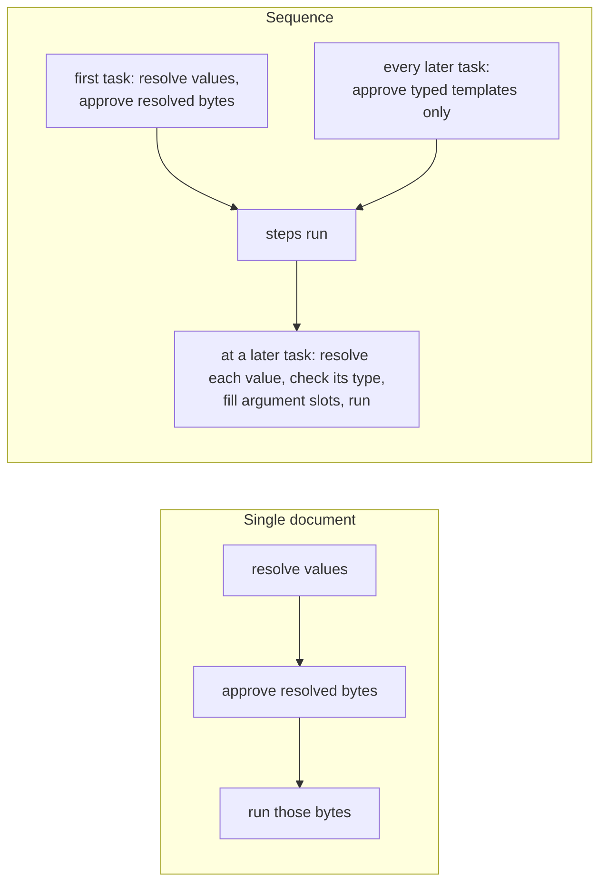

# Shell template approval

A shell command can today be approved only as the exact bytes it will run, or
as "this program with any arguments". That forces a choice between approving
too little (every new value re-prompts, and a value that does not exist until
an earlier sequence step produces it cannot be approved at all) and approving
too much. This spec adds a third kind of approval: a **typed template**. The
author approves the *shape* of a command once, with each variable part typed
(`some-command {{ alphanumeric(allow-slashes) }}/build`); any later command
of that shape whose variables are declared with a type the template allows is
covered, and each value is checked against its type and substituted as exactly
one containing argument before the affected command runs. It also settles what happens when a
value a shell command needs is missing: the command never runs.

## Background: two execution models

A reader new to this repository needs one distinction first, because the rest
of the spec depends on it.

**Single document** (`md compose`, `claudine compose`, `claudine
inline-compose`, and the provider wrappers given a prompt). One document is
composed and run. Supported approval-time reads — frontmatter, caller
setters (`key=value`, `--set`), `ctx.*`, `env.*` — resolve for that preparation.
Preflight resolves each command to its bytes, asks for approval of those bytes,
and runs exactly them unless a template approval is selected. Existing refusals
for values pending shell expansion, effect-dependent expressions, and lazy
`current.*` reads remain; this feature does not make every
expression resolvable before execution. A loop iteration, `retry`,
`resume`, or `proxy` target re-resolves with its own state and re-audits
(after the first launch the prompt is frozen, so a new command is refused
rather than prompted; adopting a proxy target retains its existing separate
approval window).

**Sequence** (`claudine sequence`). An ordered list of steps runs one after
another, and later steps can read what earlier steps produced — the outputs
array, loop counters, group results. All approval is front-loaded: before the
first step starts, Claudine walks the whole task graph and approves every
command any step could run, so the operator can walk away. A value produced
by an earlier step does not exist at that moment. Today such a command is a
typed preflight error (`SequenceShellLateBinding`); this spec makes it
approvable as a template. More generally, by the time a later task runs,
earlier tasks may have changed the values its commands read, so this spec
approves the first task's commands with their resolved values and every later
task's commands only as typed templates (section 10).



## Decided

Decided 2026-10-10 by the owner.

### 1. A shell command never runs with a missing value

A placeholder value is **missing** when its expression evaluates to `null`.
An absent property read yields `null`; a fallback such as
`{{ target || 'default' }}` may instead produce a present value. An empty
string, zero, and `false` are present. For a later-task approval-time value,
check presence at preflight and again at execution; a value initially present
can become null before the command runs. This reconciles the second and third
rows below: only deferred reads skip the approval-time presence check. Parse errors and unavailable bindings
keep their existing typed errors and are not converted to missing values.

| Where the value comes from | When it is missing |
|---|---|
| Any value in a single document (`::shell`, `::shell-block`, frontmatter `$( … )`, lifecycle `shell`, a whole-value `$( … )` in a `set`) | Preflight fails with a typed error naming the variable, the command, and its source location. Nothing runs. |
| A caller value (`key=value`, `--set`) or any other approval-time value in a sequence | Sequence preflight fails the same way, before the first step. |
| A value an earlier sequence step produces (a [late value](#10-sequence-approval-the-first-task-resolved-every-later-task-as-a-template)) | Preflight records a typed placeholder without evaluating it. When the step is reached, a missing late value fails **that step** before any of the step's commands run, with the same typed error. Effects of earlier steps remain. |

The strict-mode contract that `null` renders as an empty string keeps
applying everywhere except shell commands: body text, lifecycle messages,
`set` values, and other frontmatter are unchanged.

```md
---
target: null
---
::shell ls {{ target }}
```

`md compose` fails before running anything: `shell command 'ls {{ target }}'
reads 'target', which is missing (doc.md:4)`. Today it runs `ls` with no
argument.

### 2. Typed placeholders

Every `{{ … }}` span in a shell command is a **placeholder**. In a template
it is a typed hole: the template records the span's type, not its variable
name.

- **Declared type.** A placeholder whose expression is a bare top-level
  property reference (`{{ dir }}`, `{{ fm.dir }}`) has that property's
  declared type, with named types resolved and property constraints retained,
  read from the command-owning document's existing typed schema projection,
  `EffectiveSchema.simplified`
  ([`EffectiveSchema`](../../../darkmatter/lib/src/markdown/schemas/mod.rs),
  Darkmatter's merged schema representation). A transcluded child uses its
  own effective schema with its inherited values and local setters; a task
  uses its owning task document's schema, not an unrelated caller schema.
  No new type projection is built.
- **Fallback to `string`.** The type is `string` when the document has no
  typed projection (raw JSON Schema, or a root union of mixed shapes), when
  the property is undeclared, when the expression is anything other than a
  bare top-level property (`{{ last(seq.outputs) }}`, `{{ dir + '/x' }}`), and
  for every reserved-root value (`seq.*`, `loop.*`, `group.*`, `ctx.*`,
  `env.*`).
- **`string` here only.** Treating an undeclared name as `string` is a rule
  of shell templates. Everywhere else an undeclared name keeps the type
  `unknown`, as the strict-mode fix decided.
- **Fallback validation.** A fallback `string` describes the converted argument,
  not a newly declared document schema. Accept present scalars for that fallback
  and convert them; a genuinely declared `string` still validates the original
  value using its effective schema. A raw JSON Schema cannot supply a narrower
  template type, but its existing document validation is not bypassed.

### 3. How the prompt shows a template, and what is saved

The approval prompt shows each placeholder with its name and type:

```text
Command:  some-command {{ dir: alphanumeric(allow-slashes) }}/build
```

The persisted rule keeps the type only. The rule keyword is `template`:

```text
template some-command {{ alphanumeric(allow-slashes) }}/build
```

A placeholder whose expression is not a bare property shows the expression
text as its name: `{{ last(seq.outputs): string }}`. Rules may be written by
hand in `.darkmatter-shell-whitelist`. For the shape choice, supported
string-like declarations retain their resolved type; all other declarations
use the broad `string` approval type while retaining their original runtime
validator. The prompt explicitly shows both when they differ, for example
`{{ count: string (validated as number) }}`. This avoids saving a numeric or
union rule that the dependency's string-like relation can never match.

A rule placeholder holds one resolved supported string-like type
expression with canonical type options and no value constraints or schema
annotations. Reject constraints even when written without `;`, unresolved
named types, unsupported rule types, and unknown options. Report the file and line and skip that
malformed line as today. Stored rules must not depend on a document-local
named-type definition. The canonical one-line format double-quotes literal
argument segments, escaping backslash and double quote, literal braces as
`\{` / `\}`, and newline, carriage return, and tab as `\n`, `\r`, `\t`.
The template parser recognizes these escapes before placeholder recognition,
so literal `{{` is never mistaken for a hole; other control characters are
rejected in stored rule literals. Placeholder nodes retain their `{{ type }}`
form inside a containing word. Round trips preserve argument boundaries; a placeholder value is never written to a
template rule. The existing `exact <command>` and
`prefix <executable>` rules are unchanged.

### 4. Substitution: one argument per containing word

Parse the authored command while retaining placeholders as expression nodes;
do not interpolate values into command text and then tokenize that text.
Each argument is an ordered list of literal segments and placeholders. Resolve
each placeholder once, validate it, convert it through Darkmatter's existing
scalar conversion engine, and concatenate the segments into one argument.

- A whole-word placeholder (`ls {{ dir }}`) fills one argument, including
  when the value is an empty string.
- A placeholder within a word (`{{ dir }}/build`) or authored quotes
  (`"repairs from {{ name }}"`) stays within that argument. Two placeholders
  in one word form one argument, not two.
- Values are never reparsed for quotes, whitespace, redirects, operators,
  expansion syntax, or additional placeholders. Reject embedded NUL before
  dispatch because it cannot be passed as a process argument.
- Scalars (string, number, boolean) convert to text. Arrays and objects are
  rejected even under a `string` rule. Validate the original value against
  its declared schema before conversion; do not coerce a number into an
  `alphanumeric` string merely to pass validation.
- Execute the filled argument list directly. Darkmatter already does this in
  its [command executor](../../../darkmatter/lib/src/markdown/compose/shell_expansion/executor.rs).
  Claudine's [lifecycle runner](../../lib/src/composition/lifecycle/executor.rs)
  and [sequence shell-task runner](../../lib/src/composition/sequence/task/shell.rs)
  currently use the system shell; add a structured dispatch path for template
  mode there, retaining their environment, working directory, output, deadline,
  cancellation, and process-tree cleanup contracts. Resolved-byte mode keeps
  each surface's existing runner.

**Reader's note:** The draft proposed rebuilding a shell string with quoting.
That introduces a second interpretation of the values, especially on Windows.
Direct argument dispatch reuses Darkmatter's existing execution model and makes
argument boundaries explicit. Template mode does not promise support for shell
builtins, shell scripts, or `.cmd` / `.bat` targets that need an interpreter;
reject such a target before dispatch rather than silently invoke an interpreter.
Executable resolution must not introduce an implicit shell fallback.

| Value of `dir` | Argument received for `ls {{ dir }}` | Argument received for `ls {{ dir }}/build` |
|---|---|---|
| `src` | `src` | `src/build` |
| `a b` | `a b` | `a b/build` |
| `x; rm -rf ~` | `x; rm -rf ~` | `x; rm -rf ~/build` |
| empty string | empty string | `/build` |

These are literal argument values, not shell snippets. One-argument substitution
prevents values from adding shell syntax; it does not make every argument safe
for its program. For example, a leading dash can still select an option. Authors
should use `--` where supported and restrictive types when approving reusable
operations.

### 5. Matching is on the argument list

A template rule covers a command when, after both are parsed into argument
lists (shell words, with quoting and whitespace removed):

1. they have the same number of arguments, and the same chain operators
   (`&&`, `||`) in the same positions, with identical ordered redirection
   operations on each command;
2. every literal segment is byte-equal;
3. placeholders sit at the same positions within the same arguments; and
4. each placeholder's declared type is **covered** by the rule's type at that
   position (section 7).

Template grammar extends Darkmatter's existing
[tokenizer](../../../darkmatter/lib/src/markdown/compose/shell_expansion/tokenize.rs)
with placeholder nodes. Preserve its curated redirections (`> /dev/null`,
`2> /dev/null`, `2>&1`, `>&2`) and their ordering; redirects are operations,
not argument words. Bare pipes, semicolons, input redirection, arbitrary output
files, command substitution, and background execution remain unsupported in
template mode. Resolved-byte Claudine commands keep their current grammar.
The parser must recognize a complete expression span before interpreting its
spaces, quotes, or operators as command syntax. A placeholder may occur only
in an argument, never in a program word, operator, or redirect target.

Whitespace and quoting style do not matter: `ls   'a'` and `ls "a"` are the
same argument list. A command whose program word (the first word of a chain
segment) contains a placeholder can never be approved as a template; it is
offered only exact, once, deny, and blacklist when resolved-byte approval is
eligible. Any command requiring template mode with a program-word placeholder
or unsupported grammar fails preflight with a typed error; prefix and once
approvals cannot bypass this rejection.

### 6. The value is checked before substitution

At run time, before substituting, each value is checked against the
placeholder's **declared type including its constraints** (`min`,
`pattern`, …). A missing value (section 1), a non-scalar value, or a value the
type rejects prevents the command from running: in a single document the
composition fails; in a sequence the step fails. Late values (section 10) are
produced by earlier steps, so every late value a step's commands read is
checked when the step is reached, and a missing or invalid one fails the step
before any of that step's commands run. Any other template value is checked
immediately before its command, against the state current at that moment.
Effects of earlier steps are not rolled back. Validate every argument of every
segment of a command chain before launching its first segment, even when `&&`
or `||` would skip a segment. The error names the
placeholder, the declared type, and the source location, and never prints the
value (it may be a secret). These are authorization/input errors, not process
exit failures: `when_error`, lifecycle `no_error`, timeout fallbacks, and
transclusion notices must not suppress them. Preserve the typed cause through
Claudine's diagnostics. Shell-free initialization and its early catch handlers
remain forbidden under every approval mode.

### 7. Which types a rule covers

A saved rule covers a later command if and only if the variable's declared
type allows only values that the rule's type allows. The relation is
"covers", defined by 2026-10-16-core-schema-types; this spec uses it and does
not redefine it. It is limited to string-like types and their `allow-*` /
`block-*` type options. Ordinary constraints after `;` (`min`, `max`,
`pattern`, …) do not affect matching; they are enforced by the run-time check.

With the rule `template build {{ alphanumeric(allow-slashes) }}`:

| Variable declared as | Covered? | Why |
|---|---|---|
| `alphanumeric(allow-slashes)` | yes | identical |
| `alphanumeric` | yes | narrower: allows a subset |
| `alphanumeric(allow-slashes; min(3))` | yes | constraints do not affect matching |
| `alphanumeric(allow-slashes, block-leading-slash)` | yes | a narrowing option allows a subset |
| `alphanumeric(allow-slashes, allow-periods)` | no | wider: allows `.` |
| `string`, or undeclared | no | wider |
| `email` | no | not a subtype |

A rule placeholder of type `string` accepts any scalar placeholder after
its own declared-type validation and conversion. This is a shell-template
matching exception, not an extension of the core string-like subtype relation.
It is the template equivalent of a single-argument `*`; there is no separate
glob syntax. For a narrower rule, use only the
dependency's supported string-like subtype relation; unsupported pairs are
refused even when identical. `unknown`, union, and container declarations do
not become string-like subtypes. A broad `string` rule never permits a null,
array, or object value at execution.

### 8. What the prompt offers

| Choice | Offered when | Persists |
|---|---|---|
| **This exact command** | resolved-byte approval is eligible: a single document, or a command of the sequence's first task (section 13) with no late values | `exact <resolved command>` |
| **This command shape** | at least one placeholder and valid template grammar, including in single-document runs | `template <shape>` |
| **This program with any arguments** | fixed program words; template-required commands must first pass template grammar validation | `prefix <executable>` |
| **Once** | after candidate validation | nothing; this session only (for a template, the shape for this session) |
| **Deny** | after candidate validation | nothing; the run aborts |
| **Blacklist** | after candidate validation | `exact <resolved command>` for resolved-byte candidates, otherwise `template <shape>`, in `.darkmatter-shell-blacklist`; the run aborts |

Both prompts gain the template choice: Darkmatter's `md` prompt
(`darkmatter/cli/src/approval.rs`) and the approval handler Claudine
installs (`claudine/lib/src/harness/shell.rs`), with a new
[`ShellApprovalDecision`](../../../darkmatter/lib/src/markdown/compose/shell_expansion/types.rs)
variant in Darkmatter for persisting a template. The approval request carries
both source expressions and types, the eligible choices, and the canonical
shape; it must not encode unavailable values as empty strings. For a chain,
the program-wide choice retains the existing list of distinct executables
and its persistence behavior.

A `template` line in a **blacklist** matches on shape only: positions 1–3 of
section 5 must hold, and every placeholder matches any placeholder whatever
its type. A deny list must err toward refusing. At execution also match a template
blacklist against the filled argument list: its holes match their containing
argument segments regardless of type. Otherwise an exact-approved command
without authored placeholders could bypass the same blacklist.

### 9. Which execution path a command takes

| The command… | Approved through | Runs as |
|---|---|---|
| has no placeholders | exact, prefix, once | its bytes (unchanged) |
| has placeholders, all known at approval, in a single document or a sequence's first task | exact, prefix, or once | its resolved bytes (unchanged) |
| has placeholders, all known at approval, in a single document or a sequence's first task | a template rule or the "command shape" choice | template mode: type check, then fill argument slots |
| has at least one late value (sequences only) | a template rule, "command shape", prefix, or once | template mode |
| has placeholders and belongs to a later task of a sequence (section 10) | a template rule, "command shape", prefix, or once | template mode |

In template mode every placeholder is a hole, including ones whose values
were known at approval. If multiple approvals apply to a resolved-byte-eligible
candidate, prefer an exact rule or cached resolved-byte decision, then a template
rule, then a prefix rule. A new explicit shape choice always selects template
mode. Template-required candidates never match an exact approval, even when
their current values happen to be known.

The approval cache keys resolved bytes for resolved-byte execution and
canonical shape plus canonical declared types for template execution, including
the third row. Tag the execution mode in the key and scope it to the policy
root; never let an exact approval authorize a template. Persisted template
rules discard ordinary constraints, but each new preparation retains and
checks its own constraints. A changed type must be matched again, not accepted
because an old command happened to have the same literal shape.

A reusable approval is distinct from a cached shell result. Result-cache keys
include the filled program, argument boundaries, chain/redirection operations,
and the existing execution context. Changing values must execute a new command,
even when the reusable approval is a cache hit. Concurrent approval of the same
key retains Darkmatter's existing reservation and failure-release behavior.

### 10. Sequence approval: the first task resolved, every later task as a template

Decided 2026-10-11. In a sequence, approval depends on which task a command
belongs to (section 13 defines which tasks count as the first task):

- **The first task's** shell commands are approved with their resolved
  values, exactly as in a single document: approval-time values are resolved
  at preflight and the resolved bytes are what the operator approves (or the
  operator picks "this command shape"). A first-task command that reads a
  late value (below) is the exception: that value does not exist at
  preflight, so the command is approved as a template.
- **Every later task's** shell commands are approved **only as typed
  templates**, whether or not their values are known at approval. A command
  with placeholders in the second or any later task is shown and saved as its
  shape (`just clean --out {{ string }}/build`), never as resolved bytes; "this exact
  command" is not offered for it. When its step is reached, each placeholder's
  value is resolved from the values current at that moment, checked against
  its declared type (section 6), and substituted into its argument
  (section 4). A later task's command with no placeholders is approved and
  run as its literal bytes, as before.

```yaml
---
$schema:
    out: string -> the build directory
sequence:
    - name: build
      shell: "just build --out {{ out }}"     # first task: approved as `just build --out dist`
    - name: clean
      shell: "just clean --out {{ out }}/build"         # later task: approved as `just clean --out {{ string }}/build`
---
```

Run with `out=dist`, preflight shows the first command resolved
(`just build --out dist`) and the second as a template
(`just clean --out {{ out: string }}/build`), even though `out` is already known.
Choosing "this command shape" for the second saves
`template just clean --out {{ string }}/build`; when `clean` is reached, `out` is read,
checked against `string`, and passed as one argument.

Single documents keep resolved-value approval; this rule applies only to
sequences.

A **late value** is a placeholder whose value is produced by the run and
does not exist at sequence preflight. The late roots are exactly:

- the outputs accumulator (`seq.outputs`; spelled `outputs` until
  2026-10-24-sequence-containers renames it, and the late set follows the
  rename);
- `loop.*` (the innermost loop's counters and last output);
- `group.*` (the enclosing group's variables and results).

Every other value a sequence shell command reads is an **approval-time
value**: frontmatter, caller setters, step data, `ctx.*`, and `env.*`. In the
first task, approval-time values keep resolved-bytes approval. In a later
task they are template holes like any other placeholder, read when the step
is reached. An approval-time value that is missing at preflight fails
preflight (section 1).

`err`, `timing`, and `current.*` stay refused in sequence shell
commands with today's typed errors; they are not late values. Deferral follows
indirect reads through derived frontmatter and task parameters as well: a
property derived from `last(seq.outputs)` is deferred, not mistaken for a
missing approval-time input. Expression preparation tracks that provenance
without executing it. A compound expression containing a forbidden root remains
refused even if it also reads an allowed late root. Other `seq` fields remain
approval-time inputs when statically known; do not defer every `seq.*` read
merely because `seq.outputs` is deferred.

Darkmatter's discovery reports, for each command, its authored template and
which spans read a root the host declared late; Claudine declares the late
roots for its sequence approval scope through the existing `BindingView`
availability mechanism
([lifecycle bindings](../../lib/src/composition/lifecycle/bindings.rs), which
declares Claudine-owned globals). Represent approval-time deferral separately
from runtime lexical availability: a placeholder does not make `group.*`
available outside a group. Darkmatter owns reserved namespaces, so Claudine
must not declare reserved roots in `BindingView`; pass the deferred reserved
reads through Darkmatter's discovery interface instead. This covers every surface sequence preflight approves:
`shell:` tasks, lifecycle `shell` actions and `$( … )`-valued `set`, and the
`::shell`, `::shell-block`, and frontmatter `$( … )` commands of task
documents.

```yaml
---
$schema:
    pkg: alphanumeric(allow-dashes) -> the package to test
sequence:
    - name: pick
      prompt: "@prompts/pick-package.md"     # prints a package name
    - name: test
      shell: "just test {{ last(seq.outputs) }} --package {{ pkg }}"
---
```

`test` is a later task, so preflight shows its command as a template:
`just test {{ last(seq.outputs): string }} --package {{ pkg:
alphanumeric(allow-dashes) }}`. Choosing "this command shape" saves
`template just test {{ string }} --package {{ alphanumeric(allow-dashes) }}`.
When `test` is reached, the last output is checked against `string`, `pkg`
against `alphanumeric(allow-dashes)`, and each is passed as one argument. If
`pick` printed nothing, the value is an empty string and is present; if the
expression yields `null`, `test` fails before running.

### 11. Single-document runs gain the shape choice, not new late values

Single-document approval introduces no new deferred roots. Supported values
resolve separately for each preparation; dynamic reads retain their existing
refusals described in Background. The prompt still offers "this command shape" for any command with
placeholders; choosing it saves the template and runs this command in
template mode. A later run, or a later loop iteration whose
`::shell echo run-{{ loop.count }}` produces new bytes, is then covered
without prompting. The loop example uses a native recording executable in
portable tests; `echo` is illustrative and is not a native executable on every
platform.

### 12. Policy checks and execution membership

Preflight checks each fixed program and all known literal arguments against
the built-in blacklist, then user blacklists, before whitelist or cache approval.
Do not delete placeholder positions when checking a partial argument list: the
remaining words must not shift into another subcommand position. At execution,
validate and fill all placeholders, then check the complete command chain against
built-in and user blacklists before its first segment runs. A rule such as
`template git {{ string }}` cannot authorize a runtime value of `reset`. An
exact blacklist for `git reset` also blocks that filled command. Neither a
persisted template nor an allow-once cache hit bypasses these checks. Existing
explicit approval flags retain their documented policy behavior; this feature
does not grant a new blacklist override.

Claudine hands Darkmatter structured pre-approvals recording resolved-byte or
template mode, rather than claiming unknown future bytes belong to the old
string set. Execution must prove membership in that approved set, then validate
values and runtime policy. Never manufacture an exact pre-approval from the
newly resolved bytes before that proof. Discovery remains condition-blind and
effect-free; includes and generated Markdown must remain statically discoverable.
Approving an argument template does not authorize late-bound include paths,
new commands in generated content, pending frontmatter shell dependencies, or
effect-dependent expression evaluation.

### 13. Task positions and execution state

The resolved-value exception belongs to the root sequence's first task in
sequence order: a task qualifies only when every container above it places it
first and no executable work runs before it. Position is static; a task that
runs first because earlier tasks were skipped does not qualify.

- A first task that runs an action qualifies with every command in its source
  document and task stacks.
- A group that is the first task qualifies with all its legs.
- A nested sequence that is the first task qualifies only for its own first
  task, by the same rule applied recursively.
- Container terminal-event commands (for example a container's `finalize`,
  which runs after its children) and any command reading `group.*` are typed
  templates, even within the first task.

Every other task's commands, including the descendants of a later group or
nested sequence, are template candidates. Retries and resume do not reset a
task's position. The later container feature may extend discovery to new
surfaces, but this feature must carry the position and source owner through
today's group traversal.

Retain the approved authored expression, source span, effective type, and
execution mode at every command site. Parse-only document caches remain valid;
a prepared document containing runtime-filled template values cannot be reused
as a completed composition from upfront discovery. Resolve a template against
the current task/event state, including its actual parameters and inherited
values, immediately before dispatch. Approval-time `ctx.*` and `env.*` reads
use the captured request snapshot, never a new process-environment read.
A lifecycle `set` action reads its existing pre-write snapshot. First-task
resolved-byte commands retain their fixed approved bytes; their execution does
not silently re-evaluate expressions.

## Requirements

1. **Store.** Darkmatter's [policy store](../../../darkmatter/lib/src/markdown/compose/shell_expansion/store.rs)
   parses `template <shape>` lines into a new
   [`ShellRuleEntry`](../../../darkmatter/lib/src/markdown/compose/shell_expansion/types.rs)
   variant holding the parsed argument-list shape; a line
   whose shape fails to parse, holds a constraint, or puts a placeholder in a
   program word is reported and skipped like any malformed line. Writing a
   template rule appends one line, deduplicated by parsed shape.
2. **Matcher.** Darkmatter's
   [`ShellRuleSet`](../../../darkmatter/lib/src/markdown/compose/shell_expansion/types.rs),
   the collection of loaded policy rules, gains template matching per sections 5 and 7
   for the whitelist and section 8 (shape-only) for the blacklist. The built-in
   blacklist is checked at preflight without shifting argument positions, then
   against every filled command at execution, per section 12.
3. **Types.** The declared-type lookup (section 2) and the "covers" relation
   (section 7, from 2026-10-16-core-schema-types) are the only type inputs.
4. **Run-time check and substitution** (sections 4 and 6) live in Darkmatter's
   shell execution path, shared by Darkmatter composition and Claudine's
   sequence task and lifecycle runners. Template dispatch uses structured
   arguments while retaining each runner's existing operational contracts.
5. **Missing values** (section 1) are one typed Darkmatter error, raised at
   preflight for approval-time values and at the step for late values.
6. **Claudine sequence preflight** approves the first task's commands with
   resolved values and every later task's commands with placeholders as
   templates (section 10); replaces the `SequenceShellLateBinding` refusal
   for the late roots of section 10 with template approval, keeps it for
   `err`, `timing`, and `current.*`; and records each template-approved
   command's template so the step runner executes it in template mode.
7. **Docs.** `darkmatter/docs/inline/preflight-checks.md` and
   `claudine/docs/topics/pre-flight-checks.md` describe template rules, the
   prompt choices, matching, the run-time check, and the missing-value rule;
   `claudine/docs/topics/flow-control/sequences.md` and `lifecycle.md` replace
   "a shell string referencing `outputs` … is a typed preflight error" with the
   template behavior. Update both area READMEs for the new public approval
   behavior and document the restricted template grammar and direct dispatch.
   The `claudine` and `darkmatter` skills are updated. Docs describe current
   behavior without linking to a feature/fix snapshot.
8. **Approval transport and caches.** Replace byte-only assumptions in discovery,
   pre-approved membership, prepared task/document storage, and lifecycle shell
   values with the two execution modes. Preserve source locations through
   transclusion and retain command result caching separately from authorization.
9. **Persistence.** Keep existing policy-root resolution. Canonicalize parsed
   shapes and options for deduplication. A failed template write is a typed
   policy-I/O failure, not a successful persistent approval or an implicit once
   approval. Never serialize runtime values into a template rule.

## Out of scope

- The `alphanumeric` type, its options, and the "covers" relation:
  2026-10-16-core-schema-types.
- Renaming `outputs` to `seq.outputs` and the `seq`/`group` roots:
  2026-10-24-sequence-containers.
- Loops on groups and sequences, and `--dry-run` no longer running `shell:`
  tasks: 2026-10-25-loops-and-flow-control.
- Typing expression variables beyond a bare top-level property (Phase B's
  expression-variable projection): 2026-10-28-schema-enhancements.

## Acceptance criteria

All L1 unless noted; `just test` and `just lint` green in `darkmatter/` and
`claudine/`. Tests use `CliProcessFixture` with a private CWD and home, fake
providers, and `PLAYA_DRY_RUN`; none focuses a window or launches a real
provider; all are portable to macOS, Linux, native Windows, and WSL2 (the
argument-boundary cases run against each platform's runner). No new CI cell.

1. **Missing, single document.** `md compose` and `claudine compose` of a
   document whose `::shell`, frontmatter `$( … )`, and lifecycle `shell` each
   read a `null` or absent value fail preflight with the typed missing-value
   error naming variable and location; a stub command records that nothing
   ran. An empty-string value runs.
2. **Missing, sequence.** A sequence shell task reading an absent caller value
   fails preflight before step 1; one reading `last(seq.outputs)` where the
   expression yields `null` fails its own step before any of that step's
   commands run (a recording stub for an earlier command in the same step
   records nothing), and earlier steps' effects stand.
3. **Store round trip.** Writing, reading, writing, and reading a whitelist
   with `exact`, `prefix`, and `template` lines preserves all three; a
   template line with a constraint or a program-word placeholder is skipped
   with a warning.
4. **Argument-list matching.** Table-driven: whitespace and quoting variants
   match; a different literal, an extra argument, a moved placeholder, or a
   different chain operator does not.
5. **Covers table.** Every row of section 7 is a test case.
6. **One argument per containing word.** With values `a b`, `x; rm -rf ~`, `$(id)`, and
   `` `id` ``, a template-mode command passes exactly one argument per value
   to a native recording stub, on every platform. Adjacent placeholders remain
   in one containing argument.
7. **Run-time check.** A value rejected by the declared type (or by its
   `min`), and an array value, run nothing and fail with an error that
   does not contain the value.
8. **Prompt.** A scripted prompt session shows `{{ name: type }}`, offers
   "this exact command" only when resolved-byte approval is eligible, offers "this command
   shape" only for valid template candidates (single document included), and each
   choice persists the row of section 8.
9. **Late approval end to end.** The section 10 example runs against stub
   providers with a pre-written template rule and no prompt; with the rule
   removed and no terminal, preflight fails before step 1 naming the command.
10. **Loop re-audit.** A single-document loop with `::shell echo
    run-{{ loop.count }}` approved as a template runs three iterations with no
    refusal; approved as exact, iteration 2 is refused as today.
11. **First task resolved, later tasks templates.** The section 10
    `build`/`clean` example with `out=dist`: a scripted prompt shows the
    first command resolved and offers "this exact command"; it shows the
    second as `just clean --out {{ out: string }}/build` and does not offer "this exact
    command"; choosing "this command shape" persists
    `template just clean --out {{ string }}/build`. A pre-existing
    `exact just clean --out dist/build` rule does not cover the later task. The later
    task runs in template mode: a recording stub receives `dist/build` as one
    argument after the type check. A single document with the same `clean`
    command is still offered "this exact command".
12. **Unchanged paths.** Existing `exact`/`prefix` tests and the shell
    approval corpus pass except assertions intentionally changed by the new
    missing-value rule. `err`, `timing`, and `current.*` keep
    their existing typed approval refusal. Initialization shells stay forbidden.
13. **Runtime policy.** A template for `git {{ string }}` filled with `reset`
    is refused before spawn. An exact user blacklist and a shape-only template
    blacklist both block their corresponding filled commands, including a
    resolved-byte command. Cache hits and pre-approved transport do not bypass
    runtime template checks. A later blocked chain segment prevents the entire
    chain from starting.
14. **Grammar and argument boundaries.** Curated redirection order is preserved;
    unsupported pipes/semicolons, variable program words, and variable redirect
    targets fail template preflight under prefix and once as well. Include
    empty arguments, two holes in one argument, quotes, backslashes, Unicode,
    newlines, percent signs, exclamation marks, and embedded NUL. Use native
    recording executables, with a separate assertion that interpreter-dependent
    template targets are refused rather than silently dispatched through a shell.
15. **Approval versus results.** A shape-approved command with changed values
    gets a reusable approval but a fresh result. A changed declared type is
    rematched; a changed constraint is enforced. Exact and template cache keys
    cannot authorize each other. Persistence failures release pending approvals
    and report failure without caching a successful persistent decision.
16. **State and discovery.** Later-task values changed by an earlier task are
    read at execution, including task parameters, child documents, and lifecycle
    `set` shell values. Descendants of a later group or nested sequence retain
    template mode and source ownership. When the first task is a group, every
    leg's commands are offered resolved-value approval; when it is a nested
    sequence, only that sequence's own first task is; a first group's
    `finalize` command and a command reading `group.*` are templates; a task
    that runs first only because earlier tasks were skipped is a template. Conditional branches are still all discovered, dynamic include
    paths still fail, and no shell runs in discovery to obtain a placeholder.
17. **Schema provenance.** Named-type resolution, local child schemas, fallback
    without a typed projection, scalar conversion, and unsupported narrower
    rule types follow sections 2 and 7. A numeric value cannot satisfy an
    `alphanumeric` declaration by conversion. The shape choice for a numeric
    or union declaration discloses and persists a `string` hole while retaining
    the original runtime validator; unsupported hand-written rule types fail
    loading. Malformed persisted constraints
    are rejected with and without a semicolon.

These checks fit the existing package suites; no performance spike is required
for bounded parsing, matching, and scalar validation.

## Open questions

None.
