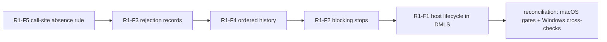

# Review-to-Implementation Log

## Implementation of Review Findings #1

> **started at:** 2026-10-24T21:49:12-07:00

- this implementation is attempting to implement _all_ of the review findings found in '/Volumes/coding/wt/rusty-biscuit/feat-pipeline/claudine/features/2026-10-31-type-aware-evaluation/review-1.md'
- this is iteration 1 of the review-to-implement cycle
- the review's `implemented` flag was confirmed `false` before repairs started

### Finding Ledger

| ID | Finding or required instance/consumer and expected result | Disposition | Verification evidence or blocker |
| --- | --- | --- | --- |
| R1-F1 | Deliver guarded editor analysis for Claudine lifecycle expressions | fixed | all children verified; host lifecycle artifact + selected-host DMLS walk; dmls 1417/1417 on macOS and native Windows |
| R1-F1.1 | Claudine `start`/`success`/`blocked`/`failure`, `stdout` and `say`: guard → call → set → call; only post-write call warns | fixed | `lifecycle_host_profile::claudine_events_narrow_until_a_write_with_stdout`, `…_with_say`; runtime parity `host_catalog.rs::the_rebuilt_profile_types_claudine_events_as_composition_does` |
| R1-F1.2 | Shared `initialize`/`composed`/`failed`/`cancelled`/`finalize` with host-only `say`: only post-write call warns | fixed | `shared_events_with_say_narrow_until_a_write` (`initialize`, `cancelled`, `finalize`); `composed`/`failed` are renamed events under Claudine (runtime `LifecycleRenamedEvent`), `renamed_events_are_not_claudine_stacks`; decision recorded |
| R1-F1.3 | Claudine `loop.gate` with `until` and guarded gate list: only post-write call warns | fixed | `loop_gate_narrows_until_a_write` |
| R1-F1.4 | Claudine `success` false branch (`when: is_null(count)`, calls in `else`): only post-write call warns | fixed | `false_branch_narrows_until_a_write` |
| R1-F1.5 | Claudine `success` nested conditional write: only later call warns | fixed | `nested_write_ends_the_fact` |
| R1-F1.6 | Markdown host events with `stdout`: only post-write call warns (clean control) | clean | `md_events_narrow_until_a_write` (no artifact → md host, only post-write call warns) |
| R1-F1.7 | `err.msg` availability in Claudine `blocked`/`failure` and Markdown `failed`: no diagnostic (clean control) | clean | `claudine_error_events_read_err`, `md_failed_reads_err` (no expression diagnostic) |
| R1-F1.8 | Other host-only verbs' operands (`speak`, `effect`, `notify`, `retry`, `resume`, `proxy`, `prep`, `break`, `defer`) acquire host lifecycle scopes | fixed | `host_only_{communication,recovery,flow}_operands_take_the_guarded_scope` (all nine verbs have expression operands) |
| R1-F2 | Stop execution when a runtime warning becomes blocking | fixed | all children verified; `pipeline::stop_if_blocked`/`blocking_guard`/`ReportWatch`; mutation check: no-op checker fails 8 row tests + CLI test |
| R1-F2.1 | Body interpolation → shell: no marker under `--deny all` | fixed | `runtime_blocking::body_interpolation_stops_a_later_shell`; CLI `compose_report_json::a_blocking_runtime_warning_stops_the_later_shell` (no `marker`, macOS and Windows) |
| R1-F2.2 | Frontmatter interpolation → body shell: stop before shell | fixed | `frontmatter_interpolation_stops_a_body_shell` |
| R1-F2.3 | Page-block condition → shell: stop before shell | fixed | `page_block_condition_stops_a_retained_shell` |
| R1-F2.4 | Transclusion condition → child execution: stop before child effect | fixed | `transclusion_condition_stops_the_child` |
| R1-F2.5 | Transclusion condition → next directive: stop before next directive's effect | fixed | `transclusion_condition_stops_the_next_directive` |
| R1-F2.6 | Frontmatter shell ternary → later shell: stop once condition warning known | fixed | `frontmatter_shell_ternary_stops_a_body_shell` (stops before the body; the parallel frontmatter `$( … )` step runs, decision recorded) |
| R1-F2.7 | Transcluded child's interpolation → child shell: child stops before shell | fixed | `a_transcluded_child_stops_before_its_own_shell` |
| R1-F2.8 | Passive category-3 call → shell: no marker (clean control) | clean | `passive_call_warning_stops_before_any_shell` |
| R1-F2.9 | `is_null(missing)` then touch: success, marker (clean control) | clean | `handled_absence_does_not_block` |
| R1-F2.10 | Missing read in false block then touch: success, marker (clean control) | clean | `a_read_in_a_removed_block_does_not_block` |
| R1-F2.11 | Lifecycle composition route (`compose_with_warnings`) checks blocking only after completion | fixed | CLI `a_blocking_runtime_warning_stops_the_later_shell` lifecycle variant (no `marker`, no `composed-marker`); library error fails `prepare` before `composed` |
| R1-F2.12 | Recovery denials (scalar `ctx`, invalid transclusion assignment, duplicate assignment) fail before later touch (clean control) | clean | `a_scalar_ctx_stops_before_the_body_shell`, `an_invalid_assignment_stops_before_the_child`, `a_duplicate_assignment_stops_before_the_child` |
| R1-F3 | Preserve shared diagnostics on lifecycle call rejection | fixed | all children verified; `LifecycleCallRejected { diagnostic }` read by `error_diagnostics` before the fallback |
| R1-F3.1 | Five events' action text `stdout: "{{ min(true, 5) }}"`: exact shared record | fixed | `shared_fields::{initialize,composed,failed,cancelled,finalize}_action_rejection_reports_the_editor_fields` (all six fields equal DMLS; column 21) |
| R1-F3.2 | Five events' `when: min(true, 5)` conditions: exact shared record | fixed | `shared_fields::{…}_condition_rejection_reports_the_editor_fields` (column 15) |
| R1-F3.3 | Lifecycle `shell:` operand: exact shared record | fixed | `shell_rejection_reports_the_editor_fields` |
| R1-F3.4 | Lifecycle side-effect argument (`ensure_file`): exact shared record, no effect | fixed | `ensure_file_rejection_reports_the_editor_fields`; CLI `a_rejected_lifecycle_call_reports_the_shared_record` (no `marker`) |
| R1-F3.5 | Lifecycle runtime `set` value: exact shared record | fixed | `set_rejection_reports_the_editor_fields` |
| R1-F3.6 | Lifecycle control reason (`error:`): exact shared record | fixed | `error_reason_rejection_reports_the_editor_fields` |
| R1-F3.7 | Body/frontmatter interpolation rejection (clean control) | clean | existing `shared_fields::a_rejected_call_reports_the_editor_fields`, CLI `a_rejected_call_reports_the_shared_record` |
| R1-F3.8 | Page-block and transclusion condition rejection (clean control) | clean | new `shared_fields::a_rejected_condition_reports_the_editor_fields` |
| R1-F3.9 | Claudine `CompositionError` conversion of `LifecycleCallRejected` preserves the shared record | fixed | claudine `call_check::a_rejected_lifecycle_call_keeps_its_located_shared_record`, `lifecycle_authoring::tests::a_converted_lifecycle_call_rejection_keeps_the_shared_record` |
| R1-F4 | Preserve the ordered passive diagnostic history | fixed | all children verified incl. discovered R1-F4.9; mutation check: old precheck fails 7 tests |
| R1-F4.1 | Separate body expressions: warning then rejection | fixed | `passive_history::an_earlier_body_warning_survives_a_later_rejection`; CLI `passive_warnings_keep_their_authored_order_through_a_rejection` |
| R1-F4.2 | Separate frontmatter leaves: warning then rejection | fixed | `an_earlier_frontmatter_leaf_warning_survives_a_later_leaf_rejection` |
| R1-F4.3 | One expression `file_exists("") + min(true,5)`: warning then rejection | fixed | `an_earlier_call_in_the_rejected_expression_keeps_its_warning` |
| R1-F4.4 | Block condition warning then body rejection: warning retained | fixed | `an_earlier_block_condition_warning_survives_a_later_body_rejection` + CLI (pre-flight walk widened) |
| R1-F4.5 | Lifecycle action list warning then rejection: warning retained before corrected rejection | fixed | `an_earlier_lifecycle_warning_survives_a_later_lifecycle_rejection` + CLI (`LifecycleCallRejected.earlier`) |
| R1-F4.6 | Body interpolation (line 1) before block condition (line 3): source order | fixed | `a_body_interpolation_warning_precedes_a_later_block_condition_warning` + CLI |
| R1-F4.7 | Body interpolation (line 1) before transclusion condition (line 3): source order | fixed | `a_body_interpolation_warning_precedes_a_later_transclusion_condition_warning` |
| R1-F4.8 | Passive warning then runtime failure (clean control) | clean | `an_earlier_warning_survives_a_later_evaluation_failure` |
| R1-F4.9 | Discovered: a transcluded child rejected in the pre-flight walk keeps the parent's earlier warnings, parent first | fixed | `passive_history::a_parent_warning_survives_a_transcluded_child_rejection_in_preflight` (failed before the fix), CLI `a_rejected_child_keeps_its_parent_warnings_first` (plain and lifecycle routes) |
| R1-F2.13 | Discovered: a blocking warning known within one expression stage stops later expressions and conditions (`as_markdown` nested shells, frontmatter leaves, block/transclusion conditions, nested child stops not absorbed by `\|\|`) | fixed | 11 new `runtime_blocking` tests incl. reverse-placement control; manual: a caller's earlier warning precedes a nested child's stop |
| R1-F5 | Do not restrict nullable-parameter suppression by return type | fixed | all children verified; return-type condition removed, call-site rule in `AbsenceScope.consumed_by_call` |
| R1-F5.1 | Runtime body `trim(x)`/`lower(x)`: no undeclared-property warning; `--deny all` succeeds | fixed | `unknown_identifier_warning::every_suppression_row_…` (`trim`/`lower`/`upper` rows); CLI `compose_unknown_identifiers::deny_all_accepts_a_direct_nullable_argument_and_blocks_a_nested_one` |
| R1-F5.2 | Runtime frontmatter `title` with same calls: suppressed | fixed | `unknown_identifier_warning::a_frontmatter_value_handles_a_direct_nullable_argument` |
| R1-F5.3 | DMLS body static inventory: undeclared-property suppressed (strict warning independent) | fixed | dmls `expression_scopes::a_direct_nullable_argument_is_handled_under_a_document_schema` |
| R1-F5.4 | Host function with explicit-null parameter and explicit-null return: direct argument handled | fixed | `host_functions::a_host_parameter_declaring_null_handles_a_missing_argument_whatever_it_returns` |
| R1-F5.5 | `is_null(x)` body and frontmatter (clean control) | clean | suppression-row test, frontmatter test, CLI test (`is_null(z)`) |
| R1-F5.6 | `is_empty(trim(x))` still warns in runtime and DMLS | clean | still warns: suppression rows, CLI test (`w` blocked), dmls `undeclared_property_findings_follow_the_parameter_types` and the schema test |
| R1-F5.7 | Parameter/overload controls: warn/warn/warn/suppress (clean control) | clean | `only_an_explicit_null_in_every_overload_handles_a_missing_argument` (warn/warn/warn/suppress) |

### Progress

- execution order chosen: R1-F5 → R1-F3 → R1-F4 → R1-F2 → R1-F1 (smallest, most isolated repair first; F3 and F4 share the report adapter, F1 is the largest)
- starting the work on 'R1-F5 nullable-parameter suppression' at 21:49:49
        - defect class: absence handling for a variable read was decided by a property of the callee's return type instead of by where the variable's call sits
        - removed the `!returns().admits_null_explicitly()` condition from `FunctionRegistration::handles_absence_at`; "direct" is now decided at the call site by `AbsenceScope.consumed_by_call`: a call that is itself a direct argument of another call handles none of its own arguments; an operator, fallback, or ternary condition between them ends the nesting; `and`/`or` (the `&&`/`||` desugaring) are exempt in both directions
        - **decision for the author to confirm:** alternative rejected was keeping the return-type test for nested calls only (still return-type based); downside: a predicate nested directly in a non-logical call (`upper(is_null(x))`) now warns; no test or doc relied on the old behavior
        - sibling sites checked: runtime body/frontmatter reader (`evaluate_function`, lazy and caller-file paths), static read inventory `walk_static` (DMLS), DMLS `overlay/expressions.rs`, interpolation evaluator bare variables, host registrations and aliases, Claudine `bindings.rs`/`prewarm/classify.rs`; all route through the one `call_argument` classifier → clean
        - test expectations that encoded the return-type rule were updated (`lower`/`upper`/`trim` direct reads silent); tests using `lower` as a "warns" stand-in moved to `abs`, comparisons, or nested calls
        - docs updated: `darkmatter/docs/inline/interpolation.md`, `darkmatter/docs/topics/schemas/parsing/grammar.md`, `darkmatter/dmls/docs/diagnostics.md`, darkmatter skill `compose.md`/`dmls.md`
        - focused checks: darkmatter 108/108 and 1731/1731, dmls 174/174, darkmatter-cli 50/50, `just lint` clean in `darkmatter/`
        - observation raised by the subagent: the CLI blocking-diagnostics error printed ANSI escapes under `NO_COLOR=1` (investigated separately below)
- work completed for 'R1-F5 nullable-parameter suppression' at 22:04:56
- side observation (not a review finding): `md` error blocks emit ANSI escapes under `NO_COLOR=1` (reproduced: 39 escape sequences for a one-call rejection); `darkmatter/cli/src` and `darkmatter/lib/src` contain no `NO_COLOR` handling at all, so this predates this spec and is not one of its defect classes; recorded here for the author and not repaired in this cycle; existing tests already normalize through `common::unwrapped`
- starting the work on 'R1-F3 lifecycle call rejection diagnostics' at 22:05:22
        - defect class: a lifecycle rejection discards its shared located diagnostic and is reclassified as an unlocated evaluation failure
        - `LifecycleError::LifecycleCallRejected` and Claudine's `CompositionError::LifecycleCallRejected` now carry `diagnostic: Box<Diagnostic>`, built from `CallCheck::rejection_diagnostic()` and located by the lifecycle warnings' own locator (now one shared private `LifecycleSurfaceCalls::position`); `error_diagnostics` reads `LifecycleError::call_diagnostic()` before the generic `ExpressionError` fallback; new accessors `LifecycleError::call_diagnostic()` and `CompositionError::lifecycle_call_diagnostic()`
        - sibling sites checked: page-block/transclusion `condition_rejection` and body/frontmatter `rejection` already preserve the record (verified by tests); Claudine `ComposeFailed`/`PreFlightDiscoveryFailed` keep the whole `MarkdownError` (`call_diagnostic()` still derivable); `lifecycle_failure_diagnostics` re-enters `error_diagnostics` → clean
        - tests: 14 macro-generated lifecycle parity tests in `dmls/tests/l1/expression_call_diagnostics.rs::shared_fields` (all six fields vs DMLS), new condition clean control, CLI wiring `compose_report_json::a_rejected_lifecycle_call_reports_the_shared_record` (no `marker` created), two Claudine tests
        - docs: `darkmatter/docs/cli/report-json.md` (rejected-call bullet with example), darkmatter skill `expressions.md`, claudine skill
        - focused checks: dmls 16 + 47, darkmatter-cli 13 + 73, darkmatter 865, claudine 10 passed; `just lint` clean in `darkmatter/` and `claudine/`
- work completed for 'R1-F3 lifecycle call rejection diagnostics' at 22:23:08
- starting the work on 'R1-F4 ordered passive diagnostic history' at 22:23:08
        - defect class: passive diagnostic collection does not preserve the ordered prefix of findings when scanning multiple expression surfaces
        - `check_document`/`first_rejected`/`rejected_condition`/`check_block_conditions` now key every finding by authored position, record every surface's checks even in the rejected expression, pick the earliest rejection by position, keep the warnings before it, and sort success-path warnings; the pipeline stashes the prefix into the document report before returning the error
        - discovered sibling (not named by the review): the `md compose` pre-flight walk (`preflight/collect.rs`) dropped the warnings and checked a narrower surface than real compose (no `::block`/`::file` conditions); fixed with a crate-private failure-warnings sink on `ComposeOptions` (drained by both CLI pre-flight failure paths) and a widened call-check surface; disabling the widening makes the CLI block row fail
        - lifecycle: `LifecycleCallRejected` gains `earlier: Vec<ComposeWarning>`, rendered by `error_diagnostics` before the R1-F3 record; Claudine has no failure report surface, so its conversion drops `earlier` with a comment
        - **decisions for the author to confirm:** findings after the rejection are not reported; the first rejection is the earliest by position (was block → transclusion → interpolation); lifecycle order stays event by event then authored order; the pre-flight walk now also checks `::block`/`::file` conditions passively
        - mutation evidence: restoring the old `call_precheck.rs`/`pipeline/mod.rs` fails 7 of the new tests; R1-F4.8 control passes either way
        - tests: `darkmatter/lib/tests/l1/report_diagnostics.rs::passive_history` (one per row plus two decision tests), CLI `compose_report_json::passive_warnings_keep_their_authored_order_through_a_rejection`
        - focused checks: darkmatter 17 + 684 + 201, darkmatter-cli 65 + 172, dmls 17, claudine 10 + 391 passed; `just lint` clean in `darkmatter/` and `claudine/`
        - residual found by the subagent: a transcluded child rejected during the pre-flight walk loses its **parent's** earlier warnings (real compose shows both); added as ledger row R1-F4.9 and sent to a follow-up subagent rather than deferred
        - R1-F4.9 follow-up: before the fix, pre-flight reported only the child's warning and rejection; the compose pass was already correct (now pinned by a test). `preflight/collect.rs` gains a `WarningsOnFailure` guard that prepends an ancestor's passive call-check warnings ahead of failed descendants' records, using the existing sink (`PreflightFailureWarnings::prepend`); only passive warnings are carried (crate-private count `ComposeReport::passive_warnings`), because the lenient discovery pass emits stand-in warnings for deferred evaluation failures, which the privacy test caught
        - **decision for the author to confirm:** parent warnings written *after* the `::file` directive are reported too, matching the compose pass (the parent's passive check covers the whole parent before any child composes); restricting to the pre-directive prefix would change compose-pass behavior
        - lifecycle route shares the walk and sink drain → covered by the CLI test with no code change
        - tests: `passive_history::a_parent_warning_survives_a_transcluded_child_rejection`, `…_in_preflight` (failed before the fix), CLI `compose_report_json::a_rejected_child_keeps_its_parent_warnings_first` (plain and lifecycle routes); `the_report_holds_no_value_or_file_content` expectation updated to `[uncertain_call, incompatible_call]`
        - focused checks: darkmatter 435, darkmatter-cli 43 passed; `just lint` clean in `darkmatter/`
- work completed for 'R1-F4 ordered passive diagnostic history' at 22:57:44
- starting the work on 'R1-F2 stop when a runtime warning becomes blocking' at 22:57:44
        - defect class: runtime warnings accumulated until composition finished, so later effects ran after a blocking diagnostic was already known
        - no single warning choke point exists (about 30 producers; undeclared reads stay candidates until reconcile), so one checker `pipeline::stop_if_blocked(report, options, verdict)` reuses `BlockingPolicy::blocks_warning` and returns the existing `MarkdownError::BlockedDiagnostics { blocking, earlier }`; it is called before frontmatter `$( … )` expansion, before each body operation, after transclusion `when=` preparation, and between `::shell` commands; it is exempt in the pre-flight discovery pass; pending undeclared reads are judged through `unknown_identifiers::pending_warnings`, shared with `reconcile`
        - Claudine: no `blocking_policy`/`BlockingPolicy`/`deny_all` in `claudine/lib/src` or `claudine/cli/src` → not applicable
        - mutation evidence: with `stop_if_blocked` forced to a no-op, all 8 blocking-row tests and the CLI test failed ("the shell after the blocking warning ran")
        - tests: `darkmatter/lib/tests/l1/runtime_blocking.rs` (15), CLI `compose_report_json::a_blocking_runtime_warning_stops_the_later_shell` (plain and lifecycle documents, positive controls)
        - docs: `darkmatter/docs/cli/policy.md` (diagram, bullets, example), darkmatter skill
        - **decisions for the author to confirm:** (1) a frontmatter undeclared read is judged only once frontmatter is final (a shell-activated trigger schema may declare it), so frontmatter `$( … )` commands in the same parallel step still run and the body is stopped; (2) children already composing in parallel are not interrupted, but every `when=` is checked before any child starts; (4) shell blocks are checked at stage boundaries (only an uncoded notice can arise inside one)
        - residual taken up as ledger row R1-F2.13: within one body interpolation step, an `{{ as_markdown("::shell …") }}` evaluated after a blocking warning is known can still run its nested shell
        - focused checks: darkmatter 15 + 1272 + 3690, darkmatter-cli 166 passed; `just lint` clean in `darkmatter/`
        - R1-F2.13 follow-up: confirmed before the fix (`{{ as_markdown("::shell touch marker") }}` then `{{ missing }}` under deny-all created `marker`, because body spans evaluate from the end backward); the same gap existed in frontmatter leaves, `::block when=`/`::file when=` conditions (both can call `as_markdown`), and nested children (a child's stop came back as an ordinary expression error that a `||` fallback could swallow)
        - fix: guarded rewriters (`interpolate_text_guarded`/`interpolate_value_guarded` with a `BeforeEval` check before each expression), `stop_if_blocked_with` + `blocking_guard` (`None` with an empty policy or in discovery passes), `ReportWatch` before each condition, and `nested.rs` restoring a child's `BlockedDiagnostics` on the caller (`NestedComposeSlot::take_blocked`, so `||` cannot absorb it); each check looks only at new warnings and new missing roots
        - reverse-placement control: an effectful expression evaluated before the warning still runs (warning not yet known; nothing reordered)
        - mutation evidence: with the new checks disabled, 6 of the new tests fail; the other 2 depend on the `nested.rs` change
        - **decision for the author to confirm:** spans inside a single `{{ … }}` expression are judged together, not between each other
        - tests: 11 new in `runtime_blocking.rs` (26 total); focused checks: darkmatter 26 + 1348, darkmatter-cli 71 passed; `just lint` clean
        - limit noted by the subagent: a nested child's stop carries only the child's warnings in `earlier`; the caller's should return through the failed-document stash (verified at reconciliation)
- work completed for 'R1-F2 stop when a runtime warning becomes blocking' at 23:42:26
- starting the work on 'R1-F1 guarded editor analysis for Claudine lifecycle expressions' at 23:42:26
        - defect class: editor analysis loses the host's lifecycle context and checks guarded expressions with an unguarded type scope
        - design: Claudine generates a passive host lifecycle artifact, `claudine/schemas/globals.lifecycle.json` (`<stem>.lifecycle.json` beside its host global catalog), from `claudine_registry()` and its parse options: every event (renames, position/role, action types, full globals view including `err` availability), the outcome pair, late globals, the unknown-verb policy, and accepted effect names; versioned to the catalog by a BLAKE3 hash (`biscuit-hash`), sorted keys, strict read; reuses the facts reader's strict-JSON helpers and companion-file reading
        - Darkmatter owns `lifecycle::host_profile` (`lifecycle_artifact(...)` writer, `HostLifecycleProfile::from_artifact` rebuilding the registry through the real registration calls) and `schemas::catalog::host_lifecycle_profiles(ctx)`; DMLS `event_views.rs` gains `LifecycleHost` (first usable profile, else `md`) and `StackEvent`, passed explicitly to every caller; `GuardedStackCalls::for_document` now calls the one library walk with the selected host
        - Claudine: `composition::lifecycle::lifecycle_artifact()`, the committed artifact, `claudine/lib/examples/lifecycle_artifact.rs`, `just regen-lifecycle-artifact`, a freshness test
        - alternatives rejected: reading the `claudine.yaml` trigger schema (no roles, positions, scope ids, `err` availability, or parse policy; not the runtime's registration); a DMLS → claudine dependency (cycle); a section of `.facts.json` (keyed to a function catalog Claudine does not have); a thread-local registry (silent `md` fallback when not entered)
        - **decisions for the author to confirm:** (1) a missing, stale, or invalid artifact falls back to the `md` host with one `dm.lifecycle.incomplete_analysis` warning per catalog (facts precedent); (2) `composed`/`failed` under Claudine are renamed events (runtime `LifecycleRenamedEvent`), so DMLS checks them as plain frontmatter and both calls warn there; (3) effect names match Playa's lowercase-alphanumeric fallback (checked against `SoundEffect::from_name`); (4) schema-typed `when:` values in stacks now also use the guarded walk
        - DMLS `md_host::` sweep: `GuardedStackCalls`, `event_views` (`stack_event`, `event_of_key`, `event_name`, `event_globals`, `validation_view`, `stack_expressions`), completion, hover, `KnownRoots::view`, `interpolation_call_diagnostics`, `expressions.rs` event hover and candidates → routed through the selected host; remaining `md_host::` uses are the `md` fallback and unit tests → clean
        - `diagnostics/nested_span.rs::lifecycle::EVENT_KEYS` → clean: a documented stopgap from a separate fix that scopes only the nested-span lint, kept in step with `claudine/schemas/` by its own parity test; the new artifact could now replace it (noted for the author)
        - tests: `darkmatter/dmls/tests/l1/lifecycle_host_profile.rs` (rows 1.1–1.8, schema-typed guards, absent/stale/incomplete artifact), `host_profile/tests.rs` unit tests, Claudine `host_catalog.rs::lifecycle_artifact` (freshness, registry equality with `claudine_registry()`, runtime-vs-walk parity for the R1-F1.1 events × verbs)
        - docs: new `darkmatter/docs/topics/lifecycle/host-artifact.md`; DMLS `features`/`diagnostics`/`hover`/`autocomplete`, `docs/lsp/features.md`, `host-functions.md`, `darkmatter-expressions.md`, `lifecycle/index.md`, `claudine/docs/topics/schemas.md`, skills; the "planned" marker now covers only hover narrowing inside lifecycle `then:`/`else:` and sequence task bodies
        - focused checks: dmls 1419, darkmatter 715 + 3611 + 4, claudine L1 971 and lib 1006 passed; `just lint` clean in `darkmatter/` and `claudine/`
        - nonblocking items noted for the author (not review findings): hover narrowing inside lifecycle bodies stays **planned** (the review's rows and criterion 34 are diagnostics); a Claudine document whose only Claudine key is `composed` gets no editor error when the trigger does not select it (renamed-event authoring belongs to lifecycle-ownership's contract, and adding the error would duplicate the schema error when the trigger does select it)
- work completed for 'R1-F1 guarded editor analysis for Claudine lifecycle expressions' at 00:26:04
- reconciliation started at 00:26:04: full-area gates run sequentially by the orchestrator with no subagent running
- reconciliation run 1 of `just test` in `darkmatter/`: 8157 passed, 1 failed (run cancelled at 8158/12370): `nested_composition::self_composition_reaches_the_depth_limit` overflowed its 2 MiB test-thread stack (SIGABRT); deterministic when run alone, so a real regression from this cycle, not load
        - root cause (measured in lldb against a temporary HEAD worktree): each `as_markdown` nesting level grew by 5,248 bytes (120,592 → 125,840), mostly from the R1-F2.13 guards held by value in `run_compose_pipeline_node`, an `and_then` closure moving a 688-byte `ComposeReport` in `NestedCompose::compose`, and guard state in `run_stage`; HEAD had only about 16 KB of headroom
        - fix (no behavior change; no stack raise, no depth change, test unchanged): `#[inline(never)]` helpers `run_call_precheck`, `interpolate_frontmatter_pass` (shared by both frontmatter passes), `stop_if_child_blocked`, `rewrite_targets_guarded`; `blocking_guard` returns a boxed `BlockingGuard`
        - evidence: 112,224 bytes per level; minimum passing stack 1,934,140 bytes (about 163 KB headroom, against HEAD's 16 KB); focused 1 + 56 + 919 passed; `just lint` clean
- reconciliation run 1 of `just test` in `claudine/`: 8758 passed, 1 failed: `test_placement::repository_test_placement` (`lib/src/composition/error/lifecycle_authoring.rs` inline tests grew to 323 lines, over the 300-line limit, from the R1-F3/R1-F4 tests); moved the inline block unchanged to `lifecycle_authoring/tests.rs` behind `mod tests;` (the crate's existing pattern); the placement guard and the moved tests pass
- `just cross-check dmls --os windows`: 1417/1417 passed
- `just cross-check darkmatter --os windows` (Windows attempt 1): 9569 passed, 2 failed
        - `compose_call_precheck::rejection::every_registered_function_rejects_a_proven_bad_call` took 6.02 s under load (3.9 s alone; 0.2 s on macOS); the test predates this spec, and the compose path does not read the new artifact; it prepared a `ComposeRequest` per registered function (the "rebuilding an expensive context inside a loop" anti-pattern), so one request is now prepared before the loop → 0.75 s on Windows under full load
        - `nested_composition::self_composition_reaches_the_depth_limit` aborted with `0xc00000fd`; **HEAD also fails on Windows** (run from a temporary HEAD worktree, tree `1f71d691…`), so it predates this cycle, but it is fixed: `prepare_document` (boxed `PreparedDocument`), `NestedCompose` split into `prepare_child`/`fold_child`, boxed `owned_call_context` in `evaluate_function`, `run_shell_blocks_operation` out of line; Windows per-level stack 120,352 → 71,632 bytes (17 levels ≈ 1.2 MB of 2 MiB); macOS 112,224 → 58,960; no stack raise, no depth change, test unchanged
        - the `os` skill gained the Windows frame-size fact (by the subagent) and a CLI-fixture `PATH` symptom row (by the orchestrator)
- after the refactor: `just test` in `darkmatter/` 12370/12370 passed; `just lint` clean
- one `claudine/` run reported 10626 tests, including a failure in `proxy_with_iteration_is_canonical_and_complete`, a test name that exists in no current source (it was renamed in commit 58e2a5790; the file has no diff against HEAD): a stale build artifact, not a code defect; the next run listed the expected 11460 tests, all passing
- `just cross-check darkmatter --os windows` (attempt 2): 9571/9571 passed; `just cross-check dmls --os windows` re-run: 1417/1417 passed
- `just cross-check darkmatter-cli --os windows`: 1291 passed, 7 failed in `compose_report_json.rs` (attempt 1 for this package)
        - six tests built expected paths with a literal `/` (`…\cwd/doc.md`); at least three of them (`a_category_3_warning_is_reported_once_with_every_field`, `an_earlier_warning_survives_a_runtime_failure`, `schema_and_parse_failures_are_located_in_the_frontmatter`) predate this cycle; a `cwd_file` helper now joins with `Path::join`, with assertions unchanged in strength
        - `a_blocking_runtime_warning_stops_the_later_shell` used `touch`, which the CLI fixture's minimal Windows `PATH` lacks; it now uses the existing `darkmatter-argv-recorder` fixture binary
        - after the fix: 1298/1298 passed on Windows; macOS `compose_report_json` 16/16; `just lint` clean
- lib `runtime_blocking.rs` keeps `touch` in-process → clean: it follows the existing in-process precedent in `nested_composition.rs` and `frontmatter_surface_projection.rs`, and passed on native Windows
- R1-F2 limit check: `md compose p.md --deny dm.expression.undeclared_property --output report-json` over `{{ file_exists("") }}` + `{{ as_markdown("{{ missing }}") }}` reports the caller's `always_false_call` (line 1) before the nested child's `undeclared_property` stop → the caller's prefix survives a nested stop

### Completion Report

> **completed at:** 2026-10-25T02:10:00-07:00 · **elapsed:** about 4 h 21 min

**Outcome: complete.** Every review finding is repaired, and every required check passes on macOS and native Windows.

- parent findings: **5 total = 5 fixed + 0 already fixed + 0 blocked + 0 unresolved + 0 disputed**
- instance rows: 48 review rows plus 2 discovered (R1-F2.13, R1-F4.9): 36 fixed, 14 clean controls, 0 open

| Finding | Repair | Proof |
| --- | --- | --- |
| R1-F1 | Claudine generates `schemas/globals.lifecycle.json` from its registry; DMLS rebuilds that host's registry and parse options and runs the library's one guarded walk | `dmls/tests/l1/lifecycle_host_profile.rs`; Claudine freshness, registry-equality, and runtime-parity tests |
| R1-F2 | the blocking policy is enforced at every effect boundary and before each expression and condition; a nested child's stop cannot be absorbed | `lib/tests/l1/runtime_blocking.rs` (26); CLI wiring test |
| R1-F3 | lifecycle rejections carry their located shared diagnostic through Claudine and the report adapter | 14 macro-generated DMLS parity tests; CLI and Claudine tests |
| R1-F4 | passive findings are ordered by authored position; the prefix before a rejection survives in compose, pre-flight, lifecycle, and transclusion paths | `report_diagnostics.rs::passive_history`; CLI tests |
| R1-F5 | absence suppression no longer depends on the callee's return type; "direct" is decided at the call site | `unknown_identifier_warning`, `host_functions`, dmls `expression_scopes`, CLI test |

#### Decisions recorded for the author to confirm

- R1-F5: `upper(is_null(x))` now warns; `&&`/`||` are exempt from the call-consumption rule
- R1-F4: only findings before the first rejection are reported; the first rejection is the earliest by position; a parent's passive warnings after a `::file` directive are reported too (matches the compose pass)
- R1-F2: frontmatter undeclared reads are judged once frontmatter is final; parallel siblings are not interrupted; spans inside one `{{ … }}` are judged together
- R1-F1: a missing or stale artifact falls back to the `md` host with `dm.lifecycle.incomplete_analysis`; `composed`/`failed` under Claudine are renamed events; effect-name matching follows Playa's fallback; schema-typed `when:` values use the guarded walk

#### Nonblocking items (not review findings)

- hover narrowing inside lifecycle `then:`/`else:` and sequence task bodies stays marked **planned** in the docs (the review's rows and criterion 34 are diagnostics)
- `dmls/src/diagnostics/nested_span.rs::lifecycle::EVENT_KEYS` is a documented stopgap with its own parity test; the new artifact could replace it
- a Claudine document whose only Claudine key is `composed` gets no editor error when the trigger does not select it
- `md` error blocks ignore `NO_COLOR` (pre-existing, repo-wide in `darkmatter`)
- the stack overflow on Windows and three of the Windows path-separator test failures predated this cycle; all are fixed here

#### Changed files

- darkmatter library: `lifecycle/{validate,error,host_profile,host_profile/tests,mod,registry}.rs`; `markdown/compose/{call_precheck,report_diagnostics,nested,directive_targets,frontmatter_interpolation,unknown_identifiers,policy}.rs`; `compose/{pipeline/mod,pipeline/phases,preflight/mod,preflight/collect,context/options,context/report,interpolation/{rewrite,mod,evaluator},inline/{interpolation,page_blocks,shell_expansion},page_blocks/engine,transclusion/engine,expression/{mod,absence,call_binding/registration,host/artifact,host/mod}}.rs`; `markdown/schemas/catalog.rs`
- darkmatter tests: `lib/tests/l1/{runtime_blocking (new),report_diagnostics,unknown_identifier_warning,host_functions,compose_call_precheck,main}.rs`; `cli/tests/l1/{compose_report_json,compose_unknown_identifiers}.rs`; `dmls/tests/l1/{lifecycle_host_profile (new),expression_call_diagnostics,expression_scopes,lsp_session,host_globals,main}.rs`
- darkmatter CLI and DMLS: `cli/src/commands/{compose,compose/lifecycle}.rs`; `dmls/src/{overlay/event_views,overlay/expressions,diagnostics/frontmatter,diagnostics/frontmatter/severity_tests,diagnostics/codes,providers/dsl,providers/frontmatter}.rs`
- claudine: `lib/src/composition/error/{mod,lifecycle_authoring,lifecycle_authoring/tests (moved),render/lifecycle}.rs`, `lib/src/composition/lifecycle/{mod,tests/call_check}.rs`, `lib/tests/l1/host_catalog.rs`, `lib/examples/lifecycle_artifact.rs` (new), `schemas/globals.lifecycle.json` (new), `schemas/README.md`, `justfile` (`regen-lifecycle-artifact`)
- docs: `darkmatter/docs/{cli/report-json,cli/policy,inline/interpolation,inline/call-check,topics/schemas/parsing/grammar,topics/host-functions,topics/darkmatter-expressions,topics/lifecycle/index,topics/lifecycle/host-artifact (new),lsp/features}.md`; `darkmatter/dmls/docs/{diagnostics,features,hover,autocomplete}.md`; `claudine/docs/topics/schemas.md`
- skills: `.claude/skills/darkmatter/{SKILL,compose,dmls,expressions,lifecycle}.md`, `.claude/skills/claudine/SKILL.md`, `.claude/skills/os/{SKILL,windows}.md`

#### Final verification

| Command | Result | Verifies |
| --- | --- | --- |
| `just test` in `darkmatter/` | 12370/12370 passed | all findings (library, CLI, DMLS) |
| `just lint` in `darkmatter/` | clean (incl. zed-dmls wasm) | all |
| `just test` in `claudine/` | 11460/11460 passed | R1-F1 artifact, R1-F3/R1-F4 Claudine twins |
| `just lint` in `claudine/` | clean (existing macOS linker `__eh_frame` warning only) | all |
| `just check-tier-coverage darkmatter` / `claudine` | 0 stranded / 0 stranded | new test placement |
| `just cross-check darkmatter --os windows` | 9571/9571 passed | stack and timing repairs, path code |
| `just cross-check dmls --os windows` | 1417/1417 passed | R1-F1 artifact discovery |
| `just cross-check darkmatter-cli --os windows` | 1298/1298 passed | R1-F2/R1-F3/R1-F4 CLI wiring |
