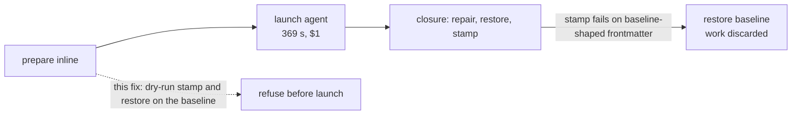

# Indented frontmatter: repair it, refuse it clearly, and refuse it before the agent runs

`claudine inline-compose` ran a research prompt to completion (369 s, about
$1, 38 tool calls), then discarded the agent's work at the closure:

```text
✓ Claude agent completed successfully
 malformed stored hash property: Cannot edit frontmatter text safely: rewritten
 frontmatter did not parse: Cannot edit frontmatter text safely: frontmatter YAML
 could not be parsed: deserializing from YAML containing more than one document
 is not supported
```

The document's frontmatter had its root mapping indented by four spaces:

```yaml
---
    prompt: |-
        Your task is to ...
---
```

That is valid YAML, and every reader accepted it. The failure came at the
end, when the closure stamped the managed `hash` property. The document's own
text had caused it, and the agent's edit played no part. Reproduced with a
one-line body:

```sh
md hash --save a.md   # same "more than one document" error
```

The fix spans three packages. Each part is useful alone; together they mean
an indented root is normalized by `md clean`, reported clearly by every text
edit that cannot handle it, and refused by `inline-compose` before any agent
time is spent.

## Root cause

Darkmatter's [frontmatter text-edit layer](../../../darkmatter/lib/src/markdown/hash/write.rs)
assumes every top-level key starts at column 0:

- `locate_node` and `locate_all_nodes` skip any line that starts with
  whitespace. For an indented root they see **no keys at all**.
- `apply_hash_save_text` therefore finds no `hash` node and inserts
  `hash: …` at column 0 at the end of the block. A column-0 key after a
  mapping that opened at column 4 is not a continuation of that mapping, and
  `serde_yaml_ng` reports it as a second document. The post-edit `validated`
  check fails with a message that points nowhere near the cause.
- `restore_properties_text`, which the closure uses to restore `prompt`,
  `hash`, and `last_updated`, finds no nodes either, so it silently restores
  nothing.
- `validate_block_mapping`, the gate both paths share, accepts the indented
  root because it only checks that the YAML parses to a mapping.

Claudine's [reconcile_inline_artifact_with_evidence](../../../claudine/lib/src/composition/closure.rs),
which validates and persists an agent's edited document, runs that stamp only
after the agent finishes. On failure it calls `restore_inline_baseline`, which correctly
puts the document back, so the user is left with the original file and no
record of the work. The baseline frontmatter is the same before and after the
run, so the failure was predictable at launch.



## Design decisions

### Normalize root indentation with a proven YAML repair

In biscuit-file, add `YamlDiagnosticCode::RootIndentation`, serialized as
`yaml.root-indentation`, to the [diagnostic catalog](../../../biscuit-file/lib/src/yaml/analyze/diagnostic.rs),
including its complete-code inventory and string conversion. Add the repair
through [s1_candidates](../../../biscuit-file/lib/src/yaml/analyze/engine.rs),
which collects whitespace edits for already-parseable YAML. These are called
S1 repairs: they are accepted only if parsing the edited text produces exactly
the original YAML value.

- Limit the new repair to a nonempty block-style root mapping. Root sequences,
  scalar roots, flow-style roots, and empty or comment-only sources produce no
  root-indentation repair. This does not change which YAML forms readers accept.
- For an eligible mapping, calculate the minimum leading ASCII-space count
  across nonblank, non-comment lines. Offer a repair only when this is greater
  than zero and the first content line identifies an ordinary mapping key.
  Leave directives, explicit document markers, and complex-key or tagged-root
  syntax outside this repair's initial scope; do not guess where their root starts.
- Remove that many spaces from each nonblank line that has them, including
  comments. Leave less-indented comments untouched. A whitespace-only line
  inside block-scalar content (`LineKind::BlockContent`) also loses up to that
  many spaces: YAML keeps any spaces beyond the content indent as scalar text,
  so a blank line left at the old content indent would gain spaces once the
  indent shrinks. Leave whitespace-only lines outside block scalars to the
  existing trailing-whitespace repair.
  Preserve key spelling, scalar text, ordering, and comments; do not serialize
  the parsed mapping to generate replacement YAML.
- Represent removals as leading-prefix byte edits, rather than a replacement
  of the entire block. They must coexist with existing line-ending, trailing
  whitespace, and final-newline edits without overlapping. The existing
  combined-edit proof remains authoritative; do not weaken it to retain a repair.
- Reparse the combined edits and require value equality through the existing
  proof machinery. Block scalars, explicit indentation indicators, multiline
  quoted strings, and lines beginning with `#` inside scalar content can make
  naive whitespace removal unsafe. Suppress the repair whenever equality cannot
  be proven; unchanged parsed content is a requirement, not an assumption.

Reader's note: valid indentation is not a YAML syntax error. This is an
intentional formatting normalization so that Darkmatter's text-preserving
editors can work on the document. Review proposed leaving every
whitespace-only line intact to avoid overlapping existing whitespace repairs.
That holds outside block scalars, where the trailing-whitespace repair already
owns those lines; it does not hold inside them, which that repair skips. There,
a blank line at the old content indent changes the scalar's value unless it is
dedented with its neighbors (verified: a `|-` block's blank line left at 8
spaces after a 4-space dedent gains four spaces of content). Without the
dedent, the proof would refuse the repair in the common editor case.

Darkmatter's [repair_frontmatter](../../../darkmatter/lib/src/markdown/cleanup/frontmatter.rs)
already applies analyzer repairs to parseable sources and rescans after a
successful first pass. No separate cleanup dispatch is needed. Verify that
`md clean` and Darkmatter's language-server formatting receive this repair through their shared cleanup
path, including after tab recovery. A second cleanup must make no further
root-indentation edit. Other existing cleanup rules may still change body
formatting or line endings; the new prefix edits themselves preserve terminators.

```text
before                      after md clean
---                         ---
    prompt: |-              prompt: |-
        Your task ...           Your task ...
---                         ---
```

### Reject unsupported indentation before any text edit

Darkmatter's [validate_block_mapping](../../../darkmatter/lib/src/markdown/hash/write.rs)
is the shared shape check for its text-preserving frontmatter editors. Extend
it to reject a parsed block mapping whose first key is indented. Ignore blank
lines and YAML comments when finding that key, retaining the original leading
spaces to calculate its column. Preserve existing errors for invalid YAML and
unsupported root forms, and continue to accept empty/comment-only frontmatter.
Do not mistake a nested value or a comment for the root key.

For the supported repairable case, return `MarkdownError::FrontmatterTextEdit`
with this reason:

```text
frontmatter root mapping is indented by 4 spaces; text-preserving edits require
top-level keys at column 0 (run `md clean --save <file>` to fix)
```

This requirement belongs to the editor, not to YAML generally. The check must
happen before locating or inserting keys, even if the requested operation
would otherwise be a no-op. Cover both the current document and the snapshot
passed to [restore_properties_text](../../../darkmatter/lib/src/markdown/hash/write.rs),
which restores closure-owned values. The same gate already covers
`apply_hash_save_text`, `parse_text_frontmatter`, and `locate_frontmatter_leaves`
in that Darkmatter source file. Audit callers with a text search; GitNexus may
help, but is not a prerequisite. Keep read-only parsing and hash computation
unchanged. Do not broaden this work into support for other unsupported YAML shapes.

Claudine's [repair_agent_frontmatter](../../../claudine/lib/src/composition/closure/persist.rs)
repairs certain agent-authored scalar mistakes; its internal `top_level_nodes`
scanner also expects column-0 keys. A launch check establishes this condition
only for the baseline, not for the later agent candidate. Retain the closure's
Darkmatter validation and rollback: an agent that introduces root indentation
must still fail safely before persistence. Document that limitation accurately;
do not claim preflight guarantees every later edit will succeed.

### Check the captured baseline before composing the inline prompt

In Claudine's [prepare_inline_on](../../../claudine/lib/src/composition/prepare.rs),
validate `source.original_text` before `compose_selecting`, guardrail creation,
or any other preparation work that can execute prompt commands or write files.
The same preparation helper serves ordinary inline runs and previews; neither
should present an uneditable baseline as runnable. Keep existing early grammar
validation ordering where it has no side effects.

Reader's note: the original placement beside the hash capture is too late.
Prompt composition happens earlier and can execute commands. The check belongs
before that work so an unusable baseline is rejected without running its prompt.
This check does not promise that earlier command bootstrap performed no reads
or unrelated setup.

Use a small shared closure helper to rehearse the actual baseline-dependent
operations, keeping closure settings and the managed-property list in one place:

1. Restore `prompt`, `hash`, and `last_updated` from the original into itself
   using Darkmatter's `restore_properties_text` and Claudine's existing
   `CLOSURE_OWNED_PROPERTIES` list.
2. Parse the returned text as Markdown, then call Darkmatter's
   [stamp_baseline](../../../darkmatter/lib/src/markdown/hash/baseline.rs) with that text,
   Claudine's existing `inline_hash_options()`, a caller-supplied timestamp,
   and `Change::Known`, matching an accepted inline closure.
3. Discard all output. Do not invoke reconciliation itself: it writes the file.

Return a dedicated `CompositionError::InlineBaselineUnstampable { path, source }`
with a typed Darkmatter cause, a launch-appropriate explanation, and the source
path. Existing closure errors describe malformed hashes or post-agent edits and
would obscure the launch failure. Integrate the new error with Claudine's
existing diagnostic rendering and typed-cause conventions, including relevant
exhaustive matches; do not flatten the cause into a string.

Run this check each time inline preparation captures a baseline, including
re-entry after a retry or proxy when it uses this path. Do not add it to ordinary
`compose` or `sequence` documents that do not use inline closure. Successful
preflight does not protect against subsequent file changes or agent edits;
existing closure validation and rollback remain necessary.

The check performs no file writes or command execution. It scans and parses
the document several times and computes a hash through the existing stamping
path; it is not just two YAML parses. Its work is bounded by document size and
occurs once per inline preparation. No performance spike or benchmark suite is
required for this fix.

## Out of scope

- **Keeping the agent's candidate when the closure fails** (for example, a
  sidecar file next to the document). This would also cover failures the
  agent itself causes, and it changes rollback behavior, so it gets its own fix.
- Teaching the text-edit layer to edit indented roots in place (rejected above).

## Success criteria

- `md clean --save` on the frontmatter above produces column-0 keys and an
  unchanged parsed value. Darkmatter's language-server formatting offers the same edit.
- `md hash --save` on an indented-root document fails with the editor-specific indentation message,
  not "more than one document". The file is unchanged.
- `claudine inline-compose` on an indented-root document fails during
  preparation with the indentation reason, and the stub provider is **never launched**.
- After `md clean --save`, the same `inline-compose` run completes and stamps
  `hash` at column 0.

## Tests

| Package | Test | Tier |
| --- | --- | --- |
| biscuit-file | `root_indentation` analyzer tests beside `tab_indentation.rs`: common indent removed; block scalar value preserved; column-0 roots yield no candidate; less-indented comments; whitespace-only lines inside a block scalar at, below, and above the content indent (value preserved) and outside one (left to trailing-whitespace); LF/CRLF prefix edits preserve terminators; empty, sequence, scalar, flow, and unsupported root forms yield no candidate; combined whitespace edits remain applicable and parse-equivalent | L1 |
| biscuit-file | Scalar safety cases: literal/folded blocks, explicit indentation indicators, blank scalar lines, multiline quoted values, and scalar content beginning with `#`; either preserve the exact value or offer no repair; diagnostic serialization and full-code inventory stay consistent | L1 |
| darkmatter | `apply_hash_save_text` and `restore_properties_text` on an indented root return `FrontmatterTextEdit` with the indentation reason and leave text untouched; test indentation in either restore input, comments before keys, and empty/comment-only accepted roots; leaf location returns the same cause | L1 |
| darkmatter | `md clean --save` end-to-end on the reproduction frontmatter, then `md hash --save` succeeds (persisted read/write/read round trip) | L1 (CLI via `CliProcessFixture`) |
| claudine | `inline-compose` on an indented-root document exits non-zero during preparation; a cross-platform recording provider fixture records **zero** launches; the document is byte-identical | L1 (CLI via `CliProcessFixture`) |
| darkmatter / DMLS | Shared cleanup and formatter paths normalize the root, preserve the YAML value, and are stable on a second pass; combine indentation with existing whitespace repairs and tab recovery | L1 |
| claudine | Early refusal precedes a recording prompt-command stub; no prompt command runs and no guardrail file is created. Assert source path and typed cause. Use fixed timestamps in helper tests | L1 |
| claudine | A column-0 baseline followed by an agent-indented candidate is refused at closure and restores the original bytes | L1 |
| claudine | the existing inline closure tests still pass with a column-0 baseline (no behavior change on the happy path) | L1 |

Use each package's existing hermetic CLI fixtures. Claudine's Unix-only
`launch_recorder` is insufficient as the sole regression check: use its
cross-platform provider-stub pattern for the launch marker. Keep audio silent,
use temporary homes and directories, and never open or focus a terminal or
browser. These are L1 checks; no live provider, L2/L3 run, new CI matrix, or
performance gate is needed.

## Open Questions

None. Remaining choices are implementation details within the safety and
scope constraints above.

## Documentation

- `darkmatter/docs/` cleanup topic page and `.claude/skills/darkmatter/cleanup.md`:
  the new `yaml.root-indentation` repair.
- biscuit-file YAML analyzer docs: the new diagnostic code alongside
  `yaml.tab-indentation`.
- `claudine/docs/topics/composition.md` (inline-compose): the launch-time
  frontmatter check and its error.
