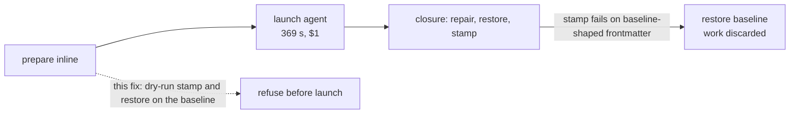

# Indented frontmatter: repair it, refuse it clearly, and refuse it before the agent runs

`claudine inline-compose` ran a research prompt to completion (369 s, about
$1, 38 tool calls), then discarded the agent's work at the closure:

```text
✓ Claude agent completed successfully
 malformed stored hash property: Cannot edit frontmatter text safely: rewritten
 frontmatter did not parse: Cannot edit frontmatter text safely: frontmatter YAML
 could not be parsed: deserializing from YAML containing more than one document
 is not supported
```

The document's frontmatter had its root mapping indented by four spaces:

```yaml
---
    prompt: |-
        Your task is to ...
---
```

That is valid YAML, and every reader accepted it. The failure came at the
end, when the closure stamped the managed `hash` property. The document's own
text had caused it, and the agent's edit played no part. Reproduced with a
one-line body:

```sh
md hash --save a.md   # same "more than one document" error
```

The fix spans three packages. Each part is useful alone; together they mean
an indented root is normalized by `md clean`, reported clearly by every text
edit that cannot handle it, and refused by `inline-compose` before any agent
time is spent.

## Root cause

Darkmatter's frontmatter text-edit layer (`darkmatter/lib/src/markdown/hash/write.rs`)
assumes every top-level key starts at column 0:

- `locate_node` and `locate_all_nodes` skip any line that starts with
  whitespace. For an indented root they see **no keys at all**.
- `apply_hash_save_text` therefore finds no `hash` node and inserts
  `hash: …` at column 0 at the end of the block. A column-0 key after a
  mapping that opened at column 4 is not a continuation of that mapping, and
  `serde_yaml_ng` reports it as a second document. The post-edit `validated`
  check fails with a message that points nowhere near the cause.
- `restore_properties_text`, which the closure uses to restore `prompt`,
  `hash`, and `last_updated`, finds no nodes either, so it silently restores
  nothing.
- `validate_block_mapping`, the gate both paths share, accepts the indented
  root because it only checks that the YAML parses to a mapping.

Claudine (`claudine/lib/src/composition/closure.rs`,
`reconcile_inline_artifact_with_evidence`) runs that stamp only after the
agent finishes. On failure it calls `restore_inline_baseline`, which correctly
puts the document back, so the user is left with the original file and no
record of the work. The baseline frontmatter is the same before and after the
run, so the failure was predictable at launch.



## Decisions

### D1. biscuit-file: a `yaml.root-indentation` repair

Add a parse-equivalent (S1) candidate to biscuit-file's YAML analyzer
(`biscuit-file/lib/src/yaml/analyze/engine.rs`, `s1_candidates`), a sibling of
the existing `yaml.tab-indentation` recovery:

- **Trigger:** the source parses, and every non-blank, non-comment line shares
  a common leading-space indent greater than zero. The first such line is the
  root's first key.
- **Repair:** remove that common indent from every line that has it. Blank
  lines with only whitespace lose up to that many spaces. Comment lines that
  are indented less than the common indent are left as they are.
- **Proof:** the standard S1 rule. The repair is attached only when the patched
  source reparses to a `serde_yaml_ng::Value` equal to the original's. Block
  scalars keep their content, since YAML strips their indentation relative to
  the parent key, so moving key and content together leaves the value
  unchanged.
- **Code:** a new `YamlDiagnosticCode::RootIndentation`, serialized as
  `yaml.root-indentation`.

Darkmatter's `cleanup::frontmatter::repair_frontmatter` applies analyzer
repairs, so `md clean` and DMLS formatting pick this up with no further
wiring. Confirm during implementation that S1 repairs reach that path for a
document that parses; if they are report-only there, wire this code in
alongside the others `repair_frontmatter` already applies.

```text
before                      after md clean
---                         ---
    prompt: |-              prompt: |-
        Your task ...           Your task ...
---                         ---
```

### D2. darkmatter: refuse an indented root before editing

The text-edit layer does not learn to edit indented roots. D1 makes the shape
transient, and supporting it would add a second indentation model to every
locate and insert routine. Instead:

- `validate_block_mapping` refuses a root whose first key line is indented,
  with a message that names the cause and the remedy:

  ```text
  frontmatter root mapping is indented by 4 spaces; top-level keys must
  start at column 0 (run `md clean --save` to fix)
  ```

- Every caller is covered through the shared gate: `apply_hash_save_text`
  (and so `md hash --save` and the inline stamp), `parse_text_frontmatter`
  (and so `restore_properties_text`), and `locate_frontmatter_leaves` if it
  does not already go through the gate. Verify the full caller set with
  GitNexus `impact` on `validate_block_mapping` and `locate_all_nodes`.
- The error stays `MarkdownError::FrontmatterTextEdit`. No new variant is
  needed; the improvement is the reason text.
- The claudine closure's `repair_agent_frontmatter` (`top_level_nodes`) has the
  same column-0 assumption; it is reached only after D3's preflight has
  passed, so it needs no separate change. Note this in its doc comment.

### D3. claudine: dry-run the closure's frontmatter edits before launch

When `prepare` builds the `InlineClosurePlan` (`claudine/lib/src/composition/prepare.rs`,
next to the `original_hash` capture), run the two baseline-dependent closure
edits against `source.original_text` and discard their output:

1. `restore_properties_text(original, original, CLOSURE_OWNED_PROPERTIES)`
2. `stamp_baseline(original, &inline_hash_options(), now, Change::Known)`

If either fails, preparation fails with a typed `CompositionError` before
any provider is launched (no agent process, no cost), naming the document and
carrying the darkmatter reason from D2. Reuse `InlineArtifactEditFailed` /
`InlineHashMalformed` if their rendered text reads correctly at launch time;
otherwise add one `InlineBaselineUnstampable { path, source }` variant.

This dry-runs the real closure code, not an indentation check. Any present or
future failure that depends only on the baseline text, not on the agent's
edit, is caught at launch by the same path.

The check is in-memory, with no file write. Its cost is two frontmatter parses.

## Out of scope

- **Keeping the agent's candidate when the closure fails** (for example, a
  sidecar file next to the document). This would also cover failures the
  agent itself causes, and it changes rollback behavior, so it gets its own fix.
- Teaching the text-edit layer to edit indented roots in place (rejected in D2).

## Success criteria

- `md clean --save` on the frontmatter above produces column-0 keys and an
  unchanged parsed value. DMLS formatting offers the same edit.
- `md hash --save` on an indented-root document fails with the D2 message,
  not "more than one document". The file is unchanged.
- `claudine inline-compose` on an indented-root document fails during
  preparation with the D2 reason, and the stub provider is **never launched**.
- After `md clean --save`, the same `inline-compose` run completes and stamps
  `hash` at column 0.

## Tests

| Package | Test | Tier |
| --- | --- | --- |
| biscuit-file | `root_indentation` analyzer tests beside `tab_indentation.rs`: common indent removed; block scalar value preserved; mixed indent (no common indent) yields no candidate; an indented comment above the root; CRLF terminators kept; already column-0 yields no diagnostic | L1 |
| darkmatter | `apply_hash_save_text` and `restore_properties_text` on an indented root return `FrontmatterTextEdit` with the indentation reason and leave text untouched | L1 |
| darkmatter | `md clean --save` end-to-end on the reproduction frontmatter, then `md hash --save` succeeds (persisted read/write/read round trip) | L1 (CLI via `CliProcessFixture`) |
| claudine | `inline-compose` on an indented-root document exits non-zero during preparation; `launch_recorder` records **zero** launches; the document is byte-identical | L1 (CLI via `CliProcessFixture`) |
| claudine | the existing inline closure tests still pass with a column-0 baseline (no behavior change on the happy path) | L1 |

## Documentation

- `darkmatter/docs/` cleanup topic page and `.claude/skills/darkmatter/cleanup.md`:
  the new `yaml.root-indentation` repair.
- biscuit-file YAML analyzer docs: the new diagnostic code alongside
  `yaml.tab-indentation`.
- `claudine/docs/topics/composition.md` (inline-compose): the launch-time
  frontmatter check and its error.
