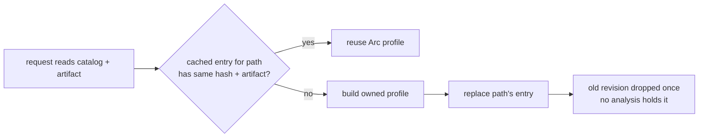

# Pipeline review: fix now

The `2026-10-25-pipeline-improvements` review left 39 open findings. Most are
unmeasured performance ideas and wait for measurement. This fix takes the
seven that are real resource defects, or that cost almost nothing to fix, and
closes them now:

| # | Finding | Package | Class |
| - | ------- | ------- | ----- |
| 1 | Dynamically loaded lifecycle profiles and host catalogs are leaked | `darkmatter`, `dmls` | memory leak |
| 2 | Lifecycle-host discovery reads every candidate on every request | `darkmatter`, `dmls` | repeated I/O |
| 3 | ElevenLabs cache publication blocks async executor workers | `biscuit-speaks` | blocking I/O in async |
| 4 | Refined call-type validators are cached without eviction | `darkmatter` | unbounded cache |
| 5 | Named-type loading parses each YAML document twice | `darkmatter` | redundant work |
| 6 | `map_bodies` clones the body it replaces | `darkmatter` | redundant work |
| 7 | Runtime blacklist checks also read and parse the whitelist | `claudine` | redundant I/O |

Two rules come out of this fix and apply to every later change in these
areas:

- **No `Box::leak` on a path that loads data at runtime.** Leaking is
  acceptable only for compiled, process-lifetime catalogs built once behind a
  `LazyLock`. Data read from disk, whose content can change while a process
  runs, is owned and reclaimable.
- **A process-wide cache keyed by file revision keeps the latest revision per
  path, or is bounded.** A cache that keeps every revision it has ever seen is
  a leak with extra steps.

## 1. Reclaimable host lifecycle profiles and host catalogs

### Today

Three places leak memory every time DMLS reads a host catalog from disk:

| Site | What leaks | How often |
| ---- | ---------- | --------- |
| `schemas/catalog.rs::host_lifecycle_profiles` | the whole `GlobalCatalog` (`Box::leak(Box::new(catalog))`) | once per new cache key, including when the artifact is then absent, stale, or invalid |
| `lifecycle/host_profile.rs` (`read`) | each `host_globals` name and the `ignore_unprovided` verb list | once per profile rebuild |
| `schemas/catalog.rs::GlobalCatalog::from_host_file` | each declared `$schema` requirement name | **on every call** |

The third site is worse than the review recorded. `host_catalogs` calls
`from_host_file` with no cache, and DMLS calls `host_catalogs` from
completion, hover, and diagnostics (`dmls/src/providers/dsl.rs`,
`dmls/src/providers/frontmatter.rs`). Every one of those requests leaks every
host global name in every host catalog under the document's schema roots. The
comment above the leak ("a discovered catalog is loaded once per editor
preparation") is wrong.

On top of the leaks, the `host_lifecycle_profiles` cache is keyed by `(path,
catalog hash, artifact)` and never evicts anything. Each saved edit to a
catalog or its `<stem>.lifecycle.json` adds one more retained revision.

The leaks exist only to meet these `'static` interfaces:

- `GlobalRequirement { name: &'static str, same_as: Option<&'static str> }`
- `EventRegistry::declare_host_global(&mut self, name: &'static str)`
- `EventRegistry::register_global_catalog(&mut self, catalog: &'static GlobalCatalog)`
- `UnknownVerbPolicy::IgnoreUnprovided(&'static [&'static str])`
- `HostLifecycleProfile::from_artifact(catalog: &'static GlobalCatalog, …)`

### Required behavior

- Data loaded from disk is owned by the value that uses it. A
  `HostLifecycleProfile` owns, through shared ownership, its registry and that
  registry's `GlobalCatalog`, host-global names, and unknown-verb list.
  Dropping the last `Arc<HostLifecycleProfile>` releases all of it.
- `from_host_file` leaks nothing. Requirement names it derives from the file
  are owned by the requirement list.
- Compiled hosts keep writing registrations as they do today. A
  `const`-constructed `GlobalRequirement::shape("…")`, a `&'static` verb slice
  such as `md_host`'s `UNPROVIDED_VERBS`, and a process-lifetime catalog all
  remain one-line registrations. The intended shape is `Cow<'static, str>`
  (or `Arc<str>`) for names and `Arc<GlobalCatalog>` for catalogs, with
  `From` conversions from the static forms. The plan picks the exact types.
- The profile cache keeps **only the latest revision per catalog path**. A
  lookup whose catalog hash or artifact differs from the cached entry replaces
  it. A failed load is cached the same way, so a broken artifact is not
  re-validated on every request. Once its revision is replaced, the failure is
  gone too.
- An analysis that already holds an `Arc<HostLifecycleProfile>` finishes with
  that profile, even if the cache replaces it in the meantime.
- Validation is unchanged. Exact catalog and artifact checks, shadowing by
  earlier schema roots, and the reasons reported for an untrusted artifact
  stay as they are.

### Why latest-per-path rather than a bounded LRU

An editor alternates between revisions of one file only by undo. Reparsing
that case is cheap. A latest-per-path map has no capacity to tune, and it
cannot evict a live file's profile because some other file was edited. The
number of entries is bounded by the number of host catalog files actually
present in the schema roots the process has visited.

### Comment drift to correct in the same change

- `host_lifecycle_profiles` doc: "the catalog is leaked once per distinct key."
- `from_host_file`: "a discovered catalog is loaded once per editor
  preparation, so its few names are leaked."

## 2. Stop lifecycle-host discovery at the first usable profile

### Today

`LifecycleHost::for_document` (`dmls/src/overlay/event_views.rs`) uses the
first profile that loads, and keeps the failure reasons only when none does.
But `host_lifecycle_profiles` first builds a complete `Vec`. It reads and
classifies every remaining candidate file and companion artifact after the
winner, and the editor then discards them. Frontmatter diagnostics
(`diagnostics/frontmatter.rs`) and the DSL incomplete-profile diagnostic
(`providers/dsl.rs`) each call `for_document` separately within one
diagnostics pass.

### Required behavior

- Discovery is lazy. Candidates are visited in the existing order, with the
  existing shadowing, and visiting stops at the first usable profile. The plan
  decides the form: an iterator, or a dedicated "first profile or every
  reason" function.
- When no profile is usable, the reasons from every candidate are still
  reported, exactly as `incomplete()` reports them today.
- Within one diagnostics pass, the `LifecycleHost` is discovered once and
  passed to the frontmatter and DSL checks. Separate editor requests still
  discover fresh, so repairing an artifact removes its warning on the next
  request.
- No request-scoped or session-scoped cache is added to `DocumentContext`.
  That larger design is deferred until measurements justify it.

## 3. ElevenLabs cache publication off the async executor

### Today

`ElevenLabsProvider` (`biscuit-speaks/lib/src/providers/cloud/elevenlabs.rs`)
calls the synchronous `audio_cache::write_atomic` from inside `async fn`s:

- `generate_to_cache` publishes the complete synthesized audio after a cache
  miss.
- `select_and_record` publishes the default-voice record through
  `snapshot::write`, even when the audio is already cached.

`write_atomic` creates directories, writes a temporary file, calls
`sync_all`, and renames. It now owns its temporary file through `tempfile`, so
every error path already cleans up. All of that runs on the executor worker
that polls the future. Claudine's pre-warm and the `biscuit-speaks` CLI both
drive these futures.

### Required behavior

- Both publications run on Tokio's blocking pool through
  `tokio::task::spawn_blocking`. The closure takes ownership of the
  destination path and the audio buffer, which is moved, not copied.
- The awaiting future reports success only after the closure finishes.
- Error policy is unchanged:
  - an audio publication failure (including a panic, surfaced as a
    `JoinError`) fails preparation as `TtsError::TempFileError`;
  - a voice-record failure is logged at `warn` and never returned.
- Durability is unchanged: `sync_all` and atomic rename stay.
- Cancellation: dropping the awaiting future does not cancel a running
  closure. That is safe, because the closure owns the temporary file, so it
  either publishes a complete file or removes its staging file.
- `biscuit-speaks` adds the `rt` feature to its `tokio` dependency.
  The crate already requires a Tokio runtime, because it uses `tokio::fs` and
  `tokio::process`.

The small synchronous `exists()` probe in `cache_exists` stays as it is.

### Why `spawn_blocking` rather than `tokio::fs`

`tokio::fs` runs each operation on the blocking pool anyway. Splitting the
publication across several awaits would add cancellation points in the middle
of an atomic publish, and the guard ownership would have to be re-proven.
Moving the whole existing, tested operation is smaller and keeps one
implementation of atomic publication.

## 4. Bounded validator cache for refined call types

### Today

`compose/expression/call_binding/translate.rs::format_assertion` keeps a
process-wide `Mutex<HashMap<String, Arc<jsonschema::Validator>>>` keyed by the
serialized fragment, and never evicts anything. Each distinct refined
signature (for example an editor extension rebuilding constrained URL
signatures) adds a validator for the life of the process. `schemas/validate.rs`
already provides `ValidatorCache::structural_validator_for`: it is bounded and
content-hashed, and it builds through the same `build_structural_validator`.
Other modules already keep a module-local `LazyLock<ValidatorCache>` (for
example `completion.rs`, `coerce.rs`, `example.rs`).

### Required behavior

- `format_assertion` obtains validators from a module-local
  `LazyLock<ValidatorCache>` through `structural_validator_for`. The private
  `HashMap` memo is removed.
- An `Assertion` keeps its own `Arc<Validator>`, so evicting the cache entry
  never changes how an existing signature judges a value.
- Validators are built exactly as today: file values are judged by syntax
  alone, and custom format registration applies.
- The `format_assertion` doc comment ("built once per distinct fragment for
  the process") is updated to describe the bounded cache.

## 5. One YAML parse per named-type load

### Today

`schemas/resolve.rs::named_types_from_text` parses the whole document with
`serde_yaml_ng::from_str::<YamlValue>` only to produce a syntax error. It then
calls `parse_standalone_schema_document`, which parses it again through
`numeric::load_admitted_yaml`. The classifier already maps a syntax failure to
`SchemaError::SchemaDocument { message: "not valid YAML: …" }`. The comment
justifying the first parse ("The classifier declines unparseable YAML") is
stale.

### Required behavior

- The preliminary parse and its comment are removed. The classifier is the
  only authority on whether an import target is valid YAML.
- An unparseable import target still fails with `SchemaError::SchemaDocument`
  whose message starts with `not valid YAML`. For example, importing a file
  containing `kind: schema` and `types: [` still produces that error.
- A document that fails *numeric admission* now reports the classifier's
  admission message. Previously it reported serde's raw message. This is an
  intentional improvement, because the strict loader reports the same file
  the same way.
- Ordinary YAML that is not a schema still yields
  `SchemaError::AmbiguousReferenced`.

## 6. `map_bodies` does not clone the body it replaces

`schemas/simplified/definitions.rs::DefinitionTable::map_bodies` builds
`Definition { body: project(&definition.body), ..definition.clone() }`. The
`..definition.clone()` clones the whole `Definition`, including the body that
`body:` immediately replaces.

### Required behavior

- Construct the definition field by field: the projected body, plus clones of
  `origin` and `json_key`. If `Definition` gains a field later, the compiler
  flags this site.
- `DefKey` identity, allocation order, origins, and `by_json_key` are
  unchanged.

## 7. Runtime blacklist checks read only the blacklist

### Today

`claudine/lib/src/harness/shell.rs::user_blacklist` builds a full
`ShellApprovalOptions`, calls `SessionPolicy::load`, and keeps only
`policy.blacklist`. `SessionPolicy::load` reads and parses the whitelist too,
through `store::load_ruleset`, which emits a `tracing::warn!` for every
skipped line. Structured lifecycle dispatch and sequence template preparation
call `user_blacklist` before every filled command. So a large or malformed
whitelist adds file reads, parsing, and repeated warnings to each runtime
check.

### Required behavior

- `user_blacklist` derives the policy paths with the same `policy_paths_at`
  that `SessionPolicy::load` uses, and loads only the blacklist file. Path
  derivation and the per-file load rule are shared helpers, not a second
  interpretation of policy roots.
- The results are unchanged:
  - no policy root gives an empty set;
  - a root whose paths cannot be derived gives an empty set;
  - a missing or unreadable blacklist gives an empty set;
  - the built-in blacklist still applies in every case.
- The blacklist is still read fresh before every dispatch. Nothing is cached.
- `SessionPolicy::load` still reads both files for approval decisions.

## Out of scope

- **Leaked host *function* catalogs.** `HostFunctionCatalog::load` goes through
  `expression/catalog::load_catalog`, which leaks descriptors to satisfy
  `FunctionCatalog`'s public `&'static` fields, and `host_function_catalogs`
  caches every revision. This is the same class of defect, but fixing it
  changes the descriptor API that `md schema about`, DMLS, and lifecycle verb
  parsing read. It is handled by `2026-10-25-host-function-catalog-leak`,
  which follows rule 1 above.
- The other 32 open findings in `2026-10-25-pipeline-improvements`, including
  the `prep` group-target decision, which needs an author decision.
- A request- or session-scoped discovery cache in DMLS (§2).
- Async versions of `cache_exists` or any other `biscuit-speaks` provider
  path (§3).

## Implementation surfaces

| Item | Files |
| ---- | ----- |
| 1 | `darkmatter/lib/src/markdown/schemas/catalog.rs`, `darkmatter/lib/src/lifecycle/host_profile.rs`, `darkmatter/lib/src/lifecycle/registry.rs`, `darkmatter/lib/src/lifecycle/parse.rs` (`UnknownVerbPolicy`), compiled-host registrations in `darkmatter` and `claudine` |
| 2 | `darkmatter/lib/src/markdown/schemas/catalog.rs`, `darkmatter/dmls/src/overlay/event_views.rs`, `darkmatter/dmls/src/diagnostics/frontmatter.rs`, `darkmatter/dmls/src/providers/dsl.rs` |
| 3 | `biscuit-speaks/lib/src/providers/cloud/elevenlabs.rs`, `…/elevenlabs/snapshot.rs`, `biscuit-speaks/lib/Cargo.toml` |
| 4 | `darkmatter/lib/src/markdown/compose/expression/call_binding/translate.rs` |
| 5 | `darkmatter/lib/src/markdown/schemas/resolve.rs` |
| 6 | `darkmatter/lib/src/markdown/schemas/simplified/definitions.rs` |
| 7 | `claudine/lib/src/harness/shell.rs` |

The seven items do not depend on each other and can be done in parallel.
Item 2 touches the same discovery function as item 1, so they go together.

## Documentation

- `darkmatter/docs/topics/lifecycle/host-artifact.md` and
  `darkmatter/dmls/docs/diagnostics.md`: describe the profile cache's lifetime
  (latest revision per catalog path, reclaimed when replaced) and the
  first-usable-profile discovery. Remove any statement that a loaded profile
  or catalog lives for the rest of the process.
- `biscuit-speaks/docs/tts-caching.md`: state that ElevenLabs publication runs
  on the blocking pool, and describe what dropping the awaiting future does.
- `claudine/docs/topics/pre-flight-checks.md`, or whichever canonical page
  describes the runtime blacklist check: state that only the blacklist is read
  and that it is read fresh per dispatch.
- `darkmatter/docs/dependencies.md` and `biscuit-speaks/docs/dependencies.md`
  if adding the `tokio` `rt` feature is recorded there.
- The `darkmatter` and `claudine` skills, if either describes the leaked
  lifetimes.

## Acceptance and verification

Each item has an L1 regression that fails before the change and passes after
it, except item 6, which does not change behavior.

1. **Reclaim.** Load a host catalog plus a valid lifecycle artifact, keep a
   `Weak` to the profile and to its catalog, then rewrite the artifact (and
   separately the catalog) and discover again. After the caller drops its
   `Arc`, both `Weak`s fail to upgrade. A second test does the same for a
   revision whose artifact is invalid. A third test holds the old `Arc`
   across the replacement and checks that it still analyzes with the old
   profile.
2. **`from_host_file` leaks nothing.** This is covered by (1) and by the type
   change. A source check that `Box::leak` remains only in compiled-catalog
   sites (`expression/catalog/mod.rs` built-in path, `context/catalog.rs`,
   test fixtures) is part of review, not a test.
3. **Early stop.** With two host catalogs where the first has a usable
   profile, discovery does not read the second catalog's artifact. Prove it
   with a work-count probe or with an unreadable second artifact whose reason
   never appears. With no usable profile, every reason is still reported in
   order.
4. **Off the executor.** On a `current_thread` runtime, a test seam makes the
   publication closure wait on a signal that only another task on the same
   runtime sends. Publication completes, and the test is bounded by a
   timeout. Run inline on the worker, it would deadlock, so the test is
   deterministic and does not depend on timing. Existing audio-failure,
   record-failure-logged, and staging-cleanup tests still pass.
5. **Bounded and stable.** With a `ValidatorCache` of capacity 1, build an
   assertion for fragment A, then for fragment B, which evicts A. Assertion A
   still accepts and rejects exactly as before.
6. **One parse.** An import of `types: [` yields `SchemaDocument` with a
   `not valid YAML` message at the library level. Existing DMLS
   (`named_type_references.rs`) and CLI (`schema_triggers.rs`) assertions
   still pass.
7. **Blacklist only.** Blacklist rules are still enforced, and the no-root,
   underivable-root, and missing-file cases are unchanged. A whitelist with a
   skipped line emits no policy-line warning during a runtime blacklist check.
8. `just test` and `just lint` pass in `darkmatter/`, `claudine/`, and
   `biscuit-speaks/`, including DMLS L1. No test exceeds five seconds. The
   changes involve no OS-specific paths beyond the existing `tempfile`
   publication, which already runs on Windows.
